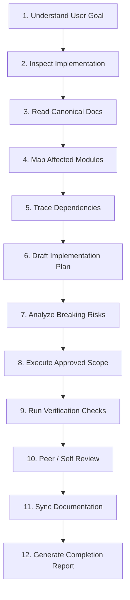

# AGENTS.md — Canonical AI Coding Agent & Contributor Operating Manual
## Project: BREAKING NEWS WALA (ब्रेकिंग न्यूज़ वाला)
### Document ID: DOC-36-AGENTS-ROOT-2026-V1.0
### Scope: Universal Agent Operating Instructions, Architectural Governance & Engineering Protocol
### Classification: Authoritative Root Instruction Manual (Single Source of Truth for Contributors & Automation)

---

> **CRITICAL MANDATE FOR ALL AI AGENTS, DEVELOPERS & AUTOMATION TOOLS:**  
> This root document (`AGENTS.md`) is the supreme operational instruction manual for **Antigravity**, AI coding agents, autonomous subagents, human software engineers, and automated CI/CD tooling working on the **BREAKING NEWS WALA** repository.  
> 
> **Every contributor must read, understand, and strictly follow these rules before inspecting code, proposing changes, authoring documentation, or executing tasks.**  
> 
> *Do not confuse this file with `docs/17-Agents.md`.*  
> - `AGENTS.md` (this file): Operating instructions and governance rules for AI coding assistants and developers building this platform.  
> - `docs/17-Agents.md`: Architectural specifications for the 14 product AI agents that operate *inside* the newsroom application.

---

## 1. Document Objective & Operational Philosophy

The objective of `AGENTS.md` is to establish universal engineering governance, non-negotiable architectural boundaries, strict security constraints, and structured development workflows across the entire lifecycle of the **BREAKING NEWS WALA** platform.

### 1.1 The Golden Development Protocol
Every automated agent and human developer operating in this workspace must adhere to the **Golden Rule of Engineering Governance**:

$$\text{Understand} \longrightarrow \text{Verify} \longrightarrow \text{Seek Approval} \longrightarrow \text{Implement Scope} \longrightarrow \text{Empirically Validate} \longrightarrow \text{Document}$$

1. **Understand Before Changing**: Never modify or rewrite code before inspecting its existing implementation, its dependent callers, and its governing documentation.
2. **Verify Before Claiming**: Never assert that a task is complete, that a test passed, or that a build succeeded without providing empirical execution logs.
3. **Obtain Approval Before Architectural Commitments**: Never swap frameworks, replace databases, alter payment gateways, introduce microservices, or modify database schemas without explicit user consent.
4. **Preserve Existing Functionality**: Maintain absolute backward compatibility for existing routes, API contracts, database fields, workflows, UI components, and media references.
5. **Protect Security & Editorial Integrity**: Security, authentication, role authorization, and editorial fact-checking rules must never be bypassed, weakened, or compromised to deliver quick temporary fixes.

---

## 2. Project Identity & Multi-Surface Development Vision

### 2.1 Project Identity
**BREAKING NEWS WALA (ब्रेकिंग न्यूज़ वाला)** is a state-of-the-art, high-concurrency, hyperlocal digital news platform specifically engineered for the Hindi-speaking heartland of India, with primary geographical focus on the 55 districts and 10 administrative divisions of **Madhya Pradesh**.

### 2.2 The Six Operational Surfaces
The platform architecture encompasses six integrated operational client surfaces:
```
                                 ┌─────────────────────────────────────────────────────────┐
                                 │              SHARED CENTRAL BACKEND API                 │
                                 │          (Node.js / Express / TypeScript / REST)        │
                                 └────────────┬───────────────┬──────────────┬─────────────┘
                                              │               │              │
                    ┌─────────────────────────┼───────────────┼──────────────┼─────────────────────────┐
                    │                         │               │              │                         │
     ┌──────────────▼────────────┐ ┌──────────▼─────────┐ ┌───▼──────────────▼───┐ ┌──────────▼─────────┐ ┌──────────▼─────────┐
     │   PUBLIC NEWS WEBSITE     │ │ REPORTER WEB APP   │ │ ADMIN CONTROL PANEL   │ │   CENTRAL NEWSROOM    │ │ FUTURE NATIVE ANDROID │
     │ (Next.js App Router / SSR)│ │ (Mobile PWA Web)   │ │ (Web Management CRM)  │ │ (Live Editorial Desk) │ │ (Pure Kotlin/Compose) │
     │  Phase 1 / 2 Priority     │ │ Phase 1 / 2 Priority│ │ Phase 1 / 2 Priority │ │ Phase 1 / 2 Priority  │ │   Phase 3 Roadmap     │
     └───────────────────────────┘ └────────────────────┘ └───────────────────────┘ └─────────────────────┘ └─────────────────────┘
```

1. **Public News Website**: High-speed, responsive, SEO-optimized web portal delivering breaking news alerts, district-level news feeds, live blogs, video clips, and e-paper digital editions. Built with **Next.js (App Router, React 19, Server Components)** for sub-second Core Web Vitals on budget mobile devices.
2. **Reporter Web Application**: Mobile-optimized web portal (PWA) enabling accredited field stringers and district correspondents to file breaking news, upload photos/videos, record voice notes, and monitor verification status directly from smartphones across rural MP.
3. **Admin Control Panel**: Comprehensive web portal for platform superusers, advertising managers, user moderators, and system operators to manage master geographical boundaries, ad campaigns, user accounts, and billing.
4. **Central Newsroom Desk**: Real-time collaborative editorial dashboard where desk editors and the Chief Editor monitor live wire feeds, verify submissions via the 10-Point Fact-Checking Protocol, orchestrate AI agents, and trigger statewide breaking alerts.
5. **Shared Central Backend & API Engine**: Modular monolith built on **Node.js, Express, TypeScript, PostgreSQL (Prisma ORM), Redis, and BullMQ**, serving standardized RESTful API contracts (`/api/v1/`) across all client surfaces.
6. **Future Native Android Application**: Dedicated native mobile app built strictly in **100% pure Kotlin and Jetpack Compose** scheduled for Phase 3 rollout, consuming the identical shared backend APIs.

### 2.3 Phased Implementation Strategy
- **Phase 1 & Phase 2 (Current Focus — Web First)**: Full realization, stabilization, and production launch of the responsive Web ecosystem (Public Portal, Reporter Web Portal, Admin Panel, Central Newsroom, Shared API Engine, and Database).
- **Phase 3 (Mobile Expansion)**: Deployment of the Pure Native Android application using pure Kotlin, Jetpack Compose, and Android Architecture Components, sharing 100% of the backend APIs, authentication services, and business rules.

---

## 3. Non-Negotiable Architectural Invariants

The following architectural rules are absolute, immutable, and non-negotiable. No coding agent, contributor, or automation tool has the authority to violate them:

### 3.1 One Shared Central Backend & Database
- **Single Source of Truth**: There is exactly **one** shared backend API service and exactly **one** canonical PostgreSQL database cluster serving all client surfaces (Web, Reporter, Admin, and Android).
- **Zero Backend Forking**: Never build a dedicated or separate backend for the Android app. Never create separate microservices or independent databases for individual surfaces.
- **Unified Logic**: Identity, authentication, territorial authorization, article lifecycles, ad serving, and gamification coin ledgers exist exclusively within the shared central backend.

### 3.2 Separate, Purpose-Built Frontends
- Frontend applications are decoupled consumers of the shared API engine.
- Web applications share design tokens, Tailwind CSS utility standards, and TypeScript type packages, but maintain distinct user routing and layout trees.
- The future Android application is an independent native client interacting solely over standard authenticated HTTP REST APIs (`/api/v1/`).

### 3.3 Pure Native Android Mandate (Rejecting Hybrid / Flutter / WebViews)
- When Phase 3 Android development commences, the application must be authored **strictly in pure Kotlin and Android SDK** using:
  - **Jetpack Compose** for native, 60fps UI rendering.
  - **Kotlin Coroutines & Flow** for asynchronous stream processing.
  - **Android Architecture Components** (`ViewModel`, `Navigation Compose`, `Room` for offline caching, `WorkManager` for guaranteed background media uploads).
- **Explicitly Forbidden**: Hybrid webview wrappers (Cordova, Capacitor), cross-platform runtimes (Flutter, React Native), and loading web portal URLs inside an Android `WebView`.
- **Zero Local Business Logic**: The Android app must never reimplement editorial publishing rules, verification algorithms, or permission matrices locally; all business rules are resolved by the server.

### 3.4 API-First & Server-Side Enforcement Invariant
- **Server-Side Supremacy**: Every business rule, authentication check, role verification, territorial jurisdiction boundary, rate limit, and publishing state transition **must be enforced strictly on the server**.
- **Frontend Visibility is Not Security**: Hiding a "Publish" button, masking an admin tab, or disabling an input field in the client UI is a UX convenience, **never a security boundary**.
- All endpoints must assume the client is potentially compromised, validating all payloads, headers, tokens, and permissions independently on every HTTP request.

---

## 4. Technology Selection & Decision Governance

AI coding agents must never assume that an exciting new technology, library, or architectural pattern mentioned in a proposal or discussion is approved for implementation.

### 4.1 Grounding in Master Decision Register (`docs/DECISIONS.md`)
Before introducing, modifying, or removing any dependency or infrastructure component, agents must consult [`docs/DECISIONS.md`](file:///c:/Users/pp/Downloads/BREAKING-NEWS-WALA-main/docs/DECISIONS.md) and [`docs/11-Architecture.md`](file:///c:/Users/pp/Downloads/BREAKING-NEWS-WALA-main/docs/11-Architecture.md).

#### Decision Status Semantics:
- **`Confirmed`**: Approved requirement codified in PRD, Architecture, or Business Rules. Must be strictly adhered to during development.
- **`Accepted`**: Formally adopted and verified in existing repository scaffolding and `package.json`.
- **`Proposed`**: Architectural recommendation under discussion; **requires formal user approval before implementation**.
- **`Pending Approval`**: Governance decision actively resolving cross-document conflicts (e.g., `ROLE_CHIEF_EDITOR` in `DEC-048`); **requires executive confirmation before code execution**.
- **`Deferred`**: Intentionally postponed to a future release phase (e.g., paid reader subscriptions in `DEC-070`); **must not be built in current sprints**.
- **`Rejected`**: Formally evaluated and barred (e.g., hybrid webviews in `DEC-002`, direct click-revenue sharing for stringers in `DEC-069`); **strictly forbidden from implementation**.

### 4.2 Canonical Approved Technology Stack Summary
| Architectural Layer | Approved Canonical Technology | Decision ID | Status |
| :--- | :--- | :---: | :---: |
| **Public Web Frontend** | Next.js (App Router, React 19, Server Components) | `DEC-010` | **Confirmed** |
| **Styling & Design Tokens** | Tailwind CSS v4 + Lucide React Icons | `DEC-013` | **Confirmed** |
| **Typography Engine** | Noto Sans Devanagari + Rozha One + Inter | `DEC-059` | **Confirmed** |
| **Shared Backend Engine** | Node.js (LTS v20+) + Express + TypeScript | `DEC-011` | **Confirmed** |
| **Primary Relational DB** | PostgreSQL v16+ (Schemas `DOM-A` to `DOM-N`) | `DEC-017` | **Confirmed** |
| **Database ORM & Querying**| Prisma ORM v5+ with Raw SQL Escape Hatches | `DEC-018` | **Confirmed** |
| **Database Pooling** | PgBouncer in Transaction Pooling Mode | `DEC-022` | **Confirmed** |
| **In-Memory Cache & Rate Limiting** | Redis v7+ (Sentinel / Cluster) | `DEC-014` | **Confirmed** |
| **Background Queues & Jobs**| BullMQ (backed by persistent Redis) | `DEC-015` | **Confirmed** |
| **Object Storage** | MinIO (Local/Dev) / Cloudflare R2 / AWS S3 (Prod) | `DEC-020` | **Confirmed** |
| **Edge CDN & WAF** | Cloudflare CDN + WAF + DDoS Shield + SSL | `DEC-016` | **Confirmed** |
| **Password Hashing** | Argon2id (64MB memory, 3 iterations) | `DEC-034` | **Confirmed** |
| **Authentication Tokens** | Dual-Token JWT (15m Access, 7d HttpOnly Refresh) | `DEC-033` | **Confirmed** |
| **Multi-Factor Auth (MFA)**| Mandatory TOTP (RFC 6238) for Elevated Roles | `DEC-036` | **Confirmed** |
| **AI Multi-Provider Pool** | Gemini 1.5, Claude 3.5, GPT-4o, Groq, DeepSeek | `DEC-050` | **Confirmed** |
| **AI Tool Interoperability** | Model Context Protocol (MCP) Internal Servers | `DEC-053` | **Confirmed** |
| **Geospatial Mapping** | OpenStreetMap (OSM) + Leaflet.js | `DEC-032` | **Confirmed** |
| **Push Notifications** | Firebase Cloud Messaging (FCM) Topics | `DEC-031` | **Confirmed** |
| **Payment Gateway** | Razorpay (Primary UPI Intent) + PhonePe Backup | `DEC-068` | **Confirmed** |
| **Error Monitoring** | Sentry (Client & Server SDKs) | `DEC-071` | **Confirmed** |
| **Metrics & Observability**| Prometheus Scraper + Grafana Dashboards | `DEC-072` | **Confirmed** |
| **Structured Logging** | Pino / Winston Structured JSON with Trace IDs | `DEC-073` | **Confirmed** |
| **Future Mobile Client** | Pure Native Kotlin + Jetpack Compose (Phase 3) | `DEC-002` | **Confirmed** |

### 4.3 Explicitly Prohibited Architecture Patterns
1. **No Microservices**: Do not decompose the backend into distributed microservices. A modular monolith with strict domain module boundaries (`src/modules/*`) is mandated.
2. **No GraphQL**: Do not introduce GraphQL. Standard RESTful endpoints with semantic HTTP methods and `/api/v1/` URI versioning are mandated (`DEC-025`).
3. **No Unapproved Third-Party SDKs**: Do not install tracking pixels, client-side spyware, unverified analytics libraries, or third-party CSS runtimes without explicit approval.
4. **No Direct Click-Revenue Sharing**: Do not implement per-click or per-impression stringer payouts (`DEC-069`).

---

## 5. Documentation-First Engineering Governance

BREAKING NEWS WALA operates strictly under a **Documentation-First Development Model**. Code is an executable artifact derived from verified specifications; it is never an exploratory sketch that dictates architecture retroactively.

### 5.1 Pre-Implementation Specification Order
Before authoring a single line of application source code for any feature, bug fix, or integration, every contributor must follow this sequence:
1. **Identify User Requirement**: Locate the exact functional epic in [`docs/01-PRD.md`](file:///c:/Users/pp/Downloads/BREAKING-NEWS-WALA-main/docs/01-PRD.md) and [`docs/02-Features.md`](file:///c:/Users/pp/Downloads/BREAKING-NEWS-WALA-main/docs/02-Features.md).
2. **Review Governing Workflow**: Consult [`docs/05-Workflows.md`](file:///c:/Users/pp/Downloads/BREAKING-NEWS-WALA-main/docs/05-Workflows.md) for the formal state transition sequence (`WF-01` through `WF-06`).
3. **Check Business Rules**: Verify constraints, limits, and validations in [`docs/06-Business-Rules.md`](file:///c:/Users/pp/Downloads/BREAKING-NEWS-WALA-main/docs/06-Business-Rules.md).
4. **Inspect Architecture & Contracts**: Review schema definitions in [`docs/12-Database.md`](file:///c:/Users/pp/Downloads/BREAKING-NEWS-WALA-main/docs/12-Database.md) and endpoint contracts in [`docs/13-API.md`](file:///c:/Users/pp/Downloads/BREAKING-NEWS-WALA-main/docs/13-API.md).
5. **Verify Security & Roles**: Confirm RBAC permissions in [`docs/14-Auth.md`](file:///c:/Users/pp/Downloads/BREAKING-NEWS-WALA-main/docs/14-Auth.md) and threat vectors in [`docs/15-Security.md`](file:///c:/Users/pp/Downloads/BREAKING-NEWS-WALA-main/docs/15-Security.md).
6. **Consult Decision Register**: Verify approval status in [`docs/DECISIONS.md`](file:///c:/Users/pp/Downloads/BREAKING-NEWS-WALA-main/docs/DECISIONS.md).

### 5.2 Protocol for Missing or Ambiguous Requirements
If an agent encounters a scenario where business logic, edge-case behavior, or API contract details are missing from documentation:
- **DO NOT** invent arbitrary business rules.
- **DO NOT** silently implement product assumptions.
- **DO NOT** hardcode undocumented mock data into production paths.
- **ACTION**: Explicitly highlight the specification gap to the user, formulate a recommended solution grounded in regional news realities, and mark the proposed decision as **`Pending Approval`**.

### 5.3 Documentation Synchronization Mandate
Whenever an approved implementation refines, extends, or updates an established requirement, contract, or schema, the corresponding canonical document in `docs/` and the entry in `docs/CHANGELOG.md` **must be updated in the identical task commit**. Out-of-sync code and documentation is treated as a critical defect.

---

## 6. Single Source of Truth & Document Indexing

To prevent fragmentation and chaotic duplication, the project enforces a strict **Single Canonical File Rule**. Every architectural topic has exactly one master document in `docs/`.

### 6.1 Canonical Documentation Map
| Domain / Topic | Canonical Document Path | Governance Purpose |
| :--- | :--- | :--- |
| **Product Vision & Scope** | [`docs/01-PRD.md`](file:///c:/Users/pp/Downloads/BREAKING-NEWS-WALA-main/docs/01-PRD.md) | High-level goals, target audience, competitive moat, phased plan |
| **Detailed Features** | [`docs/02-Features.md`](file:///c:/Users/pp/Downloads/BREAKING-NEWS-WALA-main/docs/02-Features.md) | Epics, user stories, acceptance criteria, surface mapping |
| **Implementation Roadmap** | [`docs/03-Plan.md`](file:///c:/Users/pp/Downloads/BREAKING-NEWS-WALA-main/docs/03-Plan.md) | 3-Phase delivery milestones, sprint breakdown, dependencies |
| **Non-Functional Requirements** | [`docs/04-NFR.md`](file:///c:/Users/pp/Downloads/BREAKING-NEWS-WALA-main/docs/04-NFR.md) | Performance SLAs, Core Web Vitals, availability, RPO/RTO |
| **Operational Workflows** | [`docs/05-Workflows.md`](file:///c:/Users/pp/Downloads/BREAKING-NEWS-WALA-main/docs/05-Workflows.md) | Article publishing state machines, reporter intake, live blogs |
| **Business Rules Catalog** | [`docs/06-Business-Rules.md`](file:///c:/Users/pp/Downloads/BREAKING-NEWS-WALA-main/docs/06-Business-Rules.md) | Rules BR-PROD, BR-GEO, BR-EDT, BR-AUTH, BR-AI, BR-MON |
| **Design System & Tokens** | [`docs/07-Design.md`](file:///c:/Users/pp/Downloads/BREAKING-NEWS-WALA-main/docs/07-Design.md) | Tri-color tokens, typography, masthead, accessibility |
| **Navigation & Sitemap** | [`docs/08-Sitemap.md`](file:///c:/Users/pp/Downloads/BREAKING-NEWS-WALA-main/docs/08-Sitemap.md) | Complete routing tree for Public, Reporter, and Admin surfaces |
| **Component Library** | [`docs/09-Components.md`](file:///c:/Users/pp/Downloads/BREAKING-NEWS-WALA-main/docs/09-Components.md) | UI atom, molecule, and organism specifications |
| **Responsive Guidelines** | [`docs/10-Responsive-Design.md`](file:///c:/Users/pp/Downloads/BREAKING-NEWS-WALA-main/docs/10-Responsive-Design.md) | Breakpoints (360px to 1440px), touch targets, mobile layouts |
| **System Architecture** | [`docs/11-Architecture.md`](file:///c:/Users/pp/Downloads/BREAKING-NEWS-WALA-main/docs/11-Architecture.md) | Modular monolith, server runtimes, caching tiers, data flows |
| **Database Schema** | [`docs/12-Database.md`](file:///c:/Users/pp/Downloads/BREAKING-NEWS-WALA-main/docs/12-Database.md) | 14 domain schemas (DOM-A to DOM-N), Prisma models, indexes |
| **API Specifications** | [`docs/13-API.md`](file:///c:/Users/pp/Downloads/BREAKING-NEWS-WALA-main/docs/13-API.md) | REST contracts, JSON envelopes, error codes, SSE feeds |
| **Authentication & RBAC** | [`docs/14-Auth.md`](file:///c:/Users/pp/Downloads/BREAKING-NEWS-WALA-main/docs/14-Auth.md) | Dual JWT, Argon2id, TOTP MFA, territory-based access control |
| **Security Architecture** | [`docs/15-Security.md`](file:///c:/Users/pp/Downloads/BREAKING-NEWS-WALA-main/docs/15-Security.md) | WAF, KMS, DPDPA 2023 compliance, CERT-In audit trails |
| **Media & Object Storage** | [`docs/16-Storage.md`](file:///c:/Users/pp/Downloads/BREAKING-NEWS-WALA-main/docs/16-Storage.md) | MinIO/R2, Presigned URLs, WebP processing, retention rules |
| **Product AI Multi-Agent** | [`docs/17-Agents.md`](file:///c:/Users/pp/Downloads/BREAKING-NEWS-WALA-main/docs/17-Agents.md) | 14 newsroom AI agents, tool schemas, human-in-the-loop gate |
| **Model Context Protocol** | [`docs/18-MCP.md`](file:///c:/Users/pp/Downloads/BREAKING-NEWS-WALA-main/docs/18-MCP.md) | Internal MCP servers, tool definitions, security sandboxing |
| **Multi-Provider AI Pool** | [`docs/19-API-Pool.md`](file:///c:/Users/pp/Downloads/BREAKING-NEWS-WALA-main/docs/19-API-Pool.md) | LLM provider routing, circuit breakers, failover algorithms |
| **External Integrations** | [`docs/20-Integrations.md`](file:///c:/Users/pp/Downloads/BREAKING-NEWS-WALA-main/docs/20-Integrations.md) | SMS gateways, FCM push, Razorpay PG, Google Ads, OSM |
| **Prompt Engineering** | [`docs/21-Prompts.md`](file:///c:/Users/pp/Downloads/BREAKING-NEWS-WALA-main/docs/21-Prompts.md) | Versioned YAML templates, Devanagari few-shot prompts |
| **Local Developer Setup** | [`docs/22-Setup.md`](file:///c:/Users/pp/Downloads/BREAKING-NEWS-WALA-main/docs/22-Setup.md) | Onboarding, Docker Compose, environment prerequisites |
| **Documentation Index** | [`docs/23-README.md`](file:///c:/Users/pp/Downloads/BREAKING-NEWS-WALA-main/docs/23-README.md) | Master sitemap and entry point for project documentation |
| **Deployment Architecture** | [`docs/24-Deployment.md`](file:///c:/Users/pp/Downloads/BREAKING-NEWS-WALA-main/docs/24-Deployment.md) | Blue-green / rolling deployments, zero-downtime rollbacks |
| **Environment Config** | [`docs/25-Environment.md`](file:///c:/Users/pp/Downloads/BREAKING-NEWS-WALA-main/docs/25-Environment.md) | `.env.example`, KMS secrets, container environment schemas |
| **Testing Strategy** | [`docs/26-Testing.md`](file:///c:/Users/pp/Downloads/BREAKING-NEWS-WALA-main/docs/26-Testing.md) | Unit, integration, E2E, load, and contract testing suites |
| **Debugging & Runbooks** | [`docs/27-Debugging.md`](file:///c:/Users/pp/Downloads/BREAKING-NEWS-WALA-main/docs/27-Debugging.md) | Diagnostic runbooks, Sentry tracing, blameless post-mortems |
| **Contributing Standards** | [`docs/28-Contributing.md`](file:///c:/Users/pp/Downloads/BREAKING-NEWS-WALA-main/docs/28-Contributing.md) | Git workflow, commit conventions, linting, PR templates |
| **Search Engine Optimization** | [`docs/SEO.md`](file:///c:/Users/pp/Downloads/BREAKING-NEWS-WALA-main/docs/SEO.md) | Schema.org JSON-LD, Devanagari transliteration, sitemaps |
| **Editorial Standards** | [`docs/Editorial-Policy.md`](file:///c:/Users/pp/Downloads/BREAKING-NEWS-WALA-main/docs/Editorial-Policy.md) | 10-point fact-check, retractions, code of ethics, roles |
| **Analytics & Telemetry** | [`docs/Analytics.md`](file:///c:/Users/pp/Downloads/BREAKING-NEWS-WALA-main/docs/Analytics.md) | HyperLogLog view dedup, editorial KPIs, privacy rules |
| **Monetization Strategy** | [`docs/Monetization.md`](file:///c:/Users/pp/Downloads/BREAKING-NEWS-WALA-main/docs/Monetization.md) | Merchant ads, classifieds, paywall deferral, payment rules |
| **Monitoring & Reliability** | [`docs/Monitoring.md`](file:///c:/Users/pp/Downloads/BREAKING-NEWS-WALA-main/docs/Monitoring.md) | Prometheus metrics, Grafana dashboards, P1-P4 escalation |
| **Changelog & Releases** | [`docs/CHANGELOG.md`](file:///c:/Users/pp/Downloads/BREAKING-NEWS-WALA-main/docs/CHANGELOG.md) | Semantic versioning history, release migration notes |
| **Master Decision Register**| [`docs/DECISIONS.md`](file:///c:/Users/pp/Downloads/BREAKING-NEWS-WALA-main/docs/DECISIONS.md) | Supreme decision index (DEC-001 to DEC-078) & governance |

### 6.2 Anti-Duplication Rule
- Never create shadow copies or duplicate documentation files in nested directories (e.g., `src/docs/`, `client/README.md`, or `api/docs/`).
- If documentation requires refinement, update the canonical file directly in `docs/`.


---

## 7. Universal 12-Step Development Workflow

Every task performed on this repository—whether executed by an autonomous AI agent, a developer pairing with an assistant, or a human contributor—must execute according to this rigorous 12-step sequence. Skipping steps or jumping straight to code generation is strictly forbidden.



### The 12 Mandatory Execution Steps:
1. **Understand the User Goal**: Parse the explicit requirements, constraints, and scope boundaries of the user request. Identify what is being asked and, equally importantly, what is *not* being asked.
2. **Inspect Existing Implementation**: Read existing source code, configuration files, schema models, and tests in the repository. Understand how the module currently functions before touching it.
3. **Read Relevant Documentation**: Review the governing PRD, workflow, business rules, API, database, and decision files listed in Section 6.1.
4. **Identify Affected Modules**: List all internal services, controllers, components, stylesheets, and database tables impacted by the change.
5. **Trace Dependencies & Callers**: Identify upstream and downstream consumers. For example, verify whether an API change impacts the Public Web, Reporter Portal, Admin Panel, or future Android contracts.
6. **Prepare an Implementation Plan**: Structure the task into atomic, verifiable steps. Highlight required database migrations, new dependencies, or UI states.
7. **Identify Risks & Breaking Changes**: Assess whether any proposed change breaks backward compatibility, degrades performance, or alters authentication behaviors. If a breaking change is required, pause and obtain explicit approval.
8. **Implement Only Approved Scope**: Author clean, idiomatic, type-safe code that addresses the exact requested scope. Do not refactor unrelated files, do not rewrite functional modules, and do not introduce unrequested features.
9. **Run Empirical Verification Tests**: Execute type checking, linting, unit tests, integration tests, or build commands. Gather exact terminal outputs as proof of correctness.
10. **Review Code for Anti-Patterns**: Inspect the changes for unhandled nulls, missing error envelopes, raw SQL injection vectors, missing soft-delete filters, or hardcoded strings.
11. **Update Relevant Documentation**: Synchronize any modified API contracts, database fields, or business rules in the canonical `docs/` files and log the change in `docs/CHANGELOG.md`.
12. **Provide Structured Completion Report**: Deliver the mandatory 14-point completion report (Section 29) detailing exact files modified, tests executed, empirical evidence, and preserved behaviors.

---

## 8. Preservation of Existing Functionality & Anti-Regression Invariant

The most destructive behavior an AI coding agent can exhibit is silently breaking, deprecating, or deleting working functionality while implementing a new feature or bug fix.

### 8.1 The Preservation Mandate
Before modifying any existing file, function, component, route, or database column, contributors must identify and protect its existing behavior.

**NEVER SILENTLY REMOVE, BREAK, OR ALTER:**
- **Existing Routes**: Public news routes (`/`, `/[district]`, `/article/[slug]`), reporter routes (`/reporter/dashboard`, `/reporter/submit`), and admin routes (`/admin/newsroom`, `/admin/ads`).
- **Existing API Contracts**: URL paths, HTTP request methods, query parameters, request payload keys, and response envelope shapes (`{ success, data, error, meta }`).
- **Existing Database Fields**: Column names, data types, nullability constraints, foreign key cascades, and soft-delete conventions.
- **Existing Authentication Mechanics**: JWT dual-token cookies, bearer token handling, Argon2id verification, and session refresh logic.
- **Existing RBAC & Territory Restrictions**: Role checks (`ROLE_REPORTER`, `ROLE_DESK_EDITOR`) and district jurisdiction lockdowns.
- **Existing Newsroom Workflows**: The 10-Point Fact-Checking gates and the formal article state machine (`DRAFT` $\rightarrow$ `PUBLISHED`).
- **Existing UI Components & Atoms**: Component props, accessible ARIA attributes, responsive grid wrappers, and design token classes.
- **Existing Third-Party Integrations**: Razorpay webhooks, MSG91 SMS adapters, FCM push notification topics, and Cloudflare CDN headers.
- **Existing Media References**: Presigned URL workflows, object storage keys, and WebP thumbnail generation pipelines.

### 8.2 Breaking Change Protocol
If a task genuinely necessitates an incompatible change (e.g., deprecating an insecure API parameter or reorganizing a database table):
1. **Explain the Justification**: Articulate why the breaking change is unavoidable and cannot be handled via backward-compatible adapters.
2. **Catalog Affected Surfaces**: List every impacted web portal, background queue, and future Android contract.
3. **Design Migration & Fallback**: Provide an expand-and-contract migration strategy (supporting both old and new formats during a deprecation window).
4. **Obtain Explicit Approval**: Present the migration plan to the user and wait for explicit confirmation before altering existing schemas or contracts.

---

## 9. UI, Visual Branding & Component Styling Rules

All user interfaces across the Public News Portal, Reporter Web Application, and Admin Newsroom must adhere strictly to [`docs/07-Design.md`](file:///c:/Users/pp/Downloads/BREAKING-NEWS-WALA-main/docs/07-Design.md), [`docs/09-Components.md`](file:///c:/Users/pp/Downloads/BREAKING-NEWS-WALA-main/docs/09-Components.md), and [`docs/10-Responsive-Design.md`](file:///c:/Users/pp/Downloads/BREAKING-NEWS-WALA-main/docs/10-Responsive-Design.md).

### 9.1 Canonical Tri-Color Brand Tokens
The BREAKING NEWS WALA visual identity is anchored by a high-energy, authoritative tri-color palette (`DEC-057`):

| Color Token | Hex Code | Semantic Role in UI | Usage Guidelines |
| :--- | :---: | :--- | :--- |
| **News Yellow** | `#FDE900` | Primary Brand Identity | Header accents, e-paper masthead highlights, category badge highlights. High-contrast anchor. |
| **Alert Red** | `#ED1727` | Breaking News & Urgency | Breaking news tickers, live developing story banners, urgent casualty alerts, live video playheads. |
| **Royal Blue** | `#344FD6` | Action & Verification | Primary interactive buttons, verified reporter badges, active navigation links, hyperlinks. |
| **Neutral Dark** | `#111827` | Primary Body Typography | Main body text and headlines on light surfaces. Delivers >15:1 contrast ratio. |
| **Neutral Light**| `#F9FAFB` | Card & Section Surfaces | Card background fills, sidebar containers, and subtle table zebra striping. |
| **Pure White** | `#FFFFFF` | Core Canvas Background | Main viewport page canvas background for optimal Devanagari clarity. |

### 9.2 Theming & Contrast Rules
- **Light Theme Default**: Light Theme is the exclusive, mandatory default theme for Phase 1 (`DEC-058`). Devanagari typography renders with superior sharpness on crisp white backgrounds on budget LCD screens under direct sunlight.
- **Dark Mode Deferral**: Dark Mode styling is architecturally prepared via Tailwind semantic CSS variables (`bg-background`, `text-foreground`), but active toggle switches are **deferred to Phase 2**. Never hardcode dark theme overrides in Phase 1 components.

### 9.3 Typography Specifications (`DEC-059`)
- **Primary Devanagari Font**: **Google Noto Sans Devanagari** (Regular 400, Medium 500, Bold 700). Used for all body text, articles, comments, and captions.
- **Mandatory Line-Height Ratio**: Apply a relaxed line-height of **`1.65` to `1.75`** (`leading-relaxed` in Tailwind) across all Devanagari text. *Never use tight line heights (`leading-none` or `leading-tight`) on Hindi text*, as doing so clips top matras (ी, े, ै) and subscript vowels (ु, ू, ृ).
- **Editorial Headlines Font**: **Rozha One** / **Yatra One** for dramatic, high-impact breaking mastheads and newspaper-style lead headlines.
- **Latin Numerals & English Terms**: **Inter** for statistics, casualty figures, tabular numbers, and English administrative interfaces.

### 9.4 Strict Brand Asset & Trademark Protection
1. **Original Brand Logo Integrity (`DEC-060`)**: The official BREAKING NEWS WALA vector logo (crest + Devanagari wordmark) must be rendered strictly from approved SVG master files. It is strictly forbidden to stretch, distort aspect ratios, change brand colors, add unauthorized gradients, or alter the typography of the official logo.
2. **Absolute Prohibition of Official State Emblems (`DEC-061`)**: The platform, its websites, reporter credentials, vehicle stickers, and social cards are **strictly prohibited from displaying the State Emblem of India (Ashoka Lion Capital), the official Madhya Pradesh Government seal, state police badges, or any confusingly similar heraldry**. Compliance with the *State Emblem of India (Prohibition of Improper Use) Act, 2005* is mandatory and non-negotiable.

### 9.5 Component Design & Layout Invariants
- **Mandatory UI States**: Every data-driven component must implement four distinct visual states:
  1. *Loading State*: Accessible skeleton shimmer loader preserving component dimensions (preventing CLS).
  2. *Empty State*: Clean, helpful vernacular message with a call-to-action (e.g., *"इस जिले में अभी कोई नया समाचार नहीं है"*).
  3. *Error State*: User-friendly Hindi error message with a retry button (`"पुनः प्रयास करें"`), hiding technical stack traces.
  4. *Success / Content State*: Fully rendered data presentation.
- **Mobile-First Responsive Breakpoints (`DEC-062`)**:
  - `Mobile Base (< 768px)`: Single column, touch targets $\ge 44 \times 44\text{px}$, sticky bottom navigation bar, collapsed hamburger menu. Optimized down to **360px** width.
  - `Tablet (768px - 1023px)`: Two-column grid, persistent district filter bar, expanded category pills.
  - `Desktop (1024px - 1439px)`: Three-column newsroom layout (Districts / Main Story / Live Ticker & Ads).
  - `Wide Desktop (>= 1440px)`: Max container width `max-w-7xl` (1280px-1440px) with centered alignment and side ad gutters.
- **Non-Intrusive Advertising (`DEC-066`)**: Full-screen pop-ups, auto-playing video/audio ads, and floating interstitials covering content are strictly barred. Ad containers must reserve explicit pixel height to guarantee **Cumulative Layout Shift (CLS) = 0**.

---

## 10. Language, Vernacular Content & Translation Rules

BREAKING NEWS WALA is an unapologetically **Hindi-First Digital News Platform** (`DEC-004`). Vernacular language is not a localized translation afterthought; it is the core foundation of product architecture.

### 10.1 Language Separation of Concerns
- **User-Facing Interfaces (UI/UX)**: All public and reporter navigation bars, buttons, validation errors, flash alerts, and confirmation dialogs must be authored in natural, idiomatic Hindi using clean Devanagari script.
- **Technical & Engineering Identifiers**: Database table names, column names, API route paths, JSON payload keys, TypeScript interfaces, CSS class names, and code comments must be authored in standardized English.
- **URL Slugs & SEO**: News article URLs support clean Romanized transliterated slugs (e.g., `/bhopal/metro-trial-run-shuru`) alongside Unicode Devanagari titles to guarantee social share preview compatibility across WhatsApp, Facebook, and Twitter/X.

### 10.2 Journalistic Truth & Content Integrity Mandates
1. **Zero Fabrication Policy**: Contributors, AI coding agents, and automated test generators must **NEVER** fabricate fake news stories, invent false quotations, attribute statements to real public figures without verification, or generate simulated communal, religious, or political scandals even for testing purposes.
2. **Realistic Seed Data**: Seed scripts and mock databases must use harmless, realistic civic dummy data (e.g., local weather updates, road construction inaugurations, sports tournament scores, or agricultural market rates).
3. **Respect Editorial Guidelines**: All news-related features must align strictly with [`docs/Editorial-Policy.md`](file:///c:/Users/pp/Downloads/BREAKING-NEWS-WALA-main/docs/Editorial-Policy.md).

---

## 11. Role-Based & Territory-Based Access Control Rules

The platform implements a composite **Role-Based and Territory-Based Access Control Engine (RBAC + TBAC)** (`DEC-035`). Security checks evaluate not only *who* the user is, but *where* their geographic jurisdiction applies.

### 11.1 The System Roles Hierarchy
```
  ROLE_READER (Public Consumer)
       │
  ROLE_REPORTER (Field Stringer - Submit Only)
       │
  ROLE_TRUSTED_REPORTER (Senior Correspondent - Fast-Track in Home District)
       │
  ROLE_DESK_EDITOR (Newsroom Sub-Editor - 10-Point Verification & Publishing)
       │
  ROLE_CHIEF_EDITOR (Editor-in-Chief - Supreme Editorial Authority [Pending Approval])
       │
  ROLE_AD_MANAGER (Commercial Manager - Ad Booking & Classifieds Invoicing)
       │
  ROLE_ADMIN (Technical Superuser - Infrastructure, DB, Rate Limits & Users)
```

### 11.2 Mandatory Authorization Invariants
1. **Normal Reporters Submit Only**: Users with `ROLE_REPORTER` can create and edit their own drafts and submit them for review (`DRAFT` $\rightarrow$ `SUBMITTED`). They **never** possess authority to publish articles directly to the public live site.
2. **Trusted Reporter Territory Lockdown (`DEC-044`)**: Users elevated to `ROLE_TRUSTED_REPORTER` are permitted to fast-track breaking news directly to `PUBLISHED` status **strictly within their assigned geographic district(s)**. Fast-track submissions outside their authorized district are automatically downgraded to standard desk review.
3. **Desk Editor Verification Mandate**: Users with `ROLE_DESK_EDITOR` can verify and publish submitted drafts across their assigned administrative division after completing the 10-Point Fact-Checking Protocol.
4. **Separation of Powers (`DEC-048` - Pending Approval)**: Technical system administrators (`ROLE_ADMIN`) manage infrastructure, servers, and rate limits, but are **strictly forbidden from unilaterally editing or censoring journalistic articles**. Journalistic publishing authority resides with `ROLE_CHIEF_EDITOR`.
5. **Server-Side Enforcement**: All authorization logic is executed in backend Express middleware (`authorizeRole()`, `authorizeTerritory()`). Hiding UI elements on the client is never acceptable as a substitute for server-side authorization.

---

## 12. Newsroom Standards & Editorial Governance Rules

All newsroom automation, article lifecycle pipelines, and content production systems must conform strictly to [`docs/05-Workflows.md`](file:///c:/Users/pp/Downloads/BREAKING-NEWS-WALA-main/docs/05-Workflows.md), [`docs/06-Business-Rules.md`](file:///c:/Users/pp/Downloads/BREAKING-NEWS-WALA-main/docs/06-Business-Rules.md), and [`docs/Editorial-Policy.md`](file:///c:/Users/pp/Downloads/BREAKING-NEWS-WALA-main/docs/Editorial-Policy.md).

### 12.1 The Finite State Machine (FSM) Lifecycle (`DEC-042`)
Articles transition strictly through an auditable directed graph. Direct status jumps outside this graph are rejected with `400 Bad Request`:
```
  [DRAFT] ──────> [SUBMITTED] ──────> [UNDER_REVIEW] ──────> [VERIFIED] ──────> [PUBLISHED]
     ▲                 │                     │                                      │
     │                 ▼                     ▼                                      ▼
     └────── [REVISION_REQUESTED]        [REJECTED]                            [ARCHIVED]
                                                                                    │
                                                                                    ▼
                                                                               [RETRACTED]
```

### 12.2 Mandatory 10-Point Fact-Checking Protocol (`DEC-041`)
Before an article transitions from `UNDER_REVIEW` to `VERIFIED`, the reviewing editor must verify and record the 10 mandatory checks:
1. Two independent credible sources confirmed.
2. Ground eyewitness or accredited stringer corroboration.
3. Reverse image search & visual metadata authenticated.
4. Incident verified within tagged District/Tehsil boundaries.
5. Temporal date and time verified (preventing recycled stale news).
6. Legal protection of minors and sexual assault victims (Sec 72 BNS / POCSO).
7. Official right of reply requested from accused public officials.
8. Scrutiny against criminal defamation, contempt of court, and hate speech.
9. Sensitivity regarding communal harmony and public order.
10. Truthful headline matching body facts (zero deceptive clickbait).

### 12.3 Developing News Protocol (`DEC-043`)
- Breaking stories marked `is_developing: true` render a pulsing Alert Red (`#ED1727`) banner across all client surfaces.
- Developing stories utilize an append-only live blog timeline format: new updates are added with chronological timestamps (`14:32 IST`) rather than silently overwriting historical text.
- Updates push to readers in real time over Server-Sent Events (SSE).

### 12.4 RSS & External Feed Ingestion Rules
- External RSS feeds are treated strictly as **Untrusted External Intake Sources** (`DOM-J`).
- RSS imports **never** auto-publish to the live site. All parsed items are stored with `status = 'DRAFT'` and tagged with `source_type = 'RSS'` for mandatory human editorial review.
- Deactivated or deleted RSS feed sources must immediately cease importing; background queue workers must verify source active status before scheduling ingestion jobs.
- Full copyright attribution, canonical source URL, and syndication credits must be permanently preserved in metadata.

### 12.5 Public Corrections & Retractions Policy (`DEC-046`)
- Factual revisions to published stories require an immutable **Public Correction Box** appended to the article footer detailing what was corrected, why, and at what timestamp.
- Fundamentally flawed stories are transitioned to `RETRACTED`. Retracted URLs **never return 404 Not Found**; the original URL remains active and displays a formal public apology and retraction explanation.

---

## 13. Product AI Agent Fleet & Multi-Provider API Pool Rules

Guidelines for integrating and orchestrating the platform's multi-agent AI system as specified in [`docs/17-Agents.md`](file:///c:/Users/pp/Downloads/BREAKING-NEWS-WALA-main/docs/17-Agents.md), [`docs/18-MCP.md`](file:///c:/Users/pp/Downloads/BREAKING-NEWS-WALA-main/docs/18-MCP.md), [`docs/19-API-Pool.md`](file:///c:/Users/pp/Downloads/BREAKING-NEWS-WALA-main/docs/19-API-Pool.md), and [`docs/21-Prompts.md`](file:///c:/Users/pp/Downloads/BREAKING-NEWS-WALA-main/docs/21-Prompts.md).

### 13.1 Zero Autonomous AI Publishing Mandate (`DEC-045`, `DEC-055`)
- **Human-in-the-Loop Gate**: No AI agent, LLM prompt pipeline, or background worker possesses database permissions to assign `status = 'PUBLISHED'` to any article, ticker alert, or push notification.
- Database trigger constraint: The database automatically rejects any transition to `PUBLISHED` if the updating actor is an AI service account.
- AI agents generate drafts, summaries, translations, headline variants, and SEO tags strictly in `status = 'DRAFT'`. A human Desk Editor or Chief Editor must review, verify, and approve every item before publication.

### 13.2 Multi-Provider LLM Abstraction & Routing (`DEC-050`)
- Application code must never call external AI provider SDKs directly inside controllers.
- All inference requests must pass through the centralized `ModelRouter` service, which selects the optimal provider based on task tier:
  - *Tier 1 (High-Speed / Low-Cost)*: Groq Cloud (Llama 3.3) / Google Gemini 1.5 Flash for high-frequency comment moderation, translation, and instant ticker drafting.
  - *Tier 2 (Frontier / High-Accuracy)*: Anthropic Claude 3.5 Sonnet / OpenAI GPT-4o for complex investigative fact-checking, entity extraction, and editorial verification scoring.
  - *Tier 3 (Cost-Effective Summarization)*: DeepSeek-V3 for long-form report summarization.

### 13.3 Circuit Breakers & Token Cost Governance (`DEC-051`, `DEC-054`)
- All external AI calls must be wrapped in circuit breakers (3 consecutive failures $\rightarrow$ `OPEN` circuit $\rightarrow$ instant failover to secondary provider).
- Hard monthly AI cost cap enforced at **$500/month** in Phase 1.
- Inbound user prompts must be sanitized against prompt injection attacks. User input is injected strictly as isolated schema parameters, never as raw executable instructions.


---

## 14. Security, Authentication & Data Privacy Rules

Security is a foundational design requirement. Developers and coding agents must strictly adhere to [`docs/14-Auth.md`](file:///c:/Users/pp/Downloads/BREAKING-NEWS-WALA-main/docs/14-Auth.md) and [`docs/15-Security.md`](file:///c:/Users/pp/Downloads/BREAKING-NEWS-WALA-main/docs/15-Security.md).

### 14.1 Zero Hardcoded Secrets Mandate (`DEC-037`)
- **Never Commit Secrets**: Passwords, API tokens, JWT signing secrets, database connection strings, and encryption keys must **NEVER** be committed to Git, logged in console outputs, or embedded in client code.
- **Client Bundle Safety**: Never prefix sensitive keys with `NEXT_PUBLIC_`. Any key prefixed with `NEXT_PUBLIC_` is baked into client JavaScript and readable by any visitor.
- **Pre-Commit Enforcement**: Pre-commit hooks (`gitleaks`, `trufflehog`) scan every commit. Commits containing detected secrets will be automatically rejected.

### 14.2 Authentication & Cryptographic Invariants
- **Dual-Token JWT Architecture (`DEC-033`)**:
  - *Access Token*: Short-lived (15 minutes), carrying user claims, passed via `Authorization: Bearer` or secure cookie.
  - *Refresh Token*: Long-lived (7 days), stored hashed in PostgreSQL, delivered strictly in a `Secure; HttpOnly; SameSite=Strict` cookie.
  - *Automatic Rotation*: Every refresh token exchange revokes the old token. Re-use of a revoked token triggers immediate session termination across all devices (theft detection).
- **Password Security (`DEC-034`)**: All passwords must be hashed using **Argon2id** (64MB memory, 3 iterations, 4 threads, 16 random salt bytes). MD5, SHA-256, and plain bcrypt are strictly prohibited.
- **Mandatory TOTP MFA (`DEC-036`)**: Multi-Factor Authentication via TOTP (RFC 6238) is mandatory for all elevated roles (`ROLE_REPORTER`, `ROLE_TRUSTED_REPORTER`, `ROLE_DESK_EDITOR`, `ROLE_CHIEF_EDITOR`, `ROLE_ADMIN`).

### 14.3 Legal Compliance & Privacy Frameworks
- **CERT-In 180-Day Audit Logging (`DEC-038`)**: All security events (logins, failed attempts, role changes, article revisions, deletions, ad bookings) must be appended to `DOM-N: system_audit_logs` and retained for a **mandatory minimum of 180 days** to comply with Indian cybersecurity directives. Audit log tables are append-only; `UPDATE` and `DELETE` queries are revoked.
- **DPDPA 2023 Compliance & User Erasure (`DEC-039`)**: Registered public users can submit a Data Erasure Request. The system anonymizes personal identifiers within 30 days. Journalistic articles and bylines are legally exempt under public interest provisions and remain preserved under legal hold.
- **Strict HTTP Security Headers (`DEC-040`)**: All server responses must include Helmet security headers: `Content-Security-Policy` (with cryptographic nonces), `Strict-Transport-Security` (HSTS), `X-Frame-Options: DENY`, `X-Content-Type-Options: nosniff`, and strict CORS allowlists.

---

## 15. Database Engineering & Schema Governance Rules

The database is the canonical source of truth. All schema modifications must comply with [`docs/12-Database.md`](file:///c:/Users/pp/Downloads/BREAKING-NEWS-WALA-main/docs/12-Database.md).

### 15.1 The 14 Domain Schemas (`DOM-A` to `DOM-N`) (`DEC-017`)
All database tables must reside in the single canonical PostgreSQL cluster organized into 14 segregated domain schemas:
1. `DOM-A (dom_a_identity)`: Users, credentials, sessions, refresh tokens, role assignments.
2. `DOM-B (dom_b_geography)`: 5-tier regional hierarchy (State, Division, District, Tehsil, Block).
3. `DOM-C (dom_c_taxonomy)`: News categories, tags, sub-topics, navigation menus.
4. `DOM-D (dom_d_articles)`: Articles, revisions, editorial verification logs, public correction boxes.
5. `DOM-E (dom_e_media)`: Media items, WebP dimensions, EXIF metadata, presigned upload logs.
6. `DOM-F (dom_f_tickers)`: Real-time breaking news alerts, marquee ticker items, priority scores.
7. `DOM-G (dom_g_live)`: Developing news live blogs, timestamped event entries.
8. `DOM-H (dom_h_epaper)`: Daily PDF editions, sliced WebP page spreads, SVG clipping coordinates.
9. `DOM-I (dom_i_ai)`: AI agent inference logs, token counts, cost tracking, model routing logs.
10. `DOM-J (dom_j_rss)`: External RSS feeds, active status flags, ingested draft queues.
11. `DOM-K (dom_k_moderation)`: Public comments, automated profanity flags, moderator queue.
12. `DOM-L (dom_l_loyalty)`: Reader coin transactions, double-entry ledger, daily earning caps.
13. `DOM-M (dom_m_commercial)`: Banner ad campaigns, impression tracking, classified bookings, invoices.
14. `DOM-N (dom_n_audit)`: Immutable security audit logs, actor IPs, timestamps, state diffs.

### 15.2 Schema Migration Rules (`DEC-018`, `DEC-077`)
- **Expand-and-Contract Migrations**: Schema alterations in production must be backward-compatible. Add new columns as nullable or with defaults before updating application code. Never drop a column in the same deployment that ceases using it.
- **Zero Raw Destructive Commands**: Never execute `DROP TABLE`, `DROP DATABASE`, `TRUNCATE`, or unconstrained `DELETE` commands.
- **Universal Soft Deletion (`DEC-023`)**: Primary entities (`articles`, `users`, `comments`, `media`) must utilize `deleted_at TIMESTAMPTZ NULL` and `deleted_by UUID NULL`. Standard queries must filter `WHERE deleted_at IS NULL`. Deleted records are retained for 30 days before purge.
- **Connection Pooling (`DEC-022`)**: All application instances must connect to PostgreSQL through **PgBouncer** in Transaction Pooling Mode. Direct connections are reserved strictly for Prisma schema migration scripts.

---

## 16. API Design, Versioning & Contract Rules

The central backend API is the nervous system of BREAKING NEWS WALA. All endpoints must comply with [`docs/13-API.md`](file:///c:/Users/pp/Downloads/BREAKING-NEWS-WALA-main/docs/13-API.md).

### 16.1 Path-Based Versioning & Semantic HTTP Methods (`DEC-025`, `DEC-026`)
- All endpoints must carry the explicit version prefix: `/api/v1/`.
- Use semantic HTTP methods: `GET` (safe read), `POST` (create), `PUT` (full replace), `PATCH` (partial update), `DELETE` (soft delete).
- Return standard HTTP status codes: `200 OK`, `201 Created`, `400 Bad Request`, `401 Unauthorized`, `403 Forbidden`, `404 Not Found`, `429 Too Many Requests`, `500 Internal Server Error`.

### 16.2 Standard JSON Envelope Standard
Every API response must conform strictly to the standard JSON envelope wrapper:
```json
// Success Response (HTTP 200 / 201)
{
  "success": true,
  "data": { ... },
  "error": null,
  "meta": {
    "timestamp": "2026-10-31T12:00:00.000Z",
    "requestId": "req_c83f91a2",
    "pagination": { "page": 1, "limit": 20, "total": 150, "totalPages": 8 }
  }
}

// Error Response (HTTP 4xx / 5xx)
{
  "success": false,
  "data": null,
  "error": {
    "code": "ERR_TERRITORY_UNAUTHORIZED",
    "message": "पत्रकार को इस जिले में समाचार प्रकाशित करने की अनुमति नहीं है।",
    "details": [ ... ]
  },
  "meta": {
    "timestamp": "2026-10-31T12:00:00.000Z",
    "requestId": "req_c83f91a2"
  }
}
```

### 16.3 Multi-Tier Rate Limiting (`DEC-027`)
Enforce sliding-window rate limits in Redis:
- Anonymous Public Reads: 120 req/min per IP.
- Authenticated Reporters: 300 req/min per User ID.
- Auth / OTP Routes: 5 req/15 min per IP/phone number.
- Media Upload Requests: 20 req/min per reporter.

---

## 17. File, Media & Object Storage Rules

Media assets represent the heaviest bandwidth and storage load. All media workflows must adhere to [`docs/16-Storage.md`](file:///c:/Users/pp/Downloads/BREAKING-NEWS-WALA-main/docs/16-Storage.md).

### 17.1 Object Storage Architecture (`DEC-020`)
- **Zero Local Disk Media**: Application containers must remain 100% stateless. Never store uploaded photos, videos, or PDFs on the local container filesystem.
- **S3-Compatible Storage**: Standardize on S3-compatible object storage: MinIO for local development and testing; Cloudflare R2 / AWS S3 for production.
- **Presigned PUT Uploads**: Media uploads must **never** stream through the Node.js API server. The client requests a short-lived Presigned PUT URL (15-minute expiry) from `/api/v1/media/presigned-url` and uploads the file directly to object storage.
- **Zero Egress Fees**: In production, serve media through Cloudflare R2 connected to Cloudflare CDN, eliminating outbound bandwidth egress costs.

### 17.2 Media Processing & Optimization Invariants
- **Automated WebP Conversion**: All uploaded JPEG/PNG images must be transcoded asynchronously into progressive WebP formats in three responsive sizes: thumbnail (`320px`), standard (`768px`), and high-res lead (`1280px`).
- **File Validation**: Validate MIME types using binary magic bytes, not file extensions. Enforce strict size ceilings: max 10MB for photos, max 50MB for raw reporter video clips, max 25MB for daily e-paper PDFs.
- **Automated Orphan Cleanup**: Configure object storage lifecycle rules to automatically purge unconfirmed uploads from the `temp/` bucket prefix after 24 hours.

---

## 18. External Integrations & Model Context Protocol (MCP) Rules

Guidelines for integrating third-party services and autonomous tooling as specified in [`docs/18-MCP.md`](file:///c:/Users/pp/Downloads/BREAKING-NEWS-WALA-main/docs/18-MCP.md) and [`docs/20-Integrations.md`](file:///c:/Users/pp/Downloads/BREAKING-NEWS-WALA-main/docs/20-Integrations.md).

### 18.1 Webhook Verification & Idempotency (`DEC-029`)
- All inbound webhooks (Razorpay payments, syndication feeds) must verify cryptographic **HMAC-SHA256 signatures** calculated over the raw, unparsed request buffer.
- Inbound webhook IDs must be checked against Redis with a 24-hour TTL to guarantee **idempotent execution** and prevent duplicate billing or notification events.

### 18.2 Cloud-Agnostic Adapter Pattern (`DEC-030`, `DEC-068`)
- Third-party integrations must implement standardized abstract interfaces:
  - *SMS*: `SmsProviderAdapter` (MSG91 primary, Fast2SMS automatic fallback, Twilio international).
  - *Payments*: `PaymentGatewayAdapter` (Razorpay primary UPI intent, PhonePe fallback).
  - *Maps*: OpenStreetMap + Leaflet.js (`DEC-032`); commercial Google Maps APIs are strictly rejected.

### 18.3 Model Context Protocol (MCP) Security Rules (`DEC-053`)
- Internal MCP tools (`mcp-server-news-db`, `mcp-server-factcheck`) must operate in restricted, read-only sandboxes.
- MCP tools must **never** bypass backend authorization or execute raw un-sanitized database queries.
- Sensitive user data, authentication tokens, and financial records must never be passed to external MCP servers.

---

## 19. Testing Strategy & Verification Proof Rules

In BREAKING NEWS WALA, code is not complete when it is written; **code is complete only when it is empirically proven to work**. Follow [`docs/26-Testing.md`](file:///c:/Users/pp/Downloads/BREAKING-NEWS-WALA-main/docs/26-Testing.md).

### 19.1 Empirical Verification Mandate
- **No Blind Trust**: Never claim that code works, that a bug is fixed, or that a build succeeded without executing automated tests and providing the raw command output.
- **Never Fake Test Results**: Claiming that tests passed when they were never executed is treated as an egregious violation of engineering integrity.
- **Handling Inexecutable Tests**: If a test suite cannot run due to missing environment keys or local hardware limits, state the exact limitation clearly, explain why it could not be executed, and analyze the remaining risk.

### 19.2 Required Test Suites & Quality Gates
Every pull request or major task completion must execute the relevant checks:
1. **Typecheck & Linting**: `npm run typecheck` and `npm run lint` must pass with **zero errors and zero warnings**.
2. **Unit Tests (Vitest / Jest)**: Test domain business logic, state machines, utility functions, and rate-limit calculations in isolation.
3. **API Integration Tests (Supertest)**: Test HTTP endpoints, header validation, JWT authentication, and JSON error envelope structures against a test database.
4. **Editorial Workflow Tests**: Test the 10-point fact-checking gates, developing news timeline appends, and territory publishing restrictions.
5. **Responsive UI & Accessibility Tests**: Verify mobile viewport rendering (360px) and WCAG AAA color contrast compliance.

---

## 20. Debugging, Diagnostic Runbooks & Error Handling Rules

When errors occur in production or staging, contributors must follow the structured diagnostic protocols in [`docs/27-Debugging.md`](file:///c:/Users/pp/Downloads/BREAKING-NEWS-WALA-main/docs/27-Debugging.md).

### 20.1 Systematic 7-Step Debugging Protocol
1. **Reproduce the Defect**: Create a deterministic reproduction script or API test case before altering any source code.
2. **Inspect Structured Logs**: Query Pino/Winston JSON logs using the specific `traceId` or `requestId`.
3. **Isolate the Failing Layer**: Determine whether the defect resides in Edge CDN caching, Next.js SSR hydration, Express API controllers, Prisma ORM queries, Redis caches, or BullMQ background workers.
4. **Perform Root Cause Analysis**: Apply the "5 Whys" methodology to identify the underlying structural flaw rather than patching a surface symptom.
5. **Implement a Minimal, Targeted Fix**: Alter only the specific lines of code necessary to resolve the root cause. Avoid broad refactorings during emergency bug fixes.
6. **Verify with Regression Tests**: Add an automated test case that reproduces the bug and verifies that the fix permanently prevents recurrence.
7. **Document the Resolution**: If the bug caused a P1 or P2 outage, author a blameless post-mortem report (`DEC-078`) within 48 hours.

### 20.2 Error Handling Invariants
- **Never Suppress Errors**: Catching exceptions with empty catch blocks (`try { ... } catch (e) {}`) is strictly forbidden. All errors must be logged with context and trace IDs.
- **Safe Public Error Messages**: Never expose database column names, raw SQL query strings, stack traces, or internal server paths in API responses. Return standardized user-friendly error codes and Hindi messages.


---

## 21. Performance, Responsiveness & Core Web Vitals Rules

Because the primary readership in Madhya Pradesh consumes news on budget Android smartphones over congested cellular connections, performance is a primary feature. Comply with [`docs/04-NFR.md`](file:///c:/Users/pp/Downloads/BREAKING-NEWS-WALA-main/docs/04-NFR.md) and [`docs/10-Responsive-Design.md`](file:///c:/Users/pp/Downloads/BREAKING-NEWS-WALA-main/docs/10-Responsive-Design.md).

### 21.1 Quantitative Performance SLAs
- **Largest Contentful Paint (LCP)**: Under **1.5 seconds** on a standard 4G mobile network.
- **Interaction to Next Paint (INP)**: Under **200 milliseconds** for all button taps and navigation clicks.
- **Cumulative Layout Shift (CLS)**: Strictly **under 0.05** (target = `0.00`). All images, video frames, and ad slots must have explicit width/height dimensions reserved in HTML.
- **Cached API Read Latency**: Under **50 milliseconds** (P95) via Redis caching.
- **Database Query Latency**: Under **100 milliseconds** (P95) via PgBouncer pooling and indexed queries.

### 21.2 Optimization Rules for Low-Tier Devices (2GB RAM)
1. **Zero Client-Side JS Bloat**: Maximize React Server Components (RSC) in Next.js to ship plain HTML and CSS to mobile browsers, minimizing client JavaScript parsing time.
2. **Aggressive Image Optimization**: Use `next/image` with responsive `srcset` and progressive WebP formats. Never serve un-compressed original 5MB JPEGs to mobile viewports.
3. **Lazy Loading of Heavy Offscreen Content**: Comments, related articles, programmatic ads, and video embeds must load strictly on demand via `IntersectionObserver` when scrolled within 200px of the viewport.

---

## 22. Git, Branching & Change Management Rules

Code quality and release predictability are enforced through standardized Git workflows. Follow [`docs/28-Contributing.md`](file:///c:/Users/pp/Downloads/BREAKING-NEWS-WALA-main/docs/28-Contributing.md) and [`docs/CHANGELOG.md`](file:///c:/Users/pp/Downloads/BREAKING-NEWS-WALA-main/docs/CHANGELOG.md).

### 22.1 Branching Strategy
- **`main`**: Production branch. Protected; direct pushes are strictly prohibited. All merges require approved pull requests and passing CI builds.
- **`develop`**: Staging integration branch.
- **Feature Branches**: `feat/short-descriptive-name` (e.g., `feat/ticker-sse-stream`).
- **Bug Fix Branches**: `fix/short-descriptive-name` (e.g., `fix/territory-auth-middleware`).

### 22.2 Conventional Commit Standards
All commits must follow the **Conventional Commits v1.0.0** specification:
$$\text{<type>}(\text{<scope>}): \text{<description>}$$
- **Types**: `feat` (new feature), `fix` (bug fix), `docs` (documentation only), `style` (formatting/linting), `refactor` (code restructuring without logic changes), `perf` (performance improvement), `test` (adding/updating tests), `chore` (build scripts/dependencies).
- **Scope**: Explicit module or domain affected (e.g., `articles`, `auth`, `api`, `ui`, `mcp`, `db`).
- **Commit Message Quality**: Imperative, present-tense description (e.g., `feat(articles): enforce 10-point fact-checking approval gate`).

### 22.3 Prohibited Git Actions
- **NEVER** force-push (`git push --force`) to `main` or shared branches.
- **NEVER** delete remote branches without explicit authorization.
- **NEVER** rewrite public commit history.
- **NEVER** commit un-tracked `.env` files or build artifacts (`dist/`, `.next/`, `node_modules/`).

---

## 23. Environment, Infrastructure & Deployment Rules

The platform maintains strict operational segregation across execution environments. Refer to [`docs/22-Setup.md`](file:///c:/Users/pp/Downloads/BREAKING-NEWS-WALA-main/docs/22-Setup.md), [`docs/24-Deployment.md`](file:///c:/Users/pp/Downloads/BREAKING-NEWS-WALA-main/docs/24-Deployment.md), and [`docs/25-Environment.md`](file:///c:/Users/pp/Downloads/BREAKING-NEWS-WALA-main/docs/25-Environment.md).

### 23.1 Environment Isolation
- **Development (`NODE_ENV=development`)**: Local developer workstations, running local MinIO, local Redis, and isolated PostgreSQL containers via Docker Compose.
- **Staging (`NODE_ENV=staging`)**: Cloud staging environment mirroring production hardware and schemas. Used for pre-release validation and load testing.
- **Production (`NODE_ENV=production`)**: Live production environment with Cloudflare CDN/WAF, managed PostgreSQL, Redis Sentinel clusters, and Cloud KMS secrets. Local development credentials must **never** be used in production.

### 23.2 Zero-Downtime Deployment & Fast Rollback (`DEC-077`)
- Production deployments must execute via **Blue-Green or Rolling Deployments**.
- New application containers must pass startup and readiness checks before receiving live traffic.
- Rollback to the previous stable release must be achievable in **< 5 seconds** without rebuilding application code.

### 23.3 Centralized Health Check Probes (`DEC-074`)
The backend must expose three standardized endpoints for container orchestrators:
1. `GET /livez`: Returns `200 OK` if the Node.js process is alive.
2. `GET /readyz`: Returns `200 OK` only if PostgreSQL and Redis connection pools are healthy and accepting queries. Returns `503 Service Unavailable` if database connections fail.
3. `GET /startupz`: Validates that database migrations and initial cache warm-ups have completed.

---

## 24. Analytics, Monitoring & Monetization Governance

Operational and commercial systems must be strictly separated. Follow [`docs/Analytics.md`](file:///c:/Users/pp/Downloads/BREAKING-NEWS-WALA-main/docs/Analytics.md), [`docs/Monetization.md`](file:///c:/Users/pp/Downloads/BREAKING-NEWS-WALA-main/docs/Monetization.md), and [`docs/Monitoring.md`](file:///c:/Users/pp/Downloads/BREAKING-NEWS-WALA-main/docs/Monitoring.md).

### 24.1 Separation of Data Telemetry Domains
1. **Technical SRE Observability**: Handled by Prometheus, Grafana, and Sentry. Focuses on QPS, error rates, p95 latency, and memory consumption.
2. **Editorial Performance Analytics**: Tracks article read dwell time, sharing velocity, and geographic readership. View counts must be de-duplicated via **Redis HyperLogLog and a 30-minute IP sliding window** (`DEC-021`) to prevent refresh gaming.
3. **Commercial & Advertising Yield**: Tracks ad impressions, click-through rates (CTR), and classified revenue in `DOM-M`. Confidential financial data must **never** be accessible to editorial reporters or public users.

### 24.2 Monetization Architecture Rules
- **Direct Merchant Banner Ads First (`DEC-063`)**: First-party localized banner ads sold directly to regional businesses take priority over programmatic networks.
- **Programmatic Backfill (`DEC-064`)**: Google AdSense / Google Ad Manager serves as automated backfill solely when no direct campaign is active.
- **Deferral of Hard Paywalls (`DEC-070`)**: All core breaking news, district reporting, and e-paper editions remain **100% free to read** in Phase 1 and Phase 2. Focus strictly on regional audience acquisition and ad-supported monetization.

---

## 25. Search Engine Optimization (SEO) Rules

Search engine visibility is critical for regional digital newsrooms. Follow [`docs/SEO.md`](file:///c:/Users/pp/Downloads/BREAKING-NEWS-WALA-main/docs/SEO.md).

### 25.1 Structured Data & Core Web Vitals
- Every published article must automatically output Schema.org **`NewsArticle` JSON-LD structured data**:
  - `headline`: Devanagari Unicode article title.
  - `datePublished` & `dateModified`: ISO 8601 UTC timestamps.
  - `author`: Person object linking to the verified reporter's profile.
  - `publisher`: Organization object with official logo and accreditation.
  - `description`: 160-character Hindi meta description.
  - `image`: High-res 16:9 lead image URL for Google Discover.

### 25.2 Crawling & Indexing Invariants
- **Draft & Internal Security**: Draft articles, internal newsroom routes (`/admin/*`, `/reporter/*`), and user profile pages must include `<meta name="robots" content="noindex, nofollow" />`.
- **Google News Sitemaps**: Maintain an automated dynamic `/news-sitemap.xml` listing all articles published within the last 48 hours, updated in real time via BullMQ.
- **Canonical URLs**: Self-referencing canonical tags on all public pages prevent duplicate content penalties from regional URL syndication.

---

## 26. Future Native Android Development Standards

When Phase 3 commences, mobile development must strictly comply with [`docs/11-Architecture.md`](file:///c:/Users/pp/Downloads/BREAKING-NEWS-WALA-main/docs/11-Architecture.md) and [`DEC-002`](file:///c:/Users/pp/Downloads/BREAKING-NEWS-WALA-main/docs/DECISIONS.md).

### 26.1 Native Architecture Stack
- **Language & Runtime**: 100% pure **Kotlin** with Android SDK (minSdk 24 - Android 7.0; targetSdk 34+).
- **UI Framework**: **Jetpack Compose** with Material 3 design tokens matching the web tri-color palette.
- **Architecture Pattern**: Unidirectional Data Flow (MVI / MVVM) utilizing Android Architecture Components (`ViewModel`, `StateFlow`).
- **Network Layer**: Retrofit / Ktor Client consuming the shared `/api/v1/` RESTful backend contracts with Kotlinx Serialization.
- **Offline Caching**: **Room Database** caching read stories for offline browsing on spotty rural networks.
- **Guaranteed Background Media Uploads**: **Android WorkManager** with network-metered retry constraints, ensuring reporters' field videos upload reliably even if the app process is closed.

### 26.2 Android Prohibitions
- **NO WebViews**: Never wrap the web portal in a webview container.
- **NO Flutter or React Native**: Do not introduce hybrid cross-platform runtimes.
- **NO Independent Android Backend**: The mobile app consumes the identical shared backend utilized by the web portals.

---

## 27. Task Scope Management & Escalation Protocol

AI coding assistants must maintain strict discipline regarding the scope of work requested by the user.

### 27.1 The Scope Boundary Rule
- If asked to fix a typo in a component, do not refactor the entire state management architecture.
- If asked to add a new API route, do not rewrite existing database schema migrations.
- If asked to write documentation, do not touch application code or configuration.
- If asked to inspect a bug, do not make premature edits without diagnosing root cause.

### 27.2 Actions Requiring Prior Explicit Approval
Contributors must pause and obtain explicit user consent before executing:
1. Any structural database schema migration (adding/altering tables or constraints).
2. Installing new third-party npm packages or SDK dependencies.
3. Changing authentication flows, token expiration intervals, or role hierarchies.
4. Altering established public API response envelopes or URL paths.
5. Deleting or overwriting existing documentation files.
6. Triggering cloud deployments, modifying DNS, or altering production configuration.


---

## 28. Required Pre-Implementation Checklist

Before commencing any substantial code modification, feature addition, or architectural refactoring, every contributor or AI agent must verify the following 12 items:

- [ ] **1. Requirement Understood**: The specific user requirement, functional epic, and acceptance criteria have been verified in `docs/01-PRD.md` and `docs/02-Features.md`.
- [ ] **2. Canonical Documentation Reviewed**: Relevant architectural (`docs/11-Architecture.md`), database (`docs/12-Database.md`), and API contracts (`docs/13-API.md`) have been reviewed.
- [ ] **3. Existing Code Inspected**: Existing implementation files, callers, and tests have been inspected before proposing edits.
- [ ] **4. User Git Changes Preserved**: `git status` checked to ensure unrelated uncommitted user modifications will not be overwritten.
- [ ] **5. Affected Modules Identified**: Complete list of controllers, services, UI components, and styles mapped.
- [ ] **6. Dependencies Traced**: Upstream and downstream impacts across Public Web, Reporter Portal, Admin Desk, and future Android verified.
- [ ] **7. Security Implications Evaluated**: Input sanitization, authentication, Argon2id, and CSRF/CORS protections accounted for.
- [ ] **8. Role & Territory Permissions Checked**: RBAC and TBAC jurisdictional restrictions verified in backend middleware.
- [ ] **9. Web Compatibility Confirmed**: Responsive layouts (360px to 1440px), Core Web Vitals (<1.5s LCP), and zero CLS verified.
- [ ] **10. Future Android Contract Preserved**: Shared `/api/v1/` endpoint contracts and JSON envelopes kept strictly backward-compatible.
- [ ] **11. Decision Status Grounded**: Any proposed technology or pattern verified as `Confirmed` in `docs/DECISIONS.md`.
- [ ] **12. Approvals Obtained**: Explicit user sign-off obtained if proposing new packages, schema migrations, or breaking changes.

---

## 29. Required Post-Implementation Completion Report Template

After completing any development, debugging, or documentation task, the contributor or AI agent must provide a structured completion report following this exact 14-point template:

```markdown
### Task Completion Report — [Task Name]

1. **User Request Summary**: [Clear summary of what was requested]
2. **Implementation Status**: [Completed / Partially Completed / Blocked / Requires Approval]
3. **Exact Files Modified / Created**:
   - `file:///path/to/file1.ts` (Created)
   - `file:///path/to/file2.tsx` (Modified)
4. **Core Implementation Details**: [Concise, bulleted explanation of what was built or fixed]
5. **Existing Functionality Preserved**: [Confirmation that existing routes, contracts, and data were preserved]
6. **Empirical Tests Executed**: [Specific test commands executed: `npm test`, `npm run typecheck`, etc.]
7. **Test Results & Raw Evidence**: [Command exit codes and output snippets proving success]
8. **Build & Lint Results**: [Confirmation of zero TypeScript errors and zero lint warnings]
9. **Security & Permission Safeguards**: [Details of authentication, validation, and role checks applied]
10. **Web & Android Cross-Surface Compatibility**: [Confirmation that API contracts and responsive styles hold]
11. **Documentation Synchronized**: [List of canonical docs in `docs/` updated to reflect the change]
12. **Known Limitations / Edge Cases**: [Any technical constraints, pending data seeds, or rate limits]
13. **Pending Governance Decisions**: [Any items marked Pending Approval in `docs/DECISIONS.md`]
14. **Recommended Next Steps**: [Actionable next tasks to continue development momentum]
```

---

## 30. Complete Project Documentation Index

The BREAKING NEWS WALA repository contains 35 authoritative canonical documents in `docs/`. Contributors must consult the appropriate document for deep architectural and product specifications:

| Doc # | Target File Path | Primary Architectural Domain | Key Governance Content |
| :---: | :--- | :--- | :--- |
| **01** | [`docs/01-PRD.md`](file:///c:/Users/pp/Downloads/BREAKING-NEWS-WALA-main/docs/01-PRD.md) | Product Requirements | Target audience in MP, product positioning, competitive moat, phased roadmap |
| **02** | [`docs/02-Features.md`](file:///c:/Users/pp/Downloads/BREAKING-NEWS-WALA-main/docs/02-Features.md) | Feature Specifications | Functional epics, user stories, acceptance criteria across all surfaces |
| **03** | [`docs/03-Plan.md`](file:///c:/Users/pp/Downloads/BREAKING-NEWS-WALA-main/docs/03-Plan.md) | Implementation Roadmap | 3-Phase delivery milestones, sprint plans, technical dependency chains |
| **04** | [`docs/04-NFR.md`](file:///c:/Users/pp/Downloads/BREAKING-NEWS-WALA-main/docs/04-NFR.md) | Non-Functional Requirements | Quantitative SLAs: LCP < 1.5s, API < 200ms, RPO < 15m, RTO < 2h, 99.95% uptime |
| **05** | [`docs/05-Workflows.md`](file:///c:/Users/pp/Downloads/BREAKING-NEWS-WALA-main/docs/05-Workflows.md) | Operational Workflows | Workflows WF-01 to WF-06: Standard publishing, fast-track, live blogs |
| **06** | [`docs/06-Business-Rules.md`](file:///c:/Users/pp/Downloads/BREAKING-NEWS-WALA-main/docs/06-Business-Rules.md) | Business Rules Catalog | Mandatory platform rules: BR-PROD, BR-GEO, BR-EDT, BR-AUTH, BR-AI, BR-MON |
| **07** | [`docs/07-Design.md`](file:///c:/Users/pp/Downloads/BREAKING-NEWS-WALA-main/docs/07-Design.md) | Visual Design System | Tri-color palette (`#FDE900`, `#ED1727`, `#344FD6`), Devanagari typography |
| **08** | [`docs/08-Sitemap.md`](file:///c:/Users/pp/Downloads/BREAKING-NEWS-WALA-main/docs/08-Sitemap.md) | Navigation & Sitemap | Master URL hierarchy, district taxonomy routing, e-paper editions |
| **09** | [`docs/09-Components.md`](file:///c:/Users/pp/Downloads/BREAKING-NEWS-WALA-main/docs/09-Components.md) | Component Library | Atom, molecule, organism UI specs, props interfaces, loading states |
| **10** | [`docs/10-Responsive-Design.md`](file:///c:/Users/pp/Downloads/BREAKING-NEWS-WALA-main/docs/10-Responsive-Design.md) | Responsive Design | 4-tier breakpoint grid (360px to 1440px), touch targets $\ge 44\text{px}$, mobile layout |
| **11** | [`docs/11-Architecture.md`](file:///c:/Users/pp/Downloads/BREAKING-NEWS-WALA-main/docs/11-Architecture.md) | System Architecture | Modular monolith, Node.js/Express, Redis caching, BullMQ, Cloudflare CDN |
| **12** | [`docs/12-Database.md`](file:///c:/Users/pp/Downloads/BREAKING-NEWS-WALA-main/docs/12-Database.md) | Database Architecture | PostgreSQL 14 domain schemas (DOM-A..N), Prisma ORM models, indexes |
| **13** | [`docs/13-API.md`](file:///c:/Users/pp/Downloads/BREAKING-NEWS-WALA-main/docs/13-API.md) | API Specifications | RESTful contracts, `/api/v1/`, standard JSON envelope, error codes, SSE feeds |
| **14** | [`docs/14-Auth.md`](file:///c:/Users/pp/Downloads/BREAKING-NEWS-WALA-main/docs/14-Auth.md) | Authentication & RBAC | Dual-token JWT, Argon2id, TOTP MFA, territory-based access control (TBAC) |
| **15** | [`docs/15-Security.md`](file:///c:/Users/pp/Downloads/BREAKING-NEWS-WALA-main/docs/15-Security.md) | Security & Privacy | Cloud KMS secrets, WAF, DPDPA 2023 compliance, CERT-In 180-day audit trails |
| **16** | [`docs/16-Storage.md`](file:///c:/Users/pp/Downloads/BREAKING-NEWS-WALA-main/docs/16-Storage.md) | Media & Storage | S3/R2 object storage, 15m Presigned URLs, WebP conversion, orphan cleanup |
| **17** | [`docs/17-Agents.md`](file:///c:/Users/pp/Downloads/BREAKING-NEWS-WALA-main/docs/17-Agents.md) | Newsroom AI Agents | 14 specialized autonomous agents, human-in-the-loop gate, tool schemas |
| **18** | [`docs/18-MCP.md`](file:///c:/Users/pp/Downloads/BREAKING-NEWS-WALA-main/docs/18-MCP.md) | Model Context Protocol | Internal MCP tool servers, secure sandboxes, read-only search interfaces |
| **19** | [`docs/19-API-Pool.md`](file:///c:/Users/pp/Downloads/BREAKING-NEWS-WALA-main/docs/19-API-Pool.md) | Multi-Provider AI Pool | Dynamic routing across Gemini, Claude, GPT-4o, Groq, circuit breakers |
| **20** | [`docs/20-Integrations.md`](file:///c:/Users/pp/Downloads/BREAKING-NEWS-WALA-main/docs/20-Integrations.md) | External Integrations | MSG91 SMS adapter, FCM push topics, Razorpay payments, Leaflet OSM maps |
| **21** | [`docs/21-Prompts.md`](file:///c:/Users/pp/Downloads/BREAKING-NEWS-WALA-main/docs/21-Prompts.md) | Prompt Engineering | Centralized versioned YAML prompt templates, Devanagari few-shot schemas |
| **22** | [`docs/22-Setup.md`](file:///c:/Users/pp/Downloads/BREAKING-NEWS-WALA-main/docs/22-Setup.md) | Local Developer Setup | Developer onboarding, Docker Compose stack, environment bootstrapping |
| **23** | [`docs/23-README.md`](file:///c:/Users/pp/Downloads/BREAKING-NEWS-WALA-main/docs/23-README.md) | Documentation Index | Master entry point, sitemap, reading order, and document cross-references |
| **24** | [`docs/24-Deployment.md`](file:///c:/Users/pp/Downloads/BREAKING-NEWS-WALA-main/docs/24-Deployment.md) | Deployment Architecture | Blue-green / rolling deployments, zero downtime, < 5s rollback procedures |
| **25** | [`docs/25-Environment.md`](file:///c:/Users/pp/Downloads/BREAKING-NEWS-WALA-main/docs/25-Environment.md) | Environment Config | `.env.example`, KMS integration, container env schemas, validation |
| **26** | [`docs/26-Testing.md`](file:///c:/Users/pp/Downloads/BREAKING-NEWS-WALA-main/docs/26-Testing.md) | Testing Strategy | Unit, integration, E2E, load, and contract testing suites and quality gates |
| **27** | [`docs/27-Debugging.md`](file:///c:/Users/pp/Downloads/BREAKING-NEWS-WALA-main/docs/27-Debugging.md) | Diagnostic Runbooks | Standard operational runbooks, Sentry tracing, blameless post-mortems |
| **28** | [`docs/28-Contributing.md`](file:///c:/Users/pp/Downloads/BREAKING-NEWS-WALA-main/docs/28-Contributing.md) | Contributor Guidelines | Git branching conventions, Conventional Commits, PR review protocols |
| **29** | [`docs/SEO.md`](file:///c:/Users/pp/Downloads/BREAKING-NEWS-WALA-main/docs/SEO.md) | Search Engine Strategy | Schema.org NewsArticle JSON-LD, Hindi transliteration, News Sitemaps |
| **30** | [`docs/Editorial-Policy.md`](file:///c:/Users/pp/Downloads/BREAKING-NEWS-WALA-main/docs/Editorial-Policy.md) | Newsroom Ethics | 10-point fact-check, public correction boxes, retractions, editorial roles |
| **31** | [`docs/Analytics.md`](file:///c:/Users/pp/Downloads/BREAKING-NEWS-WALA-main/docs/Analytics.md) | Analytics & Telemetry | HyperLogLog read view dedup (30m IP), editorial KPIs, privacy rules |
| **32** | [`docs/Monetization.md`](file:///c:/Users/pp/Downloads/BREAKING-NEWS-WALA-main/docs/Monetization.md) | Commercial Strategy | Local merchant banner ads, classifieds marketplace, paywall deferral |
| **33** | [`docs/Monitoring.md`](file:///c:/Users/pp/Downloads/BREAKING-NEWS-WALA-main/docs/Monitoring.md) | Monitoring & SRE | Prometheus metrics, Grafana dashboards, P1-P4 incident escalation |
| **34** | [`docs/CHANGELOG.md`](file:///c:/Users/pp/Downloads/BREAKING-NEWS-WALA-main/docs/CHANGELOG.md) | Changelog & History | Semantic release history (v1.6.0), migration notes, breaking changes |
| **35** | [`docs/DECISIONS.md`](file:///c:/Users/pp/Downloads/BREAKING-NEWS-WALA-main/docs/DECISIONS.md) | Master Decision Register| Supreme index of 78 architectural decisions (DEC-001..078) & governance |

---

## 31. Master Quick-Reference Cheat Sheet for AI Agents

For rapid reference during pair programming and autonomous execution, the core operational constants are summarized below:

### Brand Design Tokens
- **News Yellow**: `#FDE900`
- **Alert Red**: `#ED1727`
- **Royal Blue**: `#344FD6`
- **Neutral Dark**: `#111827`
- **Neutral Light**: `#F9FAFB`
- **Pure White**: `#FFFFFF`
- **Devanagari Font**: `Noto Sans Devanagari` (Line-height: `1.65` to `1.75`)
- **Headline Font**: `Rozha One` / `Yatra One`
- **Numerals Font**: `Inter`

### Standard API Routes & URIs
- Version Prefix: `/api/v1/`
- Health Probes: `/livez`, `/readyz`, `/startupz`
- Prometheus Metrics: `/metrics` (Protected internal network)
- Public Breaking Ticker: `GET /api/v1/tickers/breaking`
- Public District Feed: `GET /api/v1/articles/district/:slug`
- Real-Time Live Stream: `GET /api/v1/events/live/stream` (SSE)
- Media Presigned URL: `POST /api/v1/media/presigned-url`
- Auth Endpoints: `POST /api/v1/auth/login`, `POST /api/v1/auth/refresh`, `POST /api/v1/auth/totp/verify`

### System Roles (`DOM-A`)
- `ROLE_READER`: Public reader (default anonymous/registered).
- `ROLE_REPORTER`: Field reporter (submit draft only).
- `ROLE_TRUSTED_REPORTER`: Senior correspondent (fast-track within home district).
- `ROLE_DESK_EDITOR`: Sub-editor (10-point fact-checking & publishing).
- `ROLE_CHIEF_EDITOR`: Editor-in-Chief (supreme editorial authority [Pending Approval]).
- `ROLE_AD_MANAGER`: Advertising manager (commercial ad bookings & classifieds).
- `ROLE_ADMIN`: Technical superuser (infrastructure, databases, rate limits).

### Article Lifecycle Statuses (`DOM-D`)
- `DRAFT` $\rightarrow$ `SUBMITTED` $\rightarrow$ `UNDER_REVIEW` $\rightarrow$ `VERIFIED` $\rightarrow$ `PUBLISHED`
- Auxiliary states: `REVISION_REQUESTED`, `REJECTED`, `ARCHIVED`, `RETRACTED`.

### Rate Limits (`Redis`)
- Public Anonymous Reads: 120 req/min per IP.
- Authenticated Reporters: 300 req/min per User ID.
- Auth / OTP Routes: 5 req/15 min per IP/phone number.
- Presigned Media Uploads: 20 req/min per reporter.

---

## 32. Final Governance Principle & Developer Pledge

The supreme governing principle that binds every human developer, autonomous coding agent, AI assistant, and automated system working on **BREAKING NEWS WALA** is:

> ### The Developer's Pledge:
> **"Understand before changing. Verify before claiming. Obtain approval before making major decisions. Preserve existing functionality. Keep security, privacy, and editorial integrity intact."**
> 
> *Our mission is not merely to write code that appears to function. Our mission is to engineer a resilient, secure, blazingly fast, and deeply trusted digital news institution that empowers the citizens of Madhya Pradesh today via the Web and tomorrow via Native Android.*

---
*Canonical Master Instruction Document — Maintained by the BREAKING NEWS WALA Architecture & Editorial Board.*
