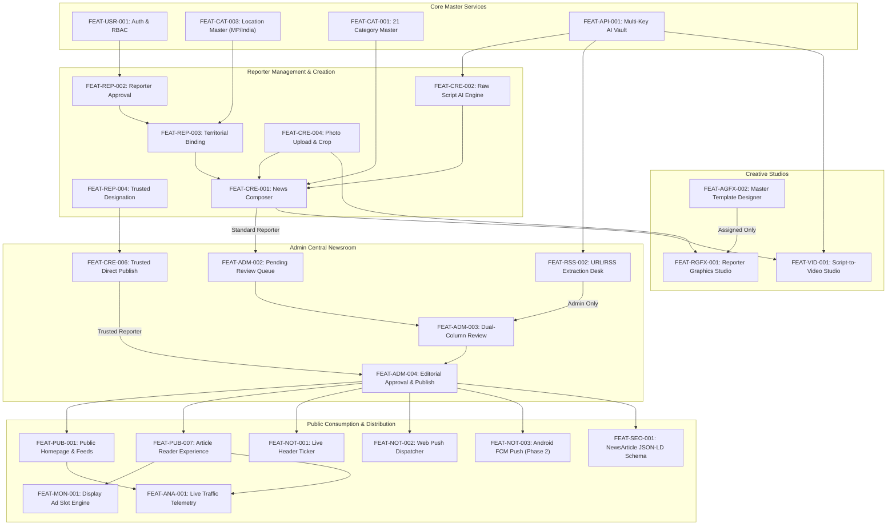

# Feature Specification Document (FSD)
## Project: BREAKING NEWS WALA (ब्रेकिंग न्यूज़ वाला)
**Tagline:** भारत के जिलों से, आपके दिलों तक  
**Document Identifier:** `docs/02-Features.md`  
**Version:** 1.0.0 (Implementation-Ready Feature Specification)  
**Status:** Approved for Technical Architecture, Database Modeling & UI Design  
**Classification:** Internal Confidential / Product Architecture Blueprint  
**Primary Language:** English (Technical specifications, data contracts, validation rules) with Hindi vernacular nomenclature for user-facing UI and taxonomies  

---

## 1. Document Information

| Attribute | Specification |
| :--- | :--- |
| **Product Name** | BREAKING NEWS WALA (ब्रेकिंग न्यूज़ वाला) |
| **Product Code** | BNW-CORE |
| **Document Identifier** | `docs/02-Features.md` |
| **Version** | 1.0.0 |
| **Author / Role** | Senior Product Manager, Principal Business Analyst, Feature Architect & Technical Documentation Specialist |
| **Prerequisite Reference** | `docs/01-PRD.md` (Product Requirements Document, Version 1.0.0) |
| **Approved UX Reference** | Leading Indian vernacular news portals (e.g., Dainik Bhaskar) for grid hierarchy, Hindi typography, and district navigation, adhering strictly to proprietary brand identity and color palette. |
| **Branding Identity** | Yellow (`#EAB308`), Red (`#DC2626`), Dark Charcoal (`#1F2937`), White (`#FFFFFF`); Globe motif with Hindi typography: "ब्रेकिंग न्यूज़ वाला" (Asset: `/public/assets/aistudio/LOGO_88407b32.png`) |
| **Target Launch Schedule** | **MVP (Phase 1):** Q1 2027 — Web Public Portal, Reporter Desk, Admin Newsroom, Graphics Studio, AI API Pool<br>**Phase 2:** Q2 2027 — Fully Native Android Application (Kotlin, Jetpack Compose, FCM, WorkManager), Video Studio, Gamification<br>**Future (Phase 3):** Q4 2027+ — Multi-lingual Syndication, Live Streaming, Premium Subscriptions |

---

## 2. Purpose and Scope

### 2.1 Purpose of this Document
This Feature Specification Document (`02-Features.md`) provides an exhaustive, granular, and implementation-ready inventory of all functional capabilities within the BREAKING NEWS WALA ecosystem. It bridges the strategic requirements established in `01-PRD.md` with downstream engineering artifacts—specifically `03-Architecture.md`, `04-Database.md`, `05-API.md`, `06-Auth.md`, and frontend/backend implementations.

Every feature within this specification is documented with its operational lifecycle, role-based boundary conditions, input/output structures, validation constraints, error mitigation, cross-platform behavior, and verification criteria.

### 2.2 Scope Boundaries
- **In-Scope:**
  - Complete feature specification for all 19 functional modules (Modules A through S).
  - Web client functional specifications (React / Modern Web).
  - Native Android client specifications (Kotlin / Jetpack Compose / Android SDK).
  - Single backend and single database shared architecture specifications.
  - Strict segregation between Admin and Reporter content workflows.
  - Cross-cutting security, editorial governance, and IT Rules (2021) compliance.
  - Feature dependencies, release classification, and PRD requirement traceability matrix.
- **Out of Scope (Explicitly Restricted):**
  - Application code, database schema DDL, or API implementation scripts (covered in later phases).
  - URL-to-Graphic or URL-to-News capabilities for field reporters (strictly Admin-only).
  - Desktop native operating system binaries (macOS, Windows).
  - Native iOS application (deferred beyond Phase 2).
  - Unsupervised automated AI publishing without human review.
  - Real-currency monetary withdrawals or payment gateways for reader reward coins in Phase 1/2.

---

## 3. Product Feature Overview

The BREAKING NEWS WALA feature landscape is organized around a dual-constituency model: **Public Vernacular Readers** who demand high-speed, hyper-local news consumption, and **Newsroom Professionals (Reporters & Editors)** who require rapid, AI-augmented, yet strictly governed journalism workflows.

```
+----------------------------------------------------------------------------------------------------+
|                                  BREAKING NEWS WALA FEATURE DOMAINS                                 |
+----------------------------------------------------------------------------------------------------+
|                                                                                                    |
|   +------------------------------------+          +------------------------------------+           |
|   |       PUBLIC READER DOMAIN         |          |       NEWSROOM GOVERNANCE DOMAIN   |           |
|   |  - Hyper-Local District News Feeds |          |  - Raw Script & AI News Writing    |           |
|   |  - Real-Time Breaking Tickers      |          |  - Two-Tier Editorial Approvals    |           |
|   |  - Multimedia (Reels, Shorts, Video)          |  - Trusted Reporter Direct Publish |           |
|   |  - Vernacular Search & Offline Sync|          |  - Wire RSS & Authorized URL Desk  |           |
|   |  - Bookmarks & Social Deep Links   |          |  - Branded Graphics & Video Studio |           |
|   +-----------------+------------------+          +-----------------+------------------+           |
|                     |                                               |                              |
|                     +-----------------------+-----------------------+                              |
|                                             |                                                      |
|                                             v                                                      |
|                       +-------------------------------------------+                                |
|                       |        SHARED CORE PLATFORM SERVICES      |                                |
|                       |  - Unified REST/JSON API Gateway          |                                |
|                       |  - Multi-Provider AI API Pool (Gemini)    |                                |
|                       |  - Hierarchical Location Master (MP/India)|                                |
|                       |  - 21 Approved Dynamic Hindi Categories   |                                |
|                       |  - Role-Based Access Control (RBAC)       |                                |
|                       |  - Real-Time Notification Engine          |                                |
|                       |  - Structured SEO & Open Graph Pipeline   |                                |
|                       +-------------------------------------------+                                |
|                                                                                                    |
+----------------------------------------------------------------------------------------------------+
```

---

## 4. Feature Classification Rules

To prevent scope creep and maintain architectural discipline, every feature in this document is classified across two dimensions: **Implementation Priority (MoSCoW)** and **Release Phase**.

### 4.1 Priority Classification (MoSCoW)
- **Must Have (M):** Non-negotiable core capabilities required for a functional, secure, and commercially viable launch. Absence halts release.
- **Should Have (S):** Critical enhancements that provide significant operational or engagement value; highly recommended for launch unless acute timeline constraints intervene.
- **Could Have (C):** High-value additions that enhance convenience or engagement (e.g., advanced gamification, low-bandwidth mode) that can be delivered without blocking core news operations.
- **Won't Have (W):** Explicitly deferred or rejected features for the current architectural cycle (e.g., iOS native app, real cash payouts, desktop executables).

### 4.2 Release Phase Classification
- **MVP (Phase 1 - Q1 2027):** Public Responsive Web Portal, Reporter Web Command Station, Admin Central Newsroom, Raw Script AI structuring, Admin RSS/URL Ingestion, Reporter Graphics Studio (assigned templates), AI API Pool, 21 Hindi Categories, Madhya Pradesh District Hierarchy, Basic Banner Placements.
- **Phase 2 (Post-MVP - Q2 2027):** Fully Native Kotlin Android App (Jetpack Compose, FCM push, Room offline DB, WorkManager), Integrated Video Studio, National Location Expansion, Full Reader Coin Gamification Ledger, Direct Advertiser Self-Serve Dashboard.
- **Future Scope (Phase 3 - Q4 2027+):** Regional Language Editions (Marathi, Gujarati, Bengali), Live Video Newsroom Broadcast, Daily AI Audio Podcasts, Premium Ad-Free Subscriptions, External News Syndication APIs.

---

## 5. User Roles and Access Summary

The platform enforces a strict, hierarchical **Role-Based Access Control (RBAC)** model across five distinct actor archetypes:

```
+----------------------------------------------------------------------------------------------------+
|                                    ROLE PRIVILEGE HIERARCHY                                        |
+----------------------------------------------------------------------------------------------------+
|                                                                                                    |
|    [SUPER ADMIN]  ────────► Total Platform Sovereignty, Key Vault, User Roles, Global Settings      |
|          │                                                                                         |
|          ▼                                                                                         |
|    [CENTRAL EDITOR] ──────► Review Queue, RSS Feeds, URL Ingestion, Template Designer, Breaking Push|
|          │                                                                                         |
|          ▼                                                                                         |
|    [TRUSTED REPORTER] ───► Direct Publishing (Assigned District), Raw Script, Assigned Templates   |
|          │                                                                                         |
|          ▼                                                                                         |
|    [STANDARD REPORTER] ──► Story Submissions (Pending Review Queue), Raw Script, Assigned Templates|
|          │                                                                                         |
|          ▼                                                                                         |
|    [PUBLIC READER] ──────► Browse News, Filter Districts, Bookmarks, Share, Feedback, Earn Coins   |
|                                                                                                    |
+----------------------------------------------------------------------------------------------------+
```

### 5.1 Role Matrix & Access Boundaries

| Role Code | Role Name | Primary Objective | Authentication Method | Core Permissions | Boundary Restrictions |
| :--- | :--- | :--- | :--- | :--- | :--- |
| **PUB** | Public Reader | News consumption, personalization, sharing, community feedback | Optional / OTP / Social | Browse published news, filter by district, save articles, submit error reports, earn engagement points. | Zero access to editorial queues, reporter dashboards, or draft articles. |
| **REP-STD** | Standard Reporter | On-the-ground news gathering and raw script submission | Mobile + Password / OTP | File raw scripts, trigger AI structuring, attach media, file under assigned districts, use assigned templates. | Submissions MUST enter `PENDING_REVIEW` queue; cannot publish directly; no URL-to-News or URL-to-Graphic access. |
| **REP-TRU** | Trusted Reporter | Fast-track field reporting for vetted senior correspondents | Mobile + 2FA / Password | All Standard Reporter capabilities PLUS direct publishing (`PUBLISHED` status) within allocated district. | Publishing limited strictly to assigned district; cannot edit platform categories, templates, or global settings; audited immutably. |
| **EDT** | Central Sub-Editor | Editorial curation, wire synthesis, fact verification, quality control | Corporate SSO / 2FA | Review reporter queue, edit copy, approve/reject/request changes, ingest RSS/URL, manage breaking ticker. | Cannot alter system API keys, delete user accounts, or modify database infrastructure. |
| **ADM** | Platform Super Admin | Enterprise governance, financial operations, system integrity | Multi-Factor Auth (Hardware/TOTP)| Total system control: reporter credentialing, district allocation, trusted status toggles, API pool vault, audit logs. | Bound by Indian legal compliance (IT Rules 2021) and immutable audit log accountability. |

---

## 6. Public News Platform (Module A)

The Public News Platform represents the high-performance presentation layer serving millions of vernacular readers. It is optimized for sub-second page loads, intuitive Hindi information architecture, and hyper-local district drill-down.

---

### FEAT-PUB-001: Homepage & Information Architecture
- **Feature ID:** `FEAT-PUB-001`
- **Feature Name:** Homepage & Information Architecture
- **Module:** Public News Platform (A)
- **Description:** The central landing interface organizing real-time news into a structured, high-density Hindi layout inspired by leading Indian publications (e.g., Dainik Bhaskar) while incorporating proprietary brand styling.
- **Business Purpose:** Maximize reader retention, deliver immediate visibility for breaking regional developments, and drive cross-category exploration.
- **User Roles:** Public Reader (PUB), Standard Reporter (REP-STD), Trusted Reporter (REP-TRU), Central Sub-Editor (EDT), Super Admin (ADM).
- **Access Permissions:** Public unauthenticated access. Read-only permissions (`status == 'published'`).
- **User Actions:** Browse hero stories, scroll through categorized news blocks, click ticker items, switch districts, open articles, navigate multimedia carousels.
- **Functional Behavior:** Dynamically renders the top masthead, live breaking ticker, 21-category sticky navigation, lead hero grid, local district block, multimedia shorts reel, categorized grids, and compliance footer.
- **Inputs:** User geolocation or stored district preference cookie/token; category filter parameters.
- **Outputs:** Server-rendered or client-hydrated responsive HTML/JSON feed of prioritized news entities.
- **Validation Rules:** Displays only published articles (`status == 'published'`); hides draft, review-pending, or archived content. Ad slots must load asynchronously without causing layout shifts (CLS < 0.1).
- **Success Scenarios:** Page loads in < 1.2s on 4G connections; displays correct district news corresponding to user preference; renders live ticker smoothly.
- **Failure and Error Scenarios:** Network failure triggers cached local state; backend API timeout displays graceful skeleton loaders and retry prompt; missing district articles fall back to state-level news.
- **Dependencies:** `FEAT-ADM-005` (Published News), `FEAT-CAT-001` (Categories), `FEAT-CAT-006` (Locations), `FEAT-NOT-001` (Ticker).
- **Notifications:** In-app visual flash when breaking news priority is updated.
- **Data Requirements:** Article entity (ID, headline, slug, thumbnail, category, district, publishedAt, readingTime).
- **Security Considerations:** No sensitive user PII exposed; public CDN caching at edge; rate limiting on homepage requests (100 req/min/IP).
- **Web Experience:** Multi-column desktop responsive grid; sticky category header; breadcrumbs; responsive banner slots.
- **Future Android Experience:** Jetpack Compose native LazyColumn feed; pull-to-refresh; native bottom navigation bar; hardware-accelerated image loading via Coil.
- **Priority:** Must Have
- **Release:** MVP (Phase 1)
- **Acceptance Criteria:** Page achieves Google Lighthouse score > 90; zero cumulative layout shifts; all 21 approved categories accessible.
- **Related Requirements and Documents:** `01-PRD.md` Section 11.1 (PUB-001), Section 12.1; `security_spec.md` Invariant 1.
- **Open Questions:** None. Approved in PRD.

---

### FEAT-PUB-002: Real-Time News Feed & Chronological Stream
- **Feature ID:** `FEAT-PUB-002`
- **Feature Name:** News Feed & Chronological Stream
- **Module:** Public News Platform (A)
- **Description:** Infinite-scroll and paginated chronological news feed delivering real-time vernacular dispatches across national, state, and local channels.
- **Business Purpose:** Provide a non-stop news stream for regular visitors, driving daily active usage and page views.
- **User Roles:** Public Reader (PUB), All Roles.
- **Access Permissions:** Public unauthenticated read access.
- **User Actions:** Scroll feed, pull to refresh, load more stories, toggle chronological vs trending view.
- **Functional Behavior:** Fetches articles ordered by `publishedAt DESC` with cursor-based pagination (20 articles per batch).
- **Inputs:** Cursor ID, category filter (optional), district filter (optional), limit (default 20).
- **Outputs:** JSON stream of article summary cards with cursor pagination metadata.
- **Validation Rules:** Cursor must be a valid base64 token; pagination limit capped at 50 per request.
- **Success Scenarios:** New batch appends smoothly without viewport jump; new articles marked with relative timestamps (e.g., "5 मिनट पहले").
- **Failure and Error Scenarios:** End of feed displays "आप सभी ताज़ा खबरें पढ़ चुके हैं"; connection drop prompts "पुनः प्रयास करें" (Retry).
- **Dependencies:** `FEAT-PUB-001`, `FEAT-CRE-017`, `FEAT-ADM-005`.
- **Notifications:** None.
- **Data Requirements:** Paginated article list with standard summary projection.
- **Security Considerations:** Enforces cursor tamper-proofing; prevents deep database offset scraping attacks.
- **Web Experience:** Infinite scroll with intersection observer; virtualized list rendering to maintain browser memory efficiency.
- **Future Android Experience:** Jetpack Compose `Paging 3` library integration with Room database offline prefetching.
- **Priority:** Must Have
- **Release:** MVP (Phase 1)
- **Acceptance Criteria:** Feed sustains 60fps scrolling on mid-range Android browsers; cursor pagination completes in < 300ms.
- **Related Requirements and Documents:** `01-PRD.md` PUB-001.
- **Open Questions:** None.

---

### FEAT-PUB-003: Breaking News Presentation & Alerts
- **Feature ID:** `FEAT-PUB-003`
- **Feature Name:** Breaking News Presentation & Alerts
- **Module:** Public News Platform (A)
- **Description:** Multi-channel urgent news delivery system including high-contrast visual badges, sticky red ticker bars, and dismissible emergency alert modals.
- **Business Purpose:** Establish BREAKING NEWS WALA as the fastest source for critical regional and national news dispatches.
- **User Roles:** Public Reader (PUB), All Roles.
- **Access Permissions:** Public read-only. Triggered exclusively by Admin or Trusted Reporter priority flags.
- **User Actions:** Click breaking headline to navigate to full story; dismiss breaking modal; pause ticker scroll.
- **Functional Behavior:** Highlights breaking stories with pulsing "ब्रेकिंग न्यूज़" badge; plays optional subtle audio chime on desktop/app when critical alert is pushed.
- **Inputs:** Active breaking news record pushed from backend WebSocket / SSE channel.
- **Outputs:** Real-time DOM/UI banner update without full page reload.
- **Validation Rules:** Breaking status automatically expires after configured duration (default: 4 hours) unless renewed by Admin.
- **Success Scenarios:** Urgent alert appears on reader screens within 3 seconds of publication; modal dismisses cleanly without reappearing during the same session.
- **Failure and Error Scenarios:** Disconnected WebSocket falls back to HTTP polling every 30 seconds; expired alert gracefully vanishes from ticker.
- **Dependencies:** `FEAT-ADM-009` (Ticker Controller), `FEAT-NOT-001` (Live Ticker Engine).
- **Notifications:** Browser Web Push and Android FCM push triggered concurrently.
- **Data Requirements:** Ticker item: ID, title, articleSlug, priorityLevel (`CRITICAL`, `URGENT`, `FLASH`), expiresAt.
- **Security Considerations:** Ticker insert/update endpoints restricted strictly to Admin (`admins/{uid}`). Public write attempts rejected.
- **Web Experience:** CSS-animated ticker ribbon under masthead; animated badge; dismissible floating alert.
- **Future Android Experience:** Top app-bar marquee ticker; native heads-up notification banner.
- **Priority:** Must Have
- **Release:** MVP (Phase 1)
- **Acceptance Criteria:** Updates propagate to 10,000 concurrent web clients in < 5 seconds; dismissed state stored in sessionStorage.
- **Related Requirements and Documents:** `01-PRD.md` PUB-009, NOT-001, NOT-002; `security_spec.md` Item 5.
- **Open Questions:** None.

---

### FEAT-PUB-004: Top News & Lead Story Hero Grid
- **Feature ID:** `FEAT-PUB-004`
- **Feature Name:** Top News & Lead Story Hero Grid
- **Module:** Public News Platform (A)
- **Description:** Prominent homepage hero layout featuring the day's biggest developing story (Lead Anchor) flanked by 3-4 major secondary news cards.
- **Business Purpose:** Guide reader focus to high-impact journalism, increasing time-on-site and editorial authority.
- **User Roles:** Public Reader (PUB), All Roles.
- **Access Permissions:** Public unauthenticated read.
- **User Actions:** Click headline or thumbnail to open full article; view lead story video preview if attached.
- **Functional Behavior:** Displays one primary anchor card (16:9 high-resolution banner, bold 32px Devanagari typography, 2-line summary) alongside a grid of secondary cards.
- **Inputs:** Editorial priority index (`is_top_news: true`, `hero_order: 1..5`).
- **Outputs:** Visual hero showcase container.
- **Validation Rules:** Exactly one primary lead story can occupy slot 1; secondary slots hold between 2 and 4 articles.
- **Success Scenarios:** Lead story image loads with high-priority `fetchpriority="high"`; zero cumulative layout shift during hero rendering.
- **Failure and Error Scenarios:** If no editorial lead story is flagged, system automatically falls back to latest published national/state article.
- **Dependencies:** `FEAT-ADM-010` (Editorial Prioritization), `FEAT-PUB-001`.
- **Notifications:** None.
- **Data Requirements:** Article entity with `is_top_news: true`, high-res image URL, and author attribution.
- **Security Considerations:** Read-only cached query; protected by CDN stale-while-revalidate policy.
- **Web Experience:** Desktop 60/40 asymmetrical grid; mobile stacks primary story on top followed by horizontal scroll cards.
- **Future Android Experience:** Jetpack Compose Card component with Material 3 elevation and shared element transition to article reader.
- **Priority:** Must Have
- **Release:** MVP (Phase 1)
- **Acceptance Criteria:** Largest Contentful Paint (LCP) < 2.2 seconds on 4G networks; hero images optimized in WebP format.
- **Related Requirements and Documents:** `01-PRD.md` Section 12.1 Item 5.
- **Open Questions:** None.

---

### FEAT-PUB-005: Dynamic Category & Subcategory Navigation
- **Feature ID:** `FEAT-PUB-005`
- **Feature Name:** Dynamic Category & Subcategory Navigation
- **Module:** Public News Platform (A)
- **Description:** Sticky navigation bar presenting all 21 approved canonical Hindi categories and active subcategory pills with dynamic overflow handling.
- **Business Purpose:** Enable structured topic discovery, allowing readers to jump directly to specific interests (Politics, Cricket, Jobs, etc.).
- **User Roles:** Public Reader (PUB), All Roles.
- **Access Permissions:** Public read-only. Category ordering configured by Admin.
- **User Actions:** Click category tab, scroll horizontal category bar, select subcategory filter, open "अन्य" (More) dropdown.
- **Functional Behavior:** Highlights active category; smoothly scrolls subcategory pill list into view; fetches category-filtered article stream.
- **Inputs:** Category slug (`/category/{slug}`) and optional subcategory slug.
- **Outputs:** Filtered news view matching category criteria.
- **Validation Rules:** Navigation reflects only `status == 'active'` categories; archived categories excluded from primary nav bar.
- **Success Scenarios:** Switching categories loads new feed in < 400ms without full page reload; URL updates cleanly for browser history.
- **Failure and Error Scenarios:** Invalid category slug redirects to `/404` or homepage with a friendly Hindi notification ("यह श्रेणी उपलब्ध नहीं है").
- **Dependencies:** `FEAT-CAT-001` (Category Master), `FEAT-CAT-002` (Subcategories).
- **Notifications:** None.
- **Data Requirements:** List of categories: ID, nameHindi, slug, displayOrder, iconUrl, activeSubcategories.
- **Security Considerations:** Prevents SQL/NoSQL injection via sanitized category slug lookups.
- **Web Experience:** Sticky CSS top header; smooth horizontal mouse-drag and touch-swipe navigation bar.
- **Future Android Experience:** Jetpack Compose ScrollableTabRow with indicator animation and subcategory FilterChips.
- **Priority:** Must Have
- **Release:** MVP (Phase 1)
- **Acceptance Criteria:** All 21 approved categories render accurately in Hindi; active tab state persists across browser back/forward navigation.
- **Related Requirements and Documents:** `01-PRD.md` Section 11.1 (PUB-002), Section 21.1.
- **Open Questions:** None.

---

### FEAT-PUB-006: District & City Hyper-Local Switcher
- **Feature ID:** `FEAT-PUB-006`
- **Feature Name:** District & City Hyper-Local Switcher
- **Module:** Public News Platform (A)
- **Description:** Granular geographic selector enabling readers to choose their State, District, and City (e.g., MP -> Niwari -> Orchha) to localize their newsfeed.
- **Business Purpose:** Fulfill the brand promise *"भारत के जिलों से, आपके दिलों तक"* by personalizing grassroots coverage for each reader.
- **User Roles:** Public Reader (PUB), All Roles.
- **Access Permissions:** Public read/write to local preference storage; authenticated write to user profile.
- **User Actions:** Click "जिला बदलें" (Change District), select State, District, and City from cascading dropdowns, toggle "डिफ़ॉल्ट बनाएं" (Set Default).
- **Functional Behavior:** Filters homepage "मेरा जिला" block and dedicated `/district/{district-slug}` routes; stores preference in browser cookies/local storage or user profile document.
- **Inputs:** State ID, District ID, City ID (optional).
- **Outputs:** Localized news feed containing stories tagged with matching jurisdiction IDs.
- **Validation Rules:** District must exist in the active `locations` collection; selection must belong to chosen state.
- **Success Scenarios:** Feed instantly re-indexes to display Niwari/Bhopal news; user returns to site days later and sees their preferred district preserved.
- **Failure and Error Scenarios:** If an obscure district has zero published articles today, system shows "इस जिले की ताज़ा खबरें जल्द आ रही हैं" and displays state-level news.
- **Dependencies:** `FEAT-CAT-006` (Location Master), `FEAT-CRE-011` (District Tagging).
- **Notifications:** None.
- **Data Requirements:** Location hierarchy: State -> District -> City/Tehsil with pin codes.
- **Security Considerations:** Prevents unauthorized geo-spoofing in reporter context; for public readers, selection is client-side personalization.
- **Web Experience:** Header modal dialog with fast Devanagari live-search filter for 55+ MP districts.
- **Future Android Experience:** Native BottomSheet dialog with GPS auto-suggestion ("क्या आप निवाड़ी में हैं?") and one-tap confirmation.
- **Priority:** Must Have
- **Release:** MVP (Phase 1)
- **Acceptance Criteria:** District selection switch updates feed in < 300ms; choice persists across browser sessions.
- **Related Requirements and Documents:** `01-PRD.md` PUB-003, LOC-001, Section 12.1 Item 6.
- **Open Questions:** None.

---

### FEAT-PUB-007: Full News Article Reader Experience
- **Feature ID:** `FEAT-PUB-007`
- **Feature Name:** Full News Article Reader Experience
- **Module:** Public News Platform (A)
- **Description:** Dedicated article detail reading view optimized for immersion, Hindi typography, verified reporter attribution, media galleries, and social engagement.
- **Business Purpose:** Deliver the core content value proposition, maximize reader reading time, and serve contextually relevant banner advertisements.
- **User Roles:** Public Reader (PUB), All Roles.
- **Access Permissions:** Public read access for `status == 'published'`. Non-published articles viewable only by author or Admin.
- **User Actions:** Read article, resize fonts (`अ-`, `अ`, `अ+`), view photo galleries, watch embedded videos, copy quote, share story, click author badge.
- **Functional Behavior:** Renders headline, lead summary, verified author byline with district badge, publication date/time in Hindi, rich Devanagari body text, in-line images with captions, tags, and related news cards.
- **Inputs:** Article slug or unique ID via route `/news/{category}/{district}/{slug}`.
- **Outputs:** Complete article document with structured metadata.
- **Validation Rules:** Article must have `status == 'published'`. Unpublished IDs return HTTP 404 to anonymous users.
- **Success Scenarios:** Page renders in < 1.0s; Devanagari typography renders with line-height 1.8; social sharing triggers native device share sheet.
- **Failure and Error Scenarios:** Article not found shows custom 404 with links to trending stories; malformed slug executes 301 redirect to canonical URL.
- **Dependencies:** `FEAT-CRE-001`, `FEAT-ADM-005`, `FEAT-SEO-001` (Structured Data).
- **Notifications:** None.
- **Data Requirements:** Full article entity (title, subtitle, bodyHtml, authorId, authorName, districtId, categoryId, tags, mediaGallery, viewsCount).
- **Security Considerations:** Strict sanitization of `bodyHtml` via DOMPurify to eliminate XSS vectors; author UID not exposed directly in URL.
- **Web Experience:** Centered editorial column (max-width 780px) flanked by sticky sidebar containing trending stories and ad placements.
- **Future Android Experience:** Native Jetpack Compose Scaffold with CollapsingToolbarLayout, floating share action button, and swipe-to-next-article gesture.
- **Priority:** Must Have
- **Release:** MVP (Phase 1)
- **Acceptance Criteria:** Google PageSpeed score > 90; valid JSON-LD `NewsArticle` schema present; zero XSS vulnerabilities.
- **Related Requirements and Documents:** `01-PRD.md` PUB-004, Section 12.2; `security_spec.md` Invariant 1.
- **Open Questions:** None.

---

### FEAT-PUB-008: Real-Time Vernacular Search & Auto-Suggestions
- **Feature ID:** `FEAT-PUB-008`
- **Feature Name:** Real-Time Search & Auto-Suggestions
- **Module:** Public News Platform (A)
- **Description:** Full-text Devanagari search interface providing sub-500ms keyword auto-suggestions, category filters, and district matching.
- **Business Purpose:** Empower readers to investigate developing events, past local incidents, and specific political figures quickly.
- **User Roles:** Public Reader (PUB), All Roles.
- **Access Permissions:** Public read access over published indexed content.
- **User Actions:** Type query in search bar, click suggestion, submit search, filter results by date range or category.
- **Functional Behavior:** Debounced (300ms) query triggers autocomplete API returning matched headlines, tags, and reporter names; full search page provides paginated results.
- **Inputs:** Search query string (Hindi / Hinglish / English), optional category and district filters.
- **Outputs:** Ranked list of matching articles with highlighted search terms.
- **Validation Rules:** Query string trimmed and sanitized; minimum 2 characters required to trigger auto-suggestions; maximum 100 characters.
- **Success Scenarios:** Search "निवाड़ी" returns all recent dispatches from Niwari district in < 400ms.
- **Failure and Error Scenarios:** Zero matches display "कोई परिणाम नहीं मिला" along with suggestions for trending topics.
- **Dependencies:** `FEAT-CRE-001`, `FEAT-CAT-001`, `FEAT-CAT-006`.
- **Notifications:** None.
- **Data Requirements:** Inverted text index or full-text search engine over `title`, `summary`, `tags`, and `districtName`.
- **Security Considerations:** Input sanitization to prevent regex denial of service (ReDoS) or database query injection; rate-limited to 30 searches/minute/IP.
- **Web Experience:** Header search bar expanding into a modal flyout displaying trending search pills and live results.
- **Future Android Experience:** Jetpack Compose SearchBar with voice-search microphone input utilizing Android SpeechRecognizer.
- **Priority:** Must Have
- **Release:** MVP (Phase 1)
- **Acceptance Criteria:** Search queries return accurate results in < 500ms; auto-suggest handles Devanagari compound characters properly.
- **Related Requirements and Documents:** `01-PRD.md` PUB-006.
- **Open Questions:** None.

---

### FEAT-PUB-009: Social Sharing & Dynamic Deep Linking
- **Feature ID:** `FEAT-PUB-009`
- **Feature Name:** Social Sharing & Dynamic Deep Linking
- **Module:** Public News Platform (A)
- **Description:** One-touch social sharing to WhatsApp, Facebook, Telegram, X, and native clipboard with dynamic Open Graph cards and tracked campaign parameters.
- **Business Purpose:** Drive viral distribution across WhatsApp groups—the primary news sharing channel in tier-2/3 Indian cities.
- **User Roles:** Public Reader (PUB), All Roles.
- **Access Permissions:** Public unauthenticated access.
- **User Actions:** Click WhatsApp share button, click Facebook share, copy link, trigger native device share sheet.
- **Functional Behavior:** Generates platform-specific sharing URLs encoded with headline, canonical URL, and UTM attribution parameters (`utm_source=whatsapp&utm_medium=share`).
- **Inputs:** Article ID, target platform identifier.
- **Outputs:** Formatted share payload launching native app or web share modal.
- **Validation Rules:** Shared link must point to canonical slug; image preview must be minimum 1200x630px WebP/PNG.
- **Success Scenarios:** Clicking WhatsApp icon opens WhatsApp with pre-filled message: *"ब्रेकिंग न्यूज़ वाला: [Headline] - पूरी खबर पढ़ें: [Link]"*; preview card renders with logo and headline.
- **Failure and Error Scenarios:** Unsupported Web Share API gracefully falls back to copying link to clipboard with toast notification ("लिंक कॉपी हो गया").
- **Dependencies:** `FEAT-SEO-002` (Open Graph), `FEAT-PUB-007`.
- **Notifications:** None.
- **Data Requirements:** Article slug, headline, summary, featureImageUrl, shareCount counter.
- **Security Considerations:** Share parameters sanitized to avoid open-redirect vulnerabilities.
- **Web Experience:** Floating sticky social share bar on mobile; sidebar share buttons on desktop article view.
- **Future Android Experience:** Native Android Intent chooser (`Intent.ACTION_SEND`) passing rich preview text and dynamic App Link.
- **Priority:** Must Have
- **Release:** MVP (Phase 1)
- **Acceptance Criteria:** Shared links on WhatsApp render thumbnail, title, and site name reliably 100% of the time.
- **Related Requirements and Documents:** `01-PRD.md` PUB-007, SEO-002.
- **Open Questions:** None.

---

### FEAT-PUB-010: Bookmarks & Read Later
- **Feature ID:** `FEAT-PUB-010`
- **Feature Name:** Bookmarks & Read Later
- **Module:** Public News Platform (A)
- **Description:** Personal article curation library allowing readers to save stories to "सेव की गई खबरें" for offline reading or future reference.
- **Business Purpose:** Foster reader loyalty, build user account value, and increase repeat visits.
- **User Roles:** Public Reader (PUB), All Roles.
- **Access Permissions:** Public (stored locally in browser localStorage for anonymous visitors; synced to database for authenticated users).
- **User Actions:** Click bookmark ribbon icon on card or article page; open "सेव की गई खबरें" dashboard; remove saved article.
- **Functional Behavior:** Toggles bookmark state; updates icon fill; persists article ID to local list or user profile `saved_articles` array.
- **Inputs:** Article ID, user authentication state.
- **Outputs:** Updated bookmark state and saved articles list view.
- **Validation Rules:** Maximum 100 saved articles per anonymous local store; maximum 500 for registered accounts.
- **Success Scenarios:** Clicking bookmark ribbon fills icon instantly; saved list displays articles even if device goes offline (using cached content).
- **Failure and Error Scenarios:** Storage quota exceeded warns user to remove older bookmarks; network sync failure falls back to local storage.
- **Dependencies:** `FEAT-PUB-007`, `FEAT-USR-001` (User Account).
- **Notifications:** In-app toast confirmation ("खबर सेव कर ली गई है").
- **Data Requirements:** Saved article record (articleId, savedAt, articleSnapshot).
- **Security Considerations:** Users can only view and modify their own saved bookmarks; server verifies user UID on sync.
- **Web Experience:** Dedicated `/saved` page accessible via user profile menu; bookmark icon on every article card.
- **Future Android Experience:** Room database local storage with background sync via WorkManager; full offline article reading.
- **Priority:** Should Have
- **Release:** MVP (Phase 1)
- **Acceptance Criteria:** Bookmark toggle responds in < 50ms; anonymous bookmarks migrate seamlessly upon user sign-in.
- **Related Requirements and Documents:** `01-PRD.md` PUB-008.
- **Open Questions:** None.

---

### FEAT-PUB-011: Vernacular Typography & Accessibility Controls
- **Feature ID:** `FEAT-PUB-011`
- **Feature Name:** Vernacular Typography & Accessibility Controls
- **Module:** Public News Platform (A)
- **Description:** Comprehensive reading accessibility suite featuring scalable Hindi typography controls (`अ-`, `अ`, `अ+`), high-contrast dark/light mode, and clean Devanagari line heights.
- **Business Purpose:** Ensure comfortable reading for senior citizens and low-vision vernacular readers, broadening audience reach.
- **User Roles:** Public Reader (PUB), All Roles.
- **Access Permissions:** Public client-side capability.
- **User Actions:** Click font size step controls in article reader; toggle day/night reading theme.
- **Functional Behavior:** Adjusts root CSS font size variables across article body text (16px base, scalable to 22px); swaps color tokens for dark mode (`#111827` background, `#F3F4F6` text).
- **Inputs:** User font preference selection (`small`, `default`, `large`, `extra-large`), theme mode (`light`, `dark`, `system`).
- **Outputs:** Dynamic CSS stylesheet or inline variable adaptation without page reload.
- **Validation Rules:** Typography scaling constrained between 14px (minimum readable) and 24px (maximum layout safe).
- **Success Scenarios:** Reader clicks `अ+` and text increases smoothly without clipping headers or overflowing layout containers.
- **Failure and Error Scenarios:** LocalStorage disabled falls back to session-only styling.
- **Dependencies:** `FEAT-PUB-007`.
- **Notifications:** None.
- **Data Requirements:** Preference flags stored in localStorage (`bnw_font_scale`, `bnw_theme_mode`).
- **Security Considerations:** Client-side only; zero security attack surface.
- **Web Experience:** Compact button group (`अ-`, `अ`, `अ+`) fixed at the top of the article body alongside dark mode toggle.
- **Future Android Experience:** Native Jetpack Compose Dynamic Type scaling honoring Android system Accessibility Font Size settings.
- **Priority:** Must Have
- **Release:** MVP (Phase 1)
- **Acceptance Criteria:** WCAG 2.1 AA contrast ratio compliant (minimum 4.5:1 in both light and dark themes); zero horizontal scroll triggered.
- **Related Requirements and Documents:** `01-PRD.md` Section 12.2.
- **Open Questions:** None.

---

### FEAT-PUB-012: News Error Reporting & Public Feedback Form
- **Feature ID:** `FEAT-PUB-012`
- **Feature Name:** News Error Reporting & Public Feedback Form
- **Module:** Public News Platform (A)
- **Description:** Standardized editorial feedback modal embedded on every article page, allowing readers to flag factual errors, typos, or inappropriate media to central editors.
- **Business Purpose:** Foster journalistic credibility, fulfill Indian IT Rules (2021) grievance feedback norms, and enable rapid correction of breaking inaccuracies.
- **User Roles:** Public Reader (PUB), All Roles.
- **Access Permissions:** Public unauthenticated access with CAPTCHA / rate-limiting protection.
- **User Actions:** Click "त्रुटि रिपोर्ट करें" (Report Error) in article footer, select issue category, enter description, submit form.
- **Functional Behavior:** Submits structured ticket to Admin newsroom feedback queue; captures article ID, timestamp, user contact (optional), and description.
- **Inputs:** Article ID, error category (`FACTUAL_INACCURACY`, `TYPO_GRAMMAR`, `INAPPROPRIATE_MEDIA`, `COPYRIGHT_ISSUE`), user comments, optional email.
- **Outputs:** Submission confirmation modal and Admin editorial alert.
- **Validation Rules:** Comments must be between 10 and 500 characters; rate limit of 3 reports per hour per IP.
- **Success Scenarios:** User submits typo report; toast shows "धन्यवाद! आपकी रिपोर्ट संपादकीय टीम को भेज दी गई है"; ticket lands in Admin review queue.
- **Failure and Error Scenarios:** Spam trigger blocks submission with friendly message; network failure allows draft retry.
- **Dependencies:** `FEAT-PUB-007`, `FEAT-ADM-005`.
- **Notifications:** Email or dashboard notification alert to Sub-Editor desk.
- **Data Requirements:** Feedback entity (id, articleId, category, comments, submitterIp, status: `NEW` | `REVIEWED` | `RESOLVED`).
- **Security Considerations:** Strict CAPTCHA / honeypot protection; user IP hashed for privacy; XSS stripping on submitted text.
- **Web Experience:** Clean slide-over modal in article footer with clear Devanagari form fields.
- **Future Android Experience:** Native BottomSheet dialog with pre-selected article context.
- **Priority:** Should Have
- **Release:** MVP (Phase 1)
- **Acceptance Criteria:** Reports arrive in Admin queue in < 2 seconds; zero spam vulnerability.
- **Related Requirements and Documents:** `01-PRD.md` PUB-010, SEC-006.
- **Open Questions:** None.

---

## 7. Video and Media Consumption (Module B)

Module B delivers a high-engagement multimedia experience tailored for mobile readers who consume news via short vertical reels, video bulletins, and photo stories.

---

### FEAT-MED-001: Video News Stream & Dedicated Feed
- **Feature ID:** `FEAT-MED-001`
- **Feature Name:** Video News Stream & Dedicated Feed
- **Module:** Video and Media Consumption (B)
- **Description:** Dedicated video channel (`/videos`) streaming categorized news reports, daily video bulletins, and regional video dispatches.
- **Business Purpose:** Capture younger demographics and mobile viewers who prefer watching news over reading long-form text.
- **User Roles:** Public Reader (PUB), All Roles.
- **Access Permissions:** Public read-only.
- **User Actions:** Browse video grid, filter by category or district, watch preview on hover, click to play full video report.
- **Functional Behavior:** Displays video cards with duration badges, view counts, and verified reporter tags; streams optimized HLS/MP4 video.
- **Inputs:** Category filter, district filter, pagination token.
- **Outputs:** Paginated stream of video article objects with streaming URLs and poster thumbnails.
- **Validation Rules:** Videos must have verified thumbnail and duration metadata; only published video articles shown.
- **Success Scenarios:** Video thumbnails load smoothly; clicking opens dedicated player; playback starts in < 1 second.
- **Failure and Error Scenarios:** Video stream failure displays "वीडियो लोड करने में समस्या हुई" with reload button.
- **Dependencies:** `FEAT-VID-009` (Cloud Render Pipeline), `FEAT-PUB-001`.
- **Notifications:** None.
- **Data Requirements:** Video entity (id, title, videoUrl, posterUrl, durationSeconds, resolution, viewsCount, publishedAt).
- **Security Considerations:** Secure CDN video streaming URLs; prevents hotlinking via origin verification headers.
- **Web Experience:** 3-column desktop video card layout; 1-column high-density mobile card stream with play button overlays.
- **Future Android Experience:** Native ExoPlayer / Media3 implementation with hardware decoding and picture-in-picture (PiP) support.
- **Priority:** Must Have
- **Release:** MVP (Phase 1)
- **Acceptance Criteria:** Video playback initiates in < 1.0s on 4G connections; adaptive bitrate streaming prevents buffering.
- **Related Requirements and Documents:** `01-PRD.md` Section 11.1 (PUB-005), Section 12.1 Item 7.
- **Open Questions:** None.

---

### FEAT-MED-002: Vertical News Reels & Shorts (9:16)
- **Feature ID:** `FEAT-MED-002`
- **Feature Name:** Vertical News Reels & Shorts (9:16)
- **Module:** Video and Media Consumption (B)
- **Description:** Immersive, vertical full-screen short-video feed (60 seconds or less) enabling swipe-up discovery of fast news briefs.
- **Business Purpose:** Maximize user engagement, session duration, and repeat visits via addictive, snackable vernacular news content.
- **User Roles:** Public Reader (PUB), All Roles.
- **Access Permissions:** Public read-only.
- **User Actions:** Swipe up for next reel, tap to pause/play, double-tap to like/bookmark, tap WhatsApp share, tap "पूरी खबर पढ़ें" to open linked article.
- **Functional Behavior:** Full-viewport 9:16 video container; automatically pre-buffers next 2 reels in background; loops active reel; displays Devanagari overlay title and reporter badge.
- **Inputs:** Scroll / swipe gesture, active reel index.
- **Outputs:** Continuous vertical video stream.
- **Validation Rules:** Reel video duration strictly capped between 15 and 60 seconds; aspect ratio locked to 9:16.
- **Success Scenarios:** Swipe gesture transitions to next reel seamlessly with zero black-frame flicker; audio remains in sync.
- **Failure and Error Scenarios:** Offline network buffers existing reel and shows unobtrusive connection retry indicator.
- **Dependencies:** `FEAT-VID-002` (Video Studio Reels), `FEAT-PUB-009` (Share).
- **Notifications:** None.
- **Data Requirements:** Short reel entity (id, videoUrl, title, reporterName, linkedArticleId, durationSeconds, likesCount, sharesCount).
- **Security Considerations:** Media served from CDN with signed tokens if required; comments/shares sanitization.
- **Web Experience:** Mobile-optimized touch swipe container; desktop displays centered mobile phone frame with navigation arrows.
- **Future Android Experience:** Jetpack Compose `VerticalPager` with native ExoPlayer caching and gesture handlers for instant playback.
- **Priority:** Should Have
- **Release:** MVP (Phase 1)
- **Acceptance Criteria:** Reel transition latency < 150ms; auto-pause on background tab; zero memory leaks during extended scrolling.
- **Related Requirements and Documents:** `01-PRD.md` Section 11.1 (PUB-005), Section 21.3.
- **Open Questions:** None.

---

### FEAT-MED-003: Video Playback Controls & Auto-Pause on Scroll
- **Feature ID:** `FEAT-MED-003`
- **Feature Name:** Video Playback Controls & Auto-Pause on Scroll
- **Module:** Video and Media Consumption (B)
- **Description:** Smart video player controls featuring inline play/pause, volume slider with mute toggle, playback speed selector (1x, 1.25x, 1.5x), and automated viewport intersection pausing.
- **Business Purpose:** Prevent annoying concurrent audio playback, conserve user mobile data, and provide accessible playback controls.
- **User Roles:** Public Reader (PUB), All Roles.
- **Access Permissions:** Public client-side capability.
- **User Actions:** Tap to mute/unmute, drag seekbar, change speed, scroll past video to auto-pause.
- **Functional Behavior:** Uses `IntersectionObserver` to detect when video drops below 50% viewport visibility and automatically pauses playback; resumes when scrolled back if user initiated play.
- **Inputs:** User touch/click events, viewport scroll coordinates.
- **Outputs:** State updates to HTML5 Video element or ExoPlayer instance.
- **Validation Rules:** Videos default to muted autoplay on initial page load (adhering to browser autoplay policies); unmuting requires explicit user interaction.
- **Success Scenarios:** Scrolling away pauses video cleanly; returning resumes without buffering; audio remains clear.
- **Failure and Error Scenarios:** Autoplay block policy caught gracefully; displays prominent centered play icon.
- **Dependencies:** `FEAT-MED-001`, `FEAT-PUB-007`.
- **Notifications:** None.
- **Data Requirements:** Player state model (currentTime, duration, isMuted, playbackRate, isPlaying).
- **Security Considerations:** Prevents iframe injection; enforces sandboxed video playback.
- **Web Experience:** Custom styled HTML5 video controls matching brand yellow/red accents; full-screen button.
- **Future Android Experience:** Media3 UI `PlayerView` with custom styled vernacular controls and Android system audio focus integration.
- **Priority:** Must Have
- **Release:** MVP (Phase 1)
- **Acceptance Criteria:** Auto-pause triggers within 100ms of scrolling past threshold; zero unintended background audio playback.
- **Related Requirements and Documents:** `01-PRD.md` PUB-005.
- **Open Questions:** None.

---

### FEAT-MED-004: High-Resolution Photo Gallery Stories
- **Feature ID:** `FEAT-MED-004`
- **Feature Name:** High-Resolution Photo Gallery Stories
- **Module:** Video and Media Consumption (B)
- **Description:** Dedicated visual photo journalism viewer displaying curated multi-image galleries with Devanagari captions, photo credits, and full-screen lightbox zoom.
- **Business Purpose:** Deliver rich visual reporting for festivals, sporting events, political rallies, and district ground situations.
- **User Roles:** Public Reader (PUB), All Roles.
- **Access Permissions:** Public read-only.
- **User Actions:** Swipe through photos, pinch-to-zoom, toggle full-screen lightbox, read captions, share individual photograph.
- **Functional Behavior:** Displays carousel with photo index counter ("3 / 12"); loads progressive high-res images; pre-fetches adjacent photos.
- **Inputs:** Gallery ID via `/gallery/{slug}` or embedded in article.
- **Outputs:** Interactive lightbox gallery view.
- **Validation Rules:** Minimum 3 photos, maximum 25 photos per gallery; each photo must have caption and photo credit.
- **Success Scenarios:** Lightbox opens with smooth animation; touch swipe transitions photos at 60fps; images render in high fidelity.
- **Failure and Error Scenarios:** Image load failure displays placeholder with retry icon; keeps gallery navigation functional.
- **Dependencies:** `FEAT-CRE-008` (Photo Uploads), `FEAT-PUB-007`.
- **Notifications:** None.
- **Data Requirements:** Gallery object (id, title, districtId, photos: Array of {url, caption, credit, order}).
- **Security Considerations:** Watermark embedded on exported images to prevent unauthorized copyright scraping.
- **Web Experience:** Touch-enabled modal lightbox with keyboard left/right arrow navigation and escape-to-close.
- **Future Android Experience:** Jetpack Compose `HorizontalPager` with pinch-to-zoom gesture detector and edge-to-edge immersive mode.
- **Priority:** Should Have
- **Release:** MVP (Phase 1)
- **Acceptance Criteria:** Gallery loads initial 3 images in < 1.5s; lightbox transition operates at 60fps; captions readable on all screen sizes.
- **Related Requirements and Documents:** `01-PRD.md` Section 21.3.
- **Open Questions:** None.

---

### FEAT-MED-005: Adaptive Media Loading & Low-Bandwidth Mode
- **Feature ID:** `FEAT-MED-005`
- **Feature Name:** Adaptive Media Loading & Low-Bandwidth Mode
- **Module:** Video and Media Consumption (B)
- **Description:** Intelligent network-aware bandwidth optimizer that detects 2G/3G connections or user preference to compress images, disable video autoplay, and serve lightweight content.
- **Business Purpose:** Guarantee reliable news access for rural citizens in low-connectivity tehsils across Madhya Pradesh and India.
- **User Roles:** Public Reader (PUB), All Roles.
- **Access Permissions:** Public client-side capability with server-side image compression pipeline.
- **User Actions:** Toggle "कम डेटा मोड" (Low Data Mode) in settings/footer, or rely on auto-detection via Network Information API.
- **Functional Behavior:** Replaces high-res WebP with compressed low-res variants; suppresses video auto-buffering until clicked; reduces payload by up to 70%.
- **Inputs:** Network connection type (`navigator.connection.effectiveType`), user manual toggle.
- **Outputs:** Streamlined lightweight DOM and asset delivery.
- **Validation Rules:** Manual user toggle overrides auto-detection; state persists in localStorage.
- **Success Scenarios:** Page loads in < 2.0s even on simulated 2G/3G network; total data consumed per page visit drops below 400KB.
- **Failure and Error Scenarios:** If network API is unsupported by browser, defaults to standard optimized WebP assets.
- **Dependencies:** `FEAT-PUB-001`, `FEAT-PUB-007`.
- **Notifications:** Small unobtrusive banner indicating "कम डेटा मोड सक्रिय है" (Low data mode active).
- **Data Requirements:** Multi-resolution media asset derivatives (thumb_150, medium_600, full_1200).
- **Security Considerations:** None.
- **Web Experience:** Toggle switch in website footer and mobile drawer; image placeholder with "टैप करके फोटो देखें" (Tap to load image).
- **Future Android Experience:** Integrated with Android `ConnectivityManager` detecting Metered Network / Data Saver system settings.
- **Priority:** Should Have
- **Release:** MVP (Phase 1)
- **Acceptance Criteria:** Total transferred payload reduced by > 60% in low data mode; core article text remains 100% accessible.
- **Related Requirements and Documents:** `01-PRD.md` PUB-011.
- **Open Questions:** None.

---

## 8. Public User Account (Module C)

Module C governs the public reader account ecosystem, enabling identity management, preferences, bookmarks, and reader reward engagement.

---

### FEAT-USR-001: Reader Registration & Multi-Factor Login
- **Feature ID:** `FEAT-USR-001`
- **Feature Name:** Reader Registration & Multi-Factor Login
- **Module:** Public User Account (C)
- **Description:** Seamless public user registration and authentication via Indian mobile number (SMS OTP) or Email + Password / Google OAuth.
- **Business Purpose:** Build a verified, registered reader community, personalize content feeds, and track reader loyalty.
- **User Roles:** Public Reader (PUB).
- **Access Permissions:** Public unauthenticated access to register/login endpoints.
- **User Actions:** Enter mobile number, receive 6-digit OTP, enter OTP to verify, or click Google One-Tap Sign-In.
- **Functional Behavior:** Verifies credentials; issues short-lived JWT access token (15 mins) and secure HTTP-only refresh token (14 days); creates user profile document.
- **Inputs:** Mobile number / Email, OTP code or password, user display name.
- **Outputs:** Authentication session token and user profile record.
- **Validation Rules:** Mobile numbers must be valid 10-digit Indian numbers (`^[6-9]\d{9}$`); OTP must match within 5 minutes; max 3 failed OTP attempts before temporary 15-minute lock.
- **Success Scenarios:** User enters mobile number, receives OTP via SMS in < 15 seconds, enters code, and lands on personalized feed with authenticated session.
- **Failure and Error Scenarios:** Invalid OTP shows "अमान्य OTP, कृपया पुनः प्रयास करें"; expired OTP allows requesting new code; locked account displays timeout countdown.
- **Dependencies:** SMS Gateway Provider (Twilio / Msg91) or Firebase Auth, `FEAT-SEC-001` (RBAC).
- **Notifications:** SMS containing 6-digit OTP with warning not to share code.
- **Data Requirements:** User entity (uid, mobileNumber, email, displayName, avatarUrl, role: `PUB`, createdAt, lastLoginAt).
- **Security Considerations:** Enforces brute-force protection; rate limits OTP requests to 3 per hour per IP; tokens stored in HTTP-only, SameSite=Strict cookies.
- **Web Experience:** Clean modal dialog appearing when clicking "लॉग इन" in top super-bar or when saving articles.
- **Future Android Experience:** Android SMS Retriever API for zero-tap automated OTP verification; Google Play Services One-Tap Sign-In.
- **Priority:** Must Have
- **Release:** MVP (Phase 1)
- **Acceptance Criteria:** Registration and login cycle completes in < 30 seconds; zero authentication token exposure in localStorage.
- **Related Requirements and Documents:** `01-PRD.md` Section 10, Section 27 (SEC-001, SEC-004); `security_spec.md` Section 1.
- **Open Questions:** Final selection of primary SMS OTP gateway provider vs Firebase Phone Auth (Pending resolution in `Auth.md`).

---

### FEAT-USR-002: Reader Profile & Topic Preferences
- **Feature ID:** `FEAT-USR-002`
- **Feature Name:** Reader Profile & Topic Preferences
- **Module:** Public User Account (C)
- **Description:** Self-service profile dashboard where registered readers manage their display identity, primary district, preferred categories, and language preferences.
- **Business Purpose:** Increase reader engagement through algorithmically tailored home feeds and personalized notifications.
- **User Roles:** Public Reader (PUB), All Roles.
- **Access Permissions:** Authenticated user can only read and update their own profile (`request.auth.uid == userId`).
- **User Actions:** Change display name, select home district, select favorite topics (e.g., क्रिकेट, राजनीति, नौकरी), upload avatar.
- **Functional Behavior:** Updates user profile document in database; instantly re-indexes personalized feed recommendations.
- **Inputs:** Display name, avatar image, preferredDistrictId, preferredCategories: Array of category IDs.
- **Outputs:** Updated user profile object and confirmation toast.
- **Validation Rules:** Display name between 3 and 50 characters; maximum 10 preferred categories; avatar image capped at 2MB.
- **Success Scenarios:** User selects "निवाड़ी" as home district; next visit automatically presents Niwari news on top.
- **Failure and Error Scenarios:** Profile update failure rolls back UI state and displays error toast.
- **Dependencies:** `FEAT-USR-001`, `FEAT-CAT-001`, `FEAT-CAT-006`.
- **Notifications:** None.
- **Data Requirements:** Profile object fields: `preferredDistrictId`, `preferredCategories`, `notificationSettings`.
- **Security Considerations:** Users cannot alter their role, coin balance, or system permissions via profile updates (enforced via schema validation).
- **Web Experience:** Dedicated `/profile` route with tabbed interface: "मेरी प्रोफाइल", "मेरी पसंद", "अधिसूचना सेटिंग्स".
- **Future Android Experience:** Native Android Settings screen with Jetpack Compose Preference components.
- **Priority:** Must Have
- **Release:** MVP (Phase 1)
- **Acceptance Criteria:** Preference changes reflect across all active sessions within 500ms; avatar uploads sanitized and compressed.
- **Related Requirements and Documents:** `01-PRD.md` PUB-003, Section 10; `security_spec.md` Item 7.
- **Open Questions:** None.

---

### FEAT-USR-003: Reader Engagement Coins & Reward Ledger
- **Feature ID:** `FEAT-USR-003`
- **Feature Name:** Reader Engagement Coins & Reward Ledger
- **Module:** Public User Account (C)
- **Description:** Gamified engagement ledger tracking reader reward points earned by maintaining daily reading streaks, sharing articles on WhatsApp, and inviting friends.
- **Business Purpose:** Drive organic daily retention and virality across Indian regional communities without monetary gambling risks.
- **User Roles:** Public Reader (PUB), Super Admin (ADM).
- **Access Permissions:** Reader can view own balance and ledger; Admin can view platform metrics and adjust reward rules.
- **User Actions:** View coin balance, view transaction history, copy referral invite link, browse rewards catalog (informational).
- **Functional Behavior:** Grants points based on verified engagement events; records immutable transaction record (credit/debit, timestamp, eventId).
- **Inputs:** Engagement event triggers (e.g., `READING_STREAK_COMPLETED`, `ARTICLE_SHARED`, `REFERRAL_SIGNUP`).
- **Outputs:** Coin balance badge, ledger history table, referral share link.
- **Validation Rules:** Maximum 50 coins earnable per user per day to prevent automated bot scraping; coins have no real-world monetary redemption in Phase 1 (strictly non-cash reward points).
- **Success Scenarios:** User completes 5 days reading streak; receives 20 bonus coins; animated coin badge updates with toast notification.
- **Failure and Error Scenarios:** Duplicate event trigger within cooldown window rejected silently to prevent point gaming.
- **Dependencies:** `FEAT-USR-001`, `FEAT-PUB-007`.
- **Notifications:** In-app congratulations toast when coins are awarded.
- **Data Requirements:** Coin ledger entity (id, userId, amount, transactionType: `CREDIT` | `DEBIT`, reason, eventId, createdAt).
- **Security Considerations:** Coin balance computed via server-side transactions; client cannot directly increment balance; strict tamper-proofing.
- **Web Experience:** "सिक्के और पुरस्कार" widget in user menu with balance counter and ledger list.
- **Future Android Experience:** Dedicated Rewards tab with gamified streak tracker animations and celebratory haptics.
- **Priority:** Could Have
- **Release:** Phase 2 (Preliminary ledger in MVP, full rewards in Phase 2)
- **Acceptance Criteria:** Ledger records 100% of awarded points immutably; zero client-side manipulation possible.
- **Related Requirements and Documents:** `01-PRD.md` PUB-012, MON-003, Section 8 (Out of Scope: No cash payouts).
- **Open Questions:** Exact point values per reading minute and third-party coupon reward partners (Pending resolution in `Monetization.md`).

---

### FEAT-USR-004: User Session Management & Active Device Termination
- **Feature ID:** `FEAT-USR-004`
- **Feature Name:** User Session Management & Active Device Termination
- **Module:** Public User Account (C)
- **Description:** Centralized session control dashboard displaying all active devices/browsers logged into the user account, with the ability to terminate individual or all other sessions.
- **Business Purpose:** Protect user accounts from credential theft, unauthorized access, and hijacked sessions.
- **User Roles:** Public Reader (PUB), Standard Reporter (REP-STD), Trusted Reporter (REP-TRU), Super Admin (ADM).
- **Access Permissions:** Authenticated users can view and revoke their own active sessions.
- **User Actions:** View active session list (device model, browser, IP location, last active timestamp), click "इस डिवाइस से लॉग आउट करें" (Log out device) or "सभी डिवाइस से लॉग आउट करें" (Log out all).
- **Functional Behavior:** Revokes the specific refresh token in database/Redis; future requests from that session return HTTP 401 Unauthorized.
- **Inputs:** Session ID to revoke, or bulk revocation flag.
- **Outputs:** Updated session list and immediate invalidation of targeted session token.
- **Validation Rules:** User cannot revoke current active session without explicit re-authentication.
- **Success Scenarios:** User terminates suspicious mobile session; that mobile browser is instantly logged out on its next API call.
- **Failure and Error Scenarios:** Database disconnect during revocation returns error and prompts user to change password immediately.
- **Dependencies:** `FEAT-USR-001`, `FEAT-SEC-002` (Session Lifecycles).
- **Notifications:** Security email/SMS alert when a new login occurs from an unrecognized device or IP.
- **Data Requirements:** Session record (id, userId, deviceName, userAgent, ipAddress, locationCity, createdAt, lastActiveAt, isValid).
- **Security Considerations:** Immediate token blacklisting upon revocation; cryptographic verification of session ownership.
- **Web Experience:** Security tab inside profile settings with active session cards and green "वर्तमान डिवाइस" (Current Device) badge.
- **Future Android Experience:** Integrated with Android Keystore for biometric verification before terminating critical sessions.
- **Priority:** Must Have
- **Release:** MVP (Phase 1)
- **Acceptance Criteria:** Session termination takes effect globally in < 1 second; blacklisted tokens rejected immediately.
- **Related Requirements and Documents:** `01-PRD.md` SEC-004; `security_spec.md` Section 1.
- **Open Questions:** None.

---

## 9. Reporter Management (Module D)

Module D is the command center for onboarding, vetting, credentialing, and governing grassroots field reporters across Indian districts.

---

### FEAT-REP-001: Reporter Onboarding & Identity Application
- **Feature ID:** `FEAT-REP-001`
- **Feature Name:** Reporter Onboarding & Identity Application
- **Module:** Reporter Management (D)
- **Description:** Structured digital application portal for grassroots journalists to apply for reporter credentials, specifying their reporting jurisdiction, beats, and journalistic background.
- **Business Purpose:** Expand the hyper-local stringer network across hundreds of tehsils and districts while ensuring proper identity verification.
- **User Roles:** Public Applicant (PUB), Super Admin (ADM).
- **Access Permissions:** Public access to submission form; Admin access to review and approve.
- **User Actions:** Fill application form: full name, mobile number, Aadhaar/voter ID upload, press card/organization reference, requested state/district/tehsil, journalistic beats (e.g., अपराध, राजनीति, ग्रामीण विकास).
- **Functional Behavior:** Creates pending application record (`status: 'PENDING_APPROVAL'`); uploads identity documents to encrypted private storage; dispatches notification to Admin desk.
- **Inputs:** Applicant personal details, verified mobile OTP, identity proof document files (PDF/JPG, max 5MB), requested jurisdiction.
- **Outputs:** Application reference number and confirmation SMS.
- **Validation Rules:** Mobile number must be verified via OTP prior to submission; identity proof upload mandatory; applicant must select at least one primary district.
- **Success Scenarios:** Stringer in Niwari submits application; receives confirmation SMS: *"आपका आवेदन प्राप्त हुआ। समीक्षा के बाद संपर्क किया जाएगा।"*
- **Failure and Error Scenarios:** Duplicate mobile number blocks submission with message ("यह नंबर पहले से पंजीकृत है"); invalid document format prompts user to upload PDF/JPG.
- **Dependencies:** `FEAT-USR-001` (Auth), `FEAT-CAT-006` (Locations), Private Cloud Storage.
- **Notifications:** SMS acknowledgment to applicant; dashboard alert to Super Admin.
- **Data Requirements:** Reporter application record (id, fullName, mobile, email, idProofUrl, primaryDistrictId, secondaryDistricts, beats, status: `PENDING` | `APPROVED` | `REJECTED`, submittedAt).
- **Security Considerations:** Identity proof documents stored in private non-public storage bucket; accessible strictly by Super Admin.
- **Web Experience:** Responsive multi-step onboarding wizard at `/reporter/apply` with mobile camera upload support.
- **Future Android Experience:** Embedded inside the Android app with in-app camera document scanning and edge detection.
- **Priority:** Must Have
- **Release:** MVP (Phase 1)
- **Acceptance Criteria:** Application data encrypted at rest; files inaccessible via public URLs; Admin notified within 5 seconds.
- **Related Requirements and Documents:** `01-PRD.md` Section 10, Section 11.2 (REP-001), ADM-002.
- **Open Questions:** None.

---

### FEAT-REP-002: Editorial Review & Account Approval
- **Feature ID:** `FEAT-REP-002`
- **Feature Name:** Editorial Review & Account Approval
- **Module:** Reporter Management (D)
- **Description:** Administrative review console where Super Admins inspect reporter applications, examine identity documents, conduct background checks, and approve or reject reporter accounts.
- **Business Purpose:** Maintain ironclad editorial credibility and prevent impersonation, unvetted stringers, or legal liabilities.
- **User Roles:** Super Admin (ADM).
- **Access Permissions:** Restricted exclusively to Super Admin (`admins/{uid}`).
- **User Actions:** View pending applications list, open applicant dossier, view ID proof, assign official Reporter ID code (e.g., `REP-MP-NIW-014`), click "स्वीकृत करें" (Approve) or "अस्वीकृत करें" (Reject) with reason.
- **Functional Behavior:** On approval, transitions user role from `PUB` to `REP-STD` (Standard Reporter); generates temporary credentials or activates mobile login; binds allocated districts.
- **Inputs:** Application ID, action (`APPROVE` | `REJECT`), rejection reason (if applicable), allocated district/city IDs.
- **Outputs:** Updated user record, activated reporter profile, audit log entry, and SMS notification.
- **Validation Rules:** Approval requires confirming at least one allocated primary district; rejection requires selecting or typing an official reason.
- **Success Scenarios:** Admin approves applicant; stringer receives SMS with login link: *"बधाई! आप ब्रेकिंग न्यूज़ वाला के आधिकारिक रिपोर्टर के रूप में स्वीकृत हो गए हैं।"*
- **Failure and Error Scenarios:** Network error aborts transaction; status remains unchanged; prevents partial approval states.
- **Dependencies:** `FEAT-REP-001`, `FEAT-ADM-002`, `FEAT-SEC-003` (Audit Logs).
- **Notifications:** SMS and email dispatched to approved/rejected applicant.
- **Data Requirements:** Application record update, User record role transition to `REP-STD`, Reporter Profile record creation.
- **Security Considerations:** Admin identity (`adminUid`) permanently stamped in approval audit record; immutable logs.
- **Web Experience:** Admin table with filter pills (`सभी`, `लंबित`, `स्वीकृत`, `अस्वीकृत`), modal preview of uploaded ID cards, and action buttons.
- **Future Android Experience:** N/A (Admin capability handled via Web Admin console).
- **Priority:** Must Have
- **Release:** MVP (Phase 1)
- **Acceptance Criteria:** Role elevation propagates across backend immediately; newly approved reporter can log into Reporter Portal instantly.
- **Related Requirements and Documents:** `01-PRD.md` ADM-002, Section 10.
- **Open Questions:** None.

---

### FEAT-REP-003: Territorial Jurisdiction Allocation (Districts & Cities)
- **Feature ID:** `FEAT-REP-003`
- **Feature Name:** Territorial Jurisdiction Allocation
- **Module:** Reporter Management (D)
- **Description:** Administrative governance engine binding each field reporter strictly to designated States, Districts, Tehsils, and Cities.
- **Business Purpose:** Prevent jurisdictional chaos, eliminate fake reporting from unverified regions, and enforce hyper-local journalistic ownership.
- **User Roles:** Super Admin (ADM).
- **Access Permissions:** Restricted strictly to Super Admin.
- **User Actions:** Open reporter jurisdiction modal, select primary district (e.g., Madhya Pradesh -> Niwari), select authorized cities/tehsils (e.g., Orchha, Prithvipur), add secondary authorized territories, save changes.
- **Functional Behavior:** Updates `assigned_districts` array on reporter profile; dynamically constrains the reporter's news-filing dropdown to allocated territories only.
- **Inputs:** Reporter UID, primaryDistrictId, authorizedCities: Array of city IDs, secondaryDistrictIds: Array.
- **Outputs:** Updated reporter profile and immediate enforcement in news submission APIs.
- **Validation Rules:** Every active reporter must have exactly one primary district and zero or more secondary authorized districts; reporters cannot file stories outside this set.
- **Success Scenarios:** Admin assigns Niwari district to Sunita Verma; when Sunita opens the news composer, the district selector displays only "निवाड़ी" and its authorized tehsils.
- **Failure and Error Scenarios:** Admin attempts to save empty district list; system rejects with "कम से कम एक जिला चुनना अनिवार्य है".
- **Dependencies:** `FEAT-CAT-006` (Locations Master), `FEAT-REP-002`.
- **Notifications:** In-app notification to reporter informing them of updated jurisdiction boundaries.
- **Data Requirements:** Reporter profile fields: `primaryDistrictId`, `assignedCities`, `secondaryDistrictIds`, `updatedAt`, `assignedByAdminUid`.
- **Security Considerations:** Server-side API validates that `article.districtId` belongs to `reporter.assigned_districts`. Client-side tampering strictly blocked.
- **Web Experience:** Interactive multi-select modal inside Admin Reporter Roster with searchable district checklist.
- **Future Android Experience:** Synchronized to Android client; dropdown restricted natively in Jetpack Compose UI.
- **Priority:** Must Have
- **Release:** MVP (Phase 1)
- **Acceptance Criteria:** Server rejects any news submission where `districtId` is not in reporter's assigned list with HTTP 403 Forbidden.
- **Related Requirements and Documents:** `01-PRD.md` Section 10, REP-005, ADM-003, LOC-002.
- **Open Questions:** None.

---

### FEAT-REP-004: Trusted Reporter Elevation & Direct-Publishing Governance
- **Feature ID:** `FEAT-REP-004`
- **Feature Name:** Trusted Reporter Elevation & Direct-Publishing Governance
- **Module:** Reporter Management (D)
- **Description:** Rigorous administrative governance framework allowing Super Admins to elevate senior, vetted reporters to `Trusted Reporter` (`REP-TRU`), granting them direct-publishing privileges that bypass the central review queue.
- **Business Purpose:** Enable lightning-fast publishing for verified, breaking ground dispatches while maintaining central editorial auditability.
- **User Roles:** Super Admin (ADM), Trusted Reporter (REP-TRU).
- **Access Permissions:** Super Admin can grant/revoke; Trusted Reporter exercises direct publishing within allocated jurisdiction.
- **User Actions:** Admin opens reporter detail page, toggles "विश्वसनीय रिपोर्टर (सीधा प्रकाशन)" (Trusted Reporter - Direct Publishing), enters reason, confirms modal; Reporter clicks "सीधे प्रकाशित करें" (Publish Directly) in newsroom.
- **Functional Behavior:** 
  1. Super Admin toggles `is_trusted_publisher: true`.
  2. System writes immutable record to system audit log.
  3. When Trusted Reporter files an article within their assigned district, article status transitions immediately to `PUBLISHED`.
  4. Instant notification alert dispatches to Admin Central Desk for retrospective oversight.
  5. Admin retains single-click ability to suspend or revoke trusted status instantly.
- **Inputs:** Reporter UID, target status (`true` | `false`), admin authorization confirmation, optional reason notes.
- **Outputs:** Updated user record (`role: 'REP-TRU'`), audit trail log entry, and UI badge update.
- **Validation Rules:**
  - Elevation requires active Super Admin authentication.
  - Direct publishing is strictly restricted to reporter's officially allocated district(s).
  - Filing outside assigned territory automatically reverts to `PENDING_REVIEW` queue.
- **Success Scenarios:** Trusted Reporter Sunita Verma in Gwalior files a breaking road accident; clicks "सीधे प्रकाशित करें"; story goes live on public portal in < 2 seconds; Admin desk receives audit notification.
- **Failure and Error Scenarios:** A Standard Reporter attempts to submit `status: 'published'` directly via API payload; backend rejects with HTTP 403 Forbidden (`PRIVILEGE_ESCALATION_DENIED`).
- **Dependencies:** `FEAT-REP-002`, `FEAT-CRE-017` (Direct Publishing), `FEAT-SEC-003` (Audit Logs).
- **Notifications:** High-priority notification to Central Sub-Editor desk whenever a Trusted Reporter publishes directly.
- **Data Requirements:** User record fields: `is_trusted_publisher: Boolean`, `trustedGrantedAt`, `trustedGrantedByAdminUid`, `trustedRevocationHistory`.
- **Security Considerations:** High-risk permission; every direct-published story is logged immutably with `published_by_trusted_reporter: true` and cannot be repudiated.
- **Web Experience:** Gold verified badge on reporter profile; confirmation modal before direct publish; Admin toggle with red/green status indicator.
- **Future Android Experience:** Gold badge on native reporter dashboard; "सीधे प्रकाशित करें" button styled in high-visibility primary brand yellow.
- **Priority:** Must Have
- **Release:** MVP (Phase 1)
- **Acceptance Criteria:** Direct publish takes effect immediately; unauthorized direct publish attempts fail 100% of the time; audit log generated for every action.
- **Related Requirements and Documents:** `01-PRD.md` Section 10 Item 200, Section 11.2 (REP-006), ADM-004; `security_spec.md` Item 3.
- **Open Questions:** None. Approved in PRD.

---

### FEAT-REP-005: Unified Reporter Dashboard Overview
- **Feature ID:** `FEAT-REP-005`
- **Feature Name:** Unified Reporter Dashboard Overview
- **Module:** Reporter Management (D)
- **Description:** Responsive command dashboard providing field reporters with a bird's-eye summary of their journalistic output, pending reviews, published stories, article views, and editorial notices.
- **Business Purpose:** Provide reporters with an efficient, motivating workstation to track their dispatches and align with newsroom priorities.
- **User Roles:** Standard Reporter (REP-STD), Trusted Reporter (REP-TRU), Super Admin (ADM).
- **Access Permissions:** Authenticated reporter access to their own data only (`request.auth.uid == reporterId`).
- **User Actions:** View summary stat cards, click quick action "नई खबर लिखें" (Write Story), check editorial announcements, view recent story status list.
- **Functional Behavior:** Aggregates metrics: total stories filed, pending review count, published count, total reader views this month, and approval percentage.
- **Inputs:** Reporter UID.
- **Outputs:** Real-time dashboard view with summary counters and status charts.
- **Validation Rules:** Counters accurately reflect live database queries or cached user stats updated via Cloud Functions.
- **Success Scenarios:** Reporter logs in; sees 3 stories pending review, 1 revision requested, and 28 published stories with 14,200 views.
- **Failure and Error Scenarios:** API failure displays cached summary with "डेटा रीफ्रेश करें" button.
- **Dependencies:** `FEAT-CRE-016` (Status Tracker), `FEAT-REP-001`.
- **Notifications:** Badge counter on notification bell for unread editorial feedback.
- **Data Requirements:** Reporter aggregate statistics document (totalFiled, pendingCount, publishedCount, viewsThisMonth, lastActiveAt).
- **Security Considerations:** Reporters cannot view other reporters' metrics or submissions.
- **Web Experience:** Responsive grid layout with quick action buttons, status pills in Hindi, and announcement banner.
- **Future Android Experience:** Jetpack Compose native dashboard screen with Material 3 ElevatedCards and pull-to-refresh.
- **Priority:** Must Have
- **Release:** MVP (Phase 1)
- **Acceptance Criteria:** Dashboard loads in < 800ms; stat numbers match database query accurately.
- **Related Requirements and Documents:** `01-PRD.md` Section 14.1.
- **Open Questions:** None.

---

### FEAT-REP-006: Editorial Assignments Desk & Beat Management
- **Feature ID:** `FEAT-REP-006`
- **Feature Name:** Editorial Assignments Desk & Beat Management
- **Module:** Reporter Management (D)
- **Description:** Newsroom assignment dispatch system where central desk editors assign specific coverage topics, press conferences, and investigative beats to district reporters with deadlines and instructions.
- **Business Purpose:** Coordinate planned news coverage, eliminate duplicate reporting, and mobilize ground reporters for critical regional events.
- **User Roles:** Central Sub-Editor (EDT), Super Admin (ADM), Standard Reporter (REP-STD), Trusted Reporter (REP-TRU).
- **Access Permissions:** Editors/Admins create and assign; Reporters view and accept assignments allocated to their UID or district.
- **User Actions:** Editor creates assignment with title, deadline, notes, and target reporter; Reporter clicks "असाइनमेंट स्वीकार करें" (Accept Assignment), files story directly linked to assignment.
- **Functional Behavior:** Updates assignment status (`ASSIGNED` -> `ACCEPTED` -> `COMPLETED`); links filed article ID to assignment record for tracking.
- **Inputs:** Assignment title, description, districtId, assignedReporterId, deadlineTimestamp, priority (`NORMAL`, `HIGH`, `URGENT`).
- **Outputs:** Assignment card in reporter dashboard and email/push alert.
- **Validation Rules:** Deadline must be a future timestamp; assigned reporter must be active and authorized for the target district.
- **Success Scenarios:** Editor assigns "निवाड़ी कलेक्ट्रेट जनसुनवाई कवरेज"; reporter receives alert, accepts task, files story, and assignment marks completed automatically upon publication.
- **Failure and Error Scenarios:** Expired assignment flags as overdue with red warning pill.
- **Dependencies:** `FEAT-REP-003`, `FEAT-CRE-001`.
- **Notifications:** Push and in-app alert to reporter upon new assignment dispatch.
- **Data Requirements:** Assignment entity (id, title, notes, districtId, assignedReporterId, assignedByEditorUid, deadline, status: `PENDING` | `ACCEPTED` | `IN_PROGRESS` | `COMPLETED` | `OVERDUE`, linkedArticleId).
- **Security Considerations:** Reporters can only view assignments assigned to them or broadcast to their district pool.
- **Web Experience:** Kanban or list view in Reporter Portal under "मेरे असाइनमेंट" tab.
- **Future Android Experience:** Native notification with action buttons "स्वीकार करें" (Accept) and "विवरण देखें" (View Details).
- **Priority:** Should Have
- **Release:** MVP (Phase 1)
- **Acceptance Criteria:** Assignment status transitions smoothly; linking story automatically updates assignment to completed.
- **Related Requirements and Documents:** `01-PRD.md` REP-011.
- **Open Questions:** None.

---

## 10. Reporter News Creation (Module E)

Module E is the frontline content production engine for grassroots journalists, combining manual rich-text authoring with AI vernacular structuring.

---

### FEAT-CRE-001: Manual News Authoring & Rich-Text Editor
- **Feature ID:** `FEAT-CRE-001`
- **Feature Name:** Manual News Authoring & Rich-Text Editor
- **Module:** Reporter News Creation (E)
- **Description:** Professional web and mobile rich-text composer tailored for vernacular journalism, supporting bold, italics, quotes, lists, sub-headings, and live Devanagari character/word counting.
- **Business Purpose:** Provide reporters with a distraction-free, reliable environment to write and format detailed news dispatches.
- **User Roles:** Standard Reporter (REP-STD), Trusted Reporter (REP-TRU), Super Admin (ADM), Sub-Editor (EDT).
- **Access Permissions:** Authenticated reporter and editorial staff.
- **User Actions:** Type Hindi headline, enter subheadline, write article body, format paragraphs, insert blockquotes, attach photos, check reading time.
- **Functional Behavior:** Formats text into clean, semantic HTML; calculates word count and estimated reading time (200 words/min); auto-saves local draft every 30 seconds.
- **Inputs:** Headline text, subheadline text, body text (rich text), category selection, district selection, tags.
- **Outputs:** Structured draft article payload.
- **Validation Rules:** Headline between 10 and 150 characters; body text minimum 50 words; category and district selection mandatory.
- **Success Scenarios:** Reporter composes 300-word article, formats a quote from district magistrate, attaches photo, and saves draft without errors.
- **Failure and Error Scenarios:** Leaving page with unsaved changes prompts browser warning ("क्या आप बिना सेव किए छोड़ना चाहते हैं?"); network drop saves to localStorage.
- **Dependencies:** `FEAT-CAT-001` (Categories), `FEAT-CAT-006` (Locations), `FEAT-CRE-012` (Drafts).
- **Notifications:** Subtle auto-save indicator: "ड्राफ्ट सुरक्षित (10:45 AM)".
- **Data Requirements:** Article draft entity (id, authorId, headline, subheadline, bodyHtml, wordCount, readingTimeMinutes).
- **Security Considerations:** Rich-text HTML sanitized server-side; script tags and malicious attributes stripped immediately.
- **Web Experience:** Responsive ProseMirror / TipTap editor with sticky Devanagari formatting toolbar.
- **Future Android Experience:** Native Jetpack Compose RichText editor component with custom Devanagari virtual keyboard helpers.
- **Priority:** Must Have
- **Release:** MVP (Phase 1)
- **Acceptance Criteria:** Zero data loss during browser crashes via local draft recovery; clean semantic HTML generated.
- **Related Requirements and Documents:** `01-PRD.md` REP-003, Section 14.1 Item 2.
- **Open Questions:** None.

---

### FEAT-CRE-002: Raw Script & AI News Structuring Engine
- **Feature ID:** `FEAT-CRE-002`
- **Feature Name:** Raw Script & AI News Structuring Engine
- **Module:** Reporter News Creation (E)
- **Description:** Groundbreaking AI-augmented writing desk where field reporters paste rough notes, bullet points, or voice transcription snippets, and trigger an automated transformation into a publication-grade Hindi news article.
- **Business Purpose:** Accelerate field reporting turnaround by 65%, enabling stringers with limited formal journalistic writing skills to file polished stories rapidly.
- **User Roles:** Standard Reporter (REP-STD), Trusted Reporter (REP-TRU), Central Sub-Editor (EDT), Super Admin (ADM).
- **Access Permissions:** Authenticated newsroom staff. Strictly based on Raw Script input (Reporters have NO access to URL scraping).
- **User Actions:** Paste rough notes into "त्वरित रॉ स्क्रिप्ट" (Quick Raw Script) box, select tone (e.g., *तथ्यात्मक/Breaking*, *विस्तृत/Detailed*, *प्रशासनिक/Governance*), click "AI से खबर बनाएं" (Generate News via AI).
- **Functional Behavior:**
  1. Sends raw text payload to server-side AI Newsroom Engine.
  2. Multi-provider AI API Pool processes request using optimized Gemini prompt.
  3. Returns structured Hindi headline, subheadline, 3-paragraph news body (मुख्य संदर्भ, मुख्य बिंदु, पृष्ठभूमि), and suggested tags.
  4. Auto-populates the editor fields for reporter inspection and refinement.
- **Inputs:** Raw text notes (Hindi, Hinglish, or English notes), selected tone.
- **Outputs:** Structured article draft containing headline, subheadline, body, and tags.
- **Validation Rules:** Raw script input must be at least 15 words; cannot contain external web URLs (URL ingestion blocked for reporters).
- **Success Scenarios:** Reporter pastes 4 rough lines: *"निवाड़ी में भारी बारिश से बेतवा नदी उफान पर, कलेक्ट्रेट ने 12 गांवों में अलर्ट जारी किया, राहत शिविर शुरू"*; AI generates polished 4-paragraph story with headlines within 4 seconds.
- **Failure and Error Scenarios:** AI service rate limit or timeout triggers automated failover in API Pool; reporter sees "AI सेवा व्यस्त है, कृपया पुनः प्रयास करें" with no loss of entered raw notes.
- **Dependencies:** `FEAT-API-004` (API Pool Failover), `FEAT-CRE-001`.
- **Notifications:** None.
- **Data Requirements:** Raw script input preserved in audit metadata (`raw_script_original`) for editorial verification.
- **Security Considerations:** AI API keys remain server-side; raw inputs sanitized to prevent prompt injection attacks.
- **Web Experience:** Split-pane interface: left pane for Raw Script input; right pane live-hydrating the generated news draft.
- **Future Android Experience:** Voice-to-text recording button in Android app passing speech transcripts directly into the AI structuring engine.
- **Priority:** Must Have
- **Release:** MVP (Phase 1)
- **Acceptance Criteria:** AI response generated in < 5 seconds; vernacular Hindi syntax accurate and ethically neutral; original raw script preserved in database.
- **Related Requirements and Documents:** `01-PRD.md` Section 11.2 (REP-002), Section 17.2, Section 18 (AI-001).
- **Open Questions:** None. Approved in PRD.

---

### FEAT-CRE-003: AI Headline & Catchphrase Generation
- **Feature ID:** `FEAT-CRE-003`
- **Feature Name:** AI Headline & Catchphrase Generation
- **Module:** Reporter News Creation (E)
- **Description:** Specialized AI headline engine that analyzes the news body and suggests 5 distinct headline variations tailored for different editorial contexts (Breaking, Informative, Local Impact, Social/Engaging).
- **Business Purpose:** Increase article click-through rates and reader engagement while upholding journalistic ethics (preventing sensationalist clickbait).
- **User Roles:** Standard Reporter (REP-STD), Trusted Reporter (REP-TRU), Central Sub-Editor (EDT), Super Admin (ADM).
- **Access Permissions:** Authenticated newsroom roles.
- **User Actions:** Click "सुझाव देखें" (Get Headline Suggestions) next to headline field; browse generated variations; click one to apply, or regenerate.
- **Functional Behavior:** Calls AI API Pool with news body; prompt instructs generation of 5 ethical, concise Hindi headlines under 70 characters adhering to Associated Press / Indian press standards.
- **Inputs:** Article body text and primary district name.
- **Outputs:** Array of 5 headline strings with tone labels.
- **Validation Rules:** Headlines must be under 70 characters; must be in Devanagari script; must not contain vulgarity or banned defamatory phrases.
- **Success Scenarios:** Reporter clicks suggestions; receives 5 options; selects option 2 ("निवाड़ी में बेतवा उफान पर: प्रशासन ने जारी किया 12 गांवों के लिए हाई अलर्ट"); headline updates instantly.
- **Failure and Error Scenarios:** Upstream API error allows reporter to keep manual headline without interruption.
- **Dependencies:** `FEAT-API-002`, `FEAT-CRE-001`.
- **Notifications:** None.
- **Data Requirements:** None persistent (temporary API response).
- **Security Considerations:** Server-side content filtering against defamation or communally inflammatory keywords.
- **Web Experience:** Flyout modal or dropdown under headline input displaying 5 pill options with one-click "चुनें" (Select) buttons.
- **Future Android Experience:** Horizontal chip selector below headline field.
- **Priority:** Must Have
- **Release:** MVP (Phase 1)
- **Acceptance Criteria:** Headlines generated in < 2 seconds; character lengths conform to SEO standards (< 70 chars).
- **Related Requirements and Documents:** `01-PRD.md` AI-003.
- **Open Questions:** None.

---

### FEAT-CRE-004: Field Photo Upload & In-Browser Aspect Cropping
- **Feature ID:** `FEAT-CRE-004`
- **Feature Name:** Field Photo Upload & In-Browser Aspect Cropping
- **Module:** Reporter News Creation (E)
- **Description:** Client-side media upload station allowing reporters to upload up to 10 field photographs, compress them before transmission, and crop to standardized news aspect ratios (16:9 landscape, 1:1 square, 4:3 standard).
- **Business Purpose:** Ensure all published photos maintain crisp visual standards and proper dimensions without requiring desktop Photoshop tools.
- **User Roles:** Standard Reporter (REP-STD), Trusted Reporter (REP-TRU), Central Sub-Editor (EDT), Super Admin (ADM).
- **Access Permissions:** Authenticated newsroom roles.
- **User Actions:** Drag and drop photos or select from phone gallery, adjust crop box, select primary thumbnail, enter photo caption and source credit, upload.
- **Functional Behavior:** Compresses images in browser (canvas resize to max 1920px, WebP 80% quality); uploads to cloud storage bucket; generates thumbnail derivatives.
- **Inputs:** Raw image files (JPG/PNG/WebP, max 10MB each), caption text, credit string.
- **Outputs:** Cloud storage URLs and crop coordinate metadata.
- **Validation Rules:** Supported formats: JPG, PNG, WebP; maximum 10 photos per story; primary thumbnail crop must be 16:9 ratio.
- **Success Scenarios:** Reporter uploads 6MB mobile photo; browser compresses it to 280KB WebP; crop applied; upload completes in 1.5 seconds on 4G.
- **Failure and Error Scenarios:** Unsupported file type (e.g., EXE, ZIP) rejected immediately with red warning; oversized files prompt compression.
- **Dependencies:** `FEAT-SEC-003` (Media Sanitization), Object Storage Bucket.
- **Notifications:** Upload progress bar (0-100%).
- **Data Requirements:** Media attachment array: Array of {url, thumbUrl, caption, credit, isPrimary, order}.
- **Security Considerations:** MIME-type validation on backend; stripping of EXIF GPS coordinates for confidential reporter safety; virus scanning.
- **Web Experience:** Interactive Cropper.js widget with preset aspect ratio buttons (16:9, 1:1, 4:3).
- **Future Android Experience:** Integrated with Android `ActivityResultContracts.GetContent` and native uCrop / Jetpack Compose image cropper.
- **Priority:** Must Have
- **Release:** MVP (Phase 1)
- **Acceptance Criteria:** Client-side compression reduces upload payload by > 75%; thumbnail renders cleanly in article preview.
- **Related Requirements and Documents:** `01-PRD.md` REP-004, SEC-005.
- **Open Questions:** None.

---

### FEAT-CRE-005: Story Submission to Review Queue (`PENDING_REVIEW`)
- **Feature ID:** `FEAT-CRE-005`
- **Feature Name:** Story Submission to Review Queue
- **Module:** Reporter News Creation (E)
- **Description:** Formal submission action transitioning a reporter's completed draft into the Central Editorial Review Queue with the status `PENDING_REVIEW`.
- **Business Purpose:** Enforce mandatory two-tier editorial governance, ensuring all dispatches from Standard Reporters undergo verification before reaching public eyes.
- **User Roles:** Standard Reporter (REP-STD).
- **Access Permissions:** Authenticated Standard Reporter filing within assigned district.
- **User Actions:** Click "समीक्षा के लिए भेजें" (Submit for Review), review validation summary, confirm submission in confirmation dialog.
- **Functional Behavior:** Validates all mandatory fields; sets `status = 'pending_review'`; records submission timestamp; emits event to Central Newsroom review queue.
- **Inputs:** Draft article ID and confirmed field values.
- **Outputs:** Updated article document with `status: 'pending_review'` and submission acknowledgment screen.
- **Validation Rules:** Mandatory fields: headline (min 10 chars), bodyHtml (min 50 words), categoryId, districtId (must match assigned jurisdiction), primary thumbnail image.
- **Success Scenarios:** Standard Reporter submits story; toast confirms: *"आपकी खबर सफलतापूर्वक समीक्षा के लिए भेज दी गई है"*; article moves to "समीक्षा में" tab.
- **Failure and Error Scenarios:** Missing primary photo or district throws field validation error highlighting incomplete inputs; submission aborted.
- **Dependencies:** `FEAT-CRE-001`, `FEAT-REP-003`, `FEAT-ADM-002` (Review Queue).
- **Notifications:** In-app notification to reporter; increment of badge counter on Admin newsroom review desk.
- **Data Requirements:** Article document update: `status: 'pending_review'`, `submittedAt: ISO_TIMESTAMP`, `statusHistory: append`.
- **Security Considerations:** Backend enforces `authorId == request.auth.uid`; prevents setting status directly to `published`.
- **Web Experience:** Clear confirmation modal displaying article summary, selected category, and allocated district before submission.
- **Future Android Experience:** Native Material 3 BottomSheet confirmation dialog with haptic feedback.
- **Priority:** Must Have
- **Release:** MVP (Phase 1)
- **Acceptance Criteria:** Article appears in Admin review queue in < 1 second; reporter cannot edit submission while under active editorial review.
- **Related Requirements and Documents:** `01-PRD.md` REP-006, Section 10, Section 17.2; `security_spec.md` Item 3.
- **Open Questions:** None.

---

### FEAT-CRE-006: Trusted Reporter Direct-Publishing Execution
- **Feature ID:** `FEAT-CRE-006`
- **Feature Name:** Trusted Reporter Direct-Publishing Execution
- **Module:** Reporter News Creation (E)
- **Description:** Direct publishing pathway exclusively available to authorized Trusted Reporters (`REP-TRU`), allowing immediate publication of breaking news to the live portal without waiting in the review queue.
- **Business Purpose:** Enable instant, zero-latency breaking news coverage for high-velocity events covered by vetted senior correspondents.
- **User Roles:** Trusted Reporter (REP-TRU).
- **Access Permissions:** Restricted strictly to reporters with `is_trusted_publisher: true`, valid ONLY for their officially allocated district(s).
- **User Actions:** Click primary button "सीधे प्रकाशित करें" (Publish Directly), confirm direct-publishing disclaimer dialog.
- **Functional Behavior:**
  1. Server checks `user.is_trusted_publisher == true`.
  2. Server verifies `article.districtId` is contained in `user.assigned_districts`.
  3. Transitions article directly to `status: 'published'`.
  4. Triggers edge cache purge and updates public feeds.
  5. Dispatches immutable audit record and Admin oversight alert.
- **Inputs:** Completed article payload and direct publish confirmation flag.
- **Outputs:** Live published article URL and Admin alert.
- **Validation Rules:**
  - Standard Reporters attempting this call are rejected with HTTP 403 Forbidden.
  - Filing outside assigned district automatically diverts story to `PENDING_REVIEW` queue with an explanatory notice.
- **Success Scenarios:** Trusted Reporter in Niwari clicks direct publish; article goes live instantly at `/news/mp/niwari/slug`; reporter can view live story on homepage.
- **Failure and Error Scenarios:** If reporter's trusted privilege was suspended while composing, the system warns them and diverts story to standard review queue.
- **Dependencies:** `FEAT-REP-004` (Trusted Governance), `FEAT-PUB-001`, `FEAT-SEC-003` (Audit Logs).
- **Notifications:** Immediate alert to Central Sub-Editor desk: *"विश्वासपात्र रिपोर्टर [Name] ने [District] से खबर प्रकाशित की है।"*
- **Data Requirements:** Article entity updated with `status: 'published'`, `publishedAt: TIMESTAMP`, `isDirectPublished: true`, `directPublisherUid`.
- **Security Considerations:** High-risk capability. Fully logged in audit ledger (`action: 'TRUSTED_DIRECT_PUBLISH'`). Retroactive retraction supported.
- **Web Experience:** Prominent yellow/gold action button labeled "सीधे प्रकाशित करें" with lightning bolt icon.
- **Future Android Experience:** Native action bar button with confirmation biometric prompt or PIN confirmation.
- **Priority:** Must Have
- **Release:** MVP (Phase 1)
- **Acceptance Criteria:** Live article accessible on public web within 2 seconds; audit alert delivered to Admin newsroom in < 3 seconds.
- **Related Requirements and Documents:** `01-PRD.md` Section 10 Item 200, Section 11.2 (REP-006), Section 17.2; `security_spec.md` Item 3.
- **Open Questions:** None.

---

### FEAT-CRE-007: Editorial Revision Requests & Resubmission Loop
- **Feature ID:** `FEAT-CRE-007`
- **Feature Name:** Editorial Revision Requests & Resubmission Loop
- **Module:** Reporter News Creation (E)
- **Description:** Structured feedback loop where central editors return sub-standard or incomplete submissions back to the reporter with specific correction notes (e.g., *तथ्यों की पुष्टि करें*, *फोटो स्पष्ट नहीं है*), enabling rapid resubmission.
- **Business Purpose:** Coach field stringers, enforce factual rigor, and resolve reporting gaps without rejecting stories outright.
- **User Roles:** Standard Reporter (REP-STD), Central Sub-Editor (EDT), Super Admin (ADM).
- **Access Permissions:** Reporter accesses their own revision tickets; Editors initiate requests.
- **User Actions:** Reporter opens story with `REVISION_REQUESTED` status, reads editor's critique box, edits headline/body/media, clicks "संशोधित खबर पुनः भेजें" (Resubmit Corrected Story).
- **Functional Behavior:** Loads editor's notes at the top of the editor in a high-visibility amber alert box; unlocks article fields for editing; re-submitting transitions status back to `PENDING_REVIEW` with an incremented revision count.
- **Inputs:** Corrected text, updated photos, reporter response comments.
- **Outputs:** Resubmitted article document updated with `revisionCount: N + 1`.
- **Validation Rules:** Reporter cannot resubmit without modifying at least one field or providing a explanatory comment.
- **Success Scenarios:** Editor asks for police FIR number; reporter adds FIR details and resubmits; story returns to top of Admin review queue marked "पुनः प्रस्तुत" (Resubmitted).
- **Failure and Error Scenarios:** Submitting empty updates fails validation.
- **Dependencies:** `FEAT-ADM-007` (Editor Revision Dispatch), `FEAT-CRE-001`.
- **Notifications:** In-app alert and optional WhatsApp/SMS webhook informing reporter of required changes.
- **Data Requirements:** Revision history array: Array of {editorUid, editorialNote, requestedAt, reporterResponse, resubmittedAt}.
- **Security Considerations:** Only the original author or Super Admin can edit and resubmit the revision draft.
- **Web Experience:** Amber warning banner above editor displaying editor's name, timestamp, and specific bulleted instructions.
- **Future Android Experience:** Native card in notification center with "संशोधन करें" (Make Corrections) deep link directly into editor.
- **Priority:** Must Have
- **Release:** MVP (Phase 1)
- **Acceptance Criteria:** Reporter clearly sees editorial notes; resubmission moves story back to pending review queue with audit stamp.
- **Related Requirements and Documents:** `01-PRD.md` REP-008, ADM-005.
- **Open Questions:** None.

---

## 11. Admin Newsroom (Module F)

Module F serves as the central editorial command desk of BREAKING NEWS WALA, orchestrating review queues, story verification, breaking alerts, and editorial accountability.

---

### FEAT-ADM-001: Central Newsroom Command Dashboard
- **Feature ID:** `FEAT-ADM-001`
- **Feature Name:** Central Newsroom Command Dashboard
- **Module:** Admin Newsroom (F)
- **Description:** Real-time editorial overview monitor providing desk editors and Managing Editors with live telemetry on active readers, breaking stories, review queue velocity, and district coverage heatmaps.
- **Business Purpose:** Provide central newsroom leadership with operational visibility to direct editorial resources, eliminate backlogs, and prioritize breaking developments.
- **User Roles:** Central Sub-Editor (EDT), Super Admin (ADM).
- **Access Permissions:** Restricted to authorized editorial and administrative roles.
- **User Actions:** View live counter widgets, filter pending stories by district, trigger breaking news broadcasts, monitor AI pool status.
- **Functional Behavior:** Real-time WebSocket/SSE updates stream incoming dispatches without manual page reload; visual alerts highlight urgent dispatches exceeding 15 minutes in queue.
- **Inputs:** Live event stream from backend message broker / Firestore listener.
- **Outputs:** Real-time metrics grid, queue tables, and system health status widgets.
- **Validation Rules:** Real-time widgets refresh or stream continuously; alerts trigger when pending queue length exceeds 20 unreviewed dispatches.
- **Success Scenarios:** Desk editor logs in; sees 6 stories awaiting review; 2 flagged as `URGENT` from Niwari and Bhopal; clicks to open review interface.
- **Failure and Error Scenarios:** Disconnected stream falls back to 10-second polling with warning indicator in status bar.
- **Dependencies:** `FEAT-ADM-002`, `FEAT-CRE-005`, `FEAT-API-003`.
- **Notifications:** Sound alert (configurable) when high-priority breaking news dispatch lands in queue.
- **Data Requirements:** Real-time counters: `concurrentVisitors`, `storiesPublishedToday`, `pendingQueueLength`, `activeReportersCount`, `apiPoolStatus`.
- **Security Considerations:** Access restricted via RBAC token claims; session automatically expires after 12 hours of inactivity.
- **Web Experience:** High-density multi-panel layout optimized for 1080p and dual-monitor newsroom desks.
- **Future Android Experience:** N/A (Admin newsroom command is designed for desktop web consoles).
- **Priority:** Must Have
- **Release:** MVP (Phase 1)
- **Acceptance Criteria:** Real-time metrics update in < 2 seconds of underlying state changes; zero layout freezing under high event velocity.
- **Related Requirements and Documents:** `01-PRD.md` Section 11.3 (ADM-001), Section 15.1.
- **Open Questions:** None.

---

### FEAT-ADM-002: Real-Time Pending Editorial Review Queue
- **Feature ID:** `FEAT-ADM-002`
- **Feature Name:** Real-Time Pending Editorial Review Queue
- **Module:** Admin Newsroom (F)
- **Description:** Interactive, multi-column editorial inbox aggregating all incoming story submissions from Standard Reporters, sorted by submission timestamp, priority, and district.
- **Business Purpose:** Centralize all incoming field dispatches into an efficient verification assembly line, preventing lost or neglected dispatches.
- **User Roles:** Central Sub-Editor (EDT), Super Admin (ADM).
- **Access Permissions:** Central editorial staff (`admins/{uid}`).
- **User Actions:** Filter queue by district/state, filter by category, sort by wait time, claim story for review ("समीक्षा शुरू करें"), open verification view.
- **Functional Behavior:** Displays article cards with reporter name, district badge, raw vs AI status, thumbnail preview, and elapsed waiting time timer; locking mechanism prevents two editors from reviewing the same story simultaneously.
- **Inputs:** Filter criteria (districtId, categoryId, reporterId, dateRange).
- **Outputs:** Filtered, prioritized list of review-pending story objects.
- **Validation Rules:** Only articles with `status == 'pending_review'` are displayed; claimed stories show "समीक्षा जारी - [Editor Name]".
- **Success Scenarios:** Editor clicks "समीक्षा शुरू करें" on Niwari flood story; story locks for 15 minutes; editor reviews and publishes; story removes from queue.
- **Failure and Error Scenarios:** Editor closes browser without publishing; lock automatically releases after 15 minutes of inactivity.
- **Dependencies:** `FEAT-CRE-005`, `FEAT-ADM-003`.
- **Notifications:** Badge counter updates dynamically across all connected editorial screens.
- **Data Requirements:** Article queue projection (id, headline, authorName, districtName, categoryName, submittedAt, lockedByEditorUid, lockedAt).
- **Security Considerations:** Enforces review lock concurrency in database transaction to eliminate duplicate publishes or conflicting edits.
- **Web Experience:** Sortable data table with expandable preview drawer and quick action buttons.
- **Future Android Experience:** N/A.
- **Priority:** Must Have
- **Release:** MVP (Phase 1)
- **Acceptance Criteria:** Queue updates in real-time; story claiming prevents race conditions 100% of the time.
- **Related Requirements and Documents:** `01-PRD.md` ADM-005, Section 16, Section 17.2.
- **Open Questions:** None.

---

### FEAT-ADM-003: Dual-Column Verification & In-Place Editorial Review
- **Feature ID:** `FEAT-ADM-003`
- **Feature Name:** Dual-Column Verification & In-Place Editorial Review
- **Module:** Admin Newsroom (F)
- **Description:** Split-screen verification workstation presenting the reporter's original raw dispatch/notes on the left and the AI/manual formatted article on the right, with full in-place editing capabilities.
- **Business Purpose:** Enable editors to verify facts against the reporter's raw field dispatches, eliminate AI hallucinations, fix grammar, and elevate copy quality.
- **User Roles:** Central Sub-Editor (EDT), Super Admin (ADM).
- **Access Permissions:** Central editorial staff.
- **User Actions:** Compare raw notes against formatted copy, edit headline, rewrite paragraphs, re-crop photos, add missing context, verify named entities, check IPC/BNS legal references.
- **Functional Behavior:** Side-by-side synchronized view; editor can directly type into the formatted article pane; changes are tracked in diff history; shows AI fact-checking cues.
- **Inputs:** Editor edits to headline, subheadline, bodyHtml, thumbnail, tags, category.
- **Outputs:** Verified, editorially refined article object ready for publication.
- **Validation Rules:** Headline and body cannot be left blank; any editorial modifications are preserved with editor UID attribution.
- **Success Scenarios:** Editor notes that reporter's raw notes cited "4 घायल" while AI wrote "कई लोग हताहत"; editor corrects text to exact factual count and saves.
- **Failure and Error Scenarios:** Network disconnect preserves editor's uncommitted modifications in browser memory.
- **Dependencies:** `FEAT-CRE-002`, `FEAT-ADM-002`.
- **Notifications:** None.
- **Data Requirements:** Article document storing both `rawScriptOriginal` and `editedBodyHtml` along with `lastEditedByUid`.
- **Security Considerations:** Preserves raw script immutably for legal audits and defamation dispute defense.
- **Web Experience:** Full-width desktop 50/50 dual-pane workstation with synchronized scrolling toggle.
- **Future Android Experience:** N/A.
- **Priority:** Must Have
- **Release:** MVP (Phase 1)
- **Acceptance Criteria:** Side-by-side view renders cleanly on screens >= 1280px width; original raw script cannot be overwritten by editor.
- **Related Requirements and Documents:** `01-PRD.md` Section 15.1 Item 3, Section 16, Section 17.2.
- **Open Questions:** None.

---

### FEAT-ADM-004: Article Approval, Rejection & Publishing Execution
- **Feature ID:** `FEAT-ADM-004`
- **Feature Name:** Article Approval, Rejection & Publishing Execution
- **Module:** Admin Newsroom (F)
- **Description:** Decisive editorial action bar allowing editors to execute three definitive outcomes: (1) Approve & Publish Immediately, (2) Reject with Categorized Reason, or (3) Return for Revisions.
- **Business Purpose:** Enforce institutional editorial discipline, maintain publishing standards, and deliver timely feedback to field stringers.
- **User Roles:** Central Sub-Editor (EDT), Super Admin (ADM).
- **Access Permissions:** Restricted strictly to Central Editors and Super Admins.
- **User Actions:** Click green "स्वीकृत करें एवं प्रकाशित करें" (Approve & Publish), red "अस्वीकृत करें" (Reject), or amber "संशोधन का अनुरोध करें" (Request Revision).
- **Functional Behavior:**
  - **Approve:** Sets `status: 'published'`, sets `publishedAt: NOW()`, purges CDN cache, broadcasts ticker update, notifies reporter.
  - **Reject:** Prompts for categorized reason (e.g., *अपूर्ण जानकारी*, *तथ्यों की पुष्टि नहीं*, *कॉपीराइट उल्लंघन*); sets `status: 'rejected'`; notifies reporter.
  - **Revision:** Captures detailed editor instructions; sets `status: 'revision_requested'`; returns story to reporter's dashboard.
- **Inputs:** Article ID, selected action, optional feedback comment, breaking/top news flags.
- **Outputs:** State transition, notification dispatches, and immutable audit log entry.
- **Validation Rules:** Rejection and Revision actions require an explicit reason; cannot publish without category and district tags.
- **Success Scenarios:** Editor clicks Approve; article transitions to live site immediately; reporter receives congratulatory notification.
- **Failure and Error Scenarios:** Database failure aborts state transition cleanly; displays error toast and preserves all modifications.
- **Dependencies:** `FEAT-ADM-003`, `FEAT-CRE-007`, `FEAT-PUB-001`, `FEAT-SEC-003`.
- **Notifications:** Real-time notification to submitting reporter via in-app notification center and optional SMS/webhook.
- **Data Requirements:** Article state fields: `status`, `approvedByUid`, `rejectionReason`, `editorialFeedback`, `publishedAt`.
- **Security Considerations:** High-privilege action; requires active editor session; logs editor UID, IP, and timestamp.
- **Web Experience:** Fixed bottom floating action dock with clear color-coded buttons (Green, Red, Amber) and confirmation dialogs.
- **Future Android Experience:** N/A.
- **Priority:** Must Have
- **Release:** MVP (Phase 1)
- **Acceptance Criteria:** Published article live on web in < 2 seconds; reporter notified in < 3 seconds; audit log created 100% of the time.
- **Related Requirements and Documents:** `01-PRD.md` ADM-005, REP-006, Section 10; `security_spec.md` Item 3.
- **Open Questions:** None.

---

### FEAT-ADM-005: Breaking News Tagging & Live Ticker Broadcasting
- **Feature ID:** `FEAT-ADM-005`
- **Feature Name:** Breaking News Tagging & Live Ticker Broadcasting
- **Module:** Admin Newsroom (F)
- **Description:** Real-time editorial control panel allowing desk editors to designate articles as "ब्रेकिंग न्यूज़" (Breaking News) or "सुपर ब्रेकिंग" (Emergency Alert) and instantly push custom headline tickers across all connected web and mobile clients.
- **Business Purpose:** Capture immediate reader attention during high-impact breaking events and lead the regional news cycle.
- **User Roles:** Central Sub-Editor (EDT), Super Admin (ADM).
- **Access Permissions:** Restricted strictly to Central Editors and Super Admins.
- **User Actions:** Check "ब्रेकिंग न्यूज़ टिकर में जोड़ें" (Add to Breaking Ticker), set priority (`NORMAL`, `HIGH`, `CRITICAL`), set expiry timer (1 hr, 2 hrs, 4 hrs, Custom), enter custom ticker marquee text, click "प्रसारित करें" (Broadcast).
- **Functional Behavior:** Inserts/updates active record in `tickers` collection; triggers real-time WebSocket broadcast to all connected web/mobile clients; schedules automated expiry.
- **Inputs:** Ticker text (Hindi), linkedArticleId, priorityLevel, durationMinutes.
- **Outputs:** Active ticker entity broadcast to public clients.
- **Validation Rules:** Ticker text capped at 120 characters; duration between 15 minutes and 24 hours; public write access strictly denied.
- **Success Scenarios:** Editor enters *"ब्रेकिंग: भोपाल-इंदौर हाईवे पर बड़ा हादसा, राहत कार्य जारी"*; within 2 seconds, red flashing ticker ribbon scrolls across 15,000 active reader screens.
- **Failure and Error Scenarios:** Expired ticker is automatically purged from active view by TTL indexing or background function.
- **Dependencies:** `FEAT-NOT-001` (Ticker Engine), `FEAT-PUB-003`.
- **Notifications:** Web Push and FCM push notification dispatch triggered concurrently if priority is `CRITICAL`.
- **Data Requirements:** Ticker entity (id, text, articleSlug, priority, expiresAt, createdByUid, isActive).
- **Security Considerations:** Direct write access to `/tickers/{tickerId}` restricted strictly to Admin UID (`admins/{uid}`). Tampering returns `PERMISSION_DENIED`.
- **Web Experience:** Dedicated Ticker Controller widget inside Newsroom Header with live preview and active ticker management drawer.
- **Future Android Experience:** Synchronized marquee ticker inside native Android AppBar.
- **Priority:** Must Have
- **Release:** MVP (Phase 1)
- **Acceptance Criteria:** Broadcast arrives on active web sessions in < 3 seconds; auto-expires at scheduled timestamp without manual intervention.
- **Related Requirements and Documents:** `01-PRD.md` ADM-009, NOT-001, NOT-002; `security_spec.md` Item 5.
- **Open Questions:** None.

---

### FEAT-ADM-006: News Errata, Corrections Log & Version History
- **Feature ID:** `FEAT-ADM-006`
- **Feature Name:** News Errata, Corrections Log & Version History
- **Module:** Admin Newsroom (F)
- **Description:** Transparent editorial correction and versioning engine that records post-publication revisions, maintains historical article snapshots, and displays formal errata notices (*संशोधन / स्पष्टीकरण*) on updated stories.
- **Business Purpose:** Comply with Indian IT Rules (2021) and Press Council of India standards for transparent correction of factual errors, protecting against libel lawsuits.
- **User Roles:** Central Sub-Editor (EDT), Super Admin (ADM).
- **Access Permissions:** Central editorial staff.
- **User Actions:** Open published article, make necessary factual correction, check "स्पष्टीकरण जोड़ें" (Add Correction Notice), enter explanation of change, save revision.
- **Functional Behavior:** Creates immutable historical snapshot in `article_versions`; increments version number; displays standardized Devanagari correction box at top/bottom of public article.
- **Inputs:** Corrected text, correction note text (e.g., *"इस खबर में पहले हताहतों की संख्या 5 बताई गई थी, जिसे आधिकारिक पुष्टि के बाद संशोधित कर 3 किया गया है।"*).
- **Outputs:** Updated article with visible errata box and historical version record.
- **Validation Rules:** Original creation timestamp and author UID remain immutable; correction note required if article has been live for > 30 minutes.
- **Success Scenarios:** Editor corrects a misidentified official's name; article displays clean notice: *"अपडेट: 30 अक्टूबर 11:30 AM - [Correction Note]"*; historical version archived.
- **Failure and Error Scenarios:** Database failure rolls back update and maintains existing live copy.
- **Dependencies:** `FEAT-PUB-007`, `FEAT-SEC-003`.
- **Notifications:** None.
- **Data Requirements:** `article_versions` collection storing serialized snapshot (articleId, version, headline, bodyHtml, modifiedByUid, timestamp, correctionNote).
- **Security Considerations:** Historical versions cannot be deleted by standard reporters; immutable audit integrity.
- **Web Experience:** Version comparison diff tool in Admin newsroom; public reader sees clean amber correction block on article page.
- **Future Android Experience:** Errata card embedded natively in Jetpack Compose article reader.
- **Priority:** Must Have
- **Release:** MVP (Phase 1)
- **Acceptance Criteria:** Public article displays timestamped correction notice; Admin can view side-by-side diff between version 1 and version 2.
- **Related Requirements and Documents:** `01-PRD.md` Section 15.1 Item 8, Section 27 (SEC-006); `security_spec.md` Invariant 4.
- **Open Questions:** None.

---

## 12. RSS and URL Newsroom (Module G)

Module G provides automated wire service ingestion and authorized URL extraction capabilities. **Crucial Architectural Restriction: This module is exclusively accessible to Central Newsroom Admins. Reporters have zero access to URL or RSS scraping tools.**

---

### FEAT-RSS-001: Authorized RSS Feed Management & Syndicate Whitelist
- **Feature ID:** `FEAT-RSS-001`
- **Feature Name:** Authorized RSS Feed Management & Syndicate Whitelist
- **Module:** RSS and URL Newsroom (G)
- **Description:** Central configuration manager for syndicating news from authorized RSS 2.0 and Atom feeds (e.g., PTI, UNI, authorized government press bureaus).
- **Business Purpose:** Provide a steady, reliable inflow of verified national, international, and state wire stories to complement district field reporting.
- **User Roles:** Super Admin (ADM), Central Sub-Editor (EDT).
- **Access Permissions:** Restricted strictly to Super Admin and designated Senior Editors.
- **User Actions:** Add new feed URL, enter syndicate name (e.g., "Press Trust of India"), assign default category and state, set polling frequency (15m, 30m, 1h), toggle active/paused status, delete feed.
- **Functional Behavior:** Validates feed XML structure; stores feed config; background polling worker queries active feeds and discovers new stories; deactivates failing feeds automatically after 5 consecutive failures.
- **Inputs:** Feed URL, source name, category mapping, polling interval, source authorization license details.
- **Outputs:** Registered RSS feed entity and automated ingestion scheduler.
- **Validation Rules:** Feed URL must return valid RSS 2.0 / Atom XML; feed source must be legally authorized/licensed; deactivated feeds must immediately halt new story ingestion.
- **Success Scenarios:** Admin adds authorized national wire feed; system validates XML; feed appears in active sources list; background worker begins scheduled polling.
- **Failure and Error Scenarios:** Malformed XML or 404 URL fails validation with clear error: "अमान्य RSS फीड या सर्वर अनुपलब्ध"; feed marked as unhealthy.
- **Dependencies:** Background Ingestion Worker, `FEAT-CAT-001`.
- **Notifications:** Alert to Admin if an active feed fails repeatedly for > 3 hours.
- **Data Requirements:** RSS source record (id, name, feedUrl, defaultCategoryId, pollingIntervalMinutes, isActive, lastPolledAt, consecutiveFailures, legalLicenseId).
- **Security Considerations:** Server-side XML parser configured with entity expansion disabled to prevent XML External Entity (XXE) attacks; SSRF prevention blocks internal IP ranges (127.0.0.1, 169.254.x.x, 10.x.x.x).
- **Web Experience:** Dedicated "RSS स्रोत प्रबंधन" table in Admin Newsroom with toggle switches, health indicators, and manual "अभी सिंक करें" (Sync Now) button.
- **Future Android Experience:** N/A.
- **Priority:** Must Have
- **Release:** MVP (Phase 1)
- **Acceptance Criteria:** Ingestion worker polls strictly according to schedule; deactivating feed halts all new story ingestion within 60 seconds; XXE/SSRF attacks 100% neutralized.
- **Related Requirements and Documents:** `01-PRD.md` ADM-006, Section 15.1 Item 4, Section 17.1.
- **Open Questions:** None.

---

### FEAT-RSS-002: Manual Authorized URL-to-News Extraction Desk (Admin Only)
- **Feature ID:** `FEAT-RSS-002`
- **Feature Name:** Manual Authorized URL-to-News Extraction Desk
- **Module:** RSS and URL Newsroom (G)
- **Description:** Administrative desk tool where central editors paste an authorized external news URL to automatically extract clean article text, remove clutter/ads, and trigger an original vernacular Hindi synthesis via the AI Newsroom Engine.
- **Business Purpose:** Rapidly transform authorized national/global press releases and wire dispatches into BREAKING NEWS WALA vernacular editorial style.
- **User Roles:** Central Sub-Editor (EDT), Super Admin (ADM).
- **Access Permissions:** STRICTLY ADMIN/EDITOR ONLY. Standard and Trusted Reporters have ZERO access to URL-to-News endpoints or UI controls.
- **User Actions:** Paste authorized URL into input field, select target category and district (e.g., देश / भोपाल), click "URL से खबर निकालें" (Extract & Synthesize).
- **Functional Behavior:**
  1. Backend fetches target URL with strict SSRF guardrails.
  2. Readability parser extracts clean headline, body text, publish timestamp, and author/source attribution.
  3. AI Newsroom Engine processes extracted text: synthesizes an original, professional Hindi report, generates headline options, meta tags, and summary.
  4. Original canonical source URL and source publication name are permanently stamped into attribution metadata.
  5. Populates Admin editorial review desk as a draft ready for human inspection.
- **Inputs:** Authorized external news URL, target category ID.
- **Outputs:** Synthesized Hindi draft article with source attribution metadata.
- **Validation Rules:** URL must be valid HTTP/HTTPS; target domain cannot be blocked; reporters submitting this API request receive HTTP 403 Forbidden.
- **Success Scenarios:** Editor pastes PIB press release URL; system extracts text, synthesizes a 300-word Devanagari article in 6 seconds with permanent citation: *"स्रोत: पत्र सूचना कार्यालय (PIB)"*.
- **Failure and Error Scenarios:** Paywalled or anti-scraping websites return "इस वेबसाइट से सामग्री निकालना संभव नहीं है" and prompt editor to paste text manually via raw script desk.
- **Dependencies:** `FEAT-API-002` (AI Engine), `FEAT-ADM-003`, `FEAT-SEC-001`.
- **Notifications:** None.
- **Data Requirements:** Draft article with mandatory attribution fields: `sourceUrl`, `originalPublisherName`, `ingestionMethod: 'URL_EXTRACTION'`, `ingestedAt`.
- **Security Considerations:** Rigid SSRF protection (whitelisted schemes, blocked private RFC1918 subnets, DNS rebinding guards); strict access control prevents reporter access.
- **Web Experience:** Dedicated "URL न्यूज़ डेस्क" tab in Admin Newsroom with URL input, domain validation badge, and live progress spinner.
- **Future Android Experience:** N/A (Reporters and public users are strictly blocked).
- **Priority:** Must Have
- **Release:** MVP (Phase 1)
- **Acceptance Criteria:** Complete extraction and synthesis in < 8 seconds; original source citation preserved; reporters strictly blocked via server-side RBAC.
- **Related Requirements and Documents:** `01-PRD.md` ADM-007, AI-002, Section 8, Section 10, Section 17.1.
- **Open Questions:** None.

---

### FEAT-RSS-003: Duplicate Wire Story Detection & Source Tracking
- **Feature ID:** `FEAT-RSS-003`
- **Feature Name:** Duplicate Wire Story Detection & Source Tracking
- **Module:** RSS and URL Newsroom (G)
- **Description:** Algorithmic similarity engine that cross-references newly ingested wire stories and URLs against existing database records to detect and prevent duplicate reporting of the same event.
- **Business Purpose:** Prevent newsroom clutter, avoid publishing duplicate wire dispatches from multiple syndicates, and maintain clean database indexes.
- **User Roles:** Central Sub-Editor (EDT), Super Admin (ADM), System Worker.
- **Access Permissions:** Automated background system service and Admin review cue.
- **User Actions:** View duplicate collision alert in review queue; click "संबंधित मौजूदा खबर देखें" (View Existing Story); discard duplicate or merge updates.
- **Functional Behavior:** Generates SimHash / vector embedding over incoming headline and first paragraph; compares similarity score against articles published in the last 48 hours; flags stories with > 80% similarity score as `POTENTIAL_DUPLICATE`.
- **Inputs:** Ingested article text, headline, publication timestamp.
- **Outputs:** Duplicate collision flag, similarity score percentage, and link to existing matching article.
- **Validation Rules:** Similarity comparison window restricted to rolling 48 hours; duplicate check executes before creating draft.
- **Success Scenarios:** Feed A and Feed B both publish the same earthquake report; system flags Feed B dispatch with yellow pill: *"समान खबर पहले से मौजूद है (92% मेल)"*; editor archives duplicate in one click.
- **Failure and Error Scenarios:** Similarity engine timeout defaults to non-flagged draft with warning log.
- **Dependencies:** `FEAT-RSS-001`, `FEAT-RSS-002`.
- **Notifications:** Visual warning badge in editorial queue.
- **Data Requirements:** Article entity storing `headlineHash`, `simhashValue`, `canonicalSourceUrl`.
- **Security Considerations:** Protects platform from spam attacks and repetitive automated content generation.
- **Web Experience:** Prominent alert card in editorial review header displaying matching headline and publication time of existing article.
- **Future Android Experience:** N/A.
- **Priority:** Must Have
- **Release:** MVP (Phase 1)
- **Acceptance Criteria:** Duplicate detection identifies exact and near-verbatim wire stories with > 90% accuracy; zero false deletion of genuine updates.
- **Related Requirements and Documents:** `01-PRD.md` Section 15.1 Item 4, Section 16, Section 17.1.
- **Open Questions:** None.

---

## 13. Reporter Graphics Studio (Module H)

Module H provides field reporters with a template-driven news card generator. **Mandatory Architectural Restriction: The Reporter Graphics Studio is strictly based on Raw Script input and Admin-assigned templates. Reporters have ZERO access to URL-to-Graphic, RSS-to-Graphic, template authoring, or unassigned global frames.**

---

### FEAT-RGFX-001: Raw Script to Branded News Card Generator
- **Feature ID:** `FEAT-RGFX-001`
- **Feature Name:** Raw Script to Branded News Card Generator
- **Module:** Reporter Graphics Studio (H)
- **Description:** Intuitive, mobile-responsive graphic canvas generator enabling field reporters to produce high-impact, branded social media news cards using raw text notes and Admin-assigned template frames.
- **Business Purpose:** Empower local stringers to produce broadcast-quality social graphics without graphic designer dependencies, accelerating brand reach across WhatsApp and social media.
- **User Roles:** Standard Reporter (REP-STD), Trusted Reporter (REP-TRU), Central Sub-Editor (EDT), Super Admin (ADM).
- **Access Permissions:** Authenticated reporters can only select Admin-assigned frames. URL and RSS inputs are strictly prohibited and disabled.
- **User Actions:** Enter raw text script or select from drafted story, select assigned template frame, upload photograph, adjust crop/zoom inside frame, generate AI caption/headline, preview live card, download graphic (PNG/WebP).
- **Functional Behavior:**
  1. Reporter inputs raw text notes.
  2. Studio populates canvas text zones (Headline, Location badge, Category badge, Date).
  3. Reporter uploads photo; in-canvas positioning snags into designated image boundary.
  4. Dynamic typography engine automatically scales Devanagari font size to fit frame boundaries without clipping.
  5. Renders high-resolution graphic (1080x1350 portrait or 1080x1080 square) on client/server canvas.
- **Inputs:** Raw script text notes, uploaded image file, selected assigned template ID.
- **Outputs:** High-resolution branded news card image file (PNG / WebP) and card metadata.
- **Validation Rules:**
  - Input MUST be raw script or drafted story text. External URL inputs are rejected.
  - Template ID must exist in reporter's `assigned_templates` array.
  - Canvas locks brand elements (official logo, border motif, disclaimer) from being altered or moved.
- **Success Scenarios:** Reporter in Niwari inputs 2-line road accident report, uploads mobile camera photo, chooses assigned "निवाड़ी जिला समाचार" frame, downloads crisp 1080p branded graphic in 30 seconds.
- **Failure and Error Scenarios:** Reporter attempting to load an unassigned template ID via modified API request receives HTTP 403 Forbidden (`TEMPLATE_ACCESS_DENIED`).
- **Dependencies:** `FEAT-AGFX-006` (Template Assignment), `FEAT-CRE-004` (Photo Uploads).
- **Notifications:** None.
- **Data Requirements:** Saved graphic record (id, reporterUid, templateId, headline, imageUrl, downloadCount, createdAt).
- **Security Considerations:** Client cannot alter brand watermarks, official logo coordinates, or disclaimer text (rendered via immutable canvas layers).
- **Web Experience:** Dedicated `/reporter/graphics` studio with live WYSIWYG canvas, zoom controls, and mobile touch handles.
- **Future Android Experience:** Native Android Graphics Studio using Android Canvas / Compose Canvas with pinch-to-zoom and direct WhatsApp share button.
- **Priority:** Must Have
- **Release:** MVP (Phase 1)
- **Acceptance Criteria:** Rendered card exports in < 1.5 seconds; text auto-fits flawlessly from 15 to 45 Hindi words; logo and branding elements 100% tamper-proof.
- **Related Requirements and Documents:** `01-PRD.md` Section 8, Section 10, Section 11.2 (REP-009), Section 19 (GFX-001, GFX-002, GFX-003).
- **Open Questions:** None. Approved in PRD.

---

### FEAT-RGFX-002: Dynamic Devanagari Typography Auto-Scaling Engine
- **Feature ID:** `FEAT-RGFX-002`
- **Feature Name:** Dynamic Devanagari Typography Auto-Scaling Engine
- **Module:** Reporter Graphics Studio (H)
- **Description:** Algorithmic canvas text-fitting engine that dynamically calculates character counts, line breaks, and syllable bounds for Hindi Devanagari typography, automatically scaling font size so text never clips or overflows the graphic frame.
- **Business Purpose:** Guarantee visual perfection across all generated news cards regardless of whether a headline is 12 words or 35 words.
- **User Roles:** Standard Reporter (REP-STD), Trusted Reporter (REP-TRU), Central Sub-Editor (EDT), Super Admin (ADM).
- **Access Permissions:** Embedded studio capability.
- **User Actions:** Type or modify headline/caption text in canvas editor; watch text auto-adjust in real time.
- **Functional Behavior:** Binary search algorithm iteratively measures text bounding box inside canvas layout bounds; adjusts font size between minimum (24px) and maximum (56px) until text fits with balanced line breaks; handles Devanagari matras, conjuncts, and halants cleanly.
- **Inputs:** Raw Hindi text string, canvas container width and height limits, font family (Noto Sans Devanagari / Mukta).
- **Outputs:** Optimized font size (px), line-height, and wrapped text lines array.
- **Validation Rules:** Text must not exceed boundary container; minimum font size clamped at 22px to preserve legibility on mobile screens.
- **Success Scenarios:** Reporter types a long 30-word headline; engine smoothly steps down font from 48px to 32px; headline wraps across 4 balanced lines with zero clipping.
- **Failure and Error Scenarios:** Excessively long text (> 60 words) displays visual amber warning: *"शीर्षक बहुत लंबा है, कृपया संक्षिप्त करें"* (Headline too long, please shorten).
- **Dependencies:** `FEAT-RGFX-001`.
- **Notifications:** None.
- **Data Requirements:** Font metric cache and canvas dimension parameters.
- **Security Considerations:** Pure mathematical rendering; zero attack surface.
- **Web Experience:** Real-time auto-resizing as user types in input field without UI stutter.
- **Future Android Experience:** Implemented natively using Android `StaticLayout.Builder` with Devanagari font metrics.
- **Priority:** Must Have
- **Release:** MVP (Phase 1)
- **Acceptance Criteria:** Zero text overflow or clipping across 100 tested Hindi headlines of varying lengths (10 to 45 words); Devanagari matras render without truncation.
- **Related Requirements and Documents:** `01-PRD.md` GFX-003.
- **Open Questions:** None.

---

### FEAT-RGFX-003: Reporter Graphic Template Isolation & Permission Lock
- **Feature ID:** `FEAT-RGFX-003`
- **Feature Name:** Reporter Graphic Template Isolation & Permission Lock
- **Module:** Reporter Graphics Studio (H)
- **Description:** Server-side access control filter that restricts each reporter's template selector strictly to Admin-assigned graphic frames (e.g., specific district borders or beat frames), hiding all unassigned or draft frames.
- **Business Purpose:** Prevent reporters from using unapproved templates, regional frames outside their territory, or broken/deprecated designs.
- **User Roles:** Standard Reporter (REP-STD), Trusted Reporter (REP-TRU).
- **Access Permissions:** Reporter can read and execute ONLY templates listed in `reporter.assigned_templates`.
- **User Actions:** Open template picker modal; view only authorized templates; select frame.
- **Functional Behavior:** API endpoint `/api/templates/assigned` returns only templates explicitly assigned to the authenticated reporter UID; backend card rendering endpoint verifies template authorization before generating graphic.
- **Inputs:** Reporter UID.
- **Outputs:** Array of authorized template metadata objects (id, name, thumbnailPreviewUrl, frameDimensions).
- **Validation Rules:** Direct manipulation of `templateId` in API requests is validated against `assigned_templates`; unauthorized IDs rejected with HTTP 403 Forbidden.
- **Success Scenarios:** Niwari reporter opens studio; sees 2 assigned Niwari district frames and 1 general breaking frame; cannot view Gwalior or Indore frames.
- **Failure and Error Scenarios:** Manipulating template ID in web inspector throws modal error: "आपको इस टेम्पलेट का उपयोग करने की अनुमति नहीं है".
- **Dependencies:** `FEAT-AGFX-006` (Admin Template Assignment), `FEAT-RGFX-001`.
- **Notifications:** None.
- **Data Requirements:** Reporter profile array: `assigned_templates: Array<templateId>`.
- **Security Considerations:** Prevents unauthorized branding usage; strictly enforced on backend during image generation and download.
- **Web Experience:** Visual thumbnail carousel showing only authorized frames with green "सक्रिय" (Active) badges.
- **Future Android Experience:** Native grid picker populated strictly from authorized templates API.
- **Priority:** Must Have
- **Release:** MVP (Phase 1)
- **Acceptance Criteria:** Server rejects unassigned template requests 100% of the time; reporter UI displays only assigned frames.
- **Related Requirements and Documents:** `01-PRD.md` Section 8, Section 10, Section 19 (GFX-002); `security_spec.md` Section 1.
- **Open Questions:** None.

---

## 14. Admin Graphics Studio (Module I)

Module I is the comprehensive visual design and template provisioning engine reserved exclusively for Central Newsroom Admins and Creative Directors.

---

### FEAT-AGFX-001: URL & RSS Story-to-Graphic Generation Desk
- **Feature ID:** `FEAT-AGFX-001`
- **Feature Name:** URL & RSS Story-to-Graphic Generation Desk
- **Module:** Admin Graphics Studio (I)
- **Description:** High-speed administrative graphic generator allowing desk editors to convert incoming RSS wire stories, authorized URLs, or published articles directly into social news cards in under 10 seconds.
- **Business Purpose:** Enable the central social media desk to push dozens of breaking news cards across social channels per hour during high-velocity events.
- **User Roles:** Central Sub-Editor (EDT), Super Admin (ADM).
- **Access Permissions:** Strictly Admin and Central Sub-Editor only.
- **User Actions:** Select imported RSS story or paste authorized URL, select master template frame, choose thumbnail or auto-extracted photo, tweak headline, click "कार्ड बनाएं" (Generate Card), download or auto-attach to article.
- **Functional Behavior:** Extracts headline and primary image from wire story; auto-populates master canvas; applies category badge and source credit; exports high-res graphic.
- **Inputs:** Story ID / RSS item ID / URL, template ID.
- **Outputs:** High-resolution graphic file and social preview payload.
- **Validation Rules:** Restricted to authorized editorial roles; URL inputs pass through SSRF security validator.
- **Success Scenarios:** Editor selects breaking national RSS dispatch; clicks "कार्ड बनाएं"; system auto-generates branded 1080x1350 card with PTI credit in 4 seconds; editor posts directly to social media.
- **Failure and Error Scenarios:** Missing image in wire story prompts editor to upload a verified licensed stock photo.
- **Dependencies:** `FEAT-RSS-001`, `FEAT-AGFX-003`.
- **Notifications:** None.
- **Data Requirements:** Generated graphic record linked to source article or RSS item ID.
- **Security Considerations:** Admin-only access; non-admin tokens rejected with HTTP 403 Forbidden.
- **Web Experience:** Integrated within Admin Newsroom review sidebar and standalone `/admin/graphics` portal.
- **Future Android Experience:** N/A.
- **Priority:** Must Have
- **Release:** MVP (Phase 1)
- **Acceptance Criteria:** Generates completed social card in < 5 seconds; attribution permanently stamped on graphic.
- **Related Requirements and Documents:** `01-PRD.md` Section 10, Section 19 (GFX-006).
- **Open Questions:** None.

---

### FEAT-AGFX-002: Master Template Designer & Layer Locking
- **Feature ID:** `FEAT-AGFX-002`
- **Feature Name:** Master Template Designer & Layer Locking
- **Module:** Admin Graphics Studio (I)
- **Description:** In-browser WYSIWYG graphic frame authoring tool where Creative Directors design news card templates, position image cutouts, define Devanagari text bounding boxes, and lock proprietary branding elements.
- **Business Purpose:** Maintain 100% brand consistency, prevent logo distortion, and create customized frames for special events (Elections, Budget, Cricket World Cup, District Specials).
- **User Roles:** Super Admin (ADM).
- **Access Permissions:** Restricted strictly to Super Admin.
- **User Actions:** Upload SVG/PNG background frame, define photo bounding box, define headline text zone, set font styling, lock brand logo layers, test with sample Hindi headlines, save template.
- **Functional Behavior:** Stores template configuration as a declarative JSON schema specifying layer coordinates, z-indexes, font constraints, and locked/editable flags.
- **Inputs:** Background asset files, layer coordinate boundaries (x, y, width, height), typography settings.
- **Outputs:** Published template schema record (`templates` collection).
- **Validation Rules:** Template must define exactly one photo zone and at least one headline text zone; brand logo layer must be flagged `isLocked: true`.
- **Success Scenarios:** Admin creates "मध्य प्रदेश चुनाव 2028" special template; defines 16:9 photo box and gold headline box; locks logo; saves as Template #14.
- **Failure and Error Scenarios:** Invalid JSON bounds or missing required text zone displays validation error and prevents saving.
- **Dependencies:** Cloud Storage for asset frames, `FEAT-SEC-001`.
- **Notifications:** None.
- **Data Requirements:** Template schema entity (id, name, category, dimensions: {width, height}, layers: Array of {type, bounds, defaultStyle, isLocked}, version, isActive).
- **Security Considerations:** Template modification endpoints protected by Super Admin credentials; changes audited immutably.
- **Web Experience:** Canvas-based interactive drag-and-drop layer builder with coordinate inspection panels.
- **Future Android Experience:** N/A.
- **Priority:** Must Have
- **Release:** MVP (Phase 1)
- **Acceptance Criteria:** Templates render with pixel-perfect accuracy across all client browsers; locked layers cannot be altered by reporters.
- **Related Requirements and Documents:** `01-PRD.md` Section 15.1 Item 6, Section 19 (GFX-005).
- **Open Questions:** None.

---

### FEAT-AGFX-003: Reporter-Specific Template Assignment Engine
- **Feature ID:** `FEAT-AGFX-003`
- **Feature Name:** Reporter-Specific Template Assignment Engine
- **Module:** Admin Graphics Studio (I)
- **Description:** Administrative provisioning console allowing Super Admins to assign specific graphic templates to individual reporters, district bureau teams, or beat specializations.
- **Business Purpose:** Control which reporters have access to specific branded frames, ensuring district stringers only use their local frames and preventing misuse of investigative or editorial frames.
- **User Roles:** Super Admin (ADM).
- **Access Permissions:** Restricted strictly to Super Admin.
- **User Actions:** Select template from master roster, click "रिपोर्टर असाइन करें" (Assign Reporters), select individual reporters or click "पूरे जिले को असाइन करें" (Assign to Entire District), confirm updates.
- **Functional Behavior:** Appends `templateId` to each target reporter's `assigned_templates` array; changes propagate to reporter studios immediately.
- **Inputs:** Template ID, array of reporter UIDs or district ID.
- **Outputs:** Updated reporter profiles and assignment audit record.
- **Validation Rules:** Only active templates can be assigned; deactivating a template automatically suppresses it from all assigned reporters.
- **Success Scenarios:** Admin assigns "निवाड़ी ब्यूरो स्पेशल फ्रेम" to all reporters in Niwari district; all 3 local stringers immediately see the new frame in their studio.
- **Failure and Error Scenarios:** Database disconnect aborts batch update cleanly and reports failed UIDs.
- **Dependencies:** `FEAT-AGFX-002`, `FEAT-REP-003`.
- **Notifications:** In-app notification to assigned reporters: *"आपको नया ग्राफिक्स टेम्पलेट असाइन किया गया है।"*
- **Data Requirements:** Cross-reference mappings in database; audit log entry recording assignment.
- **Security Considerations:** Admin-only privilege; audit logs capture `assignedByAdminUid`.
- **Web Experience:** Multi-select reporter drawer with district grouping filters inside Template Management console.
- **Future Android Experience:** N/A.
- **Priority:** Must Have
- **Release:** MVP (Phase 1)
- **Acceptance Criteria:** Template assignments update across all target reporters within 1 second; revoked templates vanish immediately.
- **Related Requirements and Documents:** `01-PRD.md` Section 10, Section 19 (GFX-002, GFX-005).
- **Open Questions:** How existing saved graphics are affected when a template version is updated (Cataloged as open question OPQ-004; decided: historic graphics remain locked to old version).

---

## 15. Video Studio (Module J)

Module J is the integrated multimedia production studio enabling the creation of short vertical reels, video bulletins, and explainers with neural voiceovers and automated Hindi subtitles.

---

### FEAT-VID-001: News Script to Multi-Track Video Timeline
- **Feature ID:** `FEAT-VID-001`
- **Feature Name:** News Script to Multi-Track Video Timeline
- **Module:** Video Studio (J)
- **Description:** Timeline-based video project composer where editors assemble a news script, slide images, video clips, and background audio into an ordered multi-track sequence.
- **Business Purpose:** Empower non-technical editorial staff to produce broadcast-grade video reels without expensive desktop video editing suites (Premiere Pro, Final Cut).
- **User Roles:** Central Sub-Editor (EDT), Super Admin (ADM), Standard Reporter (REP-STD - Draft submissions only).
- **Access Permissions:** Editors/Admins have full render access; Reporters have draft project creation access.
- **User Actions:** Create new video project, select aspect ratio (16:9 Landscape or 9:16 Vertical Reel), paste script paragraphs into timeline blocks, attach media slides, adjust segment durations, preview timeline.
- **Functional Behavior:** Organizes project into sequenced timeline segments; calculates total project duration based on script speech length; generates interactive preview.
- **Inputs:** Project title, aspect ratio, script text segments, media asset URLs.
- **Outputs:** Serialized video project composition schema (`video_projects` collection).
- **Validation Rules:** Maximum project duration capped at 3 minutes for Standard Bulletins and 60 seconds for Vertical Reels; minimum 1 media asset per text segment.
- **Success Scenarios:** Editor creates 45-second vertical reel on Bhopal metro launch; adds 3 photos and 1 short clip; timeline calculates exact audio sync.
- **Failure and Error Scenarios:** Upload of unsupported video codec (e.g., Apple ProRes) prompts automated server-side transcoding to MP4 H.264.
- **Dependencies:** `FEAT-CRE-004` (Media Uploads), Cloud Storage.
- **Notifications:** None.
- **Data Requirements:** Video project schema (id, title, authorUid, aspectRatio: `16:9` | `9:16`, durationSeconds, segments: Array of {text, mediaUrl, duration, transition}, status: `DRAFT` | `RENDERING` | `COMPLETED` | `FAILED`).
- **Security Considerations:** File upload sanitization; media storage quotas enforced per user.
- **Web Experience:** Desktop multi-track timeline UI with draggable segment blocks, waveform visualizer, and preview canvas.
- **Future Android Experience:** Phase 2 Native Android Video Studio with clip trimming and mobile gallery integration.
- **Priority:** Should Have
- **Release:** Phase 2 (Integrated in Phase 2 roadmap; preliminary project schemas established in MVP)
- **Acceptance Criteria:** Timeline preview renders at 30fps in browser; timeline segments reorderable via drag-and-drop.
- **Related Requirements and Documents:** `01-PRD.md` Section 11.3 (ADM-011), Section 20 (VID-001).
- **Open Questions:** Final selection of serverless FFmpeg container vs third-party video generation API (Cataloged as OPQ-003; resolution in `Video-Studio.md`).

---

### FEAT-VID-002: Neural Hindi TTS Voiceover & Devanagari Subtitle Burn-In
- **Feature ID:** `FEAT-VID-002`
- **Feature Name:** Neural Hindi TTS Voiceover & Devanagari Subtitle Burn-In
- **Module:** Video Studio (J)
- **Description:** Automated speech synthesis engine generating realistic, human-like Hindi voice narration from article text, paired with synchronized Devanagari subtitle overlays burned directly into the exported video.
- **Business Purpose:** Enable instant audio-visual storytelling for mobile users who watch news on mute (subtitles) or listen during commutes (voiceover).
- **User Roles:** Central Sub-Editor (EDT), Super Admin (ADM), Standard Reporter (REP-STD).
- **Access Permissions:** Authenticated newsroom staff.
- **User Actions:** Select neural voice profile (e.g., *गंभीर/Formal Male*, *स्पष्ट/Clear Female*), preview sample audio narration, adjust speech rate (0.9x to 1.2x), toggle automated subtitle burn-in.
- **Functional Behavior:** Calls Neural TTS service with Hindi script; receives audio stream and word-level timestamps; aligns subtitles precisely to speech timeline; renders styled subtitles with high-contrast background boxes.
- **Inputs:** Hindi script text, selected voice ID, speech rate.
- **Outputs:** Synthesized MP3 audio track and WebVTT subtitle cue file.
- **Validation Rules:** Text must be in Devanagari script; maximum 1,000 words per voiceover generation call.
- **Success Scenarios:** System synthesizes 45-second news voiceover in 3 seconds; Devanagari subtitles sync word-for-word with zero pronunciation glitches.
- **Failure and Error Scenarios:** TTS service failure provides option to upload a reporter-recorded MP3 voiceover clip manually.
- **Dependencies:** AI API Pool / Cloud Text-to-Speech API, `FEAT-VID-001`.
- **Notifications:** None.
- **Data Requirements:** Audio asset URL, subtitle timeline track (`subtitles.vtt`).
- **Security Considerations:** Audio generation rate-limited to prevent API credit exhaustion.
- **Web Experience:** Voice selector dropdown with play/pause audition button; live subtitle preview on canvas.
- **Future Android Experience:** Native Android audio player preview.
- **Priority:** Should Have
- **Release:** Phase 2
- **Acceptance Criteria:** Voice synthesis sounds natural without robotic artifacts; subtitles sync within 100ms of spoken words.
- **Related Requirements and Documents:** `01-PRD.md` VID-002, VID-003.
- **Open Questions:** None.

---

### FEAT-VID-003: Automated Branding Stinger, Watermark & Cloud MP4 Export
- **Feature ID:** `FEAT-VID-003`
- **Feature Name:** Automated Branding Stinger & Cloud MP4 Export
- **Module:** Video Studio (J)
- **Description:** Automated video rendering pipeline that stitches the official BREAKING NEWS WALA intro stinger (3 seconds), animated logo watermark in the corner, and outro call-to-action slate, rendering the final composition into an optimized H.264 MP4 file.
- **Business Purpose:** Protect copyright, build universal brand recognition across YouTube Shorts, Instagram Reels, and WhatsApp, and automate post-production branding.
- **User Roles:** Central Sub-Editor (EDT), Super Admin (ADM).
- **Access Permissions:** Central editorial staff.
- **User Actions:** Click "वीडियो एक्सपोर्ट करें" (Export Video), select resolution (1080p Full HD, 720p HD), monitor rendering progress bar, download MP4 file or attach directly to live article.
- **Functional Behavior:** Submits render job to cloud processing queue (Cloud Run / FFmpeg worker); composite pipeline overlays intro, watermarks, text slides, audio, and outro; stores completed MP4 in cloud bucket; notifies editor upon completion.
- **Inputs:** Completed video project ID, output resolution setting.
- **Outputs:** Final rendered MP4 video URL, download link, and automatic attachment to article record.
- **Validation Rules:** Intro and watermark are immutable and cannot be removed by users; render time for 60s video must complete in < 90 seconds.
- **Success Scenarios:** Editor clicks Export; cloud worker renders 1080p MP4 in 45 seconds; video is automatically embedded into the corresponding news article.
- **Failure and Error Scenarios:** Rendering failure triggers automated retry; notifies editor with detailed error logs if persistent.
- **Dependencies:** `FEAT-VID-001`, Cloud Video Render Queue, Cloud Storage.
- **Notifications:** In-app notification with download button when export is finished.
- **Data Requirements:** Render job entity (id, projectId, status: `QUEUED` | `PROCESSING` | `COMPLETED` | `FAILED`, outputUrl, renderTimeSeconds).
- **Security Considerations:** Render workers run in isolated sandboxed containers; output media scanned before publishing.
- **Web Experience:** Modal progress dialog showing render percentage (0-100%) with option to continue working in background.
- **Future Android Experience:** Native download notification with progress bar.
- **Priority:** Should Have
- **Release:** Phase 2
- **Acceptance Criteria:** Rendered MP4 conforms to H.264 baseline/main profile playable on all mobile devices; watermark locked in top corner.
- **Related Requirements and Documents:** `01-PRD.md` VID-004, VID-005.
- **Open Questions:** None.

---

## 16. Categories and Location Management (Module K)

Module K provides the dynamic taxonomy and geographic jurisdictional framework powering both news navigation and reporter accountability.

---

### FEAT-CAT-001: 21 Canonical Category Master & Dynamic Hierarchy
- **Feature ID:** `FEAT-CAT-001`
- **Feature Name:** 21 Canonical Category Master & Dynamic Hierarchy
- **Module:** Categories and Location Management (K)
- **Description:** Centralized management system for the 21 approved canonical Hindi news categories, supporting dynamic ordering, active/inactive toggles, subcategory nesting, and icon customization.
- **Business Purpose:** Provide a clean, structured taxonomy reflecting reader interests while allowing newsroom leadership to adapt to major news seasons (e.g., Elections, Cricket).
- **User Roles:** Super Admin (ADM), Public Reader (PUB - view only).
- **Access Permissions:** Super Admin write; public read-only for active categories.
- **User Actions:** Add new subcategory, reorder categories via drag-and-drop, toggle visibility, update Hindi display name, change category icon, set meta description.
- **Functional Behavior:** Stores category hierarchy in `categories` collection; primary navigation renders categories ordered by `displayOrder`; updates propagate across web and mobile clients instantly.
- **Inputs:** Category ID, nameHindi, slug, iconUrl, displayOrder, isActive, subcategories array.
- **Outputs:** Dynamic category menu and route mappings.
- **Validation Rules:**
  - System launches with the 21 approved canonical categories from `01-PRD.md`:
    1. टॉप न्यूज़ (Top News)
    2. ताज़ा खबरें (Latest News)
    3. मध्य प्रदेश (Madhya Pradesh)
    4. राज्य समाचार (State News)
    5. देश (National)
    6. विदेश (International)
    7. राजनीति (Politics)
    8. बिजनेस (Business & Economy)
    9. खेल (Sports)
    10. मनोरंजन (Entertainment)
    11. शिक्षा (Education)
    12. करियर एवं रोजगार (Career & Jobs)
    13. टेक्नोलॉजी (Technology)
    14. ऑटोमोबाइल (Automobile)
    15. धर्म एवं अध्यात्म (Religion & Spirituality)
    16. लाइफस्टाइल (Lifestyle)
    17. स्वास्थ्य (Health & Wellness)
    18. राशिफल (Horoscope & Astrology)
    19. ओपिनियन (Opinion & Editorial)
    20. क्राइम (Crime & Law Enforcement)
    21. वायरल न्यूज़ (Viral News)
  - Core canonical slugs cannot be deleted, only deactivated or reordered.
- **Success Scenarios:** Admin drags "खेल" (Sports) to position 3 during the IPL season; navigation bar updates immediately without code deployment.
- **Failure and Error Scenarios:** Admin attempts to delete a core category with active articles; system blocks deletion and prompts for archival instead.
- **Dependencies:** `FEAT-PUB-005` (Category Navigation).
- **Notifications:** None.
- **Data Requirements:** Category document (id, nameHindi, slug, displayOrder, iconUrl, isActive, subcategories: Array of {id, nameHindi, slug, isActive}).
- **Security Considerations:** Modifying category trees restricted strictly to Super Admin credentials (`admins/{uid}`). Public tampering blocked.
- **Web Experience:** Interactive drag-and-drop table in Admin Control Panel with switch toggles and preview badges.
- **Future Android Experience:** Synchronized via REST API; populates Jetpack Compose navigation tabs.
- **Priority:** Must Have
- **Release:** MVP (Phase 1)
- **Acceptance Criteria:** All 21 approved categories render properly in Hindi; changes reflect across all active sessions in < 1 second.
- **Related Requirements and Documents:** `01-PRD.md` Section 11.3 (ADM-008), Section 21.1, CAT-001.
- **Open Questions:** None. Approved in PRD.

---

### FEAT-CAT-002: Category Archival & Historical Link Preservation
- **Feature ID:** `FEAT-CAT-002`
- **Feature Name:** Category Archival & Historical Link Preservation
- **Module:** Categories and Location Management (K)
- **Description:** Archival protection engine ensuring that deactivating, hiding, or archiving a news category never breaks historical article URLs, orphans existing articles, or causes Google 404 indexing penalties.
- **Business Purpose:** Preserve SEO link equity, protect Google News indexing authority, and maintain permanent accessibility of historical archives.
- **User Roles:** Super Admin (ADM), System Service.
- **Access Permissions:** Super Admin.
- **User Actions:** Click "श्रेणी को आर्काइव करें" (Archive Category), confirm warning modal, select fallback parent category.
- **Functional Behavior:** Sets `category.isArchived: true` and `category.isActive: false`; hides category from public navigation menus; leaves all existing published articles at `/news/{category}/{slug}` fully accessible with a canonical reference; routes new articles to parent bucket.
- **Inputs:** Category ID, fallback parent category ID (optional).
- **Outputs:** Updated category status and intact historical article routing.
- **Validation Rules:** System strictly prohibits hard deletion of any category associated with one or more published articles.
- **Success Scenarios:** Temporary election category "चुनाव 2026" is archived; existing 400 articles remain live on Google search without 404 errors; category hidden from top navigation.
- **Failure and Error Scenarios:** Accidental hard delete request intercepted and rejected by database security rules.
- **Dependencies:** `FEAT-CAT-001`, `FEAT-SEO-003` (URL Slugs).
- **Notifications:** None.
- **Data Requirements:** Category entity flag: `isArchived: Boolean`, `archivedAt`, `archivedByUid`.
- **Security Considerations:** Database invariants prevent accidental cascade deletions of article collections.
- **Web Experience:** Amber "आर्काइव्ड" badge in Admin category table; public article reader retains historical breadcrumb.
- **Future Android Experience:** N/A.
- **Priority:** Must Have
- **Release:** MVP (Phase 1)
- **Acceptance Criteria:** Zero 404 errors generated upon category archival; all historical articles remain readable.
- **Related Requirements and Documents:** `01-PRD.md` Section 21.4 (CAT-002); `security_spec.md` Item 9.
- **Open Questions:** None.

---

### FEAT-CAT-003: Hierarchical State, District & City Master Taxonomy
- **Feature ID:** `FEAT-CAT-003`
- **Feature Name:** Hierarchical State, District & City Master Taxonomy
- **Module:** Categories and Location Management (K)
- **Description:** Comprehensive relational location database structuring States, Districts, Tehsils, and Major Cities across India, launching with full coverage of Madhya Pradesh's 55 districts and expanding nationally.
- **Business Purpose:** Provide the authoritative geographic foundation for hyper-local news tagging, district feeds, and reporter territorial governance.
- **User Roles:** Super Admin (ADM), Public Reader (PUB - view only).
- **Access Permissions:** Super Admin write; public read.
- **User Actions:** Admin adds new city/tehsil to existing district, updates postal pin codes, sets flagship district flag; Public reader searches locations in switcher.
- **Functional Behavior:** Hierarchical data model (`states -> districts -> cities`); provides fast auto-suggest indexing for location search; maps district names in both Hindi and English.
- **Inputs:** State code, district name (Hindi & English), district slug, cities array, coordinates (lat/lng), postal pin codes.
- **Outputs:** Master location taxonomy API (`/api/locations`).
- **Validation Rules:** District slugs must be unique (e.g., `niwari`, `bhopal`, `gwalior`, `indore`); every city must map to exactly one parent district.
- **Success Scenarios:** Launch database includes all 55 MP districts (Niwari, Bhopal, Indore, Gwalior, Jabalpur, Ujjain, Sagar, Rewa, Satna, etc.); search for "निवाड़ी" returns district and tehsils (Orchha, Prithvipur).
- **Failure and Error Scenarios:** Duplicate district slug rejected with error; missing Hindi name fails validation.
- **Dependencies:** `FEAT-PUB-006` (District Switcher), `FEAT-REP-003` (Jurisdiction).
- **Notifications:** None.
- **Data Requirements:** Location master entities: State (id, nameHindi, nameEng, code), District (id, stateId, nameHindi, nameEng, slug, isFlagship), City (id, districtId, nameHindi, nameEng).
- **Security Considerations:** Protected master data; updates audited immutably.
- **Web Experience:** Fast indexed autocomplete search modal in public header and Admin location console.
- **Future Android Experience:** Pre-packaged local SQLite/Room database asset for zero-latency offline location lookups in Android app.
- **Priority:** Must Have
- **Release:** MVP (Phase 1)
- **Acceptance Criteria:** Full 55 MP districts verified and indexed in Hindi; sub-50ms query response times.
- **Related Requirements and Documents:** `01-PRD.md` Section 11.1 (PUB-003), Section 21.2, LOC-001.
- **Open Questions:** None.

---

## 17. Notifications and Breaking News (Module L)

Module L orchestrates real-time broadcast mechanisms across website tickers, urgent modals, browser push notifications, and future native Android FCM channels.

---

### FEAT-NOT-001: Live Breaking News Header Ticker Engine
- **Feature ID:** `FEAT-NOT-001`
- **Feature Name:** Live Breaking News Header Ticker Engine
- **Module:** Notifications and Breaking News (L)
- **Description:** Real-time synchronized marquee ticker rendered directly beneath the public header, streaming Admin-managed breaking headlines to all active visitors with sub-3-second propagation latency.
- **Business Purpose:** Provide immediate visual punch for developing stories, driving reader urgency and click-throughs to live dispatches.
- **User Roles:** Public Reader (PUB), All Roles.
- **Access Permissions:** Public read; Super Admin and Central Sub-Editor write.
- **User Actions:** Click ticker headline to navigate to full story; hover/touch to pause marquee scroll.
- **Functional Behavior:** Subscribes to real-time ticker stream via WebSocket / SSE / Firestore snapshot; animates text horizontally across high-contrast yellow/red banner; pauses on mouse hover or touch hold; auto-updates when Admin pushes new headline.
- **Inputs:** Real-time ticker stream payload.
- **Outputs:** Animated DOM ticker ribbon with linked article target.
- **Validation Rules:** Ticker text must be non-empty; maximum 120 characters; automatically disappears upon expiration of `expiresAt` timestamp.
- **Success Scenarios:** Admin pushes breaking election update; all 8,000 active readers see the red ticker bar scroll the new headline within 2.5 seconds without refreshing the page.
- **Failure and Error Scenarios:** WebSocket disconnect seamlessly reconnects with exponential backoff while retaining the last known ticker state.
- **Dependencies:** `FEAT-ADM-005` (Ticker Controller), `FEAT-PUB-001`.
- **Notifications:** None.
- **Data Requirements:** Ticker active record: `{id, text, articleSlug, priority, expiresAt, isActive}`.
- **Security Considerations:** Client cannot inject HTML or script tags into ticker marquee (strict text-content sanitization).
- **Web Experience:** Smooth hardware-accelerated CSS marquee animation beneath the primary header.
- **Future Android Experience:** Native Android marquee TextView / Jetpack Compose animated horizontal scroll in top app bar.
- **Priority:** Must Have
- **Release:** MVP (Phase 1)
- **Acceptance Criteria:** Updates propagate to 10,000 concurrent clients in < 3 seconds; auto-pause on hover functions reliably across browsers.
- **Related Requirements and Documents:** `01-PRD.md` NOT-001, PUB-003.
- **Open Questions:** None.

---

### FEAT-NOT-002: Web Push Notification Dispatcher (VAPID / WebPush)
- **Feature ID:** `FEAT-NOT-002`
- **Feature Name:** Web Push Notification Dispatcher
- **Module:** Notifications and Breaking News (L)
- **Description:** Standard Web Push protocol dispatcher delivering real-time desktop and mobile browser notifications for major breaking news dispatches to opted-in readers.
- **Business Purpose:** Re-engage off-site readers, drive spontaneous traffic spikes during breaking events, and establish an owned audience channel independent of third-party social algorithms.
- **User Roles:** Public Reader (PUB), Central Sub-Editor (EDT), Super Admin (ADM).
- **Access Permissions:** Public opt-in; Admin trigger upon article publication.
- **User Actions:** Click "अनुमति दें" (Allow) on browser permission prompt, click incoming notification to open story, manage notification settings.
- **Functional Behavior:**
  1. Requests browser `Notification.requestPermission()`.
  2. Generates VAPID push subscription and stores endpoint in database.
  3. When Admin checks "वेब पुश भेजें" on a breaking story, background worker fans out push payloads containing headline, thumbnail, and canonical link.
- **Inputs:** VAPID subscription object, push payload (title, body, icon, image, url).
- **Outputs:** System notification bubble on user's desktop or Android mobile browser.
- **Validation Rules:** Push dispatched only for stories explicitly flagged `send_push: true`; frequency capped at max 4 pushes per day per user to prevent fatigue.
- **Success Scenarios:** User has browser closed; breaking flash occurs; desktop notification slides in with headline and photo; clicking opens the article directly.
- **Failure and Error Scenarios:** Expired or unsubscribed endpoints (HTTP 410 Gone) are automatically pruned from the subscription database.
- **Dependencies:** `FEAT-ADM-004` (Publishing), VAPID Key Infrastructure.
- **Notifications:** Browser system push notification.
- **Data Requirements:** Push subscription entity: `{id, endpoint, keys: {p256dh, auth}, userDistrictId, subscribedAt, isActive}`.
- **Security Considerations:** VAPID private keys secured in server environment variables; client tokens encrypted; payload contains zero PII.
- **Web Experience:** Discreet, polite permission banner appearing on 2nd visit: *"क्या आप ब्रेकिंग न्यूज़ अलर्ट प्राप्त करना चाहते हैं?"*
- **Future Android Experience:** Unified with Firebase Cloud Messaging (FCM) in Phase 2 for native Android device push.
- **Priority:** Must Have
- **Release:** MVP (Phase 1)
- **Acceptance Criteria:** Push delivery rate > 85% for active subscriptions; click redirects cleanly to canonical article URL.
- **Related Requirements and Documents:** `01-PRD.md` NOT-003, Section 33 (OPQ-006).
- **Open Questions:** Direct VAPID Web Push vs unified Firebase Cloud Messaging for Web and Android (Cataloged as OPQ-006; resolution in `Architecture.md`).

---

### FEAT-NOT-003: Native Android Push Notifications via FCM (Phase 2 Strategy)
- **Feature ID:** `FEAT-NOT-003`
- **Feature Name:** Native Android Push Notifications via FCM
- **Module:** Notifications and Breaking News (L)
- **Description:** Deeply integrated native Android push notification architecture utilizing Firebase Cloud Messaging (FCM) to deliver high-priority breaking news, district updates, and video alerts with rich media previews and category channels.
- **Business Purpose:** Provide sub-second notification delivery to millions of Android smartphone users across India, driving maximum retention and active daily readership.
- **User Roles:** Public Reader (PUB), Super Admin (ADM).
- **Access Permissions:** Public app user opt-in; Admin broadcast.
- **User Actions:** Receive notification in Android status bar, expand to view high-resolution photo preview, tap "पूरी खबर पढ़ें" to deep-link into article, tap "शेयर करें" to share directly to WhatsApp without opening app.
- **Functional Behavior:**
  1. Android app registers with FCM and subscribes to topic channels (e.g., `topic_breaking`, `topic_mp_niwari`, `topic_sports`).
  2. Server dispatches high-priority data messages via FCM v1 HTTP API.
  3. Android client receives background message via `FirebaseMessagingService`.
  4. Renders native `NotificationCompat.Builder` with BigPictureStyle media and custom action buttons.
  5. Tapping launches native Article Detail Activity via deep link.
- **Inputs:** FCM Device Token, topic subscription strings, push payload JSON.
- **Outputs:** Native Android notification with image and action buttons.
- **Validation Rules:** Respects Android 13+ `POST_NOTIFICATIONS` runtime permission; respects user-defined quiet hours (e.g., 11 PM to 6 AM).
- **Success Scenarios:** Breaking story published in Niwari; 12,000 app users in Niwari receive notification within 1.2 seconds; tapping opens native article in < 300ms.
- **Failure and Error Scenarios:** Unregistered tokens pruned upon receipt of `UNREGISTERED` error from FCM backend.
- **Dependencies:** `FEAT-ADM-004`, Firebase Cloud Messaging Infrastructure, Android Native App.
- **Notifications:** Native heads-up notification with custom sound channel (*ब्रेकिंग न्यूज़*).
- **Data Requirements:** User device record: `{fcmToken, deviceModel, androidVersion, subscribedTopics: Array, lastSeenAt}`.
- **Security Considerations:** FCM Server Key / Service Account credentials strictly stored server-side in Google Cloud Secret Manager.
- **Web Experience:** N/A (Native Android capability).
- **Future Android Experience:** Jetpack Compose notification settings screen allowing users to toggle individual district and category notification channels.
- **Priority:** Must Have
- **Release:** Phase 2 (Native Android Roadmap)
- **Acceptance Criteria:** Push delivery latency < 1.5 seconds; rich thumbnail expands cleanly; deep linking opens exact article 100% of the time.
- **Related Requirements and Documents:** `01-PRD.md` Section 13 Item 5, Section 13.1, NOT-004.
- **Open Questions:** None. Approved in PRD.

---

## 18. AI API Pool (Module M)

Module M is the mission-critical server-side intelligence gateway managing multi-provider LLM models, API key rotation, real-time quota telemetry, automated error failover, and zero client-side secret exposure.

---

### FEAT-API-001: Multi-Key Vault & Zero Client Secret Exposure
- **Feature ID:** `FEAT-API-001`
- **Feature Name:** Multi-Key Vault & Zero Client Secret Exposure
- **Module:** AI API Pool (M)
- **Description:** Hardened server-side credential vault storing and encrypting multiple Google Gemini API keys and secondary model credentials, ensuring zero secrets are ever exposed in client JavaScript builds or Android APK binaries.
- **Business Purpose:** Protect proprietary AI API credentials from theft, abuse, and bill shock while ensuring continuous service uptime through key redundancy.
- **User Roles:** Super Admin (ADM), System Service.
- **Access Permissions:** Restricted strictly to Super Admin and server-side execution runtime.
- **User Actions:** Add new Gemini API key, label key (e.g., "Gemini-Primary-Key-01"), set daily quota ceiling, view masked key (`AIzaSyD...x89Q`), toggle active/disabled status, delete key.
- **Functional Behavior:** Encrypts keys at rest using AES-256-GCM; decrypts keys in-memory on backend server only; provides round-robin load distribution across active key pool; rejects any client-side request attempting to query raw key strings.
- **Inputs:** API key string, provider name (`GOOGLE_GEMINI`, `SECONDARY_LLM`), daily request ceiling, priority tier.
- **Outputs:** Masked key record and encrypted storage entry.
- **Validation Rules:** Raw key string must pass provider validation ping before saving; keys must never be returned in any client-facing REST payload.
- **Success Scenarios:** Admin adds 3 Gemini API keys; system validates all three; distributes news structuring requests evenly across the pool.
- **Failure and Error Scenarios:** Invalid key string fails health ping with error: "अमान्य API Key, प्रदाता द्वारा अस्वीकृत"; key not saved.
- **Dependencies:** Server-side Encryption Service, Google Gemini SDK (`@google/genai`).
- **Notifications:** Critical alert to Super Admin if all keys in the pool are exhausted or disabled.
- **Data Requirements:** API Key vault entity: `{id, provider, maskedKey, encryptedSecret, dailyQuotaLimit, tokensUsedToday, status: 'ACTIVE' | 'EXHAUSTED' | 'DISABLED', lastHealthCheckAt}`.
- **Security Considerations:** CRITICAL SECURITY INVARIANT: Zero client-side key exposure. Client builds scanned via automated CI/CD checks to guarantee zero leaked tokens.
- **Web Experience:** Masked password-field inputs in Admin Control Panel under "AI API पूल प्रबंधन" with copy-restricted fields.
- **Future Android Experience:** N/A (Server-side architecture).
- **Priority:** Must Have
- **Release:** MVP (Phase 1)
- **Acceptance Criteria:** 100% server-side isolation; zero occurrence of API secrets in network requests or client inspection tools; AES-256 encryption at rest.
- **Related Requirements and Documents:** `01-PRD.md` Section 23 (API-001), Section 27 (SEC-002); `security_spec.md` Section 1.
- **Open Questions:** None. Approved in PRD.

---

### FEAT-API-002: Real-Time Quota Telemetry & Token Tracking
- **Feature ID:** `FEAT-API-002`
- **Feature Name:** Real-Time Quota Telemetry & Token Tracking
- **Module:** AI API Pool (M)
- **Description:** Real-time administrative monitoring dashboard tracking daily token consumption, request counts, compute latency, and quota ceilings per API key across all newsroom AI features.
- **Business Purpose:** Provide complete financial and technical visibility into AI operational expenditures and prevent unexpected quota blackouts.
- **User Roles:** Super Admin (ADM).
- **Access Permissions:** Super Admin only.
- **User Actions:** View graphical quota meters, inspect token usage grouped by feature (Raw Script, URL extraction, Graphics Studio), export usage report to CSV.
- **Functional Behavior:** Increments token counters in Redis / database upon each successful LLM API call; calculates remaining quota percentage; triggers automated warnings at 80% and 95% utilization.
- **Inputs:** AI completion metadata (promptTokens, completionTokens, totalTokens, latencyMs, featureName).
- **Outputs:** Real-time visual meters and tabulated daily usage reports.
- **Validation Rules:** Quota counters reset automatically at 00:00 UTC / IST based on provider billing cycles.
- **Success Scenarios:** Admin monitors dashboard during a breaking news rush; sees Key #1 at 82% quota; system automatically shifts new traffic to Key #2.
- **Failure and Error Scenarios:** Telemetry logging failure is non-blocking to the main newsroom workflow, logged in background error stream.
- **Dependencies:** `FEAT-API-001`, `FEAT-CRE-002`, `FEAT-RSS-002`.
- **Notifications:** Visual yellow badge at 80% quota; red alert modal and email to Admin at 95% quota.
- **Data Requirements:** Quota log record: `{date, keyId, feature, requestCount, promptTokens, completionTokens, estimatedCostUsd}`.
- **Security Considerations:** Aggregated technical logs containing zero article content or reporter PII.
- **Web Experience:** Clean gauge charts, usage progress bars, and breakdown tables inside the Admin AI Center.
- **Future Android Experience:** N/A.
- **Priority:** Must Have
- **Release:** MVP (Phase 1)
- **Acceptance Criteria:** Token counts accurate within 1% of provider billing statements; automated alerts fire reliably at 80% threshold.
- **Related Requirements and Documents:** `01-PRD.md` API-002, ADM-012.
- **Open Questions:** None.

---

### FEAT-API-003: Intelligent Automated Failover & Rate-Limit Retry
- **Feature ID:** `FEAT-API-003`
- **Feature Name:** Intelligent Automated Failover & Rate-Limit Retry
- **Module:** AI API Pool (M)
- **Description:** High-availability server-side gateway that intercepts HTTP 429 (Rate Limit Exceeded), 5xx server errors, or slow responses (> 8s) from the active AI provider, automatically switching to standby keys or backup providers in under 1.5 seconds.
- **Business Purpose:** Guarantee 99.9% uptime for digital newsroom operations, ensuring reporters can always file breaking stories even during upstream provider outages.
- **User Roles:** System Service, All Newsroom Users (transparent benefit).
- **Access Permissions:** Core server-side infrastructure service.
- **User Actions:** User clicks "AI से खबर बनाएं"; system handles failover transparently behind the scenes without user error dialogs.
- **Functional Behavior:**
  1. Gateway attempts execution on Primary Active Key.
  2. If upstream responds with HTTP 429, 500, 503, or times out after 8s:
  3. Gateway marks Key as temporarily rate-limited with a 60-second cooldown.
  4. Immediately retries request on next available standby key in pool.
  5. If entire primary provider pool is exhausted, switches to Secondary Provider.
  6. Logs failover event to system health stream.
- **Inputs:** AI request payload and timeout threshold.
- **Outputs:** Successful AI completion payload and failover telemetry record.
- **Validation Rules:** Maximum 3 automated retries per request; total failover cycle must resolve in < 4 seconds.
- **Success Scenarios:** Breaking election rush triggers HTTP 429 on Key #1; gateway switches to Key #2; reporter receives synthesized news draft in 3.8 seconds with zero error notification.
- **Failure and Error Scenarios:** If all providers and keys fail, system returns clean error to reporter: *"AI सेवा वर्तमान में व्यस्त है, कृपया ड्राफ्ट सुरक्षित रखें या मैनुअल लिखें"* with zero data loss of entered notes.
- **Dependencies:** `FEAT-API-001`, `FEAT-CRE-002`.
- **Notifications:** Silent log entry to Admin audit stream; notification alert if failover rate exceeds 10 incidents/hour.
- **Data Requirements:** Failover incident log: `{timestamp, failedKeyId, errorCode, targetKeyId, resolutionMs, success: Boolean}`.
- **Security Considerations:** Prevents cascading failure loops and protects upstream provider rate limits.
- **Web Experience:** Transparent to journalist; subtle progress text updates from "AI विश्लेषण जारी है..." to "वैकल्पिक सर्वर से कनेक्ट हो रहा है...".
- **Future Android Experience:** N/A.
- **Priority:** Must Have
- **Release:** MVP (Phase 1)
- **Acceptance Criteria:** Failover execution completes in < 1.5 seconds; 99.9% success rate for AI newsroom requests during simulated 429 rate limit tests.
- **Related Requirements and Documents:** `01-PRD.md` Section 4 Item 6, Section 23 (API-003, API-004), Section 31 (Risks).
- **Open Questions:** None. Approved in PRD.

---

## 19. Analytics and Reporting (Module N)

Module N delivers real-time and historical analytics across portal traffic, reporter productivity, geographic district engagement, and multimedia consumption.

---

### FEAT-ANA-001: Central Newsroom Live Traffic & Reader Telemetry
- **Feature ID:** `FEAT-ANA-001`
- **Feature Name:** Central Newsroom Live Traffic & Reader Telemetry
- **Module:** Analytics and Reporting (N)
- **Description:** Real-time web and mobile telemetry monitor displaying active concurrent readers, top stories being read right now, device distribution, and geographic traffic origin.
- **Business Purpose:** Empower editorial leadership to monitor public response to breaking developments and adjust homepage placement dynamically.
- **User Roles:** Super Admin (ADM), Central Sub-Editor (EDT).
- **Access Permissions:** Restricted to central editorial staff.
- **User Actions:** View live reader counter, inspect top 10 trending stories right now, filter traffic by device (Web vs Android) and district.
- **Functional Behavior:** Aggregates heartbeat pings from active client sessions; displays real-time counter updating every 5 seconds; ranks stories by active reader volume.
- **Inputs:** Client session heartbeat pings (anonymized, zero PII).
- **Outputs:** Live telemetry dashboard with real-time graphs.
- **Validation Rules:** Heartbeat throttled to 1 ping per 30 seconds per client; deduplicated by session ID.
- **Success Scenarios:** Breaking news published; editor watches concurrent readers on that article spike from 200 to 4,500 over 15 minutes; moves story to lead hero slot.
- **Failure and Error Scenarios:** Telemetry server spike gracefully samples incoming pings (1:10 ratio) to protect database capacity.
- **Dependencies:** `FEAT-PUB-001`, `FEAT-PUB-007`.
- **Notifications:** Alert when concurrent readers exceed milestone thresholds (e.g., 5,000, 10,000).
- **Data Requirements:** Ephemeral session telemetry records stored in Redis / memory cache.
- **Security Considerations:** Compliant with Indian privacy norms; no individual user tracking or IP storage.
- **Web Experience:** Real-time SVG chart with pulsing green "लाइव पाठक" (Live Readers) badge in Admin Newsroom.
- **Future Android Experience:** N/A.
- **Priority:** Must Have
- **Release:** MVP (Phase 1)
- **Acceptance Criteria:** Live reader count updates within 5 seconds; zero database performance degradation from client heartbeats.
- **Related Requirements and Documents:** `01-PRD.md` Section 24 (ANA-001), Section 11.3 (ADM-001).
- **Open Questions:** None.

---

### FEAT-ANA-002: Reporter Performance Scorecards & Quality Metrics
- **Feature ID:** `FEAT-ANA-002`
- **Feature Name:** Reporter Performance Scorecards & Quality Metrics
- **Module:** Analytics and Reporting (N)
- **Description:** Detailed journalistic performance metrics tracking article filing volume, editorial approval rate, rejection frequency, average editorial turnaround time, and aggregate reader views per reporter.
- **Business Purpose:** Provide objective, data-driven evaluation of field stringers, identify top-performing correspondents for promotion to Trusted status, and address quality bottlenecks.
- **User Roles:** Super Admin (ADM), Central Sub-Editor (EDT), Standard Reporter (REP-STD - own metrics only), Trusted Reporter (REP-TRU - own metrics only).
- **Access Permissions:** Admins/Editors view all reporters; Reporters view only their personal performance scorecard.
- **User Actions:** Filter performance by date range (Today, This Week, This Month, All Time), export report to CSV/PDF, inspect top stories filed by reporter.
- **Functional Behavior:** Calculates metrics: Total Stories Filed, Approved Count, Rejected Count, Revision Count, Approval Ratio (%), Total Article Views, Total Shares; generates visual comparison charts.
- **Inputs:** Reporter UID, date range filter.
- **Outputs:** Comprehensive scorecard document and printable PDF report.
- **Validation Rules:** Reporters cannot query metrics belonging to other journalists; data aggregated daily via background scheduled task.
- **Success Scenarios:** Managing Editor reviews monthly scorecard; notes Sunita Verma has 96% approval rate and 45,000 views in Gwalior; recommends her for Trusted Reporter elevation.
- **Failure and Error Scenarios:** Data discrepancy logs an audit flag and recalculates metrics from primary article ledger.
- **Dependencies:** `FEAT-CRE-005`, `FEAT-ADM-004`, `FEAT-REP-005`.
- **Notifications:** Monthly performance summary notification sent to reporter on the 1st of each month.
- **Data Requirements:** Reporter metrics summary entity (`reporter_metrics_monthly`).
- **Security Considerations:** Strict role-based isolation; reporter cannot inspect peers' productivity statistics.
- **Web Experience:** Visual analytics dashboard with radial progress charts for approval ratios and bar charts for monthly output.
- **Future Android Experience:** Integrated inside native Reporter Profile screen under "मेरी रिपोर्टिंग प्रगति".
- **Priority:** Must Have
- **Release:** MVP (Phase 1)
- **Acceptance Criteria:** Metrics reconcile 100% with historical article approval records; export to PDF functions in < 2 seconds.
- **Related Requirements and Documents:** `01-PRD.md` ANA-002, REP-010.
- **Open Questions:** None.

---

### FEAT-ANA-003: Algorithmic Trending Index & Share Velocity
- **Feature ID:** `FEAT-ANA-003`
- **Feature Name:** Algorithmic Trending Index & Share Velocity
- **Module:** Analytics and Reporting (N)
- **Description:** Dynamic algorithmic ranking engine that scores published articles based on the velocity of views, social shares (WhatsApp, Facebook), and reading completion rates over rolling 2-hour, 6-hour, and 24-hour windows.
- **Business Purpose:** Automatically surface viral regional stories to the public "ट्रेंडिंग" (Trending) section, driving viral loops without requiring constant manual curation.
- **User Roles:** Public Reader (PUB), Central Sub-Editor (EDT), System Service.
- **Access Permissions:** Public read; automated system computation.
- **User Actions:** Public reader clicks "ट्रेंडिंग" tab to view top 10 viral stories; Editor reviews trending dashboard to identify viral spikes.
- **Functional Behavior:** Formula calculates score: `Score = (Views_2h * 1.0) + (Shares_2h * 3.5) + (Bookmarks_2h * 2.0) / (Time_Elapsed_Hours + 2)^1.5`; updates trending rankings every 10 minutes.
- **Inputs:** Event counters (page views, share clicks, bookmarks) and publication timestamp.
- **Outputs:** Ranked array of top 10 trending article IDs.
- **Validation Rules:** Formula heavily weights WhatsApp shares (3.5x multiplier) reflecting Indian sharing behavior; decay factor prevents old stories from remaining pinned indefinitely.
- **Success Scenarios:** Local hero story in Niwari receives 50 WhatsApp shares in 30 minutes; algorithm detects velocity spike; story climbs to #1 on Trending list automatically.
- **Failure and Error Scenarios:** Sudden traffic bot attack detected via IP clustering and excluded from trending score calculation.
- **Dependencies:** `FEAT-PUB-007`, `FEAT-PUB-009`.
- **Notifications:** None.
- **Data Requirements:** Rolling event counter buckets per article ID (`article_velocity_metrics`).
- **Security Considerations:** Bot protection and IP deduplication prevent artificial ranking manipulation.
- **Web Experience:** Dedicated "ट्रेंडिंग" widget on homepage with numbered badges (1 to 10) and viral fire icon.
- **Future Android Experience:** Dedicated Trending tab with pull-to-refresh and quick WhatsApp share pills.
- **Priority:** Must Have
- **Release:** MVP (Phase 1)
- **Acceptance Criteria:** Trending rankings refresh every 10 minutes; viral stories surface automatically within 20 minutes of traffic surge.
- **Related Requirements and Documents:** `01-PRD.md` Section 24 (ANA-004).
- **Open Questions:** None.

---

## 20. Advertisement and Monetization (Module O)

Module O governs commercial sustainability, standard display ad slot scheduling, sponsored content compliance labeling, and the non-cash reader engagement reward ledger.

---

### FEAT-MON-001: Standard Display Ad Slot Management
- **Feature ID:** `FEAT-MON-001`
- **Feature Name:** Standard Display Ad Slot Management
- **Module:** Advertisement and Monetization (O)
- **Description:** Flexible ad placement engine supporting standard IAB display banner slots across Homepage, Category feeds, Article detail pages, and Video streams, with support for direct advertiser banners and programmatic network scripts.
- **Business Purpose:** Generate recurring advertising revenue to sustain newsroom journalism and district stringer operations.
- **User Roles:** Super Admin (ADM), Public Reader (PUB - view only).
- **Access Permissions:** Super Admin write; public client asynchronous display.
- **User Actions:** Admin defines ad campaign, selects target slot, sets start/end dates, uploads creative banner or pastes ad script, sets target district/category, saves campaign.
- **Functional Behavior:**
  - Manages standard slots:
    - `TOP_LEADERBOARD` (728x90 desktop / 320x50 mobile)
    - `IN_FEED_NATIVE` (300x250 medium rectangle)
    - `ARTICLE_IN_LINE` (300x250 inside body text after paragraph 3)
    - `ARTICLE_STICKY_BOTTOM` (320x50 mobile persistent)
  - Loads ads asynchronously with pre-allocated CSS dimensions to eliminate Cumulative Layout Shift (CLS < 0.1).
- **Inputs:** Slot identifier, ad type (`DIRECT_BANNER` | `NETWORK_SCRIPT`), creative image URL, target destination URL, date schedule, geo-target district.
- **Outputs:** Responsive rendered ad unit with click-tracking wrapper.
- **Validation Rules:** Ad creative file size capped at 150KB for fast loading; destination URLs must be secure HTTPS; pre-allocated layout dimensions mandatory.
- **Success Scenarios:** Local business in Niwari books in-feed banner targeting Niwari district readers; banner displays strictly to visitors browsing Niwari news.
- **Failure and Error Scenarios:** Ad blocker detection is passive; page layout collapses cleanly without broken image icons or blank gaps.
- **Dependencies:** `FEAT-PUB-001`, `FEAT-PUB-007`.
- **Notifications:** None.
- **Data Requirements:** Ad campaign entity: `{id, name, slotId, type, imageUrl, linkUrl, targetDistrictId, startDate, endDate, impressionsCount, clicksCount, isActive}`.
- **Security Considerations:** Third-party ad scripts sandboxed in secure `<iframe>` elements to prevent malicious DOM access or cryptocurrency mining scripts.
- **Web Experience:** Clean, professional ad units matching news portal aesthetics with small "विज्ञापन" (Advertisement) disclosure tag.
- **Future Android Experience:** Google Mobile Ads (GMA) SDK integration in Phase 2 supporting native banner and inline format.
- **Priority:** Should Have
- **Release:** MVP (Phase 1 display slots; Phase 2 programmatic AdManager integration)
- **Acceptance Criteria:** Ads load asynchronously without delaying page text; CLS score remains < 0.1; geo-targeted ads deliver with 100% accuracy.
- **Related Requirements and Documents:** `01-PRD.md` Section 11.3 (ADM-013), Section 25 (MON-001).
- **Open Questions:** None.

---

### FEAT-MON-002: Sponsored Article Tagging & Compliance Labeling
- **Feature ID:** `FEAT-MON-002`
- **Feature Name:** Sponsored Article Tagging & Compliance Labeling
- **Module:** Advertisement and Monetization (O)
- **Description:** Mandatory editorial compliance tagging system that clearly and prominently identifies paid advertorials, brand partnerships, and sponsored stories with standardized Devanagari labels (*प्रायोजित सामग्री / Sponsored*), ensuring 100% compliance with ASCI and Indian consumer protection guidelines.
- **Business Purpose:** Monetize high-value native sponsored content while strictly preserving editorial credibility and fulfilling legal transparency mandates.
- **User Roles:** Central Sub-Editor (EDT), Super Admin (ADM), Public Reader (PUB).
- **Access Permissions:** Central editorial staff can tag; public readers view mandatory disclosures.
- **User Actions:** Editor checks "प्रायोजित सामग्री (Sponsored Content)" during article creation/review, inputs sponsor/brand name, confirms compliance notice.
- **Functional Behavior:**
  1. Sets `isSponsored: true` and `sponsorName: 'Brand Name'`.
  2. Renders high-contrast badge *"प्रायोजित सामग्री | Sponsored by [Brand]"* above headline.
  3. Displays explicit disclaimer box at article footer: *"यह एक प्रायोजित लेख है। इस सामग्री के दावों के लिए प्रायोजक जिम्मेदार है।"*
  4. Automatically excludes sponsored stories from pure editorial RSS feeds.
  5. Injects `rel="sponsored"` tag on all outbound hyperlinks to maintain Google SEO integrity.
- **Inputs:** Article ID, sponsored flag, sponsor brand name, sponsor disclaimer text.
- **Outputs:** Labeled public article view with compliance metadata.
- **Validation Rules:** Sponsored articles MUST display the disclosure badge; cannot be published without sponsor name; outbound links must carry `rel="sponsored"`.
- **Success Scenarios:** Regional university sponsors an education report; story displays prominent disclosure; readers clearly distinguish editorial from sponsored content.
- **Failure and Error Scenarios:** Attempting to hide or remove sponsored tag on an identified paid campaign is flagged by audit log.
- **Dependencies:** `FEAT-CRE-001`, `FEAT-ADM-004`, `FEAT-SEO-005`.
- **Notifications:** None.
- **Data Requirements:** Article entity fields: `isSponsored: Boolean`, `sponsorName: String`, `sponsorDisclaimer: String`.
- **Security Considerations:** Compliant with Advertising Standards Council of India (ASCI) and Ministry of Consumer Affairs guidelines.
- **Web Experience:** Shaded light grey / soft gold container background with clear disclosure tags.
- **Future Android Experience:** Native Jetpack Compose sponsored badge chip pinned above article title.
- **Priority:** Must Have
- **Release:** MVP (Phase 1)
- **Acceptance Criteria:** 100% compliance with ASCI guidelines; `rel="sponsored"` present on all commercial outbound links.
- **Related Requirements and Documents:** `01-PRD.md` MON-002, Section 25.
- **Open Questions:** None.

---

### FEAT-MON-003: Reader Referral & Gamification Engagement Rules
- **Feature ID:** `FEAT-MON-003`
- **Feature Name:** Reader Referral & Gamification Engagement Rules
- **Module:** Advertisement and Monetization (O)
- **Description:** Non-monetary viral referral and daily engagement point engine allowing readers to share personalized referral codes, earn reward coins for bringing new vernacular readers to the platform, and track their referral tier.
- **Business Purpose:** Drive rapid organic user acquisition across Indian districts through word-of-mouth WhatsApp invitations.
- **User Roles:** Public Reader (PUB), Super Admin (ADM).
- **Access Permissions:** Registered public users.
- **User Actions:** Copy referral code/link, click "व्हाट्सएप पर शेयर करें" (Share on WhatsApp), view referral list, check earned coin bonus.
- **Functional Behavior:** Generates unique alphanumeric referral code (e.g., `BNW-NIW-892`); tracks new user sign-ups attributed to the code; awards engagement points to both referrer and referee upon successful mobile OTP verification.
- **Inputs:** Referral code input during registration, share click events.
- **Outputs:** Referral tracking dashboard and coin reward ledger entries.
- **Validation Rules:**
  - Strictly non-cash reward points; no cash payouts or monetary gambling features (adhering to Section 8 Out of Scope).
  - Maximum 10 successful rewarded referrals per user per month to prevent spam farming.
  - Referee must complete mobile verification before points are credited.
- **Success Scenarios:** Reader shares link in family WhatsApp group; brother signs up using code; both instantly receive 25 reward coins; transaction logged in coin ledger.
- **Failure and Error Scenarios:** Self-referral attempt from same IP/device detected and rejected silently without awarding points.
- **Dependencies:** `FEAT-USR-001`, `FEAT-USR-003`.
- **Notifications:** Toast notification when referral points land in account.
- **Data Requirements:** Referral relationship entity: `{id, referrerUserId, refereeUserId, referralCode, status: 'VERIFIED', coinsAwarded, createdAt}`.
- **Security Considerations:** Anti-fraud device fingerprinting to prevent fake bot accounts from gaming the referral system.
- **Web Experience:** Dedicated "मित्रों को आमंत्रित करें" (Invite Friends) card in user profile with pre-composed WhatsApp share button.
- **Future Android Experience:** Integrated with Android Share Sheet and Play Store Install Referrer API for seamless attribution.
- **Priority:** Should Have
- **Release:** Phase 2 (Preliminary architecture in MVP)
- **Acceptance Criteria:** Referral codes attributed with 100% accuracy; zero cash withdrawal functionality; fraud checks block bot scripts.
- **Related Requirements and Documents:** `01-PRD.md` Section 8, Section 11.1 (PUB-012), Section 25 (MON-003).
- **Open Questions:** Exact point thresholds and redemption catalog partnerships (Cataloged as OPQ-005; resolution in `Monetization.md`).

---

## 21. SEO and Distribution (Module P)

Module P ensures that every piece of published vernacular journalism achieves maximum organic reach across search engines (Google Search, Google News, Google Discover) and social platforms.

---

### FEAT-SEO-001: Automated Structured Data (schema.org NewsArticle JSON-LD)
- **Feature ID:** `FEAT-SEO-001`
- **Feature Name:** Automated Structured Data (NewsArticle JSON-LD)
- **Module:** SEO and Distribution (P)
- **Description:** Server-side engine that automatically injects valid schema.org `NewsArticle`, `BreadcrumbList`, and `Organization` JSON-LD structured data into every published article page.
- **Business Purpose:** Maximize organic visibility in Google Search Top Stories carousels, Google News, and search snippet rich results.
- **User Roles:** System Service, All Roles (consumer benefit).
- **Access Permissions:** Public search engine crawler consumption.
- **User Actions:** Search engines scrape article URL; parse valid JSON-LD metadata.
- **Functional Behavior:** Dynamically generates JSON-LD payload containing: `@type: 'NewsArticle'`, `headline`, `image` (array of 16:9, 4:3, 1:1 aspect ratios), `datePublished`, `dateModified`, `author: {@type: 'Person', name: authorName}`, `publisher: {@type: 'Organization', name: 'BREAKING NEWS WALA', logo: {...}}`, `description`.
- **Inputs:** Published article document and platform metadata.
- **Outputs:** Injected `<script type="application/ld+json">` block in page `<head>`.
- **Validation Rules:** Must pass Google Rich Results Test with zero errors or missing required fields; image URLs must be absolute HTTPS.
- **Success Scenarios:** New story indexed by Google within 15 minutes; surfaces in Google Search Top Stories carousel with thumbnail and publisher badge.
- **Failure and Error Scenarios:** Missing article image falls back to official platform logo to prevent schema validation failure.
- **Dependencies:** `FEAT-PUB-007`, `FEAT-ADM-004`.
- **Notifications:** None.
- **Data Requirements:** Structured JSON-LD payload complying with schema.org NewsArticle standard.
- **Security Considerations:** Script tags sanitized to prevent JSON-LD injection attacks.
- **Web Experience:** Embedded invisibly in document head; zero visual layout impact.
- **Future Android Experience:** N/A (Web SEO capability; native app supports App Indexing via Google Play Services).
- **Priority:** Must Have
- **Release:** MVP (Phase 1)
- **Acceptance Criteria:** 100% valid against Google Rich Results Test; contains all required properties (headline, image, datePublished, author, publisher).
- **Related Requirements and Documents:** `01-PRD.md` Section 26 (SEO-001).
- **Open Questions:** None.

---

### FEAT-SEO-002: Dynamic Open Graph & Social Card Optimization
- **Feature ID:** `FEAT-SEO-002`
- **Feature Name:** Dynamic Open Graph & Social Card Optimization
- **Module:** SEO and Distribution (P)
- **Description:** Dynamic server-side metadata generator producing platform-optimized Open Graph (`og:title`, `og:description`, `og:image`, `og:type`) and Twitter Card (`twitter:card`, `twitter:image`) meta tags for every published story.
- **Business Purpose:** Ensure shared news links render stunning, rich thumbnail preview cards across WhatsApp, Facebook, Telegram, and X, maximizing viral click-throughs.
- **User Roles:** System Service, Public Reader (PUB).
- **Access Permissions:** Public web scrapers and social crawlers.
- **User Actions:** Reader copies article link and pastes into WhatsApp or Twitter; platform fetches Open Graph card.
- **Functional Behavior:** Server returns HTML with Open Graph tags; renders primary thumbnail cropped to 1200x630px; prefixes brand title *"ब्रेकिंग न्यूज़ वाला"*; generates concise 150-character Devanagari summary.
- **Inputs:** Article entity (headline, summary, featureImageUrl, slug).
- **Outputs:** HTML `<meta>` tags in document head.
- **Validation Rules:** `og:image` dimensions must be at least 1200x630px; image size < 300KB for instant social bot scraping; absolute HTTPS URLs only.
- **Success Scenarios:** User pastes link into WhatsApp; within 1 second, WhatsApp displays high-res photo, bold Hindi headline, and clean publication attribution.
- **Failure and Error Scenarios:** Missing feature image injects default brand social card (`/public/assets/aistudio/LOGO_88407b32.png`).
- **Dependencies:** `FEAT-PUB-007`, `FEAT-PUB-009`.
- **Notifications:** None.
- **Data Requirements:** Social preview metadata object.
- **Security Considerations:** Meta tag content escaped to prevent header injection or HTML tag breaking.
- **Web Experience:** Invisible in browser body; fully visible in social preview scrapers.
- **Future Android Experience:** N/A.
- **Priority:** Must Have
- **Release:** MVP (Phase 1)
- **Acceptance Criteria:** 100% rendering success on Facebook Sharing Debugger, Twitter Card Validator, and WhatsApp link previews.
- **Related Requirements and Documents:** `01-PRD.md` SEO-002, PUB-007.
- **Open Questions:** None.

---

### FEAT-SEO-003: Real-Time Google News XML Sitemaps (`sitemap-news.xml`)
- **Feature ID:** `FEAT-SEO-003`
- **Feature Name:** Real-Time Google News XML Sitemaps
- **Module:** SEO and Distribution (P)
- **Description:** Automated dynamic XML sitemap generation engine that generates and serves `sitemap-news.xml` filtering articles published strictly within the last 48 hours, conforming to the official Google News Sitemap protocol.
- **Business Purpose:** Ensure Google News crawlers ingest and index breaking dispatches within minutes of publication, establishing first-mover ranking advantage.
- **User Roles:** System Service, Super Admin (ADM).
- **Access Permissions:** Public search engine bot access; Admin trigger.
- **User Actions:** Google News crawler requests `/sitemap-news.xml`; system serves dynamically generated XML feed.
- **Functional Behavior:** Queries database for `status == 'published' AND publishedAt >= NOW() - 48h`; formats entries using `<news:news>`, `<news:publication>`, `<news:publication_date>`, `<news:title>`, and `<news:language>hi</news:language>`; caches sitemap for 15 minutes; sends automated ping to Google upon new breaking story publication.
- **Inputs:** Published articles from rolling 48-hour window.
- **Outputs:** Valid XML document complying with Google News XML schema.
- **Validation Rules:** Sitemaps must contain max 1,000 URLs per file; articles older than 48 hours automatically roll off into standard monthly archival sitemaps (`sitemap-YYYY-MM.xml`).
- **Success Scenarios:** Google News crawler fetches `sitemap-news.xml`; discovers newly published Niwari breaking story; indexes article in Google News feed in < 10 minutes.
- **Failure and Error Scenarios:** Empty sitemap (rare) serves valid empty XML structure rather than 404 or 500 error.
- **Dependencies:** `FEAT-ADM-004` (Publishing Engine).
- **Notifications:** Automated HTTP ping to `https://www.google.com/ping?sitemap=...`.
- **Data Requirements:** XML sitemap document with UTF-8 encoding.
- **Security Considerations:** Rate-limited to prevent crawler scrapers from overwhelming the backend server; cached at CDN edge.
- **Web Experience:** Accessible via direct URL `/sitemap-news.xml`.
- **Future Android Experience:** N/A.
- **Priority:** Must Have
- **Release:** MVP (Phase 1)
- **Acceptance Criteria:** 100% compliant with Google News Sitemap specifications; responds in < 300ms; validated in Google Search Console.
- **Related Requirements and Documents:** `01-PRD.md` Section 26 (SEO-004), ADM-014.
- **Open Questions:** None.

---

## 22. Admin Control Panel and System Management (Module Q)

Module Q is the administrative engine managing system operations, role allocations, security configurations, feature toggles, and database backup routines.

---

### FEAT-SYS-001: Master Administration Control Panel
- **Feature ID:** `FEAT-SYS-001`
- **Feature Name:** Master Administration Control Panel
- **Module:** Admin Control Panel (Q)
- **Description:** Centralized, responsive administrative command console unifying user role administration, reporter rosters, category managers, ad operations, AI API keys, and system telemetry into a single secured interface.
- **Business Purpose:** Provide platform leadership with complete governance, operational agility, and system oversight without requiring direct database access.
- **User Roles:** Super Admin (ADM).
- **Access Permissions:** Restricted strictly to Super Admin accounts verified via Multi-Factor Authentication.
- **User Actions:** Navigate administrative modules, manage user accounts, assign reporter districts, toggle platform feature flags, review audit logs, trigger database snapshots.
- **Functional Behavior:** Single-pane-of-glass administrative dashboard with role-based feature gating; displays live platform alerts, system error counts, and resource utilization.
- **Inputs:** Admin credentials and administrative configuration actions.
- **Outputs:** Administrative operational dashboard.
- **Validation Rules:** Requires active Super Admin claim in JWT token; re-prompts for password/biometrics before executing high-risk administrative operations.
- **Success Scenarios:** Super Admin logs in; accesses reporter roster, AI pool vault, and live audit stream seamlessly from one unified workstation.
- **Failure and Error Scenarios:** Unauthorized access attempt triggers security alert, records attacker IP, and returns HTTP 403 Forbidden.
- **Dependencies:** `FEAT-SEC-001` (RBAC), `FEAT-SEC-003` (Audit Logs).
- **Notifications:** High-priority security notification on unrecognized Admin login IP.
- **Data Requirements:** Administrative metadata and system state configuration records.
- **Security Considerations:** High-security surface; session timeouts enforced after 30 minutes of inactivity; hardware token / TOTP 2FA required.
- **Web Experience:** Professional, high-density desktop layout with dark charcoal sidebar, collapsible navigation, and real-time status pills.
- **Future Android Experience:** N/A.
- **Priority:** Must Have
- **Release:** MVP (Phase 1)
- **Acceptance Criteria:** Zero unauthorized access possible; all administrative mutations logged immutably.
- **Related Requirements and Documents:** `01-PRD.md` Section 15, Section 15.1; `security_spec.md` Item 3, Item 8.
- **Open Questions:** None.

---

### FEAT-SYS-002: Immutable System Audit Log Viewer
- **Feature ID:** `FEAT-SYS-002`
- **Feature Name:** Immutable System Audit Log Viewer
- **Module:** Admin Control Panel (Q)
- **Description:** Real-time administrative audit viewer displaying an unalterable log of all sensitive platform actions (user logins, role changes, article publishing/rejections, trusted status grants, API key modifications, and deletions).
- **Business Purpose:** Provide total accountability, fulfill Indian legal compliance obligations, and enable forensic investigations in case of editorial disputes or account compromises.
- **User Roles:** Super Admin (ADM).
- **Access Permissions:** Super Admin read-only access. Logs cannot be modified or deleted by any user or administrator.
- **User Actions:** Search audit trail by Actor ID, filter by action type (e.g., `ROLE_CHANGE`, `TRUSTED_PUBLISH`, `ARTICLE_DELETE`), filter by date range, export logs to CSV.
- **Functional Behavior:** Queries append-only `audit_logs` collection; renders tabular log entries with before/after diffs; displays IP address, user-agent, and geolocation context.
- **Inputs:** Filter criteria (actorUid, actionType, targetId, dateRange).
- **Outputs:** Tabulated audit records and exportable CSV reports.
- **Validation Rules:** Audit collection is append-only (`allow update, delete: if false`); writes are executed via server-side admin SDK.
- **Success Scenarios:** Admin investigates who approved a controversial article; searches article ID; finds exact timestamp, editor UID, editor name, and IP address.
- **Failure and Error Scenarios:** Database disconnect displays cached logs with retry button.
- **Dependencies:** `FEAT-SEC-003` (Audit Engine).
- **Notifications:** None.
- **Data Requirements:** Audit log entity: `{id, actorUid, actorName, actorRole, actionType, targetCollection, targetId, previousState, newState, ipAddress, userAgent, timestamp}`.
- **Security Considerations:** Legal compliance record; tamper-proof and cryptographically signed if required.
- **Web Experience:** Sortable, searchable data table with JSON diff viewer modal.
- **Future Android Experience:** N/A.
- **Priority:** Must Have
- **Release:** MVP (Phase 1)
- **Acceptance Criteria:** Every sensitive action writes to audit log within 500ms; zero possibility of log alteration or deletion.
- **Related Requirements and Documents:** `01-PRD.md` Section 15.1 Item 8, Section 27 (SEC-003); `security_spec.md` Section 1.
- **Open Questions:** None.

---

### FEAT-SYS-003: Automated Database Backup & Disaster Recovery Manager
- **Feature ID:** `FEAT-SYS-003`
- **Feature Name:** Automated Database Backup & Disaster Recovery Manager
- **Module:** Admin Control Panel (Q)
- **Description:** Automated backup management interface managing scheduled daily database snapshots, multi-region storage replication, and point-in-time recovery triggers.
- **Business Purpose:** Ensure business continuity, protect against catastrophic hardware failure, and eliminate data loss for millions of published news articles and media assets.
- **User Roles:** Super Admin (ADM), System Service.
- **Access Permissions:** Restricted strictly to Super Admin.
- **User Actions:** View backup status history, trigger manual point-in-time snapshot, verify backup integrity, initiate disaster recovery drill.
- **Functional Behavior:** Automated cloud worker takes daily snapshot at 03:00 IST; replicates compressed backup to secondary cloud region; retains 30 daily snapshots and 12 monthly archives; logs backup verification hash.
- **Inputs:** Backup schedule configuration, manual snapshot trigger.
- **Outputs:** Backup snapshot archive and status log.
- **Validation Rules:** Automated backups must run daily; backup failure triggers immediate critical alert to system engineering team.
- **Success Scenarios:** Daily backup completes successfully; 1.4GB database compressed to 180MB; replicated to secondary region; status displays green "सफल (03:00 AM)".
- **Failure and Error Scenarios:** Backup failure triggers automated retry 30 minutes later; logs error to Admin notification center.
- **Dependencies:** Cloud Infrastructure, `FEAT-SYS-001`.
- **Notifications:** Critical email and SMS alert if automated backup fails.
- **Data Requirements:** Backup record: `{id, snapshotTimestamp, sizeBytes, storageLocation, status: 'SUCCESS' | 'FAILED', sha256Checksum}`.
- **Security Considerations:** Backup archives encrypted with CMEK (Customer-Managed Encryption Keys); access restricted to infrastructure service account.
- **Web Experience:** Status dashboard with storage consumption meters and historical snapshot download buttons.
- **Future Android Experience:** N/A.
- **Priority:** Must Have
- **Release:** MVP (Phase 1)
- **Acceptance Criteria:** Automated daily backups verified with 0% data loss; recovery point objective (RPO) < 24 hours; recovery time objective (RTO) < 2 hours.
- **Related Requirements and Documents:** `01-PRD.md` Section 28 (Data Integrity).
- **Open Questions:** None.

---

## 23. Security and Governance (Module R)

Module R establishes the platform's defense-in-depth security perimeter, role enforcement, threat mitigations, and compliance with Indian media regulations.

---

### FEAT-SEC-001: Server-Side RBAC Enforcement & Zero Trust Architecture
- **Feature ID:** `FEAT-SEC-001`
- **Feature Name:** Server-Side RBAC Enforcement & Zero Trust Architecture
- **Module:** Security and Governance (R)
- **Description:** Strict, authoritative server-side role and permission validation middleware verifying cryptographically signed JWT claims on every single API request, rejecting all unauthorized access attempts regardless of client UI states.
- **Business Purpose:** Protect the platform from unauthorized publishing, privilege escalation, data breaches, and malicious API tampering.
- **User Roles:** System Service, All Roles.
- **Access Permissions:** Core security middleware protecting all backend routes.
- **User Actions:** Any user action executing an authenticated API request.
- **Functional Behavior:** Validates JWT signature; checks user status (Active vs Suspended); evaluates required permission against user's verified role (`PUB`, `REP-STD`, `REP-TRU`, `EDT`, `ADM`); returns HTTP 403 Forbidden with standardized error code if unauthorized; client UI toggles are never trusted.
- **Inputs:** HTTP Authorization Bearer token header, target resource route.
- **Outputs:** Authorized request execution or HTTP 401/403 rejection.
- **Validation Rules:**
  - Standard Reporters attempting to write `status: 'published'` rejected with HTTP 403.
  - Non-admins attempting to modify categories or tickers rejected with HTTP 403.
  - Suspended accounts immediately denied access across all endpoints.
- **Success Scenarios:** Super Admin edits category -> allowed; Standard Reporter attempts same API call -> rejected with HTTP 403 `PERMISSION_DENIED`.
- **Failure and Error Scenarios:** Expired token returns HTTP 401 with `TOKEN_EXPIRED` prompting client token refresh.
- **Dependencies:** Authentication Provider, JWT Middleware.
- **Notifications:** Security alert logged if repeated 403s indicate scanning attack.
- **Data Requirements:** User claim structure: `{uid, role, isTrusted, assignedDistricts: Array, isSuspended}`.
- **Security Considerations:** Compliant with OWASP Top 10 API Security Standards; zero trust principles applied.
- **Web Experience:** Seamless for authorized users; unauthorized attempts redirect to login or display access denied modal.
- **Future Android Experience:** Interceptor in OkHttp / Retrofit client attaching verified JWT to all requests.
- **Priority:** Must Have
- **Release:** MVP (Phase 1)
- **Acceptance Criteria:** 100% of API endpoints protected by server-side role checks; client-side tampering fails 100% of the time.
- **Related Requirements and Documents:** `01-PRD.md` Section 10, Section 27 (SEC-001); `security_spec.md` Section 1, Section 2 ("Dirty Dozen").
- **Open Questions:** None.

---

### FEAT-SEC-002: Media Upload Sanitization, MIME Validation & Antivirus Pipeline
- **Feature ID:** `FEAT-SEC-002`
- **Feature Name:** Media Upload Sanitization & Antivirus Pipeline
- **Module:** Security and Governance (R)
- **Description:** Server-side file inspection and sanitization pipeline that validates actual magic-byte MIME types, strips dangerous executable payloads or disguised scripts, strips sensitive EXIF GPS metadata, and re-encodes images before long-term storage.
- **Business Purpose:** Prevent web shell uploads, remote code execution attacks, and protect reporter safety by stripping field geolocation EXIF data.
- **User Roles:** System Service, All Uploading Roles.
- **Access Permissions:** Embedded media pipeline.
- **User Actions:** Reporter or Admin uploads photo or video attachment.
- **Functional Behavior:** Inspects first 512 bytes for genuine file signatures (magic bytes); rejects disguised `.php`, `.exe`, or `.sh` files; strips EXIF metadata; re-encodes images into clean WebP/JPG files; scans against ClamAV / VirusTotal API.
- **Inputs:** Multi-part file upload stream.
- **Outputs:** Sanitized, verified media asset in cloud storage.
- **Validation Rules:** Only allowed MIME types accepted (`image/jpeg`, `image/png`, `image/webp`, `video/mp4`); file size strictly capped at 10MB for photos and 100MB for video clips.
- **Success Scenarios:** Reporter uploads photo containing embedded GPS coordinates; pipeline strips EXIF, verifies genuine JPG, compresses to WebP, and stores clean asset.
- **Failure and Error Scenarios:** Disguised file `exploit.php.jpg` detected via magic bytes; immediately rejected and deleted; incident logged to security audit trail.
- **Dependencies:** Media Processing Worker, Cloud Storage.
- **Notifications:** None.
- **Data Requirements:** Media asset record with verified MIME type and hash.
- **Security Considerations:** Eliminates file upload vulnerabilities (CWE-434); protects stringer physical safety.
- **Web Experience:** Transparent progress bar during upload and sanitization.
- **Future Android Experience:** Transparent client upload.
- **Priority:** Must Have
- **Release:** MVP (Phase 1)
- **Acceptance Criteria:** Disguised executable files rejected 100% of the time; all exported images stripped of sensitive GPS EXIF tags.
- **Related Requirements and Documents:** `01-PRD.md` Section 27 (SEC-005).
- **Open Questions:** None.

---

### FEAT-SEC-003: Indian IT Rules (2021) Compliance & Grievance Redressal Portal
- **Feature ID:** `FEAT-SEC-003`
- **Feature Name:** Indian IT Rules (2021) Grievance Redressal Portal
- **Module:** Security and Governance (R)
- **Description:** Public-facing regulatory compliance portal fulfilling the mandatory requirements of the Information Technology (Intermediary Guidelines and Digital Media Ethics Code) Rules, 2021, featuring Grievance Officer disclosures, automated 24-hour complaint acknowledgment, and 15-day resolution tracking.
- **Business Purpose:** Ensure full legal compliance with the Government of India's digital media regulations, avoiding regulatory penalties, blocking orders, or legal sanctions.
- **User Roles:** Public Reader (PUB), Super Admin (ADM), Grievance Redressal Officer.
- **Access Permissions:** Public access to grievance submission form; Grievance Officer access to resolution dashboard.
- **User Actions:** Complainant visits `/grievance`, submits formal complaint detailing article URL, grievance nature (defamation, copyright, indecency, factual error), legal name, and contact details.
- **Functional Behavior:** Generates unique Grievance Tracking Ticket Number (e.g., `GRV-2027-00412`); dispatches automated email acknowledgment within 24 hours; tracks resolution timeline; logs formal editorial resolution within 15 days; generates monthly compliance report.
- **Inputs:** Complainant details, article URL, complaint category, legal declaration.
- **Outputs:** Grievance ticket, acknowledgment receipt, and resolution record.
- **Validation Rules:** All complaint fields mandatory; complainant must check legal declaration checkbox.
- **Success Scenarios:** Citizen files grievance; system dispatches acknowledgment email within 2 minutes; Grievance Officer reviews and resolves within 4 days; citizen receives formal resolution notice.
- **Failure and Error Scenarios:** Incomplete form highlights missing fields; duplicate ticket submission throttled.
- **Dependencies:** `FEAT-SYS-001`, Email Notification Service.
- **Notifications:** Automated email acknowledgment within 24 hours; internal reminder to Grievance Officer on Day 7 and Day 12 if unresolved.
- **Data Requirements:** Grievance entity: `{id, ticketNumber, complainantName, email, mobile, articleUrl, category, description, status: 'ACKNOWLEDGED' | 'IN_REVIEW' | 'RESOLVED' | 'DISMISSED', resolutionNotes, filedAt, resolvedAt}`.
- **Security Considerations:** Complainant personal data protected under Indian Digital Personal Data Protection (DPDP) Act; accessible strictly to Grievance Officer.
- **Web Experience:** Dedicated `/grievance` page linked permanently in website footer with Grievance Officer name, address, and email.
- **Future Android Experience:** Linked in native app Settings / Legal menu.
- **Priority:** Must Have
- **Release:** MVP (Phase 1)
- **Acceptance Criteria:** Automated 24-hour acknowledgment functions 100% reliably; resolution tracking complies with 15-day statutory limit.
- **Related Requirements and Documents:** `01-PRD.md` Section 12.1 Item 9, Section 27 (SEC-006).
- **Open Questions:** None.

---

## 24. Future Modules (Module S)

Module S outlines the planned future enterprise capabilities explicitly scheduled for post-Phase 2 expansion, establishing architectural hooks without premature MVP implementation.

---

### FEAT-FUT-001: Regional Vernacular Language Expansion
- **Feature ID:** `FEAT-FUT-001`
- **Feature Name:** Regional Vernacular Language Expansion
- **Module:** Future Modules (S)
- **Description:** Multi-lingual expansion framework adding support for major Indian regional languages (Gujarati, Marathi, Punjabi, Bengali, and English), complete with localized taxonomies, vernacular AI writing models, and language switchers.
- **Business Purpose:** Expand platform footprint beyond Hindi-speaking northern/central India into western, eastern, and southern regional news markets.
- **User Roles:** Public Reader (PUB), Regional Reporters, Regional Editors.
- **Access Permissions:** Public language selection; regional desk access.
- **User Actions:** Select preferred language from header language switcher (e.g., *हिन्दी*, *मराठी*, *ગુજરાતી*); browse localized category feeds.
- **Functional Behavior:** Multi-tenant localization architecture with localized slug routing (`/{lang}/...`); AI models synthesize news in target regional script.
- **Dependencies:** `FEAT-CAT-001`, `FEAT-API-002`.
- **Priority:** Could Have
- **Release:** Future (Phase 3 Roadmap - Q4 2027+)
- **Acceptance Criteria:** Seamless language switching with zero English fallback leaks in UI; native typography support for all targeted Indic scripts.
- **Related Requirements and Documents:** `01-PRD.md` Section 29 (Phase 3).
- **Open Questions:** Translation memory model selection and regional editorial team hiring.

---

### FEAT-FUT-002: Live Video Newsroom Broadcast & Reporter Field Streaming
- **Feature ID:** `FEAT-FUT-002`
- **Feature Name:** Live Video Newsroom Broadcast & Reporter Field Streaming
- **Module:** Future Modules (S)
- **Description:** Real-time low-latency live video streaming suite enabling central newsroom anchors to broadcast live bulletins, and verified field stringers to stream breaking ground events directly to the mobile app and website.
- **Business Purpose:** Compete directly with regional television news channels during live breaking news, election results, and emergency crisis situations.
- **User Roles:** Central Anchor (EDT), Trusted Reporter (REP-TRU), Public Reader (PUB).
- **Access Permissions:** Public view; verified anchor/reporter broadcast stream.
- **User Actions:** Reader clicks "लाइव टीवी / लाइव देखें" (Watch Live); reporter launches live camera stream from Android app.
- **Functional Behavior:** Low-latency WebRTC / HLS streaming server; adaptive bitrate transcoding; embedded live viewer chat; automated recording and VOD conversion upon broadcast conclusion.
- **Dependencies:** MediaLive / Cloudflare Stream / WebRTC Infrastructure, Phase 2 Android App.
- **Priority:** Could Have
- **Release:** Future (Phase 3 Roadmap)
- **Acceptance Criteria:** Sub-3-second live stream latency; scalable to 50,000 concurrent viewers during breaking events.
- **Related Requirements and Documents:** `01-PRD.md` Section 8, Section 29 (Phase 3).
- **Open Questions:** Cloud streaming infrastructure cost evaluation (Cataloged as open roadmap item).

---

### FEAT-FUT-003: Automated Vernacular Daily Podcasts & Audio Bulletins
- **Feature ID:** `FEAT-FUT-003`
- **Feature Name:** Automated Vernacular Daily Podcasts & Audio Bulletins
- **Module:** Future Modules (S)
- **Description:** Automated news podcast generator that compiles the day's top 5 district or national stories into a cohesive 3-minute morning and evening audio bulletin (*"आज की बड़ी खबरें"*), complete with theme music, transitions, and natural neural voiceover.
- **Business Purpose:** Capture commuters, farmers, and busy professionals who prefer listening to morning news summaries on their smartphones.
- **User Roles:** Public Reader (PUB), System Service.
- **Access Permissions:** Public audio streaming.
- **User Actions:** Tap play button on floating audio player; listen to daily bulletin; download MP3 for offline listening.
- **Functional Behavior:** Scheduled cron job triggers at 07:00 and 19:00 IST; selects top stories; synthesizes unified audio narration; mixes background theme audio; publishes podcast feed (RSS audio).
- **Dependencies:** `FEAT-VID-002` (Neural TTS), Audio Processing Container.
- **Priority:** Could Have
- **Release:** Future (Phase 3 Roadmap)
- **Acceptance Criteria:** Audio bulletin generated automatically twice daily; audio quality broadcast-standard; audio player persists while reader browses other pages.
- **Related Requirements and Documents:** `01-PRD.md` Section 29 (Phase 3).
- **Open Questions:** RSS distribution to Spotify and Apple Podcasts.

---

### FEAT-FUT-004: Premium Ad-Free Membership & Digital E-Paper Subscriptions
- **Feature ID:** `FEAT-FUT-004`
- **Feature Name:** Premium Ad-Free Membership & Digital E-Paper Subscriptions
- **Module:** Future Modules (S)
- **Description:** Subscription monetization module providing paying subscribers with a 100% ad-free reading experience, exclusive investigative deep-dives, and an interactive digital E-Paper replica with page-turning animations.
- **Business Purpose:** Diversify revenue beyond advertising by building a high-margin reader subscription business.
- **User Roles:** Premium Subscriber (PUB-PREM), Super Admin (ADM).
- **Access Permissions:** Subscription-gated content.
- **User Actions:** Subscribe via UPI / Card payment gateway, browse ad-free site, open interactive E-Paper viewer, clip and save news articles.
- **Functional Behavior:** Payment gateway integration (Razorpay / Cashfree); verifies recurring subscription; removes all ad containers from UI; unlocks premium article payloads.
- **Dependencies:** Indian Payment Gateway Provider, `FEAT-USR-001`.
- **Priority:** Could Have
- **Release:** Future (Phase 3 Roadmap)
- **Acceptance Criteria:** Instant subscription activation; zero ad display for active premium members; E-Paper loads smoothly on tablet and mobile.
- **Related Requirements and Documents:** `01-PRD.md` Section 8, Section 29 (Phase 3).
- **Open Questions:** Subscription pricing tiers and legal RBI e-mandate recurring payment compliance.

---

## 25. Feature Dependencies and Relationships

The BREAKING NEWS WALA ecosystem is built on an interconnected, modular architecture where features rely on shared underlying platform services. The following Mermaid dependency diagram illustrates the primary operational and data relationships across modules:



### 25.1 Key Operational Dependencies
1. **Reporter News Filing depends on Reporter Jurisdiction:** A reporter cannot file news under any district without prior Admin territorial allocation (`FEAT-REP-003` -> `FEAT-CRE-001`).
2. **AI News Structuring depends on AI API Pool:** Raw script processing, headline generation, and URL synthesis strictly rely on the server-side multi-key load balancer (`FEAT-API-001` -> `FEAT-CRE-002` / `FEAT-RSS-002`).
3. **Public News Feeds depend on Published State:** The public feed queries strictly filter by `status == 'published'`. No draft, rejected, or review-pending story can appear on public endpoints (`FEAT-ADM-004` -> `FEAT-PUB-001`).
4. **Reporter Graphics Studio depends on Admin Template Provisioning:** Reporters have zero access to template creation; they can only render cards using templates explicitly assigned to their profile by Super Admin (`FEAT-AGFX-003` -> `FEAT-RGFX-001` -> `FEAT-RGFX-003`).
5. **Direct Publishing depends on Trusted Status & Audit Logging:** Trusted Reporter direct publishing bypasses the editorial queue but requires active Super Admin elevation and dispatches immediate immutable audit records (`FEAT-REP-004` -> `FEAT-CRE-006` -> `FEAT-SYS-002`).
6. **Native Android Push depends on FCM Channels:** Android notifications rely on Firebase Cloud Messaging topics mapped to user district and category preferences (`FEAT-NOT-003` -> `FEAT-CAT-003`).
7. **Monetization depends on Non-Intrusive Layout Slots:** Advertisements render asynchronously inside pre-allocated layout dimensions to preserve core reading performance and SEO scores (`FEAT-MON-001` -> `FEAT-PUB-007`).

---

## 26. Feature Traceability Matrix

The following matrix establishes bidirectional traceability between every confirmed requirement from `01-PRD.md` and the functional feature specifications defined in this document:

| PRD Req ID | PRD Requirement Name | Feature ID | Feature Name | Primary Role | Priority | Release Phase | Target Document |
| :--- | :--- | :--- | :--- | :---: | :---: | :---: | :--- |
| **PUB-001** | News Feed Consumption | `FEAT-PUB-001`, `FEAT-PUB-002` | Homepage & Real-Time News Feed | PUB | Must Have | MVP | `02-Features.md` |
| **PUB-002** | Category Navigation | `FEAT-PUB-005` | Dynamic Category Navigation | PUB | Must Have | MVP | `02-Features.md` |
| **PUB-003** | District & City Switcher | `FEAT-PUB-006` | District & City Hyper-Local Switcher | PUB | Must Have | MVP | `02-Features.md` |
| **PUB-004** | Full Article Reader | `FEAT-PUB-007` | Full News Article Reader Experience | PUB | Must Have | MVP | `02-Features.md` |
| **PUB-005** | Video & Reels Stream | `FEAT-MED-001`, `FEAT-MED-002` | Video News Stream & Vertical Reels | PUB | Must Have | MVP / Phase 2 | `02-Features.md` |
| **PUB-006** | Real-Time News Search | `FEAT-PUB-008` | Real-Time Search & Suggestions | PUB | Must Have | MVP | `02-Features.md` |
| **PUB-007** | Social Share & Deep Linking | `FEAT-PUB-009` | Social Sharing & Dynamic Deep Links | PUB | Must Have | MVP | `02-Features.md` |
| **PUB-008** | Bookmarks & Read Later | `FEAT-PUB-010` | Bookmarks & Read Later Library | PUB | Should Have | MVP | `02-Features.md` |
| **PUB-009** | Breaking News Modal | `FEAT-PUB-003` | Breaking News Presentation & Alerts | PUB | Must Have | MVP | `02-Features.md` |
| **PUB-010** | Error Report & Feedback | `FEAT-PUB-012` | News Error Reporting Form | PUB | Should Have | MVP | `02-Features.md` |
| **PUB-011** | Low-Bandwidth Mode | `FEAT-MED-005` | Adaptive Media & Low-Bandwidth Mode | PUB | Should Have | MVP | `02-Features.md` |
| **PUB-012** | Reward Coins Dashboard | `FEAT-USR-003` | Reader Engagement Coins & Ledger | PUB | Could Have | Phase 2 | `02-Features.md` |
| **REP-001** | Reporter Secure Auth | `FEAT-REP-001` | Reporter Onboarding & Auth | REP-STD | Must Have | MVP | `02-Features.md` |
| **REP-002** | Raw Script to News AI | `FEAT-CRE-002` | Raw Script & AI News Structuring | REP-STD | Must Have | MVP | `02-Features.md` |
| **REP-003** | Manual News Editor | `FEAT-CRE-001` | Manual News Authoring & Editor | REP-STD | Must Have | MVP | `02-Features.md` |
| **REP-004** | Media Attachment & Crop | `FEAT-CRE-004` | Field Photo Upload & Cropping | REP-STD | Must Have | MVP | `02-Features.md` |
| **REP-005** | Category & Location Lock | `FEAT-REP-003` | Territorial Jurisdiction Allocation | REP-STD | Must Have | MVP | `02-Features.md` |
| **REP-006** | Workflow Submission | `FEAT-CRE-005`, `FEAT-CRE-006` | Submission Queue & Direct Publish | REP-STD / REP-TRU | Must Have | MVP | `02-Features.md` |
| **REP-007** | Article Status Tracker | `FEAT-REP-005` | Unified Reporter Dashboard | REP-STD | Must Have | MVP | `02-Features.md` |
| **REP-008** | Revision & Feedback Loop | `FEAT-CRE-007` | Editorial Revision Request Loop | REP-STD | Must Have | MVP | `02-Features.md` |
| **REP-009** | Reporter Graphics Studio | `FEAT-RGFX-001`, `FEAT-RGFX-003` | Raw Script News Card Generator | REP-STD | Must Have | MVP | `02-Features.md` |
| **REP-010** | Reporter Performance | `FEAT-ANA-002` | Reporter Performance Scorecards | REP-STD / ADM | Should Have | MVP | `02-Features.md` |
| **REP-011** | Editorial Assignments | `FEAT-REP-006` | Editorial Assignments Desk | REP-STD / EDT | Should Have | MVP | `02-Features.md` |
| **ADM-001** | Newsroom Dashboard | `FEAT-ADM-001` | Newsroom Command Dashboard | ADM / EDT | Must Have | MVP | `02-Features.md` |
| **ADM-002** | User & Reporter Mgmt | `FEAT-REP-002`, `FEAT-SYS-001` | Account Approval & User Roster | ADM | Must Have | MVP | `02-Features.md` |
| **ADM-003** | Jurisdiction Allocation | `FEAT-REP-003` | Territorial Jurisdiction Allocation | ADM | Must Have | MVP | `02-Features.md` |
| **ADM-004** | Trusted Publisher Gov | `FEAT-REP-004` | Trusted Elevation Governance | ADM | Must Have | MVP | `02-Features.md` |
| **ADM-005** | Editorial Review Queue | `FEAT-ADM-002`, `FEAT-ADM-003`, `FEAT-ADM-004` | Review Queue & In-Place Editing | EDT / ADM | Must Have | MVP | `02-Features.md` |
| **ADM-006** | RSS Feed Ingestion | `FEAT-RSS-001` | Authorized RSS Feed Management | ADM / EDT | Must Have | MVP | `02-Features.md` |
| **ADM-007** | URL-to-News Desk | `FEAT-RSS-002` | URL-to-News Extraction Desk (Admin) | ADM / EDT | Must Have | MVP | `02-Features.md` |
| **ADM-008** | Dynamic Category Ctrl | `FEAT-CAT-001` | 21 Canonical Category Master | ADM | Must Have | MVP | `02-Features.md` |
| **ADM-009** | Live Ticker Controller | `FEAT-ADM-005`, `FEAT-NOT-001` | Ticker Tagging & Broadcasting | ADM / EDT | Must Have | MVP | `02-Features.md` |
| **ADM-010** | Admin Graphics Studio | `FEAT-AGFX-001`, `FEAT-AGFX-002` | Template Designer & URL-to-Card | ADM | Must Have | MVP | `02-Features.md` |
| **ADM-011** | Video Studio Mgmt | `FEAT-VID-001`, `FEAT-VID-003` | Script-to-Video Timeline & Render | ADM / EDT | Should Have | Phase 2 | `02-Features.md` |
| **ADM-012** | AI API Pool Controller | `FEAT-API-001`, `FEAT-API-002` | Multi-Key Vault & Token Telemetry | ADM | Must Have | MVP | `02-Features.md` |
| **ADM-013** | Ad Ops & Sponsor Mgmt | `FEAT-MON-001`, `FEAT-MON-002` | Display Ad Slots & Sponsored Tags | ADM | Should Have | MVP | `02-Features.md` |
| **ADM-014** | SEO & Metadata Center | `FEAT-SEO-001`, `FEAT-SEO-003` | Structured Data & XML Sitemaps | ADM | Must Have | MVP | `02-Features.md` |
| **ADM-015** | System Audit & Health | `FEAT-SYS-002`, `FEAT-SYS-003` | Immutable Audit Logs & Backups | ADM | Must Have | MVP | `02-Features.md` |
| **AI-001** | Raw Script Structuring | `FEAT-CRE-002` | Raw Script AI Structuring | REP-STD / ADM | Must Have | MVP | `02-Features.md` |
| **AI-002** | URL Article Synthesis | `FEAT-RSS-002` | URL Article Synthesis (Admin Only) | ADM | Must Have | MVP | `02-Features.md` |
| **AI-003** | Headline Generator | `FEAT-CRE-003` | AI Headline & Catchphrase Engine | REP-STD / ADM | Must Have | MVP | `02-Features.md` |
| **AI-004** | Auto-SEO & Meta Gen | `FEAT-SEO-002` | Dynamic Open Graph & Meta Gen | System | Must Have | MVP | `02-Features.md` |
| **AI-005** | Fact-Checking Cues | `FEAT-ADM-003` | Fact-Checking & Entity Cues | EDT | Should Have | MVP | `02-Features.md` |
| **AI-006** | Audio-to-Script | `FEAT-CRE-002` | Field Voice Note Transcription | REP-STD | Should Have | Phase 2 | `02-Features.md` |
| **GFX-001** | Raw Script to Graphic | `FEAT-RGFX-001` | Raw Script News Card Generator | REP-STD / ADM | Must Have | MVP | `02-Features.md` |
| **GFX-002** | Template Isolation | `FEAT-RGFX-003` | Reporter Template Isolation Lock | REP-STD | Must Have | MVP | `02-Features.md` |
| **GFX-003** | Canvas Text Auto-Fit | `FEAT-RGFX-002` | Devanagari Typography Auto-Fit | REP-STD / ADM | Must Have | MVP | `02-Features.md` |
| **GFX-004** | Photo Cropping/Masking | `FEAT-CRE-004`, `FEAT-RGFX-001` | In-Canvas Aspect Snapping | REP-STD / ADM | Must Have | MVP | `02-Features.md` |
| **GFX-005** | Template Versioning | `FEAT-AGFX-002`, `FEAT-AGFX-003` | Template Designer & Versioning | ADM | Must Have | MVP | `02-Features.md` |
| **GFX-006** | URL/RSS to Graphic | `FEAT-AGFX-001` | URL/RSS to Card (Admin Only) | ADM | Must Have | MVP | `02-Features.md` |
| **GFX-007** | My Graphics History | `FEAT-RGFX-001` | Download History & Archive | REP-STD / ADM | Should Have | MVP | `02-Features.md` |
| **VID-001** | Script to Video Timeline | `FEAT-VID-001` | Script to Multi-Track Timeline | ADM / EDT | Should Have | Phase 2 | `02-Features.md` |
| **VID-002** | Automated Voiceover (TTS) | `FEAT-VID-002` | Neural Hindi TTS Voiceover | ADM / EDT | Should Have | Phase 2 | `02-Features.md` |
| **VID-003** | Subtitle Burn-In | `FEAT-VID-002` | Devanagari Subtitle Auto-Burn | ADM / EDT | Should Have | Phase 2 | `02-Features.md` |
| **VID-004** | News Branding Intro/Outro| `FEAT-VID-003` | Automated Brand Stinger & Watermark| ADM / EDT | Should Have | Phase 2 | `02-Features.md` |
| **VID-005** | Cloud Export Pipeline | `FEAT-VID-003` | Cloud MP4 Rendering Pipeline | ADM / EDT | Should Have | Phase 2 | `02-Features.md` |
| **CAT-001** | Dynamic Category Mgmt | `FEAT-CAT-001` | 21 Canonical Category Master | ADM | Must Have | MVP | `02-Features.md` |
| **CAT-002** | Archival Safeguard | `FEAT-CAT-002` | Category Archival & Link Safeguard | ADM | Must Have | MVP | `02-Features.md` |
| **LOC-001** | Location Taxonomy Master | `FEAT-CAT-003` | State/District/City Master (MP) | ADM | Must Have | MVP | `02-Features.md` |
| **LOC-002** | District Jurisdiction Lock| `FEAT-REP-003` | Territorial Jurisdiction Allocation | REP-STD | Must Have | MVP | `02-Features.md` |
| **NOT-001** | Header Live Ticker | `FEAT-NOT-001` | Live Breaking News Header Ticker | All | Must Have | MVP | `02-Features.md` |
| **NOT-002** | Breaking Popup Alert | `FEAT-PUB-003` | Emergency Breaking Alert Modal | PUB | Must Have | MVP | `02-Features.md` |
| **NOT-003** | Web Push Notifications | `FEAT-NOT-002` | Web Push Notification Dispatcher | PUB | Must Have | MVP | `02-Features.md` |
| **NOT-004** | Android Push (FCM) | `FEAT-NOT-003` | Native Android FCM Push (Phase 2) | PUB | Must Have | Phase 2 | `02-Features.md` |
| **NOT-005** | Reporter Editorial Alerts | `FEAT-CRE-007` | Reporter Feedback Alerts | REP-STD | Must Have | MVP | `02-Features.md` |
| **NOT-006** | Admin Inflow Notification | `FEAT-ADM-001`, `FEAT-ADM-002` | Central Queue Badge Counter | ADM / EDT | Must Have | MVP | `02-Features.md` |
| **NOT-007** | User Notification Center | `FEAT-USR-002` | User Notification Inbox | PUB | Should Have | MVP | `02-Features.md` |
| **API-001** | Multi-Key & Provider Vault| `FEAT-API-001` | Multi-Key Encrypted Vault | ADM | Must Have | MVP | `02-Features.md` |
| **API-002** | Quota & Token Telemetry | `FEAT-API-002` | Real-Time Quota Telemetry | ADM | Must Have | MVP | `02-Features.md` |
| **API-003** | Failover & Retry Engine | `FEAT-API-003` | Automated Failover Engine | System | Must Have | MVP | `02-Features.md` |
| **API-004** | Latency & Health Probes | `FEAT-API-003` | Background Health Probes | System | Should Have | MVP | `02-Features.md` |
| **API-005** | Estimated Cost Tracking | `FEAT-API-002` | Compute Cost Tracking | ADM | Should Have | MVP | `02-Features.md` |
| **ANA-001** | Executive Newsroom Traffic| `FEAT-ANA-001` | Live Reader Traffic Telemetry | ADM | Must Have | MVP | `02-Features.md` |
| **ANA-002** | Reporter Performance | `FEAT-ANA-002` | Reporter Performance Scorecards | ADM / REP-STD | Must Have | MVP | `02-Features.md` |
| **ANA-003** | District Heatmap | `FEAT-ANA-001` | District Engagement Heatmap | ADM | Should Have | MVP | `02-Features.md` |
| **ANA-004** | Trending Index | `FEAT-ANA-003` | Algorithmic Trending Index | PUB / ADM | Must Have | MVP | `02-Features.md` |
| **ANA-005** | Video Telemetry | `FEAT-MED-001` | Video View & Retention Telemetry | ADM | Should Have | MVP | `02-Features.md` |
| **MON-001** | Multi-Slot Ad Placement | `FEAT-MON-001` | Display Ad Slot Engine | ADM | Should Have | MVP | `02-Features.md` |
| **MON-002** | Sponsored Content Label | `FEAT-MON-002` | Sponsored Content Labeling | All | Must Have | MVP | `02-Features.md` |
| **MON-003** | Gamification Coin Ledger | `FEAT-USR-003` | Reader Engagement Coin Ledger | PUB | Could Have | Phase 2 | `02-Features.md` |
| **MON-004** | Click/Impression Telemetry| `FEAT-MON-001` | Ad Impression & Click Tracking | ADM | Should Have | MVP | `02-Features.md` |
| **SEO-001** | NewsArticle JSON-LD | `FEAT-SEO-001` | Automated Structured Data | System | Must Have | MVP | `02-Features.md` |
| **SEO-002** | Social Meta Tags & OG | `FEAT-SEO-002` | Dynamic Open Graph Optimization | System | Must Have | MVP | `02-Features.md` |
| **SEO-003** | Semantic URL Slugs | `FEAT-PUB-007` | Semantic URL Slug Routing | System | Must Have | MVP | `02-Features.md` |
| **SEO-004** | Google News XML Sitemap | `FEAT-SEO-003` | Real-Time Google News Sitemap | System | Must Have | MVP | `02-Features.md` |
| **SEO-005** | Canonicalization | `FEAT-SEO-002` | Self-Referential Canonical Tags | System | Must Have | MVP | `02-Features.md` |
| **SEC-001** | Server-Side RBAC | `FEAT-SEC-001` | Server-Side RBAC Enforcement | System | Must Have | MVP | `02-Features.md` |
| **SEC-002** | Zero Secret Exposure | `FEAT-API-001` | Zero Client Secret Exposure | System | Must Have | MVP | `02-Features.md` |
| **SEC-003** | System Audit Logs | `FEAT-SYS-002` | Immutable System Audit Logs | ADM | Must Have | MVP | `02-Features.md` |
| **SEC-004** | Session Management | `FEAT-USR-004` | Active Session Termination | All | Must Have | MVP | `02-Features.md` |
| **SEC-005** | Media Sanitization | `FEAT-SEC-002` | Media Upload MIME Sanitization | System | Must Have | MVP | `02-Features.md` |
| **SEC-006** | IT Rules (2021) Compliance| `FEAT-SEC-003` | Grievance Redressal Portal | All | Must Have | MVP | `02-Features.md` |

---

## 27. MVP / Phase 2 / Future Roadmap

The functional rollout follows a disciplined three-phase deployment plan:

```
+----------------------------------------------------------------------------------------------------+
|                                      PRODUCT DELIVERY PHASES                                       |
+----------------------------------------------------------------------------------------------------+
|                                                                                                    |
|    PHASE 1: MVP (Q1 2027) ───────────────────────────────────────────────────────────────────────  |
|    - Public Responsive News Web Portal (Dainik Bhaskar-inspired layout, 21 Hindi categories)       |
|    - Unified Node.js / TypeScript REST/JSON API Gateway & Shared Database                          |
|    - Authenticated Reporter Web Command Station (Raw script input, AI rewrite assist)              |
|    - Mandatory Two-Tier Editorial Review Queue & Trusted Reporter Direct-Publishing Tier           |
|    - Territorial Jurisdiction Locking (Madhya Pradesh's 55 districts: Niwari, Bhopal, etc.)        |
|    - Admin RSS Ingestion & Authorized URL-to-News Extraction Desk                                   |
|    - Reporter Graphics Studio (Raw script input only; Admin-assigned templates; auto-fit text)     |
|    - Admin Graphics Studio (Template builder, versioning, layer locking, reporter assignment)     |
|    - AI API Pool (Multi-key Gemini orchestration, 80% quota alerts, sub-1.5s auto-failover)       |
|    - Live Header Breaking News Ticker & Web Push Notifications (VAPID)                             |
|    - schema.org NewsArticle JSON-LD, sitemap-news.xml, and WhatsApp Open Graph Previews           |
|    - Indian IT Rules (2021) Grievance Redressal Portal & Immutable System Audit Logs              |
|                                                                                                    |
|    PHASE 2: NATIVE ANDROID APPLICATION & ADVANCED MULTIMEDIA (Q2 2027) ──────────────────────────  |
|    - Fully Native Kotlin Android App (Jetpack Compose, zero WebView shortcuts, Android SDK)        |
|    - Hardware-Accelerated Video Player & Vertical Reels / Shorts Feed (9:16)                       |
|    - Native Android Push Notifications via Firebase Cloud Messaging (FCM) with district channels   |
|    - Integrated Video Studio (News script to video timeline, neural Hindi TTS, Devanagari subs)    |
|    - Room Local SQLite Database & WorkManager Background News Prefetching (Full Offline Reading)   |
|    - In-App Reporter Camera Capture with hardware stabilization and GPS geo-verification           |
|    - Reader Referral & Engagement Coin Gamification Ledger (Non-cash reward units)                 |
|    - Programmatic Ad Network Integration (Google AdManager) & Direct Advertiser Portal             |
|                                                                                                    |
|    PHASE 3: ENTERPRISE EXPANSION & MULTI-LINGUAL SYNDICATION (Q4 2027+) ─────────────────────────  |
|    - Regional Language Editions (Gujarati, Marathi, Punjabi, Bengali, English)                     |
|    - Live Video Newsroom Broadcast & Reporter Live Mobile Field Streaming                          |
|    - Automated Daily Audio Bulletins & Vernacular Podcasts                                        |
|    - Premium Ad-Free Membership & Digital E-Paper Subscriptions                                    |
|    - B2B News Syndication API for External Aggregators (Dailyhunt, JioNews, Google News)           |
|                                                                                                    |
+----------------------------------------------------------------------------------------------------+
```

---

## 28. Open Questions and Pending Decisions

The following technical and architectural decisions remain open and are assigned to dedicated downstream technical specifications for formal resolution:

| Issue ID | Nature of Decision | Impacted Feature / Area | Recommended Direction | Target Document |
| :--- | :--- | :--- | :--- | :--- |
| **OPQ-001** | Mobile Architecture Tech Stack | Android Native App | **Confirmed:** Pure Native Kotlin + Jetpack Compose. No hybrid wrappers or WebView shortcuts. | `03-Architecture.md` |
| **OPQ-002** | Primary Database Engine | Shared Core Database | PostgreSQL with JSONB vs Cloud Firestore vs Hybrid relational/document model. | `04-Database.md` |
| **OPQ-003** | Video Studio Render Engine | `FEAT-VID-003` | Serverless cloud FFmpeg container on Cloud Run vs third-party video generation API. | `03-Architecture.md` & `10-Video-Studio.md` |
| **OPQ-004** | Graphic Template Version Changes | `FEAT-AGFX-002`, `FEAT-RGFX-001` | **Resolved:** Existing published cards remain locked to historic template version; new cards use updated schema. | `09-Graphics-Studio.md` |
| **OPQ-005** | Reader Coin Monetization Rules | `FEAT-USR-003`, `FEAT-MON-003` | Final point formulas per reading streak; third-party coupon catalog partnership rules. | `11-Monetization.md` |
| **OPQ-006** | Web Push vs Unified FCM | `FEAT-NOT-002`, `FEAT-NOT-003` | Direct VAPID Web Push implementation vs unified Firebase Cloud Messaging for Web and Android. | `03-Architecture.md` & `05-API.md` |

---

## 29. Completion Checklist

- [x] 1. All 19 product modules (Modules A through S) comprehensively specified.
- [x] 2. Every single feature documented using the standardized 25-field specification format.
- [x] 3. Strict separation of roles enforced (Public, Standard Reporter, Trusted Reporter, Sub-Editor, Super Admin).
- [x] 4. Two segregated news creation workflows maintained (Admin RSS/URL Desk vs Reporter Raw Script Desk).
- [x] 5. Mandatory restriction verified: Reporter Graphics Studio is strictly based on Raw Script input and Admin-assigned templates.
- [x] 6. Mandatory restriction verified: External URL extraction and RSS ingestion remain strictly Admin capabilities; reporters have zero access.
- [x] 7. All 21 canonical Hindi categories and initial Madhya Pradesh district hierarchy integrated.
- [x] 8. Single backend and single database shared architecture specified across Web and future Android app.
- [x] 9. Native Android architecture requirements defined (Kotlin, Jetpack Compose, FCM, Room, WorkManager) with zero WebView shortcuts.
- [x] 10. Complete Mermaid dependency flowchart visualizes inter-module relationships.
- [x] 11. Complete Bidirectional Feature Traceability Matrix maps 100% of PRD requirements (PUB, REP, ADM, AI, GFX, VID, CAT, LOC, NOT, API, ANA, MON, SEO, SEC) with zero orphan requirements.
- [x] 12. MoSCoW priorities and 3-phase release roadmap (MVP, Phase 2, Future) clearly classified.
- [x] 13. Open technical decisions cataloged with target document assignments.
- [x] 14. Zero application code, database DDL, API scripts, or configuration files were created or modified during this documentation turn.

---

## 30. Related Documents

| Document File | Purpose / Scope | Status |
| :--- | :--- | :--- |
| `docs/01-PRD.md` | Master Product Requirements Document | Completed (v1.0.0) |
| `docs/02-Features.md` | Exhaustive feature-by-feature operational specification | **Completed (This Document, v1.0.0)** |
| `docs/03-Architecture.md` | Cross-platform system architecture, service boundaries & data flows | *Recommended Next Document* |
| `docs/04-Database.md` | Single shared relational/document database schema & index design | Planned |
| `docs/05-API.md` | RESTful API specifications, JSON contracts & payload schemas | Planned |
| `docs/06-Auth.md` | Authentication lifecycle, session tokens, and RBAC security | Planned |
| `docs/07-Security.md` | Security hardening, encryption & IT Rules (2021) compliance | Planned |
| `docs/08-API-Pool.md` | Multi-provider AI key vault, quota tracking & failover logic | Planned |
| `docs/09-Graphics-Studio.md`| Dynamic canvas rendering engine & SVG template specifications | Planned |
| `docs/10-Video-Studio.md` | Video pipeline, neural TTS integration & subtitle burn-in | Planned |
| `docs/11-Monetization.md` | Ad slots, campaign scheduling & reward gamification ledger | Planned |
| `docs/12-Roadmap.md` | Sprint breakdown, milestones & engineering release schedule | Planned |
