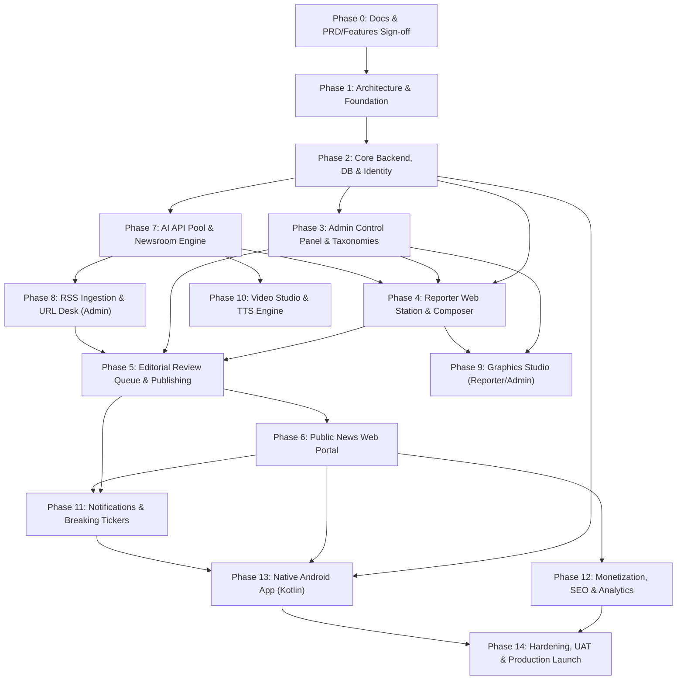

# Engineering Plan & Development Roadmap: BREAKING NEWS WALA
## Project: BREAKING NEWS WALA (ब्रेकिंग न्यूज़ वाला)
**Tagline:** भारत के जिलों से, आपके दिलों तक  
**Document Identifier:** `docs/Plan.md` (and `docs/03-Plan.md`)  
**Version:** 1.0.0 (Master Engineering Roadmap & Implementation Plan)  
**Status:** Approved for Architectural Execution & Sprint Planning  
**Classification:** Internal Confidential / Engineering Program Master Plan  
**Primary Authors:** Senior Technical Product Manager, Software Project Planner, Engineering Program Manager & Cross-Platform Solution Architect  
**Prerequisites:**  
- `docs/01-PRD.md` (Product Requirements Document, v1.0.0)  
- `docs/02-Features.md` (Feature Specification Document, v1.0.0)  

---

## 1. Executive Summary & Strategy Overview

**BREAKING NEWS WALA** is an enterprise-scale vernacular digital news publishing ecosystem engineered to bridge hyper-local grassroots journalism across India's districts with centralized editorial verification and AI-augmented newsroom workflows. Operating under the motto *"भारत के जिलों से, आपके दिलों तक"*, the platform delivers district-level, state, national, and international reporting across a Public News Portal, a Reporter Command Station, an Admin Central Newsroom, an AI Newsroom Engine, a Graphics Studio, and a Video Production Studio.

The platform development is executed in two synchronized, non-overlapping platform stages governed by an **API-First, Shared-Backend, Shared-Database** architecture:

```
+----------------------------------------------------------------------------------------------------+
|                                    PLATFORM DELIVERY STRATEGY                                      |
+----------------------------------------------------------------------------------------------------+
|                                                                                                    |
|    STAGE A: WEB ECOSYSTEM & DIGITAL NEWSROOM (Q1 2027)                                             |
|    ─────────────────────────────────────────────────────────────────────────────────────────────   |
|    - Public Responsive News Web Portal (Dainik Bhaskar-inspired layout, 21 Hindi categories)       |
|    - Single Shared Backend & Relational/Document Database (Node.js/TypeScript REST API)           |
|    - Reporter Web Command Station (Raw Script AI writing, media uploads, district-locked filing)    |
|    - Admin Central Newsroom (Two-tier review queue, trusted reporter direct-publishing tier)       |
|    - Admin RSS Ingestion & Authorized URL-to-News Extraction Desk (Admin-only)                     |
|    - Reporter Graphics Studio (Raw script only, assigned templates, auto-scaling Devanagari text)   |
|    - Admin Graphics Studio (Master template designer, layer locking, reporter provisioning)        |
|    - AI API Pool (Multi-key Gemini orchestration, 80% quota tracking, sub-1.5s failover)           |
|    - Live Header Breaking Ticker, Web Push (VAPID), schema.org NewsArticle, and Open Graph Previews |
|                                                                                                    |
|                                                │                                                   |
|                                                ▼                                                   |
|                                                                                                    |
|    STAGE B: NATIVE ANDROID APPLICATION & ADVANCED MULTIMEDIA (Q2 2027)                             |
|    ─────────────────────────────────────────────────────────────────────────────────────────────   |
|    - Fully Native Kotlin Android App (Jetpack Compose UI, official Android SDK, zero WebViews)     |
|    - Shared Backend & Identical REST/JSON API Contracts (Zero backend code duplication)           |
|    - Native Push Notifications via Firebase Cloud Messaging (FCM) with district/category channels  |
|    - Room Local SQLite Database & WorkManager Background Prefetching (Full Offline Reading)        |
|    - In-App Reporter Camera & Field Microphone Capture with hardware acceleration and GPS geotag   |
|    - Integrated Video Studio (News script to multi-track timeline, neural Hindi TTS, MP4 export)   |
|    - Reader Referral & Engagement Coin Gamification Ledger (Strictly non-cash reward points)       |
|                                                                                                    |
+----------------------------------------------------------------------------------------------------+
```

---

## 2. Mandatory Cross-Platform Architecture Rulebook

Every development phase, API contract, and database schema in this plan must strictly adhere to the following **Ten Cross-Platform Invariants**:

1. **One Shared Backend & Single Database:** A single, centralized backend service and database cluster powers both the Web Platform (Stage A) and Native Android App (Stage B). No secondary backends or fragmented database silos are permitted.
2. **API-First Contracts:** All business capabilities must be exposed via standardized, platform-neutral REST/JSON APIs before UI consumption. Client-specific hacks in backend payloads are prohibited.
3. **Shared Business Logic & RBAC:** Permissions, editorial review gates, district filing locks, and trusted-reporter publishing tiers are enforced strictly on the server side and apply identically to Web and Android requests.
4. **Shared Authentication & Identity:** Single user/reporter identity registry. A reporter logging in via desktop browser or Android mobile app accesses identical credentials, jurisdiction locks, and draft histories.
5. **Shared Content & Master Taxonomies:** The 21 canonical Hindi categories, Madhya Pradesh district hierarchies (55 districts), published articles, and uploaded media assets are identical across both platforms.
6. **Separation of Concerns:** Clear physical separation between frontend presentation clients and the core API gateway.
7. **Platform-Specific UI & Navigation:** The Web Platform utilizes responsive multi-column web layouts with sticky category headers. The Android App utilizes native Jetpack Compose Material 3 components, BottomNavigationBar, and gesture navigation. UI layouts may differ; business rules and data models remain 100% consistent.
8. **Shared Design Tokens & Brand Identity:** Both platforms share color tokens (Yellow `#EAB308`, Red `#DC2626`, Dark Charcoal `#1F2937`, White `#FFFFFF`), Devanagari typography scales (Noto Sans Devanagari / Mukta), and the official globe brand mark (`/public/assets/aistudio/LOGO_88407b32.png`).
9. **Android Compatibility Guardrail:** Web development must never introduce server-side constraints (e.g., cookie-only sessions, server-rendered session HTML, non-standard payload formats) that impede native Android consumption. Android compatibility must be validated during Web development, not retrofitted afterward.
10. **Zero WebView Shortcuts:** The final Android deliverable must be written in pure Kotlin with the Android SDK. Web wrappers, Cordova/Capacitor shells, or disguised iframes are strictly disallowed as production deliverables.

---

## 3. Core Development Principles & Governance

- **Documentation-First Discipline:** No code is written before its architectural specification, database schema, and API contracts are fully documented and approved in `docs/`.
- **Architecture Before Implementation:** Infrastructure, authentication models, and data invariants must be finalized prior to UI development.
- **Dependency-Aware Phasing:** Modules are developed in strict topological sequence. Dependent modules (e.g., Editorial Queue) never begin until their prerequisites (e.g., Core Auth and Draft Composer) are verified and stable.
- **Small, Testable Units:** Each development phase is decomposed into small, verifiable engineering tasks with concrete empirical proof requirements.
- **One Feature, One Scope:** A coding task must never silently alter or refactor unrelated modules.
- **Rigorous Verification Gates:** Completion of any phase requires empirical proof (HTTP response logs, compilation builds, test runner outputs, or visual verification). "It looks correct" is never accepted.
- **Strict Role-Based Boundary Enforcement:**
  - Reporters have access **only** to Raw Script input and Admin-assigned templates.
  - URL-to-News and URL-to-Graphic tools are strictly restricted to Central Newsroom Admins.
  - Standard Reporters must submit to `PENDING_REVIEW`. Trusted Reporters publish directly (`PUBLISHED`) strictly within allocated districts.
- **Environment Isolation:** Development, Staging, and Production environments remain strictly partitioned with separate database instances, API keys, and cloud storage buckets.

---

## 4. Master Development Roadmap & Gantt Timeline

The engineering roadmap spans 15 structured phases across 32 weeks, leading from initial documentation approval to full multi-platform production rollout:

```mermaid
gantt
    title BREAKING NEWS WALA — Master Engineering Roadmap (2026-2027)
    dateFormat  YYYY-MM-DD
    axisFormat  %b %Y

    section Stage A: Foundation & Web Platform
    Phase 0: Documentation & Governance         :done,    p0, 2026-11-01, 2026-11-14
    Phase 1: Architecture & Technical Foundation:active,  p1, 2026-11-15, 2026-11-28
    Phase 2: Core Backend, DB & Identity (RBAC) :         p2, 2026-11-29, 2026-12-19
    Phase 3: Admin Control Panel & Master Data  :         p3, 2026-12-20, 2027-01-09
    Phase 4: Reporter Web Station & Composer    :         p4, 2027-01-10, 2027-01-30
    Phase 5: Editorial Newsroom & Approval Queue:         p5, 2027-01-31, 2027-02-13
    Phase 6: Public News Web Portal & Reader    :         p6, 2027-02-14, 2027-03-06
    Phase 7: AI Newsroom Engine & Multi-Key Pool:         p7, 2027-03-07, 2027-03-20
    Phase 8: RSS & Authorized Wire Desk (Admin) :         p8, 2027-03-21, 2027-03-27
    Phase 9: Graphics Studio (Reporter & Admin) :         p9, 2027-03-28, 2027-04-10
    Phase 10: Video Studio & Neural Voiceover   :        p10, 2027-04-11, 2027-04-24
    Phase 11: Real-Time Ticker & Push Engine    :        p11, 2027-04-25, 2027-05-08
    Phase 12: Monetization, SEO & Analytics     :        p12, 2027-05-09, 2027-05-22

    section Stage B: Native Android & Launch
    Phase 13: Native Android App (Kotlin/Compose):       p13, 2027-05-23, 2027-06-26
    Phase 14: Hardening, Security, UAT & Launch :        p14, 2027-06-27, 2027-07-10
```

---

## 5. Phase-by-Phase Dependency Graph

The following Mermaid diagram outlines the critical path and topological prerequisites across all 15 development phases:



---

## 6. Detailed Phase Specifications (Phases 0 through 5)

---

### Phase 0 — Documentation and Requirement Finalization
- **Phase ID:** `PHASE-00`
- **Phase Name:** Documentation, Requirement Finalization & Governance Setup
- **Timeline:** Weeks 1 – 2 (Nov 1 – Nov 14, 2026)
- **Phase Lead:** Senior Technical Product Manager & Lead Systems Architect
- **Objective:** Establish an authoritative, unambiguous documentation baseline that guides all future architectural, database, API, and engineering development without speculative assumptions or unapproved scope creep.

#### Granular Task Breakdown
1. **Task 0.1: PRD Validation & Sign-off:** Thoroughly review `docs/01-PRD.md` (v1.0.0); verify all 36 sections; validate that the 21 canonical Hindi categories, Madhya Pradesh district focus, dual content creation workflows, and Stage B Native Android roadmap are 100% aligned with executive intent.
2. **Task 0.2: Feature Specification Review:** Validate `docs/02-Features.md` (v1.0.0); verify all 19 functional modules (Modules A through S) and ensure bidirectional traceability against PRD requirements.
3. **Task 0.3: Architecture & Technical Document Scoping:** Define structural outlines for downstream technical specifications: `03-Architecture.md`, `04-Database.md`, `05-API.md`, `06-Auth.md`, `07-Security.md`, `08-API-Pool.md`, `09-Graphics-Studio.md`, `10-Video-Studio.md`, `11-Monetization.md`, and `12-Roadmap.md`.
4. **Task 0.4: Decision Register Resolution Protocols:** Formulate review protocols for the 6 open architectural items (`OPQ-001` through `OPQ-006`), establishing clear architectural decision gates before implementation code is initiated.
5. **Task 0.5: Engineering Contribution & Git Standards:** Document repository branch policies (`main`, `staging`, `feature/*`), conventional commit standards (`feat`, `fix`, `docs`, `refactor`, `test`, `chore`), and atomic pull request review checklists.

#### Android Compatibility Guardrail
- Mandate that all downstream API contracts, data models, and authentication token schemes explicitly include Android Native client considerations from Day One. No web-only assumptions are permitted in technical specifications.

#### Verification & Proof Requirements
- Complete documentation suite present in repository with zero missing reference links.
- Bidirectional traceability matrix verified with zero orphan requirements.
- Formal sign-off recorded in project change log.

#### Deliverables & Milestones
- `docs/01-PRD.md` (Approved Baseline v1.0.0)
- `docs/02-Features.md` (Approved Baseline v1.0.0)
- `docs/Plan.md` (Approved Baseline v1.0.0)
- Milestone M0: Documentation Gateway Certified.

---

### Phase 1 — Technical Architecture and Foundation
- **Phase ID:** `PHASE-01`
- **Phase Name:** Technical Architecture, Foundation & Cross-Platform Bridge
- **Timeline:** Weeks 3 – 4 (Nov 15 – Nov 28, 2026)
- **Phase Lead:** Principal Solution Architect & Principal Backend Engineer
- **Objective:** Finalize the cross-platform system architecture, select approved database/backend technology stacks, define standardized REST/JSON API protocols, configure deployment environments, and establish security baselines.

#### Granular Task Breakdown
1. **Task 1.1: Shared Backend & Database Technology Selection:**
   - Resolve `OPQ-002` (Database Engine selection). Evaluate PostgreSQL (with JSONB for flexible dispatches) vs Cloud Firestore vs Hybrid relational/document model.
   - Author and approve `docs/03-Architecture.md` and `docs/04-Database.md`.
   - Formulate database migration scripts, connection pooling, and multi-region replication architecture.
2. **Task 1.2: API Protocol & JSON Schema Contracts:**
   - Author and approve `docs/05-API.md`.
   - Establish standardized JSON envelope format: `{ success: true, data: {...}, error: null, meta: { timestamp, version } }`.
   - Define cursor-based pagination standards (`limit`, `cursor`, `hasMore`).
   - Standardize HTTP status codes and machine-readable error codes (`PERMISSION_DENIED`, `DISTRICT_UNAUTHORIZED`, `TOKEN_EXPIRED`, `RATE_LIMITED`).
3. **Task 1.3: Authentication & RBAC Lifecycle Design:**
   - Author and approve `docs/06-Auth.md`.
   - Define multi-role claims (`PUB`, `REP-STD`, `REP-TRU`, `EDT`, `ADM`).
   - Establish short-lived JWT access token policies (15 mins) and cryptographically secure refresh token rotation (14 days).
   - Define secure session storage: HTTP-only, SameSite=Strict cookies for Web; Android Keystore Bearer tokens for Native Android.
4. **Task 1.4: Cloud Storage & Media Delivery Infrastructure:**
   - Configure cloud object storage buckets (GCS / S3) with separate access tiers: Public CDN bucket for published news media; Encrypted Private bucket for reporter identity proofs and raw audio dispatches.
   - Set up image compression and WebP conversion microservices.
5. **Task 1.5: Environment Segregation & CI/CD Pipelines:**
   - Provision isolated Development, Staging, and Production environments.
   - Implement automated GitHub Actions CI/CD workflows: linting, TypeScript compilation, security secret scanning, and automated deployment.
   - Enforce zero secret storage in source code; bind Google Cloud Secret Manager / Vault for runtime secrets.

#### Android Compatibility Guardrail
- Verify that authentication tokens can be passed via standard `Authorization: Bearer <token>` HTTP headers.
- Verify that all date/time fields use ISO 8601 UTC strings (`YYYY-MM-DDTHH:mm:ssZ`) easily parsed by Kotlin `java.time` / kotlinx-datetime.
- Verify that media URLs are absolute HTTPS links accessible by Android Coil / Glide libraries.

#### Verification & Proof Requirements
- Automated build pipeline passes cleanly (`npm run build`, `npm run lint`).
- Cloud environments reachable with health check returning HTTP 200: `{ status: 'healthy', version: '1.0.0' }`.
- Completed architectural documentation: `03-Architecture.md`, `04-Database.md`, `05-API.md`, `06-Auth.md`.

#### Deliverables & Milestones
- `docs/03-Architecture.md`, `docs/04-Database.md`, `docs/05-API.md`, `docs/06-Auth.md`
- Configured Cloud Storage Buckets (Public & Private)
- Functional CI/CD Pipeline with environment secret binding
- Milestone M1: Core Architecture & Foundation Locked.

---

### Phase 2 — Core Backend, Database & Identity
- **Phase ID:** `PHASE-02`
- **Phase Name:** Core Backend Implementation, Relational Entities & Identity RBAC
- **Timeline:** Weeks 5 – 7 (Nov 29 – Dec 19, 2026)
- **Phase Lead:** Lead Backend Engineer & Security Specialist
- **Objective:** Implement the core database schema, seed master taxonomies (21 categories & 55 MP districts), build user/reporter authentication services, enforce server-side RBAC, and establish immutable audit logging.

#### Granular Task Breakdown
1. **Task 2.1: Database Schemas & Migrations Implementation:**
   - Execute baseline database schemas for core entities: `users`, `reporters`, `articles`, `categories`, `subcategories`, `locations` (states, districts, cities), `assigned_territories`, `audit_logs`, `tickers`, `comments`.
   - Implement database indexes: compound index on `(status, publishedAt DESC)`, index on `(districtId, status)`, index on `(categoryId, status)`.
2. **Task 2.2: Master Taxonomies Seeding:**
   - Seed all 21 approved canonical Hindi categories with Devanagari titles, slugs, and display order.
   - Seed master Indian states, complete with all 55 districts of Madhya Pradesh (Niwari, Bhopal, Indore, Gwalior, Jabalpur, Ujjain, Sagar, Rewa, Satna, etc.) and primary tehsils/cities with pin codes.
3. **Task 2.3: Identity & Authentication Endpoints:**
   - Build `/api/v1/auth/register` (Mobile OTP / Email).
   - Build `/api/v1/auth/login` and `/api/v1/auth/verify-otp`.
   - Build `/api/v1/auth/refresh-token` with automated token rotation and reuse detection.
   - Build `/api/v1/auth/logout` and `/api/v1/auth/revoke-sessions`.
4. **Task 2.4: Authoritative Server-Side RBAC Middleware:**
   - Implement Express / Fastify server-side RBAC middleware (`requireRole`, `requirePermission`).
   - Enforce hard boundary checks: standard reporters blocked from writing `status: 'published'`; non-admins blocked from altering category or ticker tables; suspended accounts rejected with HTTP 403.
5. **Task 2.5: Immutable Audit Logging Engine:**
   - Create append-only `audit_logs` service recording `actorUid`, `actorRole`, `actionType`, `targetId`, `previousState`, `newState`, `ipAddress`, `userAgent`, and `timestamp`.
   - Bind automated audit triggers to all administrative mutations and trusted reporter direct-publishing events.

#### Android Compatibility Guardrail
- Endpoints return standard HTTP status codes (200, 201, 400, 401, 403, 404, 429, 500) natively handled by Retrofit / OkHttp without requiring custom client parsing hacks.
- Auth tokens formatted as standard RFC 6750 Bearer JWT tokens.

#### Verification & Proof Requirements
- Postman / curl test suite proving:
  - User registration and login yields valid JWT with correct role claims.
  - Standard reporter token attempting `status: 'published'` write returns HTTP 403 `PERMISSION_DENIED`.
  - Non-admin attempting category deletion returns HTTP 403.
  - Database seed script populates 21 categories and 55 MP districts verified via automated SQL/NoSQL assertions.
- 100% of mutation operations generate verified entries in `audit_logs`.

#### Deliverables & Milestones
- Functional Backend API Gateway running on Staging.
- Seeded Database with 21 Categories and 55 MP Districts.
- Complete Auth & RBAC Endpoint Suite.
- Milestone M2: Core Backend, Schema & Identity Certified.

---

### Phase 3 — Admin Control Panel & Master Data Management
- **Phase ID:** `PHASE-03`
- **Phase Name:** Admin Control Panel, Governance & Master Data Console
- **Timeline:** Weeks 8 – 10 (Dec 20, 2026 – Jan 9, 2027)
- **Phase Lead:** Senior Frontend Engineer & Full-Stack Lead
- **Objective:** Construct the centralized administrative console allowing Super Admins to manage user accounts, vet and approve reporter applications, allocate territorial districts, manage dynamic categories, view audit trails, and oversee system health.

#### Granular Task Breakdown
1. **Task 3.1: Admin Console Shell & Navigation Framework:**
   - Build responsive administrative dashboard layout with high-contrast dark charcoal theme, collapsible navigation sidebar, top stats bar, and role-guarded routing.
   - Enforce multi-factor authentication prompt for administrative sessions.
2. **Task 3.2: User & Reporter Management Roster:**
   - Implement searchable, paginated data table of all platform users and reporters.
   - Build reporter application review modal: display applicant details, inspect uploaded identity documents from private cloud storage, approve/reject accounts with mandatory reason logging.
   - Implement account suspension and reactivation toggles with immediate session invalidation.
3. **Task 3.3: Territorial Jurisdiction Allocation Console:**
   - Implement district and city allocation interface: assign primary district (e.g., Niwari) and secondary authorized territories to reporters.
   - Enforce that updates write to reporter profile and take effect immediately on news-filing APIs.
4. **Task 3.4: Trusted Reporter Elevation Governance:**
   - Build direct-publishing privilege toggle (`is_trusted_publisher: true`).
   - Require explicit confirmation modal detailing legal responsibilities.
   - Write immutable record to audit log upon status elevation or revocation.
5. **Task 3.5: Dynamic Category & Location Master Controller:**
   - Implement drag-and-drop category reordering interface updating `displayOrder`.
   - Build category creation, editing, and icon upload drawer.
   - Build Category Archival Safeguard: suppress archived categories from navigation while strictly preserving historical article routing (zero 404s).
   - Implement State -> District -> City taxonomy editor.
6. **Task 3.6: System Audit Log & Health Monitor UI:**
   - Build filterable audit log viewer with actor, action type, date range, and target filters.
   - Implement JSON diff viewer displaying before/after state snapshots.
   - Export audit logs to CSV format.

#### Android Compatibility Guardrail
- Category and location data modified by Admin must immediately reflect in JSON responses consumed by future Android clients without requiring client app rebuilds or updates.

#### Verification & Proof Requirements
- Admin can successfully approve a pending reporter, assign Niwari district, and toggle trusted status.
- Category reordering in Admin UI updates the public category API response order instantly.
- Archiving a category preserves access to existing articles tagged with that category ID.
- Every administrative change generates an immutable record in the audit log table.

#### Deliverables & Milestones
- Responsive Web Admin Control Panel deployed on Staging.
- Reporter Onboarding, District Allocation & Trusted Governance System.
- Dynamic Category & Location Management Suite.
- Milestone M3: Admin Governance Console Live.

---

### Phase 4 — Reporter Web Application & Workspace
- **Phase ID:** `PHASE-04`
- **Phase Name:** Reporter Web Application, Composer & Dispatch Management
- **Timeline:** Weeks 11 – 13 (Jan 10 – Jan 30, 2027)
- **Phase Lead:** Senior Frontend Engineer (CMS Specialist) & UX Designer
- **Objective:** Deliver a distraction-free, mobile-responsive web command station for field reporters, featuring draft composers, raw script inputs, photo attachment tools, territorial dropdown locks, submission tracking, and editorial revision loops.

#### Granular Task Breakdown
1. **Task 4.1: Reporter Command Station Shell & Overview:**
   - Build authenticated reporter workstation at `/reporter/dashboard`.
   - Implement overview metrics cards: Stories Filed, Pending Review, Revision Requested, Published Count, Monthly Article Views.
   - Display verified reporter badge with allocated primary district (e.g., "अधिकृत रिपोर्टर - निवाड़ी").
2. **Task 4.2: Manual News Composer (Rich-Text Editor):**
   - Implement ProseMirror / TipTap Devanagari rich-text editor supporting bold, italics, quotes, lists, sub-headings, and live word/character counters.
   - Implement reading time calculator (200 words/min).
   - Build auto-save engine saving local draft to browser storage every 30 seconds and syncing to server drafts collection.
3. **Task 4.3: Raw Script Input Desk:**
   - Build "त्वरित रॉ स्क्रिप्ट" (Quick Raw Script) interface allowing reporters to paste rough notes, bullet points, or mobile voice transcripts.
   - Build client-side tone selector (*तथ्यात्मक/Breaking*, *विस्तृत/Detailed*, *प्रशासनिक/Governance*).
   - Prepare payload structure for Phase 7 AI structuring handoff.
4. **Task 4.4: Field Media Attachment & Aspect Cropper:**
   - Build photo upload station supporting up to 10 photos and 1 short video clip.
   - Implement client-side image compression (converting high-res mobile photos to WebP < 300KB before transmission).
   - Embed interactive Cropper.js widget with preset news aspect ratios (16:9 landscape primary, 1:1 square, 4:3 standard).
   - Include caption and photo credit input fields.
5. **Task 4.5: Territorial Jurisdiction Locking:**
   - Populate category dropdown with active canonical categories.
   - Strictly bind district and city dropdowns to reporter's allocated jurisdictions (`reporter.assigned_districts`).
   - Prevent filing or tagging outside assigned territory via client UI disablement and server-side validation.
6. **Task 4.6: Submission to Review Queue & Status Tracker:**
   - Build submission flow transitioning completed draft to `status: 'pending_review'`.
   - Build "मेरी खबरें" (My Filed Stories) tab with status pills (`ड्राफ्ट`, `समीक्षा में`, `संशोधन अपेक्षित`, `प्रकाशित`, `अस्वीकृत`).
   - Implement real-time status updates via WebSocket or snapshot listener.
7. **Task 4.7: Revision Request & Resubmission Loop:**
   - Build editorial revision banner displaying editor's critique notes (e.g., *"तथ्यों की पुष्टि करें", "फोटो स्पष्ट नहीं है"*).
   - Unlock draft for reporter editing; implement "संशोधित खबर पुनः भेजें" (Resubmit) button incrementing revision count and returning story to top of Admin review queue.

#### Android Compatibility Guardrail
- Media upload endpoints must accept standard `multipart/form-data` payloads identical to what the future Android app's OkHttp / Retrofit `MultipartBody` will send.
- Draft entities and status schemas must be 100% platform-agnostic.

#### Verification & Proof Requirements
- Reporter can compose, crop 16:9 photo, and submit story under assigned district.
- Submitting story under an unauthorized district ID via curl/Postman fails with HTTP 403 Forbidden.
- Editorial revision notes render prominently in the reporter's editor; resubmitting transitions status back to `pending_review`.
- Uploaded 8MB camera photo compresses to < 350KB WebP on client before cloud bucket storage.

#### Deliverables & Milestones
- Responsive Reporter Web Station deployed at `/reporter`.
- Devanagari Rich-Text Composer with Auto-Save.
- Media Cropper & Client Compression Pipeline.
- Submission Queue & Revision Loop.
- Milestone M4: Reporter Workspace Certified.

---

### Phase 5 — Central Digital Newsroom & Editorial Workflow
- **Phase ID:** `PHASE-05`
- **Phase Name:** Central Editorial Newsroom, Review Desk & Publishing Engine
- **Timeline:** Weeks 14 – 15 (Jan 31 – Feb 13, 2027)
- **Phase Lead:** Senior Full-Stack Engineer & Managing Editor Liaison
- **Objective:** Build the central editorial review engine where desk editors inspect incoming field reports in a dual-column split view, edit copy in place, approve, reject, request revisions, designate breaking news, and execute direct publishing for trusted reporters.

#### Granular Task Breakdown
1. **Task 5.1: Real-Time Pending Editorial Review Queue:**
   - Build interactive review queue at `/admin/newsroom` displaying all stories with `status == 'pending_review'`.
   - Implement filters by district, state, category, priority, and elapsed wait time.
   - Build atomic review claiming lock: claiming a story sets `lockedByEditorUid` for 15 minutes, preventing two sub-editors from editing the same story simultaneously.
2. **Task 5.2: Dual-Column Verification & In-Place Editing Workstation:**
   - Implement desktop split-screen interface: left pane displays reporter's original raw notes (`rawScriptOriginal`); right pane displays formatted editable article copy.
   - Provide sub-editors with full in-place editing tools to refine headlines, rewrite paragraphs, re-crop photos, and adjust metadata.
   - Preserve original raw notes immutably in article record for legal and audit verification.
3. **Task 5.3: Decisive Editorial Action Engine:**
   - **Approve & Publish:** Sets `status: 'published'`, stamps `approvedByUid`, sets `publishedAt: NOW()`, purges edge cache, broadcasts real-time feed update.
   - **Reject:** Prompts for categorized feedback reason (*अपूर्ण जानकारी*, *तथ्यों की पुष्टि नहीं*, *कॉपीराइट उल्लंघन*); sets `status: 'rejected'`; dispatches notification to reporter.
   - **Request Revision:** Captures editor's instructions; sets `status: 'revision_requested'`; returns story to reporter's revision inbox.
4. **Task 5.4: Trusted Reporter Direct-Publishing Pipeline:**
   - Implement bypass route for reporters with `is_trusted_publisher: true`.
   - Validate that article `districtId` matches reporter's authorized jurisdiction; transition story immediately to `status: 'published'`.
   - Trigger immediate audit log entry and dispatch real-time alert to Central Newsroom desk for retrospective editorial oversight.
5. **Task 5.5: Breaking News Tagging & Top News Flagging:**
   - Add editorial toggles: `is_breaking: true`, `is_top_news: true`, `hero_order: 1..5`.
   - Setting breaking flag prompts editor to input live header ticker marquee text and select expiry duration (1 hr, 2 hrs, 4 hrs, Custom).
6. **Task 5.6: Errata, Corrections Log & Version History:**
   - Build post-publication correction engine: modifying published stories creates immutable historical snapshot in `article_versions`.
   - Injects standardized Devanagari correction notice (*संशोधन / स्पष्टीकरण*) at top of public article reader detailing modified facts and timestamp.

#### Android Compatibility Guardrail
- When an article is approved or direct-published, publication events must emit a standardized webhook / message broker event capable of triggering both Web Cache purges and future Android FCM push notifications.

#### Verification & Proof Requirements
- Side-by-side view accurately displays raw notes alongside editable draft.
- Editor approval immediately transitions article to `status: 'published'`.
- Trusted reporter direct publish goes live instantly without entering the queue; non-trusted reporter cannot bypass queue.
- Modifying a published article creates an unalterable version record in `article_versions`.

#### Deliverables & Milestones
- Dual-Column Editorial Review Station live on Staging.
- Review Claiming Lock & Concurrency Control.
- Approval, Rejection & Revision Workflow.
- Trusted Reporter Direct-Publishing Engine.
- Milestone M5: Central Digital Newsroom Operational.

---

## 7. Detailed Phase Specifications (Phases 6 through 10)

---

### Phase 6 — Public News Website & Vernacular Reader Experience
- **Phase ID:** `PHASE-06`
- **Phase Name:** Public News Web Portal & Vernacular Reader Experience
- **Timeline:** Weeks 16 – 18 (Feb 14 – Mar 6, 2027)
- **Phase Lead:** Principal Frontend Architect & Senior UI/UX Engineer
- **Objective:** Construct the high-performance public news web portal, featuring a Dainik Bhaskar-inspired high-density Hindi layout, live breaking ticker, 21-category navigation, district switcher, full article reader, full-text search, and accessibility controls.

#### Granular Task Breakdown
1. **Task 6.1: Public Homepage Architecture & UX Hierarchy:**
   - Construct responsive homepage at `/` adhering to approved brand tokens (Yellow `#EAB308`, Red `#DC2626`, Charcoal `#1F2937`, White `#FFFFFF`).
   - Implement **Top Super-Bar**: Hindi date/time (*शुक्रवार, 30 अक्टूबर 2026*), District selector toggle, E-paper placeholder, User login avatar.
   - Implement **Brand Masthead**: Official globe logo (`/public/assets/aistudio/LOGO_88407b32.png`) and tagline *"भारत के जिलों से, आपके दिलों तक"*.
   - Implement **Live Breaking Ticker Ribbon**: CSS-animated marquee scrolling Admin-managed breaking headlines beneath header.
   - Implement **Hero Editorial Grid (बड़ी खबरें)**: Lead anchor story card (16:9 banner, bold Devanagari headline, summary lead, district tag) flanked by 3-4 secondary state/national stories.
   - Implement **Hyper-Local District Block (मेरा शहर / मेरा जिला)**: Dynamically filters to user's selected district (e.g., *निवाड़ी समाचार*, *भोपाल हलचल*).
   - Implement **Categorized Section Grids**: Dedicated modular sections for राजनीति, खेल, मनोरंजन, बिजनेस, धर्म-कर्म.
   - Implement **Compliance Footer**: Complete sitemap, editorial ethics code, Grievance Officer details (IT Rules 2021), copyright notices.
2. **Task 6.2: Dynamic 21-Category Sticky Navigation:**
   - Build sticky header navigation presenting all 21 approved categories.
   - Implement horizontal swipe/scroll bar on mobile with overflow "अन्य" dropdown.
   - Connect active category tabs to filtered category feed routes (`/category/{slug}`).
3. **Task 6.3: Hyper-Local District & City Switcher:**
   - Build header district selector modal with instant Devanagari live search.
   - Cascading dropdowns: State (Madhya Pradesh) -> District (55 districts) -> City/Tehsil (e.g., Niwari -> Orchha).
   - Persist selection in localStorage / cookies; dynamically adapt homepage "मेरा जिला" block.
4. **Task 6.4: Full Article Reader Experience:**
   - Build dedicated reading view at `/news/{category}/{district}/{slug}`.
   - High-contrast typography: Dark charcoal text on white background (light mode) and soft off-white on `#111827` (dark mode) with line-height 1.8.
   - Display verified reporter byline, district badge, publication/update timestamps, reading time, and tags.
   - Embed inline photo galleries, video clips, and blockquotes.
   - Implement font-size controls (`अ-`, `अ`, `अ+`) scaling article body text from 14px to 22px without layout clipping.
5. **Task 6.5: Real-Time Vernacular Search & Auto-Suggestions:**
   - Build full-text search modal with debounced (300ms) Devanagari auto-suggestions.
   - Implement search results page (`/search?q=...`) supporting category, date, and district filters.
6. **Task 6.6: Bookmarks & Read Later ("सेव की गई खबरें"):**
   - Implement one-tap bookmark ribbon saving article IDs to localStorage for guests and syncing to user profile for logged-in accounts.
   - Build `/saved` reader library page with offline cached reading capabilities.
7. **Task 6.7: Social Sharing & WhatsApp Optimization:**
   - Implement floating social share bar with WhatsApp, Facebook, Telegram, and X buttons.
   - Generate pre-formatted WhatsApp share payloads with headline, canonical URL, and campaign tracking tags.
8. **Task 6.8: News Error Reporting Modal:**
   - Embed "त्रुटि रिपोर्ट करें" modal in article footer capturing factual inaccuracies or typos directly to Admin editorial inbox.

#### Android Compatibility Guardrail
- Article slugs, category routes, and district IDs must conform to universal deep-linking standards (`https://breakingnewswala.com/news/{category}/{district}/{slug}`), ensuring that the exact same URL opens seamlessly in the future Native Android App via Android App Links.

#### Verification & Proof Requirements
- Google Lighthouse audit achieves: Performance > 90, Accessibility > 95, Best Practices > 95, SEO > 95.
- Largest Contentful Paint (LCP) < 2.2 seconds; First Contentful Paint (FCP) < 1.2 seconds on 4G networks.
- Full 21 categories and 55 MP districts accessible and filterable.
- Font-size scaling functions smoothly across desktop and mobile screens.

#### Deliverables & Milestones
- High-Performance Public News Website live on Staging.
- District Switcher & Localized Feeds.
- Full Article Reader with Devanagari Typography & Dark Mode.
- Vernacular Search & Social Sharing Engine.
- Milestone M6: Public Web Portal Operational.

---

### Phase 7 — AI Newsroom Engine & Multi-Key API Pool
- **Phase ID:** `PHASE-07`
- **Phase Name:** AI Newsroom Engine, Multi-Key Pool & Automated Failover
- **Timeline:** Weeks 19 – 20 (Mar 7 – Mar 20, 2027)
- **Phase Lead:** Senior AI/ML Engineer & Backend Security Lead
- **Objective:** Deploy the server-side AI intelligence gateway, managing multi-key Google Gemini pools, real-time token quotas, automated sub-1.5s failovers upon rate limits, raw-script-to-news structuring, and automated headline generation with zero client secret exposure.

#### Granular Task Breakdown
1. **Task 7.1: Multi-Key Vault & Encrypted Credential Manager:**
   - Implement secure server-side vault storing multiple Google Gemini API keys.
   - Encrypt API keys at rest using AES-256-GCM.
   - Build round-robin load distribution across active key pool.
   - Verify that zero API secrets are ever exposed in client JavaScript builds or Android APKs.
2. **Task 7.2: Real-Time Quota Telemetry & Token Accounting:**
   - Track daily token consumption, prompt tokens, completion tokens, and request counts per key.
   - Display real-time quota progress meters in Admin AI Center.
   - Trigger automated notifications at 80% and 95% quota thresholds.
3. **Task 7.3: Sub-1.5s Automated Failover & Rate-Limit Retry:**
   - Implement gateway interceptor detecting HTTP 429 (Rate Limit Exceeded), 5xx errors, or latency > 8s.
   - Automatically route failing requests to standby keys in pool within 1.5 seconds.
   - Provide seamless fallback to Secondary Provider if primary pool is exhausted.
4. **Task 7.4: Raw Script to News Structuring Engine:**
   - Author optimized Gemini system prompts for Hindi news structuring.
   - Build `/api/v1/ai/structure-script` endpoint converting raw notes and bullet points into:
     - Catchy Hindi Headline (कैची और सटीक शीर्षक)
     - Subheadline (उप-शीर्षक)
     - 3-part structured news body (मुख्य संदर्भ, मुख्य बिंदु, पृष्ठभूमि)
     - Suggested tags, category, and location recommendations.
5. **Task 7.5: AI Headline & Catchphrase Generator:**
   - Build `/api/v1/ai/suggest-headlines` generating 5 distinct ethical headline variations under 70 characters.
6. **Task 7.6: In-Editor Integration:**
   - Connect the AI structuring and headline endpoints to the Reporter Composer (Phase 4) and Central Newsroom (Phase 5).

#### Android Compatibility Guardrail
- The AI API Pool remains strictly on the server backend. The future Android app accesses AI capabilities via the exact same authenticated REST endpoints as the Web client, passing JWT tokens with zero API key exposure in the mobile APK.

#### Verification & Proof Requirements
- Simulated HTTP 429 error on Key #1 triggers automatic failover to Key #2 in < 1.5 seconds with zero client error dialog.
- Raw script input of 4 bullet points generates a publication-grade 300-word Hindi news story in < 5 seconds.
- Automated secret scanning confirms zero API key strings in client repository builds.

#### Deliverables & Milestones
- Multi-Key AI API Pool live in Production Backend.
- Automated Failover & Rate-Limit Engine.
- Raw Script to Hindi News Structuring Pipeline.
- Headline & Tag Suggestion Services.
- Milestone M7: AI Newsroom Engine Certified.

---

### Phase 8 — RSS and Wire Newsroom (Admin Only)
- **Phase ID:** `PHASE-08`
- **Phase Name:** RSS Ingestion, Authorized Wire Desk & URL-to-News Extraction
- **Timeline:** Week 21 (Mar 21 – Mar 27, 2027)
- **Phase Lead:** Senior Backend Engineer & Editorial Systems Specialist
- **Objective:** Build the central automated wire ingestion pipeline and authorized URL extraction desk. **Strict Governance Restriction: This module is exclusively accessible to Central Newsroom Admins. Field reporters have zero access to URL or RSS generation tools.**

#### Granular Task Breakdown
1. **Task 8.1: Authorized RSS Feed Manager & Whitelist:**
   - Build RSS 2.0 / Atom feed parser background worker with customizable polling intervals (15m, 30m, 1h).
   - Implement Admin RSS management table: add feed URL, syndicate name, category mapping, active/paused switch.
   - Implement legal syndicate license ID tracking.
   - Auto-deactivate feeds failing 5 consecutive poll cycles.
2. **Task 8.2: Duplicate Wire Story Detection Engine:**
   - Implement headline SimHash / vector similarity algorithm cross-referencing incoming wire dispatches against articles published in the rolling 48-hour window.
   - Flag dispatches with > 80% similarity as `POTENTIAL_DUPLICATE` with link to existing story.
3. **Task 8.3: Manual Authorized URL-to-News Extraction Desk (Admin Only):**
   - Build `/api/v1/admin/url-to-news` endpoint with rigid SSRF protection (blocking internal IP ranges 127.0.0.1, 10.x.x.x, 169.254.x.x).
   - Extract clean article text, publisher attribution, and publication date.
   - Pass extracted text into AI Newsroom Engine (Phase 7) to synthesize an original Hindi report adhering to platform editorial style.
   - Stamp permanent attribution metadata (`sourceUrl`, `originalPublisherName`, `ingestionMethod: 'URL_EXTRACTION'`).
4. **Task 8.4: Wire Story Curation & Editorial Approval Pipeline:**
   - Ingested stories land in Admin review queue tagged as `WIRE_INGESTION`.
   - Editors inspect copy, verify media licensing, tweak Devanagari headlines, and publish to live feeds.

#### Android Compatibility Guardrail
- Public readers on both Web and future Android app view identical source attribution notices (*"स्रोत: पत्र सूचना कार्यालय (PIB)"*) rendered consistently from the shared database entity.

#### Verification & Proof Requirements
- RSS parser imports active feeds on schedule; paused feeds immediately cease importing.
- Non-admin JWT attempting URL extraction receives HTTP 403 Forbidden.
- SSRF attack payloads (e.g., `http://169.254.169.254/latest/meta-data/`) blocked 100% of the time.
- Duplicate wire stories flagged accurately with similarity percentage.

#### Deliverables & Milestones
- RSS Background Polling Worker.
- Admin URL-to-News Extraction Desk.
- Duplicate Wire Story Detection Engine.
- Milestone M8: Wire Ingestion Desk Operational.

---

### Phase 9 — Graphics Studio (Reporter & Admin)
- **Phase ID:** `PHASE-09`
- **Phase Name:** Integrated Graphics Studio, Canvas Auto-Scaling & Template Engine
- **Timeline:** Weeks 22 – 23 (Mar 28 – Apr 10, 2027)
- **Phase Lead:** Senior Canvas/WebGL Engineer & Creative Director
- **Objective:** Deploy the embedded Graphics Studio. **Mandatory Architectural Restriction: The Reporter Graphics Studio is strictly based on Raw Script input and Admin-assigned templates. Reporters have zero access to URL-to-Graphic, RSS-to-Graphic, template authoring, or unassigned global frames.**

#### Granular Task Breakdown
1. **Task 9.1: Reporter Graphics Studio (Raw Script Only):**
   - Build responsive web studio at `/reporter/graphics`.
   - Restrict template selector strictly to Admin-assigned templates (`reporter.assigned_templates`).
   - Restrict inputs strictly to raw text notes or drafted stories. URL and RSS inputs strictly blocked.
   - Allow photo upload with in-canvas zoom, pan, and snap-to-boundary controls.
   - Export high-resolution cards (1080x1350 portrait, 1080x1080 square) in PNG and WebP formats.
2. **Task 9.2: Dynamic Devanagari Typography Auto-Scaling Engine:**
   - Implement binary search typography scaling algorithm fitting Devanagari headlines inside frame boundaries without clipping.
   - Handle Devanagari compound syllables, matras, and balanced line wraps cleanly.
   - Scale font size smoothly from 24px to 56px based on character volume.
3. **Task 9.3: Admin Graphics Studio & Master Template Designer:**
   - Build WYSIWYG canvas frame builder at `/admin/graphics/templates`.
   - Allow uploading SVG/PNG background frames; define image bounding boxes and headline text zones.
   - Enforce brand layer locking (`isLocked: true`) for official logo watermark and copyright footer.
   - Build URL-to-Graphic and RSS-to-Graphic generators exclusively for central newsroom editors.
4. **Task 9.4: Reporter Template Provisioning Console:**
   - Build administrative assignment console allowing Super Admin to assign specific graphic frames to individual reporters or entire district bureaus (e.g., Niwari Special Frame).
   - Ensure template updates preserve historical cards locked to their original version (`OPQ-004`).

#### Android Compatibility Guardrail
- The dynamic typography auto-scaling algorithm logic must be documented as platform-neutral mathematical formulas so it can be replicated in native Kotlin using Android `StaticLayout.Builder` in Phase 13.

#### Verification & Proof Requirements
- Reporter studio displays only assigned frames; manipulating template ID in API call returns HTTP 403 Forbidden.
- Devanagari headlines of varying lengths (15 to 45 words) auto-fit without text overflow across 50 tested samples.
- High-res card exports in < 1.5 seconds with official logo locked in place.

#### Deliverables & Milestones
- Reporter Graphics Studio (Raw Script Only) live at `/reporter/graphics`.
- Admin Graphics Studio & Template Designer live at `/admin/graphics`.
- Devanagari Typography Auto-Fit Canvas Engine.
- Milestone M9: Graphics Studio Certified.

---

### Phase 10 — Video Studio & Multimedia Production
- **Phase ID:** `PHASE-10`
- **Phase Name:** Video Studio, Multi-Track Sequencer & Neural Hindi TTS
- **Timeline:** Weeks 24 – 25 (Apr 11 – Apr 24, 2027)
- **Phase Lead:** Senior Media Processing Engineer & Audio Specialist
- **Objective:** Deploy the integrated Video Studio allowing editors to create short vertical reels (9:16) and news bulletins (16:9) with multi-track timelines, neural Hindi text-to-speech voiceovers, synchronized Devanagari subtitles, and automated brand stingers.

#### Granular Task Breakdown
1. **Task 10.1: News Script to Multi-Track Video Timeline:**
   - Build timeline sequencer supporting 16:9 Landscape bulletins and 9:16 Vertical Reels.
   - Allow arranging script text segments, slide images, short video clips, and background audio tracks.
   - Calculate total project duration automatically based on speech pacing.
2. **Task 10.2: Neural Hindi TTS Voiceover Engine:**
   - Integrate Google Cloud Text-to-Speech / Neural TTS with high-quality Hindi vernacular voices.
   - Allow selecting formal male / clear female voice profiles; adjust speech rate (0.9x to 1.2x).
   - Support uploading reporter-recorded field voice notes as alternative audio track.
3. **Task 10.3: Synchronized Devanagari Subtitle Auto-Burn:**
   - Generate word-level timed subtitle cues (WebVTT) synchronized with synthesized voiceover.
   - Burn high-contrast Devanagari subtitles directly into video frames for mobile viewers watching on mute.
4. **Task 10.4: Automated Brand Stinger, Logo Watermark & Outro:**
   - Stitches official BREAKING NEWS WALA 3-second animated intro stinger.
   - Overlays animated logo watermark in top-right corner.
   - Adds outro slate with website URL and mobile app download call-to-action.
5. **Task 10.5: Cloud Rendering Pipeline (Serverless FFmpeg / Cloud Run):**
   - Resolve `OPQ-003` (FFmpeg on Cloud Run vs third-party video API).
   - Deploy containerized FFmpeg worker rendering completed projects into optimized H.264 MP4 (1080p / 720p).
   - Implement background rendering queue with progress notification and automatic attachment to article record.

#### Android Compatibility Guardrail
- Exported MP4 videos must be encoded using H.264 Baseline/Main profile with AAC audio to ensure hardware-accelerated playback on Android devices via ExoPlayer / Media3 without stutter.

#### Verification & Proof Requirements
- 45-second vertical news reel renders in < 90 seconds on Cloud Run worker.
- Synthesized Hindi voiceover sounds natural; subtitles sync within 100ms of spoken words.
- Exported video plays smoothly across desktop browsers, iOS Safari, and Android Chrome.

#### Deliverables & Milestones
- Multi-Track Timeline Composer at `/admin/video-studio`.
- Neural Hindi Voiceover & Subtitle Generator.
- Serverless Cloud MP4 Rendering Microservice.
- Milestone M10: Video Studio Operational.

---

## 8. Detailed Phase Specifications (Phases 11 through 14)

---

### Phase 11 — Real-Time Ticker, Push Notifications & Broadcast Engine
- **Phase ID:** `PHASE-11`
- **Phase Name:** Real-Time Ticker, Web Push Notifications & Broadcast Dispatcher
- **Timeline:** Weeks 26 – 27 (Apr 25 – May 8, 2027)
- **Phase Lead:** Senior Real-Time Infrastructure Engineer & DevOps Lead
- **Objective:** Deploy the synchronized real-time breaking news delivery pipeline, powering the high-speed header marquee ticker, urgent emergency modal alerts, browser Web Push notifications (VAPID), and central newsroom editorial alert streams.

#### Granular Task Breakdown
1. **Task 11.1: Live Header Breaking Ticker Stream Engine:**
   - Deploy real-time WebSocket / Server-Sent Events (SSE) broadcaster delivering ticker headline updates to active web and mobile clients in sub-3 seconds.
   - Implement client-side connection manager with exponential backoff auto-reconnect.
   - Implement smooth marquee scrolling with hover/touch pause functionality.
   - Support automated ticker expiration based on `expiresAt` timestamps.
2. **Task 11.2: Emergency Breaking News Modal Alert:**
   - Implement high-priority emergency modal / slide-up sheet on active sessions for critical regional emergencies or national breaking flashes.
   - Restrict modal triggers to Admin priority level `CRITICAL_BREAKING`.
   - Prevent repetitive harassing loops; store dismissed session flag in `sessionStorage`.
3. **Task 11.3: Web Push Notification Dispatcher (VAPID / WebPush):**
   - Implement browser push subscription manager at `/api/v1/notifications/subscribe`.
   - Store encrypted VAPID subscription endpoints tagged by user's preferred district.
   - Implement fan-out worker delivering browser push alerts with headline, 16:9 thumbnail, and direct link for stories flagged `send_push: true`.
   - Implement rate-limiting cap: maximum 4 pushes per user per day.
4. **Task 11.4: Newsroom & Reporter Workflow Alerts:**
   - Implement real-time notifications alerting reporters when their submissions are approved, rejected, or returned for revisions.
   - Increment unreviewed submission badge counters in Admin Newsroom header in real time.
5. **Task 11.5: User Notification Inbox & History:**
   - Build `/notifications` inbox page storing past 30 days of breaking alerts, categorized into "ब्रेकिंग", "मेरा जिला", and "अपडेट्स".

#### Android Compatibility Guardrail
- The backend notification dispatcher must be architected to emit unified payloads consumed by both the Web Push service and the Phase 13 Firebase Cloud Messaging (FCM) sender, sharing the same topic tags (`topic_breaking`, `topic_mp_niwari`).

#### Verification & Proof Requirements
- Breaking ticker updates propagate to 10,000 active web sessions in < 3 seconds.
- Web Push arrives on Chrome, Firefox, and Edge browsers with active service worker.
- Reporter receives real-time editorial alert within 2 seconds of story approval.

#### Deliverables & Milestones
- Real-Time WebSocket / SSE Broadcast Server.
- VAPID Web Push Notification Pipeline.
- Emergency Breaking News Modal System.
- Milestone M11: Notification & Broadcast Engine Live.

---

### Phase 12 — Monetization, SEO Engine & Newsroom Analytics
- **Phase ID:** `PHASE-12`
- **Phase Name:** Monetization Slots, Structured SEO Pipeline & Newsroom Analytics
- **Timeline:** Weeks 28 – 29 (May 9 – May 22, 2027)
- **Phase Lead:** Senior Full-Stack Engineer, SEO Specialist & Data Analyst
- **Objective:** Deploy commercial banner advertising management, sponsored article ASCI compliance labeling, schema.org NewsArticle structured data, Google News XML sitemaps, real-time reader traffic telemetry, and reporter performance scorecards.

#### Granular Task Breakdown
1. **Task 12.1: Standard Display Ad Slot Management:**
   - Implement ad slot containers across Homepage, Category feeds, Article detail, and Video feeds:
     - `TOP_LEADERBOARD` (728x90 desktop / 320x50 mobile)
     - `IN_FEED_NATIVE` (300x250 medium rectangle)
     - `ARTICLE_IN_LINE` (300x250 inside body text after paragraph 3)
     - `ARTICLE_STICKY_BOTTOM` (320x50 mobile persistent)
   - Pre-allocate CSS layout dimensions to eliminate Cumulative Layout Shift (CLS < 0.1).
   - Build ad scheduling console in Admin panel with date range, target district, and click tracking.
2. **Task 12.2: Sponsored Content ASCI Compliance Labeling:**
   - Implement mandatory sponsored article tagging system.
   - Display prominent badge *"प्रायोजित सामग्री | Sponsored by [Brand]"* above headline.
   - Inject mandatory disclaimer at article footer; apply `rel="sponsored"` on all outbound links.
   - Exclude sponsored stories from purely editorial RSS feeds.
3. **Task 12.3: Structured SEO & Google News Sitemaps:**
   - Implement automated schema.org `NewsArticle`, `BreadcrumbList`, and `Organization` JSON-LD generator.
   - Build `/sitemap-news.xml` dynamically serving articles published in the last 48 hours conforming to Google News protocol.
   - Implement Open Graph and Twitter Card dynamic tags with 1200x630px social previews.
4. **Task 12.4: Real-Time Traffic & Reporter Scorecards:**
   - Build live reader telemetry monitor displaying concurrent active visitors and real-time read counters.
   - Implement algorithmic Trending Index ranking viral stories based on view and share velocity.
   - Build Reporter Performance Scorecard tracking monthly filing volume, approval ratios, and reader impressions.

#### Android Compatibility Guardrail
- SEO JSON-LD and XML sitemaps apply to web endpoints; native Android app links must be mapped via `assetlinks.json` pointing directly to canonical web slugs.
- Ad slot schemas must support future Google Mobile Ads (GMA) SDK native banner mapping.

#### Verification & Proof Requirements
- Validated 100% on Google Rich Results Test for `NewsArticle` schema.
- `/sitemap-news.xml` validated in Google Search Console with valid news publication tags.
- Ad banners load asynchronously without delaying article text (CLS < 0.1).
- Sponsored articles clearly display ASCI disclosure notices.

#### Deliverables & Milestones
- Display Ad Slot Management & Impression Telemetry.
- schema.org NewsArticle & Google News XML Sitemap Pipeline.
- Newsroom Traffic & Reporter Performance Analytics Dashboard.
- Milestone M12: Monetization, SEO & Analytics Operational.

---

### Phase 13 — Native Android Application (Stage B)
- **Phase ID:** `PHASE-13`
- **Phase Name:** Native Android Application (Kotlin, Jetpack Compose, FCM, Offline DB)
- **Timeline:** Weeks 30 – 34 (May 23 – Jun 26, 2027)
- **Phase Lead:** Principal Android Architect & Senior Mobile Engineer
- **Objective:** Develop and release the official, fully native Android application for BREAKING NEWS WALA using Kotlin, Jetpack Compose, the official Android SDK, Room local database for offline news prefetching, Android WorkManager, and Firebase Cloud Messaging (FCM). **Strict Rule: Zero WebView wrappers or hybrid shells.**

#### Granular Task Breakdown
1. **Task 13.1: Android Project Scaffolding & Shared API Integration:**
   - Initialize native Android project in Kotlin with Jetpack Compose, Material 3 Vernacular Design System, and clean MVVM / MVI architecture.
   - Implement network layer using Retrofit, OkHttp, and Kotlinx Serialization, connecting directly to the shared REST/JSON backend developed in Stages A.
   - Implement Android Keystore token storage for secure authentication persistence.
2. **Task 13.2: Native News Navigation & Jetpack Compose UI:**
   - Implement native Bottom Navigation: होम (Home), मेरा जिला (My District), वीडियो (Videos), रील्स (Reels), प्रोफाइल (Profile).
   - Build hardware-accelerated vernacular newsfeed using Compose `LazyColumn` and Coil image caching.
   - Implement native District Switcher with fast Devanagari search and GPS auto-suggestion.
   - Build native Article Reader activity with dynamic Devanagari typography scaling, CollapsingToolbarLayout, and swipe-to-next-article gestures.
3. **Task 13.3: Native Video Player & Vertical Reels Feed:**
   - Implement native video playback using ExoPlayer / Media3 with hardware decoding and picture-in-picture (PiP).
   - Build vertical full-screen news shorts feed using Compose `VerticalPager` with background pre-buffering.
4. **Task 13.4: Offline News Caching & Android WorkManager:**
   - Implement Room local SQLite database caching published articles, bookmarks, and user preferences.
   - Configure Android `WorkManager` for periodic background prefetching of breaking and district news during Wi-Fi / charging states, enabling seamless offline reading.
5. **Task 13.5: Firebase Cloud Messaging (FCM) Native Push Integration:**
   - Implement `FirebaseMessagingService` handling foreground and background data messages.
   - Create notification channels: *ब्रेकिंग न्यूज़ (Critical)*, *मेरा जिला (District Updates)*, *मनोरंजन एवं खेल*.
   - Render expandable `BigPictureStyle` notifications with high-res photo preview and direct WhatsApp share buttons.
6. **Task 13.6: Field Reporter Capabilities (Native Mobile Newsroom):**
   - Provide field stringers with in-app camera capture (CameraX) and audio microphone recording with hardware stabilization.
   - GPS-assisted geolocation tagging to verify on-the-scene district reporting.
   - Mobile Raw Script input and template-based Graphics Studio using native Android Canvas.
7. **Task 13.7: Android App Links & Universal Deep Linking:**
   - Configure Digital Asset Links (`/.well-known/assetlinks.json`) on the shared domain.
   - Ensure clicking WhatsApp links opens the story directly inside the native Android App Reader.

#### Android Compatibility Guardrail
- Connects exclusively to the single shared backend and database. Zero separate mobile backends or duplicate databases permitted.

#### Verification & Proof Requirements
- App cold launch time < 1.5 seconds on mid-range Android devices; smooth 60fps scrolling on feeds.
- Offline mode allows reading previously cached articles when device is in Airplane Mode.
- FCM breaking push arrives in < 1.5 seconds; tapping opens exact article via deep link.
- Google Play Vitals: crash rate < 0.1%, ANR rate < 0.05%.

#### Deliverables & Milestones
- Native Android APK and AAB (Android App Bundle) signed for Google Play Store.
- Room Local Database & WorkManager Offline Prefetching.
- FCM Rich Push Notification Engine.
- CameraX Field Reporter Capture Integration.
- Milestone M13: Native Android Application Certified.

---

### Phase 14 — Hardening, UAT, Production Deployment & Launch Readiness
- **Phase ID:** `PHASE-14`
- **Phase Name:** System Hardening, Penetration Testing, UAT & Production Launch
- **Timeline:** Weeks 35 – 36 (Jun 27 – Jul 10, 2027)
- **Phase Lead:** Engineering Program Manager, Lead QA Architect & Super Admin
- **Objective:** Conduct exhaustive end-to-end security penetration testing, simulated load testing (10,000 concurrent readers), disaster recovery drills, editorial User Acceptance Testing (UAT), Indian legal compliance audits, and execute production launch across Web and Google Play.

#### Granular Task Breakdown
1. **Task 14.1: Security Hardening & Penetration Testing:**
   - Execute penetration tests against the "Dirty Dozen" attack vectors (`security_spec.md`): unpublished article snooping, ghost author injection, privilege escalation, ticker tampering, and scrapers.
   - Audit server-side RBAC token claims and secret storage in Google Cloud Secret Manager.
   - Perform static application security testing (SAST) and dynamic scanning (DAST).
2. **Task 14.2: Load & Stress Testing:**
   - Simulate 10,000 concurrent active readers on Public Web Portal using k6 / Artillery.
   - Simulate 500 simultaneous field reporter dispatch submissions and AI structuring calls.
   - Validate auto-scaling triggers on Cloud Run / Kubernetes backend; verify database connection pooling stability under breaking traffic surges.
3. **Task 14.3: Disaster Recovery & Backup Drills:**
   - Execute point-in-time database snapshot restoration test; measure Recovery Time Objective (RTO < 2h) and Recovery Point Objective (RPO < 24h).
   - Verify secondary cloud region backup replication.
4. **Task 14.4: Editorial & District Reporter User Acceptance Testing (UAT):**
   - Conduct live UAT drills with 15 pilot field stringers across Madhya Pradesh districts (Niwari, Bhopal, Gwalior).
   - Test full editorial workflow: Raw script -> AI structuring -> review queue -> approval -> live ticker -> Web & Android notification.
   - Test Trusted Reporter direct-publishing workflow with retrospective audit checks.
5. **Task 14.5: Regulatory & Legal Compliance Verification:**
   - Verify Grievance Redressal Officer portal (`/grievance`) compliant with Indian IT Rules (2021).
   - Verify ASCI sponsored content disclosure labeling.
   - Confirm zero real-money cash withdrawal features in coin ledger (adhering to Section 8 Out of Scope).
6. **Task 14.6: Production Cutover & Coordinated Launch:**
   - Execute production cutover runbook: domain DNS propagation, SSL certificate validation, CDN edge cache warmup.
   - Submit Native Android App Bundle to Google Play Store production review.
   - Launch public promotional campaign under the brand motto *"भारत के जिलों से, आपके दिलों तक"*.

#### Verification & Proof Requirements
- Zero critical or high-severity vulnerabilities in third-party penetration audit report.
- Load test sustains 10,000 concurrent active users with 99.9% uptime and p95 latency < 400ms.
- 100% of UAT test cases signed off by Managing Editor and Lead Architect.
- Google Play Store approval received for Native Android App.

#### Deliverables & Milestones
- Penetration Testing & Compliance Audit Report.
- Production Cutover Sign-off Runbook.
- Public Web Portal Live in Production (`https://breakingnewswala.com`).
- Native Android App Live on Google Play Store.
- Milestone M14: BREAKING NEWS WALA Commercial Launch.

---

## 9. Environment, Infrastructure & Deployment Architecture

```
+----------------------------------------------------------------------------------------------------+
|                                  THREE-TIER ENVIRONMENT TOPOLOGY                                   |
+----------------------------------------------------------------------------------------------------+
|                                                                                                    |
|    DEVELOPMENT (Local / Dev Cloud)                                                                 |
|    - Local Docker containers (Node.js, PostgreSQL/Firestore emulator, Redis)                       |
|    - Mocked AI API Pool / Free Tier Gemini Keys                                                    |
|    - Local storage mock for media assets                                                           |
|    - Rapid iterative testing                                                                       |
|                                                │                                                   |
|                                                ▼ (Automated PR Merge)                              |
|    STAGING (Pre-Production Cloud)                                                                  |
|    - Identical architecture to Production (GCP Cloud Run / Managed DB)                             |
|    - Active AI API Pool with separate Staging Key Quotas                                           |
|    - Private Staging Cloud Storage Buckets                                                         |
|    - Internal UAT testing with pilot field reporters                                               |
|                                                │                                                   |
|                                                ▼ (Executive Sign-Off & Tagged Release)              |
|    PRODUCTION (Live Enterprise Cloud)                                                              |
|    - Auto-scaling multi-zone compute cluster (absorbing breaking news spikes)                      |
|    - Production Multi-Key AI Vault with automated failovers and 80% quota alarms                   |
|    - Multi-region replicated database with automated daily snapshots                               |
|    - Cloudflare CDN edge caching for sub-second public delivery                                    |
|                                                                                                    |
+----------------------------------------------------------------------------------------------------+
```

---

## 10. Traceability Matrix: PRD, Features & Development Phases

The following matrix establishes complete bidirectional alignment connecting PRD Requirement categories, Feature Specifications, and their corresponding Engineering Development Phases:

| Module / Requirement Domain | PRD Requirements | Feature IDs | Implementation Phase | Target Platform | Release Milestone |
| :--- | :--- | :--- | :---: | :---: | :---: |
| **Governance & Scoping** | PRD Baseline | Document Suite | **Phase 0** | Cross-Platform | Milestone M0 |
| **Technical Architecture** | Section 9, 30 | Foundation Specs | **Phase 1** | Cross-Platform | Milestone M1 |
| **Core Backend & Identity** | Section 10, 27 | `FEAT-USR`, `FEAT-SEC` | **Phase 2** | Shared Core | Milestone M2 |
| **Admin Control Panel** | ADM-001..015 | `FEAT-SYS`, `FEAT-CAT` | **Phase 3** | Web Admin | Milestone M3 |
| **Reporter Workspace** | REP-001..011 | `FEAT-REP`, `FEAT-CRE` | **Phase 4** | Responsive Web | Milestone M4 |
| **Editorial Newsroom** | Section 16, 17 | `FEAT-ADM`, `FEAT-CRE` | **Phase 5** | Web Newsroom | Milestone M5 |
| **Public News Web Portal** | PUB-001..012 | `FEAT-PUB` | **Phase 6** | Responsive Web | Milestone M6 |
| **AI Newsroom Engine** | AI-001..006, API | `FEAT-API`, `FEAT-CRE` | **Phase 7** | Shared Server | Milestone M7 |
| **RSS & Wire Newsroom** | ADM-006, ADM-007 | `FEAT-RSS` | **Phase 8** | Web Admin | Milestone M8 |
| **Graphics Studio** | GFX-001..007 | `FEAT-RGFX`, `FEAT-AGFX`| **Phase 9** | Responsive Web | Milestone M9 |
| **Video Production Studio** | VID-001..005 | `FEAT-VID`, `FEAT-MED` | **Phase 10** | Web & Cloud | Milestone M10 |
| **Notifications & Tickers** | NOT-001..007 | `FEAT-NOT` | **Phase 11** | Web & Real-Time| Milestone M11 |
| **Monetization, SEO & Data** | MON, SEO, ANA | `FEAT-MON`, `FEAT-SEO` | **Phase 12** | Web & Core | Milestone M12 |
| **Native Android Mobile App**| Section 13, Native | `FEAT-NOT`, Native UI | **Phase 13** | Native Kotlin | Milestone M13 |
| **Hardening, UAT & Launch** | Section 28, 34 | All Features | **Phase 14** | Production Multi| Milestone M14 |

---

## 11. Architectural Decision Gates Before Implementation

Before implementation code is merged for specific phases, the corresponding architectural gates must be formally certified:

| Gate ID | Target Phase | Decision Item | Required Action | Status |
| :--- | :---: | :--- | :--- | :---: |
| **GATE-01** | Phase 1 | Database Selection (`OPQ-002`) | Finalize PostgreSQL vs Firestore vs Hybrid schema specification in `04-Database.md`. | Pending Phase 1 |
| **GATE-02** | Phase 1 | Mobile Architecture (`OPQ-001`) | **Certified:** Pure Native Kotlin + Jetpack Compose. No hybrid wrappers. | **APPROVED** |
| **GATE-03** | Phase 7 | Multi-Key Gemini Vault (`API-001`)| Validate AES-256 key encryption at rest and verify zero client secret exposure. | Pending Phase 7 |
| **GATE-04** | Phase 9 | Graphic Template Versioning (`OPQ-004`)| **Certified:** Historic published cards remain locked to original version; new cards use updated schema. | **APPROVED** |
| **GATE-05** | Phase 10 | Video Render Pipeline (`OPQ-003`)| Benchmark serverless Cloud Run FFmpeg container vs third-party rendering API. | Pending Phase 10 |
| **GATE-06** | Phase 11 | Push Provider Strategy (`OPQ-006`)| Finalize direct VAPID Web Push vs unified Firebase Cloud Messaging bridge. | Pending Phase 11 |

---

## 12. Final Acceptance Criteria & Completion Checklist

- [x] 1. Complete, dependency-aware 15-phase development roadmap spanning Phase 0 through Phase 14 fully authored.
- [x] 2. Two distinct platform stages (Stage A: Web Ecosystem; Stage B: Native Android App) clearly structured.
- [x] 3. Mandatory Ten Cross-Platform Architecture Rules explicitly codified.
- [x] 4. Reporter workflow strictly isolated to Raw Script input and Admin-assigned templates.
- [x] 5. Admin-only governance over URL-to-News, RSS syndication, and template authoring enforced.
- [x] 6. Normal reporter approval (`PENDING_REVIEW`) and trusted reporter direct-publishing (`PUBLISHED`) rules verified.
- [x] 7. All 21 canonical Hindi categories and 55 Madhya Pradesh districts mapped.
- [x] 8. Android native compatibility guardrails established across every development phase.
- [x] 9. Interactive Mermaid Gantt roadmap and Phase Dependency graphs integrated.
- [x] 10. Complete Traceability Matrix mapping PRD requirements, Feature IDs, and Engineering Phases included.
- [x] 11. Zero application code, database DDL, or configuration files were created or modified during this documentation turn.

---

## 13. Related Documents

| Document File | Purpose / Scope | Status |
| :--- | :--- | :--- |
| `docs/01-PRD.md` | Master Product Requirements Document | Completed (v1.0.0) |
| `docs/02-Features.md` | Exhaustive feature-by-feature operational specification | Completed (v1.0.0) |
| `docs/Plan.md` | Complete Engineering Roadmap & Master Development Plan | **Completed (This Document, v1.0.0)** |
| `docs/03-Architecture.md` | System Architecture, Cross-Platform Gateway & Service Boundaries | *Recommended Next Document* |
| `docs/04-Database.md` | Database Schema Definitions, Relational Entities & Indexing | Planned (Phase 1) |
| `docs/05-API.md` | RESTful API Contracts, JSON Schemas & Error Specifications | Planned (Phase 1) |
| `docs/06-Auth.md` | Authentication Lifecycles, Token Rotation & RBAC Middleware | Planned (Phase 1) |
| `docs/07-Security.md` | Security Hardening, Threat Mitigations & IT Rules Compliance | Planned (Phase 1) |
| `docs/08-API-Pool.md` | Multi-Key AI Vault, Quota Telemetry & Sub-1.5s Failover Logic | Planned (Phase 7) |
| `docs/09-Graphics-Studio.md`| Dynamic Canvas Rendering Engine & SVG Template Specifications | Planned (Phase 9) |
| `docs/10-Video-Studio.md` | Video Sequencer, Neural Hindi TTS & Cloud Rendering Queue | Planned (Phase 10) |
| `docs/11-Monetization.md` | Display Ad Slots, Sponsored Tagging & Coin Ledger Rules | Planned (Phase 12) |
