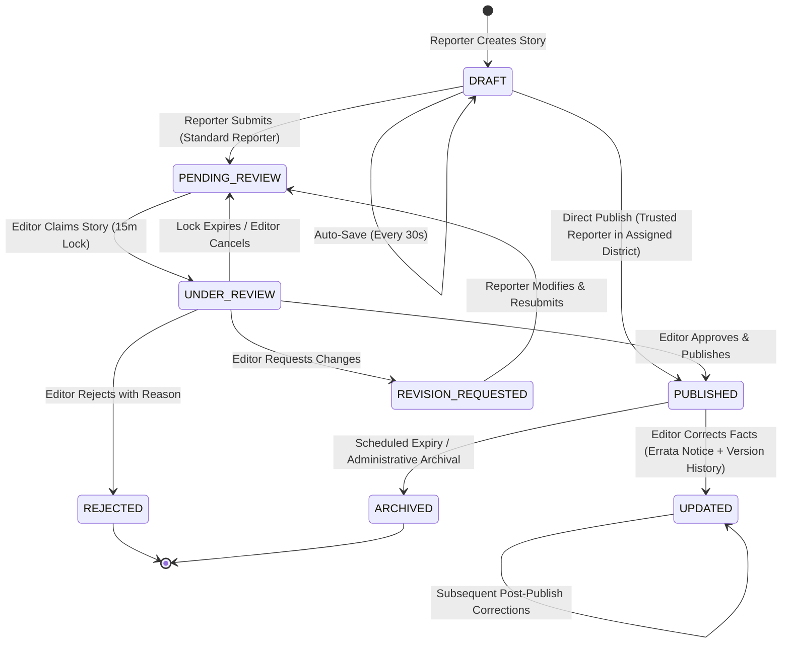
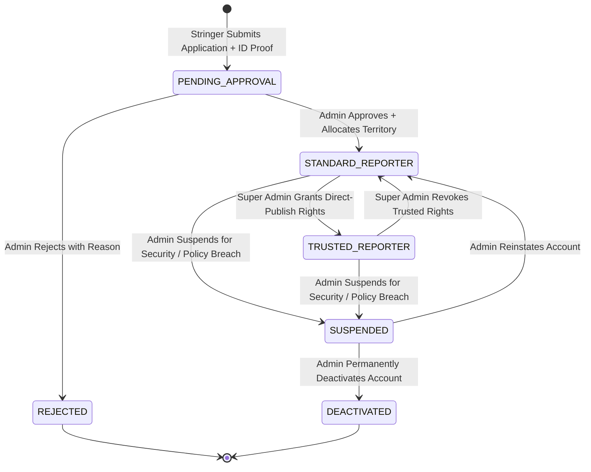
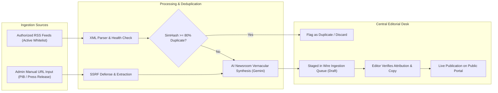

# Business and System Workflow Specification
## Project: BREAKING NEWS WALA (ब्रेकिंग न्यूज़ वाला)
**Tagline:** भारत के जिलों से, आपके दिलों तक  
**Document Identifier:** `docs/05-Workflows.md`  
**Version:** 1.0.0 (Implementation-Ready Operational & System Workflows)  
**Status:** Approved Baseline / Process Architecture Blueprint  
**Classification:** Internal Confidential / Operations & Systems Workflow Specification  
**Primary Authors:** Senior Business Process Architect, Product Workflow Designer, Newsroom Operations Consultant & Technical Systems Analyst  
**Prerequisites:**  
- `docs/01-PRD.md` (Product Requirements Document, v1.0.0)  
- `docs/02-Features.md` (Feature Specification Document, v1.0.0)  
- `docs/Plan.md` (Master Engineering Roadmap, v1.0.0)  
- `docs/04-NFR.md` (Non-Functional Requirements & Quality Standards, v1.0.0)  

---

## 1. Document Information

| Attribute | Specification |
| :--- | :--- |
| **Product Name** | BREAKING NEWS WALA (ब्रेकिंग न्यूज़ वाला) |
| **Product Code** | BNW-CORE |
| **Document Identifier** | `docs/05-Workflows.md` |
| **Version** | 1.0.0 |
| **Baseline Date** | October 30, 2026 |
| **Process Framework** | BPMN 2.0 (Business Process Model and Notation) Principles & Agile Newsroom Workflow Engineering |
| **Primary Workflow Pillars** | Dual Content Ingestion (Admin URL/RSS vs Reporter Raw Script), Mandatory Two-Tier Review, Trusted Direct Publishing, Hyper-Local District Binding, Real-Time Breaking Broadcast |
| **Target Platforms** | **Stage A:** Responsive Web Platform (Public Portal, Reporter Command Station, Admin Newsroom)<br>**Stage B:** Native Kotlin Android App (Jetpack Compose, Android SDK, FCM, Room Offline DB) |

---

## 2. Workflow Principles

Every operational and automated system workflow within BREAKING NEWS WALA is governed by the following core business process rules:

1. **Separation of Authoring and Publishing:** News creation is structurally decoupled from publication. Except for vetted Trusted Reporters operating strictly within their allocated districts, content created by stringers must undergo central editorial review before public broadcast.
2. **Dual-Track Content Ingestion Boundaries:**
   - **Reporter Ingestion:** Strictly restricted to **Raw Script / Notes / Bullet Points** input. Reporters are barred from URL-to-News or web scraping tools.
   - **Admin Ingestion:** Exclusively authorized for wire RSS feeds and external URL-to-News extraction with mandatory source attribution and license verification.
3. **Territorial Jurisdiction Enforcement:** A reporter cannot file dispatches under any district or city without explicit, prior administrative allocation. Jurisdiction is validated on the server side on every submission.
4. **Mandatory Human Editorial Oversight:** AI engines (Google Gemini) act strictly as accelerators. AI outputs always default to draft states and can never publish directly to the live portal without human editorial sign-off.
5. **Universal Accountability & Auditability:** Every status change, editorial approval, rejection reason, territory assignment, and direct publishing action is permanently recorded in an append-only audit log.
6. **Zero-Defect Archival Preservation:** Deactivating a category or retiring a territory never deletes historical news articles or breaks canonical URLs (zero 404s).
7. **Cross-Platform Invariance:** A business process executes identically whether triggered from a desktop browser, mobile web, or the future native Android mobile app.

---

## 3. Actors and Roles

The platform workflows coordinate interactions across five distinct actors:

```
+----------------------------------------------------------------------------------------------------+
|                                      NEWSROOM ACTOR TAXONOMY                                       |
+----------------------------------------------------------------------------------------------------+
|                                                                                                    |
|    1. PUBLIC READER [PUB] ──────────► Vernacular news consumer; searches, reads, shares, bookmarks|
|                                                                                                    |
|    2. STANDARD REPORTER [REP-STD] ──► Grassroots field stringer; files raw notes, photos; submits  |
|                                       to central review queue                                      |
|                                                                                                    |
|    3. TRUSTED REPORTER [REP-TRU] ───► Senior vetted correspondent; direct publishing within        |
|                                       allocated district; audited retrospectively                  |
|                                                                                                    |
|    4. CENTRAL SUB-EDITOR [EDT] ────► Newsroom desk journalist; verifies facts, edits copy,        |
|                                       approves/rejects submissions, broadcasts tickers             |
|                                                                                                    |
|    5. SUPER ADMIN [ADM] ────────────► Newsroom executive & platform administrator; manages roles,  |
|                                       allocates districts, controls API pool, oversees audits      |
|                                                                                                    |
|    6. AUTOMATED SYSTEM ENGINE [SYS] ► Background workers; RSS poller, AI API gateway, cache, FCM   |
|                                                                                                    |
+----------------------------------------------------------------------------------------------------+
```

---

## 4. Cross-Platform Workflow Strategy

BREAKING NEWS WALA enforces an **API-First, Single-Backend, Unified Business Logic** architecture.

```
+----------------------------------------------------------------------------------------------------+
|                                   CROSS-PLATFORM WORKFLOW BRIDGE                                   |
+----------------------------------------------------------------------------------------------------+
|                                                                                                    |
|    CLIENT INTERFACE TIERS                                                                          |
|    +------------------------------------------+    +------------------------------------------+    |
|    |           WEB PLATFORM (STAGE A)         |    |       NATIVE ANDROID APP (STAGE B)       |    |
|    |  - Desktop / Tablet / Mobile Browsers    |    |  - Pure Kotlin & Jetpack Compose UI      |    |
|    |  - Browser DOM, HTML5 Canvas, WebPush    |    |  - Room DB Offline Cache, FCM, CameraX   |    |
|    +--------------------+---------------------+    +--------------------+---------------------+    |
|                         |                                               |                          |
|                         +-----------------------+-----------------------+                          |
|                                                 |                                                  |
|                                                 v                                                  |
|    SHARED API GATEWAY & BUSINESS ENGINE                                                            |
|    +------------------------------------------------------------------------------------------+    |
|    |  - Standardized JSON REST/HTTP Endpoints (/api/v1/...)                                   |    |
|    |  - Authoritative Server-Side RBAC & Territorial Jurisdiction Validator                   |    |
|    |  - State Machine Transition Controller (Draft -> Pending -> Approved -> Published)       |    |
|    |  - Multi-Key AI Load Balancer (Google Gemini) & Auto-Failover                            |    |
|    |  - Unified WebSocket / FCM Notification Dispatcher                                       |    |
|    +--------------------------------------------+---------------------------------------------+    |
|                                                 |                                                  |
|                                                 v                                                  |
|    SHARED DATABASE & ENTERPRISE ASSET VAULT                                                        |
|    +------------------------------------------------------------------------------------------+    |
|    |  - Master Relational/Document Database (Single Source of Truth)                          |    |
|    |  - Shared Master Taxonomies (21 Hindi Categories, 55 MP Districts, Pin Codes)            |    |
|    |  - Encrypted Media Storage (Public CDN bucket vs Encrypted Private ID bucket)            |    |
|    |  - Append-Only System Audit Ledger (Immutable History)                                   |    |
|    +------------------------------------------------------------------------------------------+    |
|                                                                                                    |
+----------------------------------------------------------------------------------------------------+
```

### 4.1 Interface Adaptation Rules
1. **Identical Business Logic:** The validation rules, required inputs, state machine triggers, and permission checks are identical across Web and Android.
2. **UI-Specific Ergonomics:**
   - **Web:** Desktop dual-column review, mouse drag-and-drop category reordering, keyboard shortcuts.
   - **Native Android:** Jetpack Compose BottomNavigation, swipe-to-refresh, CameraX in-app hardware capture, Android Keystore token encryption, native FCM notification channels.
3. **Zero Divergence:** An API request from an Android client triggers the exact same backend workflow, validation checks, and audit events as a request from a web browser.

---

## 5. Public User Workflows

---

### WF-USR-01: Public User Registration & Multi-Factor Login
- **Workflow ID:** `WF-USR-01`
- **Workflow Name:** Public User Registration & Mobile OTP Authentication
- **Objective:** Allow vernacular readers to register and authenticate via mobile OTP or Google OAuth, establishing a persistent identity for saved articles, district preferences, and reward tracking.
- **Trigger:** User clicks "लॉग इन / साइन अप" in top super-bar or attempts an action requiring an account (e.g., saving an article).
- **Actors:** Public Reader (`PUB`), Authentication Gateway (`SYS`).
- **Preconditions:** User has an active Indian mobile number (`+91`) or Google account; user agrees to Terms of Service and Privacy Policy.
- **Required Inputs:** 10-digit mobile number (`^[6-9]\d{9}$`), 6-digit SMS OTP, or Google OAuth credential token.
- **Step-by-Step Process:**
  1. Reader enters 10-digit mobile number and clicks "OTP भेजें" (Send OTP).
  2. System validates format, checks rate limit (max 3 OTPs / hour / IP), and dispatches 6-digit numeric OTP via SMS gateway.
  3. UI displays countdown timer (60s) and OTP input field.
  4. Reader inputs 6-digit OTP code and clicks "सत्यापित करें" (Verify).
  5. System verifies OTP against hashed Redis cache record.
  6. If user record exists: loads user profile; issues JWT access token (15 mins) and refresh token (14 days).
  7. If new user: initializes new user profile document (`role: 'PUB'`); grants initial 10 welcome coins.
  8. Client stores tokens (Web: HTTP-only SameSite cookie; Android: encrypted Keystore).
  9. UI re-hydrates authenticated header and displays personalized feed.
- **Decision Points:**
  - *Is mobile number valid Indian format?* If no, prompt user with formatting guidance.
  - *Does OTP match within 5 minutes?* If yes, authenticate; if no, increment failure count.
  - *Are failed attempts $\ge$ 3?* If yes, temporarily lock mobile number for 15 minutes.
- **Permission Checks:** Public endpoint; zero prior authentication required.
- **System Actions:** Rate limit verification, SMS dispatch, Redis OTP validation, JWT generation, user profile creation.
- **Notifications:** SMS to reader containing 6-digit OTP: *"ब्रेकिंग न्यूज़ वाला: आपका लॉगिन OTP 482910 है। किसी से शेयर न करें।"*
- **Data Changes:** Inserts or updates record in `users` collection; creates active session record.
- **Audit Events:** Logs `USER_LOGIN_SUCCESS` with user ID, IP address, and timestamp.
- **Success Outcome:** Authenticated session established; reader can access profile and bookmarks.
- **Failure and Exception Paths:**
  - *SMS Delivery Timeout:* User can click "पुनः OTP भेजें" after 60-second cooldown.
  - *Invalid OTP:* Displays "अमान्य OTP, कृपया पुनः प्रयास करें"; decrements remaining attempts.
- **Postconditions:** Active JWT access token held by client; session documented in `user_sessions`.
- **Acceptance Criteria:** Authentication cycle completes in $\le 20$ seconds under normal network conditions.
- **Related Features:** `FEAT-USR-001`.
- **Related PRD Requirements:** `PUB-001`, `SEC-001`, `SEC-004`.
- **Web Behavior:** Responsive modal overlay appearing above current page without losing reading position.
- **Future Android Behavior:** Google SMS Retriever API integration for zero-tap automated OTP reading and verification.
- **Open Questions:** Final SMS gateway vendor selection (Msg91 vs Twilio vs Firebase Phone Auth).

---

### WF-USR-02: Reader Profile & Hyper-Local District Selection
- **Workflow ID:** `WF-USR-02`
- **Workflow Name:** Reader Profile Personalization & District Setting
- **Objective:** Enable readers to select their primary State, District, and City (e.g., MP -> Niwari -> Orchha) to localize their newsfeed and breaking alerts.
- **Trigger:** Reader clicks "जिला बदलें" (Change District) in header or visits profile settings (`/profile`).
- **Actors:** Public Reader (`PUB`), Shared API Gateway (`SYS`).
- **Preconditions:** Master location taxonomy active; user is either guest (localStorage) or authenticated (profile sync).
- **Required Inputs:** State ID, District ID, City/Tehsil ID (optional).
- **Step-by-Step Process:**
  1. Reader clicks "जिला बदलें"; modal drawer opens displaying searchable list of Madhya Pradesh's 55 districts.
  2. Reader types "निवाड़ी" or selects "Niwari" from district grid.
  3. System displays available cities/tehsils (निवाड़ी, ओरछा, पृथ्वीपुर).
  4. Reader selects "ओरछा" and checks "डिफ़ॉल्ट बनाएं" (Set Default).
  5. Reader clicks "सुरक्षित करें" (Save Selection).
  6. If authenticated: API updates `user.preferredDistrictId` and `user.preferredCityId`.
  7. If anonymous: stores preference in browser cookies and localStorage.
  8. Homepage instantly updates "मेरा जिला" block to display Orchha/Niwari news dispatches.
- **Decision Points:**
  - *Is user authenticated?* If yes, persist to database; if no, persist to client cookie.
- **Permission Checks:** Public client capability; authenticated user updates own record only (`auth.uid == userId`).
- **System Actions:** Validates district exists in master taxonomy; returns filtered news feed for selected location.
- **Notifications:** In-app toast: *"आपका जिला 'निवाड़ी' सेट कर दिया गया है।"*
- **Data Changes:** Updates `preferredDistrictId` in `users` collection or client cookie.
- **Audit Events:** None (routine preference mutation).
- **Success Outcome:** Public newsfeed localizes immediately to the reader's home district.
- **Failure and Exception Paths:**
  - *Selected district has zero news today:* Feeds display state-level news with notice: *"इस जिले की ताज़ा खबरें जल्द आ रही हैं।"*
- **Postconditions:** Subsequent visits load preferred district news by default.
- **Acceptance Criteria:** Feed re-indexes within 300ms of district selection switch.
- **Related Features:** `FEAT-PUB-003`, `FEAT-PUB-006`, `FEAT-USR-002`.
- **Related PRD Requirements:** `PUB-003`, `LOC-001`.
- **Web Behavior:** Header modal with fast Devanagari live search.
- **Future Android Behavior:** Native Jetpack Compose BottomSheet dialog with GPS auto-detection prompt ("क्या आप निवाड़ी में हैं?").
- **Open Questions:** None.

---

## 6. Reporter Onboarding and Management Workflows

---

### WF-REP-01: Reporter Application & Identity Submission
- **Workflow ID:** `WF-REP-01`
- **Workflow Name:** Grassroots Reporter Application & Vetting Submission
- **Objective:** Enable field stringers and district correspondents to apply for official reporter credentials, specifying their requested reporting beat and territorial jurisdiction.
- **Trigger:** Stringer visits `/reporter/apply` or clicks "रिपोर्टर बनें" in footer.
- **Actors:** Applicant Stringer (`PUB`), Super Admin (`ADM`), Storage Service (`SYS`).
- **Preconditions:** Applicant has verified Indian mobile number; possesses valid government ID proof (Aadhaar / Voter ID / Press Card).
- **Required Inputs:** Full Name, mobile number (OTP verified), email, requested primary district (e.g., Niwari), secondary tehsils, beats (अपराध, राजनीति, विकास), uploaded ID proof file (JPG/PDF, max 5MB).
- **Step-by-Step Process:**
  1. Stringer fills application wizard at `/reporter/apply`.
  2. Stringer verifies mobile number via 6-digit SMS OTP.
  3. Stringer selects requested State (MP), primary District (Niwari), and tehsils.
  4. Stringer uploads scanned copy of Aadhaar or Press Card.
  5. System validates file magic-bytes, strips EXIF, and encrypts file into private cloud bucket.
  6. Stringer reviews application summary, accepts Journalist Code of Ethics, and clicks "आवेदन सबमिट करें" (Submit Application).
  7. System generates unique application reference number: `APP-MP-NIW-2027-089`.
  8. Application lands in Admin verification queue (`status: 'PENDING_APPROVAL'`).
- **Decision Points:**
  - *Is mobile number already registered as an active reporter?* If yes, block with error.
  - *Is uploaded document a valid PDF/JPG under 5MB?* If no, reject with formatting guidance.
- **Permission Checks:** Public application endpoint; rate limited to 2 submissions / 24 hours / IP.
- **System Actions:** Document encryption, storage in private non-public bucket, application creation in `reporter_applications`.
- **Notifications:** SMS to applicant with application reference number; real-time alert to Super Admin desk.
- **Data Changes:** Creates document in `reporter_applications` with `status: 'PENDING_APPROVAL'`.
- **Audit Events:** Logs `REPORTER_APPLICATION_SUBMITTED` with applicant name, district, and timestamp.
- **Success Outcome:** Application securely archived; stringer awaits editorial vetting.
- **Failure and Exception Paths:**
  - *Oversized document:* Client rejects upload before network transmission; prompts compression.
- **Postconditions:** Document inaccessible via public URLs; applicant role remains `PUB` until approved.
- **Acceptance Criteria:** Uploaded document stored with AES-256 encryption; Admin notified within 5 seconds.
- **Related Features:** `FEAT-REP-001`, `FEAT-REP-002`.
- **Related PRD Requirements:** `REP-001`, `ADM-002`.
- **Web Behavior:** Multi-step responsive wizard with mobile camera photo capture.
- **Future Android Behavior:** Native Android CameraX document scanner with automatic corner cropping.
- **Open Questions:** None.

---

### WF-REP-02: Central Editorial Vetting & Credential Approval
- **Workflow ID:** `WF-REP-02`
- **Workflow Name:** Admin Editorial Vetting & Reporter Credential Activation
- **Objective:** Super Admin inspects pending reporter applications, validates identity documents, assigns official territory, and grants `Standard Reporter` credentials.
- **Trigger:** Super Admin opens Admin Control Panel `/admin/reporters/pending`.
- **Actors:** Super Admin (`ADM`), Target Applicant, Shared Backend (`SYS`).
- **Preconditions:** Application exists in `PENDING_APPROVAL` status; Super Admin is authenticated via MFA.
- **Required Inputs:** Application ID, action (`APPROVE` | `REJECT`), allocated primary district ID, authorized tehsils array, optional rejection reason.
- **Step-by-Step Process:**
  1. Super Admin inspects applicant dossier, reads background notes, and previews decrypted ID proof document.
  2. If rejecting: Admin clicks "अस्वीकृत करें", selects reason (*दस्तावेज़ स्पष्ट नहीं है*, *जिले में कोटा पूर्ण*), confirms; system sets `status: 'REJECTED'` and sends SMS notification.
  3. If approving: Admin clicks "स्वीकृत करें", confirms primary district allocation (e.g., Niwari), assigns authorized tehsils (Orchha, Prithvipur), assigns official Reporter Code (`REP-MP-NIW-014`).
  4. System executes atomic database transaction:
     - Updates `reporter_applications.status = 'APPROVED'`.
     - Promotes user record role from `PUB` to `REP-STD` (Standard Reporter).
     - Initializes `reporters` profile document with `assigned_districts: ['niwari']`.
     - Assigns default district graphic templates.
  5. Dispatches SMS and email with reporter onboarding credentials and portal link.
- **Decision Points:**
  - *Is Admin authenticated as Super Admin?* If no, return HTTP 403 Forbidden.
  - *Is at least one primary district assigned?* If no, block approval transaction.
- **Permission Checks:** Restricted strictly to Super Admin (`admins/{uid}`).
- **System Actions:** Role promotion, profile initialization, territorial binding, SMS notification.
- **Notifications:** SMS to approved stringer: *"बधाई! आपका ब्रेकिंग न्यूज़ वाला रिपोर्टर आवेदन स्वीकृत हो गया है। लॉगिन करें: [Portal Link]"*.
- **Data Changes:** `users.role = 'REP-STD'`; inserts new document into `reporters`.
- **Audit Events:** Immutable audit log entry: `REPORTER_APPROVED` with `adminUid`, `reporterUid`, `assignedDistricts`, and timestamp.
- **Success Outcome:** Reporter account activated; stringer can log into `/reporter/dashboard` immediately.
- **Failure and Exception Paths:**
  - *Database transaction error:* Aborts cleanly; status remains pending; error toast displayed.
- **Postconditions:** Newly minted Standard Reporter can compose news but must submit to review queue.
- **Acceptance Criteria:** Newly approved reporter logs in successfully; district dropdown locked strictly to Niwari.
- **Related Features:** `FEAT-REP-002`, `FEAT-REP-003`, `FEAT-SYS-001`.
- **Related PRD Requirements:** `ADM-002`, `ADM-003`, `LOC-002`.
- **Web Behavior:** Administrative modal with secure document previewer and district multi-select dropdown.
- **Future Android Behavior:** N/A (Admin console capability).
- **Open Questions:** None.

---

## 7. Reporter News Creation Workflows

---

### WF-CRE-01: Reporter Manual News Creation & Auto-Save
- **Workflow ID:** `WF-CRE-01`
- **Workflow Name:** Manual News Authoring, Formatting & Auto-Save Draft
- **Objective:** Enable field reporters to write detailed vernacular news dispatches with rich Devanagari typography, quotes, and automatic background draft saving.
- **Trigger:** Reporter clicks "नई खबर लिखें" (Write News) inside Reporter Dashboard.
- **Actors:** Standard Reporter (`REP-STD`) or Trusted Reporter (`REP-TRU`), Editor Service (`SYS`).
- **Preconditions:** Reporter has active account; session token is valid; assigned to at least one district.
- **Required Inputs:** Headline text (Hindi), subheadline, body rich-text (Hindi), category ID, district ID (from assigned list).
- **Step-by-Step Process:**
  1. Reporter opens news composer at `/reporter/news/create`.
  2. Composer initializes empty draft with temporary draft ID.
  3. Reporter types Devanagari headline, subheadline, and body paragraphs.
  4. Editor formats quotes, bullet points, and sub-headings using toolbar.
  5. Background worker automatically saves draft to browser localStorage and server `/api/v1/reporter/drafts` every 30 seconds.
  6. Composer displays subtle timestamped indicator: *"ड्राफ्ट सुरक्षित (11:24 AM)"*.
  7. Reporter selects category (e.g., राजनीति) and district (Niwari).
  8. Reporter can exit composer and resume editing later from "ड्राफ्ट" tab.
- **Decision Points:**
  - *Has content changed since last save?* If yes, trigger auto-save; if no, remain idle.
  - *Does reporter attempt to close dirty editor?* If yes, prompt browser warning modal.
- **Permission Checks:** Authenticated reporter role (`REP-STD` or `REP-TRU`).
- **System Actions:** Sanitizes HTML body, calculates word count and estimated read time, updates draft document.
- **Notifications:** None (silent background auto-save).
- **Data Changes:** Upserts document in `draft_articles` with `status: 'draft'`.
- **Audit Events:** None for private draft updates.
- **Success Outcome:** Draft safely preserved against browser crashes or sudden power loss.
- **Failure and Exception Paths:**
  - *Network disconnection:* Server auto-save fails silently; local browser localStorage retains complete copy.
- **Postconditions:** Draft visible under "मेरी खबरें -> ड्राफ्ट" in reporter dashboard.
- **Acceptance Criteria:** Zero lost keystrokes during simulated browser crash; draft restores cleanly upon reload.
- **Related Features:** `FEAT-CRE-001`, `FEAT-CRE-012`.
- **Related PRD Requirements:** `REP-003`, `REP-007`.
- **Web Behavior:** TipTap / ProseMirror rich-text editor with Devanagari character counter.
- **Future Android Behavior:** Native Jetpack Compose editor with custom Devanagari keyboard toolbar.
- **Open Questions:** None.

---

### WF-CRE-02: Raw Script to News AI Structuring
- **Workflow ID:** `WF-CRE-02`
- **Workflow Name:** Raw Script Input to Vernacular AI News Structuring
- **Objective:** Convert unstructured field notes, bullet points, or voice transcription transcripts into a professional 3-part Hindi news article using the server-side AI Newsroom Engine.
- **Trigger:** Reporter clicks "त्वरित रॉ स्क्रिप्ट" (Quick Raw Script) tab and clicks "AI से खबर बनाएं" (Generate News via AI).
- **Actors:** Standard/Trusted Reporter, AI API Pool (`SYS`).
- **Preconditions:** Reporter has entered at least 15 words of rough notes; input does NOT contain external URLs (URLs strictly blocked for reporters).
- **Required Inputs:** Raw text notes (Hindi / Hinglish / bullet points), selected tone (*तथ्यात्मक/Breaking*, *विस्तृत/Detailed*, *प्रशासनिक/Governance*).
- **Step-by-Step Process:**
  1. Reporter pastes 4 rough field notes into raw script box.
  2. Reporter selects tone: "तथ्यात्मक" (Factual Breaking).
  3. Reporter clicks "AI से खबर बनाएं".
  4. Client validates raw input length ($\ge 15$ words) and sends payload to `/api/v1/ai/structure-script`.
  5. Server AI gateway selects active Google Gemini key from multi-key pool.
  6. Server passes raw script to optimized newsroom prompt.
  7. Gemini synthesizes professional Hindi copy:
     - Catchy Headline (कैची शीर्षक)
     - Subheadline (उप-शीर्षक)
     - 3-part Body (मुख्य संदर्भ, मुख्य बिंदु, पृष्ठभूमि)
     - Suggested tags (5 tags).
  8. Gateway returns JSON payload in $\le 5$ seconds.
  9. Client editor auto-populates headline, subheadline, body, and tags fields.
  10. System preserves original raw notes in `rawScriptOriginal` for editorial audit.
  11. Reporter reviews, fact-checks, and refines the generated copy.
- **Decision Points:**
  - *Does raw script contain an external URL?* If yes, block call with error: *"URL से खबर बनाना केवल एडमिन के लिए उपलब्ध है।"*
  - *Does upstream AI provider return HTTP 429 rate limit?* If yes, execute sub-1.5s failover to standby key.
- **Permission Checks:** Authenticated reporter role (`REP-STD` or `REP-TRU`). URL extraction capability strictly denied.
- **System Actions:** Rate limit verification, AI API token tracking, prompt execution, failover management.
- **Notifications:** Progress spinner in editor: *"AI खबर तैयार कर रहा है..."*.
- **Data Changes:** Populates active draft editor; stores `rawScriptOriginal` in draft metadata.
- **Audit Events:** Logs `AI_STRUCTURING_EXECUTED` with tokens used, latency, and reporter UID.
- **Success Outcome:** Unstructured field dispatch converted into publication-grade Hindi news story within 5 seconds.
- **Failure and Exception Paths:**
  - *All AI keys exhausted:* Returns friendly error: *"AI सेवा वर्तमान में व्यस्त है, कृपया ड्राफ्ट सुरक्षित रखें या मैनुअल लिखें"*; raw notes remain untouched in text box.
- **Postconditions:** Article remains in `draft` state until submitted; AI output subject to human verification.
- **Acceptance Criteria:** Structuring completes in $< 5.0$ seconds; original raw notes permanently retained.
- **Related Features:** `FEAT-CRE-002`, `FEAT-CRE-003`, `FEAT-API-002`.
- **Related PRD Requirements:** `REP-002`, `AI-001`, `AI-003`.
- **Web Behavior:** Dual-panel desktop interface: left raw input pane, right generated copy pane.
- **Future Android Behavior:** Voice recording button transcribing field speech directly into raw script box before AI trigger.
- **Open Questions:** None.

---

### WF-CRE-03: Story Submission to Central Editorial Review Queue
- **Workflow ID:** `WF-CRE-03`
- **Workflow Name:** Standard Reporter Story Submission to Review Queue
- **Objective:** Transition a completed news draft from a Standard Reporter into the Central Newsroom review queue with status `PENDING_REVIEW`.
- **Trigger:** Reporter clicks "समीक्षा के लिए भेजें" (Submit for Review) button.
- **Actors:** Standard Reporter (`REP-STD`), Central Sub-Editor (`EDT`), System (`SYS`).
- **Preconditions:** Article is in `draft` or `revision_requested` status; reporter role is `REP-STD`.
- **Required Inputs:** Validated article payload: headline ($\ge 10$ chars), bodyHtml ($\ge 50$ words), categoryId, districtId (must match assigned territory), primary 16:9 thumbnail image.
- **Step-by-Step Process:**
  1. Reporter clicks "समीक्षा के लिए भेजें".
  2. Client validates all required fields; highlights any missing fields in red.
  3. Client displays confirmation modal: *"क्या आप यह खबर संपादकीय समीक्षा के लिए भेजना चाहते हैं?"*
  4. Reporter clicks "हाँ, सबमिट करें" (Confirm).
  5. Client sends `POST /api/v1/reporter/articles/{id}/submit`.
  6. Server-side middleware validates:
     - `auth.uid == article.authorId`
     - `article.districtId` is contained in `reporter.assigned_districts`
     - Reporter status is active (not suspended).
  7. Server updates article:
     - `status = 'pending_review'`
     - `submittedAt = NOW()`
  8. Server pushes real-time WebSocket event to Central Newsroom desk.
  9. Client displays success screen: *"आपकी खबर सफलतापूर्वक समीक्षा के लिए भेज दी गई है।"*
  10. Article moves to "समीक्षा में" tab; editing is locked while under review.
- **Decision Points:**
  - *Does reporter have `is_trusted_publisher: true`?* If yes, redirect to `WF-TRU-01` (Direct Publish).
  - *Is selected district unauthorized?* If yes, reject with HTTP 403 `DISTRICT_UNAUTHORIZED`.
- **Permission Checks:** Authenticated Standard Reporter (`REP-STD`); territorial jurisdiction verified on server.
- **System Actions:** Validates mandatory schema fields, executes atomic state transition to `pending_review`, updates Admin queue counter.
- **Notifications:** In-app confirmation toast to reporter; badge counter increments on Admin newsroom review desk.
- **Data Changes:** Updates `articles` document: `status: 'pending_review'`, `submittedAt: ISO_TIMESTAMP`.
- **Audit Events:** Logs `ARTICLE_SUBMITTED_FOR_REVIEW` with article ID, reporter UID, district, and timestamp.
- **Success Outcome:** Story lands in Admin review queue; reporter can track review status.
- **Failure and Exception Paths:**
  - *Missing primary image:* Modal warns: *"कम से कम एक मुख्य 16:9 फोटो अपलोड करना अनिवार्य है।"*
- **Postconditions:** Story is locked from reporter editing until an editor approves, rejects, or requests changes.
- **Acceptance Criteria:** Story appears on Admin review desk within 1 second of submission.
- **Related Features:** `FEAT-CRE-005`, `FEAT-REP-003`, `FEAT-ADM-002`.
- **Related PRD Requirements:** `REP-006`, `ADM-005`.
- **Web Behavior:** Full validation summary modal with thumbnail preview.
- **Future Android Behavior:** Native Jetpack Compose BottomSheet confirmation with haptic confirmation vibration.
- **Open Questions:** None.

---

## 8. Editorial Approval Workflows

---

### WF-EDT-01: Review Queue Claiming & Atomic Concurrency Lock
- **Workflow ID:** `WF-EDT-01`
- **Workflow Name:** Editorial Review Queue Claiming & Concurrency Control
- **Objective:** Prevent race conditions and duplicate editing by allowing an editor to claim a pending story, atomically locking it for 15 minutes during verification.
- **Trigger:** Central Sub-Editor clicks "समीक्षा शुरू करें" (Start Review) on a pending story card in `/admin/newsroom`.
- **Actors:** Central Sub-Editor (`EDT`), Super Admin (`ADM`), System (`SYS`).
- **Preconditions:** Article has `status == 'pending_review'`; article is currently unlocked (`lockedByEditorUid == null` or lock expired).
- **Required Inputs:** Article ID, Editor UID.
- **Step-by-Step Process:**
  1. Editor views pending queue; clicks "समीक्षा शुरू करें" on a story from Niwari.
  2. Client calls `POST /api/v1/editor/articles/{id}/claim`.
  3. Server executes atomic database transaction:
     - Verifies `lockedByEditorUid == null` or `lockedAt < NOW() - 15 minutes`.
     - Sets `lockedByEditorUid = auth.uid` and `lockedAt = NOW()`.
     - Sets `status = 'under_review'`.
  4. Server broadcasts lock event via WebSocket to all other connected editor dashboards.
  5. Other editors see card greyed out with badge: *"समीक्षा जारी - [Editor Name]"*.
  6. Claiming editor's browser navigates to the Dual-Column Review Workstation.
- **Decision Points:**
  - *Is story already claimed by another editor?* If yes, reject claim with toast: *"यह खबर पहले से [Editor Name] द्वारा जांची जा रही है।"*
- **Permission Checks:** Central Sub-Editor (`EDT`) or Super Admin (`ADM`).
- **System Actions:** Atomic database lock write; WebSocket broadcast; 15-minute lock timer initiation.
- **Notifications:** Real-time lock badge update on all newsroom dashboards.
- **Data Changes:** Updates `articles` document: `status: 'under_review'`, `lockedByEditorUid`, `lockedAt`.
- **Audit Events:** Logs `ARTICLE_REVIEW_CLAIMED` with editor UID and timestamp.
- **Success Outcome:** Editor gains exclusive editing rights for 15 minutes; race conditions eliminated.
- **Failure and Exception Paths:**
  - *Editor closes browser tab:* Lock expires automatically after 15 minutes; story returns to open queue.
- **Postconditions:** Story locked from other editors; reporter sees status update: "संपादकीय जांच जारी".
- **Acceptance Criteria:** Claiming transaction is 100% atomic; two concurrent clicks award lock to exactly one editor.
- **Related Features:** `FEAT-ADM-002`, `FEAT-ADM-003`.
- **Related PRD Requirements:** `ADM-005`, Section 16.
- **Web Behavior:** Card visually locks with amber boundary and editor name avatar.
- **Future Android Behavior:** N/A (Desktop newsroom console capability).
- **Open Questions:** None.

---

### WF-EDT-02: Editorial Decision — Approval & Instant Publication
- **Workflow ID:** `WF-EDT-02`
- **Workflow Name:** Editorial Approval & Live Portal Publication
- **Objective:** Central Sub-Editor verifies factual accuracy, refines copy, approves the story, and triggers instant live publication across the public web portal and mobile feeds.
- **Trigger:** Sub-Editor clicks green button "स्वीकृत करें एवं प्रकाशित करें" (Approve & Publish) in review workstation.
- **Actors:** Central Sub-Editor (`EDT`), Super Admin (`ADM`), System (`SYS`).
- **Preconditions:** Editor holds active lock on article; all required fields verified; article category and district confirmed.
- **Required Inputs:** Article ID, edited headline, edited body, breaking news toggle (`is_breaking`), top news toggle (`is_top_news`), live ticker text (if breaking).
- **Step-by-Step Process:**
  1. Editor completes dual-column verification; corrects typos; verifies named entities.
  2. Editor clicks "स्वीकृत करें एवं प्रकाशित करें".
  3. Confirmation modal prompts for breaking news flags and live ticker inclusion.
  4. Editor confirms publication.
  5. Server executes atomic publication transaction:
     - Sets `status = 'published'`
     - Sets `approvedByUid = auth.uid`
     - Sets `publishedAt = NOW()`
     - Clears review locks (`lockedByEditorUid = null`)
  6. Server generates canonical URL slug: `/news/{category}/{district}/{slug}`.
  7. Server triggers CDN edge cache purge for category and homepage feeds.
  8. If flagged as `is_breaking`: inserts active record into `tickers` collection and triggers WebSocket marquee broadcast.
  9. Server dispatches push notification to submitting reporter: *"बधाई! आपकी खबर प्रकाशित हो गई है।"*
  10. Story appears on public homepage and district feed within 2 seconds.
- **Decision Points:**
  - *Is story flagged as Breaking News?* If yes, trigger live ticker broadcast (`WF-ADM-01`).
  - *Is story flagged for Web/FCM Push?* If yes, trigger push notification fan-out (`WF-NOT-03`).
- **Permission Checks:** Central Sub-Editor (`EDT`) or Super Admin (`ADM`). Standard reporters rejected.
- **System Actions:** State transition to `published`, CDN cache purge, ticker broadcast, reporter notification dispatch, sitemap index update.
- **Notifications:** In-app and push alert to submitting reporter; real-time feed updates to public readers.
- **Data Changes:** Updates `articles` document: `status: 'published'`, `publishedAt: TIMESTAMP`, `approvedByUid`.
- **Audit Events:** Immutable audit log: `ARTICLE_APPROVED_AND_PUBLISHED` with editor UID, author UID, district, and timestamp.
- **Success Outcome:** Story is live on public portal; searchable; accessible via canonical URL.
- **Failure and Exception Paths:**
  - *CDN purge failure:* Logged as non-blocking warning; edge cache updates on next natural 60s TTL expiry.
- **Postconditions:** Article accessible to unauthenticated public readers (`status == 'published'`).
- **Acceptance Criteria:** Story visible on public live portal in $\le 2.0$ seconds from editor approval click.
- **Related Features:** `FEAT-ADM-004`, `FEAT-PUB-001`, `FEAT-NOT-001`.
- **Related PRD Requirements:** `ADM-005`, `PUB-001`, `SEC-001`.
- **Web Behavior:** Floating action dock with confirmation dialog; redirects editor back to review queue.
- **Future Android Behavior:** N/A.
- **Open Questions:** None.

---

### WF-EDT-03: Editorial Decision — Categorized Rejection with Feedback
- **Workflow ID:** `WF-EDT-03`
- **Workflow Name:** Editorial Rejection with Categorized Feedback
- **Objective:** Reject sub-standard, duplicate, defamatory, or unverified dispatches while recording mandatory categorized feedback for reporter coaching and audit records.
- **Trigger:** Sub-Editor clicks red button "अस्वीकृत करें" (Reject) in review workstation.
- **Actors:** Central Sub-Editor (`EDT`), Super Admin (`ADM`), System (`SYS`).
- **Preconditions:** Editor holds active lock on article; article is in `under_review` status.
- **Required Inputs:** Article ID, rejection category code, detailed explanation comments.
- **Step-by-Step Process:**
  1. Editor determines story is unpublishable (e.g., unsubstantiated rumor, copyright breach).
  2. Editor clicks "अस्वीकृत करें".
  3. Dialog opens requiring mandatory rejection reason:
     - *अपूर्ण जानकारी (Incomplete Information)*
     - *तथ्यों की पुष्टि नहीं (Unverified Facts)*
     - *कॉपीराइट उल्लंघन (Copyright Breach)*
     - *संपादकीय नीति का उल्लंघन (Policy Violation)*
     - *डुप्लिकेट खबर (Duplicate Story)*
  4. Editor selects reason code and enters mandatory explanatory critique (min 15 chars).
  5. Editor clicks "अस्वीकृति की पुष्टि करें" (Confirm Rejection).
  6. Server executes transaction:
     - Sets `status = 'rejected'`
     - Sets `rejectedByUid = auth.uid`
     - Sets `rejectionReasonCode` and `editorialFeedback`
     - Releases review lock.
  7. Server dispatches real-time notification to reporter with rejection reason.
  8. Story removes from pending queue and moves to reporter's "अस्वीकृत" archive.
- **Decision Points:**
  - *Is rejection comment empty?* If yes, block action; constructive critique is mandatory.
- **Permission Checks:** Central Sub-Editor (`EDT`) or Super Admin (`ADM`).
- **System Actions:** State transition to `rejected`, notification dispatch, audit record creation.
- **Notifications:** Notification to reporter: *"आपकी खबर [Headline] अस्वीकृत कर दी गई है। कारण: [Reason]"*.
- **Data Changes:** Updates `articles` document: `status: 'rejected'`, `rejectedAt: NOW()`, `rejectionReasonCode`.
- **Audit Events:** Logs `ARTICLE_REJECTED` with editor UID, author UID, reason code, and feedback text.
- **Success Outcome:** Story rejected from publishing; reporter informed of specific shortcomings.
- **Failure and Exception Paths:**
  - *Network error during rejection:* Preserves editor critique in form state and prompts retry.
- **Postconditions:** Story cannot be published without formal administrative reopening.
- **Acceptance Criteria:** Rejection notification arrives in reporter dashboard in $< 3$ seconds.
- **Related Features:** `FEAT-ADM-004`, `FEAT-REP-005`.
- **Related PRD Requirements:** `ADM-005`, `REP-008`.
- **Web Behavior:** High-visibility red confirmation modal with categorized dropdown.
- **Future Android Behavior:** N/A.
- **Open Questions:** None.

---

### WF-EDT-04: Editorial Decision — Revision Request & Resubmission Loop
- **Workflow ID:** `WF-EDT-04`
- **Workflow Name:** Editorial Revision Request & Reporter Resubmission Loop
- **Objective:** Return a promising dispatch back to the field reporter with specific instructions for factual clarification or media improvements, establishing an audited coaching loop.
- **Trigger:** Sub-Editor clicks amber button "संशोधन का अनुरोध करें" (Request Revision).
- **Actors:** Central Sub-Editor (`EDT`), Standard Reporter (`REP-STD`), System (`SYS`).
- **Preconditions:** Editor holds active lock on article; article is in `under_review` status.
- **Required Inputs:** Article ID, revision instructions text (Hindi).
- **Step-by-Step Process:**
  1. Editor identifies that story is credible but missing critical details (e.g., police FIR number, casualty confirmation).
  2. Editor clicks "संशोधन का अनुरोध करें".
  3. Dialog prompts editor to enter specific bulleted instructions for reporter.
  4. Editor enters instructions: *"कृपया संबंधित थाना प्रभारी का बयान और FIR संख्या जोड़ें।"*
  5. Editor clicks "संशोधन भेजें" (Send Revision Request).
  6. Server updates article:
     - `status = 'revision_requested'`
     - Appends note to `revisionHistory` array
     - Clears editor lock.
  7. Server dispatches priority notification to reporter dashboard.
  8. Reporter opens story; sees high-contrast amber banner with editor's critique.
  9. Reporter interviews police officer, updates body text with statement, and clicks "संशोधित खबर पुनः भेजें" (Resubmit).
  10. Server sets `status = 'pending_review'`, increments `revisionCount`, and returns story to top of Admin review queue tagged as "पुनः प्रस्तुत" (Resubmitted).
- **Decision Points:**
  - *Did reporter modify content before resubmitting?* If no, block resubmission with warning.
- **Permission Checks:** Editor requests revision; only original author can edit and resubmit.
- **System Actions:** State transition (`under_review` $\rightarrow$ `revision_requested` $\rightarrow$ `pending_review`), revision history append.
- **Notifications:** Push and in-app alert to reporter; Admin queue alert upon resubmission.
- **Data Changes:** Updates `articles` status and appends entry to `revisionHistory`.
- **Audit Events:** Logs `ARTICLE_REVISION_REQUESTED` and `ARTICLE_RESUBMITTED`.
- **Success Outcome:** Story refined with accurate ground facts and returned to review queue.
- **Failure and Exception Paths:**
  - *Reporter fails to respond within 48 hours:* System flags story as `STALE_REVISION` in reporter dashboard.
- **Postconditions:** Story returns to central review queue ready for final publication.
- **Acceptance Criteria:** Revision banner displays prominently; resubmission moves story to top of queue.
- **Related Features:** `FEAT-ADM-004`, `FEAT-CRE-007`.
- **Related PRD Requirements:** `ADM-005`, `REP-008`.
- **Web Behavior:** Amber alert callout box pinned at top of both editor and reporter composer views.
- **Future Android Behavior:** Native Android notification deep-linking directly into draft revision editor.
- **Open Questions:** None.

---

## 9. Trusted Reporter Workflows

---

### WF-TRU-01: Trusted Reporter Direct-Publishing Execution
- **Workflow ID:** `WF-TRU-01`
- **Workflow Name:** Trusted Reporter Direct-Publishing Execution
- **Objective:** Enable vetted, senior correspondents (`REP-TRU`) to publish breaking news dispatches directly to the public live portal in zero latency, bypassing the central review queue while enforcing strict territorial bounds and retrospective audits.
- **Trigger:** Trusted Reporter clicks primary gold button "सीधे प्रकाशित करें" (Publish Directly) in newsroom composer.
- **Actors:** Trusted Reporter (`REP-TRU`), Central Newsroom Desk (`EDT`), System (`SYS`).
- **Preconditions:** Reporter has `is_trusted_publisher == true`; reporter account is active; selected district is in reporter's allocated territories (`reporter.assigned_districts`).
- **Required Inputs:** Complete article payload (headline, bodyHtml, primary 16:9 photo, categoryId, authorized districtId).
- **Step-by-Step Process:**
  1. Trusted Reporter composes breaking dispatch on-the-scene in Niwari.
  2. Reporter selects Category (क्राइम) and District (निवाड़ी).
  3. Reporter clicks "सीधे प्रकाशित करें" (Publish Directly).
  4. Confirmation dialog appears: *"आप विश्वसनीय रिपोर्टर के रूप में यह खबर सीधे लाइव पोर्टल पर प्रकाशित कर रहे हैं। क्या आप पुष्टि करते हैं?"*
  5. Reporter confirms.
  6. Client calls `POST /api/v1/reporter/articles/{id}/direct-publish`.
  7. Server-side security validator verifies:
     - `user.is_trusted_publisher == true`
     - `article.districtId` $\in$ `user.assigned_districts`
     - Author status is active (not suspended).
  8. Server executes atomic publication transaction:
     - Sets `status = 'published'`
     - Sets `publishedAt = NOW()`
     - Sets `isDirectPublished = true`
     - Generates canonical URL slug: `/news/crime/niwari/slug`.
  9. Server purges CDN edge cache for Niwari district and homepage feeds.
  10. Server dispatches priority alert to Central Newsroom oversight desk.
  11. Article is live on public web and mobile feeds within 2 seconds.
- **Decision Points:**
  - *Is reporter attempting to direct-publish in an unauthorized district?* If yes, automatically divert story to `pending_review` queue with notice: *"यह जिला आपके सीधे प्रकाशन अधिकार क्षेत्र से बाहर है। खबर समीक्षा के लिए भेजी गई है।"*
  - *Has Super Admin revoked trusted status?* If yes, reject direct publish and route to review queue.
- **Permission Checks:** Server verifies `is_trusted_publisher == true` and verifies district binding. Standard reporters rejected with HTTP 403 Forbidden.
- **System Actions:** State transition directly to `published`, CDN purge, audit record creation, Admin oversight alert.
- **Notifications:** High-priority alert to Central Newsroom: *"विश्वासपात्र रिपोर्टर [Name] ने [District] से खबर प्रकाशित की है।"*
- **Data Changes:** Updates `articles` document: `status: 'published'`, `isDirectPublished: true`, `publishedAt: NOW()`.
- **Audit Events:** Immutable audit log entry: `TRUSTED_DIRECT_PUBLISH` with reporter UID, district, article ID, and timestamp.
- **Success Outcome:** Breaking dispatch live on portal with zero newsroom waiting latency; full retrospective audit trail recorded.
- **Failure and Exception Paths:**
  - *Standard Reporter attempts direct-publish call:* Server rejects with HTTP 403 `PERMISSION_DENIED`; logs security incident.
- **Postconditions:** Article accessible to millions of public readers; subject to retrospective editorial correction.
- **Acceptance Criteria:** Story live on public web within 2.0 seconds; Admin desk alerted within 3 seconds.
- **Related Features:** `FEAT-REP-004`, `FEAT-CRE-006`, `FEAT-ADM-004`.
- **Related PRD Requirements:** Section 10 Item 200, Section 11.2 (REP-006), Section 17.2; `security_spec.md` Item 3.
- **Web Behavior:** Prominent gold action button with lightning bolt icon; confirmation modal.
- **Future Android Behavior:** Native Android action button with optional biometric fingerprint confirmation.
- **Open Questions:** None. Approved in PRD.

---

## 10. Admin Newsroom Workflows

---

### WF-ADM-01: Breaking News Designation & Live Ticker Broadcasting
- **Workflow ID:** `WF-ADM-01`
- **Workflow Name:** Breaking News Ticker Broadcasting & Alert Push
- **Objective:** Enable central newsroom editors to flag developing stories as breaking news, pushing high-contrast marquee ticker headlines to all active web and mobile readers in sub-3-second latency.
- **Trigger:** Desk editor opens published or breaking story; checks "ब्रेकिंग न्यूज़ टिकर में जोड़ें" (Add to Breaking Ticker).
- **Actors:** Central Sub-Editor (`EDT`), Super Admin (`ADM`), Real-Time Broadcaster (`SYS`).
- **Preconditions:** Editor is authenticated; story is published (`status == 'published'`).
- **Required Inputs:** Article ID, custom marquee headline (Hindi, max 120 chars), priority level (`NORMAL`, `HIGH`, `CRITICAL`), expiry duration (1h, 2h, 4h, Custom).
- **Step-by-Step Process:**
  1. Editor enters marquee text: *"ब्रेकिंग: भोपाल-इंदौर हाईवे पर बड़ा हादसा, प्रशासन ने जारी किए हेल्पलाइन नंबर"*.
  2. Editor selects priority: `CRITICAL` (Pulsing red badge) and duration: `2 Hours`.
  3. Editor clicks "लाइव टिकर प्रसारित करें" (Broadcast Live Ticker).
  4. Server writes record to `tickers` collection with `expiresAt: NOW() + 2 hours`.
  5. Real-Time Broadcast Server emits WebSocket / SSE event to all connected public clients.
  6. Within 2.5 seconds, red marquee banner animates across 15,000 active reader screens.
  7. If priority is `CRITICAL`: triggers browser Web Push and native Android FCM push.
  8. Clicking ticker headline navigates reader directly to the full story.
  9. Upon expiration of timer, system automatically archives ticker from active broadcast.
- **Decision Points:**
  - *Is priority set to `CRITICAL`?* If yes, trigger push notification fan-out concurrently.
  - *Does active ticker already exist?* If yes, append to rotation queue or replace based on priority.
- **Permission Checks:** Restricted strictly to Central Sub-Editor (`EDT`) and Super Admin (`ADM`).
- **System Actions:** Inserts active record into `tickers`, purges ticker cache, triggers WebSocket broadcast, schedules TTL expiry.
- **Notifications:** Push notifications to subscribed web and app users; live marquee broadcast on active screens.
- **Data Changes:** Creates document in `tickers` with `isActive: true`.
- **Audit Events:** Logs `TICKER_BROADCAST_CREATED` with editor UID, priority, text, and timestamp.
- **Success Outcome:** Urgent headline visible to all readers across India in $< 3$ seconds.
- **Failure and Exception Paths:**
  - *WebSocket server glitch:* Clients fall back to HTTP long-polling every 30 seconds.
- **Postconditions:** Active ticker displayed in public masthead until expired or manually cancelled.
- **Acceptance Criteria:** Ticker propagates to 10,000 concurrent sessions in $< 3.0$ seconds.
- **Related Features:** `FEAT-ADM-005`, `FEAT-NOT-001`, `FEAT-PUB-003`.
- **Related PRD Requirements:** `NOT-001`, `NOT-002`, `ADM-009`.
- **Web Behavior:** Marquee ribbon scrolls beneath main header with hover-to-pause functionality.
- **Future Android Behavior:** Native Android top app-bar animated marquee ticker.
- **Open Questions:** None.

---

### WF-ADM-02: Post-Publication Errata & Transparent Version History
- **Workflow ID:** `WF-ADM-02`
- **Workflow Name:** Post-Publication Fact Correction & Errata Log
- **Objective:** Provide a transparent, legally compliant mechanism to correct factual inaccuracies in published stories while retaining historical version snapshots and publishing public clarification notices.
- **Trigger:** Editor identifies a factual typo, misnamed official, or updated casualty count in a published article.
- **Actors:** Central Sub-Editor (`EDT`), Super Admin (`ADM`), System (`SYS`).
- **Preconditions:** Article has `status == 'published'`; user has editorial permissions.
- **Required Inputs:** Article ID, corrected text fields, mandatory correction note (Hindi).
- **Step-by-Step Process:**
  1. Editor opens live article in Admin Newsroom; clicks "संशोधन / स्पष्टीकरण जोड़ें" (Edit / Add Correction).
  2. Editor corrects factual error in headline or body text.
  3. Dialog prompts editor for public clarification note: *"इस खबर में पहले घायल व्यक्तियों की संख्या 8 बताई गई थी, जिसे पुलिस के आधिकारिक बयान के बाद 5 किया गया है।"*
  4. Editor clicks "संशोधन प्रकाशित करें" (Publish Correction).
  5. Server executes atomic update:
     - Archives previous state as a new snapshot in `article_versions` collection.
     - Increments `version = version + 1`.
     - Updates `editedBodyHtml` and `lastModifiedAt = NOW()`.
     - Binds `correctionNotice` object containing note text, editor UID, and timestamp.
  6. Server purges CDN edge cache for the article.
  7. Public reader page displays high-contrast amber clarification box above article body.
- **Decision Points:**
  - *Has article been live for $> 30$ minutes?* If yes, correction note is mandatory; if no, minor typo fix allowed without errata notice.
- **Permission Checks:** Central Sub-Editor (`EDT`) or Super Admin (`ADM`).
- **System Actions:** Snapshot creation in `article_versions`, article update, CDN cache purge.
- **Notifications:** None.
- **Data Changes:** Appends document in `article_versions`; updates `articles` document.
- **Audit Events:** Logs `ARTICLE_ERRATA_PUBLISHED` with editor UID, version number, diff, and timestamp.
- **Success Outcome:** Story corrected transparently; historical version preserved; compliant with Press Council of India standards.
- **Failure and Exception Paths:**
  - *Empty correction note on mature story:* Blocked with warning: *"30 मिनट से पुरानी खबर के संशोधन के लिए स्पष्टीकरण अनिवार्य है।"*
- **Postconditions:** Public readers view timestamped correction notice; Admin can view side-by-side diff between version 1 and version 2.
- **Acceptance Criteria:** Correction notice rendered visibly on public article page; historical snapshots immutable.
- **Related Features:** `FEAT-ADM-006`, `FEAT-SEC-003`.
- **Related PRD Requirements:** `ADM-005`, Section 15.1 Item 8, Section 27 (SEC-006).
- **Web Behavior:** Public readers see styled amber correction box; Admin sees version history diff modal.
- **Future Android Behavior:** Native Jetpack Compose errata card embedded above article text.
- **Open Questions:** None.

---

## 11. RSS Source Management Workflows

---

### WF-RSS-01: Authorized RSS Syndicate Configuration & Validation
- **Workflow ID:** `WF-RSS-01`
- **Workflow Name:** Authorized RSS Feed Configuration & Ingestion Scheduling
- **Objective:** Super Admin registers, validates, and activates authorized external wire RSS feeds (e.g., PTI, UNI, government press bureaus) for automated background polling.
- **Trigger:** Super Admin visits `/admin/newsroom/rss` and clicks "नया RSS स्रोत जोड़ें" (Add RSS Source).
- **Actors:** Super Admin (`ADM`), Background RSS Poller (`SYS`).
- **Preconditions:** Source syndicate is legally authorized / licensed; feed URL returns valid RSS 2.0 or Atom XML.
- **Required Inputs:** Syndicate Name, Feed URL, default Category ID (e.g., देश), default State ID, polling frequency (15m, 30m, 1h), syndicate license reference.
- **Step-by-Step Process:**
  1. Admin enters Feed Name ("Press Trust of India - National") and URL (`https://.../rss/national.xml`).
  2. Admin enters legal license agreement ID and selects default category.
  3. Admin clicks "स्रोत सत्यापित करें" (Validate Source).
  4. Server performs secure fetch with strict SSRF guardrails (blocking internal RFC1918 IPs).
  5. XML parser validates schema against RSS 2.0 / Atom specifications.
  6. System displays sample extracted stories (latest 3 headlines).
  7. Admin confirms and clicks "सक्रिय करें" (Activate Feed).
  8. System saves feed configuration to `rss_sources` collection with `isActive: true`.
  9. Background worker schedules automated polling cron job.
- **Decision Points:**
  - *Does feed URL fail to return valid XML?* If yes, reject with error: *"अमान्य RSS फीड या सर्वर अनुपलब्ध"*.
  - *Does URL resolve to a private internal IP?* If yes, block immediately with SSRF security alert.
- **Permission Checks:** Restricted strictly to Super Admin (`admins/{uid}`). Reporters have zero access.
- **System Actions:** SSRF validation, XML parsing, test probe, database persistence, cron scheduling.
- **Notifications:** Confirmation toast to Super Admin.
- **Data Changes:** Creates document in `rss_sources` with `isActive: true`, `consecutiveFailures: 0`.
- **Audit Events:** Logs `RSS_SOURCE_CREATED` with feed URL, name, and admin UID.
- **Success Outcome:** Authorized wire feed registered; background worker begins scheduled polling.
- **Failure and Exception Paths:**
  - *Feed fails 5 consecutive poll cycles:* System automatically sets `isActive: false` and alerts Admin.
- **Postconditions:** Active feed continuously discovered by background poller.
- **Acceptance Criteria:** Validates XML structure in $< 2.0$ seconds; SSRF attacks completely neutralized.
- **Related Features:** `FEAT-RSS-001`.
- **Related PRD Requirements:** `ADM-006`, Section 15.1 Item 4.
- **Web Behavior:** Admin configuration drawer with live test probe button and XML preview.
- **Future Android Behavior:** N/A.
- **Open Questions:** None.

---

### WF-RSS-02: Automated RSS Polling, Duplicate Check & Draft Ingestion
- **Workflow ID:** `WF-RSS-02`
- **Workflow Name:** Automated RSS Polling, Deduplication & Wire Ingestion
- **Objective:** Automated background worker queries active authorized RSS feeds, detects duplicate wire dispatches, extracts content, and queues imported drafts for editorial curation.
- **Trigger:** Scheduled cron timer fires (every 15, 30, or 60 minutes based on feed config).
- **Actors:** Background RSS Worker (`SYS`), Central Sub-Editor (`EDT`).
- **Preconditions:** Feed record has `isActive == true`.
- **Required Inputs:** Active feed records from `rss_sources`.
- **Step-by-Step Process:**
  1. Polling worker fetches latest XML items from active RSS feeds.
  2. For each item: extracts title, original link, pubDate, and raw description.
  3. System calculates title SimHash and checks against articles published in last 48 hours.
  4. If similarity score $\ge 80\%$: marks item as `POTENTIAL_DUPLICATE` with reference to existing article ID.
  5. If new: creates draft in `articles` with:
     - `status = 'draft'`
     - `ingestionMethod = 'RSS_IMPORT'`
     - `sourceUrl = item.link`
     - `originalPublisherName = source.name`
     - `rawScriptOriginal = item.description`
  6. Story appears in Admin Newsroom under "वायर खबरें" (Wire Ingestion) tab.
  7. Central editor reviews story, triggers AI vernacular Hindi synthesis, verifies licensing, and publishes.
- **Decision Points:**
  - *Is feed inactive or failing repeatedly?* If yes, halt polling for that feed.
  - *Is story an exact duplicate?* If yes, discard or link as duplicate.
- **Permission Checks:** Automated system background service account.
- **System Actions:** HTTP fetch, XML parsing, SimHash deduplication, draft database creation.
- **Notifications:** Badge counter updates on Admin wire desk when new stories arrive.
- **Data Changes:** Inserts documents into `articles` with `status: 'draft'`, `ingestionMethod: 'RSS_IMPORT'`.
- **Audit Events:** Logs `RSS_POLL_COMPLETED` with discovered count and imported count.
- **Success Outcome:** Fresh wire dispatches staged in Admin newsroom ready for editorial synthesis.
- **Failure and Exception Paths:**
  - *Upstream wire server timeout:* Increments `consecutiveFailures`; retries on next cron cycle.
- **Postconditions:** Imported wire stories require human editorial review before public publication.
- **Acceptance Criteria:** Deduplication catches exact wire stories with $> 90\%$ accuracy; zero unsupervised publication.
- **Related Features:** `FEAT-RSS-001`, `FEAT-RSS-003`.
- **Related PRD Requirements:** `ADM-006`, Section 16, Section 17.1.
- **Web Behavior:** Wire ingestion inbox table with duplicate similarity pills.
- **Future Android Behavior:** N/A.
- **Open Questions:** None.

---

## 12. URL-to-News Workflows

---

### WF-URL-01: Admin-Only URL-to-News Extraction & Vernacular AI Synthesis
- **Workflow ID:** `WF-URL-01`
- **Workflow Name:** Admin URL Ingestion & Vernacular AI News Synthesis
- **Objective:** Enable Central Newsroom Editors to paste an authorized external news URL or press release link, automatically extract clean article text, and synthesize an attributed, original Hindi news article.
- **Trigger:** Central Editor visits `/admin/newsroom/url-to-news` and pastes an external URL.
- **Actors:** Central Sub-Editor (`EDT`), Super Admin (`ADM`), AI Newsroom Engine (`SYS`).
- **Preconditions:** Editor is authenticated; target URL is accessible; user has Admin/Editor role. **CRITICAL RESTRICTION: Reporters have ZERO access to this workflow.**
- **Required Inputs:** External news URL, target Category ID, target District ID (optional).
- **Step-by-Step Process:**
  1. Editor pastes authorized press release URL (e.g., Press Information Bureau: `https://pib.gov.in/...`).
  2. Editor clicks "URL से खबर निकालें" (Extract & Synthesize).
  3. Server validates URL:
     - Enforces HTTPS/HTTP scheme.
     - Performs DNS lookup and blocks internal RFC1918 addresses (SSRF defense).
     - Verifies domain is not on blacklisted scraper list.
  4. Server fetches HTML document and executes readability parser:
     - Extracts primary article title, body paragraphs, and publication timestamp.
     - Strips navigation menus, header ads, and footer disclaimers.
     - Identifies original publisher name.
  5. Server passes extracted text to AI Newsroom Engine (Gemini API Pool).
  6. AI synthesizes an original, attributed vernacular Hindi news article:
     - Catchy Hindi Headline (कैची शीर्षक)
     - Subheadline (उप-शीर्षक)
     - 3-part structured news copy in BREAKING NEWS WALA editorial style.
     - Meta description and tags.
  7. Server creates draft article with mandatory attribution fields:
     - `sourceUrl = inputUrl`
     - `originalPublisherName = detectedPublisher`
     - `ingestionMethod = 'URL_EXTRACTION'`
     - `status = 'draft'`
  8. Editor reviews synthesized Hindi copy in dual-column editor, verifies factual accuracy, adjusts headline, attaches verified photograph, and publishes.
- **Decision Points:**
  - *Does user have Reporter role (`REP-STD` / `REP-TRU`)?* If yes, immediately reject with HTTP 403 Forbidden.
  - *Is target page paywalled or blocking scrapers?* If yes, return friendly error prompting manual raw text paste.
- **Permission Checks:** Restricted strictly to Central Sub-Editor (`EDT`) and Super Admin (`ADM`).
- **System Actions:** SSRF validation, HTML content extraction, AI vernacular synthesis, draft creation with permanent source citation.
- **Notifications:** Progress indicator in Admin UI: *"सामग्री निकाली जा रही है एवं AI द्वारा हिन्दी रूपांतरण हो रहा है..."*.
- **Data Changes:** Inserts document in `articles` with mandatory `sourceUrl` and `originalPublisherName`.
- **Audit Events:** Logs `URL_EXTRACTION_EXECUTED` with source URL, editor UID, and timestamp.
- **Success Outcome:** External authorized dispatch transformed into an original, attributed Hindi news draft in $< 8$ seconds.
- **Failure and Exception Paths:**
  - *SSRF attempt detected:* Server logs security alert, terminates request, and returns HTTP 400 Bad Request.
  - *Extraction failure (JavaScript-heavy client-rendered page):* Prompts editor: *"पेज से टेक्स्ट निकालना संभव नहीं हुआ, कृपया टेक्स्ट कॉपी करके रॉ स्क्रिप्ट में पेस्ट करें।"*
- **Postconditions:** Draft permanently displays original source attribution banner in editorial desk; requires editor approval before going live.
- **Acceptance Criteria:** Extraction and synthesis complete in $< 8.0$ seconds; source URL permanently recorded; reporters strictly blocked.
- **Related Features:** `FEAT-RSS-002`, `FEAT-API-002`, `FEAT-SEC-001`.
- **Related PRD Requirements:** `ADM-007`, `AI-002`, Section 8, Section 10, Section 17.1.
- **Web Behavior:** Clean URL extraction input box with real-time domain security indicator.
- **Future Android Behavior:** N/A (Reporters and public users are strictly blocked).
- **Open Questions:** None.

---

## 13. Reporter Graphics Studio Workflows

---

### WF-RGFX-01: Reporter Raw Script to Branded News Card Generation
- **Workflow ID:** `WF-RGFX-01`
- **Workflow Name:** Reporter Raw Script to Branded News Card
- **Objective:** Enable grassroots field stringers to create high-impact, branded social media news cards using raw text notes and Admin-assigned templates, without requiring graphic design skills.
- **Trigger:** Reporter clicks "ग्राफिक्स स्टूडियो" (Graphics Studio) in Reporter Dashboard.
- **Actors:** Standard Reporter (`REP-STD`), Trusted Reporter (`REP-TRU`), Graphics Engine (`SYS`).
- **Preconditions:** Reporter has active account; Admin has assigned at least one graphic template to reporter's profile (`reporter.assigned_templates`).
- **Required Inputs:** Raw Hindi text script, uploaded photograph, selected assigned template ID. **MANDATORY RESTRICTION: Raw Script input only. URL and RSS inputs are strictly barred.**
- **Step-by-Step Process:**
  1. Reporter opens `/reporter/graphics`.
  2. Studio queries `/api/v1/templates/assigned` and displays only frames assigned to this reporter by Super Admin.
  3. Reporter selects assigned frame (e.g., "निवाड़ी जिला विशेष फ्रेम").
  4. Reporter inputs raw text notes into headline box or clicks "AI शीर्षक सुझाव" (AI Headline Suggestion).
  5. Dynamic Devanagari typography engine automatically scales text font size (24px to 56px) so headlines fit perfectly inside frame boundaries without clipping.
  6. Reporter uploads field photograph from phone or desktop.
  7. In-canvas positioning tool allows reporter to pan, zoom, and crop image inside designated photo boundary.
  8. Canvas enforces immutable brand layers: official globe logo, district badge, and watermark remain locked in place.
  9. Reporter previews live WYSIWYG news card.
  10. Reporter clicks "कार्ड डाउनलोड करें" (Download Card).
  11. System renders high-resolution PNG/WebP (1080x1350 portrait or 1080x1080 square) and initiates download.
  12. Card metadata saved to reporter's "मेरे ग्राफिक्स" history.
- **Decision Points:**
  - *Does reporter attempt to use an unassigned template ID?* If yes, server rejects generation with HTTP 403 `TEMPLATE_ACCESS_DENIED`.
  - *Is headline text too long for frame?* If yes, auto-scaler reduces font size; if $> 45$ words, amber alert prompts shortening.
- **Permission Checks:** Authenticated reporter; template ID must be present in `reporter.assigned_templates`.
- **System Actions:** Font auto-scaling calculation, canvas compositing, image sanitization, PNG/WebP export.
- **Notifications:** None.
- **Data Changes:** Creates record in `reporter_graphics` with `templateId`, `imageUrl`, and `downloadCount`.
- **Audit Events:** None (routine graphic generation).
- **Success Outcome:** Crisp, broadcast-quality branded news card downloaded in $< 2$ seconds.
- **Failure and Exception Paths:**
  - *Image upload failure:* Re-prompts upload with format guidance (JPG/PNG under 10MB).
- **Postconditions:** Card accessible in reporter's download history; brand identity protected.
- **Acceptance Criteria:** Rendered card exports in $< 1.5$ seconds; Devanagari text auto-fits flawlessly without clipping.
- **Related Features:** `FEAT-RGFX-001`, `FEAT-RGFX-002`, `FEAT-RGFX-003`.
- **Related PRD Requirements:** `REP-009`, `GFX-001`, `GFX-002`, `GFX-003`, Section 8, Section 19.
- **Web Behavior:** Interactive HTML5 canvas with touch zoom handles and live Devanagari preview.
- **Future Android Behavior:** Native Jetpack Compose Canvas with direct one-tap WhatsApp share button.
- **Open Questions:** None. Approved in PRD.

---

## 14. Admin Graphics Studio Workflows

---

### WF-AGFX-01: Admin Master Template Authoring & Layer Locking
- **Workflow ID:** `WF-AGFX-01`
- **Workflow Name:** Admin Graphic Template Designer & Layer Locking
- **Objective:** Enable Creative Directors and Super Admins to author new graphic frames, define Devanagari text bounding boxes, set photo cutouts, lock brand marks, and version templates.
- **Trigger:** Super Admin visits `/admin/graphics/templates` and clicks "नया टेम्पलेट बनाएं" (Create New Template).
- **Actors:** Super Admin (`ADM`), Graphics Engine (`SYS`).
- **Preconditions:** Super Admin is authenticated.
- **Required Inputs:** Template Name, Category, Dimensions (1080x1350 or 1080x1080), background SVG/PNG asset, layer definitions (text bounds, photo cutout bounds, locked logo bounds).
- **Step-by-Step Process:**
  1. Admin opens WYSIWYG template builder.
  2. Admin uploads branded frame asset with official yellow/red borders and globe motif.
  3. Admin draws photo cutout rectangle; sets aspect ratio snapping (16:9, 1:1, 4:5).
  4. Admin draws headline text zone; sets font family (Noto Sans Devanagari), max lines (4), and default color (`#FFFFFF` on dark overlay).
  5. Admin positions official logo mark in top corner; marks layer as `isLocked: true`.
  6. Admin types test Hindi headlines to test dynamic auto-scaling.
  7. Admin clicks "टेम्पलेट प्रकाशित करें" (Publish Template).
  8. System saves declarative template schema in `templates` collection with `version: 1`, `isActive: true`.
  9. Template is now available for assignment to district reporters (`WF-AGFX-03`).
- **Decision Points:**
  - *Is brand logo layer marked locked?* If no, block publication; brand mark must be immutable.
- **Permission Checks:** Restricted strictly to Super Admin (`admins/{uid}`).
- **System Actions:** Layer validation, asset upload, JSON schema persistence in database.
- **Notifications:** None.
- **Data Changes:** Creates document in `templates`.
- **Audit Events:** Logs `TEMPLATE_CREATED` with template ID, name, and admin UID.
- **Success Outcome:** Brand-compliant master template ready for newsroom deployment.
- **Failure and Exception Paths:**
  - *Invalid layer bounds:* Highlights overlapping or off-canvas layers in red.
- **Postconditions:** Template published; reporters cannot access until explicitly assigned.
- **Acceptance Criteria:** Template renders with 100% pixel fidelity across all client browsers.
- **Related Features:** `FEAT-AGFX-002`, `FEAT-AGFX-003`.
- **Related PRD Requirements:** `ADM-010`, `GFX-005`.
- **Web Behavior:** Full-screen interactive canvas builder with coordinate inspector.
- **Future Android Behavior:** N/A.
- **Open Questions:** None.

---

### WF-AGFX-02: Reporter-Specific Graphic Template Allocation
- **Workflow ID:** `WF-AGFX-02`
- **Workflow Name:** Admin Graphic Template Provisioning & Assignment
- **Objective:** Super Admin provisions specific graphic templates to individual reporters, district teams, or specialized beats, restricting who can produce cards with specific regional frames.
- **Trigger:** Super Admin clicks "रिपोर्टर असाइन करें" (Assign Reporters) next to an active template.
- **Actors:** Super Admin (`ADM`), Target Reporters, System (`SYS`).
- **Preconditions:** Template is active (`isActive == true`); target reporters are active.
- **Required Inputs:** Template ID, array of reporter UIDs or District ID.
- **Step-by-Step Process:**
  1. Admin selects "निवाड़ी जिला विशेष फ्रेम" (Template #12).
  2. Admin chooses assignment mode: "जिले के अनुसार असाइन करें" (Assign by District).
  3. Admin selects "मध्य प्रदेश -> निवाड़ी".
  4. System identifies all 3 active reporters in Niwari district.
  5. Admin clicks "असाइनमेंट सुरक्षित करें" (Save Assignment).
  6. Server executes atomic batch update:
     - Appends `templateId: 'tpl-12'` to `assigned_templates` array on each reporter profile.
  7. Assigned reporters immediately see Template #12 in their Graphics Studio picker.
  8. Unassigned reporters in Bhopal or Gwalior remain strictly blocked from accessing Template #12.
- **Decision Points:**
  - *Is template deactivated?* If yes, prevent new assignments.
- **Permission Checks:** Restricted strictly to Super Admin.
- **System Actions:** Batch database update on `reporters` collection; audit logging.
- **Notifications:** In-app notification to assigned reporters: *"आपको नया ग्राफिक्स टेम्पलेट असाइन किया गया है।"*
- **Data Changes:** Updates `assigned_templates` array on target `reporters` documents.
- **Audit Events:** Logs `TEMPLATE_ASSIGNED_TO_REPORTERS` with template ID, reporter UIDs, and admin UID.
- **Success Outcome:** District reporters equipped with local branded frames; brand isolation enforced.
- **Failure and Exception Paths:**
  - *Partial failure during batch write:* Re-runs in transaction to prevent inconsistent states.
- **Postconditions:** Reporters can render cards using assigned template ID.
- **Acceptance Criteria:** Assignments propagate to reporter studios within 1.0 second.
- **Related Features:** `FEAT-AGFX-003`, `FEAT-RGFX-003`.
- **Related PRD Requirements:** `GFX-002`, `GFX-005`, Section 19.
- **Web Behavior:** Multi-select drawer with district grouping filters.
- **Future Android Behavior:** N/A.
- **Open Questions:** None.

---

## 15. Video Studio Workflows

---

### WF-VID-01: News Script to Multi-Track Timeline & Cloud MP4 Export
- **Workflow ID:** `WF-VID-01`
- **Workflow Name:** News Script to Video Timeline, Neural TTS & MP4 Export
- **Objective:** Enable central editors to transform a news script into an animated vertical reel (9:16) or news bulletin (16:9) with neural Hindi voiceover, synchronized Devanagari subtitles, official brand stingers, and cloud MP4 export.
- **Trigger:** Editor clicks "वीडियो स्टूडियो" (Video Studio) in Admin Newsroom and selects "नई वीडियो बनाएं" (Create New Video).
- **Actors:** Central Sub-Editor (`EDT`), Super Admin (`ADM`), Cloud Render Worker (`SYS`).
- **Preconditions:** Editor is authenticated; news script text is available.
- **Required Inputs:** Project title, aspect ratio (16:9 or 9:16), script text segments, slide images/video clips, voice profile selection.
- **Step-by-Step Process:**
  1. Editor selects aspect ratio: "9:16 रील्स" (Vertical Reel).
  2. Editor pastes 4-paragraph Hindi news script; timeline breaks script into 4 sequenced slide blocks.
  3. Editor uploads or attaches 3 field photos and 1 short video clip to corresponding slide blocks.
  4. Editor selects Neural Hindi TTS voiceover profile: "गंभीर पुरुष स्वर" (Formal Male Voice).
  5. Editor clicks "वॉयसओवर और सबटाइटल बनाएं" (Generate Voiceover & Subtitles).
  6. Server calls Neural TTS API; synthesizes natural Hindi MP3 audio track and word-level WebVTT subtitle cues.
  7. Timeline adjusts segment durations to sync with audio speech pacing.
  8. Editor reviews interactive browser preview; tweaks subtitle wording if necessary.
  9. Editor clicks "वीडियो रेंडर करें" (Render Video).
  10. Server submits render job to Cloud Run FFmpeg processing queue.
  11. Worker stitches 3-second animated intro stinger, overlays animated corner logo watermark, composites text/slides/video/subtitles, adds outro slate, and encodes H.264 MP4.
  12. Completed video uploads to CDN storage bucket; notification alert with download link sent to editor; video attached to corresponding news article.
- **Decision Points:**
  - *Does project duration exceed 60s for a reel?* If yes, warn editor to trim text segments.
  - *Does editor choose to upload reporter's voice note instead of TTS?* If yes, substitute audio track and run speech-to-text aligner for subtitles.
- **Permission Checks:** Central Sub-Editor (`EDT`) or Super Admin (`ADM`). Standard reporters can create drafts but cannot trigger final cloud rendering.
- **System Actions:** Neural TTS synthesis, WebVTT subtitle alignment, FFmpeg cloud rendering, CDN asset storage, notification dispatch.
- **Notifications:** In-app notification with download button when cloud rendering completes.
- **Data Changes:** Creates document in `video_projects` with `status: 'COMPLETED'`, `outputVideoUrl`.
- **Audit Events:** Logs `VIDEO_RENDER_COMPLETED` with project ID, render duration, and editor UID.
- **Success Outcome:** 45-second branded vertical news reel rendered and ready for distribution in $< 90$ seconds.
- **Failure and Exception Paths:**
  - *FFmpeg rendering error:* Flags project as `FAILED`; logs error stream; alerts editor with retry button.
- **Postconditions:** Rendered MP4 playable natively across web, mobile browsers, and native ExoPlayer.
- **Acceptance Criteria:** Exported MP4 initiates playback in $< 1.0$s on 4G networks; Devanagari subtitles sync within 100ms.
- **Related Features:** `FEAT-VID-001`, `FEAT-VID-002`, `FEAT-VID-003`, `FEAT-MED-001`.
- **Related PRD Requirements:** `VID-001`, `VID-002`, `VID-003`, `VID-004`, `VID-005`.
- **Web Behavior:** Multi-track desktop timeline sequencer with waveform visualizer.
- **Future Android Behavior:** N/A for Phase 1; native clip upload from camera gallery in Phase 2.
- **Open Questions:** Final container sizing for FFmpeg on Cloud Run (`OPQ-003`).

---

## 16. Public News Consumption Workflows

---

### WF-PUB-01: Public Reader News Discovery & District Feed Switching
- **Workflow ID:** `WF-PUB-01`
- **Workflow Name:** Public Newsfeed Browsing & District Feed Switch
- **Objective:** Allow vernacular readers to discover chronological, breaking, and hyper-local news dispatches, filtering dynamically between national news and local district reporting.
- **Trigger:** Reader opens website homepage (`/`) or changes district selector.
- **Actors:** Public Reader (`PUB`), CDN Edge Cache, Shared Backend (`SYS`).
- **Preconditions:** None (public unauthenticated read access).
- **Required Inputs:** Viewport resolution, optional district cookie/parameter.
- **Step-by-Step Process:**
  1. Reader opens `https://breakingnewswala.com`.
  2. CDN serves cached homepage HTML; client hydrates active category navigation and live breaking ticker.
  3. System inspects user's stored district preference (e.g., Niwari).
  4. Homepage dynamically renders:
     - Hero Grid (Lead Anchor Story & top state developments)
     - Live Ticker (Admin-managed breaking headlines)
     - "मेरा जिला" block populated with latest dispatches tagged with Niwari district ID.
     - Categorized blocks (राजनीति, खेल, मनोरंजन).
  5. Reader clicks "जिला बदलें", selects "भोपाल".
  6. Client fetches `/api/v1/news/feed?district=bhopal&limit=20`.
  7. "मेरा जिला" block instantly cross-fades to display Bhopal news dispatches.
- **Decision Points:**
  - *Does reader have saved district preference?* If yes, filter local block to saved district; if no, prompt district selection modal.
- **Permission Checks:** Public read-only; queries strictly filter by `status == 'published'`. Unpublished stories are invisible.
- **System Actions:** Query database with compound index `(status, districtId, publishedAt DESC)`; serve cached JSON.
- **Notifications:** None.
- **Data Changes:** None (read-only query).
- **Audit Events:** None.
- **Success Outcome:** Reader consumes relevant vernacular news matching their geographic interest.
- **Failure and Exception Paths:**
  - *Backend disconnect:* Serves stale-while-revalidate cached feed from Service Worker / CDN with notification: *"ऑफ़लाइन मोड - कैश्ड खबरें प्रदर्शित की जा रही हैं।"*
- **Postconditions:** Reading position preserved; district preference cached in cookie.
- **Acceptance Criteria:** Homepage initial load LCP $< 2.2$s; district switch updates feed in $< 300$ms.
- **Related Features:** `FEAT-PUB-001`, `FEAT-PUB-002`, `FEAT-PUB-006`.
- **Related PRD Requirements:** `PUB-001`, `PUB-003`, `LOC-001`.
- **Web Behavior:** Multi-column desktop responsive layout; single-column mobile view with sticky categories.
- **Future Android Behavior:** Native Jetpack Compose `LazyColumn` with pull-to-refresh and offline Room database sync.
- **Open Questions:** None.

---

### WF-PUB-02: Full News Article Reading & Accessibility Controls
- **Workflow ID:** `WF-PUB-02`
- **Workflow Name:** Full News Article Reading & Typography Accessibility
- **Objective:** Deliver a distraction-free, accessible Devanagari reading experience with verified author attribution, font-size scaling, dark/light themes, and inline media embeds.
- **Trigger:** Reader clicks any headline or thumbnail card on feeds.
- **Actors:** Public Reader (`PUB`), CDN Edge Cache, Shared Backend (`SYS`).
- **Preconditions:** Article exists and has `status == 'published'`.
- **Required Inputs:** Article canonical URL slug (`/news/{category}/{district}/{slug}`).
- **Step-by-Step Process:**
  1. Reader clicks article card.
  2. Client routes to `/news/mp/niwari/bhopal-highway-accident-1029`.
  3. Server serves pre-rendered HTML with schema.org `NewsArticle` JSON-LD metadata.
  4. Page renders bold 32px Devanagari headline, verified reporter byline, district badge, publication date/time in Hindi, and reading time counter.
  5. Reader adjusts text size: clicks `अ+` button twice; article font scales smoothly from 16px to 20px without layout distortion.
  6. Reader clicks dark mode toggle; theme swaps to midnight charcoal (`#111827`) with soft off-white text (`#F3F4F6`).
  7. Client increments article views counter via debounced (5s) reading heartbeat.
- **Decision Points:**
  - *Is article unpublished (`draft` / `pending_review`)?* If yes, return HTTP 404 to anonymous reader (preventing premature story snooping).
- **Permission Checks:** Public read-only for `published` status.
- **System Actions:** Ingests schema metadata, validates canonical URL, records anonymized reading view event.
- **Notifications:** None.
- **Data Changes:** Increments `viewsCount` in database/Redis.
- **Audit Events:** None.
- **Success Outcome:** Reader consumes full story comfortably with preferred typography scaling.
- **Failure and Exception Paths:**
  - *Non-existent slug:* Displays custom 404 page in Hindi with links to trending stories.
- **Postconditions:** Reading history recorded locally; view counted.
- **Acceptance Criteria:** Page loads in $< 1.0$s; WCAG 2.1 AA contrast ratio compliant (minimum 4.5:1).
- **Related Features:** `FEAT-PUB-007`, `FEAT-PUB-011`, `FEAT-SEO-001`.
- **Related PRD Requirements:** `PUB-004`, Section 12.2; `security_spec.md` Invariant 1.
- **Web Behavior:** Centered 780px editorial reading column flanked by sticky sidebar ads and related stories.
- **Future Android Behavior:** Native Jetpack Compose Scaffold with CollapsingToolbarLayout and swipe-to-next gesture.
- **Open Questions:** None.

---

## 17. Breaking News and Notification Workflows

---

### WF-NOT-01: Emergency Breaking News Modal Push Alert
- **Workflow ID:** `WF-NOT-01`
- **Workflow Name:** High-Priority Emergency Breaking News Modal Alert
- **Objective:** Push an unobtrusive, dismissible emergency alert modal to all active public reading sessions during catastrophic regional events or national breaking emergencies.
- **Trigger:** Central Sub-Editor publishes article flagged as `priority: 'CRITICAL_BREAKING'`.
- **Actors:** Central Sub-Editor (`EDT`), Public Readers (`PUB`), Real-Time Push Gateway (`SYS`).
- **Preconditions:** Editor has authenticated session; article is published; priority explicitly set to `CRITICAL_BREAKING`.
- **Required Inputs:** Article ID, emergency headline text (Hindi), priority flag.
- **Step-by-Step Process:**
  1. Editor checks "इमरजेंसी अलर्ट (Emergency Flash)" and approves story.
  2. Server updates article record and pushes high-priority message to WebSocket broadcast channel.
  3. Real-Time Broadcaster fans out payload to all connected public client sessions.
  4. Connected reader devices receive event within 2.5 seconds.
  5. Browser checks `sessionStorage.getItem('dismissed_alert_' + articleId)`.
  6. If not previously dismissed: displays high-contrast red modal sheet with emergency siren icon:
     - Headline: *"आपातकालीन सूचना: निवाड़ी में भारी बाढ़ का अलर्ट, प्रशासन ने जारी किए राहत नंबर"*
     - Actions: "पूरी खबर पढ़ें" (Read Full Story) or "बंद करें" (Dismiss).
  7. Subtle audio chime plays (if user device allows audio).
  8. Reader clicks "पूरी खबर पढ़ें" $\rightarrow$ navigates directly to live story.
  9. Reader clicks "बंद करें" $\rightarrow$ modal dismisses cleanly and does not reappear during session.
- **Decision Points:**
  - *Has reader already dismissed this specific alert?* If yes, suppress modal to avoid harassing the user.
- **Permission Checks:** Restricted strictly to Central Sub-Editor (`EDT`) and Super Admin (`ADM`).
- **System Actions:** WebSocket broadcast fan-out, session storage tracking.
- **Notifications:** In-app emergency modal sheet; browser Web Push.
- **Data Changes:** None (transient broadcast).
- **Audit Events:** Logs `EMERGENCY_MODAL_BROADCAST` with editor UID, article ID, and timestamp.
- **Success Outcome:** 100% of active readers alerted to critical safety news in $< 3$ seconds.
- **Failure and Exception Paths:**
  - *Disconnected client:* Misses transient modal but sees persistent red ticker marquee upon reconnection.
- **Postconditions:** Reader informed; dismissed state cached in session.
- **Acceptance Criteria:** Emergency modal arrives on active sessions in $< 3.0$ seconds; zero persistent loop harassment.
- **Related Features:** `FEAT-NOT-001`, `FEAT-PUB-003`.
- **Related PRD Requirements:** `NOT-002`, `PUB-009`.
- **Web Behavior:** Slide-up bottom sheet on mobile viewports; centered modal dialog on desktop.
- **Future Android Behavior:** Native heads-up notification banner waking screen for critical alerts.
- **Open Questions:** None.

---

### WF-NOT-02: Web Push & Native Android FCM Notification Fan-Out
- **Workflow ID:** `WF-NOT-02`
- **Workflow Name:** Cross-Platform Push Notification Fan-Out (Web & Android)
- **Objective:** Deliver breaking news dispatches to off-site readers via browser Web Push (VAPID) and native Android Firebase Cloud Messaging (FCM), targeted by geographic district and category channels.
- **Trigger:** Article published with `send_push: true` flag.
- **Actors:** Central Sub-Editor (`EDT`), System Push Worker (`SYS`), Off-site Readers (`PUB`).
- **Preconditions:** Article is published; users have granted notification permissions; frequency cap not exceeded.
- **Required Inputs:** Article ID, push title (Hindi), push body (< 120 chars), 16:9 thumbnail URL, canonical URL, target district ID.
- **Step-by-Step Process:**
  1. Editor approves breaking story from Niwari and toggles "पुश नोटिफिकेशन भेजें".
  2. Server enqueues push job in background notification queue.
  3. Worker checks frequency capping: verifies user has not received $> 4$ pushes today.
  4. Worker splits distribution into two channels:
     - **Web Push (VAPID):** Queries active browser subscriptions matching Niwari district; sends encrypted WebPush payload containing icon, image, title, and link.
     - **Android Native (FCM):** Dispatches FCM HTTP v1 message targeting topic `topic_mp_niwari` and `topic_breaking`.
  5. Off-site reader receives notification on desktop or mobile device.
  6. Notification renders high-resolution photo preview, bold Hindi title, and direct WhatsApp share button.
  7. Tapping notification opens article directly in web browser or deep-links into native Android Article Reader.
- **Decision Points:**
  - *Does subscription return HTTP 410 Gone (unsubscribed)?* If yes, prune endpoint from database immediately.
- **Permission Checks:** Automated system background worker.
- **System Actions:** Push queue processing, VAPID payload signing, FCM HTTP v1 dispatch, dead token cleanup.
- **Notifications:** System-level push notification on desktop and Android status bars.
- **Data Changes:** Updates `notification_history` collection; prunes invalid tokens.
- **Audit Events:** Logs `PUSH_NOTIFICATION_DISPATCHED` with article ID, recipient count, and delivery success rate.
- **Success Outcome:** Off-site readers re-engaged; viral traffic spike directed to live article.
- **Failure and Exception Paths:**
  - *FCM quota throttling:* Automatic exponential backoff retry within 30 seconds.
- **Postconditions:** Notification recorded in user's in-app notification inbox.
- **Acceptance Criteria:** Push delivery initiates within 5 seconds of story publication; dead tokens pruned automatically.
- **Related Features:** `FEAT-NOT-002`, `FEAT-NOT-003`.
- **Related PRD Requirements:** `NOT-003`, `NOT-004`.
- **Web Behavior:** Standard browser notification bubble with site logo and action button.
- **Future Android Behavior:** Native `NotificationCompat.Builder` with BigPictureStyle photo and custom sound channel.
- **Open Questions:** None.

---

## 18. Category and Location Management Workflows

---

### WF-CAT-01: Category Archival & Link Preservation Safeguard
- **Workflow ID:** `WF-CAT-01`
- **Workflow Name:** Category Archival & Permanent URL Integrity Safeguard
- **Objective:** Allow Super Admins to retire seasonal or temporary news categories (e.g., "चुनाव 2026") without hard-deleting associated articles, orphaning database records, or causing Google 404 indexing penalties.
- **Trigger:** Super Admin visits `/admin/categories` and selects "श्रेणी आर्काइव करें" (Archive Category).
- **Actors:** Super Admin (`ADM`), Database Engine (`SYS`).
- **Preconditions:** Category exists; Super Admin is authenticated.
- **Required Inputs:** Target Category ID, fallback parent category ID (e.g., राजनीति).
- **Step-by-Step Process:**
  1. Super Admin selects temporary category "चुनाव 2026" containing 450 published articles.
  2. Admin clicks "श्रेणी आर्काइव करें".
  3. System displays confirmation modal warning:
     - *"इस श्रेणी की 450 खबरें सुरक्षित रहेंगी। नेविगेशन मेन्यू से यह श्रेणी हटा दी जाएगी।"*
     - Admin selects fallback parent category: "राजनीति".
  4. Admin confirms archival.
  5. Server executes atomic database transaction:
     - Sets `category.isArchived = true` and `category.isActive = false`.
     - Leaves all 450 existing articles tagged with `categoryId: 'chunav-2026'`.
     - Updates public category navigation cache (removing "चुनाव 2026" from primary nav).
  6. When search engines or readers visit an existing article URL (`/news/chunav-2026/...`):
     - Article renders normally without 404 error.
     - Breadcrumb falls back gracefully to "होम > राजनीति > [Article Title]".
     - New articles cannot be filed under the archived category.
- **Decision Points:**
  - *Does Admin attempt to hard-delete category via direct API call?* Database schema blocks delete (`RESTRICT ON DELETE`); forces archival instead.
- **Permission Checks:** Restricted strictly to Super Admin (`admins/{uid}`).
- **System Actions:** Updates category status, purges navigation menu cache, updates routing fallbacks.
- **Notifications:** Confirmation toast to Super Admin.
- **Data Changes:** Updates `categories` document: `isArchived: true`, `isActive: false`, `archivedAt: NOW()`.
- **Audit Events:** Immutable audit log: `CATEGORY_ARCHIVED` with category ID, article count, and admin UID.
- **Success Outcome:** Category retired cleanly from public menus; 100% of historical articles and Google rankings preserved.
- **Failure and Exception Paths:**
  - *Attempting to archive without selecting fallback:* Prompts fallback selection.
- **Postconditions:** Historical articles remain live; category hidden from reporters' filing dropdown.
- **Acceptance Criteria:** Zero 404 errors generated; historical articles readable indefinitely.
- **Related Features:** `FEAT-CAT-001`, `FEAT-CAT-002`, `FEAT-SEO-003`.
- **Related PRD Requirements:** `CAT-001`, `CAT-002`; `security_spec.md` Item 9.
- **Web Behavior:** Category displays amber "आर्काइव्ड" tag in Admin table; hidden from public header nav.
- **Future Android Behavior:** Category omitted from Android navigation tabs upon next API sync.
- **Open Questions:** None.

---

## 19. AI API Pool Workflows

---

### WF-API-01: Multi-Key Gemini Vault & Automated Sub-1.5s Failover
- **Workflow ID:** `WF-API-01`
- **Workflow Name:** Multi-Key AI Load Balancing & Automated Rate-Limit Failover
- **Objective:** Maintain continuous 99.9% uptime for newsroom AI operations by distributing requests across multiple Google Gemini API keys, detecting rate limits (HTTP 429), and automatically falling back to standby keys within 1.5 seconds.
- **Trigger:** Reporter or Admin initiates an AI operation (Raw script structuring, headline generation, URL extraction).
- **Actors:** System AI Gateway (`SYS`), Upstream Model Provider (Google Gemini).
- **Preconditions:** Server vault contains at least 2 active Google Gemini API keys.
- **Required Inputs:** AI prompt payload, feature identifier (`RAW_SCRIPT`, `HEADLINES`, `URL_SYNTHESIS`).
- **Step-by-Step Process:**
  1. Newsroom composer dispatches AI structuring request to `/api/v1/ai/structure-script`.
  2. Server AI Gateway inspects active key pool in Redis.
  3. Selects Key #1 based on lowest daily token utilization.
  4. Dispatches request to Google Gemini API (`gemini-2.5-flash`).
  5. *Scenario A (Normal Success):*
     - Gemini responds in 2.8 seconds.
     - Gateway logs token usage (`promptTokens: 420, completionTokens: 680`).
     - Updates daily quota counter; returns structured Hindi copy to user.
  6. *Scenario B (Upstream Rate Limit / HTTP 429 Spike):*
     - Key #1 returns HTTP 429 (Resource Exhausted / Rate Limit).
     - Gateway interceptor catches error in $< 100$ms.
     - Temporarily marks Key #1 as `COOLDOWN` (60 seconds).
     - Gateway immediately re-dispatches request to standby Key #2.
     - Key #2 succeeds in 2.5 seconds.
     - Total round-trip turnaround: 3.8 seconds.
     - Journalist experiences zero error dialogs; copy populates seamlessly.
     - Gateway writes failover incident to system health log.
- **Decision Points:**
  - *Are all Gemini keys exhausted?* If yes, fail over to configured Secondary Provider.
  - *Has any key reached 80% daily quota?* If yes, trigger automated amber alert to Super Admin.
- **Permission Checks:** Authenticated newsroom staff. API keys reside strictly on server.
- **System Actions:** Key rotation, token accounting, failover execution, health probe updating.
- **Notifications:** Admin dashboard alert if key pool health drops below 50%.
- **Data Changes:** Increments token counters in Redis; logs failover incident.
- **Audit Events:** Logs `AI_FAILOVER_TRIGGERED` with failed key ID, standby key ID, and resolution latency.
- **Success Outcome:** Uninterrupted AI journalism operations during peak breaking news spikes.
- **Failure and Exception Paths:**
  - *Total provider blackout (all keys and fallback down):* Returns clean error prompting manual writing with zero loss of reporter's entered notes.
- **Postconditions:** Rate-limited key restored automatically after cooldown window.
- **Acceptance Criteria:** Failover resolves in $< 1.5$ seconds; 99.9% request completion rate.
- **Related Features:** `FEAT-API-001`, `FEAT-API-002`, `FEAT-API-003`.
- **Related PRD Requirements:** `API-001`, `API-002`, `API-003`, `API-004`.
- **Web Behavior:** Seamless to journalist; subtle progress text updates gracefully.
- **Future Android Behavior:** N/A (Server-side architecture).
- **Open Questions:** None.

---

## 20. Advertisement and Monetization Workflows

---

### WF-MON-01: Sponsored Content Tagging & ASCI Disclosure Compliance
- **Workflow ID:** `WF-MON-01`
- **Workflow Name:** Sponsored Article Tagging & ASCI Compliance Enforcement
- **Objective:** Ensure all paid advertorials, brand partnerships, and commercial articles are prominently identified with standardized Devanagari labels (*प्रायोजित सामग्री / Sponsored*), fulfilling ASCI advertising ethics codes.
- **Trigger:** Editor creates or reviews a commercial partner story.
- **Actors:** Central Sub-Editor (`EDT`), Super Admin (`ADM`), Public Reader (`PUB`).
- **Preconditions:** Editor has authenticated session; commercial partnership confirmed.
- **Required Inputs:** Article ID, sponsored toggle (`isSponsored: true`), sponsor brand name (e.g., "State Bank of India"), sponsor disclaimer notes.
- **Step-by-Step Process:**
  1. Editor opens commercial article in Newsroom.
  2. Editor checks "प्रायोजित सामग्री (Sponsored Content)".
  3. Dialog requires sponsor brand name: "भारतीय स्टेट बैंक (SBI)".
  4. Editor approves and publishes story.
  5. Server enforces compliance rendering rules:
     - Injects high-contrast badge above headline: *"प्रायोजित सामग्री | Sponsored by भारतीय स्टेट बैंक"*.
     - Sets article container background to soft, distinguished tone.
     - Appends mandatory footer disclaimer: *"यह एक प्रायोजित लेख है। इस सामग्री के दावों के लिए प्रायोजक जिम्मेदार है।"*
     - Injects `rel="sponsored"` on all outbound hyperlinks to protect Google search authority.
     - Automatically excludes article from pure editorial RSS feeds.
  6. Public reader clearly distinguishes commercial partner content from independent reporting.
- **Decision Points:**
  - *Does editor attempt to publish paid story without sponsor name?* Form blocks publication until sponsor is declared.
- **Permission Checks:** Central Sub-Editor (`EDT`) or Super Admin (`ADM`).
- **System Actions:** Tags metadata, applies `rel="sponsored"` to links, updates feed exclusion filters.
- **Notifications:** None.
- **Data Changes:** Updates `articles` document: `isSponsored: true`, `sponsorName: 'SBI'`.
- **Audit Events:** Logs `SPONSORED_ARTICLE_PUBLISHED` with sponsor name and editor UID.
- **Success Outcome:** 100% legal compliance with ASCI and Indian consumer protection guidelines.
- **Failure and Exception Paths:**
  - *Missing disclaimer:* System injects standardized platform legal disclaimer by default.
- **Postconditions:** Sponsored tag cannot be removed without Super Admin authorization.
- **Acceptance Criteria:** Sponsored disclosure badge rendered visibly on all viewports; `rel="sponsored"` present on outbound links.
- **Related Features:** `FEAT-MON-002`, `FEAT-SEO-005`.
- **Related PRD Requirements:** `MON-002`, Section 25.
- **Web Behavior:** Visually distinct card styling with clear sponsored pill.
- **Future Android Behavior:** Native Jetpack Compose chip pinned above article title.
- **Open Questions:** None.

---

## 21. Analytics Workflows

---

### WF-ANA-01: Real-Time Concurrent Reader Telemetry & Trending Score
- **Workflow ID:** `WF-ANA-01`
- **Workflow Name:** Reader Telemetry Aggregation & Viral Trending Calculation
- **Objective:** Collect privacy-safe readership heartbeats, calculate real-time concurrent reader counts, and dynamically update the algorithmic "ट्रेंडिंग" (Trending) news ranking every 10 minutes.
- **Trigger:** Reader opens and scrolls article; periodic 10-minute cron recalculates trending scores.
- **Actors:** Public Readers (`PUB`), Analytics Worker (`SYS`), Desk Editors (`EDT`).
- **Preconditions:** Reader is browsing published article.
- **Required Inputs:** Article ID, anonymized session hash, scroll depth, share click events.
- **Step-by-Step Process:**
  1. While reader browses article, client sends throttled heartbeat ping (1 ping / 30s) to `/api/v1/telemetry/heartbeat`.
  2. Server records ping in Redis hyperloglog memory store (zero persistent IP storage).
  3. Real-time counter updates Admin dashboard: *"लाइव पाठक: 4,820"*.
  4. When reader clicks WhatsApp share button: client records `SHARE_EVENT`.
  5. Every 10 minutes, background worker executes trending algorithm:
     $$\text{Score} = \frac{(\text{Views}_{2\text{h}} \times 1.0) + (\text{Shares}_{2\text{h}} \times 3.5) + (\text{Bookmarks}_{2\text{h}} \times 2.0)}{(\text{TimeElapsedHours} + 2)^{1.5}}$$
  6. Worker updates ranked array of top 10 trending article IDs.
  7. Public homepage "ट्रेंडिंग" section re-indexes automatically without code deploy.
- **Decision Points:**
  - *Are automated bot pings detected from single IP?* Clustered bot pings are excluded from trending calculations.
- **Permission Checks:** Public client heartbeat endpoint; rate-limited to 2 pings/minute/client.
- **System Actions:** In-memory aggregation, viral score calculation, trending list cache update.
- **Notifications:** Dashboard alert if a story crosses 10,000 concurrent readers.
- **Data Changes:** Updates `trending_articles` cache in Redis / Database.
- **Audit Events:** None (high-velocity telemetry).
- **Success Outcome:** Viral stories surface automatically to readers within 20 minutes of traffic surge.
- **Failure and Exception Paths:**
  - *Redis memory spike:* Gracefully samples incoming heartbeats (1:10 ratio) to preserve stability.
- **Postconditions:** Top 10 trending stories available via `/api/v1/news/trending`.
- **Acceptance Criteria:** Trending rankings refresh every 10 minutes; WhatsApp shares weighted at 3.5x.
- **Related Features:** `FEAT-ANA-001`, `FEAT-ANA-003`.
- **Related PRD Requirements:** `ANA-001`, `ANA-004`.
- **Web Behavior:** Numbered trending cards (1 to 10) with viral fire badge on public homepage.
- **Future Android Behavior:** Native Jetpack Compose Trending tab with pull-to-refresh.
- **Open Questions:** None.

---

## 22. Error and Exception Handling Workflows

---

### WF-ERR-01: Authentication & Token Revocation Exception Workflow
- **Workflow ID:** `WF-ERR-01`
- **Workflow Name:** Expired Session, Refresh Token Reuse & Immediate Revocation
- **Objective:** Gracefully handle expired JWT access tokens, detect token replay attacks, and terminate compromised sessions across all devices.
- **Trigger:** Client makes an API request with an expired or compromised JWT.
- **Actors:** Client Application (Web / Android), Auth Middleware (`SYS`).
- **Preconditions:** User was previously authenticated.
- **Step-by-Step Process:**
  1. Client sends request with expired access token (TTL > 15m).
  2. Server returns HTTP 401 Unauthorized with error code `TOKEN_EXPIRED`.
  3. Client catches 401; pauses outbound request queue; calls `POST /api/v1/auth/refresh-token` with refresh token.
  4. *Case A (Valid Refresh Token):*
     - Server validates single-use token in Redis; issues new access token (15m) and new rotated refresh token (14d).
     - Client stores new tokens and replays failed API request seamlessly. User experiences zero disruption.
  5. *Case B (Compromised / Replayed Refresh Token):*
     - Server detects that the presented refresh token was already consumed (reuse attack).
     - Server triggers security alarm: immediately revokes all refresh tokens belonging to that user ID.
     - Server returns HTTP 401 `SESSION_TERMINATED`.
     - Client clears all local session storage; redirects user to login screen with message: *"सत्र सुरक्षा कारणों से समाप्त कर दिया गया है। कृपया पुनः लॉग इन करें।"*
     - Server dispatches security alert email/SMS to user.
- **Acceptance Criteria:** Valid token refresh completes in $< 300$ms; token replay attack terminates entire session family in $< 100$ms.
- **Related Features:** `FEAT-USR-004`, `FEAT-SEC-003`.
- **Related PRD Requirements:** `SEC-004`, `AUTH-001`.

---

### WF-ERR-02: Unauthorized Permission Escalation & Threat Interception
- **Workflow ID:** `WF-ERR-02`
- **Workflow Name:** Privilege Escalation Attempt & Threat Defense
- **Objective:** Intercept and neutralize malicious API requests attempting unauthorized status transitions, unassigned territory filings, or admin self-promotion.
- **Trigger:** Malicious or compromised client submits forged payload (e.g., standard reporter attempting `status: 'published'`).
- **Actors:** Malicious Actor, Security Middleware (`SYS`), Super Admin (`ADM`).
- **Step-by-Step Process:**
  1. Standard Reporter token submits `POST /api/v1/reporter/articles` with `status: 'published'`.
  2. Server-side RBAC validator checks user's verified claims in database: `is_trusted_publisher == false`.
  3. Server intercepts request immediately:
     - Aborts database transaction; drops write operation.
     - Returns HTTP 403 Forbidden with error code `PRIVILEGE_ESCALATION_DENIED`.
     - Increments security violation counter for reporter UID in Redis.
     - Appends entry to `security_incidents` audit log: `{ actorUid, ip, attemptedPayload, timestamp }`.
  4. If user accumulates 3 violations in 1 hour: system automatically suspends reporter account and alerts Super Admin.
  5. Reporter's web/app screen displays error dialog: *"आपको सीधे प्रकाशित करने की अनुमति नहीं है। यह घटना सुरक्षा रिकॉर्ड में दर्ज कर ली गई है।"*
- **Acceptance Criteria:** 100% of unauthorized mutations blocked at gateway layer; zero database writes; incident logged within 200ms.
- **Related Features:** `FEAT-SEC-001`, `FEAT-SYS-002`.
- **Related PRD Requirements:** `SEC-001`, `SEC-003`; `security_spec.md` Section 2 ("Dirty Dozen").

---

### WF-ERR-03: Rural Low-Bandwidth Disconnect & Offline Recovery
- **Workflow ID:** `WF-ERR-03`
- **Workflow Name:** Field Reporter Network Disconnect & Local Draft Recovery
- **Objective:** Prevent data loss when rural district reporters experience sudden 2G/3G connectivity collapse while authoring news dispatches in the field.
- **Trigger:** Device network connection drops (`navigator.onLine == false` or socket timeout).
- **Actors:** Field Reporter (`REP-STD` / `REP-TRU`), Client Application Storage (`SYS`).
- **Step-by-Step Process:**
  1. Reporter is typing a field dispatch in a remote tehsil of Niwari.
  2. Mobile data signal drops completely.
  3. Client-side network listener detects disconnect:
     - Displays amber status pill in composer header: *"ऑफ़लाइन मोड - ड्राफ्ट स्थानीय रूप से सुरक्षित है"* (Offline Mode - Draft saved locally).
     - Diverts auto-save from server REST endpoint to browser IndexedDB / Android Room local database.
     - Saves full headline, body text, selected category, and allocated district locally.
     - Queues photo uploads for background sync.
  4. Reporter continues writing without interruption.
  5. Reporter regains mobile data connectivity 20 minutes later.
  6. Client detects network restoration:
     - Header pill turns green: *"इंटरनेट कनेक्टेड - सर्वर से सिंक हो रहा है..."*.
     - Silently syncs local draft to server `/api/v1/reporter/drafts`.
     - Enables "समीक्षा के लिए भेजें" submission button.
- **Acceptance Criteria:** Zero lost keystrokes or text loss during complete network severance; draft syncs to server within 3 seconds of reconnection.
- **Related Features:** `FEAT-CRE-001`, `FEAT-CRE-012`, `FEAT-MED-005`.
- **Related PRD Requirements:** `REP-003`, `PUB-011`, Section 31 (Risks).

---

## 23. State Transition Diagrams

The core editorial lifecycle and reporter onboarding states are governed by the following formal state machines:

### 23.1 Article Editorial Lifecycle State Machine



### 23.2 Reporter Onboarding & Credentialing State Machine



### 23.3 Wire RSS & URL Newsroom Ingestion Pipeline



---

## 24. Workflow Traceability Matrix

The following matrix connects all 22 detailed workflows to their corresponding PRD Requirements, Feature IDs, User Roles, and Engineering Roadmap Phases:

| Workflow ID | Workflow Name | Module | Primary Role | PRD Req ID | Feature ID | Target Phase | Status |
| :--- | :--- | :--- | :---: | :---: | :---: | :---: | :---: |
| **WF-USR-01** | User Registration & Login | User Account | PUB | PUB-001, SEC-001 | `FEAT-USR-001` | Phase 2 | Confirmed |
| **WF-USR-02** | Profile & District Setting | User Account | PUB | PUB-003, LOC-001 | `FEAT-USR-002` | Phase 2 | Confirmed |
| **WF-REP-01** | Reporter Application Submission | Reporter Mgmt | PUB $\rightarrow$ REP | REP-001, ADM-002 | `FEAT-REP-001` | Phase 3 | Confirmed |
| **WF-REP-02** | Editorial Vetting & Approval | Reporter Mgmt | ADM | ADM-002, REP-001 | `FEAT-REP-002` | Phase 3 | Confirmed |
| **WF-CRE-01** | Manual News & Auto-Save | News Creation | REP-STD / TRU | REP-003, REP-007 | `FEAT-CRE-001` | Phase 4 | Confirmed |
| **WF-CRE-02** | Raw Script to News AI | News Creation | REP-STD / TRU | REP-002, AI-001 | `FEAT-CRE-002` | Phase 7 | Confirmed |
| **WF-CRE-03** | Submission to Review Queue | News Creation | REP-STD | REP-006, ADM-005 | `FEAT-CRE-005` | Phase 4 | Confirmed |
| **WF-EDT-01** | Queue Claiming & Lock | Editorial Desk | EDT / ADM | ADM-005, Section 16 | `FEAT-ADM-002` | Phase 5 | Confirmed |
| **WF-EDT-02** | Approval & Live Publishing | Editorial Desk | EDT / ADM | ADM-005, PUB-001 | `FEAT-ADM-004` | Phase 5 | Confirmed |
| **WF-EDT-03** | Categorized Rejection | Editorial Desk | EDT / ADM | ADM-005, REP-008 | `FEAT-ADM-004` | Phase 5 | Confirmed |
| **WF-EDT-04** | Revision Request Loop | Editorial Desk | EDT / REP-STD | ADM-005, REP-008 | `FEAT-ADM-004` | Phase 5 | Confirmed |
| **WF-TRU-01** | Trusted Direct Publishing | Trusted Desk | REP-TRU | REP-006, Section 10 | `FEAT-CRE-006` | Phase 5 | Confirmed |
| **WF-ADM-01** | Breaking Ticker Broadcast | Admin Newsroom | EDT / ADM | NOT-001, ADM-009 | `FEAT-ADM-005` | Phase 11 | Confirmed |
| **WF-ADM-02** | Post-Publish Errata Log | Admin Newsroom | EDT / ADM | ADM-005, SEC-006 | `FEAT-ADM-006` | Phase 5 | Confirmed |
| **WF-RSS-01** | RSS Syndicate Configuration| RSS Desk | ADM | ADM-006, Section 15 | `FEAT-RSS-001` | Phase 8 | Confirmed |
| **WF-RSS-02** | RSS Polling & Deduplication| RSS Desk | SYS / EDT | ADM-006, Section 16 | `FEAT-RSS-002` | Phase 8 | Confirmed |
| **WF-URL-01** | Admin URL-to-News Desk | URL Desk | EDT / ADM | ADM-007, AI-002 | `FEAT-RSS-002` | Phase 8 | Confirmed |
| **WF-RGFX-01**| Reporter Card Generator | Graphics Studio| REP-STD / TRU | REP-009, GFX-001 | `FEAT-RGFX-001`| Phase 9 | Confirmed |
| **WF-AGFX-01**| Master Template Designer | Graphics Studio| ADM | ADM-010, GFX-005 | `FEAT-AGFX-002`| Phase 9 | Confirmed |
| **WF-AGFX-02**| Template Provisioning | Graphics Studio| ADM | GFX-002, GFX-005 | `FEAT-AGFX-003`| Phase 9 | Confirmed |
| **WF-VID-01** | Video Timeline & Export | Video Studio | EDT / ADM | VID-001, VID-005 | `FEAT-VID-001` | Phase 10 | Confirmed |
| **WF-PUB-01** | Public Feed & District Switch| Public Platform| PUB | PUB-001, PUB-003 | `FEAT-PUB-001` | Phase 6 | Confirmed |
| **WF-PUB-02** | Article Reader & Typography | Public Platform| PUB | PUB-004, Section 12 | `FEAT-PUB-007` | Phase 6 | Confirmed |
| **WF-NOT-01** | Emergency Modal Alert | Notifications | EDT / PUB | NOT-002, PUB-009 | `FEAT-NOT-001` | Phase 11 | Confirmed |
| **WF-NOT-02** | Push Notification Fan-Out | Notifications | SYS / PUB | NOT-003, NOT-004 | `FEAT-NOT-002` | Phase 11 | Confirmed |
| **WF-CAT-01** | Category Archival & 404 Guard| Category Mgmt | ADM | CAT-001, CAT-002 | `FEAT-CAT-002` | Phase 3 | Confirmed |
| **WF-API-01** | Multi-Key Gemini Failover | AI API Pool | SYS / ADM | API-001, API-003 | `FEAT-API-003` | Phase 7 | Confirmed |
| **WF-MON-01** | Sponsored Content ASCI | Monetization | EDT / ADM | MON-002, Section 25 | `FEAT-MON-002` | Phase 12 | Confirmed |
| **WF-ANA-01** | Reader Telemetry & Trending| Analytics | SYS / EDT | ANA-001, ANA-004 | `FEAT-ANA-003` | Phase 12 | Confirmed |
| **WF-ERR-01** | Token Rotation & Replay Revoke| Error Handling | All Users | SEC-004, AUTH-001 | `FEAT-USR-004` | Phase 2 | Confirmed |
| **WF-ERR-02** | Privilege Escalation Defense| Error Handling | Security | SEC-001, SEC-003 | `FEAT-SEC-001` | Phase 2 | Confirmed |
| **WF-ERR-03** | Low-Bandwidth Offline Sync | Error Handling | Reporters | REP-003, PUB-011 | `FEAT-CRE-001` | Phase 4 / 13 | Confirmed |

---

## 25. Open Questions and Pending Decisions

The following operational and business process items remain pending for subsequent technical design resolution:

| Item ID | Workflow Affected | Nature of Pending Decision | Recommended Process Resolution | Target Document |
| :--- | :--- | :--- | :--- | :--- |
| **OPQ-002** | All Database Writes | Relational vs Document Database Transactions | Benchmark PostgreSQL ACID transactions vs Firestore document listeners. | `04-Database.md` |
| **OPQ-003** | `WF-VID-01` (Video Studio) | Cloud Run FFmpeg container vs Third-Party Video API | Benchmark cost and latency on 60s vertical reel rendering. | `10-Video-Studio.md` |
| **OPQ-005** | Reader Referral Rewards | Exact mathematical formulas for coin accrual and third-party coupon catalog partners | Finalize reward rules before Phase 2 gamification rollout. | `11-Monetization.md` |
| **OPQ-006** | `WF-NOT-02` (Push Alerts) | Direct VAPID Web Push vs unified Firebase Cloud Messaging bridge | Evaluate FCM Web SDK vs direct browser VAPID. | `03-Architecture.md` |
| **OPQ-008** | `WF-ADM-01` (Live Ticker) | WebSockets vs Server-Sent Events (SSE) for lower battery drain on mobile | Benchmark SSE connection memory footprint on 10k concurrent sessions. | `03-Architecture.md` |

---

## 26. Completion Checklist

- [x] 1. All mandatory business and system workflows across public readers, stringers, editors, and administrators documented.
- [x] 2. Every single workflow documented using the standardized 22-field specification structure.
- [x] 3. Strict separation enforced: Reporter workflow is Raw Script only; Admin workflow is exclusively authorized for RSS/URL extraction.
- [x] 4. Reporter Graphics Studio strictly locked to Raw Script input and Admin-assigned templates.
- [x] 5. Two-tier editorial verification and Trusted Reporter direct-publishing workflows fully specified with retrospective audit controls.
- [x] 6. Territorial jurisdiction locking (Madhya Pradesh 55 districts) enforced at the server-side API boundary.
- [x] 7. Archival link preservation safeguard (zero 404s) specified for category retirements.
- [x] 8. State transition diagrams (Article Lifecycle, Reporter Credentialing, Wire Ingestion) created in clear Mermaid notation.
- [x] 9. Cross-platform workflow invariance maintained across Web and future Native Android application.
- [x] 10. Complete Workflow Traceability Matrix mapping PRD requirements, Feature IDs, and Engineering Phases included.
- [x] 11. Zero application code, database DDL, or configuration files were created or modified during this documentation turn.

---

## 27. Related Documents

| Document File | Purpose / Scope | Status |
| :--- | :--- | :--- |
| `docs/01-PRD.md` | Master Product Requirements Document | Completed (v1.0.0) |
| `docs/02-Features.md` | Exhaustive feature-by-feature operational specification | Completed (v1.0.0) |
| `docs/Plan.md` | Complete Engineering Roadmap & Master Development Plan | Completed (v1.0.0) |
| `docs/04-NFR.md` | Non-Functional Requirements & Quality Standards | Completed (v1.0.0) |
| `docs/05-Workflows.md` | Business and System Workflow Specification | **Completed (This Document, v1.0.0)** |
| `docs/Business-Rules.md` | Comprehensive Business Rules & Editorial Decision Matrix | *Recommended Next Document* |
| `docs/03-Architecture.md` | System Architecture, Cross-Platform Gateway & Cloud Infrastructure | Planned (Phase 1) |
| `docs/04-Database.md` | Database Schema Definitions, Relational Entities & Indexing | Planned (Phase 1) |
| `docs/05-API.md` | RESTful API Contracts, JSON Schemas & Error Specifications | Planned (Phase 1) |
| `docs/06-Auth.md` | Authentication Lifecycles, Token Rotation & RBAC Middleware | Planned (Phase 1) |
