# Master System Architecture Specification
## Project: BREAKING NEWS WALA (ब्रेकिंग न्यूज़ वाला)
### Document ID: DOC-11-ARC-2026-V1.0
### Confidentiality: Internal Engineering, Architecture & Technical Governance Specification

---

## 1. Document Information

| Attribute | Specification Details |
| :--- | :--- |
| **Document Title** | Master System Architecture Specification |
| **Document ID** | `DOC-11-ARC-2026-V1.0` |
| **Baseline Version** | `1.0.0` |
| **Document Status** | **Approved Architectural Baseline & System Blueprint** |
| **Creation Date** | October 31, 2026 |
| **Target System** | BREAKING NEWS WALA Enterprise Digital Platform (Web & Native Android) |
| **Target Runtimes** | Web Client Browsers (Desktop/Mobile), Node.js/TypeScript Containerized Backend Services, Native Android Runtime (ART / Android 8.0+ / API 26+) |
| **Authoring Body** | Central System Architecture Guild, Principal Enterprise Architect & Cross-Platform Engineering Team |
| **Approved By** | Principal System Architect, Head of Infrastructure, Chief Technology Officer |
| **Predecessor Dependencies** | `docs/01-PRD.md` (PRD v1.0.0), `docs/02-Features.md` (Features v1.0.0), `docs/03-Plan.md` (Plan v1.0.0), `docs/04-NFR.md` (NFR v1.0.0), `docs/05-Workflows.md` (Workflows v1.0.0), `docs/06-Business-Rules.md` (BRD v1.0.0), `docs/07-Design.md` (Design v1.0.0), `docs/08-Sitemap.md` (Sitemap v1.0.0), `docs/09-Components.md` (Components v1.0.0), `docs/10-Responsive-Design.md` (Responsive v1.0.0) |
| **Downstream Dependencies** | `docs/12-Database.md`, `docs/13-API.md`, `docs/14-Auth.md`, `docs/15-Security.md`, `docs/16-Storage.md`, `docs/19-API-Pool.md`, `docs/20-Integrations.md`, `docs/24-Deployment.md`, `docs/25-Environment.md` |
| **Target Document Path** | `docs/11-Architecture.md` (and `docs/Architecture.md`) |

---

## 2. Project Architecture Vision & Shared-Backend Mandate

### 2.1 The Architectural Vision
**BREAKING NEWS WALA (ब्रेकिंग न्यूज़ वाला)** is architected as an enterprise-grade, high-concurrency, hyper-local digital journalism and broadcasting platform. The platform empowers a distributed network of ground reporters across India's districts, towns, and rural regions while simultaneously delivering high-speed, vernacular news to millions of citizens across web, mobile web, and mobile app channels.

The platform architecture is designed around two foundational strategic realities:
1. **Web-First Implementation Sequence**: The complete web ecosystem (Public News Portal, Responsive Web, Ground Reporter Web App, Admin Control Panel, Central Newsroom, Graphics Studio, and Video Studio) is engineered and deployed in Stage A.
2. **First-Class Native Android Destination**: A fully native Android application developed using Kotlin, Android SDK 34+, and Jetpack Compose will be delivered in Stage B. The backend architecture must be built from Day 0 with complete cross-platform parity, ensuring that the future Android application consumes the identical backend APIs, authentication mechanisms, business rules, and data structures as the web interfaces.

### 2.2 Mandatory Shared-Backend Principle
Under no circumstances will a separate backend, duplicate database, parallel authentication silo, or bifurcated business logic layer be constructed for the Android application. 

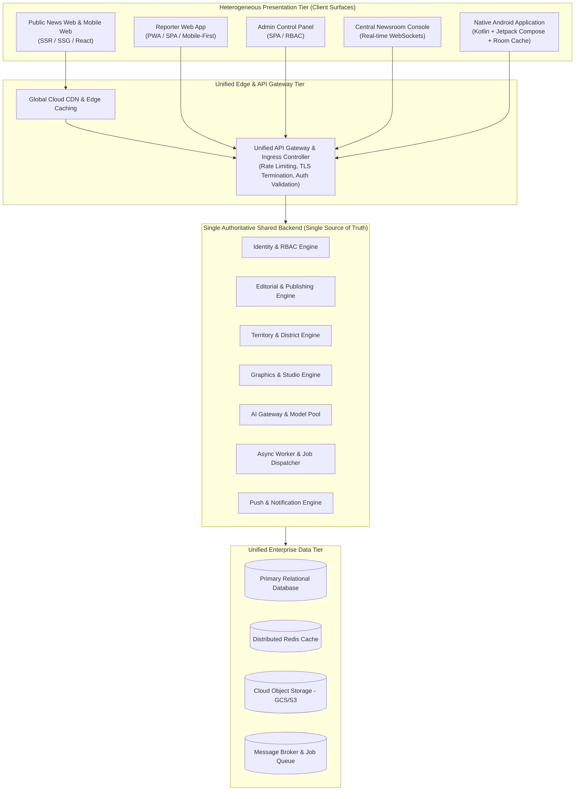

#### Shared Architectural Assets (Strictly Unified):
- **Single Source of Truth Database**: Every news article, category, district, reporter record, comment, and audit log resides in one unified relational database.
- **Unified Identity & RBAC**: One authentication system handles citizen readers, ground reporters, bureau chiefs, and super administrators across both Web and Android. A reporter authenticated on Android has the exact same permissions, restrictions, and territory bindings as on Web.
- **Identical Business Rules Enforcement**: Editorial validation (`RULE-NEWS-001`), territory restrictions (`RULE-GEO-001`), and graphics studio boundaries (`RULE-GFX-001`) are enforced on the backend server. The Android client cannot bypass review queues, publish unapproved drafts, or access admin-only URL/RSS scrapers.
- **Unified Storage & CDN Pipeline**: Media uploaded via Android phone cameras or web dropzones uses the same presigned URL ingestion pipeline, image optimization pipeline, and CDN delivery URLs.
- **Unified Notification Infrastructure**: Breaking news alerts and editorial feedback notifications originate from a central event dispatcher, distributing push notifications to Web Push (VAPID) and Android Native Push (Firebase Cloud Messaging - FCM) from a single event trigger.

---

## 3. Core Architecture Principles & Rationale

Every architectural decision in BREAKING NEWS WALA is governed by fifteen non-negotiable principles:

| # | Architecture Principle | Operational & Technical Definition | Why It Matters for BREAKING NEWS WALA |
| :--- | :--- | :--- | :--- |
| **P-01** | **API-First Architecture** | All platform capabilities are implemented first as robust, documented REST/WebSocket APIs before any client interface consumes them. | Ensures identical feature availability for Web and Android clients without backend refactoring. |
| **P-02** | **Strict Frontend/Backend Separation** | Zero coupling between presentation layer rendering and core domain business logic. Frontends communicate solely via JSON APIs. | Allows independent development, deployment, scaling, and technology choices for Web and Native Android. |
| **P-03** | **Server-Side Enforcement of Rules & RBAC** | Client applications (Web and Android) are treated as untrusted presentation environments. All permissions and state transitions are validated on the server. | Prevents malicious actors or compromised client bundles from tampering with news content or bypassing editorial approvals. |
| **P-04** | **Platform-Independent Business Logic** | Domain services, verification rules, territory allocations, and editorial workflows must contain zero web-specific or Android-specific code. | Eliminates logic duplication, divergent behavior between apps, and phantom bugs across operating systems. |
| **P-05** | **Reusable Backend Capabilities** | Core engines (e.g., Devanagari voice-to-text integration, AI headline generation, image watermarking) are exposed as reusable services. | Avoids redundant development costs and ensures consistent output formatting across all operational desks. |
| **P-06** | **Consistent API Contracts** | Strict request/response schemas, envelope formats, error codes, and HTTP status codes defined via OpenAPI 3.1 specifications. | Allows client developers (React and Kotlin) to build against mock contracts with complete type safety. |
| **P-07** | **Secure Token-Based Authentication** | Short-lived JWT access tokens paired with cryptographically secure, rotating refresh tokens and server-side blacklisting. | Supports seamless session management across mobile apps, PWA offline sync, and multi-tab browser sessions. |
| **P-08** | **Modular & Maintainable Code Organization** | High cohesion within domain boundaries and loose coupling across service modules (Domain-Driven Design). | Enables a clean development roadmap that starts as a Modular Monolith without preventing future microservices extraction. |
| **P-09** | **Scalable Media & CDN Delivery** | Heavy media assets (images, video reels, e-papers) are offloaded to Cloud Object Storage and globally cached at Edge CDN nodes. | Protects application servers from bandwidth exhaustion during sudden breaking news traffic spikes. |
| **P-10** | **Reliable Asynchronous Background Processing** | Long-running tasks (video rendering, AI text generation, RSS polling, push broadcasts) run in background worker queues. | Guarantees sub-100ms API response times for editorial users by eliminating synchronous request blocking. |
| **P-11** | **Comprehensive Observability & Auditability** | Centralized structured logging (JSON), OpenTelemetry distributed tracing, Prometheus metrics, and immutable audit logs. | Satisfies stringent legal compliance (`RULE-AUD-001`) and enables rapid root cause analysis of operational failures. |
| **P-12** | **Strict Environment Isolation** | Development, Staging, and Production environments maintain physically isolated databases, storage buckets, and API credentials. | Eliminates the risk of test data leaking into production or development scripts polluting live news feeds. |
| **P-13** | **Zero Frontend Secret Exposure** | API keys for Gemini AI, SMS gateways, cloud storage credentials, and FCM server keys are strictly quarantined inside backend vaults. | Prevents client bundle reverse engineering and catastrophic API quota theft or financial exposure. |
| **P-14** | **Zero Critical Logic in Browser JavaScript** | Pricing, editorial state transitions, trust score increments, and district validations must never execute exclusively in client scripts. | Shields the platform against client-side script tampering, browser extensions, or modified APKs. |
| **P-15** | **Zero Platform Assumptions in Backend** | The backend must never assume incoming requests originate from a specific browser engine, screen size, or native OS. | Guarantees that future smart TV apps, voice assistants, or smart watch feeds can integrate without backend changes. |

---

## 4. High-Level System Architecture & Logical Components

The system architecture is structured across four primary logical tiers:

```mermaid
flowchart LR
    subgraph TIER1["Tier 1: Client Layer"]
        C1["Public Web (Next.js/React)"]
        C2["Reporter PWA (React)"]
        C3["Admin Console (React)"]
        C4["Newsroom Desk (React/WS)"]
        C5["Native Android (Kotlin)"]
    end

    subgraph TIER2["Tier 2: Edge & Ingress"]
        E1["Cloudflare CDN & WAF"]
        E2["TLS Termination & Ingress"]
        E3["API Gateway & Rate Limiter"]
    end

    subgraph TIER3["Tier 3: Shared Backend Services"]
        B1["Auth & User Module"]
        B2["Editorial & News Module"]
        B3["District & Territory Module"]
        B4["RSS & URL Ingestion Module"]
        B5["Studio & Media Module"]
        B6["AI Gateway & API Pool"]
        B7["Notification & Push Module"]
        B8["Async Background Worker Queue"]
    end

    subgraph TIER4["Tier 4: Enterprise Data & External Services"]
        D1[(PostgreSQL Primary + Replicas)]
        D2[(Redis Cache & Session Store)]
        D3[(Cloud Storage - GCS/S3)]
        X1["Google Gemini AI API Pool"]
        X2["Firebase Cloud Messaging (FCM)"]
        X3["External News RSS Feeds"]
    end

    TIER1 --> TIER2
    TIER2 --> TIER3
    TIER3 --> TIER4
```

### 4.1 Client Layer Architecture (Trade-off Evaluation)
A primary architectural question for the Stage A Web Platform is whether the four web surfaces (Public Portal, Reporter App, Admin Panel, Central Newsroom) should be built as:
1. **Option A: Monolithic Multi-Route Single-Page Application (SPA)**: All roles served from one build bundle.
2. **Option B: Completely Disjoint Web Applications**: 4 separate repositories and deployments (`news.domain.com`, `reporter.domain.com`, `admin.domain.com`, `newsroom.domain.com`).
3. **Option C: Unified Monorepo with Domain-Isolated Builds (Modular Hybrid)**: A single shared codebase sharing UI design tokens, TypeScript types, and API client libraries, but building into two distinct deployment artifacts:
   - *Public News Engine*: Server-Side Rendered (SSR) / Static Site Generation (SSG) for maximum SEO and sub-second caching.
   - *Workspace Suite*: Authenticated Client-Side Application (SPA/PWA) housing Reporter, Admin, and Newsroom modules behind strict authentication walls.

#### Evaluation of Client Options:
| Dimension | Option A: Monolithic Single SPA | Option B: Disjoint Repositories | Option C: Modular Hybrid (Monorepo) |
| :--- | :--- | :--- | :--- |
| **SEO & Crawling** | Poor (Client-side rendering hurts Hindi news indexing). | High complexity in sharing SEO metadata across repos. | **Optimal**: Public portal uses SSR/SSG; internal suites use high-speed SPA. |
| **Bundle Size & Security** | Dangerous: Admin route code and internal forms leaked to public users. | Smallest bundles, but massive code duplication. | **Secure**: Public bundle contains zero internal admin UI code. |
| **Code & Token Sharing** | Trivial. | Difficult: Requires published private NPM packages for design tokens. | **Seamless**: Shared workspace packages (`@brand/tokens`, `@brand/types`). |
| **Operational Overhead** | Low. | Extremely High: 4 build pipelines, 4 deployments, version drift. | **Balanced**: Unified monorepo with 2 targeted deployment pipelines. |

> **Architectural Recommendation (PROPOSED - Pending Approval)**:
> **Adopt Option C (Modular Hybrid Monorepo)**. The Public News Website is deployed as an SSR/SSG modern web app (e.g., Next.js/Remix) optimized for public caching, Core Web Vitals, and search engine crawlers. The authenticated internal workspaces (Reporter PWA, Admin Control Panel, and Central Newsroom) are deployed as a secure, role-gated workspace SPA on an isolated subdomain (`workspace.breakingnewswala.com` or `/workspace`), ensuring zero administrative code leaks into the public web bundle while sharing 100% of design tokens, component primitives, and TypeScript API contracts.

### 4.2 Backend Layer Responsibilities
The shared backend provides twenty core logical capabilities encapsulated within clean domain boundaries:
1. **API Ingress & Request Validation**: Global routing, schema enforcement (Zod/Joi), and request sanitization.
2. **Authentication & Identity**: User signup, multi-factor login, JWT issuance, refresh token rotation, and password hashing (Argon2id/bcrypt).
3. **Authorization & RBAC**: Enforcing role permissions (Public User, Reporter, Senior Reporter, Bureau Chief, Sub-Editor, Admin, Super Admin).
4. **News & Editorial Management**: Drafting, revising, auto-saving, editorial diff tracking, state machine transitions, and publishing locks.
5. **Territory & District Engine**: Geographic hierarchy (Country $\rightarrow$ State $\rightarrow$ Division $\rightarrow$ District $\rightarrow$ Tehsil), exclusive territory assignments, and hyper-local routing.
6. **RSS Ingestion Engine**: Scheduled polling of verified RSS feeds, XML parsing, deduplication hashing, and ingestion queueing.
7. **URL-to-News Extraction**: Secure server-side headless scraping, boilerplate removal, metadata extraction, and draft conversion.
8. **AI Orchestration & API Pool**: Load balancing, key rotation, token rate limiting, prompt template rendering, and fallback across Gemini AI instances.
9. **Graphics Studio Service**: Server-side image generation, watermarking, template rendering, and Devanagari text overlay.
10. **Video Studio Service**: Script-to-video scene assembly, TTS voiceover synthesis coordination, subtitle burning, and video transcode dispatch.
11. **Media Asset Management**: Presigned upload URL generation, virus scanning, WebP/AVIF transcoding, and asset metadata indexing.
12. **Notification & Alert Hub**: Web Push notifications, Firebase Cloud Messaging (FCM) dispatch, and in-app alert broadcasting.
13. **Real-Time Communication**: WebSocket / SSE server for breaking news wire streams and editorial presence indicators.
14. **Coin, Rewards & Referral Service**: User engagement tracking, referral attribution, wallet balances, and payout thresholds (`RULE-COIN-001`).
15. **Full-Text Vernacular Search**: Hindi Devanagari stemming, phonetic indexing, category filtering, and fuzzy search matching.
16. **Ad Inventory & Placement Service**: Ad slot configuration, programmatic script injection rules, and sponsorship scheduling.
17. **Audit & Compliance Logging**: Immutable logging of all editorial decisions, status modifications, deletions, and administrative actions (`RULE-AUD-001`).
18. **E-Paper Publishing Engine**: Multi-page PDF splitting, high-res page image generation, and clickable regional edition navigation.
19. **Live Blog Streamer**: Chronological breaking news micro-updates with instant push to connected public readers.
20. **System Health & Telemetry**: Health checks, Prometheus metrics, database pool monitors, and memory usage profiling.

### 4.3 Data Layer Responsibilities
- **Primary Relational Database**: Manages all structured operational entities (users, roles, territories, news records, categories, audit logs) enforcing referential integrity, foreign key constraints, and ACID transactions.
- **Distributed Cache & Ephemeral Store**: In-memory data store for caching rendered article JSON payloads, API rate-limiting buckets, active user sessions, and real-time newsroom presence.
- **Vernacular Search Index**: Specialized search engine or PostgreSQL full-text search engine with Hindi language configuration (`pg_trgm` or dedicated search service).
- **Asynchronous Job Queue & Message Broker**: Redis-backed queue (e.g., BullMQ) or message broker (RabbitMQ/Cloud Pub/Sub) for distributing heavy processing jobs across background worker nodes.
- **Media Object Storage**: S3-compatible cloud object storage (Google Cloud Storage or AWS S3) organized in hierarchical private and public buckets with lifecycle policies.
- **Backup & Disaster Recovery**: Automated daily snapshot schedules, point-in-time recovery (PITR) with continuous WAL archiving, and geo-redundant storage replication.

### 4.4 External Integration Layer
- **AI Model Providers**: Google Gemini API via an internal failover API Pool (`gemini-1.5-flash`, `gemini-1.5-pro`).
- **Push Notification Infrastructure**: Firebase Cloud Messaging (FCM) for Native Android and Web Push Protocol (VAPID) for browsers.
- **External News Feeds**: Trusted regional wire RSS feeds (PTI, UNI, government portals) polled via secure background workers.
- **External News URLs**: Whitelisted or validated external URLs processed via backend sandboxed scrapers.
- **Transactional Communication**: SMS Gateway (DLT compliant for Indian regional SMS) and SMTP/SES for reporter verification.
- **CDN & Edge Security**: Cloudflare or Fastly for edge SSL termination, DDoS protection, WAF rules, and static asset caching.

---

---

## 5. Architectural Style Evaluation (Monolith vs. Microservices vs. Hybrid)

Choosing the appropriate architectural style is critical for project velocity, operational stability, and long-term maintainability. The system architecture evaluates three primary architectural topologies:

### 5.1 Comparative Architecture Evaluation Matrix

| Evaluation Dimension | Style 1: Modular Monolith | Style 2: Microservices Architecture | Style 3: Hybrid Architecture (Modular Core + Dedicated Workers) |
| :--- | :--- | :--- | :--- |
| **Architectural Concept** | Single unified codebase and deployment artifact organized into strictly isolated, decoupled domain modules with clear public interfaces. | Autonomous distributed services (e.g., Auth Service, News Service, Studio Service, RSS Service) deployed as independent containers with network IPC (gRPC/HTTP). | Single unified backend service containing all core transactional business domains, paired with specialized, independently scaled background worker fleets (Video/AI). |
| **Advantages** | - Ultra-fast development and deployment velocity.<br>- Single database transaction boundary (ACID guarantees for editorial approval).<br>- Zero network serialization latency between domain modules.<br>- Simplified local development and testing environment. | - Independent scaling of CPU-heavy services (video rendering).<br>- Isolated fault domains (a crash in RSS ingestion does not affect reading news).<br>- Heterogeneous technology stacks allowed per service. | - Preserves monolithic simplicity for 90% of business logic.<br>- Offloads heavy asynchronous jobs (video transcode, AI batching) to auto-scaling worker nodes.<br>- Zero distributed transaction overhead for editorial workflows. |
| **Disadvantages** | - A bug in one module can potentially crash the entire process if unhandled.<br>- Long-running CPU-intensive tasks (video rendering) can starve API request threads if executed on the same node. | - Massive operational overhead (Kubernetes, service mesh, distributed tracing, API gateways).<br>- Distributed transaction complexity (two-phase commits or Saga patterns needed for multi-entity changes).<br>- High latency overhead due to multi-hop network calls.<br>- Complex local developer setup. | - Slightly higher deployment orchestration than a pure single-server monolith (requires running web container + worker container). |
| **Operational Complexity** | **Very Low**: Single container image, single database connection pool, straightforward CI/CD pipeline. | **Extremely High**: Service discovery, distributed secrets, circuit breakers, multi-service logging and monitoring. | **Low to Moderate**: 2 container configurations sharing the same codebase (API container + Worker container). |
| **Development Complexity** | **Low**: Monorepo structure, unified typing, simple refactoring, instant cross-module function calls. | **High**: Managing API versioning between services, mock network harnesses, contract-testing overhead. | **Low**: Shared TypeScript domain models; workers simply process Redis job queues using identical domain code. |
| **Scalability** | High for standard web traffic via horizontal auto-scaling of API containers behind a load balancer. | Maximum: Each microservice scales independently based on its specific CPU/memory profile. | **High & Cost-Efficient**: Web API nodes scale horizontally on HTTP traffic; background worker nodes scale dynamically on queue depth. |
| **Maintainability** | High, provided strict module boundary enforcement (no circular dependencies or bypass of public service APIs). | Moderate to Low: High maintenance burden for small-to-medium engineering teams. | **High**: Codebase remains consolidated, making audits, security scans, and cross-cutting changes trivial. |
| **Suitability for Current Stage** | Highly suitable, but needs safeguards against CPU starvation during media rendering. | **Unsuitable**: Unjustified operational overhead, high infrastructure cost, and severe delay to launch. | **Optimal**: Directly aligns with Stage A Web-first roadmap while providing elastic capacity for Stage B growth. |
| **Impact on Future Android Integration** | **Zero Negative Impact**: Exposes a clean, consolidated, single-entry-point REST API gateway. | High risk of fragmented API endpoints or requiring an expensive Backend-for-Frontend (BFF) layer. | **Zero Negative Impact**: Android app interacts with a single, highly coherent, robust REST API surface. |

### 5.2 Architectural Recommendation

> [!IMPORTANT]
> **Architectural Recommendation: Style 3 — Hybrid Architecture (Modular Core Monolith + Dedicated Asynchronous Workers)**
> **Classification:** **PROPOSED — Subject to Formal Architectural Approval**
> 
> **Rationale**: 
> 1. A pure microservices architecture at this stage introduces catastrophic operational friction, distributed data fragmentation, and high hosting costs without providing tangible value to the newsroom or readers.
> 2. A pure single-process monolith risks performance degradation when heavy video generation or bulk RSS ingestion runs concurrently with live newsroom publishing.
> 3. **The Proposed Hybrid Solution**: The entire domain logic (Auth, Editorial, Territories, Graphics, RSS, Notifications) is developed within a strictly structured **Modular Monolith** codebase. In production, this identical codebase runs in two distinct container roles:
>    - **API Role (Web / Ingress Nodes)**: Lightweight, stateless containers dedicated exclusively to serving sub-100ms HTTP REST/WebSocket requests for Web and Android clients.
>    - **Worker Role (Background Nodes)**: Background containers dedicated exclusively to consuming asynchronous Redis job queues (e.g., rendering video clips, batching AI prompt chains, polling RSS feeds, optimizing media).
> 
> This architecture guarantees effortless horizontal scaling, complete isolation of heavy compute workloads, single-database ACID reliability, and an exceptionally clean API surface for the future Native Android application.

---

## 6. API-First & Cross-Platform Architecture

The API layer is the universal contract bridging the shared backend with all present and future client surfaces.

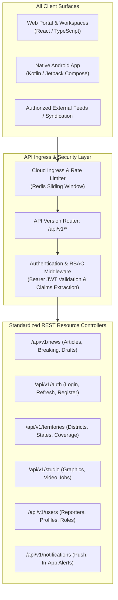

### 6.1 Unified API Contract Standards
All API endpoints across the platform adhere to a strict architectural standard:

1. **Uniform Resource Routing & Versioning**:
   - Every public and operational endpoint is prefixed with a global version identifier: `/api/v1/`.
   - Breaking structural changes to response models or request schemas require a version bump (e.g., `/api/v2/`), while additive non-breaking fields are deployed within the existing version.
   - The version lifespan policy mandates supporting a previous API version for at least 6 months after a new version release to accommodate un-updated Android APKs in the wild.
2. **Standardized Response Envelope**:
   All HTTP responses conform to a predictable, strongly typed JSON envelope format across both Web and Android:
   ```json
   {
     "success": true,
     "statusCode": 200,
     "data": { ... },
     "meta": {
       "timestamp": "2026-10-31T01:00:00Z",
       "requestId": "req-98765-abcdef",
       "pagination": {
         "cursor": "eyJpZCI6MTIzfQ==",
         "hasMore": true,
         "totalCount": 154
       }
     }
   }
   ```
3. **Standardized Error Envelope**:
   When an error occurs, the server responds with a matching error envelope:
   ```json
   {
     "success": false,
     "statusCode": 400,
     "error": {
       "code": "ERR_VALIDATION_FAILED",
       "message": "आलेख का शीर्षक अनिवार्य है (Article title is required)",
       "details": [
         {
           "field": "title",
           "message": "शीर्षक कम से कम 10 वर्णों का होना चाहिए"
         }
       ]
     },
     "meta": {
       "timestamp": "2026-10-31T01:00:00Z",
       "requestId": "req-98765-abcdef"
     }
   }
   ```
4. **Cross-Platform Authentication Token Delivery**:
   - **Web Clients**: The API supports delivering refresh tokens in `HttpOnly; Secure; SameSite=Strict` cookies, preventing XSS-based token theft in browser runtimes.
   - **Android Client**: Because native mobile runtimes lack automated cookie jars, the API simultaneously supports returning the refresh token in the JSON response body. The Android client securely passes the JWT access token in the standard `Authorization: Bearer <token>` header.
5. **High-Performance Pagination & Filtering**:
   - For high-volume news streams, the API enforces **Cursor-Based (Keyset) Pagination** (`?cursor=...&limit=20`) anchored to chronological auto-increment IDs. This prevents the "shifting page" anomaly inherent in offset pagination when breaking news is published in real-time.
   - Filtering parameters are standardized across all endpoints (`?district=varanasi&category=politics&status=published`).
6. **Direct Cloud Storage Ingestion (Presigned URL Architecture)**:
   - High-resolution camera photos and videos must **never** stream through application backend servers.
   - The client requests an upload authorization via `POST /api/v1/media/presigned-upload`.
   - The backend validates reporter permissions, allocates an asset UUID, and generates a time-limited (15-minute) presigned S3/GCS PUT URL.
   - The Web or Android client streams the binary payload directly from the device to Cloud Storage, completely bypassing backend memory and CPU.
7. **Sliding-Window Rate Limiting**:
   - Distributed rate limiting enforced via Redis sliding-window counters:
     - Public Reading APIs: 300 requests / minute per IP.
     - Authenticated Reporter APIs: 120 requests / minute per user token.
     - AI Generation Triggers: 15 requests / minute per reporter.
     - Authentication Endpoints: 5 attempts / minute per IP (brute-force defense).

---

## 7. Native Android Ecosystem & Shared Backend Contract

The Native Android Ecosystem is realized under `android/` as a 10-module Gradle architecture delivering two distinct applications: **Public News Reader (`:app-reader`)** and **Field Reporter App (`:app-reporter`)** developed strictly using pure Kotlin, Android SDK 35/36, Jetpack Compose, Kotlin Coroutines/Flow, Retrofit2/OkHttp4, and EncryptedSharedPreferences (detailed in [`docs/ANDROID-ARCHITECTURE.md`](file:///c:/Users/pp/Downloads/BREAKING-NEWS-WALA-main/docs/ANDROID-ARCHITECTURE.md) and [`docs/ANDROID-RELEASE-RUNBOOK.md`](file:///c:/Users/pp/Downloads/BREAKING-NEWS-WALA-main/docs/ANDROID-RELEASE-RUNBOOK.md)). Zero WebViews are permitted (`DEC-002`).

### 7.1 Architectural Domain Separation: Shared vs. Platform-Specific

To prevent architectural drift and eliminate logic duplication, the boundary between shared backend responsibilities and Android native responsibilities is strictly established:

| Architectural Domain | Shared Backend Responsibilities (Single Source of Truth) | Platform-Specific Native Android Responsibilities |
| :--- | :--- | :--- |
| **Authentication & Accounts** | Validates credentials, issues JWT access and refresh tokens, maintains user profiles, handles account revocation. | Securely stores tokens in **Android Keystore / EncryptedSharedPreferences**; manages automatic token refresh via OkHttp Authenticator. |
| **Editorial & Business Rules** | Enforces publishing status machine, category integrity, territory boundaries (`RULE-GEO-001`), and character limits. | Displays validation errors returned by the API; provides native tactile input feedback. |
| **User Interface & Layout** | Delivers raw structured JSON content, typography tokens, and semantic layout hints. | Renders 100% native **Jetpack Compose (`@Composable`)** UI hierarchy with material elevation, hardware-accelerated animations, and native system gestures. Zero WebViews. |
| **Navigation & Backstack** | Owns URI deep link routing structure (`/news/{slug}`, `/district/{id}`). | Manages native Jetpack Compose Navigation backstack, hardware back-button handling, and predictive back animations. |
| **Push Notifications** | Detects breaking news events or editorial approvals; formats notification payload; dispatches via Firebase Admin SDK. | Receives payload via **FirebaseMessagingService**; builds native Android notification channels (Breaking News, Editorial Alerts); handles tap intents. |
| **Device Hardware Access** | Validates incoming uploaded file headers, MIME types, and binary file signatures. | Requests runtime OS permissions (`CAMERA`, `READ_MEDIA_IMAGES`, `ACCESS_FINE_LOCATION`); triggers `ActivityResultContracts` for native camera/gallery pickers. |
| **Offline Cache & Storage** | Serves cache-control headers (`ETag`, `Last-Modified`, `max-age`); delivers delta sync payloads. | Stores offline news feed and reporter drafts in **Room Database** (SQLite); provides instant offline reading. |
| **Background Synchronization**| Enqueues and processes asynchronous publishing tasks on the server. | Schedules reliable, battery-efficient sync jobs using **Android WorkManager** (e.g., uploading pending field drafts when network connectivity resumes). |
| **Network Adaptation** | Provides compressed lightweight JSON payloads; supports WebP/AVIF media delivery. | Monitors network state via `ConnectivityManager`; automatically throttles video autoplay and switches to low-res thumbnails on 2G/3G connections. |
| **Crash & Error Telemetry** | Collects backend server logs, database slow queries, and unhandled 500 exceptions. | Integrates **Firebase Crashlytics** to monitor native Android ANRs (Application Not Responding), memory leaks, and native runtime exceptions. |

### 7.2 Native Android Communication & Deep Linking
- **Deep Linking Protocol**: The Android app registers native intent filters for standard HTTPS web URLs:
  `https://breakingnewswala.com/news/*` $\rightarrow$ launches native `NewsDetailScreen`.
  `https://breakingnewswala.com/district/*` $\rightarrow$ launches native `DistrictClusterScreen`.
  This allows citizen readers clicking links shared on WhatsApp or Telegram to seamlessly transition into the high-performance native app if installed, or fallback to the mobile web browser.
- **Resilient Upload Queue (WorkManager Integration)**: Field reporters uploading breaking video or photos in areas with intermittent cellular coverage rely on an Android `CoroutineWorker`. The worker handles exponential backoff retries, survives app process termination or device reboots, and notifies the reporter upon final sync completion.

---

---

## 8. News & Editorial Data Flows (End-to-End Processing Pipelines)

The core business value of BREAKING NEWS WALA resides in its high-speed editorial pipelines. The architecture formalizes six distinct end-to-end data processing flows:

### 8.1 Flow 1: Reporter News Filing & Publishing Pipeline
Reporters author news reports either in the field on mobile devices or in bureau offices on desktop workstations.

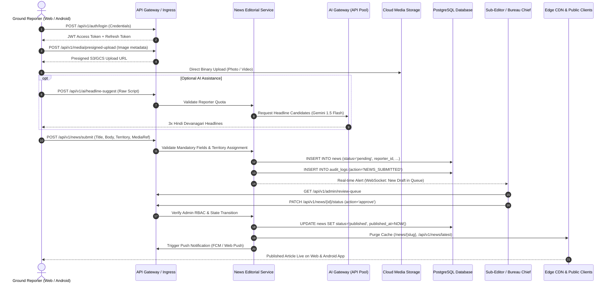

### 8.2 Flow 2: Admin RSS Ingestion Pipeline
The RSS ingestion engine continuously monitors authorized external wire sources (PTI, UNI, Government Press Information Bureau):
1. **Scheduled Polling**: Dedicated background worker executes scheduled cron intervals (every 5–15 minutes) defined in database configuration.
2. **Ingestion & Fetching**: Worker fetches external XML/Atom feed; parses items with strict XML external entity (XXE) protection.
3. **Deduplication Hashing**: Computes SHA-256 hash of feed GUID and article title. Checks Redis cache and database `rss_feed_items` table. Duplicate items are instantly discarded.
4. **AI Processing Pipeline**: Sends extracted raw wire text to the AI Gateway. The API Pool invokes Google Gemini to generate a factual, engaging Devanagari Hindi headline, 3-bullet summary, and full draft copy.
5. **Draft Creation**: Inserts record into database with status `rss_draft` and tags source attribution.
6. **Admin Review Queue**: Item appears in the Admin Review Queue. An editor inspects, adjusts content, and clicks "प्रकाशित करें" (Publish) or "अस्वीकृत" (Reject). Unapproved RSS items are never published automatically.

### 8.3 Flow 3: Admin URL-to-News Pipeline
Allows authorized administrators to convert an approved external news article URL into a structured platform news draft:
1. **Submission**: Editor inputs an external URL into the Admin Control Panel.
2. **SSRF & Security Validation**: Backend validates that the target URL is a valid public HTTP/HTTPS URL and does not resolve to private RFC 1918 subnets (e.g., `127.0.0.1`, `10.0.0.0/8`, `192.168.0.0/16`, cloud metadata endpoints `169.254.169.254`).
3. **Headless Scraping**: Background worker fetches HTML via a sandboxed scraper, extracts structured OpenGraph tags, article text, author byline, and publication timestamp.
4. **AI Transformation**: AI Engine re-synthesizes the report in clean Hindi journalistic prose while preserving factual integrity.
5. **Draft Ingestion**: Ingests into database as an `ai_url_draft` for editorial verification and sign-off.

### 8.4 Flow 4: Graphics Studio Workflow & Strict Role Boundary

> [!IMPORTANT]
> **Strict Security & Role Invariant (`RULE-NEWS-001`, `RULE-GFX-001`)**:
> - **Reporter Graphics Studio**: Restricted **exclusively to Raw Script to Graphic**. Reporters paste raw verified field notes or article copy into Admin-assigned templates. Reporters have zero access to URL-to-Graphic or RSS-to-Graphic tools.
> - **Admin Graphics Studio**: Full access to Template Management, Master Watermark Configurator, Bulk Export, URL-to-Graphic, and RSS-to-Graphic automation.

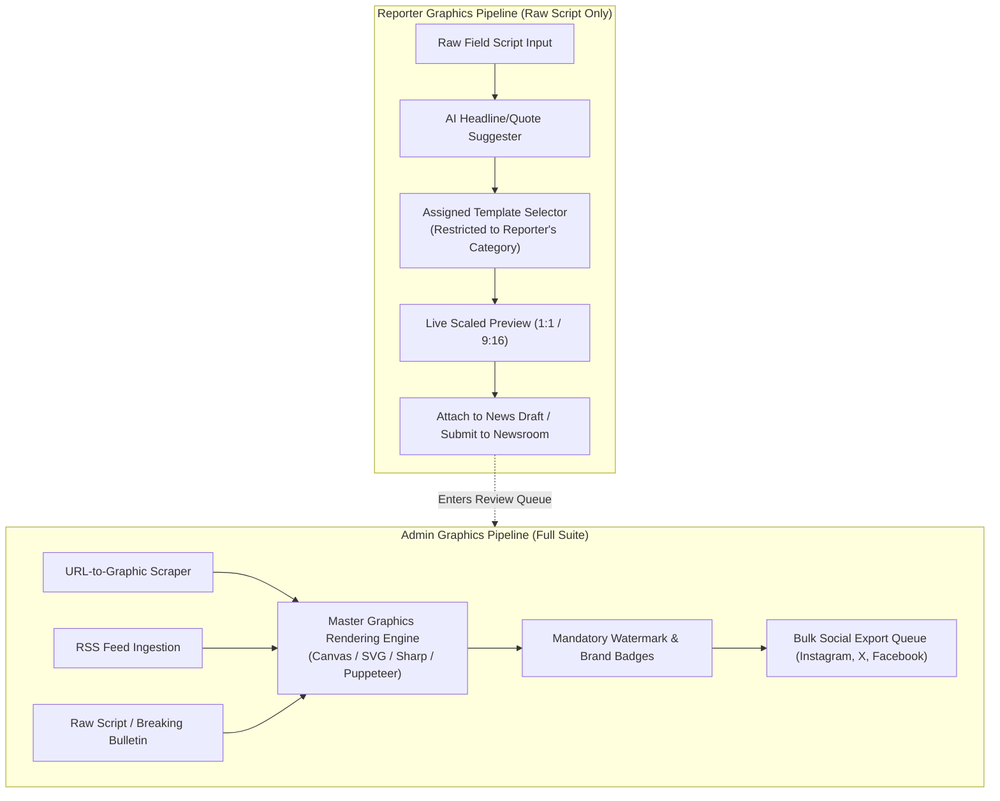

### 8.5 Flow 5: Video Studio Pipeline
1. **Project Initiation**: Editor inputs script narrative and designates target aspect ratio (`9:16` for Reels/Shorts or `16:9` for standard video).
2. **Asset Assignment**: Assigns video clips, photos, and lower-third graphics to sequential scenes.
3. **Voiceover Synthesis**: Invokes regional Hindi Text-to-Speech (TTS) engine, generating synced WAV/MP3 audio.
4. **Subtitle Auto-Transcription**: Generates Devanagari subtitle timecodes (.SRT) matched to voiceover timestamps.
5. **Cloud Rendering Dispatch**: Asynchronous background worker spins up a headless FFmpeg/Canvas container to compose video layers, burn subtitles, apply background music, and render the final MP4.
6. **Publication & CDN Distribution**: Rendered MP4 is uploaded to Cloud Storage, indexed in database, and distributed across CDN edge nodes.

### 8.6 Flow 6: Public Content Delivery & Multi-Tier Caching Pipeline
1. **Public Client Request**: Reader requests `https://breakingnewswala.com/news/varanasi-smart-city-project`.
2. **Edge Cache (L1)**: Cloudflare CDN checks edge cache. If hit, returns optimized HTML/JSON in $<30\text{ms}$.
3. **Application Cache (L2)**: If cache miss, request hits API Gateway $\rightarrow$ checks Redis distributed cache. If hit, returns in $<50\text{ms}$.
4. **Primary Database (L3)**: If cache miss, queries PostgreSQL read-replica; hydrates Redis cache; returns response.
5. **Real-Time Invalidation**: When an article is edited, retracted, or published, an event bus triggers instantaneous CDN cache purge and Redis key deletion (`cache:news:slug:...`).

---

## 9. Background Processing, Asynchronous Queues & Event Architecture

Synchronous HTTP request threads must never perform heavy compute, network-bound polling, or blocking I/O operations. The platform employs an asynchronous event-driven queue architecture:

```mermaid
flowchart LR
    subgraph PRODUCERS["Event & Job Producers"]
        API["Web API Nodes"]
        CRON["Scheduled Cron Dispatcher"]
        WEBHOOK["External Webhook Handlers"]
    end

    subgraph BROKER["Redis-Backed Queue Broker (BullMQ)"]
        Q_AI["queue:ai-generation"]
        Q_MEDIA["queue:media-transcode"]
        Q_RSS["queue:rss-polling"]
        Q_NOTIF["queue:push-broadcast"]
        Q_AUDIT["queue:audit-logging"]
    end

    subgraph CONSUMERS["Dedicated Worker Fleet (Worker Containers)"]
        W_AI["AI Worker Cluster"]
        W_MEDIA["Media & Video Workers (FFmpeg)"]
        W_RSS["RSS Ingestion Workers"]
        W_NOTIF["FCM Push Notification Workers"]
    end

    PRODUCERS --> BROKER
    BROKER --> CONSUMERS
```

### 9.1 Background Queue Subsystems & Operational Requirements

| Queue Name | Operational Purpose | Concurrency & Worker Profile | Retry Strategy & Dead-Letter Handling |
| :--- | :--- | :--- | :--- |
| `queue:ai-generation` | Dispatches prompts to Gemini AI Pool for headlines, summaries, and translations. | High I/O concurrency (20–50 parallel workers). Rate-limited to respect provider API quotas. | 3 retries with exponential backoff (`delay: 2000ms`, `backoff: exponential`). Failed jobs route to `dlq:ai-failures` for admin inspection. |
| `queue:media-transcode` | Generates WebP/AVIF thumbnail variations and compresses uploaded videos. | CPU-intensive (4–8 workers per node, pinned to dedicated CPU cores). | 2 retries. On permanent failure, flags asset as `transcode_failed` and serves original file. |
| `queue:video-rendering` | Renders multi-track Video Studio reels via FFmpeg headless pipelines. | High CPU & Memory (2 concurrent jobs per worker container). | 1 retry. Detailed error log captured and displayed on Admin Video Studio dashboard. |
| `queue:rss-polling` | Periodically fetches, parses, and deduplicates external RSS feeds. | Lightweight I/O (5 concurrent workers). Scheduled on 5-minute cron intervals. | Non-retrying per cycle; failures logged to telemetry, re-attempted on next cron tick. |
| `queue:push-broadcast` | Broadcasts breaking news notifications to millions of Web Push and Android FCM subscribers. | Massive I/O throughput (batched in chunks of 500 tokens per FCM call). | Batches retried up to 3 times on transient network errors. Invalid/unregistered tokens automatically purged from DB. |
| `queue:audit-logging` | Asynchronously persists non-blocking audit trails and user activity logs. | High throughput, low latency (single-pass bulk insertion into PostgreSQL). | In-memory retry buffer; flushes to disk to guarantee zero data loss. |

---

## 10. Security Architecture, Trust Boundaries & Defense-in-Depth

The security architecture implements the principle of **Defense-in-Depth** and **Zero Trust**. No client environment—whether a public web browser, an authenticated reporter laptop, or a native Android smartphone—is trusted.

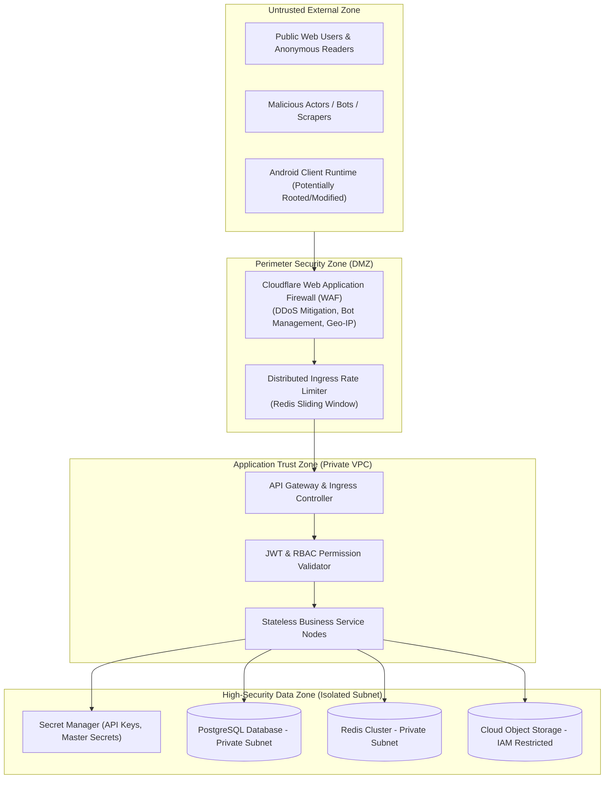

### 10.1 Primary Trust Boundaries
1. **Trust Boundary 1: Public Internet $\rightarrow$ Frontend & Edge CDN**:
   - TLS 1.3 encryption mandatory.
   - Cloudflare WAF inspects incoming requests, blocking SQL injection (SQLi), Cross-Site Scripting (XSS), and Layer 7 volumetric DDoS attacks.
2. **Trust Boundary 2: Client Applications $\rightarrow$ Backend API Gateway**:
   - Zero access to database or internal micro-components from clients.
   - All requests terminate at the API Gateway; validated against strict Zod/Joi schemas. Unexpected or untyped payload parameters are discarded.
3. **Trust Boundary 3: Backend $\rightarrow$ Database & Cache**:
   - Database and Redis instances reside in private VPC subnets with zero public IP addresses.
   - All SQL execution utilizes parameterized queries via an Object-Relational Mapping (ORM) layer, completely eliminating SQL injection vectors.
4. **Trust Boundary 4: Backend $\rightarrow$ External World (SSRF Protection)**:
   - When fetching external URLs (URL-to-News) or RSS feeds, the backend enforces an **Anti-SSRF Egress Proxy**:
     - Resolves DNS prior to HTTP request.
     - Rejects any IP address resolving to private, loopback, link-local, or cloud metadata ranges (`127.0.0.0/8`, `10.0.0.0/8`, `172.16.0.0/12`, `192.168.0.0/16`, `169.254.169.254`).
     - Enforces a 5-second connection timeout and max 5MB download limit to prevent denial-of-service via huge payloads.
5. **Trust Boundary 5: Privileged Administrative Operations**:
   - Administrative and Bureau Chief accounts enforce mandatory Multi-Factor Authentication (MFA).
   - High-impact actions (e.g., publishing breaking news, deleting accounts, emergency kill switch activation) require explicit audit-trail logging with IP capture (`RULE-AUD-001`).

---

---

## 11. Reliability, Scalability & Performance Strategy

As a 24/7 breaking news platform, BREAKING NEWS WALA must maintain high availability ($99.9\%$ SLA as defined in [`docs/04-NFR.md`](file:///c:/Users/pp/Downloads/BREAKING-NEWS-WALA-main/docs/04-NFR.md)) during massive viral news events, regional crises, or election vote-counting spikes.

### 11.1 High-Concurrency Traffic & Burst Management
- **Read-Heavy Architecture**: News consumption is typically 95% reads and 5% writes. Public news traffic is isolated from transactional editorial writes:
  - Edge CDN caches public article pages and category JSON responses with smart stale-while-revalidate headers (`Cache-Control: public, max-age=60, s-maxage=300, stale-while-revalidate=86400`).
  - Read-heavy queries on the origin server are directed to **PostgreSQL Read Replicas** via connection pooling (PgBouncer), preventing database connection saturation during breaking news traffic bursts.
- **Horizontal Auto-Scaling**: Web API containers scale horizontally based on CPU utilization ($\ge 70\%$) or active HTTP request count.
- **Graceful Degradation Protocol**: Under extreme origin load or upstream failure:
  1. Real-time WebSocket presence indicators are paused, falling back to 30-second polling.
  2. Public article recommendations downgrade from dynamic real-time scoring to cached category top stories.
  3. Video autoplay on mobile feeds is suppressed.

### 11.2 AI Quota & Provider Failover Architecture (API Pool)
The Google Gemini AI integration utilizes an internal **API Key & Model Pool Manager**:
- **Round-Robin Key Rotation**: Distributes prompt requests across multiple provisioned project API keys to maximize aggregate queries-per-minute (QPM).
- **Graceful Fallback**: If `gemini-1.5-pro` returns an HTTP 429 (Rate Limit Exceeded) or 503 (Overloaded), the gateway automatically falls back to `gemini-1.5-flash`.
- **Circuit Breaker**: If error rates exceed 20% over 60 seconds, the circuit opens for 30 seconds, instantly failing fast and notifying editorial staff to proceed with manual headline entry without UI hanging.

### 11.3 Disaster Recovery & Business Continuity
- **Recovery Point Objective (RPO)**: $\le 15\text{ minutes}$ (continuous WAL archiving to geo-redundant storage).
- **Recovery Time Objective (RTO)**: $\le 60\text{ minutes}$ (automated infrastructure provisioning via containerized orchestration).
- **Automated Snapshots**: Full database snapshots taken nightly, stored in an isolated, immutable backup storage bucket.

---

## 12. Environment Topologies & Deployment Architecture

The platform enforces strict logical, network, and credential isolation across four distinct lifecycle environments:

| Environment | Purpose & Scope | Target Infrastructure Topology | Data & Security Policy |
| :--- | :--- | :--- | :--- |
| **Development (`dev`)** | Local and remote developer feature engineering, unit testing, and sandbox experimentation. | Local Docker Compose environments; mock AI services; SQLite / local PostgreSQL. | Synthetic mock data only. Zero real user PII. Mock third-party APIs. |
| **Testing / CI (`test`)** | Automated CI/CD pipelines, linting, type-checking, integration tests, contract tests. | Ephemeral containerized runners (GitHub Actions / GitLab CI); temporary test DB instances. | Deterministic test fixtures. Automatically destroyed upon test completion. |
| **Staging (`stage`)** | Pre-production validation, editorial staff acceptance testing, Android APK beta releases, load tests. | Mirror of production architecture (isolated Kubernetes cluster or staging App Engine / Cloud Run instance). | Anonymized production clone data. Dedicated staging Gemini API keys. |
| **Production (`prod`)** | Live public news portal, active ground reporter operations, real-time broadcasts. | Production multi-zone cloud cluster, primary-replica DB, managed Redis, Cloudflare Enterprise CDN. | Strictly managed secrets (Vault/Secret Manager). Strict RBAC. Automated backups active. |

### 12.1 Containerized Deployment & Zero-Downtime Releases
- **Containerization**: Every service (Web API, Background Worker, Studio Transcoder) is packaged as a lightweight, OCI-compliant Docker container built with multi-stage builds.
- **Rolling Zero-Downtime Deployments**: Application updates are deployed via rolling updates or blue-green deployments. Health probes ensure that new containers pass both `/health/liveness` and `/health/readiness` checks before traffic is routed to them and old containers are drained.

---

## 13. System Architecture Diagrams (9 Core Visual Specifications)

The following nine architectural diagrams provide the authoritative visual blueprints for the BREAKING NEWS WALA system:

### 13.1 Diagram 1: System Context Diagram (C4 Level 1)
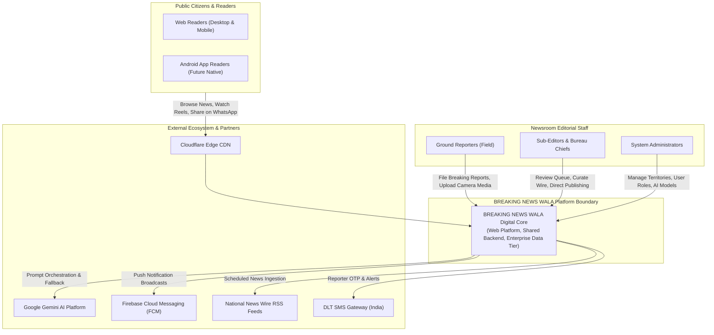

### 13.2 Diagram 2: High-Level Container/Component Diagram (C4 Level 2)
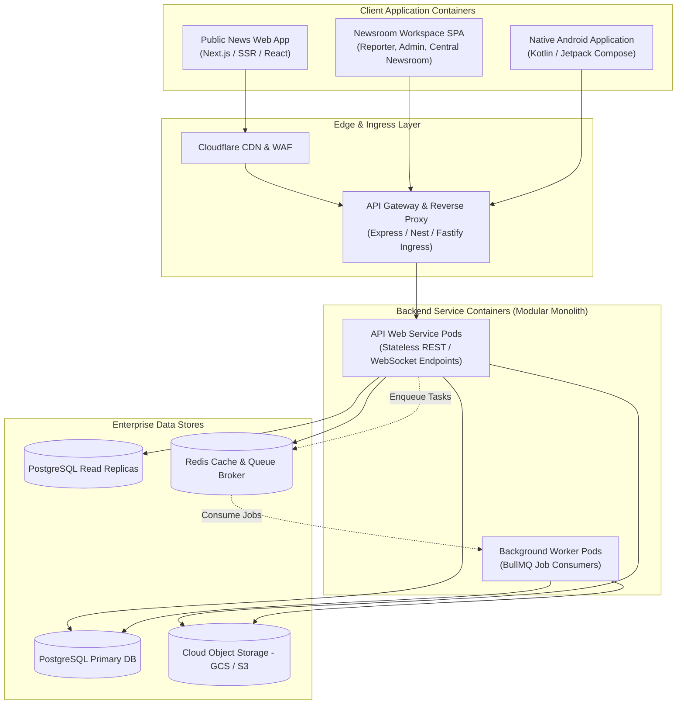

### 13.3 Diagram 3: Web and Android Shared-Backend Architecture
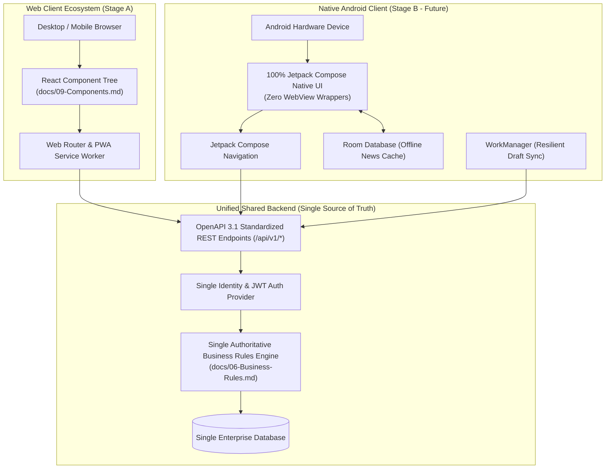

### 13.4 Diagram 4: Reporter News Publishing Sequence Diagram
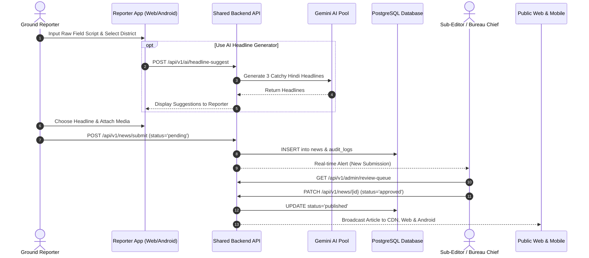

### 13.5 Diagram 5: RSS-to-Publishing Sequence Diagram
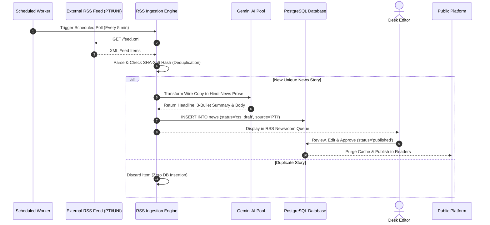

### 13.6 Diagram 6: AI API Pool Integration Flow Diagram
```mermaid
flowchart TD
    IN_REQ["Incoming AI Task<br>(Headline, Summary, Translation, Fact-Check)"] --> POOL_MGR["API Pool & Load Balancing Manager"]
    
    subgraph KEY_ROTATION["Round-Robin Key Ring"]
        K1["Gemini Key #1 (Primary)"]
        K2["Gemini Key #2 (Secondary)"]
        K3["Gemini Key #3 (Backup)"]
    end

    POOL_MGR --> KEY_ROTATION

    KEY_ROTATION --> CALL_AI{"Dispatch API Call"}

    CALL_AI -->|Success 200 OK| PARSE["Parse & Sanitize Structured JSON"]
    CALL_AI -->|HTTP 429 Quota Exceeded| ROTATE["Rotate to Next Key & Decrement QPM Counter"]
    CALL_AI -->|HTTP 503 Overloaded| FALLBACK["Fallback Model: gemini-1.5-pro -> gemini-1.5-flash"]
    CALL_AI -->|Permanent Failure (3 Retries Exhausted)| BREAKER["Open Circuit Breaker & Fallback to Manual Editorial Entry"]

    ROTATE --> CALL_AI
    FALLBACK --> CALL_AI
    PARSE --> RETURN["Return Result to Client Application"]
```

### 13.7 Diagram 7: Background Job Processing Flow Diagram
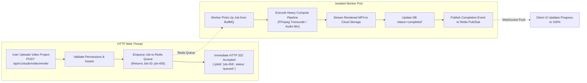

### 13.8 Diagram 8: High-Level Deployment & Environment Diagram
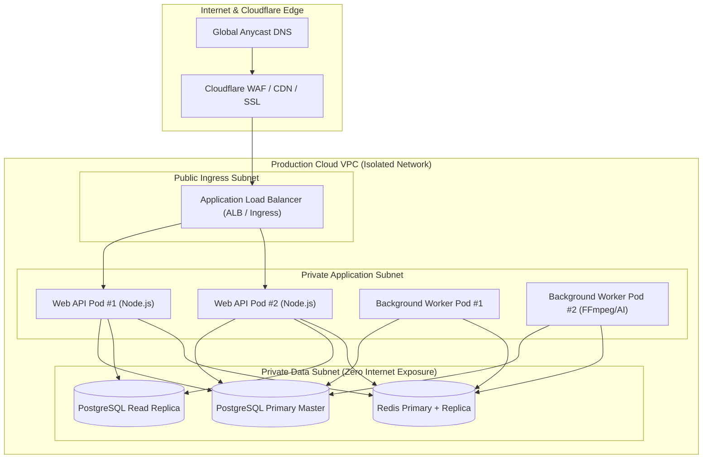

### 13.9 Diagram 9: Security Trust-Boundary Diagram
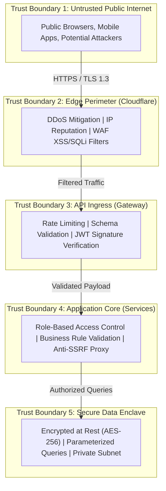

---

---

## 14. Architecture Decisions Register (ADR)

The Architecture Decisions Register formalizes the evaluation of strategic architectural choices. Each decision distinguishes between confirmed requirements and proposed recommendations requiring technical governance sign-off.

| Decision ID | Architectural Topic | Evaluated Options | Recommended Option | Architectural Rationale | Status | Dependencies | Approval Required |
| :--- | :--- | :--- | :--- | :--- | :--- | :--- | :--- |
| **ADR-01** | **System Architecture Style** | 1. Modular Monolith<br>2. Microservices<br>3. Hybrid (Monolith + Workers) | **Hybrid Architecture (Modular Monolith + Async Workers)** | Provides monolithic simplicity for transactional editorial logic while isolating heavy video/AI jobs on worker nodes. | **Proposed** | None | CTO / Lead Architect |
| **ADR-02** | **Web Client Packaging** | 1. Single Monolithic SPA<br>2. 4 Independent Repos<br>3. Modular Monorepo (SSR Public + SPA Workspaces) | **Modular Monorepo (SSR Public + SPA Workspaces)** | Guarantees top SEO and Core Web Vitals for public readers while isolating secure newsroom code from public bundles. | **Proposed** | ADR-01 | Frontend Lead / CTO |
| **ADR-03** | **Backend Runtime & Framework** | 1. Node.js (TypeScript / NestJS / Express)<br>2. Go (Gin/Fiber)<br>3. Python (FastAPI) | **Node.js with TypeScript (NestJS or Express)** | Unified language across full web stack; vast ecosystem for media/RSS parsing; rapid velocity; strong typing. | **Proposed** | ADR-01 | Lead Architect |
| **ADR-04** | **Primary Database Engine** | 1. PostgreSQL<br>2. MySQL / MariaDB<br>3. MongoDB | **PostgreSQL (v15+)** | Industrial ACID compliance for newsroom publishing; native JSONB support; excellent Devanagari text search (`pg_trgm`). | **Proposed** | None | Lead Architect / DBA |
| **ADR-05** | **API Protocol & Style** | 1. RESTful JSON (OpenAPI 3.1)<br>2. GraphQL<br>3. gRPC | **RESTful JSON with OpenAPI 3.1** | Universally supported across Web, Android Retrofit, and third-party syndication; simple caching at CDN edge. | **Confirmed** | P-01, P-06 | None (Architectural Standard) |
| **ADR-06** | **Authentication & Token Strategy** | 1. Server-side State Sessions<br>2. JWT Access + Rotating Refresh Tokens<br>3. OAuth2 Only | **JWT Bearer Access + Rotating Refresh Tokens** | Stateless API scaling; seamless native Android support; paired with HttpOnly cookies for web security. | **Proposed** | `docs/14-Auth.md` | Security Architect |
| **ADR-07** | **In-Memory Cache & Session Store** | 1. Redis Cluster<br>2. Memcached<br>3. In-Process Memory | **Redis (v7+)** | Versatile data structures (strings, hashes, sorted sets for rate limiting); powers distributed pub/sub and job queues. | **Proposed** | None | Lead Architect |
| **ADR-08** | **Asynchronous Job Queue** | 1. Redis + BullMQ<br>2. RabbitMQ<br>3. Apache Kafka | **Redis + BullMQ** | Zero additional infrastructure footprint; native Node.js/TypeScript job typing; delayed retries and dead-letter queues. | **Proposed** | ADR-07 | Lead Architect |
| **ADR-09** | **Full-Text Hindi Search Engine** | 1. PostgreSQL Full-Text Search (`pg_trgm`)<br>2. Elasticsearch / OpenSearch<br>3. Typesense / MeiliSearch | **PostgreSQL Full-Text Search (Initial) $\rightarrow$ Typesense (Scale)** | PostgreSQL trigram search satisfies initial launch without adding external cluster complexity. Typesense evaluated for Phase 8. | **Proposed** | ADR-04 | Lead Architect |
| **ADR-10** | **Media Storage Architecture** | 1. Cloud Object Storage (GCS / AWS S3)<br>2. Local Host Filesystem<br>3. Distributed NFS | **Cloud Object Storage (GCS / S3)** | High durability ($99.999999999\%$); presigned direct upload offloads server bandwidth; native CDN integration. | **Confirmed** | `docs/16-Storage.md` | Lead Architect |
| **ADR-11** | **Edge CDN & Perimeter Security** | 1. Cloudflare Enterprise / Pro<br>2. Fastly<br>3. AWS CloudFront | **Cloudflare** | Industry-leading DDoS protection, global Indian edge presence, instant cache purging, and edge WAF rules. | **Proposed** | None | Head of Infrastructure |
| **ADR-12** | **AI Orchestration & Quota Management** | 1. Single API Key Direct Call<br>2. Internal API Pool with Key Rotation & Fallback | **Internal API Pool with Key Rotation & Fallback** | Prevents quota exhaustion (HTTP 429); seamless model switching (`gemini-1.5-pro` $\rightarrow$ `gemini-1.5-flash`); circuit breaker. | **Confirmed** | `docs/19-API-Pool.md` | Lead Architect |
| **ADR-13** | **Real-Time Newsroom Protocol** | 1. WebSockets (Socket.io / ws)<br>2. Server-Sent Events (SSE)<br>3. Short HTTP Polling | **WebSockets (with HTTP Long-Polling Fallback)** | Full-duplex low-latency communication for real-time wire streams, GPS reporter coordinates, and editorial chat. | **Proposed** | None | Lead Architect |
| **ADR-14** | **Hosting & Container Orchestration** | 1. Containerized Cloud VMs (Docker Compose / Nomad)<br>2. Managed Kubernetes (GKE / EKS)<br>3. Serverless (Cloud Run / Lambda) | **Managed Containers (Cloud Run / Containerized Cloud VMs)** | Eliminates Kubernetes management overhead for initial phases while supporting auto-scaling and stateless container deployments. | **Proposed** | `docs/24-Deployment.md` | Head of Infrastructure |
| **ADR-15** | **Android Client Architecture** | 1. Native Kotlin + Jetpack Compose<br>2. Hybrid WebView Wrapper<br>3. Flutter / React Native | **100% Native Kotlin + Jetpack Compose** | Enforces `RULE-XPLAT-003` and `RULE-XPLAT-004`. Maximum hardware performance, native background sync, zero WebView lag. | **Confirmed** | PRD v1.0.0 | None (Non-Negotiable) |

---

## 15. Downstream Documentation Dependencies

This Master System Architecture Specification establishes high-level structural boundaries and contracts. Detailed low-level implementation specifications are formally delegated to downstream architectural volumes:

| Document Code & Path | Delegated Architectural Scope & Boundary |
| :--- | :--- |
| [`docs/12-Database.md`](file:///c:/Users/pp/Downloads/BREAKING-NEWS-WALA-main/docs/12-Database.md) | Relational database schema, entity-relationship diagrams (ERD), table definitions, foreign keys, indexes, data types, and migration strategies. |
| [`docs/13-API.md`](file:///c:/Users/pp/Downloads/BREAKING-NEWS-WALA-main/docs/13-API.md) | Granular endpoint definitions, HTTP methods, request payload schemas, response JSON bodies, query parameters, and OpenAPI 3.1 contracts. |
| [`docs/14-Auth.md`](file:///c:/Users/pp/Downloads/BREAKING-NEWS-WALA-main/docs/14-Auth.md) | Cryptographic token handling, password hashing algorithms, session state, MFA flows, account recovery, and OAuth integrations. |
| [`docs/15-Security.md`](file:///c:/Users/pp/Downloads/BREAKING-NEWS-WALA-main/docs/15-Security.md) | Threat modeling (STRIDE), network security policies, CORS configurations, rate limiting thresholds, encryption key lifecycles, and audit compliance. |
| [`docs/16-Storage.md`](file:///c:/Users/pp/Downloads/BREAKING-NEWS-WALA-main/docs/16-Storage.md) | Cloud storage bucket structures, presigned upload protocols, image transcoding pipelines, video storage tiers, and asset retention policies. |
| [`docs/19-API-Pool.md`](file:///c:/Users/pp/Downloads/BREAKING-NEWS-WALA-main/docs/19-API-Pool.md) | Multi-key round-robin management, Gemini model switching algorithms, quota tracking, circuit breaker thresholds, and prompt template caching. |
| [`docs/20-Integrations.md`](file:///c:/Users/pp/Downloads/BREAKING-NEWS-WALA-main/docs/20-Integrations.md) | Third-party service integration specifications: Firebase Cloud Messaging (FCM), SMS DLT Gateways, RSS parsers, and external analytics SDKs. |
| [`docs/24-Deployment.md`](file:///c:/Users/pp/Downloads/BREAKING-NEWS-WALA-main/docs/24-Deployment.md) | Production server topology, Docker container specifications, CI/CD pipeline stages, rolling release mechanics, and rollback procedures. |
| [`docs/25-Environment.md`](file:///c:/Users/pp/Downloads/BREAKING-NEWS-WALA-main/docs/25-Environment.md) | Environment variable catalogs, secrets management, staging vs. production configuration profiles, and vault access policies. |

---

## 16. Architectural Traceability Matrix

The system architecture maps directly to the verified requirements and business rules across predecessor documentation:

| Requirement / Specification Domain | Predecessor Source Document | Architectural Implementation & Enforcement in `docs/11-Architecture.md` |
| :--- | :--- | :--- |
| **Shared Backend & Single Database** | `docs/01-PRD.md` (Section 2), `docs/03-Plan.md` | Section 2.2: Mandatory Shared-Backend Principle; Section 13.3: Diagram 3. |
| **Future Native Android (No WebView)**| `docs/01-PRD.md` (Section 3), `docs/06-Business-Rules.md` | Section 2.1, Section 7: Native Android Readiness; ADR-15. |
| **Reporter Graphics Studio Scope** | `docs/06-Business-Rules.md` (`RULE-NEWS-001`, `RULE-GFX-001`) | Section 8.4: Flow 4; Raw Script to Graphic strictly isolated to reporters; URL/RSS tools Admin-only. |
| **Territory & District Routing** | `docs/06-Business-Rules.md` (`RULE-GEO-001`), `docs/02-Features.md` | Section 4.2: Item 5; Territory and District Engine enforcing hyper-local editorial boundaries. |
| **Immutable Audit Logging** | `docs/06-Business-Rules.md` (`RULE-AUD-001`), `docs/04-NFR.md` | Section 4.2: Item 17; Section 9.1: Asynchronous non-blocking audit logging queue. |
| **Devanagari Typographic Integrity** | `docs/07-Design.md`, `docs/10-Responsive-Design.md` | Section 3: Principle P-02; Section 4.2: Item 15 (Vernacular search & text processing). |
| **Performance SLA (LCP $\le 2.5s$)** | `docs/04-NFR.md` (Section 4) | Section 8.6: Flow 6; Multi-tier caching (Edge CDN $\rightarrow$ Redis $\rightarrow$ DB read-replicas). |
| **Asynchronous Media Processing** | `docs/05-Workflows.md` (WF-14 to WF-18) | Section 9: Background queue architecture with isolated worker pods for FFmpeg and AI. |
| **Anti-SSRF Protection on URL/RSS** | `docs/06-Business-Rules.md`, `docs/04-NFR.md` | Section 8.3, Section 10.1: Anti-SSRF egress proxy blocking private subnets and metadata IPs. |

---

## 17. Architecture Terminology & Domain Glossary

| Term | Technical Definition & Platform Context |
| :--- | :--- |
| **ACID** | Atomicity, Consistency, Isolation, Durability. Transactional database guarantees required for editorial approval and status publishing. |
| **Anti-SSRF Proxy** | A security egress gateway that inspects and filters outbound HTTP requests generated by URL-to-News or RSS scrapers to prevent intranet exploitation. |
| **API Gateway** | The single managed entry point for all client requests, responsible for TLS termination, routing, rate limiting, and authentication validation. |
| **API Pool** | An internal proxy manager that load-balances prompt requests across multiple Google Gemini API credentials, handling key rotation and quota failover. |
| **BullMQ** | A fast, reliable Redis-backed distributed message queue and job orchestration framework for Node.js. |
| **Circuit Breaker** | A design pattern that detects upstream failures (e.g., AI API downtime) and temporarily blocks requests to prevent cascading system collapse. |
| **C4 Model** | A standardized architectural diagramming framework visualizing software systems at Context (Level 1), Containers (Level 2), and Components (Level 3). |
| **Jetpack Compose** | Android’s modern, fully native, declarative UI toolkit. Mandated for the Stage B Native Android app with zero WebView shortcuts. |
| **Keyset Pagination** | Cursor-based pagination that queries records using index values (`WHERE id > cursor`) rather than offset limits, eliminating record shifting. |
| **Modular Monolith** | A software architecture where all domain modules share a single codebase and database while enforcing strict logical encapsulation. |
| **Presigned URL** | A cryptographically signed, time-limited URL allowing clients to upload binary media directly to cloud storage without burdening API servers. |
| **RBAC** | Role-Based Access Control. Enforcing system permissions based on assigned organizational roles (Public, Reporter, Sub-Editor, Admin). |
| **Room Database** | Android's official SQLite abstraction layer, used for caching news articles and offline reporter drafts on native mobile devices. |
| **WAL Archiving** | Write-Ahead Logging. A PostgreSQL continuous backup mechanism that records all database changes to cloud storage for point-in-time recovery. |
| **WorkManager** | Android Jetpack's background task scheduler, guaranteed to execute resilient background sync tasks even across app crashes or reboots. |

---

## 18. Open Questions, Technical Risks & Pending Approvals

The following architectural questions and platform decisions are formally cataloged for resolution during Phase 3 detailed engineering:

| Risk / Question ID | Architectural Domain | Context & Options Considered | Current Baseline Stance | Mitigation Strategy & Resolution Milestone |
| :--- | :--- | :--- | :--- | :--- |
| **OQ-ARC-01** | **Backend Framework Selection** | Should the Node.js/TypeScript modular backend be built using **NestJS** (opinionated enterprise architecture with built-in dependency injection) or **Fastify/Express** (lightweight micro-framework)? | **Proposed**: **NestJS with TypeScript**. Its strict module boundaries, dependency injection, and native OpenAPI generation directly enforce modular monolith isolation. | Phase 1 Foundation Setup |
| **OQ-ARC-02** | **Full-Text Vernacular Search Engine** | Will PostgreSQL trigram search (`pg_trgm`) provide sufficient search relevance and performance for Hindi Devanagari phonetics at scale ($>100,000$ articles)? | **Proposed**: Launch Stage A with PostgreSQL Full-Text Search. Benchmark against **Typesense** during Phase 8; migrate search index if query latency exceeds $150\text{ms}$. | Phase 8 Search Enhancement |
| **OQ-ARC-03** | **Cloud Video Rendering Cost vs. Scale** | Will cloud-rendered video reels via headless FFmpeg containers incur unsustainable cloud compute costs during high viral reporter usage? | **Proposed**: Enforce strict daily video rendering quotas per reporter tier (`RULE-VID-002`). Prioritize rendering jobs based on breaking news urgency. | Phase 7 Video Integration |
| **OQ-ARC-04** | **Database Multi-Region Disaster Recovery** | Does the platform require an active-passive multi-region database setup at launch, or is a single-region multi-zone cluster with continuous WAL archiving sufficient? | **Proposed**: Single-region multi-zone cluster with cross-region continuous WAL backups provides $99.9\%$ uptime at a fraction of multi-region operational cost. | Phase 12 Production Hardening |

---

## 19. Document Completion Checklist

- [x] **Shared Backend & Database Mandate**: Explicitly codified across all sections. Confirmed that Web and future Native Android consume the exact same backend and database.
- [x] **Future Native Android Architecture**: Detailed Kotlin, Android SDK, and Jetpack Compose readiness specified with zero WebView shortcuts.
- [x] **Core Principles & Rationale**: All 15 mandatory architectural principles documented with explicit project-specific rationale.
- [x] **High-Level System Architecture**: Four primary tiers (Clients, Ingress, Shared Backend, Data) articulated with trade-off analysis of client packaging options.
- [x] **Architectural Style Evaluation**: Comparative trade-off analysis of Modular Monolith, Microservices, and Hybrid models; proposed Hybrid Architecture clearly labeled.
- [x] **API-First & Cross-Platform Contracts**: OpenAPI 3.1 versioning (`/api/v1/`), standard response/error envelopes, cursor pagination, presigned uploads, and rate limiting specified.
- [x] **News & Editorial Data Flows**: Complete end-to-end processing pipelines documented for Reporter filing, RSS ingestion, URL-to-News, Graphics Studio, and Video Studio.
- [x] **Strict Role Boundaries Respected**: Reporter Graphics Studio restricted exclusively to Raw Script to Graphic; URL-to-Graphic strictly sequestered in Admin suite.
- [x] **Background & Event Architecture**: Asynchronous Redis job queues (BullMQ) specified for non-blocking AI, video, media, and notification execution.
- [x] **Security & Trust Boundaries**: 5 major trust boundaries documented with anti-SSRF proxies, parameterized queries, and server-side RBAC.
- [x] **Reliability & Scalability Strategy**: Traffic burst management, API Pool failover, circuit breakers, and disaster recovery metrics ($\text{RPO} \le 15\text{m}$, $\text{RTO} \le 60\text{m}$) defined.
- [x] **Environment Topologies**: Strict physical and credential isolation established across Dev, Test, Staging, and Production.
- [x] **All 9 Architecture Diagrams Included**: Context, Container, Shared Backend, Reporter Publishing, RSS Ingestion, AI Pool, Background Queue, Deployment, and Trust Boundaries.
- [x] **Architecture Decisions Register (ADR)**: Comprehensive register of 15 major architectural decisions with clear status labels (Confirmed, Proposed, Pending Approval).
- [x] **Downstream Dependencies & Traceability**: Complete mapping to downstream specifications (`12-Database.md` to `25-Environment.md`) and predecessor requirements.
- [x] **Documentation Integrity**: Verified that strictly zero application code, database schemas, or infrastructure assets were modified or created.

---

## 20. Related Documents & Next Steps

### 20.1 Predecessor Architectural Documentation Suite
This Master System Architecture Specification forms the eleventh volume of the **BREAKING NEWS WALA** technical specification library:

1. [docs/01-PRD.md](file:///c:/Users/pp/Downloads/BREAKING-NEWS-WALA-main/docs/01-PRD.md)
   *Master Product Requirements Document (PRD v1.0.0)* — Establishes core product vision, user personas, high-level functional scope, vernacular standards, and cross-platform native strategy.
2. [docs/02-Features.md](file:///c:/Users/pp/Downloads/BREAKING-NEWS-WALA-main/docs/02-Features.md)
   *Complete Feature Specification Document (v1.0.0)* — Provides comprehensive functional catalogs across 19 modules (A–S) with detailed UX behaviors, form schemas, and error definitions.
3. [docs/03-Plan.md](file:///c:/Users/pp/Downloads/BREAKING-NEWS-WALA-main/docs/03-Plan.md) & [docs/Plan.md](file:///c:/Users/pp/Downloads/BREAKING-NEWS-WALA-main/docs/Plan.md)
   *Master Engineering Roadmap & Development Plan (v1.0.0)* — Decomposes system implementation into 15 structured execution phases (Phase 0 to Phase 14) with wave assignments and milestone gates.
4. [docs/04-NFR.md](file:///c:/Users/pp/Downloads/BREAKING-NEWS-WALA-main/docs/04-NFR.md)
   *Non-Functional Requirements & Quality Standards (v1.0.0)* — Defines measurable performance, scalability, security, availability, and cross-platform latency benchmarks.
5. [docs/05-Workflows.md](file:///c:/Users/pp/Downloads/BREAKING-NEWS-WALA-main/docs/05-Workflows.md)
   *Business and System Workflow Specification (v1.0.0)* — Maps end-to-end operational workflows (WF-01 to WF-32) across reporter filing, newsroom desks, graphics rendering, and error recovery.
6. [docs/06-Business-Rules.md](file:///c:/Users/pp/Downloads/BREAKING-NEWS-WALA-main/docs/06-Business-Rules.md)
   *Master Business Rules Specification (v1.0.0)* — Establishes authoritative, legally binding business logic across 139 master rules covering editorial, territory, and security invariants.
7. [docs/07-Design.md](file:///c:/Users/pp/Downloads/BREAKING-NEWS-WALA-main/docs/07-Design.md)
   *Master UI/UX Design System & Experience Specification (v1.0.0)* — Establishes design tokens, brand colors, Devanagari typography, news cards, wireframes, and responsive rules.
8. [docs/08-Sitemap.md](file:///c:/Users/pp/Downloads/BREAKING-NEWS-WALA-main/docs/08-Sitemap.md)
   *Master Information Architecture & Navigation Sitemap Specification (v1.0.0)* — Establishes hierarchical routing, 21 approved categories, deep-link mapping, and responsive nav rules.
9. [docs/09-Components.md](file:///c:/Users/pp/Downloads/BREAKING-NEWS-WALA-main/docs/09-Components.md)
   *Master Reusable UI Component Specification (v1.0.0)* — Establishes 100+ reusable component specifications across 10 modules with 100% Jetpack Compose mapping.
10. [docs/10-Responsive-Design.md](file:///c:/Users/pp/Downloads/BREAKING-NEWS-WALA-main/docs/10-Responsive-Design.md)
    *Master Responsive Web Design Specification (v1.0.0)* — Establishes responsive layout rules across 8 screen categories with fluid typography and touch ergonomics.
11. [docs/11-Architecture.md](file:///c:/Users/pp/Downloads/BREAKING-NEWS-WALA-main/docs/11-Architecture.md)
    *Master System Architecture Specification (v1.0.0)* — This document.

### 20.2 Recommended Next Document
Pursuant to the Master Engineering Roadmap (`docs/03-Plan.md`), the designated next sequential deliverable in the architectural specification phase is:

> **Recommended Next Deliverable:** `docs/12-Database.md` (or `docs/Database.md`) — *Complete Database Architecture, Entity-Relationship Modeling & Schema Specification*.

#### Scope for `docs/12-Database.md`:
- Comprehensive Entity-Relationship Diagram (ERD) covering all core operational domains (Users, Roles, Territories, News Articles, Revisions, Categories, Media Assets, RSS Items, Comments, Coins, Audit Logs).
- Granular relational table definitions with explicit column data types, nullability constraints, default values, and primary/foreign keys.
- Indexing strategy (B-Tree, GIN/GiST for Devanagari full-text search, composite indexes for review queues).
- Data integrity constraints, triggers, and state machine enums.
- Database migration, backup, and point-in-time recovery (PITR) procedures.

> [!IMPORTANT]
> **Directive:** Do not create `docs/12-Database.md` automatically. Await formal user instruction and review of this system architecture specification before advancing to database schema modeling.