# Master Database Architecture & Data Model Specification
## Project: BREAKING NEWS WALA (ब्रेकिंग न्यूज़ वाला)
### Document ID: DOC-12-DB-2026-V1.0
### Confidentiality: Internal Engineering, Architecture & Database Governance Specification

---

## 1. Document Information and Version

| Attribute | Specification Details |
| :--- | :--- |
| **Document Title** | Master Database Architecture & Data Model Specification |
| **Document ID** | `DOC-12-DB-2026-V1.0` |
| **Baseline Version** | `1.0.0` |
| **Document Status** | **Approved Architectural Baseline & Data Schema Blueprint** |
| **Creation Date** | October 31, 2026 |
| **Target System** | BREAKING NEWS WALA Enterprise Digital Platform (Web & Native Android) |
| **Target Data Engine Scope** | Shared Relational Operational Database, Distributed Cache, Ephemeral Queue Store, and Media Metadata Catalog |
| **Authoring Body** | Central Database Architecture Guild, Data Modeling Specialists & Technical Documentation Team |
| **Approved By** | Principal Database Architect, Lead Enterprise Solutions Architect, Chief Technology Officer |
| **Predecessor Dependencies** | `docs/01-PRD.md` (PRD v1.0.0), `docs/02-Features.md` (Features v1.0.0), `docs/03-Plan.md` (Plan v1.0.0), `docs/04-NFR.md` (NFR v1.0.0), `docs/05-Workflows.md` (Workflows v1.0.0), `docs/06-Business-Rules.md` (BRD v1.0.0), `docs/07-Design.md` (Design v1.0.0), `docs/08-Sitemap.md` (Sitemap v1.0.0), `docs/09-Components.md` (Components v1.0.0), `docs/10-Responsive-Design.md` (Responsive v1.0.0), `docs/11-Architecture.md` (Architecture v1.0.0) |
| **Downstream Dependencies** | `docs/13-API.md`, `docs/14-Auth.md`, `docs/15-Security.md`, `docs/16-Storage.md`, `docs/19-API-Pool.md`, `docs/20-Integrations.md`, `docs/24-Deployment.md`, `docs/25-Environment.md` |
| **Canonical Target Path** | `docs/12-Database.md` |

---

## 2. Purpose and Scope

### 2.1 Purpose
The purpose of this specification is to establish the definitive conceptual, logical, and structural data architecture for the **BREAKING NEWS WALA (ब्रेकिंग न्यूज़ वाला)** platform. 

As an enterprise hyper-local digital news network handling real-time breaking dispatches, multimedia video assets, AI-assisted content synthesis, automated RSS wire ingestion, and strict regional territory governance, BREAKING NEWS WALA requires an extraordinarily reliable, consistent, and audit-compliant data foundation. 

This document defines every entity, relationship, foreign key constraint, state transition, indexing strategy, data lifecycle rule, and security boundary required to power the platform while strictly maintaining vendor neutrality at the conceptual and logical tiers.

### 2.2 System Scope
The data model specified herein represents the **single source of truth** across all five platform surfaces:
1. **Public News Website & Mobile Web**: High-speed, cached read access for published news, video reels, category hubs, live blogs, and district-level feeds.
2. **Reporter Web Application**: Authenticated, role-restricted transactional access for ground reporters filing drafts, uploading camera media, reviewing editorial feedback, and tracking territory coverage.
3. **Admin Control Panel**: Operational governance over review queues, user verification, territory allocation, RSS feeds, URL scrapers, AI model switching, and audit trails.
4. **Central Newsroom**: Real-time operational streaming, wire deduplication, reporter GPS coordinates, and desk kanban state machines.
5. **Future Native Android Application**: Consumes identical backend REST APIs and shares the identical database source of truth.

### 2.3 Documentation-Only Guardrail
This is strictly an architectural modeling specification. No production database instances, database migrations (e.g., Flyway, Prisma, Liquibase), SQL DDL execution, table creation, seed scripts, or application code may be written, altered, or executed as part of this deliverable.

---

## 3. Database Principles

The data architecture of BREAKING NEWS WALA is governed by eight foundational principles:

### 3.1 Single Shared Database (Zero Data Bifurcation)
All five presentation tiers consume data from **one shared operational database**. There is strictly zero database duplication between Web and Android. While the future Native Android application will maintain an ephemeral local cache (e.g., via Android Room SQLite) for offline reading and draft survivability, that cache is strictly subordinate to the shared backend database, which remains the sole authoritative source of truth.

### 3.2 Database Technology Neutrality
This document establishes the **conceptual and logical data model** independently of any specific database engine (such as PostgreSQL, MySQL, MariaDB, Oracle, Cloud Spanner, Firestore, or MongoDB). Vendor-specific proprietary features (such as PostgreSQL JSONB operators, Firestore subcollections, or MySQL generated columns) are treated as implementation options rather than mandatory requirements. The logical schema is constructed using ANSI/ISO standard data types, standard foreign key relationships, and explicit relational normalization (3NF) to ensure effortless portability.

### 3.3 Strict ACID Guarantees for Editorial & Governance Invariants
News publishing, editorial approvals, territory allocations, coin ledger balances, and audit logs require strict **Atomicity, Consistency, Isolation, and Durability (ACID)**. 
- An editorial status transition from `pending` to `published` must atomically update the article status, set the publishing timestamp, increment reporter submission metrics, and write an immutable audit log within a single transactional boundary.
- Eventual consistency models (such as pure NoSQL document stores) are deemed unacceptable for core editorial and financial ledger domains.

### 3.4 Full Unicode & Devanagari Script Integrity
All textual storage fields (titles, body copy, reporter notes, district names, category labels, editorial feedback) mandate full Unicode support (`UTF-8` / `utf8mb4`). 
- Collation and storage must preserve complex Devanagari ligatures, half-consonants (*samyuktaksaras*), viramas (*halant*), dependent vowel signs (*matras*), and Vedic accent marks without truncation, byte loss, or mojibake corruption.
- Search indexing must accommodate phonetic stemming and character variations in Hindi text.

### 3.5 Immutable Auditability (Zero Historical Erasure)
In accordance with `RULE-AUD-001`:
- Audit logs, editorial review decisions, rejection notes, status changes, and published news corrections are strictly immutable.
- Correcting a published article does not overwrite the original record; it creates a new revision entity linked to the parent article with an explicit correction timestamp, author ID, and change summary.
- Deleting an entity (such as a reporter account or category) defaults to a logical **Soft Delete** or **Archive** state to preserve historical referential integrity.

### 3.6 Explicit Foreign Key Referential Integrity
All relationships between entities (e.g., news to author, news to category, reporter to territory, review to editor) enforce strict foreign key constraints at the database engine level. Application-level "soft references" without database-enforced integrity are prohibited for transactional operational data.

### 3.7 Separation of Operational and Analytical Concerns
High-frequency transactional tables (articles, users, drafts, territories) are isolated from high-volume clickstream telemetry (page views, video watch seconds, banner impressions). Analytical metrics are stored in aggregated reporting summaries or dedicated time-series structures to prevent table bloat and lock contention on primary editorial tables.

### 3.8 Secure Credential & PII Isolation
Plaintext passwords, raw API secret keys (such as Google Gemini API credentials), and unencrypted sensitive personal information must never be persisted in plain database columns. Secrets must be cryptographically hashed (Argon2id/bcrypt) or encrypted at rest using AES-256 before storage.

---

## 4. Shared Database Architecture

The logical database architecture is structured into four functional tiers that guarantee high-throughput read scalability alongside ultra-reliable transactional consistency:

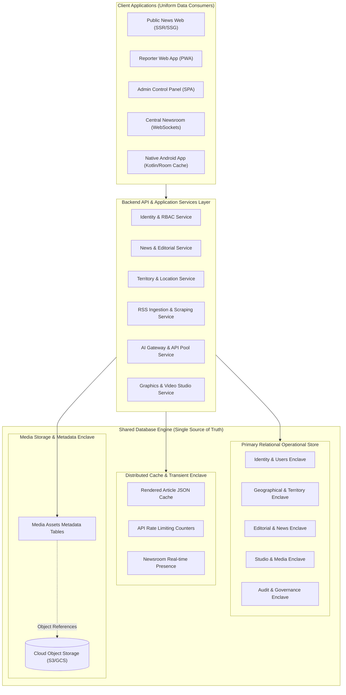

### 4.1 Data Segregation Architecture
1. **Primary Operational Relational Database**: Houses all structured, schema-enforced business entities across 16 core domains. Handles all transactional reads and writes with strict referential constraints.
2. **Distributed In-Memory Cache (Redis)**: Caches serialized JSON representations of hot data (homepage news feeds, breaking tickers, category lists, active user session tokens) with automated invalidation upon database update.
3. **Cloud Media Object Storage (S3/GCS)**: Stores raw and optimized binary media files (photos, videos, audio clips, PDF e-papers). The database stores strictly structured metadata records (URLs, dimensions, MIME types, file sizes, blurhashes, alt-text) pointing to these objects.

---

## 5. Domain Inventory

The BREAKING NEWS WALA enterprise data architecture is systematically partitioned into **sixteen logical domains**:

| Domain Code | Domain Name | Core Business Purpose & Operational Scope | Key Entity Count |
| :--- | :--- | :--- | :--- |
| **DOM-A** | **User & Identity Management** | Citizen, reporter, and admin credentials, roles, granular permissions, authentication sessions, and multi-factor status. | 9 Entities |
| **DOM-B** | **Reporter Management** | Field reporter onboarding, background verification, trust scoring, performance metrics, and administrative territory allocation. | 6 Entities |
| **DOM-C** | **Geographical Data & Territories** | Flexible multi-level administrative hierarchy (Country $\rightarrow$ State $\rightarrow$ Division $\rightarrow$ District $\rightarrow$ City/Tehsil) with hyper-local mapping. | 4 Entities |
| **DOM-D** | **News & Editorial Management** | Comprehensive editorial lifecycle from initial draft, AI revision, review queue, approval, publishing, corrections, to archiving. | 10 Entities |
| **DOM-E** | **Categories & Subcategories** | Dynamically managed taxonomy, Hindi/English slugs, visual icons, navigation sorting, and soft-delete archive flags. | 3 Entities |
| **DOM-F** | **RSS & URL Ingestion** | Authorized external news wire sources, feed import schedules, duplicate hashing (SHA-256), scraped URLs, and raw wire text. | 6 Entities |
| **DOM-G** | **AI Processing & API Pool** | Multi-key Gemini API pool management, model metadata, token consumption tracking, prompt templates, and failover logs. | 6 Entities |
| **DOM-H** | **Graphics Studio** | Template configurations, brand watermarks, reporter template assignments, and generated social graphic records. | 5 Entities |
| **DOM-I** | **Video Studio** | Script-to-video project state, scene sequencing, TTS voiceover assets, subtitle timecodes, and FFmpeg render job queues. | 6 Entities |
| **DOM-J** | **Media Management** | Central media library, image/video metadata, responsive variants (`16:9`, `1:1`, `9:16`), upload sessions, and copyright attribution. | 5 Entities |
| **DOM-K** | **Public User Engagement** | Citizen bookmarks, reading history, topic/location preferences, article feedback ratings, and social share tracking. | 6 Entities |
| **DOM-L** | **Notification & Push System** | Multi-channel dispatch (Web Push VAPID, Android FCM), notification templates, delivery status, and device push tokens. | 5 Entities |
| **DOM-M** | **Coins, Rewards & Referrals** | Citizen engagement coin ledger, referral code trees, reward rule configurations, transaction history, and payout requests. | 6 Entities |
| **DOM-N** | **Advertising & Monetization** | Ad inventory spaces, advertiser campaigns, banner creatives, schedules, impressions, CTR analytics, and sponsored labels. | 6 Entities |
| **DOM-O** | **Analytics & Reporting** | Aggregated page views, video watch duration, reporter productivity metrics, category heatmaps, and AI operational costs. | 5 Entities |
| **DOM-P** | **Audit Logging & System Settings** | Immutable audit trails (`RULE-AUD-001`), administrative permission changes, emergency kill switch states, and feature flags. | 4 Entities |

*Total Logical Entities Cataloged:* **92 Strongly Typed Conceptual Entities**

---

---

## 6. Entity Definitions

The conceptual entities of BREAKING NEWS WALA are modeled using vendor-neutral ANSI SQL data types (e.g., `UUID`, `VARCHAR`, `TEXT`, `INTEGER`, `BIGINT`, `BOOLEAN`, `TIMESTAMP`, `DECIMAL`, `JSON`).

### 6.1 Domain A: User & Identity Management

#### 1. `users` (Core Identity Entity)
Represents every human actor registered within the system (Public Citizen, Ground Reporter, Sub-Editor, Bureau Chief, Administrator, Super Admin).
- `id` (`UUID`, PK, Not Null): Globally unique immutable user identifier.
- `phone_number` (`VARCHAR(20)`, Unique, Nullable): Primary authentication credential for Indian mobile users (+91 format).
- `email` (`VARCHAR(255)`, Unique, Nullable): Secondary or administrative authentication credential.
- `password_hash` (`VARCHAR(255)`, Not Null): Cryptographic salted hash (Argon2id or bcrypt). Plaintext passwords never stored.
- `status` (`VARCHAR(30)`, Not Null, Default `'active'`): User lifecycle status (`pending_verification`, `active`, `suspended`, `banned`, `deactivated`).
- `phone_verified` (`BOOLEAN`, Not Null, Default `FALSE`): OTP verification flag.
- `email_verified` (`BOOLEAN`, Not Null, Default `FALSE`): Email verification flag.
- `mfa_enabled` (`BOOLEAN`, Not Null, Default `FALSE`): Multi-factor authentication flag (mandatory for Admins).
- `mfa_secret` (`VARCHAR(255)`, Nullable): Encrypted TOTP secret key.
- `created_at` (`TIMESTAMP WITH TIME ZONE`, Not Null): Account creation timestamp.
- `updated_at` (`TIMESTAMP WITH TIME ZONE`, Not Null): Last profile update timestamp.
- `deleted_at` (`TIMESTAMP WITH TIME ZONE`, Nullable): Soft-delete timestamp for account deactivation.

#### 2. `user_profiles` (Personal & Demographic Details)
- `user_id` (`UUID`, PK, FK $\rightarrow$ `users.id`, On Delete Cascade): 1-to-1 extension of core user.
- `full_name` (`VARCHAR(150)`, Not Null): Display name in Hindi or English script.
- `avatar_media_id` (`UUID`, FK $\rightarrow$ `media_assets.id`, Nullable): Profile photo reference.
- `bio` (`TEXT`, Nullable): Short biography or journalistic credentials.
- `preferred_language` (`VARCHAR(10)`, Not Null, Default `'hi'`): ISO language code (`hi` for Hindi).
- `home_state_id` (`UUID`, FK $\rightarrow$ `geo_locations.id`, Nullable): User's primary state location.
- `home_district_id` (`UUID`, FK $\rightarrow$ `geo_locations.id`, Nullable): User's primary district location.

#### 3. `roles` & `permissions` (Granular RBAC)
A user can possess multiple roles; each role is composed of fine-grained permissions.
- `roles`:
  - `id` (`UUID`, PK, Not Null)
  - `name` (`VARCHAR(50)`, Unique, Not Null): Machine identifier (`public_user`, `reporter`, `senior_reporter`, `bureau_chief`, `sub_editor`, `admin`, `super_admin`).
  - `display_name` (`VARCHAR(100)`, Not Null): Localized title (e.g. *ग्राउंड रिपोर्टर*, *उप-संपादक*, *व्यवस्थापक*).
  - `description` (`TEXT`, Nullable)
  - `is_system` (`BOOLEAN`, Not Null, Default `FALSE`): System roles cannot be renamed or deleted.
- `permissions`:
  - `id` (`UUID`, PK, Not Null)
  - `code` (`VARCHAR(100)`, Unique, Not Null): Scoped permission code (e.g. `news:create`, `news:approve`, `news:direct_publish`, `territory:allocate`, `studio:raw_script`, `studio:url_scrape`).
  - `module` (`VARCHAR(50)`, Not Null): Functional module categorization.
  - `description` (`TEXT`, Nullable)
- `user_roles` (M:N Junction Table):
  - `user_id` (`UUID`, FK $\rightarrow$ `users.id`, On Delete Cascade)
  - `role_id` (`UUID`, FK $\rightarrow$ `roles.id`, On Delete Restrict)
  - `assigned_by` (`UUID`, FK $\rightarrow$ `users.id`, Nullable)
  - `assigned_at` (`TIMESTAMP WITH TIME ZONE`, Not Null)
  - *Composite Primary Key*: `(user_id, role_id)`
- `role_permissions` (M:N Junction Table):
  - `role_id` (`UUID`, FK $\rightarrow$ `roles.id`, On Delete Cascade)
  - `permission_id` (`UUID`, FK $\rightarrow$ `permissions.id`, On Delete Cascade)
  - *Composite Primary Key*: `(role_id, permission_id)`

#### 4. `auth_sessions` & `device_registrations`
- `auth_sessions`: Tracks active JWT refresh tokens and browser/app sessions.
  - `id` (`UUID`, PK, Not Null)
  - `user_id` (`UUID`, FK $\rightarrow$ `users.id`, On Delete Cascade)
  - `refresh_token_hash` (`VARCHAR(255)`, Not Null): SHA-256 hash of issued refresh token.
  - `ip_address` (`VARCHAR(45)`, Not Null): Client IP address (IPv4/IPv6).
  - `user_agent` (`TEXT`, Nullable): Browser / Device client identifier.
  - `client_type` (`VARCHAR(20)`, Not Null): `web_browser` or `android_native`.
  - `expires_at` (`TIMESTAMP WITH TIME ZONE`, Not Null)
  - `revoked_at` (`TIMESTAMP WITH TIME ZONE`, Nullable)
- `device_registrations`: Stores hardware push tokens for Web Push and Android FCM.
  - `id` (`UUID`, PK, Not Null)
  - `user_id` (`UUID`, FK $\rightarrow$ `users.id`, On Delete Cascade, Nullable): Optional for anonymous public readers.
  - `platform` (`VARCHAR(20)`, Not Null): `android`, `web_chrome`, `web_safari`, `web_firefox`.
  - `push_token` (`TEXT`, Unique, Not Null): FCM registration token or Web Push subscription JSON.
  - `app_version` (`VARCHAR(30)`, Nullable): Installed Android APK build version.
  - `last_active_at` (`TIMESTAMP WITH TIME ZONE`, Not Null)

---

### 6.2 Domain B: Reporter Management & Territory Assignments

#### 1. `reporter_profiles` (Journalistic Accreditation & Governance)
- `user_id` (`UUID`, PK, FK $\rightarrow$ `users.id`, On Delete Restrict): 1-to-1 extension of a user possessing the `reporter` role.
- `reporter_code` (`VARCHAR(30)`, Unique, Not Null): Human-readable ID (e.g. `REP-MP-IND-014`).
- `press_id_card_number` (`VARCHAR(100)`, Nullable): Government or official accreditation ID.
- `id_card_media_id` (`UUID`, FK $\rightarrow$ `media_assets.id`, Nullable): Uploaded scan of press credentials.
- `verification_status` (`VARCHAR(30)`, Not Null, Default `'applied'`): `applied`, `under_review`, `verified`, `rejected`, `suspended`.
- `is_trusted_reporter` (`BOOLEAN`, Not Null, Default `FALSE`): In accordance with `RULE-AUTH-004`, trusted reporters can be granted direct publishing privileges.
- `can_direct_publish` (`BOOLEAN`, Not Null, Default `FALSE`): Controlled by Admin; bypasses review queue when TRUE.
- `trust_score` (`INTEGER`, Not Null, Default `50`): Score from 0 to 100 based on verified submissions and editorial feedback.
- `total_submissions` (`INTEGER`, Not Null, Default `0`)
- `approved_submissions` (`INTEGER`, Not Null, Default `0`)
- `rejected_submissions` (`INTEGER`, Not Null, Default `0`)
- `created_at` (`TIMESTAMP WITH TIME ZONE`, Not Null)
- `verified_at` (`TIMESTAMP WITH TIME ZONE`, Nullable)
- `verified_by` (`UUID`, FK $\rightarrow$ `users.id`, Nullable)

#### 2. `reporter_territory_assignments` (Administrative Territory Allocation)
In accordance with `RULE-GEO-001`, a reporter can only file news for geographic locations officially assigned to them by an Administrator.
- `id` (`UUID`, PK, Not Null)
- `reporter_id` (`UUID`, FK $\rightarrow$ `reporter_profiles.user_id`, On Delete Restrict, Not Null)
- `location_id` (`UUID`, FK $\rightarrow$ `geo_locations.id`, On Delete Restrict, Not Null): District, City, or Tehsil location reference.
- `assignment_type` (`VARCHAR(30)`, Not Null, Default `'primary'`): `primary`, `secondary`, `temporary`, `emergency`.
- `assigned_by` (`UUID`, FK $\rightarrow$ `users.id`, Not Null)
- `assigned_at` (`TIMESTAMP WITH TIME ZONE`, Not Null)
- `valid_until` (`TIMESTAMP WITH TIME ZONE`, Nullable): Optional expiration timestamp for temporary beat reporting.
- `status` (`VARCHAR(20)`, Not Null, Default `'active'`): `active`, `suspended`, `revoked`.
- *Composite Unique Index*: `(reporter_id, location_id, status)`

---

### 6.3 Domain C: Geographical Data & Hierarchy

#### 1. `geo_locations` (Self-Referential Location Hierarchy)
A flexible parent-child recursive tree supporting any administrative level without schema alteration.
- `id` (`UUID`, PK, Not Null)
- `name_hi` (`VARCHAR(100)`, Not Null): Devanagari Hindi location name (e.g., *वाराणसी*, *इंदौर*, *भोपाल*).
- `name_en` (`VARCHAR(100)`, Not Null): English name (e.g., `Varanasi`, `Indore`, `Bhopal`).
- `slug` (`VARCHAR(120)`, Unique, Not Null): URL-friendly slug (`varanasi`, `indore`).
- `level` (`VARCHAR(30)`, Not Null): Administrative division (`country`, `state`, `division`, `district`, `city`, `tehsil`).
- `parent_id` (`UUID`, FK $\rightarrow$ `geo_locations.id`, On Delete Restrict, Nullable): Points to containing parent location (e.g., District $\rightarrow$ State $\rightarrow$ Country).
- `state_code` (`VARCHAR(10)`, Nullable): E.g., `MP` for Madhya Pradesh, `UP` for Uttar Pradesh.
- `latitude` (`DECIMAL(10, 8)`, Nullable): Geographical coordinate.
- `longitude` (`DECIMAL(11, 8)`, Nullable): Geographical coordinate.
- `display_order` (`INTEGER`, Not Null, Default `0`)
- `is_active` (`BOOLEAN`, Not Null, Default `TRUE`)

---

### 6.4 Domain D: News & Editorial Lifecycle Management

#### 1. `news_articles` (Primary News Record)
- `id` (`UUID`, PK, Not Null): Unique article identifier.
- `public_id` (`VARCHAR(30)`, Unique, Not Null): Short public-facing identifier (e.g. `BNW-2026-89472`).
- `slug` (`VARCHAR(255)`, Unique, Not Null): Unique Devanagari-derived English slug for SEO routing.
- `title` (`TEXT`, Not Null): Primary article headline in Devanagari script.
- `subheadline` (`TEXT`, Nullable): Secondary deck / summary kicker.
- `body_content` (`TEXT`, Not Null): Rich text journalistic body content (HTML / Markdown).
- `excerpt` (`TEXT`, Nullable): 2–3 sentence synopsis for search snippets and cards.
- `author_id` (`UUID`, FK $\rightarrow$ `users.id`, On Delete Restrict, Not Null): Original author/reporter.
- `last_editor_id` (`UUID`, FK $\rightarrow$ `users.id`, Nullable): Editor who performed last modification.
- `primary_category_id` (`UUID`, FK $\rightarrow$ `categories.id`, On Delete Restrict, Not Null)
- `primary_location_id` (`UUID`, FK $\rightarrow$ `geo_locations.id`, On Delete Restrict, Not Null): Geographic locus.
- `featured_media_id` (`UUID`, FK $\rightarrow$ `media_assets.id`, Nullable): Lead photograph or video thumbnail.
- `status` (`VARCHAR(30)`, Not Null, Default `'draft'`): Complete lifecycle states:
  - `draft` (*ड्राफ्ट*)
  - `pending` (*लंबित*)
  - `under_review` (*समीक्षाधीन*)
  - `changes_requested` (*सुधार अपेक्षित*)
  - `approved` (*स्वीकृत*)
  - `published` (*प्रकाशित*)
  - `rejected` (*अस्वीकृत*)
  - `archived` (*संग्रहीत*)
- `content_source` (`VARCHAR(30)`, Not Null, Default `'original_reporter'`): `original_reporter`, `rss_import`, `url_scrape`, `agency_wire`, `press_release`.
- `source_attribution` (`VARCHAR(255)`, Nullable): Wire agency or external citation (e.g., *भाषा / पीटीआई*).
- `is_breaking` (`BOOLEAN`, Not Null, Default `FALSE`): Triggers breaking alert tickers.
- `breaking_priority` (`INTEGER`, Not Null, Default `0`): Priority ranking for banner ticker.
- `view_count` (`BIGINT`, Not Null, Default `0`): Cached aggregate view metric.
- `share_count` (`INTEGER`, Not Null, Default `0`): Cached social share metric.
- `created_at` (`TIMESTAMP WITH TIME ZONE`, Not Null)
- `updated_at` (`TIMESTAMP WITH TIME ZONE`, Not Null)
- `submitted_at` (`TIMESTAMP WITH TIME ZONE`, Nullable): Timestamp when sent to review queue.
- `published_at` (`TIMESTAMP WITH TIME ZONE`, Nullable): Official live publication timestamp.
- `scheduled_at` (`TIMESTAMP WITH TIME ZONE`, Nullable): Optional scheduled publishing trigger.
- `deleted_at` (`TIMESTAMP WITH TIME ZONE`, Nullable): Soft-delete archive timestamp.

#### 2. `news_revisions` (Immutable Historical Versioning)
Preserves every editorial revision without overwriting historical text.
- `id` (`UUID`, PK, Not Null)
- `news_id` (`UUID`, FK $\rightarrow$ `news_articles.id`, On Delete Cascade, Not Null)
- `version_number` (`INTEGER`, Not Null): Incremental version index (1, 2, 3...).
- `title` (`TEXT`, Not Null)
- `body_content` (`TEXT`, Not Null)
- `subheadline` (`TEXT`, Nullable)
- `excerpt` (`TEXT`, Nullable)
- `revised_by` (`UUID`, FK $\rightarrow$ `users.id`, Not Null)
- `revision_summary` (`VARCHAR(255)`, Nullable): Editorial note explaining changes (e.g. *तथ्य सुधार, स्पेलिंग चेक*).
- `created_at` (`TIMESTAMP WITH TIME ZONE`, Not Null)
- *Composite Unique Index*: `(news_id, version_number)`

#### 3. `editorial_reviews` (Approval, Rejection & Correction Logs)
- `id` (`UUID`, PK, Not Null)
- `news_id` (`UUID`, FK $\rightarrow$ `news_articles.id`, On Delete Cascade, Not Null)
- `reviewer_id` (`UUID`, FK $\rightarrow$ `users.id`, Not Null): Sub-Editor or Bureau Chief.
- `action` (`VARCHAR(30)`, Not Null): `approved`, `rejected`, `changes_requested`, `direct_published`, `retracted`.
- `reason_code` (`VARCHAR(50)`, Nullable): E.g., `FACTUAL_INACCURACY`, `GRAMMAR_ISSUES`, `DEFAMATION_RISK`, `OFF_TERRITORY`.
- `feedback_comments` (`TEXT`, Nullable): Granular instructions from editor to ground reporter.
- `created_at` (`TIMESTAMP WITH TIME ZONE`, Not Null)

---

### 6.5 Domain E: Categories & Subcategories

#### 1. `categories` (Dynamically Managed Taxonomy)
- `id` (`UUID`, PK, Not Null)
- `name_hi` (`VARCHAR(100)`, Not Null): Hindi label (e.g., *राजनीति*, *क्रिकेट*, *राज्य*, *व्यापार*).
- `name_en` (`VARCHAR(100)`, Not Null): English name (e.g., `Politics`, `Cricket`, `State`, `Business`).
- `slug` (`VARCHAR(120)`, Unique, Not Null): URL slug (e.g., `politics`, `cricket`).
- `description` (`TEXT`, Nullable)
- `icon_media_id` (`UUID`, FK $\rightarrow$ `media_assets.id`, Nullable): Icon/SVG reference.
- `parent_id` (`UUID`, FK $\rightarrow$ `categories.id`, On Delete Restrict, Nullable): Supports nested subcategories (e.g., *क्रिकेट* under *खेल*).
- `display_order` (`INTEGER`, Not Null, Default `0`): Navigation sorting weight.
- `is_active` (`BOOLEAN`, Not Null, Default `TRUE`)
- `created_at` (`TIMESTAMP WITH TIME ZONE`, Not Null)
- `deleted_at` (`TIMESTAMP WITH TIME ZONE`, Nullable): Soft-delete archive timestamp. Deactivating a category **does not** delete published news records.

---

### 6.6 Domain F: RSS & URL Ingestion

#### 1. `rss_sources` (Authorized Feed Configuration)
- `id` (`UUID`, PK, Not Null)
- `name` (`VARCHAR(150)`, Not Null): Agency or feed title (e.g., *पीटीआई राष्ट्रीय समाचार*, *राज्य सूचना पोर्टल*).
- `feed_url` (`TEXT`, Unique, Not Null): Validated external RSS/Atom XML feed URL.
- `is_authorized` (`BOOLEAN`, Not Null, Default `FALSE`): In accordance with business rules, only currently authorized active sources can generate imports.
- `polling_interval_minutes` (`INTEGER`, Not Null, Default `15`)
- `default_category_id` (`UUID`, FK $\rightarrow$ `categories.id`, Nullable)
- `last_polled_at` (`TIMESTAMP WITH TIME ZONE`, Nullable)
- `status` (`VARCHAR(20)`, Not Null, Default `'active'`): `active`, `paused`, `revoked`.

#### 2. `imported_rss_items` (Feed Items & Duplicate Prevention)
- `id` (`UUID`, PK, Not Null)
- `rss_source_id` (`UUID`, FK $\rightarrow$ `rss_sources.id`, On Delete Restrict, Not Null)
- `guid_hash` (`VARCHAR(64)`, Unique, Not Null): SHA-256 hash of external item GUID / URL to prevent duplicate ingestion.
- `original_title` (`TEXT`, Not Null)
- `original_url` (`TEXT`, Not Null)
- `raw_content` (`TEXT`, Nullable)
- `generated_news_id` (`UUID`, FK $\rightarrow$ `news_articles.id`, Nullable): Links imported wire item to resulting news draft.
- `ai_processing_status` (`VARCHAR(30)`, Not Null, Default `'pending'`): `pending`, `processed`, `failed`, `skipped`.
- `imported_at` (`TIMESTAMP WITH TIME ZONE`, Not Null)

---

### 6.7 Domain G: AI Processing & API Pool Management

#### 1. `ai_providers` & `ai_models`
- `ai_providers`:
  - `id` (`UUID`, PK, Not Null)
  - `name` (`VARCHAR(50)`, Unique, Not Null): `google_gemini`, `openai`, `anthropic`.
  - `is_active` (`BOOLEAN`, Not Null, Default `TRUE`)
- `ai_models`:
  - `id` (`UUID`, PK, Not Null)
  - `provider_id` (`UUID`, FK $\rightarrow$ `ai_providers.id`, On Delete Restrict, Not Null)
  - `model_identifier` (`VARCHAR(100)`, Not Null): E.g., `gemini-1.5-flash`, `gemini-1.5-pro`.
  - `context_window_tokens` (`INTEGER`, Not Null)
  - `cost_per_million_input_tokens` (`DECIMAL(10, 4)`, Nullable)
  - `cost_per_million_output_tokens` (`DECIMAL(10, 4)`, Nullable)
  - `is_default` (`BOOLEAN`, Not Null, Default `FALSE`)

#### 2. `ai_api_key_references` (Secure Secret Vault References)
Plaintext API keys are **never** stored in database tables.
- `id` (`UUID`, PK, Not Null)
- `provider_id` (`UUID`, FK $\rightarrow$ `ai_providers.id`, On Delete Restrict, Not Null)
- `key_alias` (`VARCHAR(50)`, Not Null): Human identifier (e.g. `GEMINI_PROJECT_ALPHA_KEY_01`).
- `vault_secret_path` (`VARCHAR(255)`, Not Null): Reference path in KMS / Secret Manager.
- `quota_limit_qpm` (`INTEGER`, Not Null, Default `60`): Queries per minute quota.
- `current_status` (`VARCHAR(20)`, Not Null, Default `'healthy'`): `healthy`, `rate_limited_429`, `error_503`, `exhausted`.
- `last_used_at` (`TIMESTAMP WITH TIME ZONE`, Nullable)

#### 3. `ai_processing_requests` (Audit & Telemetry Log)
- `id` (`UUID`, PK, Not Null)
- `model_id` (`UUID`, FK $\rightarrow$ `ai_models.id`, On Delete Restrict, Not Null)
- `key_reference_id` (`UUID`, FK $\rightarrow$ `ai_api_key_references.id`, On Delete Restrict, Nullable)
- `task_type` (`VARCHAR(50)`, Not Null): `headline_suggestion`, `article_summary`, `rss_synthesis`, `url_news_draft`, `fact_check_assist`.
- `prompt_tokens` (`INTEGER`, Nullable)
- `completion_tokens` (`INTEGER`, Nullable)
- `execution_duration_ms` (`INTEGER`, Not Null)
- `status` (`VARCHAR(20)`, Not Null): `success`, `rate_limited`, `failed`.
- `error_message` (`TEXT`, Nullable)
- `created_at` (`TIMESTAMP WITH TIME ZONE`, Not Null)

---

### 6.8 Domain H: Graphics Studio

#### 1. `graphic_templates` (Master Design Layouts)
- `id` (`UUID`, PK, Not Null)
- `name` (`VARCHAR(100)`, Not Null): E.g. *ब्रेकिंग न्यूज़ बुलेटिन*, *विशेष वक्तव्य / कोट कार्ड*, *जिला क्राइम अलर्ट*.
- `aspect_ratio` (`VARCHAR(10)`, Not Null): `1:1` (Square), `9:16` (Story/Reel), `16:9` (Banner).
- `template_schema_json` (`JSON`, Not Null): Layout definitions, text bounding boxes, font sizes, color placeholders.
- `category_restriction_id` (`UUID`, FK $\rightarrow$ `categories.id`, Nullable): Restricts template to specific news beat.
- `created_by` (`UUID`, FK $\rightarrow$ `users.id`, Not Null): Admin user.
- `is_active` (`BOOLEAN`, Not Null, Default `TRUE`)

#### 2. `reporter_template_assignments` (Strict Access Restriction)
In accordance with `RULE-GFX-001`, reporters can only access templates explicitly assigned to them or their beat.
- `reporter_id` (`UUID`, FK $\rightarrow$ `reporter_profiles.user_id`, On Delete Cascade)
- `template_id` (`UUID`, FK $\rightarrow$ `graphic_templates.id`, On Delete Cascade)
- `assigned_by` (`UUID`, FK $\rightarrow$ `users.id`, Not Null)
- `assigned_at` (`TIMESTAMP WITH TIME ZONE`, Not Null)
- *Composite Primary Key*: `(reporter_id, template_id)`

#### 3. `generated_graphics` (Rendered Social Assets)
- `id` (`UUID`, PK, Not Null)
- `template_id` (`UUID`, FK $\rightarrow$ `graphic_templates.id`, On Delete Restrict, Not Null)
- `creator_id` (`UUID`, FK $\rightarrow$ `users.id`, On Delete Restrict, Not Null)
- `associated_news_id` (`UUID`, FK $\rightarrow$ `news_articles.id`, Nullable)
- `raw_input_text` (`TEXT`, Not Null): Field script used for overlay.
- `output_media_id` (`UUID`, FK $\rightarrow$ `media_assets.id`, Not Null): Final rendered image asset.
- `render_status` (`VARCHAR(20)`, Not Null, Default `'completed'`): `pending`, `completed`, `failed`.
- `created_at` (`TIMESTAMP WITH TIME ZONE`, Not Null)

---

### 6.9 Domain I: Video Studio

#### 1. `video_projects` & `video_render_jobs`
- `video_projects`:
  - `id` (`UUID`, PK, Not Null)
  - `title` (`VARCHAR(200)`, Not Null)
  - `aspect_ratio` (`VARCHAR(10)`, Not Null, Default `'9:16'`): `9:16` (Reels) or `16:9` (Standard).
  - `script_text` (`TEXT`, Not Null): Hindi narrative script.
  - `voiceover_media_id` (`UUID`, FK $\rightarrow$ `media_assets.id`, Nullable): Synthesized TTS audio asset.
  - `subtitle_srt` (`TEXT`, Nullable): Synchronized subtitle timecodes.
  - `status` (`VARCHAR(30)`, Not Null, Default `'draft'`): `draft`, `rendering`, `completed`, `failed`.
  - `creator_id` (`UUID`, FK $\rightarrow$ `users.id`, Not Null)
  - `created_at` (`TIMESTAMP WITH TIME ZONE`, Not Null)
- `video_render_jobs`:
  - `id` (`UUID`, PK, Not Null)
  - `project_id` (`UUID`, FK $\rightarrow` `video_projects.id`, On Delete Cascade, Not Null)
  - `worker_node_id` (`VARCHAR(100)`, Nullable): Host container processing the job.
  - `render_progress_percent` (`INTEGER`, Not Null, Default `0`)
  - `output_media_id` (`UUID`, FK $\rightarrow$ `media_assets.id`, Nullable): Final rendered MP4.
  - `error_log` (`TEXT`, Nullable)
  - `started_at` (`TIMESTAMP WITH TIME ZONE`, Nullable)
  - `completed_at` (`TIMESTAMP WITH TIME ZONE`, Nullable)

---

### 6.10 Domain J: Media Asset Management

#### 1. `media_assets` (Universal Media Catalog)
Stores references to physical files hosted in Cloud Object Storage (S3/GCS).
- `id` (`UUID`, PK, Not Null)
- `storage_key` (`VARCHAR(500)`, Unique, Not Null): Bucket object key path (e.g. `uploads/2026/10/varanasi-lead-img.webp`).
- `cdn_url` (`TEXT`, Not Null): Public edge delivery URL.
- `file_type` (`VARCHAR(20)`, Not Null): `image`, `video`, `audio`, `pdf_epaper`.
- `mime_type` (`VARCHAR(100)`, Not Null): E.g. `image/webp`, `video/mp4`, `application/pdf`.
- `file_size_bytes` (`BIGINT`, Not Null)
- `width` (`INTEGER`, Nullable): Image/video pixel width.
- `height` (`INTEGER`, Nullable): Image/video pixel height.
- `aspect_ratio` (`VARCHAR(10)`, Nullable): E.g. `16:9`, `1:1`, `9:16`.
- `blurhash` (`VARCHAR(100)`, Nullable): Ultra-low bandwidth placeholder string.
- `alt_text_hi` (`TEXT`, Nullable): Accessible Devanagari image description.
- `uploaded_by` (`UUID`, FK $\rightarrow$ `users.id`, Nullable)
- `created_at` (`TIMESTAMP WITH TIME ZONE`, Not Null)

---

### 6.11 Domain K: Public User Engagement

- `user_bookmarks`: Stores citizen saved news.
  - `user_id` (`UUID`, FK $\rightarrow$ `users.id`, On Delete Cascade)
  - `news_id` (`UUID`, FK $\rightarrow$ `news_articles.id`, On Delete Cascade)
  - `saved_at` (`TIMESTAMP WITH TIME ZONE`, Not Null)
  - *Composite Primary Key*: `(user_id, news_id)`
- `user_reading_history`:
  - `id` (`BIGINT`, PK, Not Null)
  - `user_id` (`UUID`, FK $\rightarrow$ `users.id`, On Delete Cascade, Not Null)
  - `news_id` (`UUID`, FK $\rightarrow$ `news_articles.id`, On Delete Cascade, Not Null)
  - `read_percentage` (`INTEGER`, Not Null, Default `100`)
  - `read_at` (`TIMESTAMP WITH TIME ZONE`, Not Null)

---

### 6.12 Domain L: Notification & Push System

- `notifications`:
  - `id` (`UUID`, PK, Not Null)
  - `recipient_user_id` (`UUID`, FK $\rightarrow$ `users.id`, On Delete Cascade, Nullable): Null indicates broadcast to all devices.
  - `title` (`VARCHAR(255)`, Not Null): Devanagari notification headline.
  - `body` (`TEXT`, Not Null): Short alert message.
  - `channel` (`VARCHAR(30)`, Not Null): `breaking_news`, `editorial_feedback`, `assignment_alert`, `system_announcement`.
  - `target_screen_uri` (`VARCHAR(255)`, Nullable): Deep link intent path (`/news/slug-id`).
  - `is_read` (`BOOLEAN`, Not Null, Default `FALSE`)
  - `sent_at` (`TIMESTAMP WITH TIME ZONE`, Not Null)

---

### 6.13 Domain M: Coins, Rewards & Referrals

- `coin_wallets`:
  - `user_id` (`UUID`, PK, FK $\rightarrow$ `users.id`, On Delete Restrict)
  - `balance_coins` (`BIGINT`, Not Null, Default `0`)
  - `lifetime_earned_coins` (`BIGINT`, Not Null, Default `0`)
  - `referral_code` (`VARCHAR(20)`, Unique, Not Null)
  - `referred_by_user_id` (`UUID`, FK $\rightarrow$ `users.id`, Nullable)
- `coin_transactions` (Immutable Ledger):
  - `id` (`UUID`, PK, Not Null)
  - `wallet_user_id` (`UUID`, FK $\rightarrow$ `coin_wallets.user_id`, On Delete Restrict, Not Null)
  - `amount` (`INTEGER`, Not Null): Positive for credit, negative for debit.
  - `transaction_type` (`VARCHAR(50)`, Not Null): `article_read_reward`, `referral_bonus`, `quiz_participation`, `reward_redemption`.
  - `reference_entity_id` (`UUID`, Nullable): ID of article read or referred user.
  - `created_at` (`TIMESTAMP WITH TIME ZONE`, Not Null)

---

### 6.14 Domain N: Advertising & Monetization

- `ad_campaigns` & `ad_creatives`:
  - `ad_campaigns`:
    - `id` (`UUID`, PK, Not Null)
    - `advertiser_name` (`VARCHAR(150)`, Not Null)
    - `campaign_name` (`VARCHAR(200)`, Not Null)
    - `start_date` (`TIMESTAMP WITH TIME ZONE`, Not Null)
    - `end_date` (`TIMESTAMP WITH TIME ZONE`, Not Null)
    - `status` (`VARCHAR(20)`, Not Null, Default `'active'`): `scheduled`, `active`, `paused`, `completed`.
  - `ad_creatives`:
    - `id` (`UUID`, PK, Not Null)
    - `campaign_id` (`UUID`, FK $\rightarrow$ `ad_campaigns.id`, On Delete Cascade, Not Null)
    - `ad_slot_code` (`VARCHAR(50)`, Not Null): `HEADER_LEADERBOARD`, `HOMEPAGE_IN_FEED`, `ARTICLE_IN_BODY_MPU`, `STICKY_BOTTOM_BANNER`.
    - `creative_media_id` (`UUID`, FK $\rightarrow$ `media_assets.id`, Not Null)
    - `destination_url` (`TEXT`, Not Null)
    - `target_district_id` (`UUID`, FK $\rightarrow$ `geo_locations.id`, Nullable): Hyper-local ad geotargeting.

---

### 6.15 Domain O: Analytics & Performance Summaries

Raw clickstream events are aggregated into daily rollups to protect primary database throughput:
- `daily_article_analytics`:
  - `news_id` (`UUID`, FK $\rightarrow$ `news_articles.id`, On Delete Cascade, Not Null)
  - `date` (`DATE`, Not Null)
  - `total_page_views` (`BIGINT`, Not Null, Default `0`)
  - `unique_readers` (`INTEGER`, Not Null, Default `0`)
  - `avg_read_time_seconds` (`INTEGER`, Not Null, Default `0`)
  - *Composite Primary Key*: `(news_id, date)`

---

### 6.16 Domain P: Audit Logging & System Governance

#### 1. `audit_logs` (Strictly Immutable Audit Trail)
In compliance with `RULE-AUD-001`, this table forbids `UPDATE` and `DELETE` operations via database permissions and trigger rules.
- `id` (`UUID`, PK, Not Null)
- `actor_user_id` (`UUID`, FK $\rightarrow$ `users.id`, On Delete Set Null, Nullable)
- `action` (`VARCHAR(100)`, Not Null): `USER_LOGIN`, `ARTICLE_PUBLISHED`, `ARTICLE_RETRACTED`, `REPORTER_VERIFIED`, `TERRITORY_REVOKED`, `KILL_SWITCH_TRIGGERED`.
- `target_entity_type` (`VARCHAR(50)`, Not Null): `news_articles`, `users`, `reporter_profiles`, `geo_locations`.
- `target_entity_id` (`UUID`, Not Null)
- `payload_before` (`JSON`, Nullable): State snapshot before change.
- `payload_after` (`JSON`, Nullable): State snapshot after change.
- `ip_address` (`VARCHAR(45)`, Not Null)
- `user_agent` (`TEXT`, Nullable)
- `created_at` (`TIMESTAMP WITH TIME ZONE`, Not Null)

---

## 7. Relationships

The relationships across all 16 domains are explicitly mapped with precise referential constraints:

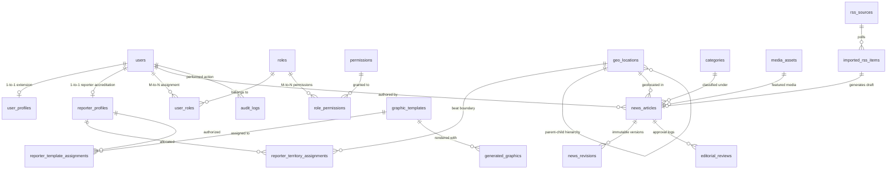

### 7.1 Foreign Key Deletion Strategies
- **RESTRICT (Strict Non-Cascading)**: Primary reference entities (such as `categories`, `geo_locations`, and `users`) enforce `ON DELETE RESTRICT` when referenced by `news_articles`. An Administrator cannot accidentally delete a category or district that contains published news.
- **CASCADE (Parent Ownership)**: Subordinate entities (such as `news_revisions` and `editorial_reviews`) enforce `ON DELETE CASCADE` from their parent `news_articles`.
- **SET NULL**: Audit logs enforce `ON DELETE SET NULL` on `actor_user_id` so that historical compliance audit trails remain intact even if an employee account is purged.

---

---

## 8. Mermaid ER Diagrams

To prevent overwhelming single-canvas complexity and maintain clean visual readability, the database schema is mapped across **fourteen domain-specific Entity-Relationship (ER) diagrams**, concluding with a master system-wide topology overview.

### 8.1 Diagram 1: Identity and Access Management ERD
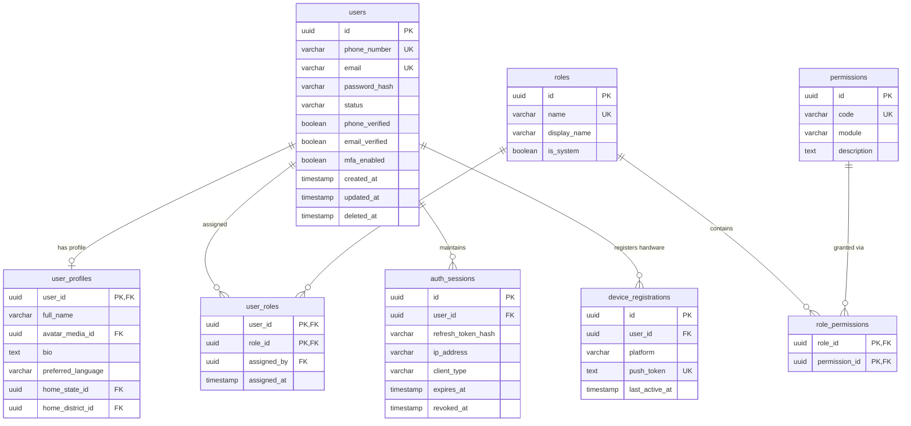

### 8.2 Diagram 2: Reporter and Territory Management ERD
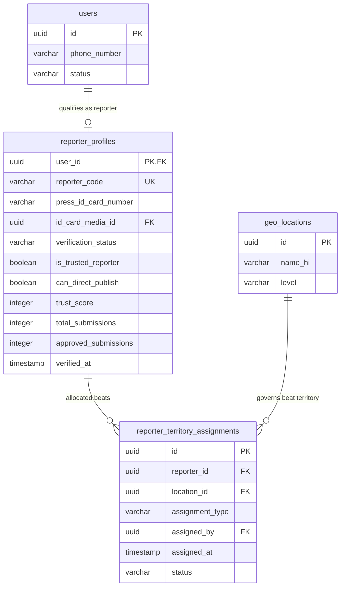

### 8.3 Diagram 3: News and Editorial Workflow ERD
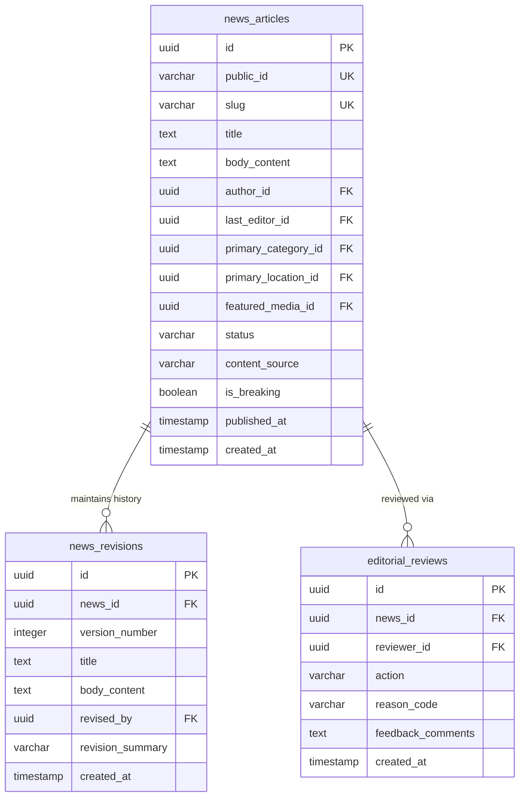

### 8.4 Diagram 4: Categories and Geographical Hierarchy ERD
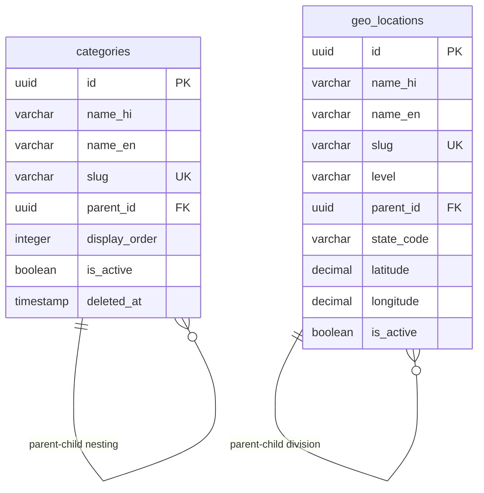

### 8.5 Diagram 5: RSS and URL Ingestion ERD
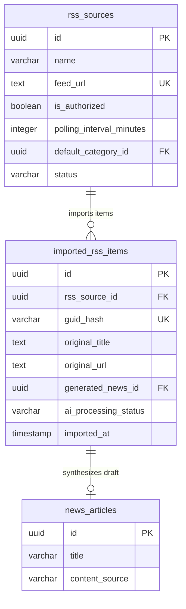

### 8.6 Diagram 6: AI Providers and Processing ERD
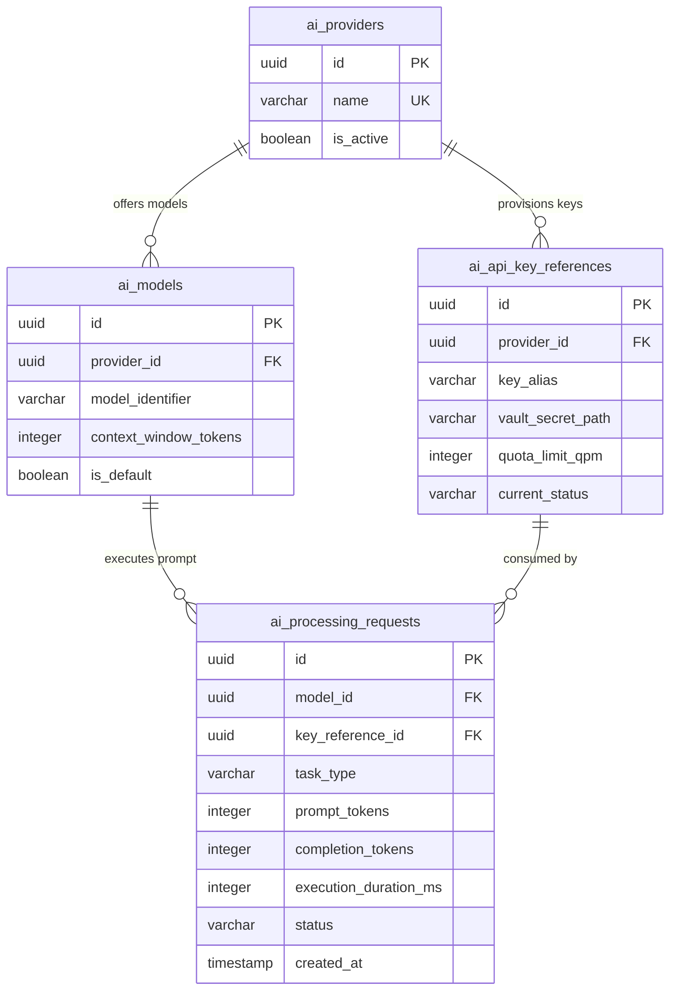

### 8.7 Diagram 7: Graphics and Video Studio ERD
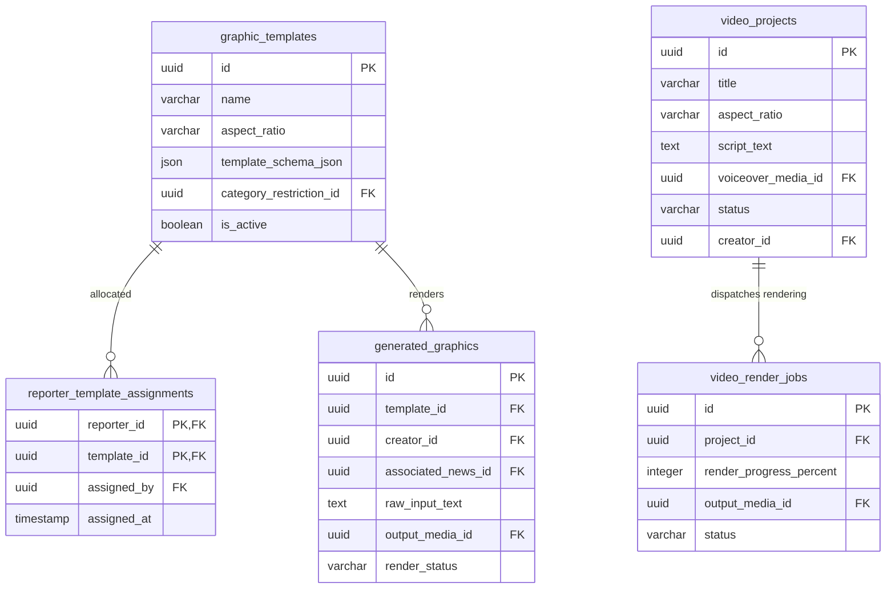

### 8.8 Diagram 8: Media Management ERD
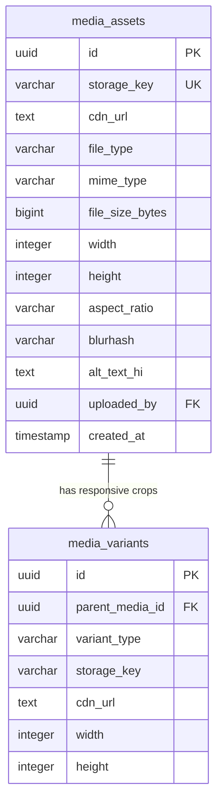

### 8.9 Diagram 9: User Engagement ERD
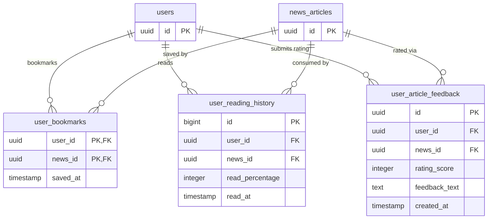

### 8.10 Diagram 10: Notification System ERD
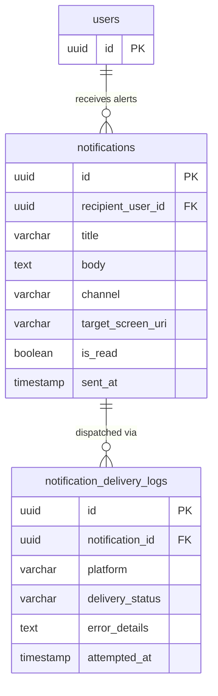

### 8.11 Diagram 11: Coins and Referrals ERD
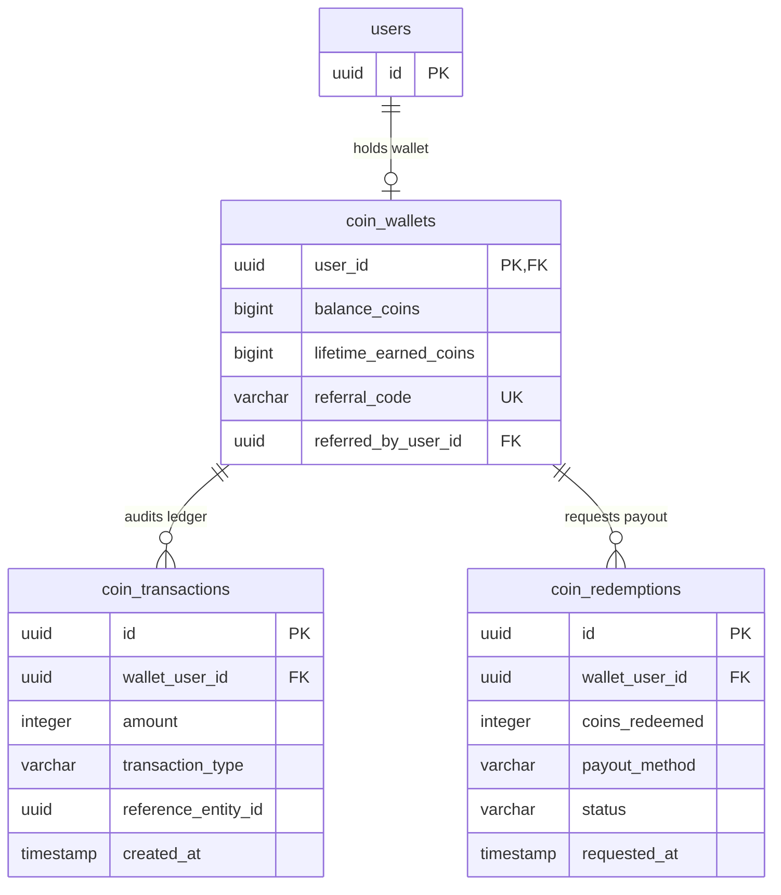

### 8.12 Diagram 12: Advertising and Analytics ERD
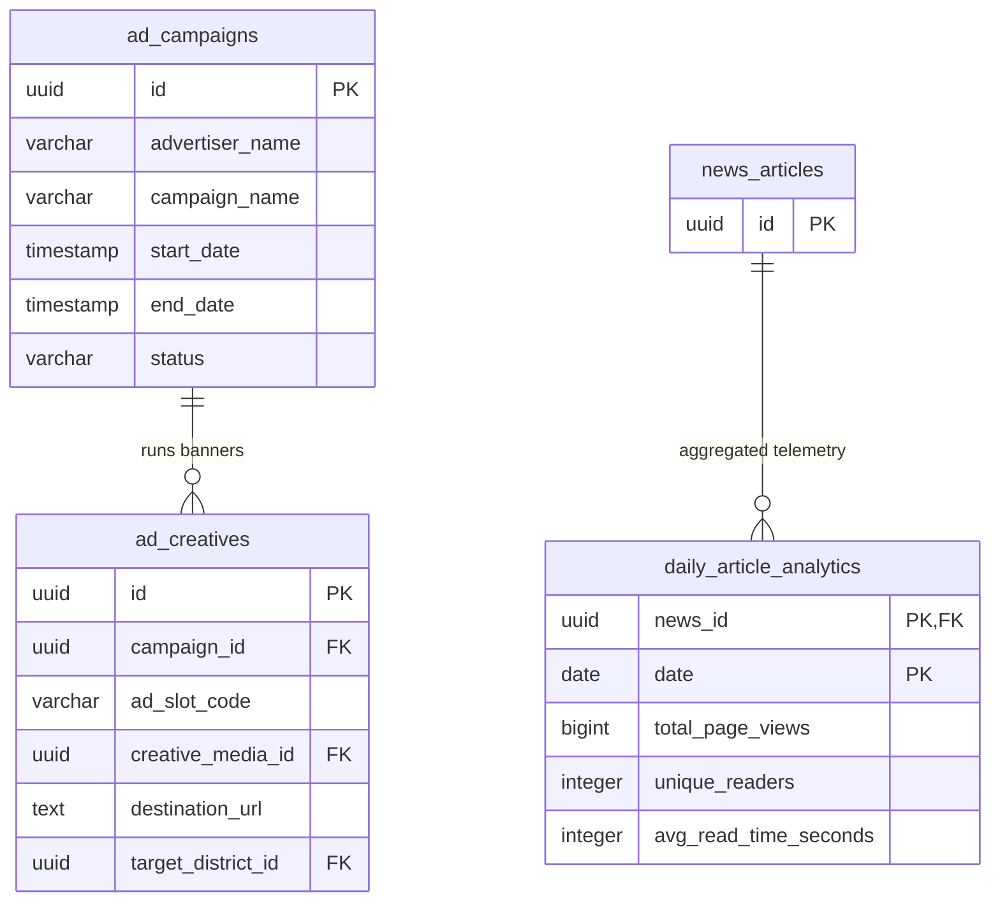

### 8.13 Diagram 13: Audit Logging and System Configuration ERD
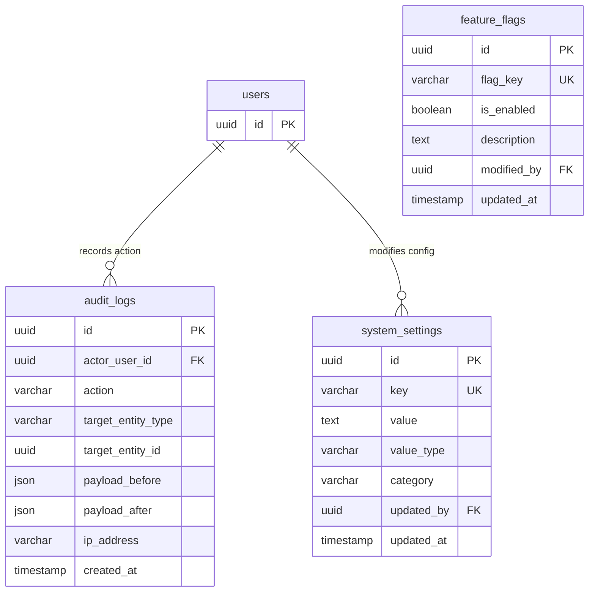

### 8.14 Diagram 14: Master Enterprise Database Topology Overview
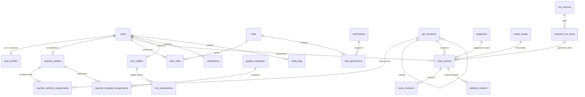

---

---

## 9. News Lifecycle Data Model

The news publishing workflow is the central business engine of BREAKING NEWS WALA. The database enforces an authoritative, mathematically formal state machine governing article lifecycles.

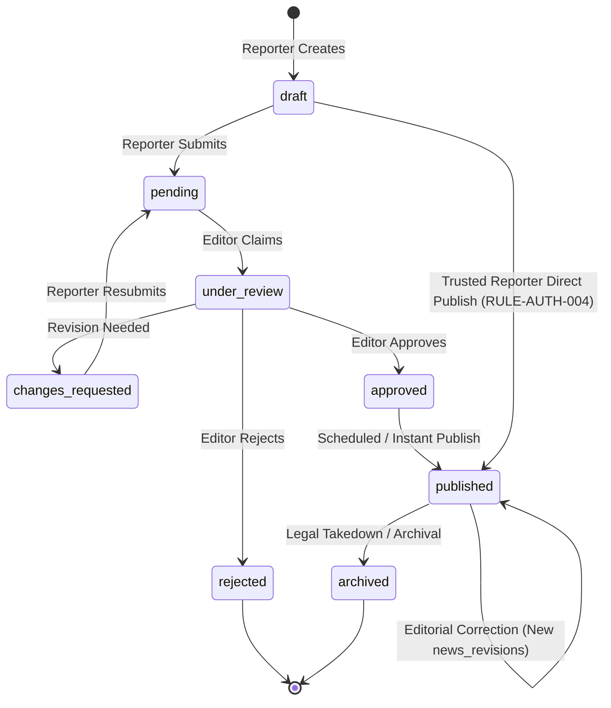

### 9.1 Authoritative Status State Machine
In strict adherence to [`docs/06-Business-Rules.md`](file:///c:/Users/pp/Downloads/BREAKING-NEWS-WALA-main/docs/06-Business-Rules.md), all article state transitions are validated on the backend server:

| Status Code | Vernacular Display Label | Permitted Actor Roles | Valid Prior States | Business Rules & Database Action |
| :--- | :--- | :--- | :--- | :--- |
| `draft` | **ड्राफ्ट** | Original Author | `[*]` Initial State | Autosaved text; invisible to public and review queue. |
| `pending` | **लंबित** | Original Author | `draft`, `changes_requested` | Enters Admin Review Queue; locks reporter from simultaneous edits. |
| `under_review`| **समीक्षाधीन** | Sub-Editor, Bureau Chief | `pending` | Desk editor claims exclusive review lock; logs reviewer ID. |
| `changes_requested`| **सुधार अपेक्षित** | Sub-Editor, Bureau Chief | `under_review` | Returns draft to reporter with mandatory `feedback_comments`. |
| `approved` | **स्वीकृत** | Sub-Editor, Bureau Chief | `under_review` | Editorial sign-off recorded; ready for immediate or scheduled release. |
| `published` | **प्रकाशित** | Editor, Trusted Reporter | `approved`, `draft` (Trusted only) | Article goes live; sets `published_at=NOW()`; triggers CDN & push broadcasts. |
| `rejected` | **अस्वीकृत** | Sub-Editor, Bureau Chief | `under_review` | Final rejection; records immutable `reason_code` and notification. |
| `archived` | **संग्रहीत** | Admin, Super Admin | `published` | Removed from public feeds; retained in database for legal audit trails. |

### 9.2 Version Preservation Architecture
- **Immutable Historical Lineage**: When an editor modifies copy or issues a post-publication factual correction, the primary `news_articles` row is updated with current text, but the prior state is atomically preserved in `news_revisions` (`version_number = N + 1`).
- **Transparency Invariant**: Corrected articles display a visible Devanagari correction notice to readers (*"संशोधित: [दिनांक] — तथ्य सुधार"*), referencing the specific historical revision record without erasing past errors.

---

## 10. Identifier Strategy

The database implements a multi-tier identifier strategy designed to balance performance, security, SEO, and cross-platform compatibility:

| Identifier Type | Technical Format | Target Entities | Architectural Purpose & Rationale |
| :--- | :--- | :--- | :--- |
| **Internal Primary Key (PK)** | `UUIDv4` or `ULID` (128-bit) | All operational entities (`users`, `news_articles`, `categories`, etc.) | Completely eliminates auto-increment ID enumeration attacks (IDOR); supports client-side offline ID pre-generation on Android; globally unique across shards. |
| **Public-Facing Business ID** | Formatted String: `BNW-YYYY-XXXXX` | `news_articles.public_id`, `reporter_profiles.reporter_code` | Human-readable short reference for citizen support inquiries, press accreditation cards, and broadcast citations. |
| **URL SEO Slug** | Transliterated ASCII String (max 120 chars) | `news_articles.slug`, `categories.slug`, `geo_locations.slug` | Search engine optimization (SEO) friendly routing (`/news/varanasi-smart-city-launch-89472`). Unique index enforced. |
| **Deduplication Fingerprint** | `SHA-256` Hex String (64 chars) | `imported_rss_items.guid_hash` | Cryptographic hash of external GUIDs to guarantee O(1) duplicate detection for external news wires. |
| **High-Volume Telemetry ID** | `BIGINT` (64-bit Auto-Increment) | `user_reading_history.id` | Ultra-compact numeric indexing for multi-million-row append-only analytics logs where UUID storage overhead would be prohibitive. |

---

## 11. Data Integrity and Constraints

The data layer enforces strict integrity constraints at the database engine level:

### 11.1 Unique Key Invariants
- `users.phone_number`: Unique (where not null) to prevent duplicate citizen or reporter registrations.
- `news_articles.slug`: Globally unique for clean public web routing.
- `categories.slug`: Unique across active taxonomies.
- `geo_locations.slug`: Unique across geographic hierarchy.
- `imported_rss_items.guid_hash`: Unique to prevent re-importing the same wire news item.
- `reporter_template_assignments`: Composite primary key `(reporter_id, template_id)` prevents redundant permission records.

### 11.2 Check Constraints & Domain Validation
- `trust_score`: Enforces `CHECK (trust_score >= 0 AND trust_score <= 100)`.
- `status`: Enforces strict enum membership checks matching approved lifecycle states.
- `coin_transactions.amount`: Enforces `CHECK (amount <> 0)` (zero-amount ledger entries prohibited).
- `aspect_ratio`: Enforces `CHECK (aspect_ratio IN ('16:9', '1:1', '9:16'))`.

### 11.3 Transactional Isolation Invariants
- **Publishing Transaction**: Executed at `READ COMMITTED` or `REPEATABLE READ` isolation level. Atomically validates territory authorization, updates article status to `published`, increments reporter metrics, and inserts into `audit_logs`.
- **Coin Wallet Transaction**: Executed with row-level pessimistic locking (`SELECT ... FOR UPDATE`) to prevent double-spending during rapid reward redemptions.

---

## 12. Indexing and Query Strategy

To satisfy the sub-100ms API performance benchmark established in [`docs/04-NFR.md`](file:///c:/Users/pp/Downloads/BREAKING-NEWS-WALA-main/docs/04-NFR.md), the database schema defines targeted indexing strategies:

### 12.1 High-Frequency Query Index Catalog

| Target Query Workload | Target Table | Recommended Index Type | Indexed Column Specification |
| :--- | :--- | :--- | :--- |
| **Latest Published News Feed** | `news_articles` | Composite B-Tree (Filtered) | `(published_at DESC, id DESC) WHERE status = 'published' AND deleted_at IS NULL` |
| **Category News Stream** | `news_articles` | Composite B-Tree | `(primary_category_id, published_at DESC) WHERE status = 'published'` |
| **District Regional News** | `news_articles` | Composite B-Tree | `(primary_location_id, published_at DESC) WHERE status = 'published'` |
| **Admin Editorial Review Queue** | `news_articles` | Composite B-Tree | `(status, submitted_at ASC) WHERE status IN ('pending', 'under_review')` |
| **Reporter Personal Dashboard** | `news_articles` | Composite B-Tree | `(author_id, updated_at DESC)` |
| **RSS Deduplication Lookup** | `imported_rss_items`| Unique Hash Index | `guid_hash` |
| **Devanagari Full-Text Search** | `news_articles` | GIN / Trigram Index | `title gin_trgm_ops, body_content gin_trgm_ops` (or language-specific tsvector) |
| **Territory Beat Validation** | `reporter_territory_assignments` | Composite B-Tree | `(reporter_id, location_id, status)` |
| **Active Push Tokens** | `device_registrations` | B-Tree Index | `(user_id, platform)` |

### 12.2 Keyset (Cursor-Based) Pagination Strategy
Offset pagination (`OFFSET 10000 LIMIT 20`) causes severe performance degradation on large news databases due to full-table scanning.
The database schema mandates **Keyset Pagination** for all public news streams:
$$\text{SELECT} \dots \text{WHERE } (\text{published\_at}, \text{id}) < (\text{cursor\_published\_at}, \text{cursor\_id}) \text{ ORDER BY published\_at DESC, id DESC LIMIT 20}$$
This guarantees constant $O(1)$ query execution time regardless of whether a reader is browsing page 1 or page 5,000.

---

## 13. Data Lifecycle and Retention

The database implements systematic data retention policies balancing journalistic archive value, storage costs, and legal compliance:

| Data Entity / Domain | Lifecycle Strategy | Retention Duration | Architectural Purge / Archive Mechanism |
| :--- | :--- | :--- | :--- |
| **Published News Articles** | **Permanent Retain** | Indefinite | Never purged. Permanent journalistic record. |
| **Editorial Revisions** | **Permanent Retain** | Indefinite | Preserves complete editorial history for legal and compliance audit. |
| **Rejected Submissions** | **Soft Retain** | 180 Days | Maintained for reporter review; auto-archived after 6 months to reduce active table size. |
| **Unpublished Drafts** | **Auto-Purge** | 90 Days of Inactivity | Inactive abandoned drafts flagged for purge after notification to author. |
| **Imported Wire RSS Items** | **Sliding Window** | 30 Days (Unused items) | Items not converted into news drafts within 30 days are purged; converted items retained permanently. |
| **Media Assets (Images/Video)** | **Tiered Storage** | Active: Indefinite / Cold: 1 Year | Unreferenced temporary upload sessions purged after 48 hours. Published media cold-tiered in S3/GCS. |
| **AI Processing Logs** | **Summary Rollup** | Raw logs: 60 Days / Aggregates: 2 Years | Detailed prompt telemetry rolled up into monthly cost summaries; raw tokens purged. |
| **Push Notification Logs** | **Sliding Window** | 30 Days | Delivery attempt logs purged after 30 days. |
| **Audit Compliance Logs** | **Permanent Retain** | **7 Years Minimum** (`RULE-AUD-001`) | Immutable. Partitioned by year; moved to compressed archive storage after 2 years. |
| **Deactivated User Accounts** | **Soft Anonymization**| Retained (PII Stripped) | User record marked `deleted_at`; phone and email anonymized; authored news attribution preserved. |

---

---

## 14. Privacy and Security Considerations

Data security and citizen privacy are foundational to journalistic integrity and regulatory compliance (including India's Digital Personal Data Protection Act - DPDPA 2023).

### 14.1 Data Minimization & Citizen Privacy
- **Anonymous Reading**: Public readers are never forced to register or provide phone numbers to browse news articles. Reading activity by anonymous citizens generates zero identifiable PII records in the database.
- **Selective Demographic Collection**: Reporter registration collects only strictly necessary verification credentials (phone number, government press ID scan, verified legal name).
- **Cryptographic Password Security**: Passwords are mathematically irreversible, hashed using **Argon2id** (memory cost: 64MB, time cost: 3 iterations, parallelism: 4) or standard **bcrypt** (work factor $\ge 12$).

### 14.2 Vault-Backed Secret Storage for Third-Party Integrations
In compliance with `RULE-SEC-002`:
- Third-party API keys (e.g., Google Gemini AI keys, SMS DLT gateway tokens, FCM server credentials) are **strictly forbidden** from being stored as plaintext strings in database columns.
- The `ai_api_key_references` table stores only opaque secret resource paths pointing to an isolated external Key Management Service (KMS) or cloud secret vault. At runtime, the application server decrypts credentials in memory without persisting decrypted strings to disk.

### 14.3 Database Access Controls & Row-Level Isolation
- Application connections to the database authenticate via dedicated, non-superuser service accounts with least-privilege permissions.
- Administrative reporting queries are executed on read-only database replicas to prevent performance degradation on primary transactional nodes.

---

## 15. Web and Android Compatibility

The shared database architecture guarantees seamless multi-platform consistency between the Stage A Web Platform and the Stage B Native Android Application:

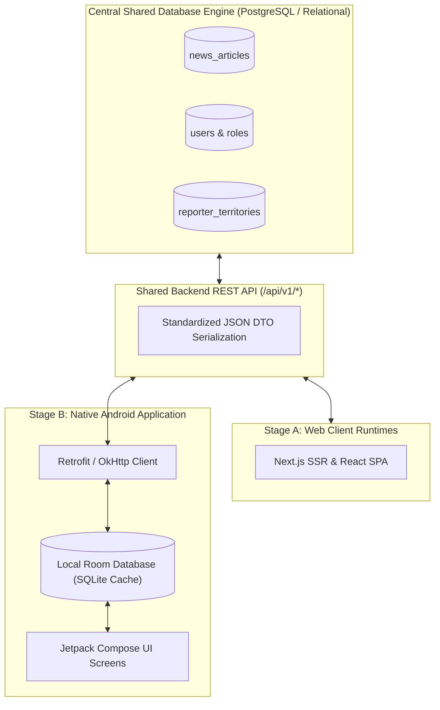

### 15.1 Architectural Parity Rules
1. **Zero Database Forking**: There is strictly one database schema. The Android application consumes the exact same data structures, status codes, and entity relationships as the web platform via the `/api/v1/` REST gateway.
2. **Subordinate Local Android Cache**: The Android application employs an internal **Room Database** (SQLite) strictly as an ephemeral local cache:
   - Caches published news articles for offline reading during transit.
   - Preserves unsubmitted reporter drafts locally on device storage via Android `WorkManager` until cellular network connectivity is restored.
   - Upon network reconnection, local drafts sync to the shared backend database via standard `POST /api/v1/news/submit` endpoints.
3. **Optimistic Locking for Concurrent Edits**: To resolve edit conflicts between multiple open sessions (e.g., a reporter editing a draft on their phone while also logged in on a desktop browser), the `news_articles` table supports an `updated_at` optimistic locking timestamp. If an incoming update presents an outdated timestamp, the server rejects the write with HTTP 409 Conflict, prompting the user to merge changes.

---

## 16. Backup and Recovery

In alignment with [`docs/04-NFR.md`](file:///c:/Users/pp/Downloads/BREAKING-NEWS-WALA-main/docs/04-NFR.md), the database tier enforces rigorous business continuity protocols:

| Dimension | Architectural Specification | Recovery Objective | Verification & Automation |
| :--- | :--- | :--- | :--- |
| **Point-in-Time Recovery (PITR)** | Continuous Write-Ahead Log (WAL) archiving streamed to geo-redundant Cloud Storage. | $\text{RPO} \le 15\text{ minutes}$ | Continuous real-time streaming; enables restoring database to any specific minute. |
| **Full Daily Snapshots** | Automated nightly binary database dump taken at off-peak hours (03:00 IST). | $\text{RTO} \le 60\text{ minutes}$ | Stored in an isolated, immutable (WORM) storage bucket with 30-day lifecycle retention. |
| **Disaster Recovery Drills** | Automated weekly restore testing on an isolated sandbox instance. | Automated validation | Automated health test validates table row counts and integrity constraints after restore. |
| **Media Coordinated Backup** | Database backup metadata coordinated with Cloud Storage versioning. | Zero orphaned references | Media files in S3/GCS utilize object versioning to prevent accidental deletions from breaking DB links. |

---

## 17. Database Technology Evaluation

To preserve technology neutrality while providing concrete engineering guidance, the platform evaluates three primary database technology paradigms:

| Evaluation Dimension | Option 1: Relational Database (RDBMS - PostgreSQL / MySQL) | Option 2: NoSQL Document Store (MongoDB / Firestore) | Option 3: Hybrid Polyglot (RDBMS Core + Redis Cache + Object Storage) |
| :--- | :--- | :--- | :--- |
| **Conceptual Suitability** | High: Newsroom editorial workflows, territory hierarchies, and role permissions are inherently relational. | Moderate to Low: Relational joins across users, territories, and articles require complex denormalization. | **Optimal**: Relational guarantees for core entities; Redis for high-speed ephemeral caches and queues. |
| **ACID & Editorial Invariants** | **Maximum**: Enforces strict transactional isolation for multi-table status publishing and audit logging. | Weak: Multi-document transactions in NoSQL carry severe performance penalties or lack guarantees. | **Maximum**: Primary operational data strictly protected by relational ACID guarantees. |
| **Devanagari Search & Indexing** | Excellent: PostgreSQL `pg_trgm` and GIN indexes provide outstanding Hindi substring and fuzzy search. | Moderate: Requires external search cluster integration for vernacular stemming. | **Excellent**: PostgreSQL trigram search satisfies initial launch; offloadable to Typesense at scale. |
| **Schema Evolution & Migrations** | Deterministic: Structured SQL migrations (Flyway/Prisma) track schema changes across environments. | High Risk: Unstructured documents lead to schema drift and hard-to-debug data corruption. | **Deterministic & Controlled**: Clean schema evolution with versioned migration scripts. |
| **Operational Complexity** | Low to Moderate: Readily available as managed cloud databases (AWS RDS, Cloud SQL). | Moderate: Complex sharding and index management at scale. | **Low**: Managed relational database paired with managed Redis. Standard industry pattern. |

---

## 18. Decision Register (ADR)

The Database Architecture Decisions Register formalizes technical evaluations and distinguishes confirmed requirements from proposed recommendations:

| Decision ID | Database Topic | Evaluated Alternatives | Recommended Option | Architectural Rationale | Status | Approval Required |
| :--- | :--- | :--- | :--- | :--- | :--- | :--- |
| **DB-ADR-01** | **Shared Database Scope** | 1. Single Shared Database 2. Separate Web & Android DBs 3. Microservice Database-per-Service | **Single Shared Relational Database** | Non-negotiable project mandate. Guarantees single source of truth across Web and Android without distributed sync failure risks. | **Confirmed** | None (Mandatory Invariant) |
| **DB-ADR-02** | **Primary Database Engine** | 1. PostgreSQL (v15+) 2. MySQL / MariaDB 3. MongoDB / Firestore | **PostgreSQL (v15+)** | Industrial-grade ACID reliability; superior native JSONB support; outstanding Hindi text indexing (`pg_trgm`). | **Proposed** | Lead Architect / CTO |
| **DB-ADR-03** | **Primary Key Strategy** | 1. Sequential Auto-Increment INT 2. UUIDv4 / ULID 3. Natural Business Keys | **UUIDv4 / ULID** | Prevents IDOR enumeration attacks; supports client-side pre-generation on Android; seamless future sharding. | **Proposed** | Database Architect |
| **DB-ADR-04** | **Audit Trail Immutability** | 1. Application-level logs only 2. Append-only database table 3. Database Trigger-enforced immutability | **Append-Only Database Table with Engine Trigger Locks** | Enforces `RULE-AUD-001`. Forbids SQL UPDATE and DELETE on audit logs, guaranteeing tamper-proof compliance. | **Confirmed** | Security Architect |
| **DB-ADR-05** | **Pagination Architecture** | 1. Offset / Limit (`OFFSET 500`) 2. Keyset (Cursor-Based) Pagination | **Keyset (Cursor-Based) Pagination** | Constant $O(1)$ query execution time; eliminates page shifting anomalies when breaking news is published in real time. | **Proposed** | Lead Architect |
| **DB-ADR-06** | **Media Storage Integration** | 1. BLOBs stored in DB tables 2. Cloud Object Storage (S3/GCS) + DB Metadata | **Cloud Object Storage with DB Metadata** | Database stores file keys, CDN URLs, and image dimensions; binary files stream directly to S3/GCS via presigned URLs. | **Confirmed** | Lead Architect |
| **DB-ADR-07** | **Geographical Data Hierarchy** | 1. Hardcoded Enum values 2. Self-referential `geo_locations` table | **Self-Referential Location Table** | Parent-child tree allows adding new Indian states, districts, and tehsils dynamically without schema modifications. | **Confirmed** | Lead Architect |
| **DB-ADR-08** | **AI Secret Key Storage** | 1. Plaintext in database 2. Encrypted DB column 3. KMS Vault Resource References | **KMS Vault Resource References** | Enforces `RULE-SEC-002`. Zero plaintext keys in database; prevents credential theft during database dump breaches. | **Confirmed** | Security Architect |

---

## 19. Cross-Document Traceability

The database schema directly maps to the requirements, workflows, and business rules established across predecessor documentation:

| Domain / Entity | Predecessor Document Reference | Business Rule / Requirement Enforced |
| :--- | :--- | :--- |
| `news_articles`, `editorial_reviews` | [`docs/06-Business-Rules.md`](file:///c:/Users/pp/Downloads/BREAKING-NEWS-WALA-main/docs/06-Business-Rules.md) (BRD Section 3) | `RULE-NEWS-001` (Mandatory Editorial Review), `RULE-AUTH-004` (Trusted Reporter Direct Publish). |
| `reporter_territory_assignments` | [`docs/06-Business-Rules.md`](file:///c:/Users/pp/Downloads/BREAKING-NEWS-WALA-main/docs/06-Business-Rules.md) (BRD Section 4) | `RULE-GEO-001` (Strict Territory Assignment & Exclusive Beat Enforcement). |
| `reporter_template_assignments` | [`docs/06-Business-Rules.md`](file:///c:/Users/pp/Downloads/BREAKING-NEWS-WALA-main/docs/06-Business-Rules.md) (BRD Section 8) | `RULE-GFX-001` (Reporter Graphics restricted to Raw Script to Graphic with assigned templates only). |
| `imported_rss_items` | [`docs/06-Business-Rules.md`](file:///c:/Users/pp/Downloads/BREAKING-NEWS-WALA-main/docs/06-Business-Rules.md) (BRD Section 6) | `RULE-RSS-001` (Only authorized active sources; SHA-256 duplicate detection; no unapproved auto-publish). |
| `audit_logs` | [`docs/06-Business-Rules.md`](file:///c:/Users/pp/Downloads/BREAKING-NEWS-WALA-main/docs/06-Business-Rules.md) (BRD Section 12) | `RULE-AUD-001` (Immutable 7-year audit logging of all publishing and administrative actions). |
| `coin_wallets`, `coin_transactions` | [`docs/02-Features.md`](file:///c:/Users/pp/Downloads/BREAKING-NEWS-WALA-main/docs/02-Features.md) (Module O) | `RULE-COIN-001` (Configurable reward rules, auditable double-entry ledger). |
| `categories`, `geo_locations` | [`docs/08-Sitemap.md`](file:///c:/Users/pp/Downloads/BREAKING-NEWS-WALA-main/docs/08-Sitemap.md), [`docs/07-Design.md`](file:///c:/Users/pp/Downloads/BREAKING-NEWS-WALA-main/docs/07-Design.md) | Dynamic taxonomy supporting 21 core categories and regional district hubs without hardcoding. |

---

## 20. Open Questions and Technical Risks

The following database architecture questions are cataloged for resolution during Phase 3 detailed engineering:

| Question ID | Architectural Domain | Context & Trade-Offs | Current Stance | Resolution Milestone |
| :--- | :--- | :--- | :--- | :--- |
| **OQ-DB-01** | **Devanagari Trigram vs. Dedicated Search Engine** | Will PostgreSQL trigram search (`pg_trgm`) provide sufficient query throughput ($<100\text{ms}$) when article counts exceed 250,000 records? | **Proposed Baseline**: Use PostgreSQL trigram search for Stage A launch. Benchmark during Phase 8; migrate search queries to a dedicated **Typesense** cluster if latency exceeds thresholds. | Phase 8 Search Enhancement |
| **OQ-DB-02** | **Legal Data Retention for User Deletions** | When a registered citizen or reporter requests account deletion under Indian DPDPA regulations, how long must historical authored articles and audit logs be retained? | **Proposed Baseline**: Anonymize personal PII (phone, email, real name) while retaining authored journalistic articles and audit records tagged with an anonymous surrogate ID (`RULE-PRIV-001`). | Legal Review Gate |
| **OQ-DB-03** | **Time-Series Metric Partitioning** | Should high-volume analytics tables (`daily_article_analytics`, `user_reading_history`) utilize declarative table partitioning (e.g. monthly range partitions) from Day 1? | **Proposed Baseline**: Implement monthly range partitioning on `created_at` for analytics and audit tables to enable seamless historical archiving and high query speeds. | Phase 2 Database Setup |

---

## 21. Glossary

| Term | Technical Definition & Platform Context |
| :--- | :--- |
| **ACID** | Atomicity, Consistency, Isolation, Durability. Transactional database guarantees required for editorial publishing, wallet balances, and audit records. |
| **Blurhash** | A compact string representation of an image placeholder used to render smooth, low-bandwidth previews before the full image loads. |
| **Cursor Pagination** | A query technique (`WHERE (published_at, id) < (cursor_time, cursor_id)`) providing constant $O(1)$ performance without offset scanning. |
| **Devanagari Collation** | Database character sorting and comparison rules tailored for Hindi script ligatures, vowel signs, and anusvara. |
| **IDOR** | Insecure Direct Object Reference. A security vulnerability caused by exposing predictable sequential integers; prevented via UUIDv4/ULID. |
| **Keyset Pagination** | Synonym for Cursor-Based Pagination. |
| **KMS** | Key Management Service. Cloud cryptographic enclave used to store master encryption keys and AI API credentials securely. |
| **Optimistic Locking** | A concurrency control mechanism using timestamp or version checks to prevent concurrent overwrites without blocking database reads. |
| **PITR** | Point-in-Time Recovery. Restoring a database to a specific minute in the past using continuous WAL log archives and nightly snapshots. |
| **Room Database** | Android Jetpack's official SQLite object-mapping library used for offline caching in the native mobile app. |
| **Soft Delete** | Flagging a record as deleted via a `deleted_at` timestamp rather than physically removing the row from disk, preserving referential integrity. |
| **Trigram Index (`pg_trgm`)** | A text indexing method breaking strings into 3-character tuples, enabling high-speed fuzzy and substring search in Devanagari text. |
| **ULID** | Universally Unique Lexicographically Sortable Identifier. A 128-bit time-sortable alternative to UUIDv4. |
| **WAL** | Write-Ahead Logging. A database transaction logging mechanism that records all data changes to disk before committing them to data pages. |