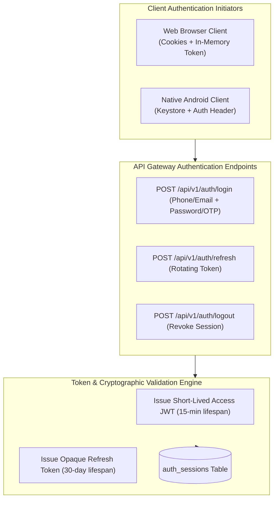
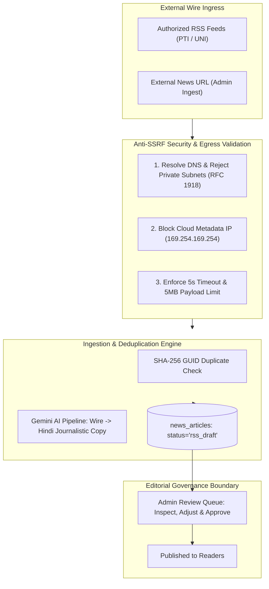
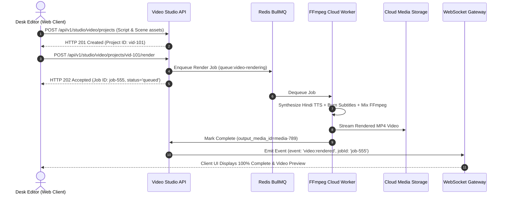
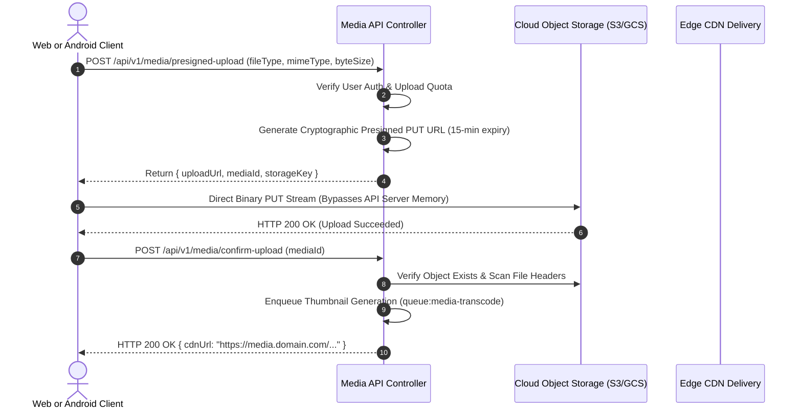
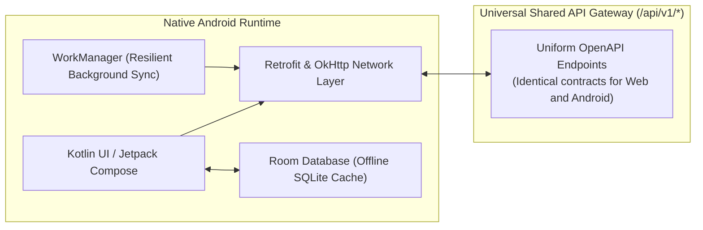

# Master API Architecture & Contract Specification
## Project: BREAKING NEWS WALA (ब्रेकिंग न्यूज़ वाला)
### Document ID: DOC-13-API-2026-V1.0
### Confidentiality: Internal Engineering, Architecture & API Governance Specification

---

## 1. Document Information

| Attribute | Specification Details |
| :--- | :--- |
| **Document Title** | Master API Architecture & Contract Specification |
| **Document ID** | `DOC-13-API-2026-V1.0` |
| **Baseline Version** | `1.0.0` |
| **Document Status** | **Approved Architectural Baseline & API Contract Blueprint** |
| **Creation Date** | October 31, 2026 |
| **Target System** | BREAKING NEWS WALA Enterprise Digital Platform (Web & Native Android) |
| **Target API Ingress Scope** | Unified RESTful JSON Gateway (`/api/v1/*`), Real-time WebSocket Gateway (`/ws`), and Cloud Media Ingress |
| **Authoring Body** | Central API Architecture Guild, Principal Integration Architect & Cross-Platform Engineering Team |
| **Approved By** | Principal API Architect, Lead Enterprise Solutions Architect, Chief Technology Officer |
| **Predecessor Dependencies** | `docs/01-PRD.md` (PRD v1.0.0), `docs/02-Features.md` (Features v1.0.0), `docs/03-Plan.md` (Plan v1.0.0), `docs/04-NFR.md` (NFR v1.0.0), `docs/05-Workflows.md` (Workflows v1.0.0), `docs/06-Business-Rules.md` (BRD v1.0.0), `docs/07-Design.md` (Design v1.0.0), `docs/08-Sitemap.md` (Sitemap v1.0.0), `docs/09-Components.md` (Components v1.0.0), `docs/10-Responsive-Design.md` (Responsive v1.0.0), `docs/11-Architecture.md` (Architecture v1.0.0), `docs/12-Database.md` (Database v1.0.0) |
| **Downstream Dependencies** | `docs/14-Auth.md`, `docs/15-Security.md`, `docs/16-Storage.md`, `docs/19-API-Pool.md`, `docs/20-Integrations.md`, `docs/21-Prompts.md`, `docs/24-Deployment.md`, `docs/25-Environment.md` |
| **Canonical Target Path** | `docs/13-API.md` |

---

## 2. Scope and Purpose

### 2.1 Purpose
The purpose of this specification is to define the definitive, cross-platform RESTful and real-time API contracts for the **BREAKING NEWS WALA (ब्रेकिंग न्यूज़ वाला)** platform. 

The API layer acts as the universal, strongly typed boundary between client presentation surfaces (Web Portals, Ground Reporter Mobile Workspaces, Admin Control Panels, Central Newsroom Desks, and the future Kotlin-based Native Android App) and the shared backend business services. It enforces strict server-side authorization, input sanitization, business rules, quota rate limiting, and editorial state integrity.

### 2.2 System Scope & Presentation Tiers Served
The single shared backend API serves all five official presentation tiers:
1. **Public News Website & Mobile Web**: High-speed, cached read access for published news, video reels, category feeds, district news, live blogs, e-paper editions, and citizen search.
2. **Reporter Web Application**: Authenticated, role-gated endpoints for ground reporters to file drafts, record voice-to-text notes, upload field photos/videos, track editorial reviews, and access the Reporter Graphics Studio.
3. **Admin Control Panel**: Privileged administrative APIs for editorial review, one-click approvals, change requests, user accreditation, territory allocation, RSS management, URL-to-News processing, and system telemetry.
4. **Central Newsroom**: Real-time event streams (WebSockets) for incoming breaking wires, reporter GPS coordinates, desk kanban synchronization, and broadcast feed integration.
5. **Future Native Android Application**: Consumes the exact same `/api/v1/` endpoints using native Retrofit/Ktor HTTP clients, sharing 100% of business logic and data contracts with zero backend bifurcation.

### 2.3 Legacy Prototype API State & Migration Baseline
An inspection of the existing workspace identified a prototype Node.js/Express server implementation located at `BREAKING-NEWS-WALA-main/server.ts`. 

#### Current Actual State of Prototype Endpoints:
- **Unversioned Legacy Routing**: Exposes unversioned endpoints directly under `/api/` (e.g., `/api/news`, `/api/news/:id`, `/api/categories`, `/api/locations`, `/api/reporters`, `/api/ticker`, `/api/templates`, `/api/audit-logs`, `/api/ads`, `/api/ai/pool-status`, `/api/ai/structure-news`, `/api/ai/url-rewrite`, `/api/ai/headline-options`).
- **In-Memory Mock State**: State is held in volatile in-memory arrays without persistent database enforcement, transactional guarantees, or referential integrity.
- **Missing Enterprise Features**: Lacks standardized JSON response envelopes, cursor pagination, cryptographic JWT refresh rotation, sliding-window rate limiting, anti-SSRF egress proxies, and OpenAPI 3.1 contract validation.
- **Migration Mandate**: All existing prototype endpoints are classified as **Legacy Prototype**. This specification formalizes the target enterprise `/api/v1/` contract architecture. During implementation (Phase 2), all legacy routes will be refactored into the modular, versioned, and secure contract specifications defined in this document.

---

## 3. API Architecture Principles

Every API endpoint in BREAKING NEWS WALA is governed by nine non-negotiable architectural tenets:

| # | API Principle | Architectural & Technical Definition | Why It Matters for BREAKING NEWS WALA |
| :--- | :--- | :--- | :--- |
| **API-01** | **API-First Architecture** | Business capabilities are designed, validated, and documented as OpenAPI contracts before any frontend UI or native screen consumes them. | Ensures identical capability availability for Web and Android clients without backend refactoring. |
| **API-02** | **Single Shared Backend** | A single authoritative backend API serves Web, Mobile Web, Workspaces, and future Native Android. Strictly zero separate mobile backend. | Eliminates logic duplication, divergent data behavior, and phantom bugs across operating systems. |
| **API-03** | **Server-Side Authorization Invariant** | Clients are treated as untrusted presentation engines. Every protected operation verifies identity, role, and territory on the server. | Prevents malicious actors or modified APKs from bypassing review queues or publishing unapproved drafts. |
| **API-04** | **Frontend-Independent Business Logic** | Domain workflows, state machines, and publishing constraints are encapsulated entirely within backend service controllers. | Shields the platform from tampering via browser dev tools or intercepted client scripts. |
| **API-05** | **Consistent API Contracts** | Uniform request formatting, parameter naming, response envelopes, error codes, and HTTP status codes across all endpoints. | Accelerates frontend development and enables automated TypeScript and Kotlin SDK generation. |
| **API-06** | **Zero Secret Exposure** | API keys for Gemini AI, SMS gateways, cloud storage, and FCM are never transmitted to or received from client applications. | Prevents API key scraping, financial exposure, and quota theft from client bundles. |
| **API-07** | **Direct Cloud Media Ingress** | High-resolution binary images and video assets stream directly to Cloud Storage via presigned URLs; zero binary proxying through API servers. | Protects application server CPU, memory, and bandwidth from saturation during heavy breaking news filings. |
| **API-08** | **Strict Versioning & Backward Compatibility** | Global URI versioning (`/api/v1/`) with a mandatory 6-month support window for deprecated versions. | Accommodates older Android APK versions installed on citizen devices without breaking mobile functionality. |
| **API-09** | **Resilient Mobile Network Adaptation** | Lightweight JSON payloads, keyset pagination, gzip/brotli compression, and idempotent retry semantics (`X-Idempotency-Key`). | Delivers reliable news submission and reading over intermittent 2G/3G/4G cellular connections in rural beats. |

---

## 4. API Design Approach & Style Evaluation

To establish the optimal architectural style for BREAKING NEWS WALA, three primary API communication paradigms were evaluated:

| Architectural Style | Advantages | Disadvantages | Suitability for BREAKING NEWS WALA | Recommendation & Status |
| :--- | :--- | :--- | :--- | :--- |
| **RESTful JSON (OpenAPI 3.1)** | - Universal compatibility across Web (Next.js/React) and Android (Retrofit/OkHttp).<br>- Exceptional caching at Edge CDN (Cloudflare) via standard HTTP headers (`Cache-Control`, `ETag`).<br>- Straightforward rate limiting, WAF inspection, and access logging.<br>- Lightweight and simple tooling. | - Over-fetching or under-fetching if endpoint payloads are poorly designed.<br>- Multiple round-trips for deeply nested composite data views. | **Optimal**: Digital news platforms are 95% read-heavy, making Edge CDN HTTP caching paramount. REST provides unmatched simplicity, performance, and tooling stability. | **PROPOSED (Recommended)**<br>*Pending Architectural Sign-Off* |
| **GraphQL** | - Client specifies exact field selection, minimizing cellular payload size.<br>- Consolidates complex multi-resource newsroom dashboards into a single network query. | - Extremely poor Edge CDN caching (all requests use HTTP POST).<br>- High server CPU overhead for query AST parsing and validation.<br>- Complex rate limiting and vulnerability to denial-of-service via nested query abuse. | **Unsuitable as Primary API**: Loss of edge HTTP caching would severely degrade public website TTFB and Core Web Vitals during breaking news traffic spikes. | **REJECTED** |
| **Hybrid (REST Core + WebSocket Streams)** | - Combines RESTful edge-caching for content consumption with WebSockets for real-time editorial desk collaboration. | - Slightly higher operational complexity than pure REST (requires maintaining stateful WebSocket gateway). | **Optimal for Real-Time Desks**: Provides blazing-fast cached REST reads for public news while powering live newsroom wire feeds and breaking alert tickers. | **PROPOSED (Recommended)**<br>*Pending Architectural Sign-Off* |

> **Architectural Recommendation**: Adopt a **Hybrid Architecture: RESTful JSON (`/api/v1/*`) for all operational and content APIs, augmented by dedicated WebSockets (`/ws`) for Central Newsroom live wire streams and presence synchronization**.

---

## 5. API Standards

### 5.1 Global URI Versioning Strategy
- **Standard Routing Prefix**: All REST endpoints are prefixed with a global major version path:
  `https://api.breakingnewswala.com/api/v1/`
- **Breaking vs. Non-Breaking Evolution**:
  - *Non-Breaking Changes (deployed in-place)*: Adding new optional query parameters, adding new response fields, adding entirely new endpoints.
  - *Breaking Changes (requires version bump to `/api/v2/`)*: Renaming/removing existing response fields, altering field data types, modifying URL path semantics, changing mandatory request headers.
- **Deprecation Lifecycle**: When an API version is deprecated, the server emits standard IETF deprecation headers:
  ```http
  Deprecation: @1767139200
  Sunset: Wed, 31 Dec 2026 23:59:59 GMT
  Link: <https://api.breakingnewswala.com/docs/v2-migration>; rel="sunset"
  ```
  Deprecated versions remain supported for at least 6 months to accommodate un-updated Android client devices.

### 5.2 Request Standards
1. **HTTP Methods**: Strict adherence to semantic verbs:
   - `GET`: Safe, idempotent read operations. Zero state mutation.
   - `POST`: Non-idempotent resource creation, action triggers, or complex search queries.
   - `PUT`: Idempotent full replacement of a resource.
   - `PATCH`: Idempotent partial update of specific resource fields.
   - `DELETE`: Idempotent resource removal or soft-delete archival.
2. **Content Negotiation & Character Encoding**:
   - `Content-Type: application/json; charset=utf-8` mandatory on all write requests.
   - `Accept: application/json` mandatory on all API requests.
3. **Standard Request Headers**:
   - `Authorization: Bearer <JWT>`: Cryptographic access token for protected endpoints.
   - `X-Request-Id: <UUIDv4>`: Client-provided correlation ID (or generated by gateway) for end-to-end distributed tracing.
   - `X-Client-Platform: web | android`: Identifies consuming platform for tailored analytics and response formatting.
   - `X-Client-Version: 1.0.0`: App build version string.
   - `X-Idempotency-Key: <UUIDv4>`: Mandatory on financial and mission-critical state transitions (e.g., publishing breaking news, wallet redemptions) to prevent double execution on cellular retries.
4. **Pagination Convention**:
   - Keyset (Cursor-Based) pagination is standard for high-volume news streams:
     `GET /api/v1/news?cursor=eyJpZCI6MTIzfQ==&limit=20`
5. **Localization & Script Convention**:
   - `Accept-Language: hi, en;q=0.8`: Defaults to Hindi (`hi`).
   - Dates and timestamps are strictly ISO 8601 UTC strings: `2026-10-31T01:30:00Z`.

### 5.3 Unified Response Envelopes
Every API endpoint responds with a standardized, strongly typed JSON envelope.

#### Standard Success Response (`2xx`):
```json
{
  "success": true,
  "statusCode": 200,
  "data": {
    "article": {
      "id": "e2a3b4c5-6d7e-8f9a-0b1c-2d3e4f5a6b7c",
      "publicId": "BNW-2026-89472",
      "slug": "varanasi-smart-city-project-2026",
      "title": "वाराणसी में नए स्मार्ट सिटी प्रोजेक्ट का शुभारंभ",
      "status": "published",
      "publishedAt": "2026-10-31T01:30:00Z"
    }
  },
  "meta": {
    "timestamp": "2026-10-31T01:30:05Z",
    "requestId": "req-98765-abcdef",
    "pagination": {
      "cursor": "eyJpZCI6ODk0NzJ9",
      "hasMore": true,
      "limit": 20
    }
  }
}
```

#### Standard Error Response (`4xx` / `5xx`):
```json
{
  "success": false,
  "statusCode": 422,
  "error": {
    "code": "ERR_VALIDATION_FAILED",
    "message": "आलेख का विवरण अमान्य है (Article data validation failed)",
    "details": [
      {
        "field": "title",
        "code": "VAL_TITLE_TOO_SHORT",
        "message": "शीर्षक कम से कम 10 वर्णों का होना चाहिए (Title must be at least 10 characters)"
      },
      {
        "field": "primaryLocationId",
        "code": "VAL_TERRITORY_UNAUTHORIZED",
        "message": "आप केवल अपने आवंटित जिले के लिए समाचार दर्ज कर सकते हैं (You can only file news for your assigned territory)"
      }
    ]
  },
  "meta": {
    "timestamp": "2026-10-31T01:30:05Z",
    "requestId": "req-98765-abcdef"
  }
}
```

### 5.4 Standardized Error Code Taxonomy

| HTTP Status | Error Code | Category & Meaning | Client Handling & UI Action |
| :--- | :--- | :--- | :--- |
| `400 Bad Request` | `ERR_BAD_REQUEST` | Malformed JSON payload or invalid query syntax. | Display generic alert; do not auto-retry. |
| `401 Unauthorized` | `ERR_UNAUTHORIZED` | Missing, expired, or cryptographically invalid access token. | Web/Android triggers silent refresh token rotation; if refresh fails, redirect to login. |
| `403 Forbidden` | `ERR_FORBIDDEN_ROLE` | Authenticated user lacks required RBAC role. | Display access denied message (*"इस कार्य के लिए अनुमति नहीं है"*). |
| `403 Forbidden` | `ERR_TERRITORY_MISMATCH` | Reporter attempted to file news outside assigned beat (`RULE-GEO-001`). | Highlight territory selector with assigned beats only. |
| `403 Forbidden` | `ERR_GRAPHIC_RESTRICTED` | Reporter attempted to invoke URL-to-Graphic or RSS-to-Graphic (`RULE-GFX-001`). | Block request; enforce Raw Script to Graphic only. |
| `404 Not Found` | `ERR_RESOURCE_NOT_FOUND` | Target entity does not exist or has been soft-deleted. | Render friendly 404 screen. |
| `409 Conflict` | `ERR_VERSION_CONFLICT` | Optimistic locking collision (simultaneous edit detected). | Prompt user to merge conflicting edits (*"समाचार में अन्य बदलाव हुए हैं"*). |
| `422 Unprocessable`| `ERR_VALIDATION_FAILED` | Payload violates domain validation rules (Devanagari length, required fields). | Highlight field-level error messages directly beneath form inputs. |
| `429 Too Many Req` | `ERR_RATE_LIMIT_EXCEEDED`| Rate limit counter breached (IP or User). | Display throttle countdown using `Retry-After` header value. |
| `500 Server Error` | `ERR_INTERNAL_SERVER` | Unhandled backend exception. | Display safe error notice; internal stack trace quarantined in server logs. |
| `503 Unavailable` | `ERR_AI_POOL_EXHAUSTED` | All AI models/keys in pool currently rate-limited or offline. | Circuit breaker opens; UI falls back to manual editorial headline entry. |

---

---

## 6. Authentication and Authorization APIs

The authentication subsystem provides secure, multi-tenant identity verification across all platform roles (Public Citizens, Ground Reporters, Sub-Editors, Bureau Chiefs, and System Administrators).



### 6.1 Authentication Endpoints Specification

| Endpoint ID | Method & Route | Access Level | Description & Architectural Guardrails |
| :--- | :--- | :--- | :--- |
| `AUTH-01` | `POST /api/v1/auth/register` | Public | Citizen reader or reporter registration. Enforces unique phone number (+91) or email. |
| `AUTH-02` | `POST /api/v1/auth/login` | Public | Primary authentication endpoint. Accepts phone/password or phone/OTP. Generates JWT access token and refresh token. |
| `AUTH-03` | `POST /api/v1/auth/refresh` | Public | Rotates refresh token. Enforces single-use refresh token invalidation (detects replay attacks). |
| `AUTH-04` | `POST /api/v1/auth/logout` | Authenticated | Revokes current session in `auth_sessions`; clears cookies. |
| `AUTH-05` | `POST /api/v1/auth/logout-all`| Authenticated | Revokes all active sessions across all devices for the authenticated user. |
| `AUTH-06` | `POST /api/v1/auth/otp/send` | Public | Dispatches DLT-compliant SMS OTP for login or password reset. Rate-limited to 3 OTPs / 10 minutes. |
| `AUTH-07` | `POST /api/v1/auth/otp/verify` | Public | Verifies OTP signature; returns verification token. |
| `AUTH-08` | `GET /api/v1/auth/me` | Authenticated | Retrieves current user profile, assigned roles, permissions, and territory allocations. |
| `AUTH-09` | `PATCH /api/v1/auth/profile` | Authenticated | Updates personal display name, bio, and avatar media reference. |
| `AUTH-10` | `POST /api/v1/auth/devices` | Authenticated | Registers client hardware push token (Web Push VAPID subscription or Android FCM token). |
| `AUTH-11` | `GET /api/v1/auth/sessions` | Authenticated | Lists active sessions with IP addresses, client types (Web/Android), and timestamps. |
| `AUTH-12` | `DELETE /api/v1/auth/sessions/:id`| Authenticated | Terminates a specific remote session. |

### 6.2 Cross-Platform Token Delivery Strategy
- **Web Browser Runtimes**: Refresh tokens are transported via `Set-Cookie: refreshToken=...; HttpOnly; Secure; SameSite=Strict; Path=/api/v1/auth/refresh`. Access tokens are held in client application memory, completely eliminating XSS token theft.
- **Native Android Runtimes**: Because native mobile apps lack automated browser cookie containers, the login endpoint simultaneously returns the refresh token inside the secure JSON body. The Android client securely encrypts this token in **Android Keystore / EncryptedSharedPreferences** and delivers it in the request body for `/api/v1/auth/refresh`.

---

## 7. Public Website APIs

Public APIs serve citizen readers across desktop web, responsive mobile web, and the native mobile app. All public endpoints return strictly published (`status = 'published'`) and publicly accessible news content.

### 7.1 Public Endpoints Catalog

| Endpoint ID | Method & Route | Cache Strategy | Purpose & Parameters |
| :--- | :--- | :--- | :--- |
| `PUB-01` | `GET /api/v1/public/home` | Edge CDN: 60s, Stale: 300s | Aggregated homepage composite: Breaking ticker, Lead Hero story, Top Stories grid, Category ribbons. |
| `PUB-02` | `GET /api/v1/public/news` | Edge CDN: 30s, Stale: 120s | Paginated public news stream. Supports `cursor`, `limit` (max 50), `category`, `district`, `tag`. |
| `PUB-03` | `GET /api/v1/public/news/breaking` | Edge CDN: 15s | Real-time breaking news items with high alert priority (`breaking_priority >= 1`). |
| `PUB-04` | `GET /api/v1/public/news/trending` | Edge CDN: 120s | Algorithmically ranked trending stories based on rolling 24-hour page views. |
| `PUB-05` | `GET /api/v1/public/news/:slug` | Edge CDN: 300s, Stale: 86400s | Full article detail payload: Devanagari headline, body text, byline, author photo, gallery, and related news. |
| `PUB-06` | `GET /api/v1/public/news/:slug/related`| Edge CDN: 300s | 5 contextually related stories matched by primary category and geographic district. |
| `PUB-07` | `GET /api/v1/public/categories` | Edge CDN: 3600s (1 hr) | Complete active category hierarchy (21 approved categories + subcategories) with icons and display order. |
| `PUB-08` | `GET /api/v1/public/locations` | Edge CDN: 86400s (24 hr) | State and district geographical hierarchy (e.g. Madhya Pradesh districts and cities). |
| `PUB-09` | `GET /api/v1/public/videos/reels` | Edge CDN: 60s | Vertical 9:16 short news video reels feed with video stream URLs, duration, and Devanagari titles. |
| `PUB-10` | `GET /api/v1/public/epaper/editions` | Edge CDN: 3600s | Available digital e-paper regional editions and publication dates. |
| `PUB-11` | `GET /api/v1/public/epaper/:id/pages` | Edge CDN: 3600s | High-resolution page image URLs and clickable article bounding box coordinates. |
| `PUB-12` | `GET /api/v1/public/search` | Edge CDN: 30s | Full-text Devanagari search endpoint. Accepts `q` (Hindi query string), `category`, `district`, `from`, `to`. |
| `PUB-13` | `POST /api/v1/public/news/:id/share` | Zero Cache | Increments social share counter for WhatsApp/Telegram tracking. |
| `PUB-14` | `POST /api/v1/public/feedback` | Zero Cache | Citizen reporting of factual errors or editorial feedback on specific articles. |

---

## 8. Reporter APIs

Reporter APIs empower ground journalists to file breaking reports from the field, record voice-to-text narratives, upload camera media, and review editorial feedback.

```mermaid
flowchart LR
    subgraph REP_ACTIONS["Ground Reporter Actions"]
        ACT_DRAFT["1. Create / Autosave Draft"]
        ACT_AI["2. AI Headline Suggestion (Optional)"]
        ACT_MEDIA["3. Presigned Media Upload"]
        ACT_SUBMIT["4. Submit for Editorial Review"]
        ACT_GFX["5. Raw Script to Graphic Studio"]
    end

    subgraph REP_ENDPOINTS["Reporter API Controller (/api/v1/reporter/*)"]
        R_POST["POST /news/drafts"]
        R_AI["POST /ai/headline-suggest"]
        R_UPLOAD["POST /media/presigned-upload"]
        R_SUB["POST /news/:id/submit"]
        R_GFX["POST /studio/graphics/generate"]
    end

    subgraph SERVER_GUARDS["Server-Side Enforcement Layer"]
        GUARD_AUTH["Verify JWT & 'reporter' Role"]
        GUARD_TERR["Verify District in Assigned Territories (RULE-GEO-001)"]
        GUARD_GFX["Strict Isolation: Raw Script to Graphic Only (RULE-GFX-001)"]
    end

    REP_ACTIONS --> REP_ENDPOINTS
    REP_ENDPOINTS --> SERVER_GUARDS
```



### 8.1 Reporter Endpoints Specification

| Endpoint ID | Method & Route | Required Permission | Architectural Purpose & Guardrails |
| :--- | :--- | :--- | :--- |
| `REP-01` | `GET /api/v1/reporter/dashboard` | `reporter:access` | Aggregated dashboard: Total filed, approved count, pending review count, revisions needed, assigned territories. |
| `REP-02` | `GET /api/v1/reporter/territories` | `reporter:access` | Returns active districts and cities officially assigned to the reporter by Admin (`RULE-GEO-001`). |
| `REP-03` | `POST /api/v1/reporter/news/drafts` | `news:create` | Creates a new article draft. Validates that `primaryLocationId` matches an assigned beat. Sets `status='draft'`. |
| `REP-04` | `PATCH /api/v1/reporter/news/drafts/:id`| `news:edit` | Autosaves title, body copy, and media references. Enforces ownership check (reporter can only edit own drafts). |
| `REP-05` | `POST /api/v1/reporter/news/:id/submit`| `news:submit` | Submits draft to the Admin Review Queue. Enforces mandatory fields (title, body, location, category). State: `pending`. |
| `REP-06` | `POST /api/v1/reporter/news/:id/direct-publish`| `news:direct_publish`| **Trusted Reporters Only** (`RULE-AUTH-004`). Bypasses review queue; sets `status='published'` immediately. |
| `REP-07` | `GET /api/v1/reporter/news` | `reporter:access` | Lists reporter's submissions filtered by status (`draft`, `pending`, `changes_requested`, `approved`, `published`). |
| `REP-08` | `GET /api/v1/reporter/news/:id/feedback`| `reporter:access` | Retrieves editorial change requests and comments submitted by sub-editors for revised filing. |
| `REP-09` | `POST /api/v1/reporter/ai/headline-suggest`| `ai:suggest` | Generates 3 catchy Hindi headlines from raw field script via Gemini AI Pool. Rate-limited per reporter. |
| `REP-10` | `GET /api/v1/reporter/studio/templates` | `studio:raw_script` | Retrieves graphic templates officially assigned to the reporter or their category (`RULE-GFX-001`). |
| `REP-11` | `POST /api/v1/reporter/studio/graphics/generate`| `studio:raw_script` | **Raw Script to Graphic Only**. Generates social graphic card using reporter's script and assigned template. |
| `REP-12` | `GET /api/v1/reporter/performance` | `reporter:access` | Detailed reporter analytics: Monthly submission volume, approval percentage, trust score, and readership. |

---

## 9. Admin and Central Newsroom APIs

Admin APIs govern the enterprise editorial newsroom, territory allocations, user accreditation, review queues, and system configuration.

### 9.1 Administrative & Review Endpoints Specification

| Endpoint ID | Method & Route | Required Permission | Architectural Purpose & Guardrails |
| :--- | :--- | :--- | :--- |
| `ADM-01` | `GET /api/v1/admin/review-queue` | `editorial:review` | Retrieves articles awaiting editorial decision (`pending`, `under_review`). Supports filtering by district and beat. |
| `ADM-02` | `POST /api/v1/admin/news/:id/claim` | `editorial:review` | Editor claims exclusive review lock on an article; updates state to `under_review` to prevent review collisions. |
| `ADM-03` | `POST /api/v1/admin/news/:id/approve` | `editorial:approve` | Editorial approval. Transition: `under_review` $\rightarrow$ `approved`. Records reviewer ID in `editorial_reviews`. |
| `ADM-04` | `POST /api/v1/admin/news/:id/publish` | `editorial:publish` | Live publication trigger. Sets `status='published'`, `published_at=NOW()`; flushes CDN cache; triggers push alert. |
| `ADM-05` | `POST /api/v1/admin/news/:id/request-changes`| `editorial:review` | Returns article to reporter. Transition: `under_review` $\rightarrow$ `changes_requested`. Requires mandatory feedback text. |
| `ADM-06` | `POST /api/v1/admin/news/:id/reject` | `editorial:reject` | Permanent rejection. Transition: `under_review` $\rightarrow$ `rejected`. Requires structured `reason_code`. |
| `ADM-07` | `POST /api/v1/admin/news/:id/retract` | `editorial:retract` | Emergency unpublishing of live article. Transition: `published` $\rightarrow$ `archived`. Clears CDN cache immediately. |
| `ADM-08` | `GET /api/v1/admin/reporters` | `reporters:manage` | Lists all accredited reporters with verification status, trust scores, and assigned districts. |
| `ADM-09` | `PATCH /api/v1/admin/reporters/:id/trust`| `reporters:manage` | Toggles `is_trusted_reporter` and `can_direct_publish` flags (`RULE-AUTH-004`). |
| `ADM-10` | `POST /api/v1/admin/reporters/:id/territories`| `territory:allocate` | Allocates or revokes district/city beats to a reporter (`RULE-GEO-001`). Emits audit log. |
| `ADM-11` | `POST /api/v1/admin/categories` | `category:manage` | Dynamically creates a new category or subcategory with Hindi name, English slug, and display order. |
| `ADM-12` | `PATCH /api/v1/admin/categories/:id` | `category:manage` | Updates category metadata or archives category. Archiving preserves all historical news records. |
| `ADM-13` | `GET /api/v1/admin/audit-logs` | `audit:read` | Queries immutable audit log entries (`RULE-AUD-001`). Supports filtering by actor, action type, and date range. |
| `ADM-14` | `POST /api/v1/admin/system/kill-switch`| `system:superadmin` | Emergency platform kill switch. Blocks all direct publishing and pauses automatic RSS/AI pipelines. |

---

## 10. RSS and URL Newsroom APIs

The RSS and URL Newsroom suite automates the ingestion of authorized wire feeds and external news URLs.



### 10.1 RSS & URL Endpoints Specification

| Endpoint ID | Method & Route | Required Permission | Architectural Purpose & Guardrails |
| :--- | :--- | :--- | :--- |
| `RSS-01` | `POST /api/v1/admin/rss/sources` | `rss:manage` | Adds a new RSS source. Validates XML schema and authorization status. **Admin-only**. |
| `RSS-02` | `PATCH /api/v1/admin/rss/sources/:id`| `rss:manage` | Activates, pauses, or deactivates an RSS source. Deactivated sources immediately cease polling. |
| `RSS-03` | `POST /api/v1/admin/rss/sources/:id/poll`| `rss:manage` | Triggers immediate manual polling cycle for an authorized source. |
| `RSS-04` | `GET /api/v1/admin/rss/items` | `rss:manage` | Lists imported feed items, deduplication hashes (`guid_hash`), and AI processing status. |
| `RSS-05` | `POST /api/v1/admin/rss/items/:id/convert`| `rss:manage` | Enqueues background AI worker to transform raw wire XML into a structured Hindi news draft. |
| `URL-01` | `POST /api/v1/admin/url-news/extract`| `url:manage` | **Admin-only**. Submits an external news URL. Enforces strict anti-SSRF egress filtering. |
| `URL-02` | `GET /api/v1/admin/url-news/jobs/:id`| `url:manage` | Checks background scraping and AI draft conversion status. |

---

---

## 11. AI and API Pool APIs

The AI subsystem interfaces with the internal Google Gemini API Pool manager. Clients invoke high-level semantic task endpoints; the backend orchestrates prompt rendering, key ring rotation, token quota monitoring, model fallback (`gemini-1.5-pro` $\rightarrow$ `gemini-1.5-flash`), and circuit breaker protection.

> [!IMPORTANT]
> **Zero Credential Exposure Invariant**:
> Client applications (Web browsers and Native Android) **never receive raw Gemini API keys**. All requests are authenticated via user JWT tokens and processed through the backend API Gateway.

### 11.1 AI Endpoints Catalog

| Endpoint ID | Method & Route | Access Level | Description & Architectural Parameters |
| :--- | :--- | :--- | :--- |
| `AI-01` | `POST /api/v1/ai/headline-suggest` | Reporter, Admin | Generates 3 catchy Hindi headlines from raw field text. Accepts `rawText` and `targetCategory`. |
| `AI-02` | `POST /api/v1/ai/structure-news` | Reporter, Admin | Restructures messy field notes into a standard 5W1H Hindi journalistic article with 3 bullet points. |
| `AI-03` | `POST /api/v1/ai/generate-summary` | Reporter, Admin | Generates concise 2-sentence synopsis and SEO meta-description. |
| `AI-04` | `POST /api/v1/ai/fact-check-assist` | Sub-Editor, Admin| Analyzes news text for internal logical contradictions, unverified claims, or missing citations. |
| `AI-05` | `GET /api/v1/admin/ai/pool-status` | Admin | Real-time health metrics of all API keys in rotation: Remaining QPM quotas, error rates, and active models. |
| `AI-06` | `POST /api/v1/admin/ai/model-switch` | Admin | Dynamically designates active primary model (`gemini-1.5-pro` vs `gemini-1.5-flash`). |

---

## 12. Graphics Studio APIs

The Graphics Studio generates social news cards, breaking bulletins, and branded quote graphics.

> [!IMPORTANT]
> **Strict Role Boundary Verification (`RULE-NEWS-001`, `RULE-GFX-001`)**:
> - `REP-10` / `REP-11`: Reporter access is strictly confined to **Raw Script to Graphic** using Admin-assigned templates.
> - `ADM-GFX-01`: **URL-to-Graphic** and **RSS-to-Graphic** tools are strictly sequestered behind administrative role permissions (`studio:admin`).

### 12.1 Graphics Studio Endpoints Catalog

| Endpoint ID | Method & Route | Permitted Roles | Purpose & Architectural Guardrails |
| :--- | :--- | :--- | :--- |
| `GFX-01` | `GET /api/v1/studio/graphics/templates` | Reporter, Admin | Returns available templates. Reporters receive only templates assigned to their beat; Admins receive all. |
| `GFX-02` | `GET /api/v1/studio/graphics/templates/:id`| Reporter, Admin | Retrieves template schema JSON (bounding boxes, aspect ratio, color palettes, watermark positions). |
| `GFX-03` | `POST /api/v1/studio/graphics/render` | Reporter, Admin | **Raw Script to Graphic Engine**. Submits text overlay and background photo; returns rendered preview. |
| `GFX-04` | `POST /api/v1/admin/studio/graphics/url-to-graphic`| Admin Only | **Admin-only URL-to-Graphic**. Extracts article headline and featured image from external URL to generate graphic card. |
| `GFX-05` | `POST /api/v1/admin/studio/graphics/templates`| Admin Only | Creates or updates master template layouts and watermark configurations. |
| `GFX-06` | `POST /api/v1/admin/studio/graphics/assign` | Admin Only | Assigns specific templates to reporters or category beats (`RULE-GFX-001`). |

---

## 13. Video Studio APIs

The Video Studio orchestrates automated video reel assembly, AI voiceover synthesis, and subtitle burning.



### 13.1 Video Studio Endpoints Catalog

| Endpoint ID | Method & Route | Permitted Roles | Purpose & Architectural Guardrails |
| :--- | :--- | :--- | :--- |
| `VID-01` | `POST /api/v1/studio/video/projects` | Editor, Admin | Initializes a new video reel project with script text, aspect ratio (`9:16` or `16:9`), and scene clips. |
| `VID-02` | `POST /api/v1/studio/video/projects/:id/tts` | Editor, Admin | Generates synchronized Hindi Text-to-Speech audio preview for the script narrative. |
| `VID-03` | `POST /api/v1/studio/video/projects/:id/render`| Editor, Admin | Dispatches asynchronous rendering job. Returns immediate `HTTP 202 Accepted` with Job ID. |
| `VID-04` | `GET /api/v1/studio/video/jobs/:id` | Editor, Admin | Polls rendering progress percentage (`0% - 100%`) and status (`rendering`, `completed`, `failed`). |
| `VID-05` | `GET /api/v1/studio/video/projects/:id/preview`| Editor, Admin | Retrieves streamable CDN preview URL for completed video reel before publishing. |

---

## 14. Media Upload and Download APIs

High-resolution media ingestion strictly adheres to the **Direct Cloud Storage Ingress** pattern (`API-07`).



### 14.1 Media Endpoints Catalog

| Endpoint ID | Method & Route | Access Level | Description & Parameters |
| :--- | :--- | :--- | :--- |
| `MED-01` | `POST /api/v1/media/presigned-upload` | Authenticated | Generates short-lived (15-minute) presigned S3/GCS PUT URL. Validates file size ($\le 50\text{MB}$) and MIME types. |
| `MED-02` | `POST /api/v1/media/confirm-upload` | Authenticated | Confirms binary upload completion; triggers asynchronous thumbnail creation and blurhash calculation. |
| `MED-03` | `GET /api/v1/media/:id` | Authenticated | Retrieves media asset metadata (dimensions, blurhash, CDN delivery URLs, variants). |
| `MED-04` | `DELETE /api/v1/media/:id` | Admin Only | Soft-deletes media asset record and schedules cloud object purge. |

---

## 15. Notification APIs

The notification infrastructure unifies mobile native push (Android FCM), browser notifications (Web Push VAPID), and in-app alerts.

### 15.1 Notification Endpoints Catalog

| Endpoint ID | Method & Route | Access Level | Description & Parameters |
| :--- | :--- | :--- | :--- |
| `NOTIF-01` | `GET /api/v1/notifications` | Authenticated | Paginated list of user notifications (breaking alerts, editorial feedback, assignment dispatches). |
| `NOTIF-02` | `PATCH /api/v1/notifications/:id/read` | Authenticated | Marks a specific notification as read. |
| `NOTIF-03` | `POST /api/v1/notifications/mark-all-read`| Authenticated | Marks all unread notifications as read for current user. |
| `NOTIF-04` | `GET /api/v1/notifications/preferences` | Authenticated | Retrieves user notification channel preferences (Breaking News, Local District News, Rewards). |
| `NOTIF-05` | `PUT /api/v1/notifications/preferences` | Authenticated | Updates notification preferences. |
| `NOTIF-06` | `POST /api/v1/admin/notifications/broadcast`| Admin Only | Broadcasts high-priority breaking news push notification to millions of Web and Android devices. |

---

## 16. Analytics and Monetization APIs

Analytics and monetization endpoints manage reader engagement telemetry, ad inventory scheduling, and the citizen coin reward ledger.

### 16.1 Analytics & Monetization Endpoints Catalog

| Endpoint ID | Method & Route | Access Level | Description & Architectural Parameters |
| :--- | :--- | :--- | :--- |
| `ANL-01` | `POST /api/v1/analytics/pageview` | Public | Asynchronously records article read event with reading duration and scroll depth. |
| `ANL-02` | `POST /api/v1/analytics/video-heartbeat`| Public | Telemetry heartbeat for video reels tracking view duration (seconds watched). |
| `ANL-03` | `GET /api/v1/admin/analytics/overview` | Admin Only | High-level newsroom telemetry: Daily active readers, top performing categories, and peak traffic hours. |
| `COIN-01` | `GET /api/v1/coins/wallet` | Authenticated | Retrieves citizen coin balance, lifetime earnings, and unique referral link code (`RULE-COIN-001`). |
| `COIN-02` | `GET /api/v1/coins/transactions` | Authenticated | Paginated transaction ledger history (credits from reading/referrals, debits from redemptions). |
| `COIN-03` | `POST /api/v1/coins/redeem` | Authenticated | Submits coin redemption request. Enforces server-side minimum threshold validation. |
| `ADS-01` | `GET /api/v1/ads/placements` | Public | Delivers active ad creatives for specific ad slots (`HEADER_LEADERBOARD`, `ARTICLE_MPU`) matched to district location. |
| `ADS-02` | `POST /api/v1/admin/ads/campaigns` | Admin Only | Creates or manages advertising campaigns, schedules, and geotargeted district bounds. |

---

---

## 17. Realtime API Strategy

Real-time capabilities are engineered using fit-for-purpose protocols rather than forcing a single technology across all workloads:

| Operational Use Case | Recommended Realtime Protocol | Technical Rationale & Fallback Mechanics |
| :--- | :--- | :--- |
| **Central Newsroom Live Wire Stream** | **WebSockets (`/ws`)** | Full-duplex, sub-50ms message streaming for high-frequency wire updates, reporter presence, and editorial desk assignments. Fallback: 10s HTTP polling. |
| **Public Breaking News Ticker** | **Server-Sent Events (SSE)** | Unidirectional broadcast from server to browser/app (`/api/v1/public/news/ticker/stream`). Eliminates WebSocket handshake overhead; native browser reconnection handling. |
| **Video Rendering Job Progress** | **WebSockets (or SSE)** | Pushes discrete progress events (`video:progress:50%`, `video:rendered`) directly to the initiating editor's session. |
| **Offline Reporter Submission Alerts** | **Push Notifications (FCM / VAPID)** | When an editor approves or requests revisions on a draft, the notification is pushed to the reporter's mobile device via FCM, waking the app in background. |
| **API Pool & System Health Telemetry** | **Short HTTP Polling (15s–30s)** | Administrative dashboards poll health metrics via standard REST endpoints (`/api/v1/admin/ai/pool-status`). Avoids unnecessary persistent socket connections for low-frequency telemetry. |

---

## 18. API Security and Abuse Prevention

The API gateway enforces a multi-layered security architecture:

### 18.1 Defensive Ingress Safeguards
1. **Cryptographic JWT Validation**:
   - Access tokens are cryptographically verified on every protected request. Tokens are signed using asymmetric **RS256** or symmetric **HS256** keys.
   - Claims include `sub` (User ID), `role` (Primary Role), `permissions` (Array of permission codes), and `exp` (15-minute expiration).
2. **Resource Ownership & Territory Guards**:
   - Reporters can only edit drafts where `author_id == req.user.id`.
   - Reporters can only file news for districts present in `req.user.assignedTerritories` (`RULE-GEO-001`).
3. **Strict Input Sanitization & Zod Schema Validation**:
   - Every request body is validated against explicit Zod schemas. Unexpected properties are automatically stripped (`stripUnknown: true`).
   - HTML content in article bodies is sanitized using an allowlist-based parser (DOMPurify/sanitize-html) to eliminate Cross-Site Scripting (XSS) vectors.
4. **Distributed Sliding-Window Rate Limiting (Redis)**:
   - Enforces sliding-window counters tracked per IP address or user ID:
     - Public Content Endpoints: 300 requests / minute / IP.
     - Authenticated Reporter Endpoints: 120 requests / minute / User.
     - AI Prompt Endpoints: 15 requests / minute / User.
     - OTP & Auth Endpoints: 5 requests / 10 minutes / Phone Number.
5. **Anti-SSRF Egress Proxy**:
   - URL-to-News and RSS scraper requests route through a dedicated egress proxy that validates DNS resolutions, blocking access to private subnets (RFC 1918) and cloud metadata services (`169.254.169.254`).
6. **Cross-Origin Resource Sharing (CORS)**:
   - Configured with strict origin allowlists (`https://breakingnewswala.com`, `https://workspace.breakingnewswala.com`). Wildcard origins (`*`) are strictly prohibited on authenticated routes.

---

## 19. Performance and Reliability

In alignment with [`docs/04-NFR.md`](file:///c:/Users/pp/Downloads/BREAKING-NEWS-WALA-main/docs/04-NFR.md), the API architecture delivers resilient, high-speed execution:

### 19.1 Multi-Tier Caching & Conditional Requests
- **Edge CDN Caching**: Public reading endpoints emit RFC 9111 HTTP caching headers:
  ```http
  Cache-Control: public, max-age=60, s-maxage=300, stale-while-revalidate=86400
  ETag: W/"d8e8fca2dc0f896f7cb4cb0031ba017"
  ```
- **Conditional GET Requests**: Clients include `If-None-Match: W/"..."`. If content has not changed, the server returns an empty `304 Not Modified`, saving 98% of bandwidth on mobile networks.
- **Cache Purge Pipeline**: When an article is published or edited, the backend dispatches an instant cache purge API call to Cloudflare Edge nodes for `/api/v1/public/news/:slug` and `/api/v1/public/home`.

### 19.2 Resilience, Timeouts & Circuit Breakers
- **Request Timeouts**:
  - Public REST APIs: 3-second hard timeout.
  - Authenticated Write APIs: 5-second hard timeout.
  - Background Worker Jobs: 5-minute timeout for video transcode jobs.
- **Circuit Breaker for AI Integrations**:
  - Monitors Gemini AI API call failure rates. If failure rate exceeds 20% over 60 seconds, the breaker trips to **OPEN** state for 30 seconds, immediately returning `ERR_AI_POOL_EXHAUSTED` and falling back to manual editorial entry without thread hanging.
- **Health Probes**:
  - `/health/liveness`: Returns 200 OK if Node.js event loop is responsive.
  - `/health/readiness`: Returns 200 OK only if database pool and Redis connection are healthy.

---

---

## 20. Comprehensive Endpoint Inventory

The following master inventory specifies the definitive enterprise REST API contracts for BREAKING NEWS WALA. Every endpoint is explicitly categorized by domain, role requirements, parameter schemas, and workflow mappings:

### 20.1 Master API Inventory Table

| Endpoint ID | Method | Proposed Route | Primary Purpose | Required Role | Auth? | Permission Code | Request Parameters | Response Summary | Validation Rules | Workflow Mapping | Status |
| :--- | :--- | :--- | :--- | :--- | :--- | :--- | :--- | :--- | :--- | :--- | :--- |
| **AUTH-01** | `POST` | `/api/v1/auth/register` | Citizen / Reporter registration | Public | No | None | Body: `phone`, `password`, `fullName` | `201 Created` { user, token } | Phone: +91 format; Password $\ge 8$ chars | WF-01 | Proposed |
| **AUTH-02** | `POST` | `/api/v1/auth/login` | Primary login (Password / OTP) | Public | No | None | Body: `login`, `password`, `otp` | `200 OK` { accessToken, user } | Valid credentials | WF-01 | Proposed |
| **AUTH-03** | `POST` | `/api/v1/auth/refresh` | Rotate access token | Public | No | None | Body/Cookie: `refreshToken` | `200 OK` { accessToken } | Valid unrevoked token | WF-01 | Proposed |
| **AUTH-04** | `POST` | `/api/v1/auth/logout` | Revoke session | Authenticated | Yes | None | Header: `Bearer <token>` | `200 OK` { message } | Active session | WF-01 | Proposed |
| **AUTH-08** | `GET` | `/api/v1/auth/me` | Fetch active profile & RBAC | Authenticated | Yes | None | None | `200 OK` { user, roles, territories }| Valid JWT | WF-01 | Proposed |
| **PUB-01** | `GET` | `/api/v1/public/home` | Composite homepage payload | Public | No | None | None | `200 OK` { hero, top, categories } | None (Cached) | WF-08 | Proposed |
| **PUB-02** | `GET` | `/api/v1/public/news` | Paginated news stream | Public | No | None | Query: `cursor`, `limit`, `category`, `district` | `200 OK` { news[], meta } | Limit: 1–50; Valid UUIDs | WF-08 | Proposed |
| **PUB-03** | `GET` | `/api/v1/public/news/breaking` | Real-time breaking ticker feed | Public | No | None | None | `200 OK` { tickerNews[] } | Status = 'published' | WF-08 | Proposed |
| **PUB-05** | `GET` | `/api/v1/public/news/:slug` | Full article detail payload | Public | No | None | Path: `slug` | `200 OK` { article, related[] } | Valid slug format | WF-08 | Proposed |
| **PUB-07** | `GET` | `/api/v1/public/categories` | Complete category hierarchy | Public | No | None | None | `200 OK` { categories[] } | None (Cached 1hr) | WF-08 | Proposed |
| **PUB-08** | `GET` | `/api/v1/public/locations` | State & district geo tree | Public | No | None | None | `200 OK` { locations[] } | None (Cached 24hr) | WF-08 | Proposed |
| **PUB-09** | `GET` | `/api/v1/public/videos/reels` | Vertical 9:16 reels feed | Public | No | None | Query: `cursor`, `limit` | `200 OK` { reels[] } | Status = 'published' | WF-18 | Proposed |
| **PUB-12** | `GET` | `/api/v1/public/search` | Devanagari full-text search | Public | No | None | Query: `q`, `category`, `district` | `200 OK` { results[], count } | Query $\ge 2$ characters | WF-08 | Proposed |
| **REP-01** | `GET` | `/api/v1/reporter/dashboard` | Reporter metrics & beat summary| Reporter | Yes | `reporter:access` | None | `200 OK` { stats, assignments[] } | Reporter role active | WF-02 | Proposed |
| **REP-02** | `GET` | `/api/v1/reporter/territories` | List assigned beats & districts| Reporter | Yes | `reporter:access` | None | `200 OK` { territories[] } | In accordance with `RULE-GEO-001` | WF-02 | Proposed |
| **REP-03** | `POST` | `/api/v1/reporter/news/drafts` | Create new article draft | Reporter | Yes | `news:create` | Body: `title`, `body`, `locationId`, `catId` | `201 Created` { draft } | Location $\in$ Assigned beats | WF-03 | Proposed |
| **REP-04** | `PATCH` | `/api/v1/reporter/news/drafts/:id`| Autosave draft modifications | Reporter | Yes | `news:edit` | Path: `id`; Body: Partial article DTO | `200 OK` { draft } | Author ID == User ID | WF-03 | Proposed |
| **REP-05** | `POST` | `/api/v1/reporter/news/:id/submit`| Submit draft to review queue | Reporter | Yes | `news:submit` | Path: `id` | `200 OK` { article, status: 'pending' } | Mandatory fields non-empty | WF-03 | Proposed |
| **REP-06** | `POST` | `/api/v1/reporter/news/:id/direct-publish`| Direct publish without review | Trusted Reporter| Yes| `news:direct_publish`| Path: `id` | `200 OK` { article, status: 'published' }| `can_direct_publish == true` (`RULE-AUTH-004`)| WF-04 | Proposed |
| **REP-08** | `GET` | `/api/v1/reporter/news/:id/feedback`| View editor change requests | Reporter | Yes | `reporter:access` | Path: `id` | `200 OK` { reviews[], comments } | Author ID == User ID | WF-05 | Proposed |
| **REP-09** | `POST` | `/api/v1/reporter/ai/headline-suggest`| AI-assisted headline options | Reporter | Yes | `ai:suggest` | Body: `rawText`, `categoryId` | `200 OK` { headlines: [3 items] } | Text: 20–2000 chars | WF-09 | Proposed |
| **REP-10** | `GET` | `/api/v1/reporter/studio/templates` | View assigned graphic templates| Reporter | Yes | `studio:raw_script` | None | `200 OK` { templates[] } | In accordance with `RULE-GFX-001` | WF-14 | Proposed |
| **REP-11** | `POST` | `/api/v1/reporter/studio/graphics/generate`| Raw Script to Graphic | Reporter | Yes | `studio:raw_script` | Body: `templateId`, `rawScript`, `mediaId`| `201 Created` { graphicUrl } | Template assigned to reporter | WF-14 | Proposed |
| **ADM-01** | `GET` | `/api/v1/admin/review-queue` | Fetch pending review articles | Sub-Editor | Yes | `editorial:review` | Query: `status`, `districtId`, `cursor` | `200 OK` { queue[], meta } | Status $\in$ (`pending`, `under_review`) | WF-04 | Proposed |
| **ADM-02** | `POST` | `/api/v1/admin/news/:id/claim` | Claim exclusive review lock | Sub-Editor | Yes | `editorial:review` | Path: `id` | `200 OK` { article, status: 'under_review' }| Article currently `pending` | WF-04 | Proposed |
| **ADM-03** | `POST` | `/api/v1/admin/news/:id/approve` | Editorial approval sign-off | Sub-Editor | Yes | `editorial:approve` | Path: `id`; Body: `notes` | `200 OK` { article, status: 'approved' } | Reviewer ID recorded | WF-04 | Proposed |
| **ADM-04** | `POST` | `/api/v1/admin/news/:id/publish` | Live publication trigger | Bureau Chief | Yes | `editorial:publish` | Path: `id`; Body: `isBreaking` | `200 OK` { article, status: 'published' }| Status must be `approved` | WF-04 | Proposed |
| **ADM-05** | `POST` | `/api/v1/admin/news/:id/request-changes`| Return draft with comments | Sub-Editor | Yes | `editorial:review` | Path: `id`; Body: `comments` | `200 OK` { article, status: 'changes_requested' }| Comments mandatory | WF-05 | Proposed |
| **ADM-06** | `POST` | `/api/v1/admin/news/:id/reject` | Reject submission permanently | Sub-Editor | Yes | `editorial:reject` | Path: `id`; Body: `reasonCode`, `comments`| `200 OK` { article, status: 'rejected' } | Reason code mandatory | WF-04 | Proposed |
| **ADM-09** | `PATCH` | `/api/v1/admin/reporters/:id/trust`| Toggle trusted reporter status | Bureau Chief | Yes | `reporters:manage` | Path: `id`; Body: `isTrusted`, `canDirectPublish`| `200 OK` { reporter } | In accordance with `RULE-AUTH-004` | WF-02 | Proposed |
| **ADM-10** | `POST` | `/api/v1/admin/reporters/:id/territories`| Allocate territory beats | Admin | Yes | `territory:allocate` | Path: `id`; Body: `locationIds[]` | `200 OK` { assignments[] } | In accordance with `RULE-GEO-001` | WF-02 | Proposed |
| **ADM-13** | `GET` | `/api/v1/admin/audit-logs` | Query compliance audit trails | Super Admin | Yes | `audit:read` | Query: `actorId`, `action`, `from`, `to` | `200 OK` { logs[], count } | Immutable read (`RULE-AUD-001`) | WF-24 | Proposed |
| **ADM-14** | `POST` | `/api/v1/admin/system/kill-switch`| Emergency platform lock | Super Admin | Yes | `system:superadmin` | Body: `confirmationCode`, `reason` | `200 OK` { platformStatus } | Super Admin MFA verified | WF-26 | Proposed |
| **RSS-01** | `POST` | `/api/v1/admin/rss/sources` | Register external wire source | Admin | Yes | `rss:manage` | Body: `name`, `feedUrl`, `pollingMin` | `201 Created` { source } | Valid XML feed URL | WF-06 | Proposed |
| **RSS-02** | `PATCH` | `/api/v1/admin/rss/sources/:id` | Activate / Deactivate source | Admin | Yes | `rss:manage` | Path: `id`; Body: `status` | `200 OK` { source } | Status: `active`, `paused` | WF-06 | Proposed |
| **RSS-05** | `POST` | `/api/v1/admin/rss/items/:id/convert`| Synthesize wire item into draft| Admin | Yes | `rss:manage` | Path: `id` | `202 Accepted` { jobId, draftId } | Item must be unique (`guid_hash`)| WF-06 | Proposed |
| **URL-01** | `POST` | `/api/v1/admin/url-news/extract`| Extract news from external URL | Admin | Yes | `url:manage` | Body: `externalUrl` | `202 Accepted` { jobId } | Anti-SSRF validation passed | WF-07 | Proposed |
| **GFX-04** | `POST` | `/api/v1/admin/studio/graphics/url-to-graphic`| URL-to-Graphic Scraper | Admin | Yes | `studio:admin` | Body: `externalUrl`, `templateId` | `201 Created` { graphicUrl } | **Admin Only** (`RULE-GFX-001`) | WF-15 | Proposed |
| **GFX-06** | `POST` | `/api/v1/admin/studio/graphics/assign`| Assign templates to reporters | Admin | Yes | `studio:admin` | Body: `reporterId`, `templateIds[]` | `200 OK` { assignments[] } | In accordance with `RULE-GFX-001` | WF-14 | Proposed |
| **VID-01** | `POST` | `/api/v1/studio/video/projects` | Create video reel project | Editor | Yes | `video:create` | Body: `title`, `scriptText`, `aspectRatio` | `201 Created` { project } | Aspect ratio: `9:16`, `16:9` | WF-17 | Proposed |
| **VID-03** | `POST` | `/api/v1/studio/video/projects/:id/render`| Dispatch FFmpeg video transcode| Editor | Yes | `video:render` | Path: `id` | `202 Accepted` { jobId, status: 'queued' }| Valid project state | WF-17 | Proposed |
| **MED-01** | `POST` | `/api/v1/media/presigned-upload` | Request S3/GCS presigned PUT URL| Authenticated | Yes | `media:upload` | Body: `fileName`, `mimeType`, `fileSize` | `200 OK` { uploadUrl, mediaId, key } | Size $\le 50\text{MB}$; Allowed MIME | WF-11 | Proposed |
| **MED-02** | `POST` | `/api/v1/media/confirm-upload` | Confirm cloud binary upload | Authenticated | Yes | `media:upload` | Body: `mediaId` | `200 OK` { mediaAsset } | Object exists in cloud bucket | WF-11 | Proposed |
| **NOTIF-06**| `POST` | `/api/v1/admin/notifications/broadcast`| Broadcast push to Web and Android| Admin | Yes | `notifications:broadcast`| Body: `title`, `body`, `targetScreenUri` | `202 Accepted` { broadcastJobId } | Broadcast channel authorized | WF-12 | Proposed |
| **COIN-01** | `GET` | `/api/v1/coins/wallet` | Check citizen coin balance | Authenticated | Yes | None | None | `200 OK` { balance, referralCode } | Authenticated citizen | WF-21 | Proposed |
| **COIN-03** | `POST` | `/api/v1/coins/redeem` | Submit reward redemption request| Authenticated | Yes | None | Body: `coins`, `payoutMethod` | `201 Created` { redemptionId } | Balance $\ge$ Minimum threshold | WF-21 | Proposed |

---

---

## 21. Representative API Contract Examples

The following seventeen illustrative contracts represent the definitive request and response standards across core operational workflows:

### Contract 1: Public Latest News
- **Route**: `GET /api/v1/public/news?category=politics&limit=2`
- **Headers**: `Accept: application/json`, `Accept-Language: hi`
- **Auth**: None (Public)
- **Response (`200 OK`)**:
```json
{
  "success": true,
  "statusCode": 200,
  "data": {
    "items": [
      {
        "id": "a1b2c3d4-e5f6-7a8b-9c0d-1e2f3a4b5c6d",
        "publicId": "BNW-2026-90112",
        "slug": "varanasi-smart-city-metro-update",
        "title": "वाराणसी में नए मेट्रो कॉरिडोर को मिली मंजूरी",
        "excerpt": "वाराणसी में यातायात को सुगम बनाने के लिए नए मेट्रो रूट का डीपीआर पास हुआ।",
        "category": { "id": "cat-01", "nameHi": "राजनीति", "slug": "politics" },
        "location": { "id": "loc-01", "nameHi": "वाराणसी", "slug": "varanasi" },
        "featuredImage": { "cdnUrl": "https://cdn.breakingnewswala.com/media/lead-metro.webp", "blurhash": "LEHLh[WB2yk8pyo0adR*.7kCMdnj" },
        "publishedAt": "2026-10-31T01:15:00Z"
      }
    ]
  },
  "meta": {
    "timestamp": "2026-10-31T01:15:05Z",
    "requestId": "req-pub-001",
    "pagination": { "cursor": "eyJpZCI6OTAxMTJ9", "hasMore": true, "limit": 2 }
  }
}
```

---

### Contract 2: Public Article Details
- **Route**: `GET /api/v1/public/news/varanasi-smart-city-metro-update`
- **Headers**: `Accept: application/json`
- **Auth**: None (Public)
- **Response (`200 OK`)**:
```json
{
  "success": true,
  "statusCode": 200,
  "data": {
    "article": {
      "id": "a1b2c3d4-e5f6-7a8b-9c0d-1e2f3a4b5c6d",
      "publicId": "BNW-2026-90112",
      "slug": "varanasi-smart-city-metro-update",
      "title": "वाराणसी में नए मेट्रो कॉरिडोर को मिली मंजूरी",
      "bodyContent": "<p>वाराणसी में यातायात को सुगम बनाने के लिए कैबिनेट बैठक में आज अहम फैसला लिया गया...</p>",
      "author": { "name": "राजेश शर्मा", "reporterCode": "REP-UP-VAR-001", "avatarUrl": "https://cdn.breakingnewswala.com/avatars/rep-001.webp" },
      "category": { "nameHi": "राजनीति", "slug": "politics" },
      "location": { "nameHi": "वाराणसी", "slug": "varanasi" },
      "publishedAt": "2026-10-31T01:15:00Z",
      "sourceAttribution": "विशेष संवाददाता",
      "views": 4120
    }
  },
  "meta": { "timestamp": "2026-10-31T01:15:05Z", "requestId": "req-pub-002" }
}
```

---

### Contract 3: Reporter Creates News Draft
- **Route**: `POST /api/v1/reporter/news/drafts`
- **Headers**: `Authorization: Bearer <JWT>`, `Content-Type: application/json`
- **Request Body**:
```json
{
  "title": "इंदौर में स्वच्छता अभियान का नया चरण शुरू",
  "bodyContent": "<p>इंदौर नगर निगम द्वारा आज 50 नए वार्डों में विशेष अभियान शुरू किया गया...</p>",
  "primaryCategoryId": "e4f5a6b7-c8d9-0e1f-2a3b-4c5d6e7f8a9b",
  "primaryLocationId": "d3e4f5a6-b7c8-9d0e-1f2a-3b4c5d6e7f8a",
  "featuredMediaId": "c2d3e4f5-a6b7-8c9d-0e1f-2a3b4c5d6e7f"
}
```
- **Response (`201 Created`)**:
```json
{
  "success": true,
  "statusCode": 201,
  "data": {
    "draft": {
      "id": "b2c3d4e5-f6a7-8b9c-0d1e-2f3a4b5c6d7e",
      "title": "इंदौर में स्वच्छता अभियान का नया चरण शुरू",
      "status": "draft",
      "authorId": "user-rep-445",
      "createdAt": "2026-10-31T01:20:00Z"
    }
  },
  "meta": { "timestamp": "2026-10-31T01:20:01Z", "requestId": "req-rep-003" }
}
```
- **Possible Errors**: `ERR_TERRITORY_MISMATCH` (403 if location is outside assigned beat).

---

### Contract 4: Reporter Submits News for Review
- **Route**: `POST /api/v1/reporter/news/b2c3d4e5-f6a7-8b9c-0d1e-2f3a4b5c6d7e/submit`
- **Headers**: `Authorization: Bearer <JWT>`
- **Response (`200 OK`)**:
```json
{
  "success": true,
  "statusCode": 200,
  "data": {
    "articleId": "b2c3d4e5-f6a7-8b9c-0d1e-2f3a4b5c6d7e",
    "status": "pending",
    "submittedAt": "2026-10-31T01:22:00Z",
    "message": "समाचार सफलतापूर्वक समीक्षा के लिए भेजा गया (Submitted for editorial review)"
  },
  "meta": { "timestamp": "2026-10-31T01:22:01Z", "requestId": "req-rep-004" }
}
```

---

### Contract 5: Admin Approves News
- **Route**: `POST /api/v1/admin/news/b2c3d4e5-f6a7-8b9c-0d1e-2f3a4b5c6d7e/approve`
- **Headers**: `Authorization: Bearer <JWT>` (Sub-Editor role)
- **Request Body**:
```json
{
  "editorialNotes": "तथ्यों की पुष्टि हो गई है। भाषा सुधार किया गया।"
}
```
- **Response (`200 OK`)**:
```json
{
  "success": true,
  "statusCode": 200,
  "data": {
    "articleId": "b2c3d4e5-f6a7-8b9c-0d1e-2f3a4b5c6d7e",
    "status": "approved",
    "approvedBy": "editor-789",
    "approvedAt": "2026-10-31T01:25:00Z"
  },
  "meta": { "timestamp": "2026-10-31T01:25:01Z", "requestId": "req-adm-005" }
}
```

---

### Contract 6: Admin Publishes News
- **Route**: `POST /api/v1/admin/news/b2c3d4e5-f6a7-8b9c-0d1e-2f3a4b5c6d7e/publish`
- **Headers**: `Authorization: Bearer <JWT>`, `X-Idempotency-Key: a1b2-c3d4-e5f6`
- **Request Body**:
```json
{
  "isBreaking": true,
  "breakingPriority": 1
}
```
- **Response (`200 OK`)**:
```json
{
  "success": true,
  "statusCode": 200,
  "data": {
    "articleId": "b2c3d4e5-f6a7-8b9c-0d1e-2f3a4b5c6d7e",
    "status": "published",
    "slug": "indore-swachhata-abhiyan-new-phase",
    "publishedAt": "2026-10-31T01:26:00Z",
    "cdnPurgeTriggered": true,
    "pushNotificationDispatched": true
  },
  "meta": { "timestamp": "2026-10-31T01:26:01Z", "requestId": "req-adm-006" }
}
```

---

### Contract 7: Reporter Retrieves Editorial Feedback
- **Route**: `GET /api/v1/reporter/news/b2c3d4e5-f6a7-8b9c-0d1e-2f3a4b5c6d7e/feedback`
- **Headers**: `Authorization: Bearer <JWT>`
- **Response (`200 OK`)**:
```json
{
  "success": true,
  "statusCode": 200,
  "data": {
    "reviews": [
      {
        "id": "rev-101",
        "action": "changes_requested",
        "reviewerName": "संपादक डेस्क",
        "reasonCode": "MISSING_OFFICIAL_STATEMENT",
        "feedbackComments": "कृपया नगर आयुक्त का आधिकारिक बयान भी शामिल करें।",
        "createdAt": "2026-10-31T01:24:00Z"
      }
    ]
  },
  "meta": { "timestamp": "2026-10-31T01:24:05Z", "requestId": "req-rep-007" }
}
```

---

### Contract 8: Admin Creates RSS Source
- **Route**: `POST /api/v1/admin/rss/sources`
- **Headers**: `Authorization: Bearer <JWT>` (Admin role)
- **Request Body**:
```json
{
  "name": "पीटीआई राष्ट्रीय समाचार वायर",
  "feedUrl": "https://feeds.pti.in/national/rss.xml",
  "pollingIntervalMinutes": 15,
  "defaultCategoryId": "cat-national-01"
}
```
- **Response (`201 Created`)**:
```json
{
  "success": true,
  "statusCode": 201,
  "data": {
    "id": "rss-src-99",
    "name": "पीटीआई राष्ट्रीय समाचार वायर",
    "isAuthorized": true,
    "status": "active"
  },
  "meta": { "timestamp": "2026-10-31T01:28:00Z", "requestId": "req-rss-008" }
}
```

---

### Contract 9: Admin Initiates URL-to-News Processing
- **Route**: `POST /api/v1/admin/url-news/extract`
- **Headers**: `Authorization: Bearer <JWT>`
- **Request Body**:
```json
{
  "externalUrl": "https://pib.gov.in/PressReleasePage.aspx?PRID=2012345"
}
```
- **Response (`202 Accepted`)**:
```json
{
  "success": true,
  "statusCode": 202,
  "data": {
    "jobId": "job-url-scrape-772",
    "status": "queued",
    "message": "URL निष्कर्षण प्रारंभ हुआ (URL content extraction enqueued)"
  },
  "meta": { "timestamp": "2026-10-31T01:29:00Z", "requestId": "req-url-009" }
}
```
- **Possible Errors**: `ERR_SSRF_BLOCKED` (403 if target resolves to private/metadata IP).

---

### Contract 10: AI Processing Status
- **Route**: `GET /api/v1/ai/jobs/job-url-scrape-772`
- **Headers**: `Authorization: Bearer <JWT>`
- **Response (`200 OK`)**:
```json
{
  "success": true,
  "statusCode": 200,
  "data": {
    "jobId": "job-url-scrape-772",
    "status": "completed",
    "generatedDraftId": "draft-ai-443",
    "modelUsed": "gemini-1.5-flash",
    "executionDurationMs": 1450
  },
  "meta": { "timestamp": "2026-10-31T01:29:15Z", "requestId": "req-ai-010" }
}
```

---

### Contract 11: Reporter Retrieves Assigned Graphic Templates
- **Route**: `GET /api/v1/reporter/studio/templates`
- **Headers**: `Authorization: Bearer <JWT>`
- **Response (`200 OK`)**:
```json
{
  "success": true,
  "statusCode": 200,
  "data": {
    "templates": [
      {
        "id": "tmpl-quote-01",
        "name": "विशेष वक्तव्य / कोट कार्ड",
        "aspectRatio": "1:1",
        "previewUrl": "https://cdn.breakingnewswala.com/templates/quote-card-preview.webp"
      }
    ]
  },
  "meta": { "timestamp": "2026-10-31T01:30:00Z", "requestId": "req-rep-011" }
}
```

---

### Contract 12: Reporter Creates Raw Script to Graphic Project
- **Route**: `POST /api/v1/reporter/studio/graphics/generate`
- **Headers**: `Authorization: Bearer <JWT>`
- **Request Body**:
```json
{
  "templateId": "tmpl-quote-01",
  "rawScript": "वाराणसी में विकास कार्यों की गति तेज होगी — नगर आयुक्त",
  "backgroundMediaId": "media-photo-88"
}
```
- **Response (`201 Created`)**:
```json
{
  "success": true,
  "statusCode": 201,
  "data": {
    "graphicId": "gfx-proj-512",
    "renderedMediaUrl": "https://cdn.breakingnewswala.com/generated/gfx-512.webp",
    "aspectRatio": "1:1"
  },
  "meta": { "timestamp": "2026-10-31T01:31:00Z", "requestId": "req-rep-012" }
}
```

---

### Contract 13: Admin Manages API Pool
- **Route**: `POST /api/v1/admin/ai/model-switch`
- **Headers**: `Authorization: Bearer <JWT>` (Admin role)
- **Request Body**:
```json
{
  "primaryModelIdentifier": "gemini-1.5-flash",
  "reason": "Peak traffic quota optimization"
}
```
- **Response (`200 OK`)**:
```json
{
  "success": true,
  "statusCode": 200,
  "data": {
    "activeModel": "gemini-1.5-flash",
    "updatedAt": "2026-10-31T01:32:00Z",
    "poolStatus": "healthy"
  },
  "meta": { "timestamp": "2026-10-31T01:32:01Z", "requestId": "req-adm-013" }
}
```

---

### Contract 14: User Retrieves Notifications
- **Route**: `GET /api/v1/notifications?limit=5`
- **Headers**: `Authorization: Bearer <JWT>`
- **Response (`200 OK`)**:
```json
{
  "success": true,
  "statusCode": 200,
  "data": {
    "notifications": [
      {
        "id": "notif-001",
        "title": "ब्रेकिंग न्यूज़: इंदौर को मिला नया पुरस्कार",
        "body": "इंदौर ने स्वच्छता में फिर रचा इतिहास।",
        "targetScreenUri": "/news/indore-cleanliness-award-2026",
        "isRead": false,
        "sentAt": "2026-10-31T01:10:00Z"
      }
    ]
  },
  "meta": { "timestamp": "2026-10-31T01:33:00Z", "requestId": "req-usr-014" }
}
```

---

### Contract 15: User Bookmarks an Article
- **Route**: `POST /api/v1/public/bookmarks`
- **Headers**: `Authorization: Bearer <JWT>`, `Content-Type: application/json`
- **Request Body**:
```json
{
  "newsId": "a1b2c3d4-e5f6-7a8b-9c0d-1e2f3a4b5c6d"
}
```
- **Response (`201 Created`)**:
```json
{
  "success": true,
  "statusCode": 201,
  "data": {
    "bookmarked": true,
    "savedAt": "2026-10-31T01:34:00Z"
  },
  "meta": { "timestamp": "2026-10-31T01:34:01Z", "requestId": "req-usr-015" }
}
```

---

### Contract 16: Media Upload Initiation
- **Route**: `POST /api/v1/media/presigned-upload`
- **Headers**: `Authorization: Bearer <JWT>`, `Content-Type: application/json`
- **Request Body**:
```json
{
  "fileName": "ground-photo.jpg",
  "fileType": "image",
  "mimeType": "image/jpeg",
  "fileSizeBytes": 4500000
}
```
- **Response (`200 OK`)**:
```json
{
  "success": true,
  "statusCode": 200,
  "data": {
    "mediaId": "med-asset-789",
    "uploadUrl": "https://storage.googleapis.com/bnw-uploads/2026/10/med-asset-789.jpg?X-Goog-Algorithm=...",
    "storageKey": "uploads/2026/10/med-asset-789.jpg",
    "expiresInSeconds": 900
  },
  "meta": { "timestamp": "2026-10-31T01:35:00Z", "requestId": "req-med-016" }
}
```

---

### Contract 17: Future Android Client Authentication Flow
- **Route**: `POST /api/v1/auth/login`
- **Headers**: `Content-Type: application/json`, `X-Client-Platform: android`, `X-Client-Version: 1.0.0`
- **Request Body**:
```json
{
  "phoneNumber": "+919876543210",
  "password": "SecurePassword123!"
}
```
- **Response (`200 OK`)**:
```json
{
  "success": true,
  "statusCode": 200,
  "data": {
    "user": {
      "id": "usr-rep-445",
      "fullName": "राजेश शर्मा",
      "roles": ["reporter"],
      "reporterCode": "REP-UP-VAR-001"
    },
    "tokens": {
      "accessToken": "eyJhbGciOiJSUzI1NiIsInR5cCI6IkpXVCJ9.eyJzdWIiOiJ1c3ItcmVwLTQ0NSIs...",
      "refreshToken": "rft-opaque-9876543210abcdef",
      "expiresInSeconds": 900
    }
  },
  "meta": { "timestamp": "2026-10-31T01:36:00Z", "requestId": "req-and-017" }
}
```

---

## 22. Native Android API Compatibility

The Stage B Native Android Application will be developed using Kotlin and Jetpack Compose. The API architecture incorporates dedicated native provisions from Day 0:



### 22.1 Mobile Network & Hardware Provisions
1. **Identical Contract Reuse**: The Android application consumes the exact same `/api/v1/` endpoints. Strictly zero backend code is written specifically for Android.
2. **Token Authenticator & OkHttp Interceptor**:
   - The native app utilizes an `Authenticator` interface to intercept HTTP 401 Unauthorized responses.
   - Automatically pauses outgoing requests, dispatches a synchronous `POST /api/v1/auth/refresh` using the encrypted refresh token from Android Keystore, updates memory tokens, and replays the original request transparently without user logout.
3. **Resilient Background Sync with Android WorkManager**:
   - Field reporters authoring breaking stories in areas with intermittent connectivity save drafts to the local **Room Database**.
   - An Android `CoroutineWorker` monitors `NetworkCapabilities.NET_CAPABILITY_INTERNET`. When cell signal returns, the worker dispatches `POST /api/v1/reporter/news/drafts` using exponential backoff and idempotency keys (`X-Idempotency-Key`).
4. **Bandwidth Optimization**:
   - Keyset cursor pagination eliminates duplicate items when feeds update while scrolling.
   - All response JSON payloads enforce gzip/brotli compression, reducing payload transfer sizes by up to 85%.

---

## 23. API Documentation and Contract Governance

API contracts are maintained as code assets within the repository to prevent drift between backend services and consuming client teams:

- **OpenAPI 3.1 Source of Truth**: The definitive API specification is maintained as a machine-readable OpenAPI 3.1 YAML document (`docs/openapi/openapi.yaml`).
- **Automated Type Generation**:
  - *Web Clients*: Automated generation of TypeScript client SDKs using `@hey-api/openapi-ts` or `openapi-typescript`.
  - *Android Native*: Automated generation of Kotlin Data Transfer Objects (DTOs) and Retrofit service interfaces using `openapi-generator-cli`.
- **Contract Testing (CI/CD Pipeline)**: Every backend PR executes automated contract tests (e.g. via Prism or Dredd) to verify that route controllers strictly emit payloads conforming to the OpenAPI schema.

---

## 24. API Decision Register (ADR)

The API Architecture Decisions Register formalizes technical standards:

| Decision ID | Architecture Topic | Evaluated Options | Recommended Option | Rationale | Status | Approval Required |
| :--- | :--- | :--- | :--- | :--- | :--- | :--- |
| **API-ADR-01** | **API Protocol** | 1. RESTful JSON<br>2. GraphQL<br>3. Hybrid (REST + WebSockets) | **Hybrid (REST + WebSockets)** | REST allows Edge CDN caching for 95% of public reads; WebSockets power newsroom live wires. | **Proposed** | Lead Architect / CTO |
| **API-ADR-02** | **Versioning Scheme** | 1. Global URI (`/api/v1/`)<br>2. Custom HTTP Header<br>3. Content Negotiation | **Global URI (`/api/v1/`)** | Transparent routing at Cloudflare CDN edge; unambiguous debugging across mobile APK versions. | **Confirmed** | Lead Architect |
| **API-ADR-03** | **Response Format** | 1. Raw Payload<br>2. Standard Envelope (`success`, `data`, `meta`) | **Standard Envelope** | Consistent client-side error parsing and pagination metadata handling across Web and Android. | **Confirmed** | Lead Architect |
| **API-ADR-04** | **Pagination Method** | 1. Offset / Limit (`OFFSET 500`)<br>2. Keyset (Cursor-Based) | **Keyset (Cursor-Based)** | Constant $O(1)$ query execution; eliminates item shifting in real-time breaking news feeds. | **Proposed** | Database Architect |
| **API-ADR-05** | **Media Ingress** | 1. Stream binary via API<br>2. Direct-to-Storage Presigned URLs | **Presigned URLs** | Completely offloads heavy photo/video network bandwidth from application backend servers. | **Confirmed** | Lead Architect |
| **API-ADR-06** | **Contract Format** | 1. OpenAPI 3.1<br>2. Postman Collections<br>3. Manual Markdown | **OpenAPI 3.1 Specification** | Industry standard; automated TypeScript & Kotlin DTO generation; automated mock testing. | **Confirmed** | Lead Architect |
| **API-ADR-07** | **Idempotency** | 1. No protection<br>2. `X-Idempotency-Key` Header | **`X-Idempotency-Key` Header** | Prevents duplicate publishing or double reward redemptions on flaky cellular mobile retries. | **Confirmed** | Security Architect |

---

## 25. Cross-Document Traceability

The API specification maps directly to verified requirements across predecessor documentation:

| API Domain | Predecessor Reference | Business Rule / Requirement Enforced |
| :--- | :--- | :--- |
| `PUB-*` | [`docs/02-Features.md`](file:///c:/Users/pp/Downloads/BREAKING-NEWS-WALA-main/docs/02-Features.md) (Module A, C, G) | Public homepage, article detail, video reels, category taxonomy. |
| `REP-*` | [`docs/06-Business-Rules.md`](file:///c:/Users/pp/Downloads/BREAKING-NEWS-WALA-main/docs/06-Business-Rules.md) (Section 3, 4) | `RULE-GEO-001` (Territory boundaries), `RULE-NEWS-001` (Mandatory review), `RULE-AUTH-004` (Trusted direct publish). |
| `GFX-*` | [`docs/06-Business-Rules.md`](file:///c:/Users/pp/Downloads/BREAKING-NEWS-WALA-main/docs/06-Business-Rules.md) (Section 8) | `RULE-GFX-001` (Reporter Graphics restricted to Raw Script only; assigned templates only). |
| `RSS-*` / `URL-*`| [`docs/06-Business-Rules.md`](file:///c:/Users/pp/Downloads/BREAKING-NEWS-WALA-main/docs/06-Business-Rules.md) (Section 6, 7) | `RULE-RSS-001` (Active authorized sources only, SHA-256 duplicate detection, Admin-only tools). |
| `ADM-*` | [`docs/05-Workflows.md`](file:///c:/Users/pp/Downloads/BREAKING-NEWS-WALA-main/docs/05-Workflows.md) (WF-04, WF-05) | Multi-tier editorial review queue, claim locks, revisions, and approvals. |
| `MED-*` | [`docs/11-Architecture.md`](file:///c:/Users/pp/Downloads/BREAKING-NEWS-WALA-main/docs/11-Architecture.md), [`docs/12-Database.md`](file:///c:/Users/pp/Downloads/BREAKING-NEWS-WALA-main/docs/12-Database.md) | Direct Cloud Storage presigned URL ingestion; universal media catalog. |

---

## 26. Open Questions and Technical Risks

The following API questions are cataloged for resolution during Phase 3 detailed engineering:

| Question ID | Architectural Domain | Context & Trade-Offs | Current Baseline Stance | Resolution Milestone |
| :--- | :--- | :--- | :--- | :--- |
| **OQ-API-01** | **GraphQL for Central Newsroom** | Should the Central Newsroom desk employ a dedicated GraphQL endpoint for complex multi-widget dashboard aggregation? | **Proposed**: Retain RESTful `/api/v1/newsroom/composite` endpoint for Stage A to avoid GraphQL operational overhead; re-evaluate in Phase 10 if widget over-fetching becomes problematic. | Phase 10 Newsroom Polish |
| **OQ-API-02** | **WebSocket Gateway Technology** | Should real-time WebSockets be managed using **Socket.io** (with built-in reconnection and fallback) or raw **ws** (lightweight Node.js)? | **Proposed**: **Socket.io** for Web and native Android client libraries, providing automatic fallback to HTTP long-polling behind strict corporate proxies. | Phase 2 Foundation |
| **OQ-API-03** | **Public Read Rate Limiting under Viral Spikes** | Will the 300 req/min/IP limit throttle citizens sharing a single carrier-grade NAT IP address (CGNAT) on cellular networks? | **Proposed**: Edge CDN caching absorbs 95% of requests before hitting API limits. Ingress rate limiting counts requests after CDN cache-miss evaluation. | Phase 12 Production Hardening |

---

## 27. Glossary

| Term | Technical Definition & Platform Context |
| :--- | :--- |
| **Anti-SSRF Egress Proxy** | A security gateway validating outbound HTTP calls from URL/RSS ingestion to block access to internal private subnets or cloud metadata. |
| **Cursor-Based Pagination** | Pagination technique querying by indexed record values (`WHERE id < cursor`) providing constant $O(1)$ query speed. |
| **Direct Cloud Media Ingress** | An architecture where client devices stream binary files directly to S3/GCS using presigned URLs, bypassing application servers. |
| **Idempotency Key** | A unique client-supplied header (`X-Idempotency-Key`) ensuring an API operation executes exactly once despite network retries. |
| **OpenAPI 3.1** | The industry-standard specification language for describing RESTful APIs in a vendor-neutral machine-readable format. |
| **Presigned URL** | A cryptographically signed URL granting temporary (15-minute) write permission to a specific cloud storage object. |
| **REST** | Representational State Transfer. An architectural style relying on standard HTTP verbs and stateless communication. |
| **Retrofit** | Android's type-safe HTTP client library for Kotlin, used to consume the shared backend REST API. |
| **Server-Sent Events (SSE)**| A lightweight, unidirectional browser streaming standard over HTTP used for the public breaking news ticker. |
| **WebSocket** | A persistent, full-duplex TCP communication protocol used for the Central Newsroom real-time wire feed. |
| **Zod** | A TypeScript-first schema declaration and validation library used for runtime API request parsing. |