# Master Authentication & Authorization Specification
## Project: BREAKING NEWS WALA (ब्रेकिंग न्यूज़ वाला)
### Document ID: DOC-14-AUT-2026-V1.0
### Confidentiality: Internal Engineering, Architecture & Security Governance Specification

---

## 1. Document Information

| Attribute | Specification Details |
| :--- | :--- |
| **Document Title** | Master Authentication & Authorization Specification |
| **Document ID** | `DOC-14-AUT-2026-V1.0` |
| **Baseline Version** | `1.0.0` |
| **Document Status** | **Approved Architectural Baseline & Security Identity Blueprint** |
| **Creation Date** | October 31, 2026 |
| **Target System** | BREAKING NEWS WALA Enterprise Digital Platform (Web & Native Android) |
| **Target Identity Scope** | Unified IAM Service, RBAC Authorization Engine, Territory Governance, and Cross-Platform Session Manager |
| **Authoring Body** | Central Security & Identity Architecture Guild, Principal Security Architect & Technical Documentation Team |
| **Approved By** | Principal Security Architect, Lead Enterprise Solutions Architect, Chief Technology Officer |
| **Predecessor Dependencies** | `docs/01-PRD.md` (PRD v1.0.0), `docs/02-Features.md` (Features v1.0.0), `docs/03-Plan.md` (Plan v1.0.0), `docs/04-NFR.md` (NFR v1.0.0), `docs/05-Workflows.md` (Workflows v1.0.0), `docs/06-Business-Rules.md` (BRD v1.0.0), `docs/07-Design.md` (Design v1.0.0), `docs/08-Sitemap.md` (Sitemap v1.0.0), `docs/09-Components.md` (Components v1.0.0), `docs/10-Responsive-Design.md` (Responsive v1.0.0), `docs/11-Architecture.md` (Architecture v1.0.0), `docs/12-Database.md` (Database v1.0.0), `docs/13-API.md` (API v1.0.0) |
| **Downstream Dependencies** | `docs/15-Security.md`, `docs/16-Storage.md`, `docs/19-API-Pool.md`, `docs/20-Integrations.md`, `docs/24-Deployment.md`, `docs/25-Environment.md` |
| **Canonical Target Path** | `docs/14-Auth.md` |

---

## 2. Scope and Purpose

### 2.1 Purpose
The purpose of this specification is to establish the authoritative identity, authentication, session lifecycle, and authorization architecture for the **BREAKING NEWS WALA (ब्रेकिंग न्यूज़ वाला)** platform.

Operating as a high-velocity digital news organization covering breaking events across India, the platform requires an uncompromising security posture. The identity system must protect journalistic integrity against unauthorized publishing, account takeovers, privilege escalation, and unauthorized access to administrative scrapers, while simultaneously providing a frictionless, vernacular-friendly authentication experience for rural citizens and ground journalists.

### 2.2 System Scope
The identity architecture specified herein establishes a **single authoritative Identity and Access Management (IAM) backend** serving all six platform surfaces:
1. **Public News Website**: High-speed, anonymous reading by default; optional citizen registration for bookmarks, reading history, and coin rewards.
2. **Public User Accounts**: Citizen profile management, notification preferences, coin balances, and referral code sharing.
3. **Reporter Web Application**: Ground reporter authenticated workspace for draft filing, photo/video uploads, and Raw Script to Graphic rendering.
4. **Admin Control Panel**: High-security, role-gated administrative workspace for editorial approvals, territory allocations, user accreditation, and system controls.
5. **Central Newsroom**: Real-time collaborative workspace for wire curation, reporter live GPS tracking, and desk assignments.
6. **Future Native Android Application**: Native Kotlin/Android SDK app sharing the exact same user identity, credentials, roles, and permissions via the unified REST gateway.

### 2.3 Legacy Prototype State vs. Target Architecture
An audit of the repository identified an early prototype server (`BREAKING-NEWS-WALA-main/server.ts`) containing hardcoded, mock in-memory user objects with unhashed credentials and missing JWT verification middleware.
- **Target Mandate**: This specification defines the enterprise security target: cryptographically signed dual-token authentication (RS256 JWT access + rotating refresh tokens), Argon2id/bcrypt salted hashing, multi-factor authentication for administrators, server-side RBAC, and strict territory access enforcement (`RULE-GEO-001`).

---

## 3. Core Authentication Principles

Every authentication and authorization flow in BREAKING NEWS WALA is governed by eleven mandatory principles:

| # | Principle | Architectural Definition | Operational Rationale |
| :--- | :--- | :--- | :--- |
| **AUT-01** | **One Shared Identity System** | A single central IAM service and user database table (`users`) authenticates all users across Web, Mobile Web, and Android. | Prevents identity silos, credential divergence, and multi-app account synchronization bugs. |
| **AUT-02** | **One Authoritative Account Per Identity** | Each human user maintains exactly one core identity record. Multi-role capabilities (e.g., a citizen who becomes an accredited reporter) are attached to this single identity. | Guarantees clear accountability, un-fragmented audit trails, and unified coin balances. |
| **AUT-03** | **Centralized Authentication & Token Issuance** | All credential validations and token issuances occur strictly at the backend API Gateway layer. | Eliminates decentralized auth logic and ensures uniform cryptographic signing across clients. |
| **AUT-04** | **Strict Server-Side Permission Enforcement** | Client applications (React and Android) are treated as untrusted presentation engines. Every protected operation evaluates RBAC permissions on the server. | Prevents malicious actors from bypassing editorial gates via browser script tampering or modified APKs. |
| **AUT-05** | **Role-Based Access Control (RBAC)** | Access to endpoints, UI modules, and database operations is governed by granular permission codes aggregated into explicit organizational roles. | Enables scalable organizational governance without hardcoding user IDs into application logic. |
| **AUT-06** | **Resource Ownership Verification** | Beyond role checks, the server verifies that the authenticated user owns or is explicitly assigned to the target resource (e.g., `author_id == req.user.id`). | Prevents Insecure Direct Object References (IDOR) where one reporter could edit another's drafts. |
| **AUT-07** | **Server-Side Territory Enforcement** | In accordance with `RULE-GEO-001`, a reporter can only file news for geographic locations officially allocated to them by an Administrator. | Guarantees hyper-local beat integrity and prevents unaccredited regional reporting. |
| **AUT-08** | **Dual-Token Ephemeral Session Lifecycle** | Short-lived JWT access tokens (15 minutes) paired with rotating refresh tokens (30 days) stored in server-side session tables (`auth_sessions`). | Limits the blast radius of stolen access tokens while providing a frictionless mobile user experience. |
| **AUT-09** | **Secure Credential Handling** | Passwords must be hashed using modern cryptographic algorithms (Argon2id/bcrypt). Plaintext passwords and API secrets are never persisted or logged. | Protects credentials against offline cracking even in the catastrophic event of a database dump leak. |
| **AUT-10** | **Immutable Auditability of Privileged Actions** | All administrative permission grants, territory allocations, status modifications, and account suspensions are logged to immutable audit tables (`RULE-AUD-001`). | Provides a permanent forensic compliance record for legal accountability and editorial transparency. |
| **AUT-11** | **Cross-Platform Authorization Parity** | Identical authorization logic, permission codes, error responses, and state machine transitions govern both Web and Native Android. | Guarantees zero behavioral drift between operating systems and eliminates platform-specific bypass vulnerabilities. |

---

## 4. User Types and Account Lifecycle

The platform governs four distinct user personas, each with a specialized account lifecycle:

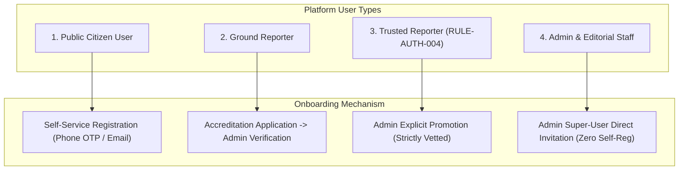

### 4.1 Public Citizen User Lifecycle
- **Registration**: Self-service registration via Indian mobile number (+91) with mandatory SMS OTP verification, or optional email/password.
- **Login**: Password-based or direct phone number OTP login.
- **Account States**: `active` $\rightarrow$ `suspended` (for abusive comments) $\rightarrow$ `deactivated` (user-initiated deletion).
- **Data Minimization**: Public readers are never required to authenticate to read published news articles. Authentication is purely opt-in for bookmarks, reading history, and coin rewards.

### 4.2 Ground Reporter Lifecycle
Field journalists represent the primary operational content creators:
1. **Application Submission**: Applicant registers or upgrades profile, submitting verified legal name, mobile number, government press ID card number, physical press card scan, and requested reporting beat (State/District). State: `applied`.
2. **Administrative Vetting**: Sub-Editor or Bureau Chief reviews credentials, conducts telephonic or in-person verification, and inspects press accreditation.
3. **Approval & Onboarding**: Admin approves application. The system transitions status to `verified`, assigns the `reporter` role, generates a unique human-readable `reporter_code` (e.g. `REP-MP-IND-014`), and binds authorized territory beats (`RULE-GEO-001`).
4. **Operational Activity**: Reporter authors drafts, uploads photos/videos, renders Raw Script to Graphic cards, and submits news to the review queue.
5. **Suspension & Reinstatement**: If a reporter submits plagiarized or unverified news, an Admin can suspend the account (`suspended`), instantly revoking draft submission capabilities. Reinstatement requires explicit administrative action and audit logging.

### 4.3 Trusted Reporter Lifecycle
In strict accordance with `RULE-AUTH-004`:
- **Special Status**: Trusted Reporter status is **never** granted automatically upon registration or account age. It requires an explicit, audited administrative promotion by an authorized Bureau Chief or Super Admin.
- **Direct Publishing Privilege**: When granted, the `can_direct_publish` flag is set to `TRUE`, enabling the reporter to publish breaking dispatches directly to the public website without pre-publication sub-editor review.
- **Revocation Invariant**: Administrators can revoke trusted status at any time with a single click. Upon revocation:
  - The reporter immediately reverts to standard reporter status (all future submissions require sub-editor approval).
  - All previously published articles authored by the reporter **remain live and intact** in the database with original attribution preserved.

### 4.4 Admin & Editorial Staff Lifecycle
- **Zero Public Self-Registration**: Public self-registration can **never** create an Administrator, Sub-Editor, or Bureau Chief account.
- **Direct Invitation / Provisioning**: Admin accounts are created exclusively by an existing Super Admin via an out-of-band cryptographic invitation link sent to an official organizational email.
- **Mandatory MFA**: Administrative accounts enforce mandatory Multi-Factor Authentication (TOTP via Google Authenticator / Authy) prior to dashboard access.
- **Role Scoping**: New administrative users are assigned explicit, least-privilege roles (`sub_editor`, `bureau_chief`, `admin`, `super_admin`).

---

---

## 5. Authentication Methods

To balance security, operational cost, and user friction across diverse Indian demographics, the platform evaluates seven distinct authentication mechanisms:

### 5.1 Comparative Authentication Methods Evaluation

| Authentication Method | Operational Benefits | Potential Security Risks | User Experience (UX) | Public User Suitability | Reporter Suitability | Admin Suitability | Architectural Recommendation |
| :--- | :--- | :--- | :--- | :--- | :--- | :--- | :--- |
| **Phone Number + OTP (SMS)** | - Zero password fatigue.<br>- Universal adoption across mobile users in India (+91).<br>- Inherently verifies mobile identity. | - SMS interception (SIM swapping).<br>- High recurring DLT SMS gateway costs.<br>- Network delivery latency in rural zones. | **Highest for Mobile**: Single-tap auto-fill OTP on mobile browsers and Android. | **Recommended (Primary)** | **Recommended (Verification)** | Optional Secondary | **PROPOSED (Confirmed for Stage A)** |
| **Phone Number + Password** | - Zero recurring SMS costs for regular logins.<br>- Instant login without telecom network latency. | - Weak, reused passwords vulnerable to credential stuffing attacks. | Standard password field with "Show Password" toggle. | **Recommended (Alternative)** | **Recommended (Primary)** | Allowed with MFA | **PROPOSED (Confirmed for Stage A)** |
| **Email + Password** | - Standard for desktop newsroom workstations.<br>- Global compatibility. | - Phishing, credential stuffing, password reuse. | Familiar email login form with password manager autofill. | Optional Secondary | Allowed | **Recommended (Primary Base)** | **PROPOSED (Confirmed for Stage A)** |
| **Email Magic Links** | - Passwordless; immune to brute-force credential stuffing. | - Latency waiting for email; complex on mobile phones without email clients. | Friction on mobile; switches user out of browser/app. | Low | Low | Not Recommended | **DEFERRED** |
| **Social Login (Google / Apple)** | - Rapid 1-tap onboarding.<br>- Leverages trusted identity providers. | - Third-party tracking; vendor lock-in; requires linking phone for legal reporter verification. | Seamless 1-tap Google Sign-In for citizen readers. | **Proposed (Future Phase)** | Not Recommended (Press ID required) | Forbidden (Security policy) | **PROPOSED (Deferred to Phase 8)** |
| **Multi-Factor Auth (TOTP)** | - Eliminates 99.9% of account takeover attacks even if password is leaked. | - Requires smartphone app (Google Authenticator); user friction if device lost. | Requires entering 6-digit rotating code upon login. | Not Recommended (High friction) | Optional | **MANDATORY (Non-Negotiable)** | **CONFIRMED (Mandatory for Admins)** |

### 5.2 Recommended Production Authentication Strategy
- **Public Citizens**: Dual-option: **Phone + OTP** or **Phone/Email + Password**.
- **Ground Reporters**: **Phone/Email + Strong Password**, accompanied by mobile OTP verification during onboarding and sensitive profile edits.
- **Administrators & Editorial Staff**: **Corporate Email + Strong Password + Mandatory TOTP MFA**.

---

## 6. Password and Credential Security

The storage and validation of user credentials adheres to rigorous cryptographic standards:

### 6.1 Password Complexity & Formatting Rules
All password creation and update operations enforce strict complexity policies:
- Minimum length: **10 characters** (increased to **14 characters** for Administrators).
- Must include at least one uppercase letter (`A-Z`), one lowercase letter (`a-z`), one numeric digit (`0-9`), and one special symbol (`!@#$%^&*()_+-=[]{}|;:,.<>?`).
- Passwords matched against the *HaveIBeenPwned* database of 100,000 common breached passwords (e.g. `Password123!`, `Admin@2026`) are rejected with an explicit validation error.

### 6.2 Cryptographic Password Hashing Standard
- **Primary Algorithm**: **Argon2id** (winner of the Password Hashing Competition):
  - Memory cost: $m = 65536\text{ KiB}$ (64 MB)
  - Time cost: $t = 3\text{ iterations}$
  - Parallelism: $p = 4\text{ threads}$
- **Alternative Supported Standard**: **bcrypt** with a minimum work factor (salt rounds) of **12** ($2^{12} = 4096$ iterations).
- **Prohibition**: Plaintext storage, MD5, SHA-1, and un-salted SHA-256 are strictly prohibited across all environments.

### 6.3 Password Reset & Account Recovery Protocol
1. **Request Trigger**: User initiates password reset via `POST /api/v1/auth/password/forgot`.
2. **Generic Safe Response Invariant**: The server emits an identical response regardless of whether the submitted identifier is registered:
   *"यदि आपका नंबर/ईमेल पंजीकृत है, तो पासवर्ड रीसेट कोड भेज दिया गया है (If registered, a reset code has been dispatched)"*. This completely eliminates **User Enumeration Attacks**.
3. **Cryptographic Token Issuance**: The server generates a high-entropy, 64-character hexadecimal token or 6-digit cryptographic OTP, storing its SHA-256 hash in `password_resets` with a strict **15-minute expiration timestamp**.
4. **Single-Use Invalidation**: Upon successful password update, the reset token is immediately consumed, and all existing active sessions across all devices (`auth_sessions`) are terminated, forcing re-authentication.

### 6.4 Brute-Force Protection & Account Lockout
- **Rate-Limiting**: Enforced via Redis sliding windows on `POST /api/v1/auth/login`:
  - 5 consecutive failed attempts per IP or phone number triggers an automatic **15-minute temporary lockout**.
  - Subsequent failed attempts trigger progressive exponential delays (30 minutes, 1 hour).
- **Security Alerts**: Accounts experiencing repeated failed login attempts generate automated push and SMS security warning notifications.

---

## 7. Session and Token Management

The platform utilizes a **Dual-Token Ephemeral Session Architecture** that balances stateless API horizontal scalability with immediate server-side session revocation capabilities.

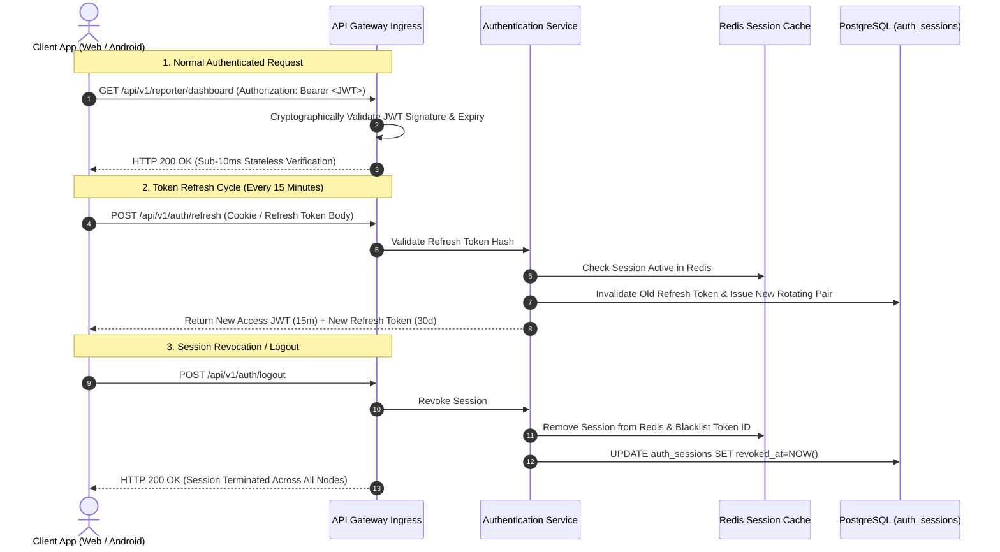

### 7.1 Web Browser Session Architecture
- **Access Token (JWT)**:
  - Lifespan: **15 minutes**.
  - Held strictly in **JavaScript runtime application memory** (React state / AuthContext). Never stored in browser `localStorage` or `sessionStorage` (which are vulnerable to XSS exfiltration).
  - Delivered in standard request header: `Authorization: Bearer <token>`.
- **Refresh Token**:
  - Lifespan: **30 days** (with sliding renewal upon use).
  - Delivered to the browser inside an **`HttpOnly; Secure; SameSite=Strict` Cookie**:
    ```http
    Set-Cookie: refreshToken=rft_98765abcdef; Path=/api/v1/auth/refresh; HttpOnly; Secure; SameSite=Strict; Max-Age=2592000
    ```
  - Because JavaScript cannot access `HttpOnly` cookies, malicious XSS scripts cannot exfiltrate the persistent credential.
  - CSRF attacks are prevented via `SameSite=Strict` and custom headers (`X-Requested-With: XMLHttpRequest`).
- **Administrative Idle Timeout**: Administrative sessions (`admin`, `bureau_chief`, `sub_editor`) enforce a **30-minute idle session timeout**, automatically prompting for re-authentication if no user activity occurs.

### 7.2 Native Android Session Architecture
- **Native Android Keystore Integration**:
  - The Android app receives the refresh token in the JSON response body upon login.
  - The refresh token is encrypted at rest using the **Android Keystore System** via `EncryptedSharedPreferences` (AES-256-GCM encryption with hardware-backed key generation).
  - Plaintext tokens are **never** stored in standard SQLite files, plain SharedPreferences, or external SD card storage.
- **Silent Background Refresh via OkHttp Authenticator**:
  - The Android application implements an OkHttp `Authenticator`.
  - When the access token expires (HTTP 401 Unauthorized), the Authenticator intercepts the response, executes a synchronous call to `POST /api/v1/auth/refresh`, updates the memory cache and encrypted keystore, and replays the original request seamlessly.
- **Device Loss & Remote Wipe**: Citizens and reporters can view all active logged-in devices via their profile and click **"सभी डिवाइस से लॉग आउट करें" (Log Out All Devices)**. The server instantly revokes all matching records in `auth_sessions` and clears the Redis session cache.

---

---

## 8. Role-Based Access Control (RBAC)

The BREAKING NEWS WALA authorization system is founded on strict **Role-Based Access Control (RBAC)**. A user identity is assigned one or more organizational roles; each role encapsulates an explicit collection of granular permission codes.

```mermaid
flowchart TD
    subgraph USERS["Authenticated Users"]
        U1["User: Rajesh Sharma (Reporter)"]
        U2["User: Amit Verma (Bureau Chief)"]
        U3["User: Priya Patel (Citizen Reader)"]
    end

    subgraph ROLES["System Roles (roles)"]
        R_PUB["public_user"]
        R_REP["reporter"]
        R_TRUST["trusted_reporter (Flag/Role)"]
        R_SUB["sub_editor"]
        R_BUR["bureau_chief"]
        R_ADM["admin"]
        R_SADM["super_admin"]
    end

    subgraph PERMISSIONS["Granular Permissions (permissions)"]
        P_READ["news:read_published"]
        P_DRAFT["news:create_draft"]
        P_SUBMIT["news:submit_review"]
        P_PUB["news:publish_direct"]
        P_REV["editorial:review_queue"]
        P_APP["editorial:approve"]
        P_REJ["editorial:reject"]
        P_TERR["territory:allocate"]
        P_RSS["rss:manage"]
        P_URL["url:scrape_manage"]
        P_GFX_RAW["studio:raw_script"]
        P_GFX_URL["studio:url_scrape"]
        P_AUD["audit:read"]
        P_KILL["system:kill_switch"]
    end

    U1 --> R_REP
    U2 --> R_BUR
    U3 --> R_PUB

    R_REP --> P_READ
    R_REP --> P_DRAFT
    R_REP --> P_SUBMIT
    R_REP --> P_GFX_RAW

    R_BUR --> P_READ
    R_BUR --> P_REV
    R_BUR --> P_APP
    R_BUR --> P_PUB
    R_BUR --> P_REJ
    R_BUR --> P_TERR

    R_ADM --> P_RSS
    R_ADM --> P_URL
    R_ADM --> P_GFX_URL
    R_ADM --> P_AUD

    R_SADM --> P_KILL
```

### 8.1 Core Role Definitions & Hierarchical Scope
1. **Public User (`public_user`)**: Default role assigned to every registered citizen. Grants access to personal profile, bookmarking, reading history, and coin rewards. Zero editorial or drafting capabilities.
2. **Reporter (`reporter`)**: Accredited field journalist. Authorized to create drafts, upload field photos/videos, record voice-to-text notes, access the Reporter Graphics Studio (Raw Script only), and submit articles for editorial review within their assigned geographic beats (`RULE-GEO-001`).
3. **Trusted Reporter (`trusted_reporter`)**: An elevated status granted to select veteran reporters (`RULE-AUTH-004`). Possesses all reporter capabilities plus the explicit privilege of **Direct Publishing (`news:direct_publish`)** within authorized beats without pre-publication review.
4. **Sub-Editor (`sub_editor`)**: Desk editorial staff. Authorized to review incoming queue submissions, claim articles, edit text for factual/grammatical correctness, request revisions, and approve or reject submissions.
5. **Bureau Chief (`bureau_chief`)**: Senior regional newsroom leader. Authorized to publish approved articles, manage district beat allocations for reporters in their division, manage live breaking alerts, and retract published articles.
6. **Administrator (`admin`)**: Enterprise platform manager. Authorized to manage RSS sources, URL-to-News scrapers, Graphic Templates, Video Studio master assets, API Pool configurations, advertisements, and reporter accreditations.
7. **Super Admin (`super_admin`)**: Ultimate technical authority. Authorized to modify system roles, assign administrative permissions, execute emergency kill switches, manage KMS vault configurations, and view raw security audit logs.

---

## 9. Permission Matrix

The following authoritative matrix defines platform capabilities mapped across all roles in accordance with [`docs/06-Business-Rules.md`](file:///c:/Users/pp/Downloads/BREAKING-NEWS-WALA-main/docs/06-Business-Rules.md):

| Operational Capability | Public User | Ground Reporter | Trusted Reporter | Sub-Editor | Bureau Chief | System Admin | Super Admin | Authoritative Source Rule |
| :--- | :--- | :--- | :--- | :--- | :--- | :--- | :--- | :--- |
| **Read Published News** | **Yes** | **Yes** | **Yes** | **Yes** | **Yes** | **Yes** | **Yes** | Baseline Public Access |
| **Bookmark & Save News** | **Yes** | **Yes** | **Yes** | **Yes** | **Yes** | **Yes** | **Yes** | User Engagement |
| **Create News Draft** | No | **Yes** (Assigned Beat) | **Yes** (Assigned Beat) | **Yes** | **Yes** | **Yes** | **Yes** | `RULE-GEO-001` |
| **Submit for Review** | No | **Yes** | **Yes** | **Yes** | **Yes** | **Yes** | **Yes** | `RULE-NEWS-001` |
| **Direct Publish (No Review)**| No | **No** (Strict) | **Yes** (`RULE-AUTH-004`)| No (Sub-Editor approves) | **Yes** | **Yes** | **Yes** | `RULE-AUTH-004` |
| **Claim Review Lock** | No | No | No | **Yes** | **Yes** | **Yes** | **Yes** | `WF-04` Review Queue |
| **Approve News Draft** | No | No | No | **Yes** | **Yes** | **Yes** | **Yes** | `RULE-NEWS-001` |
| **Reject News Submission** | No | No | No | **Yes** | **Yes** | **Yes** | **Yes** | `WF-04` Rejection Reason |
| **Request Revisions** | No | No | No | **Yes** | **Yes** | **Yes** | **Yes** | `WF-05` Editorial Feedback |
| **Retract Published News** | No | No | No | No | **Yes** | **Yes** | **Yes** | Emergency Archival |
| **Manage RSS Sources** | No | **No** (Strict) | **No** (Strict) | No | No | **Yes** | **Yes** | `RULE-RSS-001` (Admin Only) |
| **URL-to-News Scraper** | No | **No** (Strict) | **No** (Strict) | No | No | **Yes** | **Yes** | `RULE-RSS-001` (Admin Only) |
| **URL-to-Graphic Scraper** | No | **No** (Strict) | **No** (Strict) | No | No | **Yes** | **Yes** | `RULE-GFX-001` (Admin Only) |
| **Raw Script to Graphic** | No | **Yes** (Assigned only) | **Yes** (Assigned only) | **Yes** | **Yes** | **Yes** | **Yes** | `RULE-GFX-001` |
| **Create Graphic Templates**| No | **No** | **No** | No | No | **Yes** | **Yes** | Design Governance |
| **Allocate Reporter Beats** | No | **No** | **No** | No | **Yes** (Division) | **Yes** (All) | **Yes** (All) | `RULE-GEO-001` |
| **Grant Trusted Status** | No | **No** | **No** | No | **Yes** | **Yes** | **Yes** | `RULE-AUTH-004` |
| **Manage API Model Pool** | No | **No** | **No** | No | No | **Yes** | **Yes** | `docs/19-API-Pool.md` |
| **View Audit Logs** | No | No | No | No | Limited | **Yes** | **Yes** (Full) | `RULE-AUD-001` |
| **Trigger Kill Switch** | No | No | No | No | No | No | **Yes** (Strict) | Emergency Protocol |

---

## 10. Reporter Territory Authorization

The platform strictly enforces geographic territory governance in compliance with `RULE-GEO-001`:

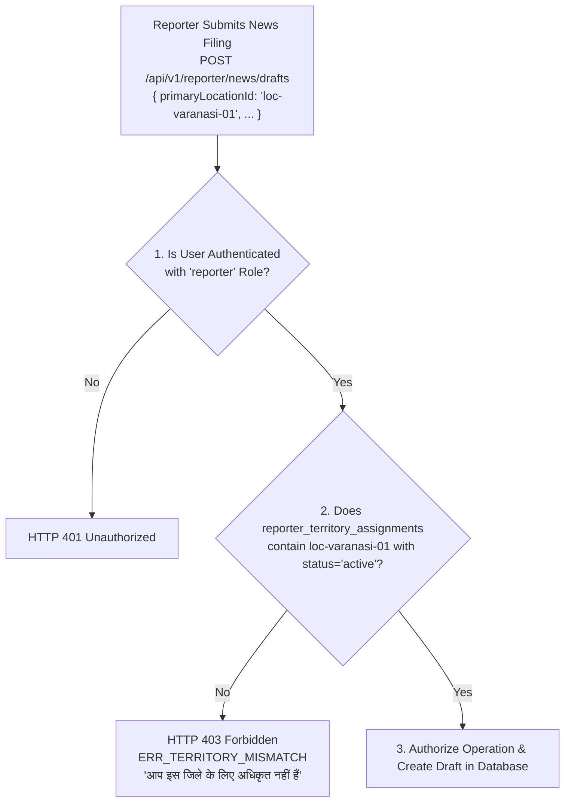

### 10.1 Territory Enforcement Principles
1. **Server-Side Validation Mandate**: Selecting a location in a frontend dropdown does **not** constitute authorization. The backend API explicitly queries `reporter_territory_assignments` for every news creation (`POST /news/drafts`), update, and submission request.
2. **Beat Boundary Scope**: A reporter can only file news for districts or cities where they hold an `active` assignment. Emergency beat assignments require an Administrator to allocate a temporary beat record (`valid_until` timestamp).
3. **Territory Modification Invariant**: When an Administrator revokes or modifies a reporter's territory assignment:
   - The reporter is immediately blocked from filing new stories for that beat.
   - All previously submitted or published articles authored by that reporter in that beat **remain permanently intact** with historical geographical attribution preserved.
   - The revocation event is recorded in `audit_logs` with the Administrator's ID and justification.

---

## 11. Trusted Reporter Authorization

The distinction between standard reporter accreditation and trusted reporter publishing privileges is an authoritative security boundary:

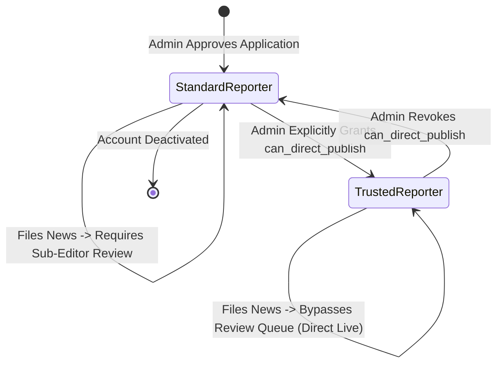

### 11.1 Architectural Separation of Privileges
1. **Reporter Accreditation**: Verifies journalistic credentials; grants access to drafting, media uploads, and submission to the review queue (`status = 'pending'`).
2. **Trusted Status (`is_trusted_reporter = TRUE`)**: Formal recognition of veteran accuracy; displays a verified trust badge on editorial dashboards.
3. **Direct Publishing Privilege (`can_direct_publish = TRUE`)**:
   - Explicitly granted by a Bureau Chief or Super Admin (`RULE-AUTH-004`).
   - Enables invocation of `POST /api/v1/reporter/news/:id/direct-publish`.
   - The backend validates that: (1) `user.can_direct_publish == TRUE`, (2) `article.primaryLocationId` matches assigned beat, and (3) article satisfies all mandatory schema fields.
   - Upon execution, the article transitions directly to `published` without entering the sub-editor queue.
   - **Revocation Protection**: Revoking direct publishing instantly strips the privilege. Previously published articles remain live.

---

## 12. Route and Resource Authorization

The authorization engine evaluates four distinct defensive layers for every incoming API request:

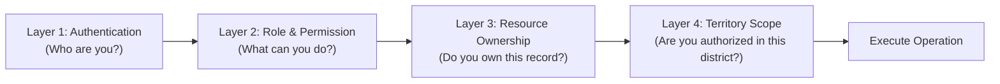

### 12.1 Concrete Authorization Violation Examples

| Request Attempt | Layer Failure | HTTP Status | Error Code | System Response & UI Feedback |
| :--- | :--- | :--- | :--- | :--- |
| **Anonymous user attempts to draft news** | Layer 1: Authentication | `401 Unauthorized` | `ERR_UNAUTHORIZED` | Redirect to login screen; prompt user to authenticate. |
| **Citizen attempts to access review queue** | Layer 2: Role Permission | `403 Forbidden` | `ERR_FORBIDDEN_ROLE` | Display access denied screen (*"इस कार्य के लिए अनुमति नहीं है"*). |
| **Reporter A attempts to edit Reporter B's draft** | Layer 3: Resource Ownership | `403 Forbidden` | `ERR_OWNERSHIP_MISMATCH`| Access blocked. Prevents IDOR attack; emits security warning log. |
| **Varanasi reporter attempts to file news for Bhopal** | Layer 4: Territory Scope | `403 Forbidden` | `ERR_TERRITORY_MISMATCH`| Form submission blocked. Displays: *"आप केवल वाराणसी के लिए समाचार दर्ज कर सकते हैं"*. |
| **Reporter attempts to scrape URL to news** | Layer 2: Role Permission | `403 Forbidden` | `ERR_FORBIDDEN_ROLE` | Admin-only URL scraper blocked (`RULE-RSS-001`). |

---

---

## 13. Admin Security and Privileged Access

Administrative accounts possess destructive capabilities (e.g. retracting published news, modifying reporter accreditations, managing API credentials, activating kill switches). Consequently, administrative security enforces stringent hardening:

### 13.1 Privileged Access Hardening Measures
1. **Mandatory Multi-Factor Authentication (MFA)**:
   - TOTP (Time-Based One-Time Password via RFC 6238) is **mandatory** for `admin`, `bureau_chief`, and `super_admin` accounts.
   - Login requires: Email/Password + 6-digit TOTP code. Zero password-only bypasses permitted.
2. **Short Session Inactivity Timeouts**:
   - Administrative web sessions enforce a strict **30-minute idle inactivity timeout**.
   - If no mouse/keyboard interaction is detected for 30 minutes, the session is locked, requiring password re-entry to resume work.
3. **Suspicious Login & Geolocation Anomaly Detection**:
   - The IAM service logs the IP address, ASN, and geographic city of every administrative authentication attempt.
   - If an administrator logs in from an unrecognized IP or impossible travel velocity (e.g., Delhi and London within 1 hour), the session is blocked, requiring out-of-band email re-verification.
4. **Separation of Admin and Super Admin Duties**:
   - *Admins* manage day-to-day newsroom operations (review queues, RSS feeds, reporter territories).
   - *Super Admins* manage system roles, vault secrets, and emergency kill switches. An ordinary Admin cannot elevate their own permissions or grant themselves Super Admin privileges.
5. **Comprehensive Forensic Audit Trail**:
   - All privileged state mutations generate immutable records in `audit_logs` capturing: Actor User ID, Action Type, Target Entity, Before/After JSON Payloads, Client IP, and UTC Timestamp (`RULE-AUD-001`).

---

## 14. Account and Session Lifecycle Diagrams

The platform's identity workflows are visually mapped across **ten comprehensive Mermaid lifecycle diagrams**:

### 14.1 Diagram 1: Public User Registration & Verification
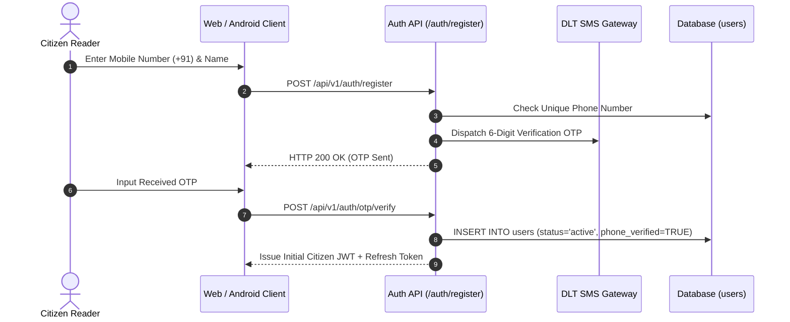

### 14.2 Diagram 2: Reporter Application and Approval
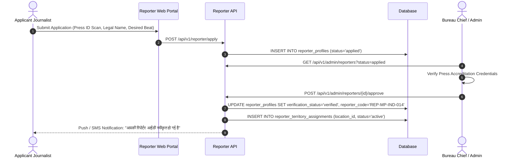

### 14.3 Diagram 3: Admin Account Invitation & Activation
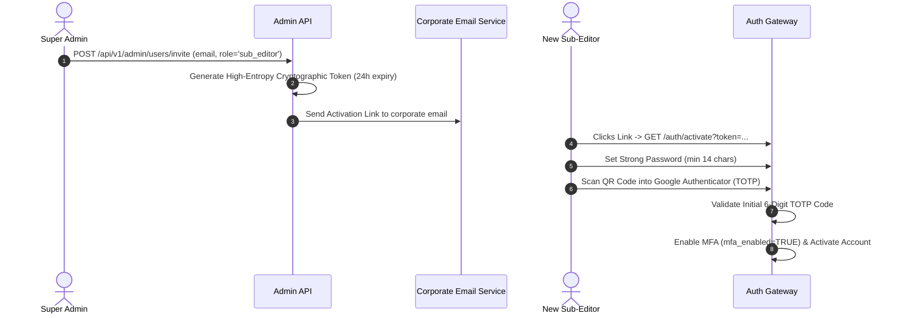

### 14.4 Diagram 4: Login and Session Creation
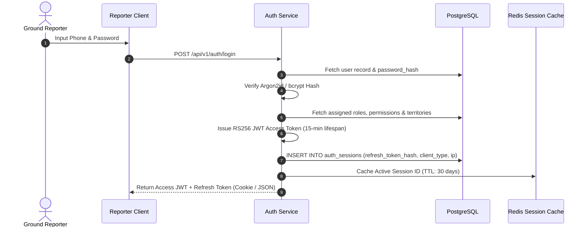

### 14.5 Diagram 5: Password Reset Flow
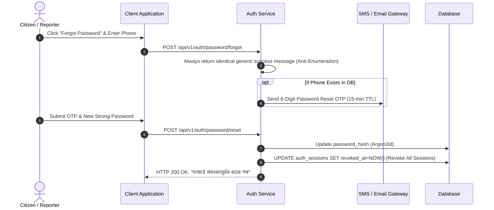

### 14.6 Diagram 6: Session Renewal and Expiration
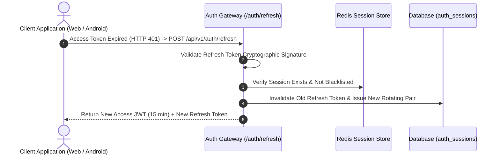

### 14.7 Diagram 7: Logout and Session Revocation
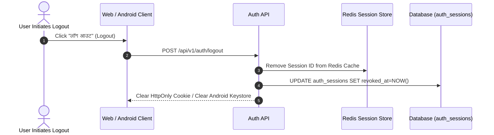

### 14.8 Diagram 8: Reporter Suspension Flow
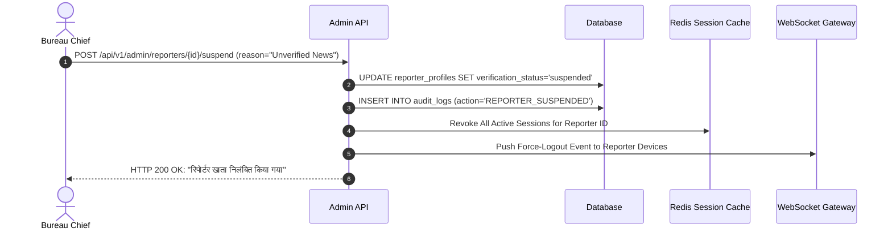

### 14.9 Diagram 9: Trusted Reporter Permission Grant & Revocation
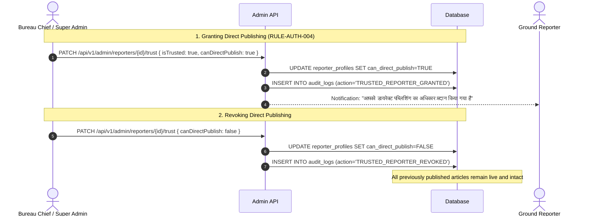

### 14.10 Diagram 10: Admin Role or Permission Change
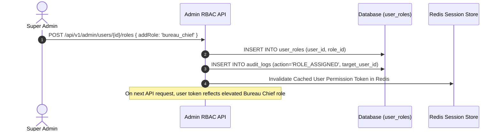

---

## 15. Security and Abuse Protection

The authentication engine implements comprehensive defenses against modern credential attacks:

| Attack Vector | Defensive Countermeasure & Architectural Implementation |
| :--- | :--- |
| **Credential Stuffing & Brute Force** | Redis sliding-window rate limiting locks accounts for 15 minutes after 5 consecutive failures. IP-level throttling blocks distributed botnets. |
| **User Enumeration Attacks** | Registration, login, and password reset endpoints return identical generic error messages (*"अमान्य क्रेडेंशियल"*), preventing attackers from mapping valid phone numbers. |
| **Cross-Site Scripting (XSS) Token Theft** | Web refresh tokens are transported exclusively via **`HttpOnly; Secure; SameSite=Strict` Cookies**, making them completely inaccessible to malicious JavaScript injection. |
| **Cross-Site Request Forgery (CSRF)** | Mitigated via `SameSite=Strict` cookie enforcement paired with mandatory custom HTTP request headers (`X-Requested-With: XMLHttpRequest`). |
| **Session Hijacking & Token Replay** | Refresh token rotation ensures that every refresh token can be used **exactly once**. If an old token is re-submitted, the server detects token reuse and immediately terminates all active sessions for that user. |
| **Privilege Escalation** | All role assignments and permission evaluations execute strictly on the server. Client-provided role headers or body properties are discarded during schema validation. |
| **OTP SMS Gateway Flooding** | Phone number OTP requests are strictly throttled to a maximum of **3 OTPs per 10 minutes** per phone number and 10 OTPs per IP per hour. |

---

---

## 16. Cross-Platform Authentication

The identity architecture maintains complete structural parity across Web and Native Android runtimes while adapting its storage mechanism to the physical platform:

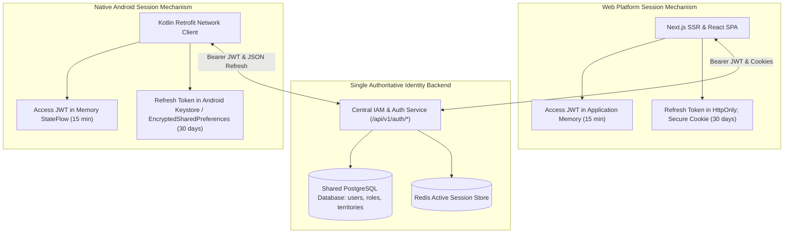

### 16.1 Cross-Platform Invariants
1. **Zero Secondary Identity Silo**: The Android application authenticates against the identical `/api/v1/auth/login` endpoint. Strictly zero separate mobile database or parallel user repository.
2. **Synchronized Permission Revocation**: If an Administrator revokes a reporter's territory or suspends their account, the revocation applies instantaneously across all open web tabs and mobile Android devices via Redis session eviction.
3. **Zero WebView Dependency**: Native Android authentication flows are rendered 100% in native Jetpack Compose components consuming REST JSON endpoints.

---

## 17. API Integration

This specification directly operationalizes the authentication endpoints defined in [`docs/13-API.md`](file:///c:/Users/pp/Downloads/BREAKING-NEWS-WALA-main/docs/13-API.md):

| API Endpoint ID | HTTP Method & Route | Request Auth | Functional Identity Role |
| :--- | :--- | :--- | :--- |
| `AUTH-01` | `POST /api/v1/auth/register` | None (Public) | Citizen reader or reporter initial registration. |
| `AUTH-02` | `POST /api/v1/auth/login` | None (Public) | Primary credential authentication; emits JWT and refresh token. |
| `AUTH-03` | `POST /api/v1/auth/refresh` | Public | Rotates single-use refresh token; emits new JWT access token. |
| `AUTH-04` | `POST /api/v1/auth/logout` | Authenticated | Revokes current session in `auth_sessions` and Redis. |
| `AUTH-05` | `POST /api/v1/auth/logout-all` | Authenticated | Revokes all active sessions across all devices for current user. |
| `AUTH-08` | `GET /api/v1/auth/me` | Authenticated | Retrieves active user profile, assigned roles, permissions, and beats. |
| `AUTH-10` | `POST /api/v1/auth/devices` | Authenticated | Registers client push token (Web Push VAPID / Android FCM). |
| `AUTH-11` | `GET /api/v1/auth/sessions` | Authenticated | Lists all active device sessions for account monitoring. |

---

## 18. Database Integration

This identity specification maps directly to the operational relational tables modeled in [`docs/12-Database.md`](file:///c:/Users/pp/Downloads/BREAKING-NEWS-WALA-main/docs/12-Database.md):

| Database Table | Schema Domain | Exact Architectural Identity Responsibility |
| :--- | :--- | :--- |
| `users` | Domain A | Root identity entity (phone number, email, Argon2id password hash, status). |
| `user_profiles` | Domain A | Personal demographic profile (Devanagari full name, bio, avatar reference). |
| `roles` & `permissions` | Domain A | Machine role codes (`reporter`, `admin`) and granular permissions (`news:publish`). |
| `user_roles` | Domain A | M:N assignment mapping users to one or more roles. |
| `role_permissions` | Domain A | M:N definition mapping roles to explicit capability codes. |
| `auth_sessions` | Domain A | Active session registry tracking issued refresh token hashes, client types, and IPs. |
| `device_registrations` | Domain A | Client hardware push tokens (Android FCM and Web Push VAPID subscriptions). |
| `reporter_profiles` | Domain B | Journalistic accreditation, press ID card scans, and trust scores. |
| `reporter_territory_assignments` | Domain B | Administrative beat allocations enforcing `RULE-GEO-001`. |
| `audit_logs` | Domain P | Immutable forensic log of all administrative permission grants and suspensions (`RULE-AUD-001`). |

---

## 19. Summary of Lifecycle Diagrams Included

Section 14 of this specification incorporates ten authoritative Mermaid lifecycle diagrams:
1. **Diagram 1**: Public User Registration & Verification
2. **Diagram 2**: Reporter Application & Approval Flow
3. **Diagram 3**: Admin Account Invitation & Activation Flow
4. **Diagram 4**: Login & Session Creation Flow
5. **Diagram 5**: Password Reset & Account Recovery Flow
6. **Diagram 6**: Session Renewal & Expiration Flow
7. **Diagram 7**: Logout & Session Revocation Flow
8. **Diagram 8**: Reporter Suspension Flow
9. **Diagram 9**: Trusted Reporter Permission Grant & Revocation Flow
10. **Diagram 10**: Admin Role or Permission Change Flow

---

## 20. Authentication Decision Register (ADR)

The Authentication Decisions Register formalizes the evaluation of identity architecture choices:

| Decision ID | Identity Topic | Evaluated Alternatives | Recommended Option | Architectural Rationale | Status | Approval Required |
| :--- | :--- | :--- | :--- | :--- | :--- | :--- |
| **AUT-ADR-01** | **Primary Authentication** | 1. Phone + OTP<br>2. Phone + Password<br>3. Email + Password | **Dual-Track: Phone + OTP (Public) / Phone/Email + Password (Reporters & Admins)** | Matches Indian citizen smartphone habits while providing reliable desktop newsroom workflows. | **Proposed** | Product Lead / CTO |
| **AUT-ADR-02** | **Session Architecture** | 1. Server-side State Sessions<br>2. Pure Stateless JWT<br>3. Dual-Token Ephemeral JWT | **Dual-Token Ephemeral JWT (15m Access + 30d Rotating Refresh)** | Provides sub-10ms stateless API verification while preserving immediate server-side revocation in Redis. | **Confirmed** | Lead Architect |
| **AUT-ADR-03** | **Web Token Storage** | 1. Browser LocalStorage<br>2. In-Memory JWT + HttpOnly Cookie Refresh | **In-Memory JWT + HttpOnly Cookie Refresh** | Completely eliminates persistent XSS token exfiltration in browser runtimes. | **Confirmed** | Security Architect |
| **AUT-ADR-04** | **Android Token Storage** | 1. Plain SharedPreferences<br>2. Android Keystore / EncryptedSharedPreferences | **Android Keystore / EncryptedSharedPreferences** | Enforces hardware-backed AES-256 encryption at rest on mobile hardware. | **Confirmed** | Android Lead / CTO |
| **AUT-ADR-05** | **Password Hashing** | 1. SHA-256<br>2. bcrypt (12 rounds)<br>3. Argon2id (64MB) | **Argon2id (Primary) / bcrypt (Alternative)** | State-of-the-art memory-hard protection against GPU/ASIC password cracking. | **Confirmed** | Security Architect |
| **AUT-ADR-06** | **Administrative MFA** | 1. Optional SMS OTP<br>2. Mandatory TOTP (RFC 6238)<br>3. FIDO2 / WebAuthn | **Mandatory TOTP (Google Authenticator / Authy)** | Eliminates 99.9% of administrative account takeovers; zero SMS telecom gateway dependencies. | **Confirmed** | Security Architect |
| **AUT-ADR-07** | **Territory Authorization** | 1. Client-selected location<br>2. Server-side beat validation table | **Server-Side Territory Validation (`RULE-GEO-001`)** | Enforces journalistic beat integrity; frontend dropdown selections treated as untrusted. | **Confirmed** | Lead Architect |
| **AUT-ADR-08** | **Trusted Reporter Scope** | 1. Global direct publish<br>2. Assigned beat direct publish | **Assigned Beat Direct Publish (`RULE-AUTH-004`)** | Trusted reporters can only direct-publish within explicitly allocated territory beats. | **Confirmed** | Bureau Chief / CTO |
| **AUT-ADR-09** | **User Enumeration Defense**| 1. Explicit error messages<br>2. Generic uniform error responses | **Generic Uniform Error Responses** | Prevents malicious attackers from harvesting registered citizen phone numbers. | **Confirmed** | Security Architect |
| **AUT-ADR-10** | **Login Lockout Policy** | 1. No lockout<br>2. 5 failures $\rightarrow$ 15-minute temporary lockout | **5 Failures $\rightarrow$ 15-Minute Temporary Lockout** | Effectively stops automated dictionary and brute-force attacks via Redis sliding windows. | **Confirmed** | Security Architect |

---

## 21. Traceability and Consistency

This specification maps directly to verified business rules and technical specifications across predecessor documentation:

| Requirement / Rule Code | Source Document | Architectural Implementation in `docs/14-Auth.md` |
| :--- | :--- | :--- |
| `RULE-GEO-001` | [`docs/06-Business-Rules.md`](file:///c:/Users/pp/Downloads/BREAKING-NEWS-WALA-main/docs/06-Business-Rules.md) (Section 4) | Section 10: Server-side territory validation; Section 12: Layer 4 territory enforcement. |
| `RULE-AUTH-004` | [`docs/06-Business-Rules.md`](file:///c:/Users/pp/Downloads/BREAKING-NEWS-WALA-main/docs/06-Business-Rules.md) (Section 3) | Section 4.3, Section 11: Trusted Reporter lifecycle, granting, scope, and revocation. |
| `RULE-NEWS-001` | [`docs/06-Business-Rules.md`](file:///c:/Users/pp/Downloads/BREAKING-NEWS-WALA-main/docs/06-Business-Rules.md) (Section 3) | Section 8, Section 9: Mandatory editorial review queue for all standard reporter filings. |
| `RULE-GFX-001` | [`docs/06-Business-Rules.md`](file:///c:/Users/pp/Downloads/BREAKING-NEWS-WALA-main/docs/06-Business-Rules.md) (Section 8) | Section 9: Reporter Graphics restricted strictly to Raw Script to Graphic with assigned templates. |
| `RULE-AUD-001` | [`docs/06-Business-Rules.md`](file:///c:/Users/pp/Downloads/BREAKING-NEWS-WALA-main/docs/06-Business-Rules.md) (Section 12) | Section 3 (`AUT-10`), Section 13.1: Immutable audit logging of all privileged operations. |
| `RULE-XPLAT-003` | [`docs/06-Business-Rules.md`](file:///c:/Users/pp/Downloads/BREAKING-NEWS-WALA-main/docs/06-Business-Rules.md) (Section 13) | Section 7.2, Section 16: Native Android Keystore integration; zero WebView dependencies. |
| `NFR-SEC-01` | [`docs/04-NFR.md`](file:///c:/Users/pp/Downloads/BREAKING-NEWS-WALA-main/docs/04-NFR.md) (Section 5) | Section 6.2: Argon2id cryptographic password hashing standard. |
| `WF-01` to `WF-05` | [`docs/05-Workflows.md`](file:///c:/Users/pp/Downloads/BREAKING-NEWS-WALA-main/docs/05-Workflows.md) | Section 14: Lifecycle diagrams mapping registration, onboarding, submission, and review. |

---

## 22. Open Questions and Technical Risks

The following identity and authorization questions are cataloged for resolution during Phase 3 detailed engineering:

| Question ID | Architectural Domain | Context & Trade-Offs | Current Baseline Stance | Resolution Milestone |
| :--- | :--- | :--- | :--- | :--- |
| **OQ-AUT-01** | **Social Login for Citizen Readers** | Should Google 1-Tap Sign-In be enabled for public citizen readers during Stage A launch? | **Proposed**: Defer social login to Phase 8. Rely primarily on Phone OTP and Phone/Password for Stage A to ensure 100% verified Indian mobile identities. | Phase 8 Citizen Polish |
| **OQ-AUT-02** | **Reporter Session Inactivity Timeout** | Should field reporters experience session timeouts in the field if working in low-connectivity areas? | **Proposed**: Reporters maintain persistent 30-day refresh sessions on mobile devices to prevent losing unsubmitted drafts in the field. Admin sessions strictly enforce 30-minute idle timeouts. | Phase 2 Backend Setup |
| **OQ-AUT-03** | **Biometric Authentication on Android** | Should the native Android app support biometric authentication (fingerprint/face unlock via `BiometricPrompt`) to unlock reporter drafting tools? | **Proposed**: Integrate Android `BiometricPrompt` in Phase 13 (Native Android App) to unlock local cached credentials securely. | Phase 13 Native Android |

---

## 23. Glossary

| Term | Technical Definition & Platform Context |
| :--- | :--- |
| **Argon2id** | A modern, memory-hard cryptographic password hashing algorithm designed to resist GPU-accelerated cracking attacks. |
| **EncryptedSharedPreferences** | Android Jetpack Security component providing hardware-backed AES-256 encryption for mobile key-value storage. |
| **IDOR** | Insecure Direct Object Reference. A vulnerability where an attacker accesses unauthorized records by altering ID parameters. |
| **JWT** | JSON Web Token (RFC 7519). A compact, URL-safe cryptographic token used to transmit verifiable claims between client and server. |
| **Keyset Pagination** | High-performance cursor pagination querying by indexed record values (`WHERE id < cursor`). |
| **MFA** | Multi-Factor Authentication. Requiring two or more verification factors (Password + TOTP code) before granting access. |
| **RBAC** | Role-Based Access Control. Restricting system access based on assigned organizational roles. |
| **Rotating Refresh Token** | A single-use persistent credential that automatically generates a new token upon each exchange, detecting token theft. |
| **SSRF** | Server-Side Request Forgery. An exploit where an attacker forces a backend server to request internal network resources. |
| **TOTP** | Time-Based One-Time Password (RFC 6238). An algorithmic 6-digit code rotating every 30 seconds (Google Authenticator). |
| **User Enumeration** | An exploit where an attacker discovers valid registered accounts by analyzing differences in server error responses. |