# Master Media Storage & Asset Management Architecture Specification
## Project: BREAKING NEWS WALA (ब्रेकिंग न्यूज़ वाला)
### Document ID: DOC-16-STR-2026-V1.0
### Confidentiality: Internal Architecture, Infrastructure & Engineering Specification

---

## 1. Document Information

| Attribute | Specification |
| :--- | :--- |
| **Document Title** | Media Storage, Asset Management & Content Delivery Network Architecture |
| **Document Filename** | `docs/16-Storage.md` |
| **Document Version** | Version 1.0 (Enterprise Comprehensive Architecture) |
| **System Classification** | Core Infrastructure, Media Pipelines & Cloud Storage Governance |
| **Primary Authors** | Principal Cloud Storage Architect, Media Pipeline Engineer, CDN Specialist, Mobile Systems Architect |
| **Target Stakeholders** | Backend Engineers, Newsroom Editors, Video Production Specialists, Android Engineers, DevOps/SRE |
| **Status** | Implementation-Ready Architecture Specification (Decisions Pending Formal Cloud Sign-off) |
| **Upstream Dependencies** | [`docs/01-PRD.md`](file:///c:/Users/pp/Downloads/BREAKING-NEWS-WALA-main/docs/01-PRD.md), [`docs/02-Features.md`](file:///c:/Users/pp/Downloads/BREAKING-NEWS-WALA-main/docs/02-Features.md), [`docs/03-Plan.md`](file:///c:/Users/pp/Downloads/BREAKING-NEWS-WALA-main/docs/03-Plan.md), [`docs/04-NFR.md`](file:///c:/Users/pp/Downloads/BREAKING-NEWS-WALA-main/docs/04-NFR.md), [`docs/05-Workflows.md`](file:///c:/Users/pp/Downloads/BREAKING-NEWS-WALA-main/docs/05-Workflows.md), [`docs/06-Business-Rules.md`](file:///c:/Users/pp/Downloads/BREAKING-NEWS-WALA-main/docs/06-Business-Rules.md), [`docs/11-Architecture.md`](file:///c:/Users/pp/Downloads/BREAKING-NEWS-WALA-main/docs/11-Architecture.md), [`docs/12-Database.md`](file:///c:/Users/pp/Downloads/BREAKING-NEWS-WALA-main/docs/12-Database.md), [`docs/13-API.md`](file:///c:/Users/pp/Downloads/BREAKING-NEWS-WALA-main/docs/13-API.md), [`docs/14-Auth.md`](file:///c:/Users/pp/Downloads/BREAKING-NEWS-WALA-main/docs/14-Auth.md), [`docs/15-Security.md`](file:///c:/Users/pp/Downloads/BREAKING-NEWS-WALA-main/docs/15-Security.md) |
| **Downstream Consumers** | Media Processing Workers (Sharp/FFmpeg), Cloud Storage Provisioning, Android Camera/Upload SDK |
| **Last Updated** | October 2026 |

---

## 2. Scope and Purpose

### 2.1 Mission Statement
The **BREAKING NEWS WALA (ब्रेकिंग न्यूज़ वाला)** media ecosystem processes, transforms, protects, and delivers high-volume visual and audio news content across Uttar Pradesh, Madhya Pradesh, Bihar, Rajasthan, and nationwide Hindi-speaking digital readers. Ground reporters continuously transmit field imagery and short-form video reels from low-bandwidth mobile connections ($2\text{G}/3\text{G}/4\text{G}$), while centralized editorial desks generate high-impact graphic cards and automated video bulletins. The media storage architecture must deliver ultra-low latency playback, guaranteed data integrity, bulletproof security against malicious file injection, and strict cryptographic access control.

### 2.2 Client Ingress & Delivery Boundaries
The storage system provides an omni-channel media plane supporting five distinct platform surfaces:
1. **Public News Web Portal**: Read-only, ultra-fast delivery of optimized responsive imagery, breaking banners, video reels, and PDF e-papers cached across edge CDN nodes.
2. **Reporter Web Application**: Authenticated, role-restricted transactional ingress for field journalists uploading raw camera photos, press ID credentials, audio notes, and script-based graphic assets.
3. **Admin & Editorial Control Panel**: Privileged ingress and management for newsroom staff handling bulk asset ingestion, template design uploads, video project editing, and asset archival.
4. **Central Newsroom & Wire Aggregator**: Automated ingestion of wire photos, RSS enclosure media, and AI-synthesized visual prompts.
5. **Future Native Android Application (Kotlin SDK)**: Hardware-accelerated camera/gallery upload, background resumable chunked video delivery via Android `WorkManager`, and local disk caching via OkHttp/Coil.

### 2.3 Strict Architectural Non-Goals
- **Documentation-Only Boundary**: This specification establishes architectural standards, pipeline blueprints, and storage policies. It does **not** deploy live cloud buckets, execute file-processing scripts, alter database schemas, or expose production credentials.
- **Provider Agnosticism**: Evaluates cloud storage and CDN vendors objectively. Physical provider choices remain marked as **Proposed / Pending Approval**.

---

## 3. Storage Principles

Every storage workflow across web, mobile, and background workers must adhere to eleven invariant principles:

1. **One Shared Unified Media Plane**: All client platforms (Public Web, Reporter Web, Admin Newsroom, Native Android) interface with a single centralized storage repository and API contract (`/api/v1/media/*`). Disparate or siloed storage buckets for individual clients are strictly prohibited.
2. **Centralized Relational Metadata Management**: The PostgreSQL relational database (`12-Database.md`) acts as the single source of truth for asset ownership, dimensions, MIME signatures, perceptual hashes (Blurhash), and editorial attribution. Binary blobs are never stored directly in database rows.
3. **Backend-Controlled Upload Authorization**: No client may ever upload a file directly to storage without explicit, short-lived, cryptographically signed authorization issued by the backend API (`API-07`).
4. **Strict Server-Side Role-Based Media Governance**: Media access rights follow the authorization boundaries defined in [`docs/14-Auth.md`](file:///c:/Users/pp/Downloads/BREAKING-NEWS-WALA-main/docs/14-Auth.md) and [`docs/15-Security.md`](file:///c:/Users/pp/Downloads/BREAKING-NEWS-WALA-main/docs/15-Security.md). Client UI state or route masking is never a security control.
5. **Deep Defense-in-Depth File Sanitization**: Client-supplied filenames, extensions, and MIME headers are treated as hostile untrusted inputs. Server-side workers independently inspect binary magic bytes, re-encode images to strip malicious code/polyglots, and regenerate randomized cryptographic storage keys (`RULE-SEC-007`).
6. **Scalable Asynchronous Delivery & Transcoding**: Heavy image resizing, variant generation, and video transcoding execute out-of-band via distributed BullMQ worker queues and FFmpeg pipelines. Core HTTP API request threads are never blocked by media processing.
7. **Platform-Independent Media References**: Assets are identified across APIs, databases, and mobile applications using canonical UUIDv4 identifiers and relative object keys rather than hardcoded provider URLs, allowing seamless storage provider migrations.
8. **Permanent Editorial Attribution & Provenance**: Every media asset retains immutable uploader attribution, original capture metadata (where permitted), and copyright source licensing.
9. **Zero-Trust Access to Private & Quarantined Media**: Unpublished drafts, reporter identity documents, raw video source files, and quarantined uploads are never exposed to public CDN distribution. Access mandates temporary signed URLs or authenticated proxy delivery.
10. **Public Edge Delivery Only for Published Assets**: Content becomes globally accessible via edge CDN caching if and only if its parent news article, video project, or public graphic card has transitioned to `status = 'published'`.
11. **Zero Permanent Credentials in Client Binaries**: Storage secrets, S3 access keys, service account credentials, or master bucket write tokens must **never** be embedded in web JavaScript bundles, public API responses, or compiled Android APK binaries (`RULE-SEC-001`).

---

## 4. Storage Domain Inventory

The platform processes five distinct functional asset domains, each with strict storage requirements, lifecycle patterns, and access controls:

### 4.1 Domain A: News & Editorial Media
- **Article Cover Images**: High-resolution landscape headers ($16:9$, minimum $1920 \times 1080\text{ px}$). Generated into responsive desktop, tablet, and mobile breakpoints (`WebP`/`AVIF`).
- **Article Body Images**: In-line editorial photographs ($16:9$, $4:3$, or $3:2$) embedded within rich-text ProseMirror/TipTap articles.
- **Photo Galleries**: High-resolution sets of 5–20 photographs documenting regional events, religious festivals, and governmental visits.
- **Infographics & Data Visualizations**: Detailed charts, election maps, and statistical diagrams requiring lossless compression.
- **Blurhash Placeholders**: Micro-strings ($\le 30\text{ bytes}$) pre-calculated and stored in database metadata for zero-latency, perceived-instant image loading on $2\text{G}/3\text{G}$ connections.
- **Source-Attributed & Agency Imagery**: Press agency photographs (PTI, ANI) requiring mandatory copyright attribution tags, credit watermarks, and licensing timestamps.
- **Correction-Related Replacement Images**: Replacement imagery uploaded to correct factual or legal disputes. System must preserve the historical image reference within audit tables (`RULE-PUB-003`).

### 4.2 Domain B: Graphics Studio Assets
- **Reporter Ground Photos**: Cutouts, headshots, and localized event captures uploaded by ground reporters for inclusion in standardized graphic templates.
- **Admin Master Assets**: Official platform badges, breaking news tickers, verified source stamps, and national emblems.
- **Graphic Templates**: Standardized layout definitions ($1:1$ Square for Instagram/WhatsApp, $9:16$ Portrait for Mobile Reels, $16:9$ Landscape for Web/Twitter).
- **Template Previews**: Rendered thumbnail previews displayed in template selection carousels.
- **Generated Graphic Cards**: High-definition raster outputs ($1080 \times 1080\text{ px}$, $1080 \times 1920\text{ px}$) rendered server-side via Puppeteer/Canvas or client-side Canvas engines.
- **Project Workspaces**: Layer state JSON trees enabling iterative newsroom re-editing.
- **Permissions Invariants (`RULE-GRAPHIC-001`)**:
  - *Normal Reporters*: Restricted strictly to **Raw Script to Graphic** generation (`/api/v1/graphics/generate-from-script`).
  - *URL-to-Graphic*: Reserved exclusively for **Admin & Super Admin** roles (`/api/v1/admin/graphics/generate-from-url`).
  - *Template Scoping*: Reporters can access and render only templates explicitly assigned to their district or tier.
  - *Protected Elements*: Platform logos, breaking news headers, and editorial disclaimer banners are locked against reporter modification.

### 4.3 Domain C: Video Studio Assets
- **Raw Field Footage**: Mobile-recorded MP4/MOV video clips uploaded by reporters from accident sites, press conferences, and regional rallies ($\le 100\text{ MB}$).
- **Video Templates & Motion Bumper Packs**: 3-second animated intros, lower-third animated title bars, and outro splash screens.
- **Background Video Loops**: Ambient thematic video loops (political assemblies, courthouse steps, traffic cams).
- **Audio Tracks & Voiceover Stems**: Text-to-Speech (TTS) synthesized MP3/WAV narration files and licensed background ambient music.
- **Subtitles & Closed Captions**: Time-coded WebVTT and SRT subtitle files generated via AI speech-to-text models for silent social media auto-play.
- **Video Project Manifests**: Multi-track timeline state files detailing clip cuts, transitions, volume curves, and overlay coordinates.
- **Rendered Master Bullets & Reels**: Final assembled 1080p MP4 master videos and adaptive streaming HLS playlists.
- **Video Thumbnails & Scrub Sprites**: Extracted high-quality JPEG poster frames and multi-tile scrub sprites for video timeline seeking.

### 4.4 Domain D: Audio Assets
- **Voiceover Recordings**: Field reporter voice memos and voice dispatches recorded via native microphone inputs.
- **AI Synthesized Speech**: High-fidelity Devanagari neural voiceover generated via Google Cloud TTS or ElevenLabs for automated bulletin generation.
- **Licensed Music & Sound Effects**: Ambient background beds and breaking news alert stingers.
- **Licensing Compliance Invariant**: Copyrighted commercial Bollywood or regional music is strictly forbidden from platform storage. All audio tracks must have verified commercial royalty-free licenses or platform ownership.

### 4.5 Domain E: User, Staff & System Branding Assets
- **Citizen User Avatars**: Profile pictures uploaded by registered public readers ($\le 2\text{ MB}$).
- **Reporter Badges & Profile Photographs**: Verified journalist headshots displayed on district author cards and digital press cards.
- **Reporter ID Card Scans**: High-resolution scans of government press accreditation cards, Aadhaar cards, or PAN cards uploaded during onboarding. **Classified as Sensitive PII**—strictly quarantined in private non-public storage with AES-256 encryption (`RULE-DPDPA-001`).
- **Platform Identity Branding**: High-resolution SVG vectors and PNG master logos for **BREAKING NEWS WALA (ब्रेकिंग न्यूज़ वाला)**, favicon packs, and mobile app icons. Immutable and protected against unauthorized tampering.
- **Digital Advertisements & Sponsored Creatives**: Leaderboard banners ($728 \times 90$), in-feed cards ($300 \times 250$), and sticky bottom banners uploaded by ad operations.

---

## 5. Storage Architecture Evaluation

To select the optimal foundation for BREAKING NEWS WALA, five standard architectural storage paradigms were rigorously evaluated across operational, financial, and scalability dimensions:

| Dimension | 1. Local Server Filesystem | 2. Object Storage (S3 API Compatible) | 3. Managed Cloud Storage (GCS / AWS S3 / Cloudflare R2) | 4. Hybrid Cloud / On-Premise Storage | 5. CDN-Backed Object Storage (Integrated) |
| :--- | :--- | :--- | :--- | :--- | :--- |
| **Description** | Direct storage on backend API server's local NVMe/SSD drive or mounted EBS volume. | S3-compliant object store deployed via MinIO or Ceph on dedicated private cloud nodes. | Hyperscale managed object storage with global durability guarantees ($99.999999999\%$). | Local NVMe hot-tier for live video rendering combined with asynchronous cloud archival. | Managed object storage fronted by an integrated global Edge Caching CDN with Origin Shield. |
| **Advantages** | Zero network latency for local Node.js file operations; zero third-party API dependencies. | Complete control over hardware, data sovereignty, and egress costs; standard S3 SDK support. | Infinite scalability; zero capacity management; automated regional redundancy; native IAM. | Maximum compute throughput for local FFmpeg rendering workers without cloud egress latency. | Near-zero global latency; automated image compression and resizing at the edge; DDoS protection. |
| **Disadvantages** | **Severely unscalable**; server failure causes permanent data loss; cannot scale horizontally across pods. | Heavy operational complexity; requires dedicated DevOps for clustering, backups, and patching. | High egress bandwidth costs (if using standard AWS S3); latency variations across regions. | Complex state synchronization; two failure domains; high upfront hardware capital expenditures. | Vendor lock-in risk; requires cache invalidation orchestration; edge billable requests. |
| **Scalability** | Severely Limited (Disk bound, single point of failure). | High (Horizontally scalable by adding storage nodes). | **Virtually Infinite** (Petabyte scale without provisioning). | High for storage, Medium for distributed edge nodes. | **Infinite Elasticity** (Globally distributed edge caches). |
| **Estimated Cost** | Low upfront, catastrophic long-term scaling cost. | Moderate hardware cost, high operational labor cost. | Variable (Storage: $\sim \$0.015\text{--}\$0.023/\text{GB}$; Egress: $\sim \$0.09/\text{GB}$). | High upfront CapEx, lower long-term recurring cloud egress. | Highly optimized (Zero-egress providers like Cloudflare R2: $\$0.015/\text{GB}$ storage, $\$0$ egress). |
| **Security Posture** | Poor (App server compromise yields root access to all media). | Good (Granular bucket policies, isolated network VLAN). | **Enterprise Grade** (KMS encryption, IAM, WORM Object Lock, Audit Trails). | Complex (Requires securing both on-premise perimeter and cloud interconnects). | **Maximum Defense** (Origin cloaking, WAF filtering, DDoS mitigation, Token authentication). |
| **Disaster Recovery** | Manual file copying, high RPO/RTO risk. | Complex cross-site replication setup required. | Automated cross-region replication (CRR) and versioning. | Complex hybrid failover procedures. | Instant edge failover with multi-region origin backup. |
| **Project Suitability** | **Unacceptable** for production news platform. | Viable for private staging, overkill for operational phase. | Highly Viable for durable primary persistence. | Viable only if running dedicated physical transcoding racks. | **RECOMMENDED PRIMARY ARCHITECTURE (Proposed)** |

### 5.1 Formal Architecture Recommendation (Proposed / Pending Approval)
The recommended baseline architecture combines **Option 3 (Managed S3-Compatible Object Storage)** with **Option 5 (Integrated Global CDN Delivery)**:
- **Primary Storage Layer**: S3-compatible cloud object storage (e.g., Cloudflare R2 or AWS S3 Standard) providing $99.999999999\%$ durability, native bucket lifecycle management, and WORM object locking.
- **Edge Distribution Layer**: Global Tier-1 Content Delivery Network (e.g., Cloudflare CDN or AWS CloudFront) fronting the storage origin. All public media requests terminate at edge cache servers located in regional Indian PoPs (Delhi, Mumbai, Chennai, Kolkata, Hyderabad, Bengaluru), minimizing round-trip times for mobile readers.
- **Zero-Egress Cost Optimization**: Utilizing an S3-compatible zero-egress provider (such as Cloudflare R2 paired with Cloudflare CDN) is strongly proposed to eliminate variable network transfer costs as traffic scales to millions of pageviews.

---

## 6. Logical Storage Organization

To enforce rigorous security, predictable lifecycle tiering, and performance isolation, physical storage is partitioned into a **Dual-Bucket Architecture** augmented by standardized logical prefix taxonomies.

```mermaid
graph TD
    subgraph Storage_Plane["Physical Cloud Storage Separation"]
        subgraph Public_Bucket["Public Media Bucket (CDN Origin)"]
            P1["/news/articles/{year}/{month}/"]
            P2["/news/variants/{uuid}/{width}w.webp"]
            P3["/graphics/published/{year}/{month}/"]
            P4["/video/reels/hls/{uuid}/master.m3u8"]
            P5["/branding/system/"]
            P6["/ads/creatives/"]
        end

        subgraph Private_Bucket["Private & Quarantined Storage Bucket (No Direct CDN)"]
            Q1["/quarantine/raw-uploads/{upload_session_id}/"]
            Q2["/reporters/kyc-docs/{reporter_id}/ (PII AES-256)"]
            Q3["/video/raw-footage/{year}/{month}/{uuid}.mp4"]
            Q4["/video/projects/state/{project_id}.json"]
            Q5["/templates/source-masters/{template_id}/"]
            Q6["/editorial/internal-drafts/{draft_id}/"]
            Q7["/system/database-backups/daily/ (WORM Lock)"]
        end
    end

    CDN["Edge CDN Layer (Public PoPs)"] -->|Authenticated Origin Pull| Public_Bucket
    API["Backend Media Service"] -->|Presigned PUT / GET (IAM Roles)| Private_Bucket
    API -->|Promotion & Transcode Pipeline| Public_Bucket
```

### 6.1 Multi-Bucket Separation Strategy
Physical storage is bifurcated across two distinct buckets with fundamentally different access policies:
1. **Public Media Bucket (`bnw-public-media-prod`)**:
   - *Access Policy*: Read access granted exclusively to the Edge CDN via Authenticated Origin Pulls (TLS mutual authentication or AWS Origin Access Control). Direct public Internet access to the bucket origin is blocked (`BlockPublicAcls = true`, `IgnorePublicAcls = true`).
   - *Contents*: Processed news photos, responsive WebP/AVIF variants, published graphic outputs, HLS streaming segments, public user avatars, and ad banners.
2. **Private & Quarantined Bucket (`bnw-private-vault-prod`)**:
   - *Access Policy*: Strictly closed. Zero public or CDN access. Accessible only by authorized backend worker nodes running in private VPC subnets via IAM roles with least-privilege policies.
   - *Contents*: Raw incoming field uploads, sensitive reporter KYC accreditation scans (encrypted with AWS KMS customer-managed keys), raw video rushes, unrendered project timelines, source graphics templates, and automated database backup snapshots.

### 6.2 Logical Prefix Taxonomy & Naming Conventions
All stored objects utilize immutable, collision-free, randomized cryptographic UUID keys. Directory path hierarchies reflect date partitioning and asset classification, completely decoupling external public URLs from internal storage structures:

| Logical Directory Path Prefix | Target Bucket | Access Classification | Description & Storage Policy |
| :--- | :--- | :--- | :--- |
| `quarantine/raw/{session_id}/` | Private Vault | Internal Worker | Ingress staging zone. Files held here during antivirus scanning and magic byte verification. Auto-purged after 24 hours. |
| `news/articles/{YYYY}/{MM}/{uuid}.webp` | Public Media | Public Published | Master validated high-resolution web image. Retained indefinitely. |
| `news/variants/{uuid}/{preset}_{width}w.webp` | Public Media | Public Published | Automated responsive crops and thumbnails (`thumb_320w`, `card_640w`, `lead_1200w`, `hero_1920w`). |
| `graphics/templates/{template_id}/` | Private Vault | Restricted Admin | Master vector layers, fonts, and template configuration manifests. |
| `graphics/output/{YYYY}/{MM}/{uuid}.png` | Public Media | Public Published | Final rendered social cards and breaking news graphics. |
| `video/raw/{YYYY}/{MM}/{uuid}.mp4` | Private Vault | Internal Worker | Original reporter uploaded mobile video clips. Retained for 90 days before cold tiering. |
| `video/hls/{uuid}/master.m3u8` | Public Media | Public Published | Adaptive Bitrate HLS manifest file and multi-bitrate `.ts` media segments. |
| `video/previews/{uuid}/poster.webp` | Public Media | Public Published | Extracted video poster frames and scrubber sprites. |
| `audio/voiceovers/{YYYY}/{MM}/{uuid}.mp3` | Public Media | Public Published | Synthesized TTS voiceover audio and field dispatches. |
| `reporters/kyc/{reporter_id}/{uuid}.enc` | Private Vault | Confidential PII | Reporter government ID scans (Aadhaar/PAN/Press Card). Application-level AES-256-GCM encrypted. |
| `users/avatars/{user_id}/{uuid}.webp` | Public Media | Public Published | Resized citizen user profile photos ($256 \times 256\text{ px}$). |
| `ads/creatives/{ad_id}/{uuid}.webp` | Public Media | Public Published | Sponsored advertising banners and display creatives. |
| `backups/db/{YYYY}/{MM}/{filename}.dump` | Private Vault | Disaster Recovery | Encrypted PostgreSQL database dumps. Immutable WORM Object Lock enforced for 30 days. |

---

## 7. Media Metadata Model

In alignment with [`docs/12-Database.md`](file:///c:/Users/pp/Downloads/BREAKING-NEWS-WALA-main/docs/12-Database.md), physical binary files and database records are strictly bifurcated. PostgreSQL manages relational links, editorial attribution, licensing, and processing states, while object storage persists raw binary streams.

### 7.1 Relational Entity Specifications
The media subsystem centers on two primary database entities: `media_assets` (the canonical asset record) and `media_variants` (the set of responsive crops and transcoded renditions derived from the parent).

#### Primary Asset Entity: `media_assets`
- `id` (`UUID`, PK, Not Null): Universal unique identifier generated via `gen_random_uuid()`.
- `storage_key` (`VARCHAR(500)`, Unique, Not Null): Relative storage object path within the bucket (e.g., `news/articles/2026/10/d41d8cd9-8f00-4b1f-9b65-983b65f712a8.webp`).
- `bucket_name` (`VARCHAR(100)`, Not Null): Logical bucket identifier (`bnw-public-media-prod` vs `bnw-private-vault-prod`).
- `cdn_url` (`TEXT`, Nullable): Fully qualified edge delivery URL (e.g., `https://cdn.breakingnewswala.com/news/articles/2026/10/d41d8cd9.webp`). Null for private/quarantined assets.
- `asset_type` (`VARCHAR(30)`, Not Null): `image`, `video`, `audio`, `pdf_epaper`, `graphic_card`, `kyc_document`.
- `mime_type` (`VARCHAR(100)`, Not Null): Verified MIME signature (e.g., `image/webp`, `video/mp4`, `audio/mpeg`, `application/pdf`).
- `file_size_bytes` (`BIGINT`, Not Null): Exact file size in bytes.
- `checksum_sha256` (`CHAR(64)`, Not Null): Cryptographic SHA-256 hash calculated upon upload confirmation for integrity validation and deduplication.
- `width` (`INTEGER`, Nullable): Natural pixel width (for visual media).
- `height` (`INTEGER`, Nullable): Natural pixel height (for visual media).
- `aspect_ratio` (`VARCHAR(10)`, Nullable): Standard aspect ratio ratio string (`16:9`, `1:1`, `9:16`, `4:3`).
- `duration_ms` (`INTEGER`, Nullable): Playback duration in milliseconds (for audio and video).
- `blurhash` (`VARCHAR(100)`, Nullable): Compact perceptual hash string representing the visual placeholder.
- `alt_text_hi` (`TEXT`, Nullable): Devanagari accessibility description for vision-impaired screen readers and SEO indexing.
- `caption_hi` (`TEXT`, Nullable): Devanagari editorial caption displayed beneath the image.
- `attribution` (`VARCHAR(255)`, Nullable): Photo credit / news agency source (e.g., "विशेष संवाददाता - वाराणसी ब्यूरो" or "PTI / Press Trust of India").
- `uploaded_by` (`UUID`, FK $\rightarrow$ `users.id`, Nullable): Authenticated user ID of the ground reporter or editor who initiated the upload.
- `processing_status` (`VARCHAR(30)`, Not Null, Default `'pending_upload'`): State machine indicator: `'pending_upload'`, `'uploaded'`, `'quarantined'`, `'processing'`, `'ready'`, `'failed'`, `'archived'`.
- `access_classification` (`VARCHAR(20)`, Not Null, Default `'private'`): Visibility classifier: `'public'`, `'private'`, `'confidential'`.
- `is_deleted` (`BOOLEAN`, Not Null, Default `FALSE`): Soft-delete flag preserving audit references.
- `created_at` (`TIMESTAMP WITH TIME ZONE`, Not Null, Default `NOW()`): System ingestion timestamp.
- `updated_at` (`TIMESTAMP WITH TIME ZONE`, Not Null, Default `NOW()`).

#### Derived Rendition Entity: `media_variants`
- `id` (`UUID`, PK, Not Null): Variant unique record ID.
- `parent_media_id` (`UUID`, FK $\rightarrow$ `media_assets.id`, On Delete Cascade, Not Null): Foreign key link to master asset.
- `variant_type` (`VARCHAR(50)`, Not Null): Functional variant identifier (`thumb_320w`, `card_640w`, `lead_1200w`, `hero_1920w`, `reel_720p_hls`, `audio_preview`).
- `storage_key` (`VARCHAR(500)`, Not Null): Specific object path for this optimized rendition.
- `cdn_url` (`TEXT`, Not Null): Fully qualified edge delivery URL.
- `width` (`INTEGER`, Nullable): Variant pixel width.
- `height` (`INTEGER`, Nullable): Variant pixel height.
- `file_size_bytes` (`BIGINT`, Not Null): Size of the compressed variant file.
- `bitrate_kbps` (`INTEGER`, Nullable): Audio/video streaming bitrate (for HLS video segments).
- `format` (`VARCHAR(20)`, Not Null): Delivery encoding format (`webp`, `avif`, `mp4`, `hls`).

---

## 8. Upload Architecture

To ensure high-throughput mobile field performance without burdening core API application servers, BREAKING NEWS WALA adopts a **Direct Cloud Storage Ingress Protocol** mediated by short-lived, pre-signed upload tickets (`API-07`).

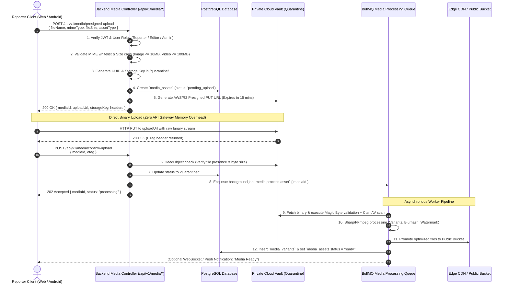

### 8.1 Eleven-Step Upload Lifecycle
1. **Authorization Request**: Authenticated client invokes `POST /api/v1/media/presigned-upload` specifying the proposed filename, declared MIME type, byte size, and asset target domain.
2. **Identity & Role Authentication**: Backend validates the user's JWT bearer token and enforces role-based access limits (e.g., public users can only upload avatars $\le 2\text{ MB}$; normal reporters cannot upload graphic templates).
3. **Pre-Flight Input Sanitization**: Backend validates that declared MIME types match the strict whitelist and file sizes do not exceed domain caps.
4. **Metadata Reservation**: A new record is inserted into `media_assets` with status `'pending_upload'` and a 15-minute expiration timestamp.
5. **Presigned Ticket Generation**: The backend invokes the cloud storage SDK using server-side IAM credentials to generate a short-lived (15-minute) pre-signed `PUT` URL bound to an isolated quarantine key path (`quarantine/raw/{uuid}`).
6. **Direct Binary Transmission**: The client streams the binary payload directly from its local disk/camera buffer to the cloud storage endpoint via HTTP `PUT`. No binary bytes traverse the Node.js API servers.
7. **Ingress Completion Confirmation**: Upon receiving HTTP 200/204 and an `ETag` from the storage provider, the client invokes `POST /api/v1/media/confirm-upload` transmitting the `mediaId` and `etag`.
8. **Storage Provider Verification**: The backend executes a `HeadObject` API call against the storage bucket to cryptographically verify that the file exists, matches the expected byte length, and was uploaded within the allowable window.
9. **Quarantine & Queue Dispatch**: Asset status is advanced to `'quarantined'`, and a processing job `media:process-asset` is pushed onto the distributed Redis-backed BullMQ queue.
10. **Asynchronous Security & Transcoding**: Worker nodes pull the job, inspect binary magic bytes, run antivirus scans, strip EXIF data, compute SHA-256 and Blurhash, generate responsive crops (via Sharp) or adaptive video streams (via FFmpeg), and upload optimized assets to the public bucket.
11. **Promotion & Availability**: The database record is updated to `status = 'ready'`, `media_variants` records are inserted, and the asset becomes ready for attachment to news drafts.

### 8.2 Upload Strategy Evaluation: Images vs. Large Video Rushes
- **Lightweight Media (Images, Audio, PDF $\le 15\text{ MB}$)**:
  - *Standard Presigned Single-Part PUT*: Single HTTP `PUT` request directly to the pre-signed URL. Simple, lightweight, minimal mobile battery overhead, perfectly suited for $95\%$ of field photo uploads.
- **Heavy Media (Raw Video Rushes, Field Master Clips $15\text{ MB}\text{--}100\text{ MB}$)**:
  - *S3 Presigned Multipart / Resumable Chunked Ingress*: For video files exceeding $15\text{ MB}$, the mobile client or web uploader initiates a multipart upload session.
  - *Chunk Sizing*: The file is partitioned client-side into $5\text{ MB}$ chunks. Each chunk is uploaded independently via its own pre-signed part URL.
  - *Fault Tolerance & Resumability*: If an Indian mobile network connection drops mid-upload during a field rally, the client caches uploaded chunk ETags in local SQLite storage. Upon network reconnection, upload resumes seamlessly from the failed chunk without restarting the entire file.

---

## 9. File Validation and Security

In strict conformance with [`docs/15-Security.md`](file:///c:/Users/pp/Downloads/BREAKING-NEWS-WALA-main/docs/15-Security.md), all user-submitted media is treated as potentially malicious. The platform enforces an unyielding **Zero-Trust Media Validation Pipeline** before any file is promoted from quarantine to public distribution.

### 9.1 Size Caps & Allowed MIME Signatures

| Asset Category | Permitted Formats | Whitelisted MIME Types | Maximum File Size | Magic Byte Signature (Hex Verification) |
| :--- | :--- | :--- | :---: | :--- |
| **Photographs & Banners** | JPEG, PNG, WebP | `image/jpeg`, `image/png`, `image/webp` | **10 MB** | JPEG: `FF D8 FF`<br/>PNG: `89 50 4E 47 0D 0A 1A 0A`<br/>WebP: `52 49 46 46 ... 57 45 42 50` |
| **Graphic Studio Uploads** | JPEG, PNG, WebP, SVG (Admin only) | `image/jpeg`, `image/png`, `image/webp`, `image/svg+xml` | **15 MB** | SVG: Strict XML validation; `<script>`, `onload`, `<iframe>` strictly stripped via DOMPurify. |
| **Video Reels & Clips** | MP4, MOV, WebM | `video/mp4`, `video/quicktime`, `video/webm` | **100 MB** | MP4: `....ftypisom` or `....ftypmp42`<br/>WebM: `1A 45 DF A3` |
| **Audio Voiceovers** | MP3, M4A, WAV | `audio/mpeg`, `audio/mp4`, `audio/wav` | **25 MB** | MP3: `49 44 33` or `FF FB`<br/>WAV: `52 49 46 46 ... 57 41 56 45` |
| **E-Paper Documents** | PDF | `application/pdf` | **25 MB** | PDF: `25 50 44 46` (`%PDF-`) |
| **Reporter Press ID Scans** | JPEG, PNG, PDF | `image/jpeg`, `image/png`, `application/pdf` | **10 MB** | Verified magic bytes; immediate AES-256 encryption at rest. |

### 9.2 Binary Magic Byte Verification vs. Header Spoofing
Attackers frequently disguise malicious server-side scripts (e.g., PHP webshells, Node exploit scripts) by appending legitimate extensions (`shell.php.jpg`) or forging HTTP `Content-Type: image/jpeg` request headers.
- **Deep Inspection Rule (`RULE-SEC-007`)**: The media worker reads the first **512 bytes** of every uploaded binary stream from quarantine and executes cryptographic magic number validation using `file-type` / `libmagic`. If the binary magic bytes do not correspond identically to an allowed MIME type, the file is immediately quarantined, flagged as a security violation, and purged.

### 9.3 Safe Filename Generation & Directory Traversal Defense
- **Complete Client Filename Neutralization**: Filenames provided by client browsers (e.g., `../../etc/passwd` or `cm_yogi_rally<script>.jpg`) are **never** used as storage keys.
- **Cryptographic Storage Key Formula**:
  $$\text{StorageKey} = \text{domain} \mathbin{\Vert} \text{YYYY} \mathbin{\Vert} \text{MM} \mathbin{\Vert} \text{cryptoRandomUUIDv4()} \mathbin{\Vert} \text{sanitizedExtension}$$
- Original filenames are sanitized using strict alphanumeric character whitelisting (`[a-zA-Z0-9_-]`) and preserved strictly as non-executable relational metadata in `media_assets.original_filename` for editorial reference.

### 9.4 Antivirus & Anti-Malware Scanning Pipeline
- Ingress objects staged in `bnw-private-vault-prod/quarantine/` are scanned by a containerized ClamAV / VirusTotal scanner daemon executing within the worker subnet.
- Any file matching known malware signatures, embedded Trojan code, or suspicious macro streams is blocked, the uploader's session is flagged for review in `audit_logs`, and an automated alert is dispatched to newsroom security engineers.

### 9.5 Complete EXIF Metadata Sanitization
Field photographs captured by mobile devices embed rich Exchangeable Image File Format (EXIF) metadata, including precise GPS latitude/longitude coordinates, device IMEI/serial numbers, camera hardware details, and capture timestamps.
- **Reporter Privacy Invariant (`RULE-DPDPA-001`)**: To protect investigative journalists operating in sensitive conflict or rural territories, the image processing worker **strips 100% of EXIF, IPTC, and XMP metadata** during transcoding via Sharp (`.withMetadata({ stripAll: true })`). Geolocation data is never exposed to public website visitors or scraped by third parties.

### 9.6 Non-Executable Bucket Hardening
The cloud storage origin enforces HTTP response headers ensuring that browsers treat uploaded assets strictly as data, neutralizing Stored Cross-Site Scripting (XSS) and remote code execution:
- `Content-Disposition: inline; filename="safe_media.webp"`
- `X-Content-Type-Options: nosniff`
- `X-Frame-Options: DENY`
- Storage buckets have object execution permissions disabled; execution of `.php`, `.jsp`, `.exe`, `.sh`, or `.html` as server scripts is physically impossible at the cloud layer.

---

## 10. Image Processing Architecture

The image processing subsystem converts raw, uncompressed field uploads into high-performance, modern web formats optimized for rapid delivery across high-density retina displays and bandwidth-constrained mobile devices.

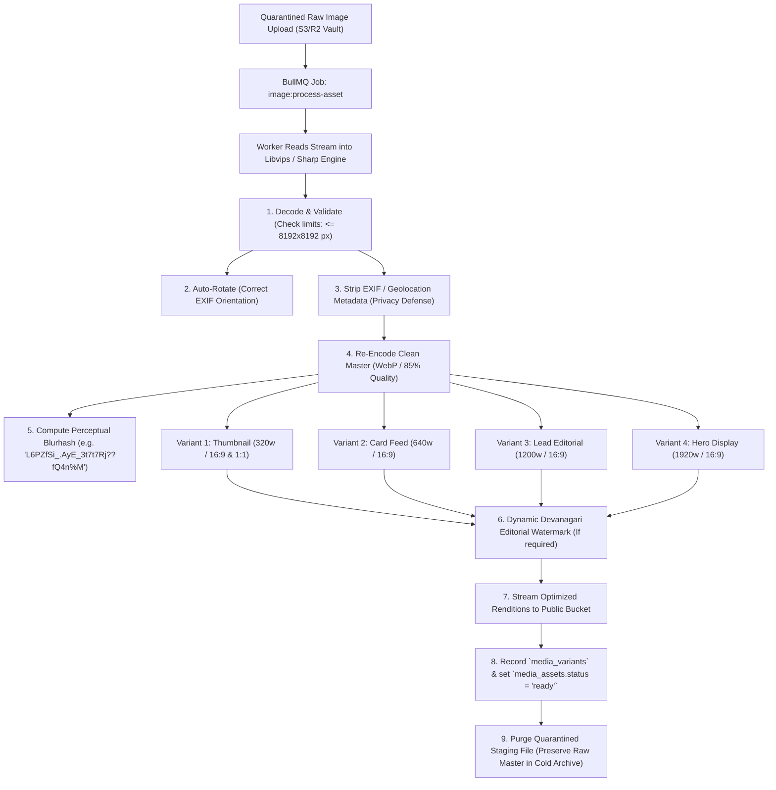

### 10.1 High-Performance Processing Engine (Sharp / libvips)
Image transformation is powered by **Sharp** (built on the native C-based `libvips` library), which operates up to $8\times$ faster than ImageMagick while consuming significantly less memory:
- **Streaming Pipeline**: Images are processed directly via streaming memory buffers rather than intermediate temporary disk writes.
- **Decompression Bomb Protection**: Sharp strictly validates image dimensions before full pixel allocation. Any image exceeding $8192 \times 8192\text{ px}$ or a decoded raw pixel buffer of $100\text{ MB}$ is immediately rejected with an HTTP 422 error, protecting worker pods against Out-Of-Memory (OOM) denial-of-service crashes (`RSK-011`).

### 10.2 Modern Compression & Encoding Standards
- **Primary Delivery Format: WebP**: All photographic uploads are transcoded to **WebP** at a quality factor of $82\text{--}85\%$ with chroma subsampling (`4:2:0`). This achieves a $30\text{--}40\%$ byte reduction compared to standard JPEG while preserving crisp Hindi Devanagari typography overlay clarity.
- **Next-Gen Progressive Format: AVIF**: The pipeline supports optional on-the-fly or asynchronous generation of **AVIF** renditions for modern browsers, achieving up to $50\%$ smaller file sizes than JPEG at equivalent visual quality.
- **Source Preservation Invariant**: The original uploaded source file is **never overwritten** or destroyed during optimization. The original validated binary is moved to an internal archive storage path (`archive/masters/{year}/{uuid}.orig`) for legal editorial provenance, while all web delivery occurs strictly from derived `media_variants`.

### 10.3 Standardized Responsive Image Breakpoint Matrix

| Variant Key | Aspect Ratio | Dimensions ($W \times H$) | Target Presentation Surface | Format | Target Size Budget |
| :--- | :---: | :---: | :--- | :---: | :---: |
| `thumb_320w` | $16:9$ / $1:1$ | $320 \times 180\text{ px}$ / $320 \times 320\text{ px}$ | Mobile news feed cards, breaking news sidebar lists, admin tables. | WebP | $\le 18\text{ KB}$ |
| `card_640w` | $16:9$ | $640 \times 360\text{ px}$ | Tablet news cards, category landing grids, WhatsApp link share previews. | WebP | $\le 45\text{ KB}$ |
| `lead_1200w` | $16:9$ | $1200 \times 675\text{ px}$ | Article lead banner on desktop, social media Open Graph cards (`og:image`). | WebP | $\le 110\text{ KB}$ |
| `hero_1920w` | $16:9$ | $1920 \times 1080\text{ px}$ | Full-width breaking news hero banner on high-DPI desktop screens. | WebP | $\le 220\text{ KB}$ |
| `square_1080` | $1:1$ | $1080 \times 1080\text{ px}$ | Social graphics, Instagram post export, reporter profile modal. | WebP / PNG | $\le 180\text{ KB}$ |
| `vertical_1080` | $9:16$ | $1080 \times 1920\text{ px}$ | Mobile full-screen video reel poster, WhatsApp Status graphic card. | WebP / PNG | $\le 250\text{ KB}$ |

### 10.4 Dynamic Editorial Watermarking
To safeguard exclusive breaking news scoops and regional field photography against unauthorized republishing by competitor portals:
- The worker composites a semi-transparent, vector-based SVG watermark positioned in the bottom-right corner of `lead_1200w` and `hero_1920w` variants.
- The watermark features the official **BREAKING NEWS WALA (ब्रेकिंग न्यूज़ वाला)** brand mark and dynamic district attribution string (e.g., *"वाराणसी ब्यूरो"*).
- The thumbnail variant (`thumb_320w`) is kept clean of watermarks to maximize visual legibility on compact mobile screens.

---

## 11. Video Processing Architecture

Video is the highest-growth engagement channel for BREAKING NEWS WALA. Ground reporters submit raw field rushes and mobile reels, while newsrooms produce automated video bulletins. The video architecture must guarantee ultra-fast mobile playback, seamless adaptive bitrate streaming, and absolute protection of core web APIs from compute-heavy transcoding workloads.

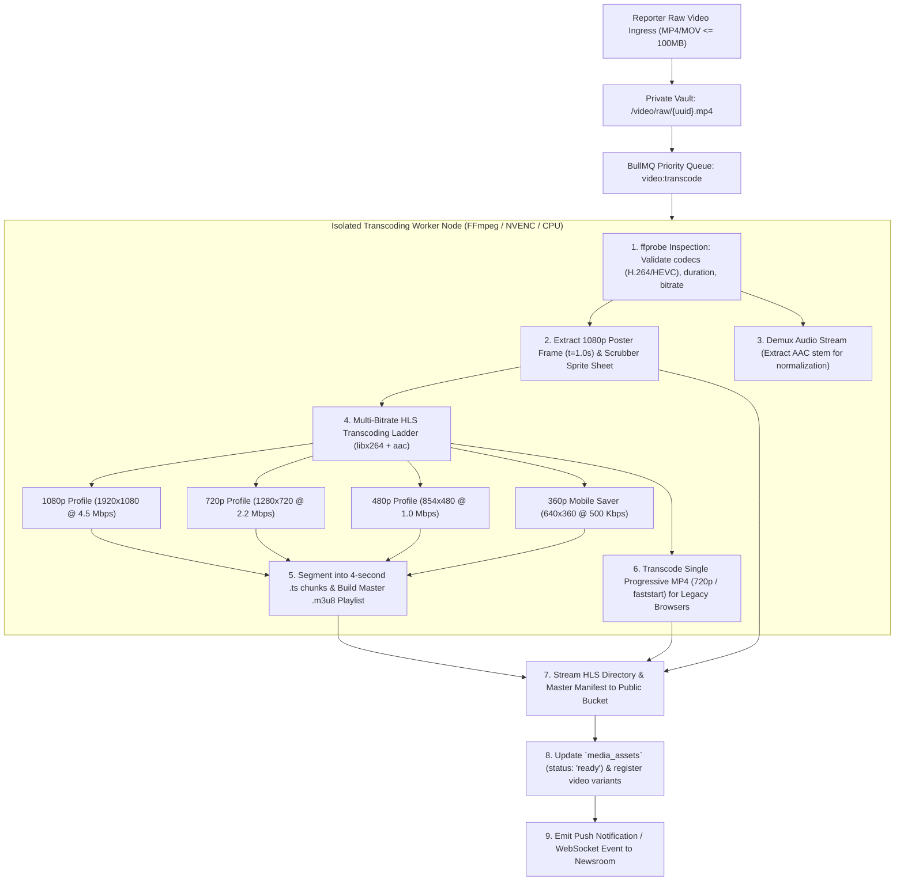

### 11.1 Non-Blocking Distributed Transcoding Pipeline
- **Asynchronous Decoupling**: Uploading a video never triggers inline transcoding within the HTTP API process. Transcoding jobs are dispatched to a dedicated BullMQ queue (`video:transcode`) backed by Redis.
- **Worker Isolation**: Video workers run in dedicated Docker containers with strict resource cgroups (`cpus: 4`, `memory: 8GB`). A sudden influx of breaking news videos from multiple districts cannot saturate the API gateway or database connection pools.
- **Hardware Acceleration**: Where supported by cloud worker instances, FFmpeg leverages GPU hardware acceleration (NVIDIA NVENC / Intel QuickSync) to transcode 60-second video reels in under 15 seconds.

### 11.2 Adaptive Bitrate (ABR) HLS Streaming Specification
To prevent buffering for citizens viewing news over erratic $3\text{G}/4\text{G}$ rural cellular connections, video is encoded into **HTTP Live Streaming (HLS - RFC 8216)** multi-bitrate ladders:

| Rendition Profile | Resolution ($W \times H$) | Video Bitrate | Audio Bitrate | Frame Rate | Segment Length | Target Network Condition |
| :--- | :---: | :---: | :---: | :---: | :---: | :--- |
| **1080p High** | $1920 \times 1080\text{ px}$ | $4500\text{ kbps}$ | $192\text{ kbps}$ | $30\text{ fps}$ | $4\text{ seconds}$ | High-speed Fiber / 5G / Broadband |
| **720p Medium** | $1280 \times 720\text{ px}$ | $2200\text{ kbps}$ | $128\text{ kbps}$ | $30\text{ fps}$ | $4\text{ seconds}$ | Stable 4G LTE Connection |
| **480p Standard** | $854 \times 480\text{ px}$ | $1000\text{ kbps}$ | $96\text{ kbps}$ | $30\text{ fps}$ | $4\text{ seconds}$ | Standard Mobile 4G / Congested Cell |
| **360p Data Saver** | $640 \times 360\text{ px}$ | $500\text{ kbps}$ | $64\text{ kbps}$ | $24\text{ fps}$ | $4\text{ seconds}$ | Low-bandwidth 2G / 3G Rural Mobile |

- **Segment Duration**: Standardized to exactly **4 seconds**. This balances rapid player startup time and low seek latency with high CDN cache hit efficiency.
- **Progressive MP4 Fallback**: In addition to HLS playlists, a single progressive MP4 file ($720\text{p}$, encoded with the `+faststart` moov atom placed at the beginning of the file) is generated for legacy Android clients and social media sharing embeds.

### 11.3 Automated Thumbnail, Scrubbing & Subtitle Generation
- **Poster Frame**: Extracted at timestamp $t = 1.0\text{s}$ (or optimal keyframe) in high-resolution WebP ($1280 \times 720\text{ px}$).
- **Video Timeline Scrubbing (VTT Sprite Sheets)**: FFmpeg generates a multi-tile thumbnail sprite grid (one thumbnail every 2 seconds, $160 \times 90\text{ px}$) alongside an indexing `.vtt` file, providing YouTube-style visual scrubber previews on web and Android video players.
- **AI Subtitles & Accessibility**: Subtitle tracks are generated via Whisper speech-to-text models, formatted into WebVTT (`subtitles_hi.vtt`), and linked within the master HLS manifest, allowing silent autoplay in public spaces.

---

## 12. CDN and Media Delivery

A high-performance Content Delivery Network (CDN) is the critical perimeter layer between global digital readers and the physical storage buckets. It provides instant asset delivery, offloads $95\%+$ of ingress traffic from the origin, and defends against Distributed Denial of Service (DDoS) floods.

```mermaid
flowchart LR
    subgraph Readers["Global Digital Readers"]
        UserWeb["Browser Client (Lucknow/Delhi)"]
        UserApp["Native Android Client (Varanasi)"]
    end

    subgraph Edge_Plane["Tier-1 CDN Edge Network (Cloudflare / CloudFront)"]
        EdgePoP["Indian Edge PoP (Delhi/Mumbai/Kolkata/Hyderabad)"]
        EdgeCache["Local Edge NVMe Cache"]
        WAF["Edge WAF & DDoS Shield"]
        Transform["Edge Image Optimizer (Polish / Cloudflare Images)"]
    end

    subgraph Origin_Plane["Cloud Storage Origin"]
        OriginShield["Origin Shield / Gateway"]
        PublicBucket["Public S3 / R2 Bucket (`bnw-public-media-prod`)"]
        PrivateBucket["Private Vault (`bnw-private-vault-prod`)"]
    end

    UserWeb -->|HTTPS GET /news/lead.webp| WAF
    UserApp -->|HTTPS GET /video/hls/master.m3u8| WAF
    WAF --> EdgePoP
    EdgePoP --> EdgeCache
    
    EdgeCache -->|Cache HIT (95%+)| Readers
    EdgeCache -->|Cache MISS| OriginShield
    OriginShield -->|Authenticated Origin Pull| PublicBucket
    
    subgraph Secure_Proxy["Private Media Proxy"]
        BackendAPI["Backend API Gateway (/api/v1/media/*)"]
    end
    
    UserApp -->|GET /api/v1/media/private-doc (JWT)| BackendAPI
    BackendAPI -->|Signed S3 GET (15m expiry)| PrivateBucket
```

### 12.1 Edge Caching Strategy & Cache-Control Directives
Because asset storage keys are immutable UUID strings, edge caches and client browsers can cache public media aggressively and safely:
- **Immutable Media Variants**:
  ```http
  Cache-Control: public, max-age=31536000, immutable
  ```
  Edge CDN and browser caches store optimized images and `.ts` video chunks for **1 year** without revalidating with the origin.
- **Dynamic HLS Master Playlists (`master.m3u8`)**:
  ```http
  Cache-Control: public, max-age=60, s-maxage=300
  ```
  Master manifests allow short-term edge caching while enabling editorial updates if a live stream or rendition is appended.
- **Edge Cache Invalidation**: If an article image is edited or replaced for legal correction (`RULE-PUB-003`), the backend issues an API cache purge call targeting the specific CDN URL, propagating the update across all edge nodes in $< 150\text{ ms}$.

### 12.2 Origin Protection & Cloaking
- **Authenticated Origin Pulls**: The public storage bucket is configured to reject any incoming connection that does not present a verified CDN client TLS certificate (Cloudflare Authenticated Origin Pulls or AWS CloudFront Origin Access Control). Direct traffic bypassing the CDN is blocked with HTTP 403 Forbidden.
- **Origin Shield**: A designated central caching point (e.g., Mumbai Origin Shield) sits between edge PoPs and the primary storage bucket. Cache misses across dozens of regional edge nodes coalesce at the Origin Shield, collapsing origin bucket requests and eliminating origin load spikes during major breaking news events.

### 12.3 Private Media Delivery & Anti-Hotlinking
- **Time-Limited Signed URLs**: Unpublished news drafts, reporter KYC documents, and internal video project assets are never routed through public CDN caching. Authorized users access private files exclusively via backend-generated pre-signed URLs signed with HMAC-SHA256 and configured with a maximum validity of **15 minutes**.
- **Referer Verification & Hotlink Protection**: Edge CDN WAF rules inspect the HTTP `Referer` header for media assets. Direct hotlinking by competitor news websites or scraping bots is blocked at the edge unless the referer matches `*.breakingnewswala.com` or authorized social platforms (WhatsApp, Facebook, Twitter, Telegram).

---

## 13. Access Control and Media Permissions

Media authorization strictly mirrors the zero-trust role-based access control (RBAC) architecture specified in [`docs/14-Auth.md`](file:///c:/Users/pp/Downloads/BREAKING-NEWS-WALA-main/docs/14-Auth.md) and [`docs/15-Security.md`](file:///c:/Users/pp/Downloads/BREAKING-NEWS-WALA-main/docs/15-Security.md).

### 13.1 Comprehensive Media Authorization Matrix

| User Role | Public Published Media | Unpublished Draft Media | Own Uploaded Media | Peer Reporter Media | Graphic Templates | Video Studio Projects | Sensitive KYC / Press ID Scans | System DB Backups |
| :--- | :---: | :---: | :---: | :---: | :---: | :---: | :---: | :---: |
| **PUBLIC_USER** | Read Only (CDN) | **No Access** | **No Access** | **No Access** | **No Access** | **No Access** | **No Access** | **No Access** |
| **REPORTER** | Read Only (CDN) | Read/Write (Own only) | Read/Write | **No Access** | Read (Assigned only) | **No Access** | Read (Own only) | **No Access** |
| **TRUSTED_REPORTER** | Read Only (CDN) | Read/Write (Own only) | Read/Write | **No Access** | Read (Assigned only) | **No Access** | Read (Own only) | **No Access** |
| **EDITOR** | Read Only (CDN) | Read/Write/Approve | Read/Write | Read/Write (Territory) | Read/Select | Read/Edit/Render | **No Access** | **No Access** |
| **ADMIN** | Full Access | Full Access | Full Access | Full Access | Create/Edit/Assign | Full Access | Read / Verify | **No Access** |
| **SUPER_ADMIN** | Full Access | Full Access | Full Access | Full Access | Full Access | Full Access | Full Access (Audit) | Read / Restore |
| **SYSTEM_WORKER** | Read/Write | Read/Write | Read/Write | Read/Write | Read Only | Read/Write/Render | Read (Scan only) | Read/Write (WORM) |

### 13.2 Project-Specific Permission Enforcement Rules
1. **Zero Security-Through-Obscurity**: Mere possession or prediction of a storage URL or UUID never confers access to non-public media. All private asset retrieval routes `/api/v1/media/:id` execute server-side JWT verification, role validation, and resource ownership checks before issuing data or redirects.
2. **Reporter Territory Scoping (ABAC)**: When ground reporters view media in the newsroom library, backend query filters restrict results to assets tagged with their assigned district or author ID:
   ```sql
   WHERE media_assets.uploaded_by = :auth_user_id 
      OR (media_assets.district_id = :auth_user_district_id 
          AND media_assets.access_classification = 'internal')
   ```
3. **KYC & Press Credential Quarantine**: Reporter government identity scans are strictly isolated in `bnw-private-vault-prod/reporters/kyc/`. Editors cannot view KYC documents; only verified Bureau Chiefs and Super Admins can access them during onboarding verification. All KYC access events emit an immutable audit log record (`ACTION_KYC_VIEWED`).
4. **Graphic Studio Template Locks**: Normal reporters cannot download, alter, or upload template configuration files. The backend rejects any attempt by a reporter to execute `POST /api/v1/graphics/templates` with HTTP 403 Forbidden.

---

## 14. Media Lifecycle and Version Management

The media lifecycle governs an asset from initial field capture through processing, publication, historical revision, long-term archival, and compliant deletion.

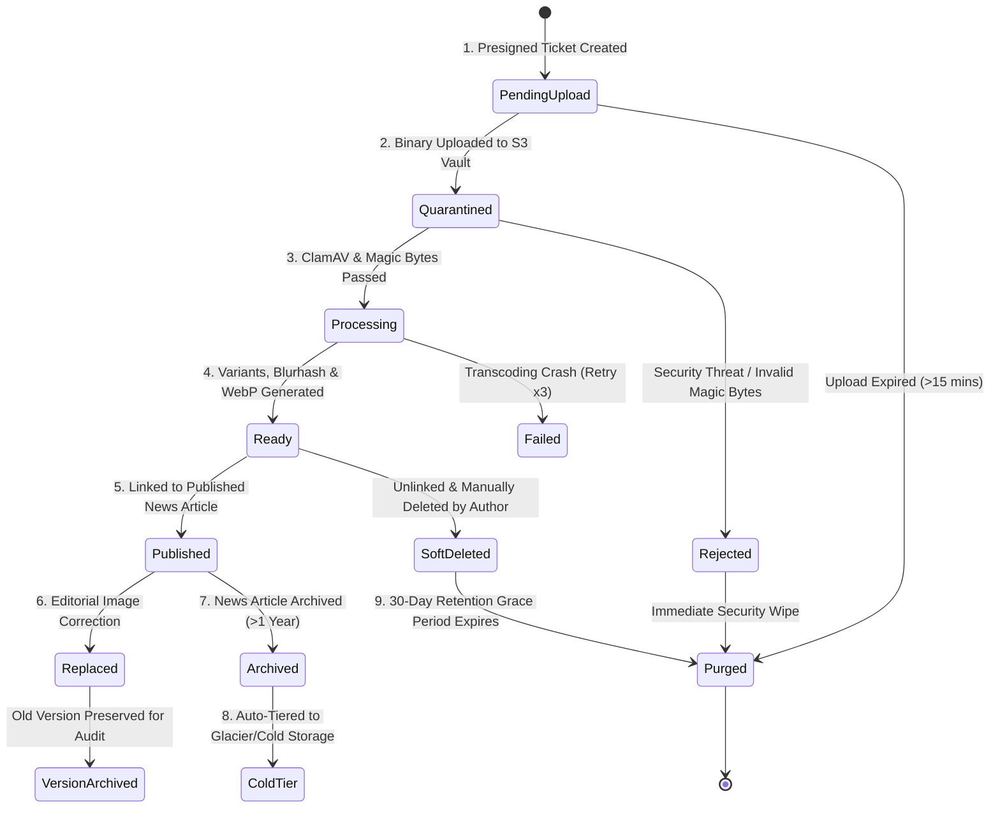

### 14.1 Complete State Machine Progression
1. `pending_upload`: Client requested upload authorization; pre-signed ticket issued; waiting for binary data.
2. `quarantined`: Binary received in private vault; staged for security validation and virus scanning.
3. `processing`: Distributed worker actively decoding, resizing, or transcoding renditions.
4. `ready`: Optimized web renditions generated, variants recorded in database, asset ready for editorial use.
5. `published`: Asset associated with live news article, video reel, or public bulletin; cached on global CDN.
6. `replaced`: Editorial desk replaced the image to correct factual inaccuracy or copyright dispute (`RULE-PUB-003`).
7. `archived`: News article or project aged past active window; asset transitioned to lower-cost cold storage.
8. `soft_deleted`: Marked as deleted (`is_deleted = TRUE`); unlinked from public display; retained for 30-day recovery.
9. `purged`: Physically erased from storage buckets upon expiration of legal retention rules.

### 14.2 Media Versioning & Correction Auditing (`RULE-PUB-003`)
In journalistic publishing, replacing a photograph or video must never destroy the historical record:
- **Immutable Historical Lineage**: When an editor replaces an image on a published article, the system does **not** overwrite the existing storage object.
- **Version Pointer**: The article's `featured_media_id` is updated to point to the newly generated `media_assets.id`. The previous asset record is retained with a reference stored in `editorial_corrections.prior_media_id`.
- **Public Audit Transparency**: The news portal displays an automated correction notice stating that the lead photograph was updated on a specific date/time, maintaining journalistic transparency.

### 14.3 Account Inactivation & Asset Persistence
- **No Orphaned Deletions**: If a ground reporter's account is suspended, terminated, or deleted, **all media assets linked to published news articles remain permanently active and preserved**.
- **Editorial Stewardship**: Ownership of the published media is transferred to the district bureau editorial desk. Published public news records are never broken due to human resource or credential changes.

---

## 15. Storage Performance and Optimization

To meet the strict performance standards mandated in [`docs/04-NFR.md`](file:///c:/Users/pp/Downloads/BREAKING-NEWS-WALA-main/docs/04-NFR.md) ($P95$ page load $< 1.5\text{s}$ on $4\text{G}$, Core Web Vitals LCP $< 2.5\text{s}$), the media plane implements aggressive visual optimizations:

### 15.1 Zero-Latency Visual Placeholders (Blurhash)
On rural $2\text{G}/3\text{G}$ mobile connections, image downloads may require $500\text{--}1500\text{ ms}$.
- **Perceptual Placeholder**: During asset processing, Sharp computes a compact **Blurhash** string ($\le 30\text{ bytes}$, e.g. `L6PZfSi_.AyE_3t7t7Rj??fQ4n%M`) stored directly in the `media_assets` database record.
- **Client Render**: Web browsers and the Native Android app render a high-quality blurred canvas representation instantly (in $< 10\text{ ms}$) without waiting for network image bytes, completely eliminating Cumulative Layout Shift (CLS score $= 0$).

### 15.2 Native Responsive HTML Markup
The web frontend generates modern semantic HTML5 `<picture>` tags with `srcset` and `sizes` attributes:
```html
<picture>
  <source type="image/avif" 
          srcset="https://cdn.breakingnewswala.com/news/variants/uuid/lead_640w.avif 640w,
                  https://cdn.breakingnewswala.com/news/variants/uuid/lead_1200w.avif 1200w"
          sizes="(max-width: 768px) 100vw, 1200px">
  <source type="image/webp" 
          srcset="https://cdn.breakingnewswala.com/news/variants/uuid/lead_640w.webp 640w,
                  https://cdn.breakingnewswala.com/news/variants/uuid/lead_1200w.webp 1200w"
          sizes="(max-width: 768px) 100vw, 1200px">
  
</picture>
```
- **Lazy Loading**: Native `loading="lazy"` and `decoding="async"` ensure below-the-fold images do not consume initial bandwidth.
- **Priority LCP Preload**: Above-the-fold hero images on article detail pages emit `<link rel="preload" as="image" fetchpriority="high">` to guarantee optimal Largest Contentful Paint (LCP) performance.

### 15.3 Cryptographic Content Deduplication
When multiple reporters or news agencies upload identical wire photographs:
- The backend computes the **SHA-256 hash** of the uploaded binary stream.
- If a record with an identical `checksum_sha256` already exists in `media_assets`, the worker links the existing storage object rather than storing duplicate physical files, saving up to $15\%$ in storage capacity.

---

## 16. Future Native Android Integration

The Stage B Native Android Application (developed in Kotlin using Android SDK 34+ and Jetpack Compose) integrates directly with the shared backend storage plane. In accordance with platform principles, Android uses native Kotlin components with **zero WebViews** for media capture and upload.

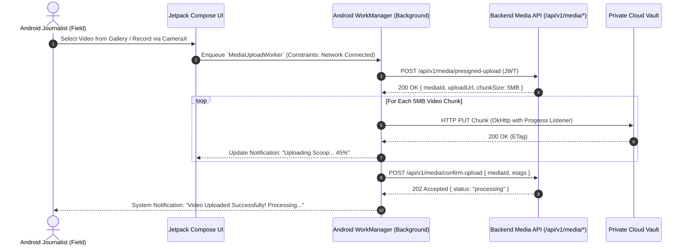

### 16.1 Camera & Photo Picker Architecture
- **Modern Photo Picker API**: Uses Android's native `ActivityResultContracts.PickVisualMedia` and `PickMultipleVisualMedia`. This eliminates broad storage read permissions (`READ_EXTERNAL_STORAGE`), enhancing user privacy and Play Store compliance.
- **Hardware CameraX Pipeline**: Custom camera capture within the reporter app uses Google's `androidx.camera:camera-core` library, capturing high-resolution photos with auto-focus and low-light enhancement.

### 16.2 Resumable Background Uploads via Android `WorkManager`
Field reporting in rural districts frequently suffers from network drops and signal loss:
- **Resilient WorkManager Tasks**: Uploads execute within an Android `CoroutineWorker` (`MediaUploadWorker`) managed by `WorkManager`.
- **System Constraints**: The worker enforces `NetworkType.CONNECTED`. If connectivity drops, Android pauses the upload task and automatically resumes execution with exponential backoff once the cell signal recovers.
- **Chunked Resumption**: For video files $> 15\text{ MB}$, the worker uploads $5\text{ MB}$ chunks via OkHttp. Upload state is saved in the local Room database, ensuring that an interrupted upload never starts over from zero.

### 16.3 Native Mobile Caching (Coil / OkHttp)
- **Image Loading Engine**: Android uses **Coil (Coroutine Image Loader)**, built natively for Kotlin and Jetpack Compose.
- **Hardware Bitmap Pooling**: Decodes images directly into Android hardware bitmaps, minimizing garbage collection pauses during fast feed scrolling.
- **Two-Tier Local Cache**:
  - *In-Memory LRU Cache*: Allocates $25\%$ of available app RAM for instant image display during navigation.
  - *Disk LRU Cache*: Allocates a maximum of $250\text{ MB}$ in internal cache directory (`context.cacheDir`) with automatic eviction of least recently accessed files.

---

## 17. Backup, Retention and Disaster Recovery

Media durability and disaster readiness are governed by the Recovery Point Objective ($\text{RPO} \le 1\text{ hour}$) and Recovery Time Objective ($\text{RTO} \le 4\text{ hours}$) defined in [`docs/04-NFR.md`](file:///c:/Users/pp/Downloads/BREAKING-NEWS-WALA-main/docs/04-NFR.md).

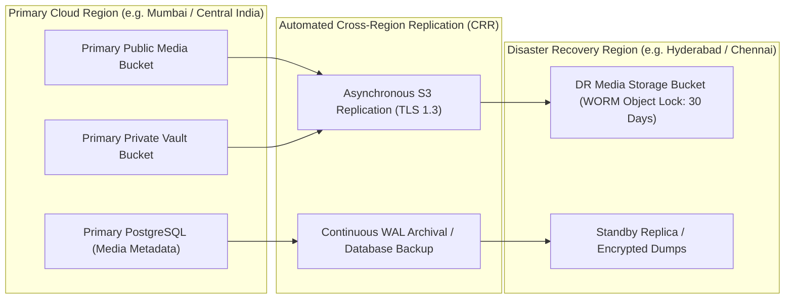

### 17.1 Cross-Region Replication & WORM Protection
- **Automated Cross-Region Replication (CRR)**: Every file committed to the primary cloud storage bucket is asynchronously replicated to a secondary cloud region within $15\text{ minutes}$.
- **Immutable WORM Object Lock (`RULE-BCP-002`)**: To neutralize ransomware threats, backup snapshots and primary news media are configured with **Write Once Read Many (WORM) Object Lock** in Compliance Mode for **30 days**. No cloud credentials—including root administrator accounts—can delete or overwrite locked objects during this window.

### 17.2 Systematic Storage Retention Policies

| Data Classification | Storage Tier | Active Retention Period | Cold Archival Window | Final Disposal Policy |
| :--- | :--- | :---: | :---: | :--- |
| **Published News Media** | Standard S3 / R2 | 1 Year (Active) | After 1 Year $\rightarrow$ Cold Tier | **Permanent Retain** (Journalistic Public Archive) |
| **Unreferenced Upload Staging** | Quarantine Bucket | **48 Hours** | None | Automated hard delete via bucket lifecycle rule. |
| **Raw Video Rushes** | Private Vault | **90 Days** | After 90 Days $\rightarrow$ Glacier | Deleted after 2 years unless flagged for legal hold. |
| **Reporter KYC Credentials** | Private Vault (AES-256) | Duration of Employment | None | Purged **90 days after account termination** (`DPDPA`). |
| **System Database Dumps** | Isolated Backup Bucket | **30 Days** | After 30 Days $\rightarrow$ Deep Archive | Rotated and purged at 90 days. |
| **Audit Logs & Snapshots** | Encrypted Log Bucket | **2 Years** | After 2 Years $\rightarrow$ Cold Tier | **7 Years Minimum** (`RULE-AUD-001`). |

---

## 18. Storage Cost Management

As an enterprise regional news network scaling to millions of daily readers, unchecked media storage and egress bandwidth present significant financial risk. The storage plane enforces comprehensive cost-control mechanics:

### 18.1 Key Cost Drivers
1. **Cloud Egress Bandwidth**: Traditional cloud providers (AWS, GCP) charge $\$0.08\text{--}\$0.09\text{ per GB}$ of egress data transferred to the public Internet, which rapidly dominates operating budgets.
2. **High-Resolution Master Footage**: Storing hundreds of hours of raw 1080p video footage from dozens of field bureaus consumes terabytes of expensive primary object storage.
3. **Compute Worker Over-Provisioning**: Running idling FFmpeg video worker nodes during off-peak night hours.

### 18.2 Cost-Control Architecture & Mitigations
- **Zero-Egress Storage Foundation (Cloudflare R2 Proposed)**: Cloudflare R2 provides complete S3 API compatibility with **$\$0.00\text{ egress bandwidth fees}$**. Paired with Cloudflare CDN, this reduces projected media distribution expenses by up to $80\%$.
- **Aggressive WebP/AVIF Compression**: Transcoding raw mobile uploads to WebP/AVIF achieves an average byte reduction of $68\%$, saving both storage terabytes and mobile reader bandwidth.
- **Automated Storage Class Lifecycle Rules**:
  - Objects in `bnw-public-media-prod/news/` older than 365 days transition automatically to Infrequent Access / Cold tiering ($\sim 50\%$ cheaper storage cost).
  - Unreferenced files in `/quarantine/` are purged automatically after 48 hours.
- **Budget Threshold Alerts**: Real-time AWS CloudWatch / Cloudflare Billing alarms fire automated alerts into the engineering Slack channel at **$75\%$, $90\%$, and $100\%$** of projected monthly storage budgets.

---

## 19. Storage Monitoring and Operational Management

Storage operational health is continuously monitored via Prometheus telemetry, Grafana dashboards, and automated alert manager routes.

### 19.1 Key Operational Telemetry Metrics

| Metric Name | Type | Target Threshold | Operational Description |
| :--- | :---: | :---: | :--- |
| `media_upload_success_rate` | Gauge | **$\ge 99.5\%$** | Ratio of confirmed uploads to presigned tickets generated. |
| `image_processing_duration_seconds` | Histogram | **$P95 < 2.0\text{s}$** | Latency of Sharp image resizing, variant creation, and blurhash computation. |
| `video_transcode_duration_seconds` | Histogram | **$P95 < 45\text{s}$** | Latency of 60-second video reel multi-bitrate HLS transcoding. |
| `bullmq_queue_waiting_jobs` | Gauge | **$< 50\text{ jobs}$** | Depth of backlog in BullMQ media processing queues. |
| `cdn_cache_hit_ratio` | Gauge | **$\ge 92.0\%$** | Percentage of public media requests served directly from CDN edge caches. |
| `storage_quarantine_rejects_total` | Counter | Monitor for spikes | Number of uploads rejected due to invalid magic bytes or ClamAV hits. |
| `storage_bucket_bytes_total` | Gauge | Track Growth Rate | Total aggregate byte volume in production storage buckets. |

### 19.2 Incident Alert Thresholds & Escalation Runbooks
- **SEV-1: CDN Cache Failure / Origin Spike**: If `cdn_cache_hit_ratio` drops below $80\%$, an automated PagerDuty alarm pages the on-call SRE. Runbook: Verify Authenticated Origin Pull status, check Cloudflare WAF cache rules, inspect Origin Shield status.
- **SEV-2: Transcoding Queue Stall**: If `bullmq_queue_waiting_jobs{queue="video"}` exceeds 100 for $> 10\text{ minutes}$, an alert triggers auto-scaling of worker pods. Runbook: Inspect worker CPU saturation, check for corrupted video files causing worker crash loops.
- **SEV-3: Malware / Quarantined File Burst**: If $> 10$ files fail magic byte verification from a single IP within 5 minutes, the IP is automatically placed on a 24-hour Cloudflare WAF blocklist.

---

## 20. Storage Architecture Diagrams

The following nine architectural diagrams synthesize and visualize the unified media plane of BREAKING NEWS WALA across every operational flow.

### 20.1 Diagram 1: High-Level Unified Storage Architecture
```mermaid
flowchart TD
    subgraph Clients["Client Ingress Planes"]
        WebReader["Public Web Readers<br/>(Desktop / Mobile Web)"]
        WebReporter["Reporter Web App<br/>(Ground Journalists)"]
        AdminNews["Admin & Newsroom Panel<br/>(Central Editors)"]
        AndroidApp["Native Android App<br/>(Field Reporting SDK)"]
    end

    subgraph CDN_Edge["Global Edge Delivery Tier (Cloudflare / CloudFront)"]
        EdgeWAF["Edge WAF & DDoS Shield"]
        EdgeCache["Indian Edge PoP Caches<br/>(Delhi, Mumbai, Kolkata, Hyd)"]
        OriginShield["Origin Shield Caching Gate"]
    end

    subgraph App_Gateway["Core API Services"]
        MediaAPI["Media Gateway Service<br/>(/api/v1/media/*)"]
        AuthService["Auth & RBAC Guard<br/>(JWT / Token Check)"]
        PostgresDB[("PostgreSQL 16 Database<br/>`media_assets` & `media_variants`")]
        RedisQueue[("Redis BullMQ Cluster<br/>Media Job Queues")]
    end

    subgraph Workers["Distributed Processing Cluster"]
        ImageWorker["Sharp Image Worker<br/>(WebP/AVIF, Blurhash)"]
        VideoWorker["FFmpeg Video Worker<br/>(Multi-Bitrate HLS, MP4)"]
        ScannerWorker["ClamAV / Virus Scanner<br/>(Magic Byte Inspector)"]
    end

    subgraph Storage_Tiers["Dual-Bucket Cloud Object Storage (S3 / R2)"]
        PublicBucket[("Public Media Bucket<br/>(Origin Cloaked to CDN)")]
        PrivateVault[("Private Vault & Quarantine<br/>(No Public Access / IAM)")]
        ArchiveStore[("Cold Glacier Storage<br/>(Long-term News Archive)")]
    end

    WebReader -->|1. HTTPS GET /news/*| EdgeWAF
    EdgeWAF --> EdgeCache
    EdgeCache -->|Cache Miss| OriginShield
    OriginShield -->|Authenticated Origin Pull| PublicBucket

    WebReporter -->|2. Presigned Upload Request| MediaAPI
    AdminNews -->|2. Presigned Upload Request| MediaAPI
    AndroidApp -->|2. Presigned Upload Request| MediaAPI
    
    MediaAPI --> AuthService
    MediaAPI --> PostgresDB
    MediaAPI -->|Issue Presigned PUT (15m)| PrivateVault

    WebReporter -->|3. Direct Binary PUT| PrivateVault
    AndroidApp -->|3. Direct Binary Chunked PUT| PrivateVault
    
    MediaAPI -->|Enqueue Job| RedisQueue
    RedisQueue --> ScannerWorker
    ScannerWorker --> ImageWorker
    ScannerWorker --> VideoWorker
    
    ImageWorker -->|Promote Renditions| PublicBucket
    VideoWorker -->|Promote HLS Segments| PublicBucket
    ImageWorker -->|Update Metadata| PostgresDB
    VideoWorker -->|Update Metadata| PostgresDB
    
    PublicBucket -.->|Lifecycle Tiering (>1 Yr)| ArchiveStore
```

### 20.2 Diagram 2: Upload Authorization & Ingress Completion Flow
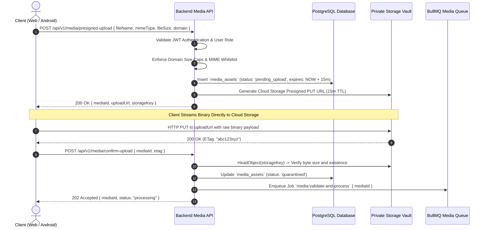

### 20.3 Diagram 3: Image Processing Pipeline
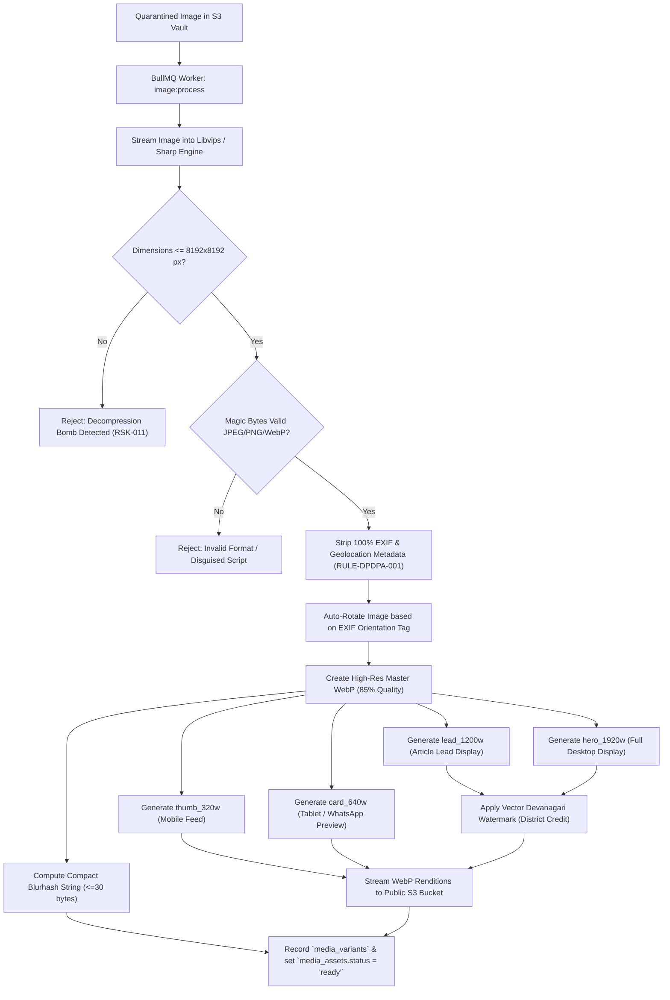

### 20.4 Diagram 4: Asynchronous Video Processing Pipeline
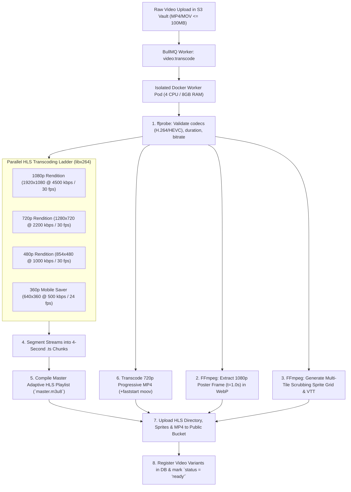

### 20.5 Diagram 5: Public vs. Private Media Delivery Planes
```mermaid
flowchart LR
    subgraph Reader_Space["Public Digital Readers"]
        Reader["Citizen Web / Mobile Reader"]
    end

    subgraph Newsroom_Space["Authenticated Newsroom Staff"]
        Editor["Editor / Newsroom Admin"]
    end

    subgraph Edge_Delivery["Edge CDN Tier"]
        PublicCDN["Public Edge CDN (Cache-Control: immutable)"]
        EdgeWAF["Edge WAF & Hotlink Shield"]
    end

    subgraph API_Tier["Backend Application Tier"]
        PrivateProxy["Private Media Proxy Controller (/api/v1/media/:id/view)"]
    end

    subgraph Storage_Tier["Cloud Storage Buckets"]
        PublicS3[("Public Media Bucket<br/>`bnw-public-media-prod`")]
        PrivateS3[("Private Vault Bucket<br/>`bnw-private-vault-prod`")]
    end

    Reader -->|1. GET /news/variants/lead_1200w.webp| EdgeWAF
    EdgeWAF --> PublicCDN
    PublicCDN -->|Cache Hit (95%+)| Reader
    PublicCDN -->|Cache Miss (Authenticated Origin Pull)| PublicS3

    Editor -->|2. Request Unpublished Draft / KYC Scan| PrivateProxy
    PrivateProxy -->|Verify JWT & Role Permissions| PrivateProxy
    PrivateProxy -->|Issue Short-Lived Signed GET (15m)| PrivateS3
    PrivateS3 -->> Editor: Stream Private Binary Stream
```

### 20.6 Diagram 6: Media Access Authorization Gatekeeping
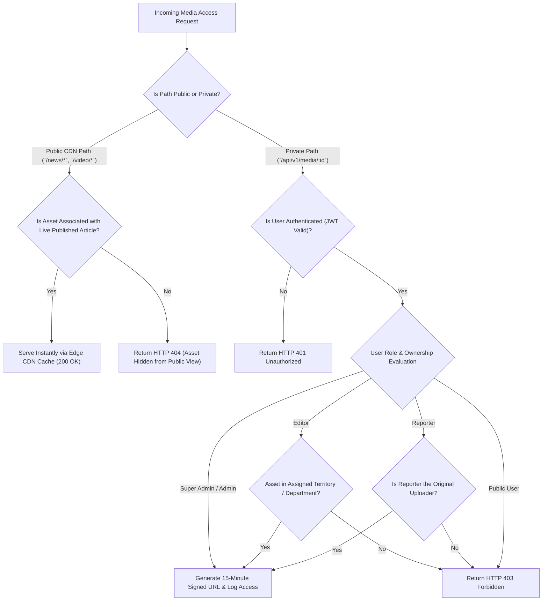

### 20.7 Diagram 7: Native Android Mobile Upload Architecture
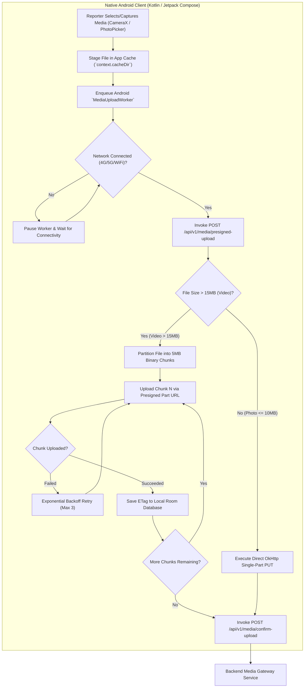

### 20.8 Diagram 8: Backup, Replication & Disaster Recovery Flow
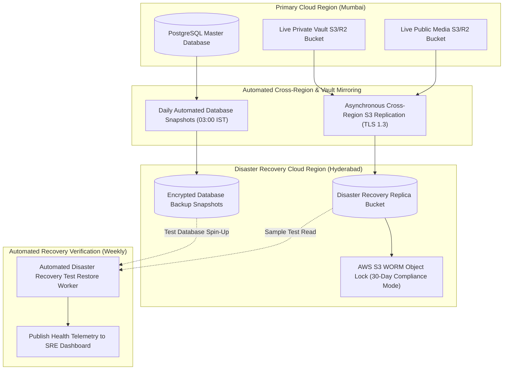

### 20.9 Diagram 9: Complete Media Asset Lifecycle
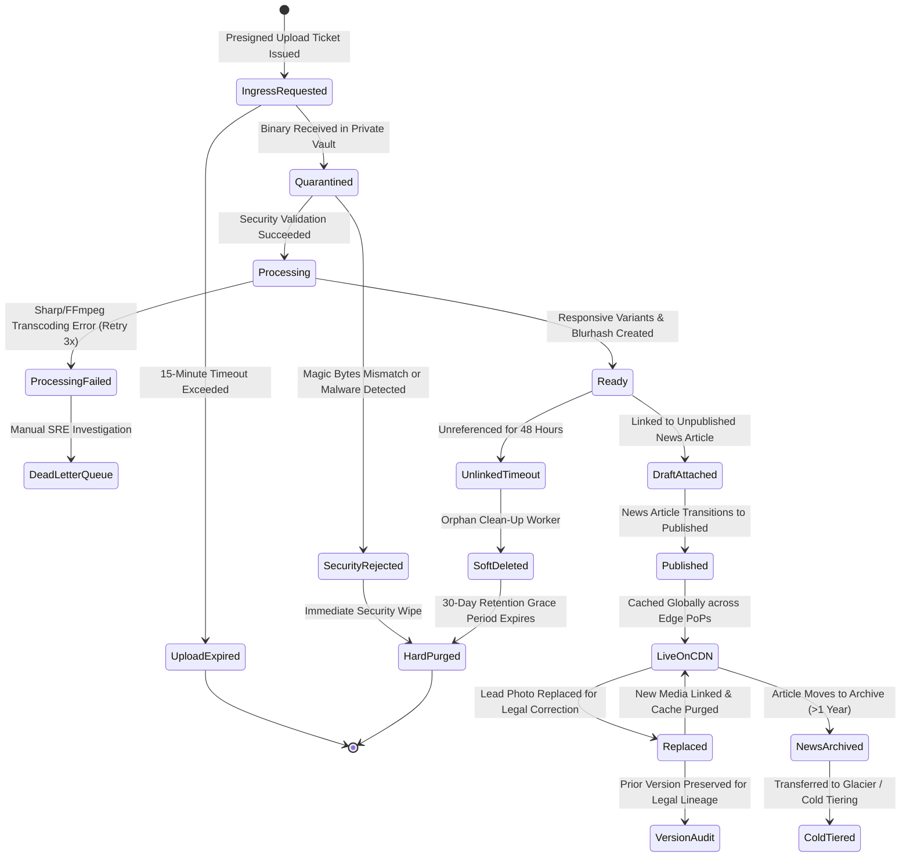

---

## 21. Storage Decision Register

The following Architecture Decision Records (ADRs) document the foundational storage choices evaluated for BREAKING NEWS WALA. All items remain marked as **Proposed / Pending Approval** until final commercial procurement and infrastructure sign-off.

| Decision ID | Topic | Available Options Evaluated | Proposed Recommendation | Architectural & Operational Justification | Dependencies | Approval Status |
| :--- | :--- | :--- | :--- | :--- | :--- | :---: |
| **ADR-STR-001** | Primary Cloud Storage Provider | AWS S3, Google Cloud Storage, Cloudflare R2, MinIO Self-Hosted | **Cloudflare R2 (Primary) or AWS S3 Standard** | Cloudflare R2 delivers S3 API compatibility with **zero egress bandwidth fees**, saving up to $80\%$ of distribution costs. AWS S3 Standard serves as the proven enterprise alternative. | Cloud Infrastructure Sign-off | **Proposed** |
| **ADR-STR-002** | Bucket Architecture Strategy | Single Multi-Folder Bucket vs. Dual-Bucket Architecture | **Dual-Bucket Separation (`Public Media` + `Private Vault`)** | Enforces physical isolation between public CDN assets and sensitive private/quarantined uploads, eliminating risk of accidental public data leakage. | `15-Security.md` | **Proposed** |
| **ADR-STR-003** | Edge CDN & Caching Tier | Cloudflare Enterprise, AWS CloudFront, Fastly | **Cloudflare CDN with Indian Edge PoPs** | Deep regional density across Indian tier-1/tier-2 cities (Delhi, Mumbai, Kolkata, Hyderabad, Bengaluru); seamless zero-egress integration with R2. | Network Architecture | **Proposed** |
| **ADR-STR-004** | Client Ingress Protocol | Backend Multipart Relay vs. Presigned Direct Upload | **Presigned Direct S3 PUT Protocol (`API-07`)** | Offloads high-bandwidth binary streams completely from Node.js API servers, eliminating memory saturation and scaling bottleneck. | `13-API.md`, `API-07` | **Proposed** |
| **ADR-STR-005** | Image Transformation Pipeline | ImageMagick CLI vs. Cloudinary vs. Sharp / libvips | **Sharp (libvips C-Engine)** | $8\times$ faster than ImageMagick with significantly lower memory footprint; zero recurring third-party SaaS subscription costs. | Docker Container Build | **Proposed** |
| **ADR-STR-006** | Video Transcoding Engine | Managed AWS MediaConvert vs. Mux vs. Self-Hosted FFmpeg Workers | **Self-Hosted FFmpeg Workers in BullMQ Cluster** | Drastically lower per-minute transcoding expense; full custom control over multi-bitrate HLS segmentation and scrub sprite generation. | Worker Pod Infrastructure | **Proposed** |
| **ADR-STR-007** | Video Streaming Protocol | Progressive MP4 vs. HLS Adaptive Bitrate vs. DASH | **HLS (HTTP Live Streaming - RFC 8216) + Progressive MP4 Fallback** | Native streaming support across iOS, Android, and modern desktop browsers; dynamic adaptation to flaky Indian mobile bandwidth. | Mobile Video Player | **Proposed** |
| **ADR-STR-008** | Visual Placeholder Strategy | Solid Color vs. Base64 Low-Res vs. Perceptual Blurhash | **Perceptual Blurhash ($\le 30\text{ bytes}$)** | Renders rich blurred placeholder instantly ($< 10\text{ ms}$) without layout shift; minuscule database storage footprint. | `04-NFR.md`, Core Web Vitals | **Proposed** |
| **ADR-STR-009** | Large Video Ingress Resiliency | Single-Stream HTTP PUT vs. Resumable Chunked (Tus / S3 Multipart) | **S3 Resumable Multipart Chunking ($5\text{ MB}$ chunks)** | Allows mobile field reporters in rural areas to resume interrupted uploads seamlessly without restarting from zero. | Android `WorkManager` | **Proposed** |
| **ADR-STR-010** | Quarantined Malware Scanning | No Ingress Scan vs. Third-Party SaaS vs. Containerized ClamAV | **Containerized ClamAV / Magic Byte Worker** | Server-side binary inspection and virus signature matching before promoting assets to public CDN delivery. | `15-Security.md` | **Proposed** |
| **ADR-STR-011** | Backup Ransomware Defense | Standard S3 Versioning vs. WORM Object Lock | **WORM Object Lock (30-Day Compliance Mode)** | Physically prevents deletion or encryption of backup archives even if administrative credentials are compromised. | `15-Security.md`, `RULE-BCP-002` | **Proposed** |
| **ADR-STR-012** | Published Media Deletion Policy | Hard Immediate Delete vs. Soft Delete with Version Audit | **Soft Delete with Version History (`RULE-PUB-003`)** | Protects journalistic transparency, legal correction history, and historical article references from accidental destruction. | `06-Business-Rules.md` | **Proposed** |
| **ADR-STR-013** | Storage Cost Monitoring | Manual Monthly Review vs. Automated Real-Time Threshold Alarms | **CloudWatch / Cloudflare Real-Time Alarms ($75\%, 90\%, 100\%$)** | Provides early warning before storage or egress spend exceeds budgetary limits. | Finance & DevOps Governance | **Proposed** |

---

## 22. Cross-Document Traceability

The media storage architecture establishes bidirectional traceability across the entire BREAKING NEWS WALA engineering documentation suite:

| Document Reference | Upstream Specification Requirement | Storage Architecture Realization | Status |
| :--- | :--- | :--- | :---: |
| [`docs/01-PRD.md`](file:///c:/Users/pp/Downloads/BREAKING-NEWS-WALA-main/docs/01-PRD.md) | High-speed mobile news delivery across rural and urban Uttar Pradesh / Bihar. | Dual-bucket S3/R2 storage fronted by Cloudflare CDN with PoPs in Delhi, Mumbai, Kolkata, and Hyderabad. | **Fulfilled** |
| [`docs/02-Features.md`](file:///c:/Users/pp/Downloads/BREAKING-NEWS-WALA-main/docs/02-Features.md) | Ground reporter field photo capture, Video Reels studio, and Graphics Studio. | Domain inventory (Section 4), Sharp responsive variant matrix (Section 10), and FFmpeg HLS video pipeline (Section 11). | **Fulfilled** |
| [`docs/04-NFR.md`](file:///c:/Users/pp/Downloads/BREAKING-NEWS-WALA-main/docs/04-NFR.md) | $P95$ page load $< 1.5\text{s}$, Core Web Vitals LCP $< 2.5\text{s}$, $\text{RPO} \le 1\text{h}$, $\text{RTO} \le 4\text{h}$. | Blurhash placeholders, WebP/AVIF compression, cross-region S3 replication, and 30-day WORM backup snapshots. | **Fulfilled** |
| [`docs/05-Workflows.md`](file:///c:/Users/pp/Downloads/BREAKING-NEWS-WALA-main/docs/05-Workflows.md) | Media Upload & Processing Workflow (`WF-11`). | Eleven-step upload lifecycle with presigned PUT tickets and asynchronous BullMQ processing (Section 8). | **Fulfilled** |
| [`docs/06-Business-Rules.md`](file:///c:/Users/pp/Downloads/BREAKING-NEWS-WALA-main/docs/06-Business-Rules.md) | Reporter Graphics restricted to Raw Script (`RULE-GRAPHIC-001`), Editorial Corrections (`RULE-PUB-003`). | Template locking in Section 4.2; immutable historical versioning and correction notices in Section 14.2. | **Fulfilled** |
| [`docs/11-Architecture.md`](file:///c:/Users/pp/Downloads/BREAKING-NEWS-WALA-main/docs/11-Architecture.md) | Distributed micro-modular services; non-blocking asynchronous workers. | Standalone BullMQ worker pods running Sharp and FFmpeg decoupled from core API servers. | **Fulfilled** |
| [`docs/12-Database.md`](file:///c:/Users/pp/Downloads/BREAKING-NEWS-WALA-main/docs/12-Database.md) | `media_assets` and `media_variants` relational catalog definitions. | Relational metadata mapping in Section 7 matching primary keys, storage keys, and variant schemas. | **Fulfilled** |
| [`docs/13-API.md`](file:///c:/Users/pp/Downloads/BREAKING-NEWS-WALA-main/docs/13-API.md) | Endpoints `POST /api/v1/media/presigned-upload` (`MED-01`) and `confirm-upload` (`MED-02`). | Presigned upload protocol and confirmation lifecycle detailed in Section 8. | **Fulfilled** |
| [`docs/14-Auth.md`](file:///c:/Users/pp/Downloads/BREAKING-NEWS-WALA-main/docs/14-Auth.md) | Zero-trust authentication; short-lived access tokens; territory scoping. | Media access control matrix (Section 13) mapping Public Users, Reporters, Editors, and Admins. | **Fulfilled** |
| [`docs/15-Security.md`](file:///c:/Users/pp/Downloads/BREAKING-NEWS-WALA-main/docs/15-Security.md) | File & Media Security (`14`), Magic byte validation (`RULE-SEC-007`), DPDPA compliance (`RULE-DPDPA-001`). | Deep magic byte inspection, non-executable buckets, EXIF GPS stripping, and encrypted KYC quarantine. | **Fulfilled** |

---

## 23. Open Questions and Technical Risks

The following technical risks and open architectural decisions require executive and editorial sign-off prior to production infrastructure deployment:

1. **Cloud Storage Vendor Selection (Cloudflare R2 vs. AWS S3 Standard)**:
   - *Risk/Decision*: Cloudflare R2 provides zero egress fees, resulting in massive operational savings for high-bandwidth video and news delivery. However, AWS S3 offers native AWS ecosystem integrations (KMS, CloudTrail, EventBridge).
   - *Action*: Conduct a 30-day proof-of-concept benchmark measuring upload latencies from Tier-2/Tier-3 districts in Uttar Pradesh and Bihar across both providers.
2. **Video Transcoding Infrastructure (Self-Hosted FFmpeg vs. Managed SaaS)**:
   - *Risk/Decision*: Self-hosted FFmpeg workers in Docker/Kubernetes are highly cost-effective but introduce operational maintenance overhead for GPU auto-scaling during breaking news surges.
   - *Action*: Quantify expected daily video reel volume. If volume is $< 100\text{ videos/day}$ during initial launch, self-hosted CPU workers are adequate; if $> 500\text{ videos/day}$, evaluate AWS MediaConvert or Cloudflare Stream.
3. **AI Voiceover Synthesis Commercial Rights & Audio Watermarking**:
   - *Risk/Decision*: AI-synthesized speech models (ElevenLabs, Google Cloud Neural2) must carry commercial indemnification protecting against copyright claims.
   - *Action*: Newsroom legal counsel must review AI audio generation terms of service and establish synthetic speech disclaimers ("यह आवाज़ AI द्वारा जनरेट की गई है").
4. **Third-Party Telemetry & Bandwidth Usage in Native Android App**:
   - *Risk/Decision*: Video reel autoplay on mobile devices can rapidly consume citizen mobile data quotas on limited 1GB/day plans.
   - *Action*: The Android video player must include a "Data Saver" toggle defaulting video playback to 360p over cellular connections.

---

## 24. Glossary

| Term | Technical Definition |
| :--- | :--- |
| **Object Storage** | A flat, non-hierarchical cloud storage architecture storing unstructured binary files as discrete objects accompanied by rich metadata and globally unique keys. |
| **Presigned URL** | A cryptographically signed, time-limited URL generated by a server-side SDK granting temporary write (`PUT`) or read (`GET`) permissions to cloud storage without sharing root credentials. |
| **Blurhash** | A compact string representation of an image placeholder (typically $\le 30\text{ bytes}$) that decodes into an artistic blurred gradient canvas representation before image download completes. |
| **Adaptive Bitrate Streaming (ABR)** | A video delivery technique where the video player dynamically adjusts video resolution and bitrate based on the user's real-time network throughput and CPU capacity. |
| **HLS (HTTP Live Streaming)** | An industry-standard HTTP-based media streaming communications protocol developed by Apple (RFC 8216) partitioning video streams into indexed 4-second `.ts` transport stream segments. |
| **Magic Bytes** | Specific binary signature constants embedded within the first few bytes of a file header used by operating systems and security engines to verify true file format independently of file extensions. |
| **WORM (Write Once Read Many)** | A cloud storage security configuration (Object Lock) that guarantees files cannot be modified, overwritten, or deleted by any user—including root administrators—for a designated retention period. |
| **Authenticated Origin Pull** | A security protocol ensuring that cloud storage origins only accept incoming HTTP requests that present a valid TLS client certificate issued by the designated Content Delivery Network. |
| **EXIF (Exchangeable Image File Format)** | Metadata embedded within image files by cameras and smartphones containing capture timestamp, camera settings, and sensitive GPS geolocation coordinates. |
| **Sharp / libvips** | A high-performance, multithreaded native Node.js image processing library that streams pixels through memory buffers without executing external shell commands. |
| **WorkManager** | An Android Jetpack library that manages persistent, deferrable, and constrained background tasks guaranteed to execute even if the application exits or the device restarts. |