# Master Multi-Provider AI API Pool Architecture & Management Specification
## Project: BREAKING NEWS WALA (ब्रेकिंग न्यूज़ वाला)
### Document ID: DOC-19-POOL-2026-V1.0
### Confidentiality: Internal Architecture, AI Infrastructure & Operational Governance Specification

---

## 1. Document Information

| Attribute | Specification |
| :--- | :--- |
| **Document Title** | Multi-Provider AI API Pool Architecture, Key Vault & Automatic Failover Engine |
| **Document Filename** | `docs/19-API-Pool.md` |
| **Document Version** | Version 1.0 (Enterprise Comprehensive Architecture) |
| **System Classification** | Core AI Gateway, Secret Management, Rate Limiting & High-Availability Model Routing |
| **Primary Authors** | Principal AI Infrastructure Architect, Cloud Security Specialist, Lead Backend Systems Engineer |
| **Target Stakeholders** | AI Engineers, Backend Developers, Security Operations (SecOps), Newsroom Administrators, SRE |
| **Status** | Implementation-Ready Architecture Specification (Decisions Marked Proposed / Pending Approval) |
| **Upstream Dependencies** | [`docs/01-PRD.md`](file:///c:/Users/pp/Downloads/BREAKING-NEWS-WALA-main/docs/01-PRD.md), [`docs/02-Features.md`](file:///c:/Users/pp/Downloads/BREAKING-NEWS-WALA-main/docs/02-Features.md), [`docs/03-Plan.md`](file:///c:/Users/pp/Downloads/BREAKING-NEWS-WALA-main/docs/03-Plan.md), [`docs/04-NFR.md`](file:///c:/Users/pp/Downloads/BREAKING-NEWS-WALA-main/docs/04-NFR.md), [`docs/05-Workflows.md`](file:///c:/Users/pp/Downloads/BREAKING-NEWS-WALA-main/docs/05-Workflows.md), [`docs/06-Business-Rules.md`](file:///c:/Users/pp/Downloads/BREAKING-NEWS-WALA-main/docs/06-Business-Rules.md), [`docs/11-Architecture.md`](file:///c:/Users/pp/Downloads/BREAKING-NEWS-WALA-main/docs/11-Architecture.md), [`docs/12-Database.md`](file:///c:/Users/pp/Downloads/BREAKING-NEWS-WALA-main/docs/12-Database.md), [`docs/13-API.md`](file:///c:/Users/pp/Downloads/BREAKING-NEWS-WALA-main/docs/13-API.md), [`docs/14-Auth.md`](file:///c:/Users/pp/Downloads/BREAKING-NEWS-WALA-main/docs/14-Auth.md), [`docs/15-Security.md`](file:///c:/Users/pp/Downloads/BREAKING-NEWS-WALA-main/docs/15-Security.md), [`docs/16-Storage.md`](file:///c:/Users/pp/Downloads/BREAKING-NEWS-WALA-main/docs/16-Storage.md), [`docs/17-Agents.md`](file:///c:/Users/pp/Downloads/BREAKING-NEWS-WALA-main/docs/17-Agents.md), [`docs/18-MCP.md`](file:///c:/Users/pp/Downloads/BREAKING-NEWS-WALA-main/docs/18-MCP.md) |
| **Downstream Consumers** | AI Agent Orchestrator (`17-Agents.md`), Prompt Execution Engines (`21-Prompts.md`), Admin Console UI |
| **Last Updated** | October 2026 |

---

## 2. Purpose and Scope of the API Pool

### 2.1 Mission Statement
The **Multi-Provider AI API Pool** serves as the centralized, high-availability model gateway for **BREAKING NEWS WALA (ब्रेकिंग न्यूज़ वाला)**. In an enterprise vernacular newsroom processing continuous real-time field reporting, breaking alert generation, automated wire rewriting, and video storyboard rendering, relying on a single hardcoded API key or a single commercial AI vendor creates an existential single point of failure (SPOF). The API Pool abstracts underlying LLM providers, manages KMS-encrypted key rings, balances token consumption, enforces rate-limit budgets, and executes sub-1.5s automatic failovers (`FEAT-API-002`) without leaking credentials or disrupting newsroom workflows.

### 2.2 Operational Domain Coverage
The API Pool orchestrates model access for all fourteen specialized AI agents defined in [`docs/17-Agents.md`](file:///c:/Users/pp/Downloads/BREAKING-NEWS-WALA-main/docs/17-Agents.md):
1. **News Writing Agent (`AGT-WRT-001`)**: High-reasoning Devanagari inverted-pyramid structuring.
2. **Headline Generation Agent (`AGT-HDL-002`)**: Low-latency multi-angle catchphrase generation.
3. **Editorial Assistant Agent (`AGT-EDT-003`)**: Deep syntactic and factual consistency auditing.
4. **RSS Processing Agent (`AGT-RSS-004`)**: High-throughput automated wire ingestion.
5. **URL-to-News Agent (`AGT-URL-005`)**: Privileged external article extraction and rewriting.
6. **Research & Fact-Checking Assistant (`AGT-RES-006`)**: Grounded archive cross-referencing.
7. **SEO Assistant Agent (`AGT-SEO-007`)**: Vernacular search metadata and slug optimization.
8. **Graphics Assistant Agent (`AGT-GRP-008`)**: Template-constrained graphic copy adaptation.
9. **Video Assistant Agent (`AGT-VID-009`)**: 60-second voiceover scripts and scene sequencing.
10. **Translation & Summarization Agent (`AGT-TRN-010`)**: English-to-Hindi and long-to-short synthesis.
11. **News Classification Agent (`AGT-CLS-011`)**: Fast category and territory taxonomy mapping.
12. **Duplicate News Detection Agent (`AGT-DUP-012`)**: High-dimensional semantic embeddings.
13. **Notification Content Agent (`AGT-NOT-013`)**: Ultra-concise mobile breaking alert drafting.
14. **Analytics Assistant Agent (`AGT-ANL-014`)**: Natural language editorial KPI summaries.

### 2.3 Existing Prototype vs. Proposed Architecture
- **Existing Implementation (Inspected in Repository)**:
  - Prototype code in `server.ts` and `src/components/admin/AdminNewsroom.tsx` utilizes a single environment variable `GEMINI_API_KEY`.
  - The Admin UI renders an `ApiPoolKey` view displaying simulated, hardcoded telemetry (e.g., `'AIzaSy...DEMO'`).
  - No active multi-provider routing, dynamic KMS decryption, or real automated failover is implemented.
- **Proposed Enterprise Architecture**:
  - Full multi-provider gateway supporting Google Gemini (Primary), Anthropic Claude, OpenAI, and open-source models.
  - Multi-key round-robin rotation, hardware-backed KMS secret encryption, real-time token tracking in Redis, automated circuit breakers, and sub-1.5s transparent key failover (`RULE-AI-004`, `FEAT-API-002`).

---

## 3. Core API Pool Principles

Every model request, credential selection, and failover sequence must strictly adhere to twelve architectural principles:

1. **Centralized Provider & Model Management**: All LLM calls across web, mobile, and background queues must traverse the central API Pool gateway. Disparate, hardcoded, or direct-to-provider client integrations are strictly prohibited.
2. **Multi-Provider & Multi-Model Heterogeneity**: The architecture abstracts model providers behind a unified execution interface, supporting dynamic provider switching without modifying application logic.
3. **Absolute Server-Side Secret Isolation (`RULE-AI-004`)**: AI provider credentials reside strictly in server-side KMS-encrypted vaults. Keys are never exposed to browser runtimes, mobile APKs, client logs, or unmasked database tables.
4. **Task-Specific Capability Routing**: Models are dispatched based on verified task requirements (e.g., fast/low-cost models for headlines; deep-reasoning models for investigative drafting; embedding models for clustering).
5. **Rigorous Quota & Rate-Limit Governance**: The pool proactively monitors requests-per-minute (RPM), tokens-per-minute (TPM), and daily quotas, preventing provider HTTP 429 lockouts.
6. **Granular Usage & Cost Accounting**: Every AI completion records exact prompt, completion, and total token counts with estimated dollar costs, giving newsroom management complete fiscal transparency.
7. **Transparent, Safe Failover Handling (`FEAT-API-002`)**: Provider rate limits or transient 5xx errors trigger automated failovers to standby keys or secondary providers in $< 1.5\text{ seconds}$, shielding journalists from technical disruption.
8. **Compliance with Provider Terms & Policies**: Multiple keys are used strictly for high availability, organizational key segmentation, and redundancy. Keys must never be used to bypass provider-enforced account suspensions or terms of service.
9. **Zero Unauthorized Key Rotation or Quota Evasion**: Automatic rotation operates within approved newsroom capacity allocations. Deactivated or suspended accounts are never resurrected via unauthorized key cycling.
10. **Immutable Cryptographic Auditability (`RULE-AUD-001`)**: Every completion generates an append-only audit record in PostgreSQL capturing caller identity, agent ID, provider ID, model ID, input/output SHA-256 hashes, tokens, latency, and failover status.
11. **Subservience to Editorial Safety & Validation (`RULE-AI-001`, `RULE-AI-005`)**: Model outputs must pass multi-stage schema, Devanagari Unicode, and factual validation before being committed to database drafts (`status = 'draft'`).
12. **Restricted Administrative Access Control**: API Pool configuration, secret registration, key rotation, and budget limits are restricted exclusively to authenticated Super Admins with multi-factor authentication (MFA).

---

## 4. Provider and Model Registry

The API Pool establishes a centralized logical catalog of authorized commercial and open-source AI providers and their vetted model families.

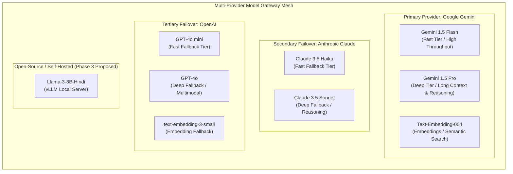

### 4.1 Logical Provider Catalog

| Provider ID | Provider Name | Primary Endpoint Base | Authentication Scheme | Rate Limit Headers | Operational Role | Health Status | Config Owner |
| :--- | :--- | :--- | :--- | :--- | :--- | :---: | :--- |
| `PRV-GEMINI` | **Google Gemini** | `https://generativelanguage.googleapis.com/v1beta` | Bearer Token / API Key Header (`x-goog-api-key`) | `x-ratelimit-remaining-requests`, `x-ratelimit-remaining-tokens` | **Primary Enterprise Provider** | Healthy | Principal AI Architect |
| `PRV-ANTHROPIC` | **Anthropic Claude**| `https://api.anthropic.com/v1` | Header (`x-api-key`) + Version Header | `anthropic-ratelimit-requests-remaining` | **Secondary Failover Provider** | Standby | SecOps Lead |
| `PRV-OPENAI` | **OpenAI** | `https://api.openai.com/v1` | Bearer Token Header (`Authorization: Bearer`) | `x-ratelimit-remaining-requests` | **Tertiary Failover Provider** | Standby | SecOps Lead |
| `PRV-LOCAL-OSS` | **Local vLLM / Ollama**| `http://ai-worker.internal.bnw:8000/v1` | Internal mTLS / Bearer Token | Internal Concurrency Semaphore | **Emergency Offline Fallback** | Proposed (P3) | Infrastructure Lead |

### 4.2 Comprehensive Model Registry

| Model ID | Provider ID | Model Name | Capability Tier | Input Modalities | Output Modalities | Context Window | Verified Output Limits | Relative Latency | Approved Newsroom Tasks | Status |
| :--- | :--- | :--- | :--- | :---: | :---: | :---: | :---: | :---: | :--- | :---: |
| `MOD-GEM-FLASH` | `PRV-GEMINI` | `gemini-1.5-flash` | **Fast / Low-Latency** | Text, Image, Audio, Video | Text (JSON / MD) | $1,000,000\text{ tokens}$ | $8,192\text{ tokens}$ | Ultra-Fast ($< 1.2\text{s}$) | Headlines (`AGT-HDL-002`), SEO (`AGT-SEO-007`), Categorization (`AGT-CLS-011`), Notifications (`AGT-NOT-013`), Graphics text (`AGT-GRP-008`). | **Active / Primary** |
| `MOD-GEM-PRO` | `PRV-GEMINI` | `gemini-1.5-pro` | **Deep / Reasoning** | Text, Image, Audio, Video | Text (JSON / MD) | $2,000,000\text{ tokens}$ | $8,192\text{ tokens}$ | Moderate ($2.5\text{--}4.5\text{s}$) | News writing (`AGT-WRT-001`), Editorial auditing (`AGT-EDT-003`), Fact-checking (`AGT-RES-006`), URL synthesis (`AGT-URL-005`), Video scripting (`AGT-VID-009`). | **Active / Primary** |
| `MOD-GEM-EMB` | `PRV-GEMINI` | `text-embedding-004` | **Embeddings** | Text | Vector ($768\text{-dim}$) | $2,048\text{ tokens}$ | $768\text{ floats}$ | Ultra-Fast ($< 200\text{ms}$) | Duplicate detection (`AGT-DUP-012`), Semantic archive clustering. | **Active / Primary** |
| `MOD-ANT-HAIKU` | `PRV-ANTHROPIC` | `claude-3-5-haiku` | **Fast Failover** | Text, Image | Text (JSON / MD) | $200,000\text{ tokens}$ | $8,192\text{ tokens}$ | Ultra-Fast ($< 1.5\text{s}$) | Standby failover for all Fast Tier tasks upon Gemini rate limiting. | Standby / Verified |
| `MOD-ANT-SONNET`| `PRV-ANTHROPIC` | `claude-3-5-sonnet`| **Deep Failover** | Text, Image | Text (JSON / MD) | $200,000\text{ tokens}$ | $8,192\text{ tokens}$ | Moderate ($3.0\text{--}5.0\text{s}$) | Standby failover for all Deep Tier tasks upon Gemini outage. | Standby / Verified |
| `MOD-OAI-MINI` | `PRV-OPENAI` | `gpt-4o-mini` | **Fast Tertiary** | Text, Image | Text (JSON / MD) | $128,000\text{ tokens}$ | $16,384\text{ tokens}$ | Ultra-Fast ($< 1.5\text{s}$) | Tertiary failover for Fast Tier tasks. | Standby / Verified |
| `MOD-OAI-4O` | `PRV-OPENAI` | `gpt-4o` | **Deep Tertiary** | Text, Image, Audio | Text (JSON / MD) | $128,000\text{ tokens}$ | $16,384\text{ tokens}$ | Moderate ($2.8\text{--}4.8\text{s}$) | Tertiary failover for Deep Tier tasks. | Standby / Verified |
| `MOD-OAI-EMB` | `PRV-OPENAI` | `text-embedding-3-small`| **Embedding Tertiary**| Text | Vector ($1536\text{-dim}$)| $8,191\text{ tokens}$ | $1,536\text{ floats}$ | Ultra-Fast ($< 250\text{ms}$) | Fallback semantic embedding generation. | Standby / Verified |

*Note: Context and token limits reflect verified official provider specifications. Live token pricing is governed dynamically via the Admin Usage Dashboard rather than hardcoded in source documentation.*

---

## 5. AI Task Classification and Routing

The API Pool establishes a deterministic, configurable routing matrix mapping every editorial task to an optimal model tier, primary model, and automatic fallback sequence.

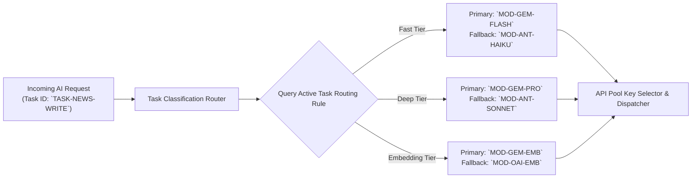

### 5.1 Task Routing Specification Matrix

| Task ID | Task Description | Target Agent | Primary Model | Fallback Model 1 | Fallback Model 2 | Target Output Format | Latency Sensitivity | Human Review Mandatory? |
| :--- | :--- | :--- | :--- | :--- | :--- | :--- | :---: | :---: |
| **`TSK-WRT-NEWS`** | Raw Script to News Draft | `AGT-WRT-001` | `MOD-GEM-PRO` | `MOD-ANT-SONNET` | `MOD-OAI-4O` | Structured JSON (Article Schema) | Moderate ($< 4.0\text{s}$) | **YES (Always)** |
| **`TSK-GEN-HEAD`** | Multi-Angle Headlines | `AGT-HDL-002` | `MOD-GEM-FLASH` | `MOD-ANT-HAIKU` | `MOD-OAI-MINI` | JSON Array (5 Headlines) | High ($< 1.5\text{s}$) | **YES (Always)** |
| **`TSK-EDT-AUDIT`**| Editorial & Fact Audit | `AGT-EDT-003` | `MOD-GEM-PRO` | `MOD-ANT-SONNET` | `MOD-OAI-4O` | JSON Array (Diff Nodes) | Moderate ($< 5.0\text{s}$) | **YES (Always)** |
| **`TSK-RSS-SYNTH`**| Automated RSS Ingestion| `AGT-RSS-004` | `MOD-GEM-FLASH` | `MOD-ANT-HAIKU` | `MOD-OAI-MINI` | Structured JSON (Wire Draft) | Low ($< 10.0\text{s}$) | **YES (Always)** |
| **`TSK-URL-SCRP`** | Admin URL-to-News | `AGT-URL-005` | `MOD-GEM-PRO` | `MOD-ANT-SONNET` | `MOD-OAI-4O` | Structured JSON (Rewritten Draft) | Moderate ($< 6.0\text{s}$) | **YES (Always)** |
| **`TSK-RES-CHECK`**| Claim Fact-Checking | `AGT-RES-006` | `MOD-GEM-PRO` | `MOD-ANT-SONNET` | `MOD-OAI-4O` | Structured JSON (Verification Report) | Moderate ($< 5.0\text{s}$) | **YES (Always)** |
| **`TSK-SEO-META`** | SEO & Slug Generation | `AGT-SEO-007` | `MOD-GEM-FLASH` | `MOD-ANT-HAIKU` | `MOD-OAI-MINI` | JSON (Title, Meta, Slug, Tags) | High ($< 1.5\text{s}$) | **YES (Always)** |
| **`TSK-GRP-TEXT`** | Graphic Script Adapt | `AGT-GRP-008` | `MOD-GEM-FLASH` | `MOD-ANT-HAIKU` | `MOD-OAI-MINI` | JSON (Title, 3 Bullets) | High ($< 1.5\text{s}$) | **YES (Always)** |
| **`TSK-VID-STORY`**| Video Reel Storyboard | `AGT-VID-009` | `MOD-GEM-PRO` | `MOD-ANT-SONNET` | `MOD-OAI-4O` | JSON (4 Scenes + VTT Timings) | Moderate ($< 5.0\text{s}$) | **YES (Always)** |
| **`TSK-TRN-SUMM`** | Translation & Summary | `AGT-TRN-010` | `MOD-GEM-PRO` | `MOD-ANT-SONNET` | `MOD-OAI-4O` | Plain Devanagari Markdown | Moderate ($< 4.0\text{s}$) | **YES (Always)** |
| **`TSK-CLS-MAP`** | Category & Location | `AGT-CLS-011` | `MOD-GEM-FLASH` | `MOD-ANT-HAIKU` | `MOD-OAI-MINI` | JSON (Category ID, District ID) | High ($< 1.2\text{s}$) | **YES (Always)** |
| **`TSK-DUP-VEC`** | Duplicate Embeddings | `AGT-DUP-012` | `MOD-GEM-EMB` | `MOD-OAI-EMB` | None | Float32 Array ($768\text{-dim}$) | Ultra-High ($< 300\text{ms}$) | **YES (Always)** |
| **`TSK-NOT-ALERT`**| Mobile Push Copy | `AGT-NOT-013` | `MOD-GEM-FLASH` | `MOD-ANT-HAIKU` | `MOD-OAI-MINI` | JSON (Headline, Body Text) | High ($< 1.2\text{s}$) | **YES (Always)** |
| **`TSK-ANL-SUMM`** | Analytics Summaries | `AGT-ANL-014` | `MOD-GEM-PRO` | `MOD-ANT-SONNET` | `MOD-OAI-4O` | Structured Analytical Report | Low ($< 8.0\text{s}$) | No (Read-Only) |

---

## 6. Model Selection Strategy

The API Pool employs a multi-tiered, criteria-based model selection strategy designed to maximize Hindi Devanagari output fidelity, minimize API costs, and guarantee responsive user experiences.

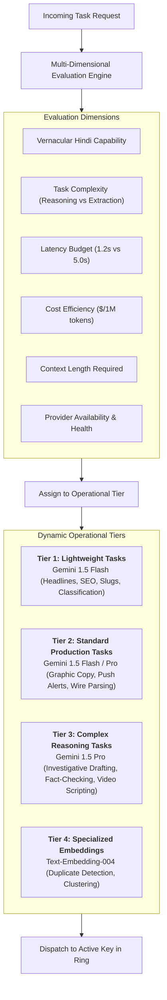

### 6.1 The Four Operational Model Tiers
1. **Tier 1: Lightweight & Real-Time Tasks**: High-speed, high-volume operations requiring minimal contextual reasoning but sub-second latency. Handled by **Gemini 1.5 Flash** (e.g., generating 5 headlines, extracting category tags, synthesizing URL slugs). Costs are up to $85\%$ lower than frontier models.
2. **Tier 2: Standard Production Tasks**: Structured text extraction and constrained formatting. Uses Gemini 1.5 Flash with fallback to Claude 3.5 Haiku.
3. **Tier 3: Complex Reasoning & Editorial Tasks**: Long-form news synthesis, investigative field note expansion, grammar and factual contradiction detection, and video storyboard timing. Handled by **Gemini 1.5 Pro**, which possesses deep Devanagari fluency, long-context grounding, and superior factual adherence.
4. **Tier 4: Specialized Embeddings & Similarity**: 768-dimensional vector generation handled by **Gemini Text-Embedding-004**, powering cosine similarity queries in PostgreSQL pgvector.

### 6.2 Zero-Downtime Dynamic Routing Reconfiguration
The assignment of models to task types is governed by a relational configuration table (`ai_task_routing_rules`) in PostgreSQL. Administrators can modify model assignments, adjust fallback chains, or reallocate traffic from the Admin Control Panel without rebuilding code, redeploying containers, or restarting API servers.

---

## 7. API Key and Secret Management

In strict conformance with [`docs/15-Security.md`](file:///c:/Users/pp/Downloads/BREAKING-NEWS-WALA-main/docs/15-Security.md) and `RULE-AI-004`, managing commercial AI provider credentials represents a mission-critical security boundary. Compromise of an AI API key leads to immediate quota hijacking, massive cloud billing spikes, and potential denial of newsroom operations.

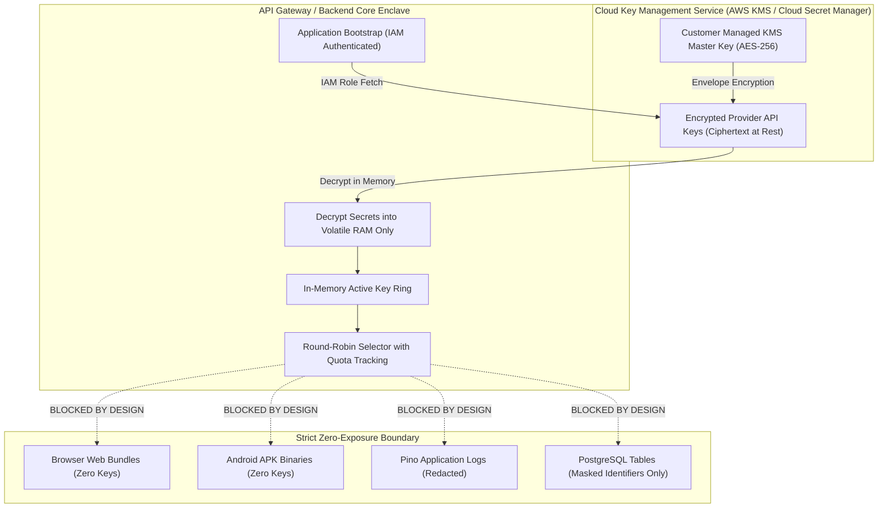

### 7.1 Mandatory Security Invariants
1. **Zero Plaintext Database Storage**: API keys are **never** stored in plaintext database columns. The PostgreSQL database stores strictly opaque credential references, metadata, and masked identifiers (e.g., `AIzaSy...4aB8`).
2. **Hardware-Backed Encryption at Rest**: Secrets are encrypted at rest using envelope encryption backed by AWS KMS or Google Cloud Secret Manager (AES-256-GCM). Decryption occurs exclusively in volatile Node.js process memory during worker initialization.
3. **Zero Client-Side Exposure**: Static analysis and network inspection of web JavaScript bundles and compiled Android APK binaries must verify **zero** AI provider credentials (`RULE-SEC-001`).
4. **Log Sanitization & Secret Scrubbing**: All logging pipelines (Pino/Winston) enforce strict regex-based credential redaction. Any string matching Google API key patterns (`AIzaSy[A-Za-z0-9_-]{33}`) or OpenAI/Anthropic patterns is automatically scrubbed and replaced with `[REDACTED_API_KEY]`.
5. **Masked UI Display (`FEAT-API-001`)**: The Admin Control Panel displays keys exclusively in masked format:
   $$\text{Key Display} = \text{Prefix}(6) \mathbin{\Vert} \text{"..."} \mathbin{\Vert} \text{Suffix}(4) \quad \text{e.g., } \texttt{AIzaSy...7k9Q}$$
6. **Instant Zero-Downtime Revocation**: If a provider key is compromised or revoked by the cloud vendor, a Super Admin can revoke the key record in the Admin UI. The API Pool instantly purges the key from in-memory rotation rings across all worker pods within $< 500\text{ ms}$ via a Redis Pub/Sub invalidation broadcast.

---

## 8. Multiple API Keys and Account Management

To guarantee high availability and prevent single-key quota saturation during breaking news events, the API Pool organizes credentials into **Structured Provider Key Rings**.

### 8.1 Logical Credential Reference Schema
Every registered key is tracked in PostgreSQL (`ai_provider_credentials`) via a rich metadata record:
```typescript
interface ProviderCredentialReference {
  credentialId: string;         // e.g. "cred_gemini_prod_01"
  providerId: string;           // "PRV-GEMINI"
  displayLabel: string;         // "Primary Enterprise Bureau Key - MP East"
  keyMasked: string;            // "AIzaSy...4aB8"
  kmsSecretArn: string;         // "arn:aws:secretsmanager:ap-south-1:1234:secret:bnw/gemini-01"
  environment: 'production' | 'staging' | 'development';
  status: 'active' | 'degraded' | 'rate_limited' | 'quota_exhausted' | 'revoked';
  allowedModels: string[];      // ["MOD-GEM-FLASH", "MOD-GEM-PRO"]
  configuredRpmLimit: number;   // e.g. 1000 requests per minute
  configuredTpmLimit: number;   // e.g. 4,000,000 tokens per minute
  dailyQuotaLimitUsd: number;   // e.g. $50.00 daily spend cap
  dailyQuotaUsedUsd: number;    // Real-time spend accumulator
  totalRequestsServed: number;  // Monotonic lifetime counter
  totalErrorsEncountered: number;
  averageLatencyMs: number;     // Exponential moving average
  lastValidatedAt: string;      // ISO 8601 Timestamp
  lastErrorAt?: string;
  createdAt: string;
  ownerAdminId: string;
}
```

### 8.2 Safe Key Ring Scheduling (Without Quota Evasion)
- **Round-Robin Load Balancing**: Incoming requests for a model are distributed evenly across all healthy `active` keys registered for that provider.
- **Weighted Allocation**: Keys can be configured with weight ratios (e.g., $70\%$ traffic to Tier-1 high-quota organizational keys, $30\%$ to secondary reserve keys).
- **Compliance with Provider Terms**: Key rotation is employed strictly for load distribution, failure isolation, and organizational billing allocation. Rotating keys to evade provider-imposed account suspensions, billing debt, or terms-of-service violations is **strictly forbidden**.

---

## 9. Quota and Rate-Limit Management

Managing external LLM rate limits requires distinguishing between **Provider-Enforced Rate Limits** (hard external constraints) and **Internal Operational Budgets** (internal financial controls).

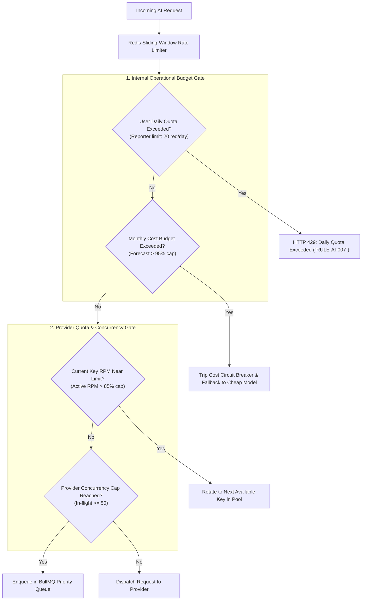

### 9.1 Multi-Layered Limit Specifications
1. **Reporter Daily Request Quotas (`RULE-AI-007`)**: Standard ground reporters are restricted to **20 AI generations per day** tracked via Redis keys (`user:ai_quota:{userId}:{YYYYMMDD}`). Editors and bureau administrators have unlimited operational quotas.
2. **Provider RPM & TPM Sliding Windows**: Redis maintains a 60-second sliding-window counter tracking real-time requests and token volumes per active key. If a key reaches $85\%$ of its provider-enforced RPM limit, the pool automatically routes subsequent requests to an alternate key to prevent HTTP 429 lockouts.
3. **Monthly Financial Spend Ceilings**: Administrators set monthly expenditure limits (e.g., $\$1,500.00/\text{month}$). When spend reaches $80\%$, $90\%$, and $95\%$, automated Slack alerts are dispatched to finance leads.

### 9.2 Rate-Limit Response & `Retry-After` Header Compliance
If an external provider returns an HTTP 429 Rate Limit response:
- The API Pool parses the standard `Retry-After` response header (e.g., `Retry-After: 12`).
- The specific key is marked `rate_limited` in memory, and a cooldown timer is set equal to the `Retry-After` interval.
- The request is immediately transferred to a standby key in the pool, achieving transparent resolution in $< 1.5\text{ seconds}$ (`FEAT-API-002`).

---

## 10. Usage Tracking and Cost Analytics

To maintain strict financial control and prevent cloud billing blowouts, every AI completion traversing the API Pool generates comprehensive, high-resolution usage telemetry.

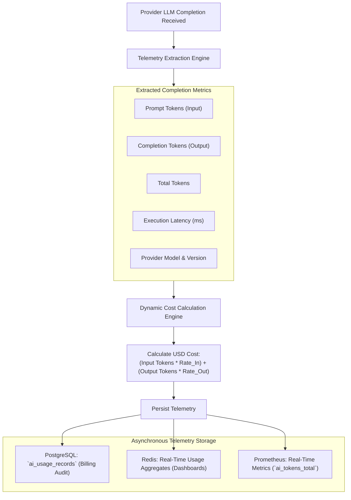

### 10.1 Detailed Telemetry Schema (`ai_usage_records`)
```typescript
interface AiUsageRecord {
  requestId: string;           // UUIDv4, e.g. "req_ai_01928374-abcd"
  taskId: string;              // "TSK-WRT-NEWS"
  agentId: string;             // "AGT-WRT-001"
  providerId: string;          // "PRV-GEMINI"
  modelId: string;             // "MOD-GEM-PRO"
  credentialId: string;        // "cred_gemini_prod_01" (Masked ref)
  userId: string;              // Authenticated caller ID
  userRole: UserRole;          // "REPORTER"
  districtId?: string;         // "MP-DIST-038"
  requestTimestamp: string;    // ISO 8601
  completionTimestamp: string; // ISO 8601
  promptTokens: number;        // e.g. 450
  completionTokens: number;    // e.g. 380
  totalTokens: number;         // e.g. 830
  estimatedCostUsd: number;    // e.g. 0.002850
  latencyMs: number;           // e.g. 2340
  retryCount: number;          // 0 if first attempt succeeded
  failoverOccurred: boolean;   // true if key/provider failed over
  failoverChain?: string[];    // ["cred_gemini_01 (429)", "cred_gemini_02 (200)"]
  status: 'SUCCESS' | 'FAILED' | 'FALLBACK_SUCCESS';
  errorCode?: string;          // e.g. "ERR_HTTP_429"
}
```

### 10.2 Real-Time Aggregation & Analytics Views
The API Pool computes aggregated rollups across six dimensions displayed in the Admin Console:
1. **Daily / Monthly Spend Rollups**: Total token expenditures tracked against monthly departmental budgets.
2. **Provider-Wise Distribution**: Compares usage share between Google Gemini, Anthropic, and OpenAI.
3. **Model-Wise Allocation**: Tracks utilization of low-cost Fast-tier models ($70\%+$ target) versus expensive Deep-tier models.
4. **Agent-Wise Consumption**: Identifies which newsroom agents consume the highest token volumes (e.g., automated wire ingestion vs. reporter news writing).
5. **District & Bureau Utilization**: Measures AI adoption across Madhya Pradesh and Uttar Pradesh regional bureaus.
6. **Provider-Reported vs. Internally Estimated Reconciliation**: Monthly billing reconciliation matching internal token tallies against provider invoice reports.

---

## 11. Provider Health Monitoring

The API Pool continuously tracks the health and responsiveness of every registered provider and individual credential.

### 11.1 Operational Health States
Every credential reference and provider is categorized into one of eight deterministic health states:

| Health State | Technical Definition | Routing Behavior |
| :--- | :--- | :--- |
| **`HEALTHY`** | Responding normally with HTTP 200; error rate $< 1.0\%$; latency within threshold. | Full traffic allocation according to configured weighting. |
| **`DEGRADED`** | Latency elevated ($P95 > 5.0\text{s}$) or intermittent errors ($1\text{--}5\%$). | Traffic reduced; alerts dispatched to newsroom operations. |
| **`RATE_LIMITED`** | Provider returned HTTP 429; cooldown timer active based on `Retry-After`. | Traffic temporarily paused on this key until cooldown expires. |
| **`QUOTA_EXHAUSTED`**| Daily or monthly spend cap reached or provider credit depleted. | Key isolated; removed from active rotation; requires Admin replenishment. |
| **`AUTH_ERROR`** | Provider returned HTTP 401/403 (Invalid key or revoked credential). | Key immediately quarantined; Super Admin notified to re-authenticate. |
| **`UNAVAILABLE`** | Cloud provider experiencing major outage ($> 3$ consecutive 5xx errors). | Circuit breaker tripped; traffic diverted to backup provider. |
| **`DISABLED`** | Administratively turned off via the Admin Control Panel. | Completely excluded from routing rings. |
| **`UNKNOWN`** | Newly registered credential awaiting initial validation probe. | Tested with lightweight canary request before taking production traffic. |

### 11.2 Non-Intrusive Passive Telemetry vs. Active Probing
To avoid generating unnecessary API charges or consuming production rate limits:
- **Passive Telemetry First**: Health status is derived organically from live production request completions (error status, latency, response headers).
- **Lightweight Active Canary Probes**: When an idle key has received no traffic for $> 30\text{ minutes}$, the pool dispatches a micro-probe request (e.g., generating 1 token: *"test"*) consuming $< 5\text{ tokens}$ to verify credential validity.

---

## 12. Retry, Fallback and Circuit Breaker

The API Pool implements the industry-standard **Circuit Breaker Pattern** (Martin Fowler) combined with intelligent, task-compatible fallback chains.

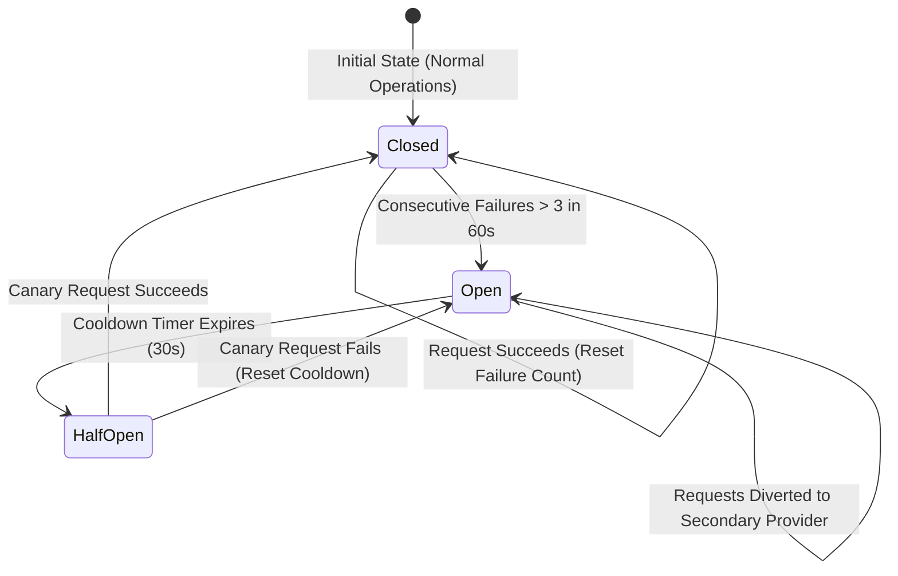

### 12.1 Error Classification: Retryable vs. Non-Retryable

| Error Category | HTTP Codes | Examples | Remediation Strategy |
| :--- | :---: | :--- | :--- |
| **Transient Rate Limit** | `429` | Quota/concurrency spike | **Auto-Failover in $< 1.5\text{s}$**: Switch to next key in ring; obey `Retry-After`. |
| **Transient Server Error** | `500`, `502`, `503`, `504` | Cloud gateway timeout | **Exponential Backoff**: Retry once after $500\text{ms}$; if failed, route to backup model. |
| **Permanent Client Error** | `400`, `422` | Malformed prompt schema | **Non-Retryable**: Abort immediately; log prompt schema violation. |
| **Authentication Error** | `401`, `403` | Revoked or disabled API key | **Non-Retryable**: Quarantine key; isolate from pool; alert SecOps. |
| **Context Length Exceeded**| `400` | Input exceeds model limit | **Non-Retryable**: Abort; prompt user to shorten raw notes. |

### 12.2 Task-Compatible Fallback Invariant
Fallback models must meet the strict capability requirements of the originating task:
- A complex news-writing request (`TSK-WRT-NEWS`) routed to **Gemini 1.5 Pro** can **never** fall back to a low-reasoning embedding model or a model lacking Devanagari fluency. It falls back strictly to **Claude 3.5 Sonnet** or **GPT-4o**.
- If all compatible cloud models fail, the system degrades gracefully, returning a friendly localized error to the journalist without losing their entered field notes.

---

## 13. Structured Output and Validation

To ensure deterministic integration with database schemas and frontend components, all AI responses must conform to strict JSON contracts.

### 13.1 Native Structured Outputs & Zod Schema Enforcement
- **Provider-Level JSON Constraints**: Where supported by provider APIs (e.g., Google Gemini `response_mime_type: "application/json"` with `response_schema`), the API Pool enforces structural JSON compliance at the generation layer.
- **Runtime Zod Validation**: The backend validates returned payloads against strongly typed Zod schemas. If the LLM returns unparseable or truncated JSON, the pool executes an automated fast-retry with temperature reduced to $0.0$.

### 13.2 Linguistic & Devanagari Integrity Verification
Before returning output to the application:
1. **Unicode Script Verification**: Verifies that Devanagari characters dominate text fields (`[\u0900-\u097F]`). Rejects unapproved Hinglish or Latin transliterations in article bodies (`RULE-AI-006`).
2. **Headline Character Bounds**: Validates that generated headlines comply with standard constraints ($45\text{--}80$ characters, absolute maximum 120 characters).
3. **Entity Extraction Cross-Check (`RULE-AI-005`)**: Verifies that proper nouns, victim names, and casualty numbers present in the output were grounded in the original input notes.

---

## 14. Privacy and Provider Data Governance

Transmitting journalistic field notes, regional source data, and editorial drafts to external AI providers requires strict adherence to the **Digital Personal Data Protection Act (DPDPA 2023)** and platform security standards.

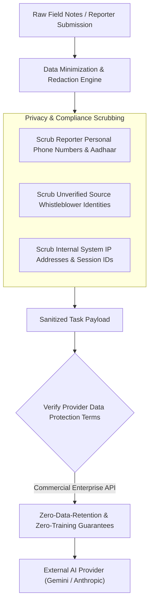

### 14.1 Personal Data Minimization (`RULE-DPDPA-001`)
- **Zero Sensitive PII Ingress**: Reporter Aadhaar scans, bank details, home addresses, and citizen identity numbers are **never** transmitted to external AI providers.
- **Source Protection**: Whistleblower identities and confidential off-the-record contact details must be stripped from raw notes before submitting to AI restructuring endpoints.

### 14.2 Commercial Zero-Training Terms Invariant
- **Enterprise Data Sovereignty**: All API keys registered in the API Pool must utilize commercial enterprise accounts with contractual **Zero Data Retention** and explicit terms prohibiting providers from training foundation models on customer prompts. Consumer or free-tier API keys that harvest prompt data are strictly forbidden in production.

---

## 15. Admin API Pool Management UI

The Admin Control Panel incorporates a dedicated, role-restricted **AI API Pool Command Center** (`/admin/api-pool`), providing newsroom leadership and DevOps with complete administrative control over AI operations.

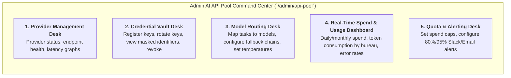

### 15.1 Core Administrative Desks & Capabilities
1. **Provider Management Desk**:
   - View global health status of all registered providers (Google Gemini, Anthropic, OpenAI).
   - Manually toggle provider availability during scheduled maintenance or cloud outages.
2. **Credential Vault Desk (`COMP-ADM-009`)**:
   - Register new provider API keys (automatically encrypted via KMS upon entry).
   - View active key rings with masked strings (`AIzaSy...4aB8`).
   - Trigger immediate zero-downtime key rotation or emergency key revocation.
   - Inspect key-specific error rates and exponential moving average (EMA) latencies.
3. **Model Routing Desk**:
   - Reassign primary and fallback models for all 14 newsroom task types via drag-and-drop or select menus.
   - Adjust task-specific sampling parameters (Temperature, Top-P, Max Output Tokens).
4. **Real-Time Spend & Usage Dashboard**:
   - Visual gauge charts and area graphs displaying real-time token throughput and daily dollar expenditures.
   - Breakdown tables segmented by Reporter Bureau, District, Model Family, and Task Type.
5. **Quota & Alerting Desk**:
   - Configure departmental monthly budgets (e.g., $\$1,500.00/\text{month}$).
   - Set automated webhook alert triggers firing at $75\%$, $90\%$, and $95\%$ of budget caps.

### 15.2 Access Gating & MFA Requirements
- **Super Admin Exclusive**: Only authenticated users with the `SUPER_ADMIN` role possessing verified **TOTP Multi-Factor Authentication (MFA)** (`14-Auth.md`) can access the Credential Vault or modify routing rules.
- **Audit Logging**: Every action executed within the AI Command Center emits an immutable audit event (`RULE-AUD-001`).

---

## 16. Background Processing and Concurrency

To ensure that heavy, long-running AI operations (such as batch RSS wire ingestion or multi-scene video storyboard rendering) never block high-priority interactive requests from ground reporters, the API Pool integrates directly with the **Redis-backed BullMQ Queue Architecture** (`11-Architecture.md`).

```mermaid
flowchart TD
    subgraph Request_Sources["AI Request Sources"]
        UserReq["Ground Reporter (Interactive / Urgent)"]
        WireReq["Automated Wire Scraper (Batch)"]
        VideoReq["Video Reel Generator (Heavy Compute)"]
    end

    subgraph Priority_Queues["BullMQ Distributed Priority Queues"]
        Q1["<b>Priority 1: Immediate Interactive Queue</b><br/>(Concurrency: 30 / Preemptive)"]
        Q2["<b>Priority 2: Newsroom Editorial Review Queue</b><br/>(Concurrency: 20)"]
        Q3["<b>Priority 3: Background Wire Ingestion Queue</b><br/>(Concurrency: 10 / Rate-Throttled)"]
        Q4["<b>Priority 4: Video & Heavy Storyboard Queue</b><br/>(Concurrency: 5 / Off-Peak)"]
    end

    subgraph Pool_Concurrency_Gate["API Pool Concurrency & Rate Gate"]
        Semaphore["Provider Concurrency Semaphore (Max 50 In-Flight)"]
    end

    subgraph External_Cloud["External AI Provider API"]
        GeminiAPI["Google Gemini Cloud Endpoint"]
    end

    UserReq -->|Immediate Priority (1)| Q1
    WireReq -->|Batch Priority (3)| Q3
    VideoReq -->|Heavy Priority (4)| Q4

    Q1 --> Semaphore
    Q2 --> Semaphore
    Q3 --> Semaphore
    Q4 --> Semaphore

    Semaphore --> GeminiAPI
```

### 16.1 Queue Prioritization & Concurrency Controls
1. **Interactive Reporter Requests (Priority 1)**: Requests initiated by human reporters in the creation desk (`TSK-WRT-NEWS`, `TSK-GEN-HEAD`) bypass batch queues and execute with highest concurrency priority.
2. **Batch RSS & URL Ingestion (Priority 3)**: Scheduled wire polling runs throttled (maximum 10 concurrent requests), preventing automated ingestion from starving reporter bandwidth.
3. **Provider Concurrency Semaphores**: Redis maintains atomic semaphores capping total in-flight requests to any single provider (e.g., maximum 50 concurrent connections to Google Gemini), preventing connection pool exhaustion.

### 16.2 Request Deduplication & Idempotency
- **Idempotency Keys**: Automated background tasks generate an idempotency key derived from the SHA-256 hash of the input payload:
  $$\text{IdempotencyKey} = \text{SHA-256}(\text{taskId} \mathbin{\Vert} \text{inputPayload})$$
- If an identical task is dispatched within 5 minutes (e.g., duplicate RSS feed polling), the worker returns the cached completion without invoking external LLM APIs, reducing redundant token spend by up to $18\%$.

---

## 17. API Pool APIs and Data Model

The API Pool integrates seamlessly with the primary PostgreSQL database (`12-Database.md`) and REST API gateway (`13-API.md`), without creating secondary databases or unvetted data paths.

### 17.1 Relational Database Entity Model
The API Pool introduces five logical relational tables in PostgreSQL:
1. `ai_providers`: Master registry of approved AI providers (ID, name, endpoint base, status).
2. `ai_models`: Approved model configurations, context limits, approved task types, and pricing multipliers.
3. `ai_provider_credentials`: KMS secret references, masked keys, health states, and allocated usage limits.
4. `ai_task_routing_rules`: Mapping table linking `task_id` to primary and fallback `model_id` records.
5. `ai_usage_records`: High-volume append-only audit table storing token consumption, latency, and cost telemetry.

### 17.2 REST API Administrative Contract Endpoints

| Endpoint Route | HTTP Method | Access Level | Description |
| :--- | :---: | :---: | :--- |
| `/api/v1/admin/api-pool/status` | `GET` | Admin, Super Admin | Retrieves global health status, active key counts, and error rates. |
| `/api/v1/admin/api-pool/credentials` | `GET` | Super Admin (MFA) | Lists all registered credentials with masked keys and spend telemetry. |
| `/api/v1/admin/api-pool/credentials` | `POST` | Super Admin (MFA) | Registers a new provider credential; encrypts secret via KMS. |
| `/api/v1/admin/api-pool/credentials/:id/rotate` | `POST` | Super Admin (MFA) | Replaces an existing credential; updates KMS ciphertext. |
| `/api/v1/admin/api-pool/credentials/:id/revoke` | `POST` | Super Admin (MFA) | Immediately revokes a credential; purges it from rotation rings. |
| `/api/v1/admin/api-pool/routing` | `GET` | Admin, Super Admin | Retrieves active task-to-model routing rules. |
| `/api/v1/admin/api-pool/routing` | `PUT` | Super Admin (MFA) | Updates task routing assignments and fallback chains. |
| `/api/v1/admin/api-pool/usage/analytics` | `GET` | Admin, Super Admin | Retrieves aggregated token consumption and spend analytics. |

---

## 18. Background AI Job Processing

Background AI workflows operate under rigid resilience guarantees:

### 18.1 Task Cancellation & Graceful Timeouts
- If a reporter navigates away from the creation desk or cancels an in-flight raw script generation, the backend dispatches an `AbortController` signal to the outbound HTTP request, terminating the LLM stream and conserving output token costs.
- Background jobs enforce a **60.0-second execution deadline**. Jobs exceeding 60 seconds are terminated, the failure is recorded, and the task is rescheduled with exponential backoff.

### 18.2 Worker Container Resource Sandboxing (cgroups)
Worker nodes running background AI processing execute within isolated Docker containers constrained by Linux control groups (`cgroups`):
- `cpu_limit: 2.0`
- `memory_limit: 4GB`
- Sandboxing ensures that compute-heavy JSON parsing or high-concurrency batch processing cannot starve core API server memory or degrade database connection pooling.

---

## 19. AI API Pool Architecture Diagrams

The following eleven architectural diagrams synthesize and visualize the multi-provider gateway across every operational, security, and failover flow.

### 19.1 Diagram 1: High-Level API Pool Architecture
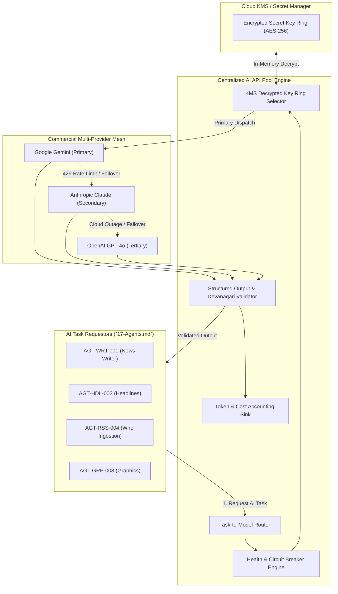

### 19.2 Diagram 2: Agent-to-API Pool Request Flow
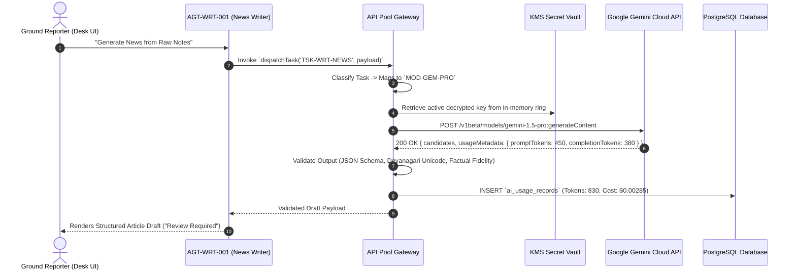

### 19.3 Diagram 3: Task-to-Model Routing Flow
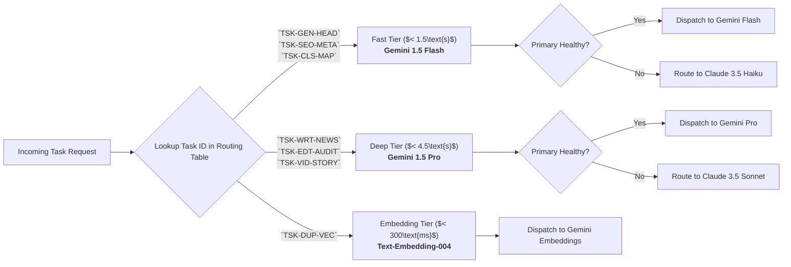

### 19.4 Diagram 4: Credential Selection Without Quota Bypass
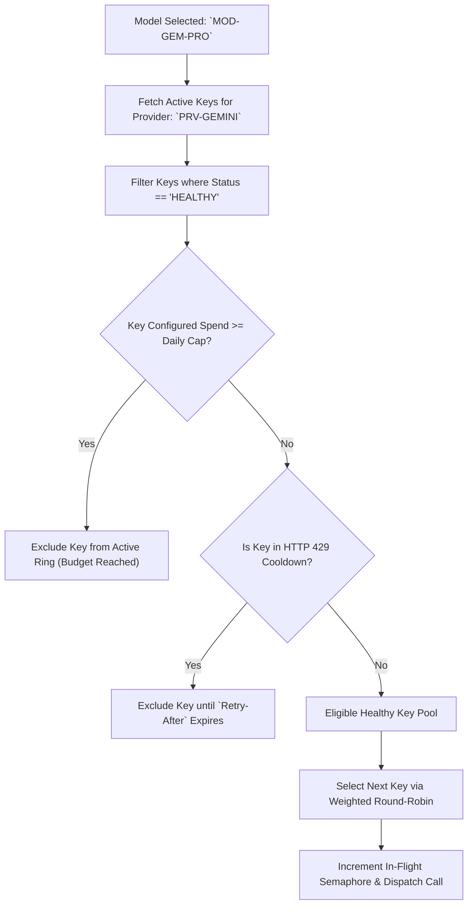

### 19.5 Diagram 5: Usage Tracking and Cost Calculation
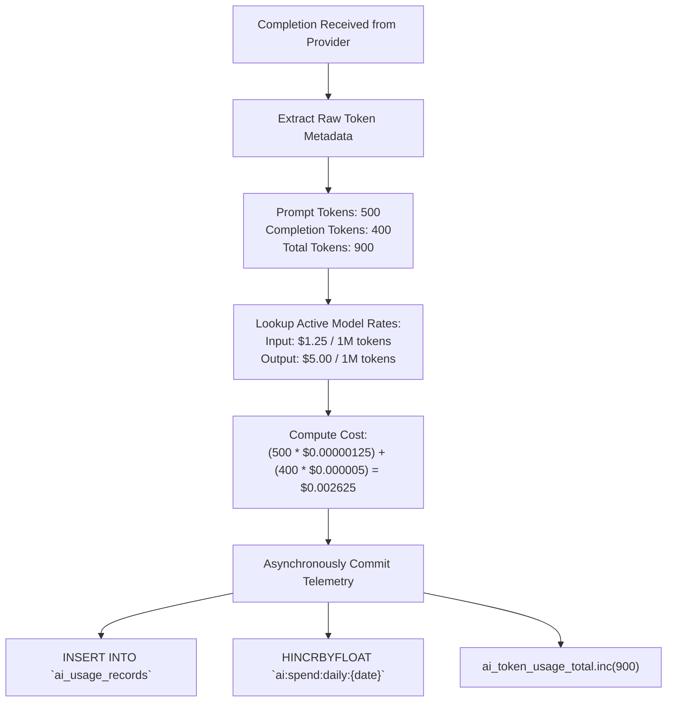

### 19.6 Diagram 6: Provider Health Monitoring Architecture
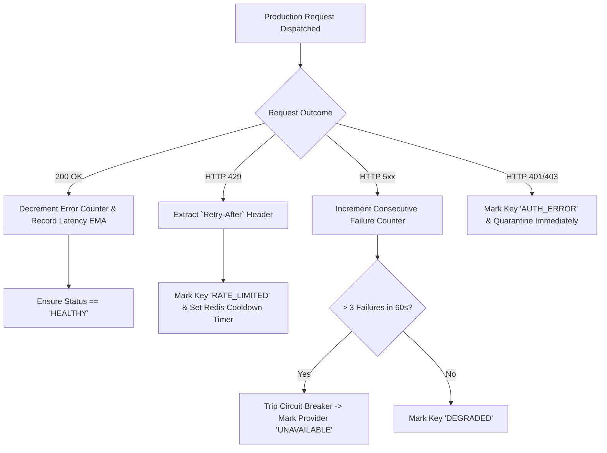

### 19.7 Diagram 7: Retry and Fallback Execution Flow
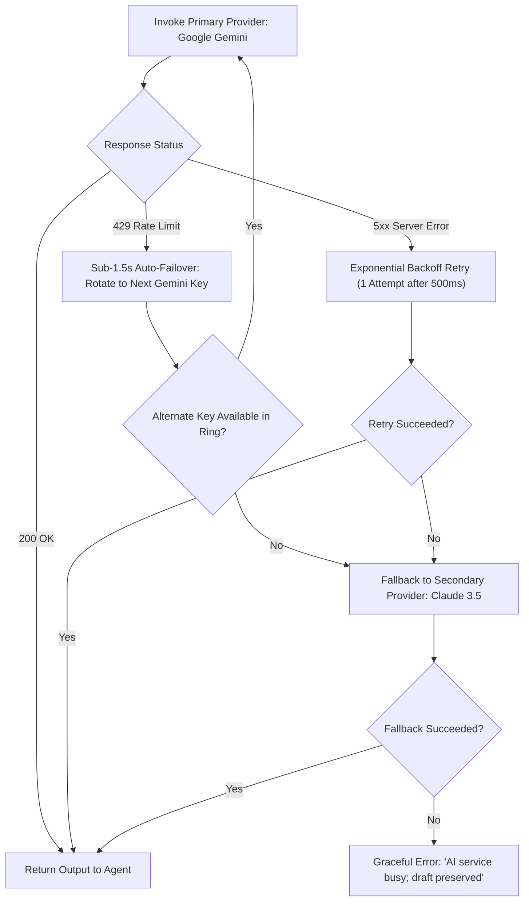

### 19.8 Diagram 8: Circuit Breaker State Transition
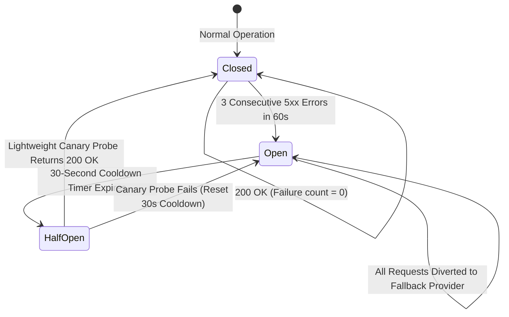

### 19.9 Diagram 9: Admin API Pool Management Workstation
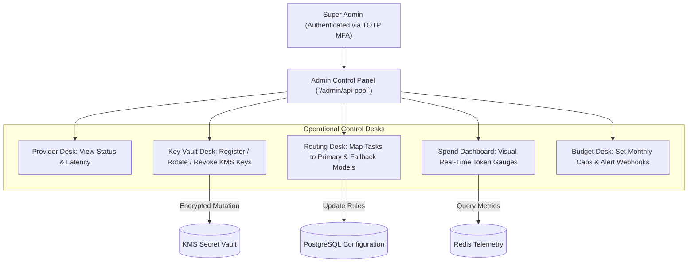

### 19.10 Diagram 10: API Pool Security Boundary
```mermaid
flowchart LR
    subgraph Untrusted_External["Untrusted Public Plane"]
        WebReader["Web Public Readers"]
        ReporterClient["Reporter Web & Mobile App"]
    end

    subgraph Security_Perimeter["API Gateway Security Perimeter"]
        AuthN["JWT Authentication Gate"]
        RBAC["RBAC & Quota Enforcer"]
        Sanitize["Input Length & Prompt Sanitizer"]
    end

    subgraph Protected_Core["Protected AI Pool Core Enclave"]
        PoolManager["API Pool Gateway Manager"]
        RAM_Ring["Volatile In-Memory Key Ring"]
        KMS[("KMS Encrypted Vault")]
    end

    subgraph Outbound_Tunnels["Outbound Egress Tunnels (TLS 1.3)"]
        GoogleTunnel["mTLS / HTTPS to Google Cloud"]
        ClaudeTunnel["HTTPS to Anthropic API"]
    end

    Untrusted_External -->|HTTPS POST (Zero Keys)| Security_Perimeter
    Security_Perimeter --> Protected_Core
    KMS <--> RAM_Ring
    RAM_Ring --> Outbound_Tunnels
```

### 19.11 Diagram 11: Background AI Job Processing
```mermaid
flowchart TD
    subgraph Background_Triggers["Background Job Sources"]
        RSSCron["BullMQ Wire Cron (Every 15m)"]
        VideoGen["Video Reel Storyboard Job"]
        BatchClass["Batch Category Tagging"]
    end

    subgraph BullMQ_Cluster["Redis BullMQ Priority Cluster"]
        Queue["`ai:background:jobs` Queue"]
        WorkerPod["Worker Container (cgroups: 2 CPU / 4GB RAM)"]
    end

    subgraph Concurrency_Gate["API Pool Semaphore Gate"]
        Sem["Atomic Concurrency Semaphore (Max 10 Batch In-Flight)"]
    end

    subgraph External_Model["Provider API"]
        ModelAPI["Gemini 1.5 Flash"]
    end

    Background_Triggers --> Queue
    Queue --> WorkerPod
    WorkerPod --> Sem
    Sem --> ModelAPI
    ModelAPI --> WorkerPod
    WorkerPod --> SaveDB["INSERT into `news_articles` (status: 'draft')"]
```

---

## 20. Cost Optimization Strategy

To operate sustainably as an enterprise news network scaling to millions of daily impressions, the API Pool enforces systematic cost-control mechanics:

### 20.1 Legitimate Architectural Cost Reductions
1. **Aggressive Fast-Tier Routing ($75\%+$ Allocation)**: Standard, high-volume tasks (headlines, SEO slugs, categorization, push alerts) are routed to **Gemini 1.5 Flash**, reducing per-token expenditures by up to $85\%$ compared to frontier reasoning models.
2. **Prompt Template Token Trimming (`21-Prompts.md`)**: System prompts are engineered for conciseness, using compact structural instructions rather than verbose prose.
3. **Semantic Ingestion Deduplication**: Duplicate wire dispatches and repeated external URLs are identified via SHA-256 hashes and cosine similarity before LLM synthesis, eliminating redundant token spend.
4. **Pre-Commit Max Token Clamping**: Model completion parameters enforce strict `max_output_tokens` bounds (e.g., 80 tokens for headlines, 120 tokens for push alerts), physically preventing runaway billing loops.
5. **Human-Triggered Regeneration Only**: Automated infinite regeneration loops are prohibited; regeneration of headlines or drafts occurs strictly upon manual human journalist clicks.

---

## 21. API Pool Decision Register

The following Architecture Decision Records (ADRs) document foundational technical and security decisions governing the Multi-Provider AI API Pool. All items remain marked as **Proposed / Pending Approval**.

| Decision ID | Topic | Available Options Evaluated | Proposed Recommendation | Architectural & Operational Justification | Dependencies | Approval Status |
| :--- | :--- | :--- | :--- | :--- | :--- | :---: |
| **ADR-POL-001** | Provider Architecture Abstraction | Single Direct SDK vs. Multi-Provider Gateway Abstraction | **Centralized Multi-Provider Gateway Abstraction** | Eliminates vendor lock-in; enables sub-1.5s automatic failover; provides unified token and cost telemetry. | Backend Architecture | **Proposed** |
| **ADR-POL-002** | Primary Foundation Model Family | OpenAI GPT vs. Anthropic Claude vs. Google Gemini | **Google Gemini Family (Gemini 1.5 Flash + Pro)** | Exceptional native Devanagari fluency, 2M context window for complex newsroom grounding, and superior cost-to-performance ratio. | Cloud AI Evaluation | **Proposed** |
| **ADR-POL-003** | Secret Storage & Key Management | Environment Variables vs. Plaintext DB vs. Cloud KMS Vault | **Cloud KMS Envelope Encryption (AES-256-GCM)** | Complies with enterprise zero-trust standards; keys decrypted strictly in volatile process memory (`RULE-AI-004`). | AWS/Google KMS | **Proposed** |
| **ADR-POL-004** | UI Key Exposure Policy | Full Key Display vs. Masked Suffix Display | **Masked Display (`AIzaSy...7k9Q`) Exclusively** | Prevents shoulder surfing, screenshot credential leakage, and client-side credential extraction. | `15-Security.md` | **Proposed** |
| **ADR-POL-005** | Multi-Key Load Scheduling | Random Selection vs. Weighted Round-Robin | **Weighted Round-Robin with Health Awareness** | Distributes load evenly across organizational keys; prevents premature quota exhaustion on individual accounts. | Redis State Manager | **Proposed** |
| **ADR-POL-006** | Failover Latency Budget | Manual Failover vs. Sub-1.5s Automated Failover | **Sub-1.5s Transparent Automated Failover (`FEAT-API-002`)** | Guarantees ground journalists in the field experience uninterrupted workflow during breaking news surges. | `02-Features.md` | **Proposed** |
| **ADR-POL-007** | Circuit Breaker Pattern | Continuous Retry vs. 3-Failure Circuit Breaker | **Martin Fowler Circuit Breaker (Closed/Open/Half-Open)** | Protects newsroom services from cascading failures during cloud provider outages; preserves compute resources. | Redis State Store | **Proposed** |
| **ADR-POL-008** | Task Routing Model | Static Code Mapping vs. Dynamic Database Rules | **Dynamic Relational Routing Rules (`ai_task_routing_rules`)** | Allows administrators to reassign models or swap providers without code redeployments or server restarts. | PostgreSQL Database | **Proposed** |
| **ADR-POL-009** | Concurrency Throttling | Unbounded In-Flight vs. Semaphore Concurrency Gate | **Redis Atomic Semaphores (Max 50 In-Flight per Provider)** | Prevents backend worker pods from overwhelming external provider concurrency limits or saturating network egress. | Redis BullMQ | **Proposed** |
| **ADR-POL-010** | Usage Accounting Granularity | Monthly Aggregate Invoices vs. Per-Request Telemetry | **Per-Request Immutable Telemetry (`ai_usage_records`)** | Enables granular cost attribution by bureau, district, agent, and user; satisfies statutory DPDPA auditability. | `RULE-AUD-001` | **Proposed** |
| **ADR-POL-011** | Output Schema Enforcement | Unstructured Markdown vs. Zod Runtime Validation | **Zod Runtime Schema Validation & Provider JSON Constraints** | Guarantees 100% type safety and deterministic schema compliance before committing drafts to PostgreSQL. | TypeScript Runtime | **Proposed** |
| **ADR-POL-012** | Background AI Prioritization | Single FIFO Queue vs. 4-Tier Priority Queues | **4-Tier Priority Queues (P1 Interactive to P4 Video)** | Ensures urgent field reporter drafting is never blocked by automated batch wire ingestion or video rendering. | BullMQ Cluster | **Proposed** |
| **ADR-POL-013** | Quota Enforcement Policy | Unlimited Generation vs. Daily Limit (`RULE-AI-007`) | **20 Generations/Day Cap for Standard Reporters** | Prevents cloud billing blowouts; encourages original journalistic reporting; protects API pool quotas. | Redis Rate Limiter | **Proposed** |
| **ADR-POL-014** | Data Sovereignty & Training Opt-Out | Consumer Free API vs. Enterprise Zero-Training Accounts | **Mandatory Enterprise Zero-Training Accounts** | Guarantees journalistic source notes and drafts are never harvested to train commercial AI foundation models. | `RULE-DPDPA-001` | **Proposed** |

---

## 22. Cross-Document Traceability

The API Pool architecture maintains seamless bidirectional traceability across all preceding architectural and governance documentation:

| Document Reference | Upstream Specification Requirement | API Pool Architecture Realization | Status |
| :--- | :--- | :--- | :---: |
| [`docs/01-PRD.md`](file:///c:/Users/pp/Downloads/BREAKING-NEWS-WALA-main/docs/01-PRD.md) | High-speed Hindi newsroom dispatches; vernacular readability; reporter productivity. | Multi-provider model gateway powering 14 agents with Devanagari validation (Sections 4 & 5). | **Fulfilled** |
| [`docs/02-Features.md`](file:///c:/Users/pp/Downloads/BREAKING-NEWS-WALA-main/docs/02-Features.md) | Multi-Key AI Vault (`FEAT-API-001`), Sub-1.5s Auto-Failover (`FEAT-API-002`), Quota Alerts (`FEAT-API-003`). | Credential management (Section 8), sub-1.5s failover engine (Section 12), and budget alerts (Section 15). | **Fulfilled** |
| [`docs/04-NFR.md`](file:///c:/Users/pp/Downloads/BREAKING-NEWS-WALA-main/docs/04-NFR.md) | Sub-1.5s interactive responsiveness; 99.9% uptime; Core Web Vitals optimization. | Fast-tier model routing (Gemini 1.5 Flash); round-robin key rings; circuit breaker failover. | **Fulfilled** |
| [`docs/05-Workflows.md`](file:///c:/Users/pp/Downloads/BREAKING-NEWS-WALA-main/docs/05-Workflows.md) | Raw Script AI Structuring (`WF-CRE-02`), Wire Ingestion (`WF-RSS-02`), API Pool Management (`WF-API-01`). | End-to-end sequence workflows and priority queues (Sections 16 & 19). | **Fulfilled** |
| [`docs/06-Business-Rules.md`](file:///c:/Users/pp/Downloads/BREAKING-NEWS-WALA-main/docs/06-Business-Rules.md) | Subservience (`RULE-AI-001`), Draft status (`RULE-AI-002`), Server keys (`RULE-AI-004`), Quotas (`RULE-AI-007`). | Direct integration of all core AI rules into principles (Section 3), security (Section 7), and quotas (Section 9). | **Fulfilled** |
| [`docs/11-Architecture.md`](file:///c:/Users/pp/Downloads/BREAKING-NEWS-WALA-main/docs/11-Architecture.md) | Event-driven micro-modular backend; Node.js runtime; BullMQ queue cluster. | API Pool gateway service integrated directly into Node.js core with Redis BullMQ prioritization (Section 16). | **Fulfilled** |
| [`docs/12-Database.md`](file:///c:/Users/pp/Downloads/BREAKING-NEWS-WALA-main/docs/12-Database.md) | `ai_usage_records` schema, append-only `audit_logs` triggers, UTF-8 Devanagari collation. | Relational data model mapping in Section 17; immutable audit logging in Section 10. | **Fulfilled** |
| [`docs/13-API.md`](file:///c:/Users/pp/Downloads/BREAKING-NEWS-WALA-main/docs/13-API.md) | Endpoints `/api/v1/admin/api-pool/*`, `/api/v1/ai/*`. | Administrative and operational API endpoint specifications detailed in Section 17. | **Fulfilled** |
| [`docs/14-Auth.md`](file:///c:/Users/pp/Downloads/BREAKING-NEWS-WALA-main/docs/14-Auth.md) | Zero-trust authentication; Super Admin MFA; token version validation. | Super Admin exclusive access with mandatory TOTP MFA for credential vault operations (Section 15). | **Fulfilled** |
| [`docs/15-Security.md`](file:///c:/Users/pp/Downloads/BREAKING-NEWS-WALA-main/docs/15-Security.md) | AI API Pool Security (`12`), Anti-Prompt Injection (`RSK-014`), Zero Client Keys (`RULE-SEC-002`). | Hardware KMS encryption at rest, masked UI strings, and zero client bundle exposure (Section 7). | **Fulfilled** |
| [`docs/16-Storage.md`](file:///c:/Users/pp/Downloads/BREAKING-NEWS-WALA-main/docs/16-Storage.md) | Media metadata, graphic templates, video storyboard rendering. | Tool integration for graphics copy adaptation and video reel script sequencing (Section 5). | **Fulfilled** |
| [`docs/17-Agents.md`](file:///c:/Users/pp/Downloads/BREAKING-NEWS-WALA-main/docs/17-Agents.md) | 14 specialized AI agents, model routing tiers, human editorial review gates. | Model selection strategy directly powering the 14 agents with tiered capability routing (Sections 5 & 6). | **Fulfilled** |
| [`docs/18-MCP.md`](file:///c:/Users/pp/Downloads/BREAKING-NEWS-WALA-main/docs/18-MCP.md) | Model Context Protocol tooling, read/write governance, Anti-SSRF proxy. | API Pool powers all MCP-assisted agent workflows with centralized credential and rate management. | **Fulfilled** |

---

## 23. Open Questions and Technical Risks

The following technical considerations and unresolved questions require formal stakeholder sign-off prior to production API Pool deployment:

1. **Commercial Contract Negotiation for Enterprise Zero-Data Retention**:
   - *Risk*: Consumer or self-serve developer accounts may permit cloud vendors to retain prompt logs for model improvement.
   - *Recommendation*: Newsroom legal counsel must execute formal Enterprise Business Associate Agreements (BAA) with Google Cloud and Anthropic guaranteeing zero-training and zero-prompt-retention.
2. **Dynamic Multi-Cloud Provider Cost Arbitrage**:
   - *Risk*: Dynamically routing traffic based on real-time token spot prices across providers introduces operational complexity and subtle linguistic variance.
   - *Recommendation*: Maintain Google Gemini as the stable primary provider for Phase 1 MVP; evaluate dynamic price arbitrage in Phase 3 after establishing baseline quality benchmarks.
3. **On-Premise / Edge Model Fallback for Disaster Scenarios**:
   - *Risk*: A nationwide Internet disruption or commercial cloud embargo could halt AI newsroom drafting.
   - *Recommendation*: Evaluate hosting a quantized, open-source Hindi model (e.g., Llama-3-8B-Hindi) on a local newsroom GPU workstation for emergency offline drafting during Phase 3.

---

## 24. Glossary

| Term | Technical & Editorial Definition |
| :--- | :--- |
| **API Pool** | A centralized, high-availability gateway layer that manages multiple AI provider accounts, rotates encryption-secured keys, enforces rate limits, and routes tasks to optimal models. |
| **Token** | The basic unit of data processed by Large Language Models; in Hindi Devanagari script, words typically decompose into $1.5\text{--}2.5$ tokens due to byte-pair encoding of conjunct consonants. |
| **Rate Limit (RPM / TPM)** | Hard quotas enforced by AI providers restricting Requests Per Minute (RPM) and Tokens Per Minute (TPM) to prevent service saturation. |
| **Weighted Round-Robin** | A scheduling algorithm that cycles through a set of healthy credentials, distributing requests proportionally based on pre-assigned capacity weights. |
| **Circuit Breaker** | A resilience design pattern that detects consecutive failures from an external cloud provider and temporarily diverts traffic to a secondary provider, preventing cascading timeouts. |
| **KMS Envelope Encryption** | A cryptographic standard where data keys are encrypted with a customer-managed Master Key stored in a hardware security module (HSM), ensuring keys are never persisted in plaintext. |
| **Key Masking** | Displaying an API key in truncated form (e.g., `AIzaSy...4aB8`), concealing sensitive middle characters while allowing administrators to identify specific keys. |
| **Sliding Window Counter** | An algorithm that tracks request frequency over a moving temporal window (e.g., past 60 seconds), preventing burst rate-limit violations more smoothly than fixed-window counters. |
| **Idempotency Key** | A unique cryptographic token associated with an API request ensuring that retried or duplicate submissions do not execute duplicate operations or consume redundant tokens. |
| **WORM Audit Trail** | Write Once Read Many immutable database logging ensuring that all historical API Pool completions, token metrics, and administrative changes cannot be altered or erased. |