# Master Third-Party Integrations, External Gateways & Webhook Architecture
## Project: BREAKING NEWS WALA (ब्रेकिंग न्यूज़ वाला)
### Document ID: DOC-20-INT-2026-V1.0
### Confidentiality: Internal Architecture, Integration Engineering & Gateway Governance Specification

---

## 1. Document Information

| Attribute | Specification |
| :--- | :--- |
| **Document Title** | Third-Party Integrations, External Gateways, Webhooks & Ecosystem Mesh Architecture |
| **Document Filename** | `docs/20-Integrations.md` |
| **Document Version** | Version 1.0 (Enterprise Comprehensive Architecture) |
| **System Classification** | External Connectivity Layer, Webhook Mesh, Egress Boundaries & Vendor Gateways |
| **Primary Authors** | Principal Integration Architect, Cloud Security Specialist, Lead Backend Systems Engineer |
| **Target Stakeholders** | Backend Engineers, Newsroom Integrators, DevOps/SRE, Security Operations (SecOps), Android Leads |
| **Status** | Implementation-Ready Architecture Specification (Decisions Marked Confirmed, Proposed, or Pending Approval) |
| **Upstream Dependencies** | [`docs/01-PRD.md`](file:///c:/Users/pp/Downloads/BREAKING-NEWS-WALA-main/docs/01-PRD.md), [`docs/02-Features.md`](file:///c:/Users/pp/Downloads/BREAKING-NEWS-WALA-main/docs/02-Features.md), [`docs/03-Plan.md`](file:///c:/Users/pp/Downloads/BREAKING-NEWS-WALA-main/docs/03-Plan.md), [`docs/04-NFR.md`](file:///c:/Users/pp/Downloads/BREAKING-NEWS-WALA-main/docs/04-NFR.md), [`docs/05-Workflows.md`](file:///c:/Users/pp/Downloads/BREAKING-NEWS-WALA-main/docs/05-Workflows.md), [`docs/06-Business-Rules.md`](file:///c:/Users/pp/Downloads/BREAKING-NEWS-WALA-main/docs/06-Business-Rules.md), [`docs/11-Architecture.md`](file:///c:/Users/pp/Downloads/BREAKING-NEWS-WALA-main/docs/11-Architecture.md), [`docs/12-Database.md`](file:///c:/Users/pp/Downloads/BREAKING-NEWS-WALA-main/docs/12-Database.md), [`docs/13-API.md`](file:///c:/Users/pp/Downloads/BREAKING-NEWS-WALA-main/docs/13-API.md), [`docs/14-Auth.md`](file:///c:/Users/pp/Downloads/BREAKING-NEWS-WALA-main/docs/14-Auth.md), [`docs/15-Security.md`](file:///c:/Users/pp/Downloads/BREAKING-NEWS-WALA-main/docs/15-Security.md), [`docs/16-Storage.md`](file:///c:/Users/pp/Downloads/BREAKING-NEWS-WALA-main/docs/16-Storage.md), [`docs/17-Agents.md`](file:///c:/Users/pp/Downloads/BREAKING-NEWS-WALA-main/docs/17-Agents.md), [`docs/18-MCP.md`](file:///c:/Users/pp/Downloads/BREAKING-NEWS-WALA-main/docs/18-MCP.md), [`docs/19-API-Pool.md`](file:///c:/Users/pp/Downloads/BREAKING-NEWS-WALA-main/docs/19-API-Pool.md) |
| **Downstream Consumers** | AI Prompt Engineering (`21-Prompts.md`), Testing Architecture (`22-Testing.md`), Deployment Specs (`24-Deployment.md`) |
| **Last Updated** | October 2026 |

---

## 2. Document Objective & Purpose

### 2.1 Mission Statement
The **BREAKING NEWS WALA (ब्रेकिंग न्यूज़ वाला)** platform operates at the nexus of hyper-local regional field reporting, wire news syndication, multi-provider generative AI synthesis, cloud media delivery, and mobile citizen notification. Modern digital newsrooms cannot function as isolated monoliths; they must integrate securely and reliably with external cloud ecosystems. The objective of this specification is to define an enterprise integration architecture that governs every external connection, vendor API, inbound/outbound webhook, RSS feed, storage provider, and mobile notification service under strict backend-controlled, zero-trust security.

### 2.2 Core Integration Mandates & Architectural Scope
- **Unified Backend Control Plane**: All third-party communication, external web scraping, vendor API queries, and webhook ingestion execute exclusively through the shared Node.js backend infrastructure (`11-Architecture.md`). Client-side web browsers and mobile applications are physically barred from executing raw third-party service calls with shared platform credentials.
- **Single Shared Source of Truth**: External data entering the platform is normalized, validated, and persisted into the shared PostgreSQL 16 database (`12-Database.md`) and Cloudflare R2 / AWS S3 media storage vault (`16-Storage.md`). No integration creates secondary shadow databases.
- **Full Omnichannel Parity for Native Android**: The Stage B Native Android Application (Kotlin SDK 34+ / Jetpack Compose) communicates exclusively through the backend API contracts (`13-API.md`). Android does not possess private integration backends or embedded third-party secrets.
- **Strict Documentation-Only Scope**: This document establishes technical specifications, integration catalogs, failure recovery runbooks, and security boundaries. It does **not** write production code, configure live cloud accounts, provision credentials, or alter database schemas.

### 2.3 Distinction Between Existing Prototype and Proposed Architecture
- **Existing Prototype State (Verified in Codebase)**:
  - The repository contains a lightweight client-side Firebase Auth/Firestore prototype (`firebase-applet-config.json`, `src/firebase/config.ts`, `src/firebase/firestore.ts`).
  - Single environment variable `GEMINI_API_KEY` in `server.ts` for AI drafting.
  - Mocked UI tabs in `AdminNewsroom.tsx` for URL/RSS ingestion and API Pool keys.
  - Zero live webhooks, zero external SMS gateways, zero push notification services (FCM), and zero production cloud storage integrations exist.
- **Proposed Architecture Specified Herein**:
  - Full decoupling from client-side Firebase data mutations; transition to backend-controlled PostgreSQL 16 persistence.
  - Anti-SSRF-isolated RSS and URL ingestion proxies (`RULE-SEC-008`).
  - Enterprise multi-provider AI Pool (`19-API-Pool.md`) and Model Context Protocol tooling mesh (`18-MCP.md`).
  - Production-grade webhook engine featuring HMAC-SHA256 signature verification, replay protection, and dead-letter queues.
  - Dual SMS/WhatsApp gateway abstractions for Indian regional phone verification under TRAI DLT regulations.
  - Multi-platform push notification engine (FCM / Web Push) with granular user consent management.

---

## 3. Integration Classification

To ensure rigorous defense-in-depth and avoid conflating architectural concepts, all platform integrations are categorized into ten distinct technical classes:

```mermaid
graph TD
    subgraph Platform_Core["BREAKING NEWS WALA Integration Taxonomy"]
        direction TB
        C1["1. Internal Module-to-Module - In-Process REST, Redis Pub/Sub, BullMQ Queues"]
        C2["2. External Provider APIs - Outbound HTTPS REST / JSON to Verified Vendors"]
        C3["3. Webhooks & Event Streams - Inbound Signed Callbacks & Outbound Event Sinks"]
        C4["4. RSS & News Wire Ingestion - Scheduled Pull from PTI, ANI, Govt Press Feeds"]
        C5["5. AI Provider Mesh (API Pool) - Gemini, Claude, OpenAI via KMS Vault"]
        C6["6. MCP Tool Integrations - JSON-RPC over stdio IPC and mTLS SSE"]
        C7["7. Notification & Communication - FCM, Web Push, Fast2SMS / MSG91, SendGrid"]
        C8["8. Media Storage, CDN & Transcoding - Cloudflare R2, AWS S3, Cloudflare CDN, FFmpeg"]
        C9["9. Analytics, Ads & Measurement - First-Party Telemetry, AdSense / Local Ad Servers"]
        C10["10. Platform-Specific Client Ingress - Web PWA ServiceWorkers, Android Jetpack Compose SDK"]
    end
```

### 3.1 Detailed Technical Classification Definitions

| Class ID | Integration Class | Direction | Transport & Protocol | Security & Auth Boundary | Operational Sensitivity |
| :--- | :--- | :---: | :--- | :--- | :--- |
| **CAT-01** | **Internal Module-to-Module** | Bidirectional | Local Node.js in-process calls, Unix domain sockets, Redis BullMQ queues. | Internal VPC trust; JWT session context propagation; zero public ingress. | Low latency ($< 2\text{ms}$); high trust; atomic DB transactions. |
| **CAT-02** | **External Provider APIs** | Outbound | HTTPS / REST / JSON (TLS 1.3). | Server-side bearer tokens, API keys in KMS, egress firewall filtering. | External vendor latency ($100\text{--}500\text{ms}$); circuit breaker required. |
| **CAT-03** | **Webhooks & Event Streams** | Inbound / Outbound | HTTPS POST with raw payload stream. | Cryptographic HMAC-SHA256 signature verification, timestamp tolerance ($< 5\text{m}$), replay nonce cache. | Untrusted public ingress for inbound; idempotent consumer mandatory. |
| **CAT-04** | **RSS & Wire Sources** | Inbound (Pull) | Scheduled HTTP/HTTPS GET, XML/Atom stream. | Dedicated Anti-SSRF egress proxy, private IP blocking, content sandboxing. | Highly untrusted external text; prompt injection and XXE risks. |
| **CAT-05** | **AI Provider Mesh** | Outbound | HTTPS / REST / Streaming SSE via API Pool. | KMS envelope encryption, key masking, sub-1.5s automatic failover (`FEAT-API-002`). | Variable cloud billing; rate limits (RPM/TPM); zero client key exposure. |
| **CAT-06** | **MCP Tool Integrations** | Bidirectional | JSON-RPC 2.0 over `stdio` IPC and mTLS HTTP/SSE. | Host-enforced caller JWT verification, allowlisted tool schemas (`18-MCP.md`). | Sandboxed execution; strict read/write governance; zero direct SQL. |
| **CAT-07** | **Notification & Comms** | Outbound | HTTPS REST via vendor SDKs (FCM, SMS Gateways). | Vendor service account tokens (OAuth2, API keys in KMS); DLT template IDs. | High delivery volume; user consent and frequency caps mandatory. |
| **CAT-08** | **Media, CDN & Storage** | Bidirectional | S3 API over HTTPS, Authenticated Origin Pulls. | Short-lived presigned PUT/GET URLs (15m TTL), TLS client certs. | High bandwidth throughput; non-executable bucket headers (`nosniff`). |
| **CAT-09** | **Analytics & Advertising** | Outbound / Client | HTTPS beacons, first-party REST endpoints. | Anonymized user hashes; DPDPA 2023 compliance; zero PII transmission. | Read-heavy; asynchronous processing; zero impact on core news rendering. |
| **CAT-10** | **Platform-Specific Clients** | Inbound | HTTPS REST (`/api/v1/*`), WSS (WebSocket). | Bearer JWT access tokens, `HttpOnly` refresh cookies, Android Keystore. | Public Internet ingress; WAF rate limiting; device fingerprinting. |

---

## 4. Integration Inventory

The platform maintains an authoritative, structured catalog of all planned and active internal and external integrations. All external third-party integrations remain categorized as **Proposed / Pending Approval** until formal commercial contracting and technical certification are completed.

### 4.1 Master Integration Inventory Matrix

| Integration ID | Name | Category | Connected Internal Module | External Provider / Service | Data Exchanged | Sensitivity | Dir | Auth Method | Required Role | Dependency Level | Failure Impact | Fallback Strategy | Status |
| :--- | :--- | :--- | :--- | :--- | :--- | :---: | :---: | :--- | :--- | :---: | :--- | :--- | :---: |
| **`INT-RSS-001`** | Wire Feed Poller | RSS Sources (CAT-04) | Ingestion Worker (`bnw-rss`) | Authorized RSS Feeds (PTI, ANI) | Wire XML, Article Titles, Body Snippets | Public | In | HTTP/HTTPS via Anti-SSRF Proxy | System Worker | Low | No new wire stories ingested. | Manual newsroom drafting; core portal operates normally. | **Proposed** |
| **`INT-URL-002`** | URL Content Extractor | Web Scraping (CAT-02) | Central Newsroom (`bnw-url`) | External News Portals (Websites) | HTML DOM, Article Body, Author, Lead Photo | Public | In | Anti-SSRF Egress Proxy | Admin, Super Admin | Low | Admin cannot extract news from external URLs. | Manual text copy-paste into news drafting workspace. | **Proposed** |
| **`INT-AIP-003`** | Google Gemini API | AI Pool (CAT-05) | AI API Pool (`bnw-aipool`) | Google Gemini 1.5 Pro / Flash | Prompts, Sanitized Notes, JSON Completions | Internal | Out | KMS Decrypted Bearer Token (`x-goog-api-key`) | Reporter, Editor, Admin | Medium | Inability to use Gemini for news drafting. | Sub-1.5s automatic failover to Anthropic Claude (`FEAT-API-002`). | **Proposed** |
| **`INT-AIP-004`** | Anthropic Claude API | AI Pool (CAT-05) | AI API Pool (`bnw-aipool`) | Anthropic Claude 3.5 Sonnet / Haiku | Prompts, Sanitized Notes, JSON Completions | Internal | Out | KMS Decrypted API Key (`x-api-key`) | Reporter, Editor, Admin | Low (Standby) | Secondary failover unavailable. | Fallback to OpenAI GPT-4o or manual news drafting. | **Proposed** |
| **`INT-AIP-005`** | OpenAI API | AI Pool (CAT-05) | AI API Pool (`bnw-aipool`) | OpenAI GPT-4o / 4o-mini | Prompts, Embeddings, JSON Completions | Internal | Out | KMS Decrypted Bearer Token | Reporter, Editor, Admin | Low (Standby) | Tertiary failover unavailable. | Fallback to manual drafting; core news operations unaffected. | **Proposed** |
| **`INT-MCP-006`** | Internal Newsroom MCP | MCP Tooling (CAT-06) | AI Agent Host (`bnw-agents`) | Internal `bnw-newsroom-mcp` Server | Taxonomy, Archives, Draft Metadata | Internal | Bi | Local Process `stdio` IPC | Reporter, Editor, Admin | Low | Agents lose archive search and taxonomy autofill. | Direct REST service calls via backend gateway. | **Proposed** |
| **`INT-MCP-007`** | Sandboxed RSS MCP | MCP Tooling (CAT-06) | AI Agent Host (`bnw-agents`) | Sandboxed `bnw-rss-research-mcp` | Wire Search, Claim Cross-Referencing | Internal | Bi | mTLS HTTP over Docker Bridge | Editor, Admin | Low | Wire fact-checking tools disabled. | Manual search of wire databases by editors. | **Proposed** |
| **`INT-NOT-008`** | Firebase Cloud Messaging (FCM) | Notifications (CAT-07) | Notification Dispatcher | Google Firebase Cloud Messaging | Device Push Tokens, Title, Body, Deep-Links | Internal PII | Out | Google Service Account (OAuth2 JWT) | Editor, Admin | Medium | Citizens do not receive mobile push notifications. | Readers view breaking news upon opening web or mobile app. | **Proposed** |
| **`INT-SMS-009`** | Indian Regional SMS Gateway | Notifications (CAT-07) | Auth & User Management | Fast2SMS / MSG91 (TRAI DLT Verified) | Phone Numbers, 6-Digit OTP Codes | Sensitive PII | Out | API Key via KMS + DLT Template IDs | System Worker | High | Reporters/Users cannot verify mobile numbers via SMS. | Fallback to Email OTP or WhatsApp OTP verification. | **Proposed** |
| **`INT-EML-010`** | Transactional Email | Notifications (CAT-07) | Auth & Editorial Alerts | SendGrid / AWS SES | Email Addresses, Password Reset Links | Sensitive PII | Out | API Key via KMS / SMTP TLS 1.3 | System Worker | Low | Password reset emails delayed. | SMS OTP-based password reset fallback. | **Proposed** |
| **`INT-STR-011`** | Cloud Object Storage | Media Storage (CAT-08) | Media Gateway (`bnw-media`) | Cloudflare R2 / AWS S3 Standard | Image/Video Binaries, PDF E-Papers | Internal/Public | Bi | S3 Presigned PUT/GET URLs (15m TTL) | Reporter, Editor, Admin | **Critical** | New uploads blocked; media delivery continues from CDN. | Multi-region replication failover; read replicas. | **Proposed** |
| **`INT-CDN-012`** | Edge Content Delivery Network | Media CDN (CAT-08) | Edge Delivery Plane | Cloudflare Enterprise CDN | Cached Media Assets, HLS Video Segments | Public | Out | Authenticated Origin Pulls (TLS Client Cert) | Public Readers | **Critical** | Slower image/video loading directly from origin bucket. | Direct Origin Shield delivery with WAF rate limiting. | **Proposed** |
| **`INT-VID-013`** | Media Transcoding Workers | Video Studio (CAT-08) | Video Processing Cluster | Local FFmpeg Workers in Docker Pods | Raw MP4 Video Clips, Transcoded HLS Streams | Internal | Bi | Redis BullMQ Priority Queues | Editor, Admin | Medium | Video reel processing queued; background delay. | Videos queue in Redis; core text news publishing unaffected. | **Proposed** |
| **`INT-ANL-014`** | First-Party Telemetry | Analytics (CAT-09) | Analytics Aggregator | PostgreSQL Partitioned Telemetry Tables | Anonymized Article Views, Category Clicks | Anonymized | In | Internal Session Token (No Third-Party Cookies) | Public Readers | Low | Temporary loss of live view counts. | Core news portal and admin newsroom operate 100% unaffected. | **Confirmed** |
| **`INT-ADS-015`** | Display Advertising Network | Advertising (CAT-09) | Ad Placement Engine | Google AdSense / Regional Direct Advertisers | Display Banners, Impression Beacons | Public | In/Out | HTTPS Asynchronous JavaScript Tag | Public Readers | Low | Display ad slots remain blank or show house banners. | Automatic collapse of ad containers; zero news degradation. | **Proposed** |
| **`INT-SRH-016`** | Full-Text & Vector Search | Search (CAT-01) | News Search Engine | PostgreSQL `tsvector` + `pgvector` | Article Content, Devanagari Search Queries | Public | Bi | Internal SQL Queries over Read Replicas | Public, Staff | Medium | Autocomplete and archive search disabled. | Fallback to category/district browsing feeds. | **Confirmed** |
| **`INT-SOC-017`** | Social Web Share Previews | Social Sharing (CAT-10) | Public Frontend Router | WhatsApp, Facebook, Telegram, Twitter | Open Graph Meta Tags, Twitter Cards, Lead Image | Public | Out | Public HTTPS GET (Edge Cached Meta Crawling) | Public Readers | Low | Shared links display plain text without image preview cards. | Plain URL sharing continues working reliably. | **Confirmed** |
| **`INT-MAP-018`** | Geographical Taxonomy Engine | Mapping & Location (CAT-01) | Location Management | PostgreSQL Internal Master Location Tables | State, District, Tehsil Geo-Codes | Public | In | Internal Cached Relational Queries | Public, Staff | Low | Administrative district dropdowns fallback to Redis cache. | Static offline JSON fallback bundled in web/mobile app. | **Confirmed** |
| **`INT-OPS-019`** | Error & APM Monitoring | Observability (CAT-02) | DevOps Core Monitoring | Sentry / Prometheus & Grafana | Stack Traces (Sanitized), Latency Histograms | Internal Ops | Out | Sentry DSN (Sanitized) / Prometheus Pull | System Worker | Low | Operational metrics blindspot during deployment. | Local Docker log inspection via journald. | **Proposed** |
| **`INT-BCP-020`** | Disaster Recovery Backup Vault | Storage & Backup (CAT-08) | Disaster Recovery Engine | AWS S3 Secondary Region (WORM Object Lock) | PostgreSQL Dumps, Master Image Archives | Confidential | Out | AWS IAM Roles with Cross-Region Replication | System Worker | High | Nightly DR replication delayed. | Primary snapshots remain preserved in primary vault. | **Proposed** |

---

### 4.2 Deep Domain Specifications (Areas A through L)

#### Area A: RSS and News Source Integrations (`INT-RSS-001`)
- **Discovery & Registration**: Newsroom Administrators register authorized RSS/Atom wire sources (PTI, ANI, Uttar Pradesh Information Department, Madhya Pradesh Jansampark) via the Admin Control Panel (`/admin/newsroom`).
- **Activation & Deactivation Enforcement**:
  - Only sources with `is_active = TRUE` are queried during scheduled BullMQ polling runs (every 15 minutes).
  - When an administrator deactivates or deletes an RSS feed, the system instantly cancels future scheduled jobs for that source.
  - *Retention Invariant*: Historical articles previously synthesized and published from that feed remain permanently preserved in the public archive with accurate source attribution intact (`RULE-RSS-005`).
- **Anti-SSRF Protection (`RULE-SEC-008`)**: All RSS HTTP requests execute through the isolated Anti-SSRF proxy. The proxy resolves the domain's DNS, verifies that the target IP does not belong to RFC 1918/6598 private spaces or cloud metadata endpoints (`169.254.169.254`), and enforces a 10-second timeout and 5MB payload ceiling.
- **Untrusted Input Quarantine (`RULE-AI-008`)**: Raw RSS XML is parsed using safe XML parsers (with external entity resolution / DTD processing disabled to prevent XXE attacks). Extracted content is framed in `<untrusted_wire_source>` tags before reaching any AI processing agent.

#### Area B: External URL and Web Content Processing (`INT-URL-002`)
- **Admin-Only Gating**: In accordance with `RULE-GRAPHIC-001` and `15-Security.md`, external URL scraping is restricted exclusively to **Administrators and Super Admins**. Normal reporters have zero access to URL-to-News or URL-to-Graphic extraction endpoints (`/api/v1/admin/url-to-news/*`).
- **Egress Sandboxing**: URLs are processed by an isolated Puppeteer/Cheerio worker residing on a sandboxed Docker bridge network. The scraper rejects private IP addresses, enforces HTTP/HTTPS-only protocols, follows a maximum of 3 redirects (each independently verified against the private IP blocklist), and strips executable `<script>`, `<style>`, and `<iframe>` tags before extracting clean article copy.
- **No Autonomous Publishing**: Scraped copy must be synthesized into a draft and requires verified human editorial review before release.

#### Area C: AI Providers and API Pool (`INT-AIP-003`, `004`, `005`)
- **Centralized Integration**: All AI interactions route through the Multi-Provider AI API Pool (`19-API-Pool.md`). AI agents never communicate with providers directly or hold credentials.
- **Provider Redundancy & Transparent Failover**: Primary traffic routes to **Google Gemini 1.5 Pro / Flash**. Upon HTTP 429 rate limits or cloud outages, the API Pool automatically switches to **Anthropic Claude 3.5** or **OpenAI GPT-4o** in $< 1.5\text{ seconds}$ (`FEAT-API-002`).
- **Data Sovereignty**: Integrations utilize commercial enterprise accounts with contractual **Zero Data Retention** and explicit guarantees that editorial prompts are never used to train commercial foundation models (`RULE-DPDPA-001`).

#### Area D: MCP Integrations (`INT-MCP-006`, `007`)
- **Internal vs. Perimeter Segmentation**: Governed strictly by [`docs/18-MCP.md`](file:///c:/Users/pp/Downloads/BREAKING-NEWS-WALA-main/docs/18-MCP.md). Internal servers execute over local process `stdio` IPC; perimeter wire search servers run in isolated Docker containers over mutual TLS (mTLS) with HTTP/SSE.
- **Zero Client Footprint**: Mobile applications and web browsers never connect directly to MCP servers.

#### Area E: Notification Integrations (`INT-NOT-008`, `009`, `010`)
- **Push Notifications (FCM / Web Push)**: The platform implements a provider-agnostic notification service. Push tokens are registered securely by web browsers and Android clients via `POST /api/v1/notifications/register-token`. The backend dispatches notifications asynchronously via BullMQ queues, tracking delivery success, token expirations, and user opt-outs.
- **Indian Regional SMS Gateways (Fast2SMS / MSG91)**: Used exclusively for critical 6-digit OTP phone authentication. All SMS dispatch templates must be formally registered and approved under Telecom Regulatory Authority of India (TRAI) Distributed Ledger Technology (DLT) regulations. Plaintext OTPs are never logged.
- **Transactional Email (SendGrid / AWS SES)**: Dispatches password reset tokens and security breach notices over TLS 1.3.

#### Area F: Media, Storage and CDN Integrations (`INT-STR-011`, `012`)
- **Cloud Object Storage (Cloudflare R2 / AWS S3)**: Implements direct presigned S3 PUT authorization (`API-07`, `16-Storage.md`). The backend issues 15-minute presigned upload tickets; binary bytes stream directly between client devices and cloud storage, bypassing Node.js API server memory.
- **Edge CDN (Cloudflare CDN)**: Fronts the public storage bucket using Authenticated Origin Pulls (TLS client certificates). Direct public access to the storage bucket origin is blocked. Optimized images and video chunks are cached globally with `Cache-Control: public, max-age=31536000, immutable`.

#### Area G: Video Processing Integrations (`INT-VID-013`)
- **Distributed FFmpeg Workers**: Video transcoding (multi-bitrate HLS segmentation and 720p progressive MP4 fallback) is executed by self-hosted worker nodes running inside containerized Docker pods managed by Redis BullMQ priority queues (`16-Storage.md`). Core web API servers are never burdened by transcoding compute.

#### Area H: Analytics and Advertising Integrations (`INT-ANL-014`, `015`)
- **First-Party Analytics**: High-volume, privacy-preserving telemetry (article read percentage, category popularity, district engagement) is recorded directly in PostgreSQL partitioned tables (`user_reading_history`). No third-party tracking scripts, cross-site cookies, or fingerprinting pixels are utilized.
- **Display Advertising**: Standard digital display ad banners ($728 \times 90$, $300 \times 250$) are loaded via asynchronous, non-blocking script tags or direct internal ad server endpoints, preventing third-party ad network latencies from degrading news article rendering.

#### Area I: Search and Discovery Integrations (`INT-SRH-016`)
- **Native Relational Full-Text & Vector Search**: Implemented directly in PostgreSQL 16 using native `tsvector` / `tsquery` (configured for Hindi language stemming) combined with `pgvector` for semantic cosine similarity matching (`12-Database.md`). Zero external search SaaS dependencies are required for MVP.

#### Area J: SEO and Social Platform Integrations (`INT-SOC-017`)
- **Open Graph & Twitter Cards**: The public web server dynamically injects rich Open Graph (`og:title`, `og:description`, `og:image`, `og:url`) and Twitter Card metadata tags into HTML page headers.
- **WhatsApp Vernacular Sharing**: Client applications format deep-link share URLs pre-filled with the official Devanagari news headline, canonical URL, and UTM tracking tags:
  ```text
  whatsapp://send?text=ब्रेकिंग न्यूज़ वाला: [Headline] - पूरी खबर पढ़ें: [CanonicalURL]?utm_source=whatsapp
  ```

#### Area K: Location and Mapping Integrations (`INT-MAP-018`)
- **Internal Geographic Taxonomy**: The regional geographical hierarchy (Madhya Pradesh and Uttar Pradesh states, 130+ districts, and tehsils) is persisted directly in PostgreSQL (`location_states`, `location_districts`, `location_tehsils`). The platform does **not** depend on external Google Maps or Mapbox APIs for core newsroom territory governance.

#### Area L: Backup, Monitoring and Operational Integrations (`INT-OPS-019`, `020`)
- **Error & Performance Monitoring (Sentry / Prometheus)**: Sentry tracks frontend and backend runtime exceptions; all stack traces are scrubbed to remove PII and credentials. Prometheus scrapes backend `/metrics` endpoints to monitor API latencies, BullMQ queue depths, and AI Pool token throughput.
- **Disaster Recovery Vault (AWS S3 WORM)**: Nightly automated database dumps are replicated to an isolated secondary cloud storage region configured with **30-day immutable Object Lock (WORM)** (`RULE-BCP-002`), protecting backups against ransomware destruction.

---

## 5. Webhook Architecture

Webhooks establish asynchronous, event-driven communication between BREAKING NEWS WALA and external vendor systems. Because webhook receiver endpoints are publicly accessible, they represent an untrusted perimeter boundary requiring strict cryptographic verification.

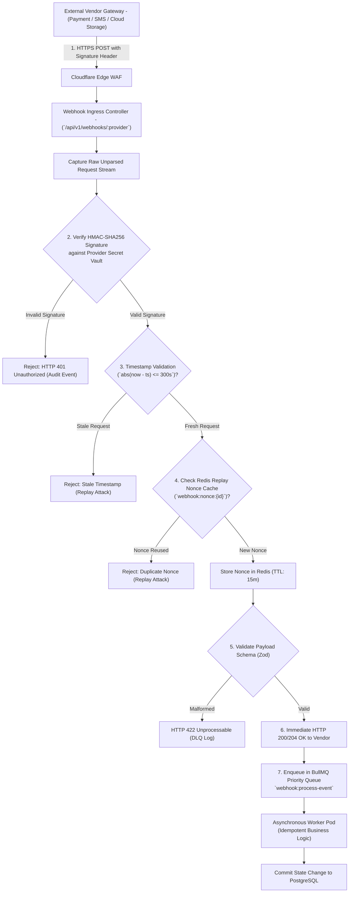

### 5.1 Inbound Webhook Security Framework
1. **Raw Payload Signature Verification**:
   - Webhook ingress endpoints **never** parse JSON payloads before signature verification.
   - The raw byte buffer (`req.rawBody`) is captured and evaluated using **HMAC-SHA256** against the provider's shared secret stored in the KMS vault:
     $$\text{CalculatedSig} = \text{HMAC-SHA256}(\text{rawBody}, \text{webhookSecret})$$
   - Comparison uses **constant-time string comparison** (`crypto.timingSafeEqual`) to prevent timing side-channel attacks.
2. **Timestamp Validation & Replay-Attack Neutralization**:
   - The request must provide a timestamp header (e.g., `X-Provider-Timestamp`). The backend verifies that the timestamp does not deviate by more than **300 seconds (5 minutes)** from server time (`NOW()`).
   - The unique webhook event ID or signature is written to Redis (`SET webhook:event:{id} 1 EX 900 NX`). If the key already exists, the request is immediately rejected as a replay attack.
3. **Immediate Acknowledgement & Asynchronous Decoupling**:
   - The webhook controller acknowledges receipt with HTTP 200/204 in $< 100\text{ ms}$, immediately releasing the external vendor connection.
   - Business mutations (e.g., confirming media transcode completion, updating delivery receipts) are dispatched to Redis BullMQ queues for asynchronous processing.
4. **Dead-Letter Queue (DLQ) & Failure Visibility**:
   - If a background webhook processing job fails after 3 exponential backoff retries, it is moved to the `webhook:dead-letter-queue` for manual investigation by DevOps. Webhook failure alerts fire into the engineering Slack channel.

### 5.2 Outbound Webhook Engine
When BREAKING NEWS WALA dispatches outbound webhooks to authorized subscribers (e.g., external syndication partners):
- Dispatches are signed using the platform's private HMAC key, emitting an `X-BNW-Signature: sha256={hash}` and `X-BNW-Timestamp: {epoch}` header.
- The payload conforms to standard CloudEvents specification.
- Dispatches enforce a 5-second connection timeout with automated retries (3 attempts with exponential backoff).

---

## 6. Authentication and Secret Management

All external vendor credentials, secret tokens, and cryptographic keys are managed under strict zero-trust standards cross-referencing [`docs/14-Auth.md`](file:///c:/Users/pp/Downloads/BREAKING-NEWS-WALA-main/docs/14-Auth.md) and [`docs/15-Security.md`](file:///c:/Users/pp/Downloads/BREAKING-NEWS-WALA-main/docs/15-Security.md).

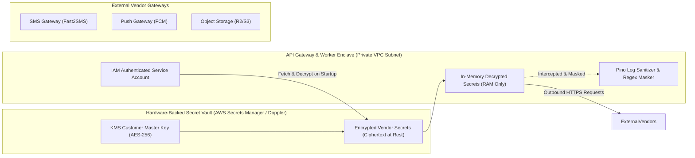

### 6.1 Mandatory Secret Management Invariants
1. **Zero Secret Persistence in Repositories or Databases**: Actual API keys, webhook secrets, and private signing keys are **never** committed to version control (`.git`), placed in documentation, or stored in plaintext database rows (`RULE-SEC-002`).
2. **KMS Envelope Encryption**: Secrets are stored in cloud secret vaults (AWS Secrets Manager or Doppler) encrypted with AES-256-GCM. The application runtime retrieves secrets in-memory during bootstrap via IAM instance roles.
3. **Zero Client-Side Secret Leakage (`RULE-SEC-001`)**: No third-party provider keys (Firebase master keys, Google Cloud service accounts, SMS gateway credentials) are ever embedded in client JavaScript bundles or compiled Android APK binaries.
4. **Log Scrubbing**: Pino logging pipelines scrub all outbound logs using regex patterns, replacing tokens matching vendor formats with `[REDACTED_VENDOR_KEY]`.
5. **Periodic Secret Rotation & Revocation**: Integration secrets rotate every 90 days. If an operational key is suspected of being compromised, it can be revoked and re-issued within 5 minutes without requiring application code changes or full container redeployments.

---

## 7. Data Mapping and Transformation

External third-party schemas must **never** dictate the internal PostgreSQL database schema. The integration layer enforces strict data normalization and defensive schema mapping.

### 7.1 Data Transformation Standards
- **Input Validation via Zod Schemas**: Every inbound payload (RSS XML fields, webhook JSON, scraper DOM nodes) must pass strict Zod runtime schema validation before ingestion. Extra, unvalidated, or unexpected fields are discarded.
- **Vernacular Unicode & Devanagari Normalization**: External text is normalized using Unicode Normalization Form C (`NFC`) to ensure uniform rendering of Devanagari conjuncts (*samyuktaksaras*), viramas (*halant*), and matras across operating systems.
- **Timezone Standardization**: All external timestamps (UTC, GMT, RFC 822 wire dates) are converted and stored as UTC timestamps in PostgreSQL (`TIMESTAMP WITH TIME ZONE`). The frontend presentation layer renders times in **Indian Standard Time (IST - UTC+05:30)**.
- **Permanent Source Attribution Binding**: Ingested wire stories and external summaries permanently bind the original publisher name, source URL, and author to the article entity, satisfying journalistic licensing standards.

---

## 8. Integration Reliability and Failure Handling

To guarantee uninterrupted newsroom operations during external cloud disruptions, all integrations adhere to a unified resilience framework:

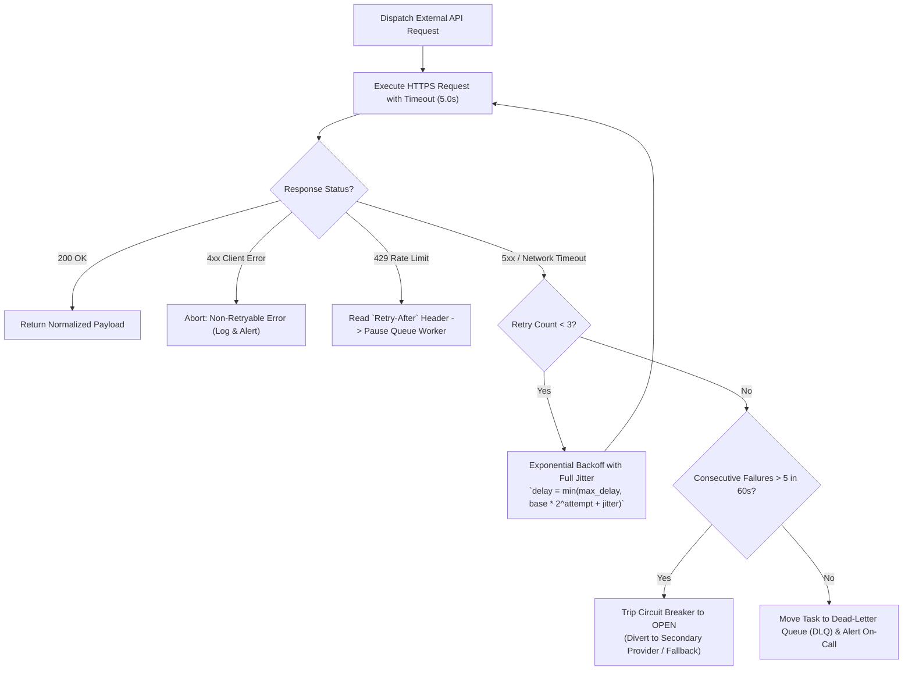

### 8.1 Resilience Mechanics & Timeouts
- **Strict Network Timeouts**: External synchronous HTTP requests enforce hard timeouts:
  - *Standard Vendor REST APIs*: $5.0\text{ seconds}$.
  - *External Web Scraper / RSS*: $10.0\text{ seconds}$.
  - *AI Provider Completions*: $8.0\text{ seconds}$ (interactive), $60.0\text{ seconds}$ (batch).
- **Exponential Backoff with Full Jitter**:
  $$t_{\text{delay}} = \min\left(t_{\text{max}}, t_{\text{base}} \times 2^{\text{attempt}}\right) + \text{random}(0, t_{\text{base}})$$
  This avoids thundering-herd spikes on recovering vendor endpoints.
- **Circuit Breaker Thresholds**: If an external service returns 5 consecutive 5xx errors within 60 seconds, the circuit breaker opens, immediately diverting traffic to an approved fallback service or returning graceful degradation notices.

---

## 9. Integration Environments

To protect production editorial operations and citizen data, integrations maintain absolute environmental segregation across four tiers:

| Environment | Purpose & Infrastructure Boundary | External Vendor Configuration | Test Data & Quota Policy |
| :--- | :--- | :--- | :--- |
| **Development (`local`)** | Local engineer workstations; Docker Desktop. | Mock servers; local vLLM / Ollama; simulated SMS responses; test cloud buckets. | Zero production credentials; mock data; zero billable vendor traffic. |
| **Testing / CI (`test`)** | GitHub Actions / Automated CI test runners. | WireMock / MSW HTTP interceptors; simulated webhook event suites. | Synthetic fixtures; zero external network egress during unit test runs. |
| **Staging (`stage`)** | Cloud pre-production environment mirroring prod. | Vendor Sandbox APIs (Fast2SMS Sandbox, Firebase Test Project, Cloudflare Staging). | Segregated staging databases; sanitized test phone numbers; zero live reader PII. |
| **Production (`prod`)** | Live enterprise cloud infrastructure. | Verified commercial enterprise accounts; dedicated KMS master keys. | Full production credentials; live billing quotas; 24/7 SIEM audit monitoring. |

### 9.1 Environment Segregation Invariants
- Production API keys, SMS gateway credentials, and cloud storage tokens must **never** be copied into staging, testing, or development `.env` files.
- Staging webhooks must target staging URLs (`https://stage-api.breakingnewswala.com/api/v1/webhooks/*`) and cannot trigger production database mutations.

---

## 10. Web and Native Android Compatibility

The platform enforces absolute architectural consistency: a **Single Shared Backend** powering both the Responsive Web Portal and the Stage B Native Android Application.

```mermaid
flowchart TD
    subgraph Client_Applications["Omnichannel Clients"]
        WebPortal["Responsive Web Application - (React / Vite PWA)"]
        AndroidApp["Native Android Mobile App - (Kotlin / Jetpack Compose SDK 34+)"]
    end

    subgraph Unified_Backend["Single Shared Node.js Backend Gateway"]
        APIGateway["Unified REST API Gateway (`/api/v1/*`)"]
        AuthModule["JWT & Session Validator"]
        IntegrationHub["Integration Dispatcher & Secret Vault"]
    end

    subgraph External_Cloud_Services["External Services (Backend Controlled Only)"]
        FCM["Firebase Cloud Messaging (FCM)"]
        SMS["SMS Gateway (Fast2SMS)"]
        S3["Cloud Storage (R2/S3)"]
        Gemini["Google Gemini AI"]
    end

    WebPortal -->|HTTPS / WSS (JWT)| APIGateway
    AndroidApp -->|HTTPS / WSS (OkHttp / JWT)| APIGateway

    APIGateway --> AuthModule --> IntegrationHub
    IntegrationHub --> FCM
    IntegrationHub --> SMS
    IntegrationHub --> S3
    IntegrationHub --> Gemini
```

### 10.1 Native Android Integration Standards (Kotlin SDK 34+)
- **Zero WebViews for Media & Integrations**: The Native Android application is built entirely in native Kotlin using Jetpack Compose. WebViews are strictly prohibited as substitutes for native media upload, camera capture, or authentication.
- **Push Token Registration**: Android devices retrieve native FCM device registration tokens via `FirebaseMessaging.getInstance().token` and transmit them to the backend API via `POST /api/v1/notifications/register-token`. The backend manages targeting and dispatching.
- **Camera & File Pickers**: Android utilizes `ActivityResultContracts.PickVisualMedia` and CameraX, requesting only granular media permissions without broad storage access.
- **Offline Resiliency via `WorkManager`**: Field reporters can draft articles and queue uploads offline; Android `WorkManager` automatically syncs data with the backend once cellular network connectivity recovers.

---

## 11. Admin Integration Management

The Admin Control Panel incorporates an **Integration & External Services Management Desk** (`/admin/integrations`), providing newsroom leadership with centralized operational visibility.

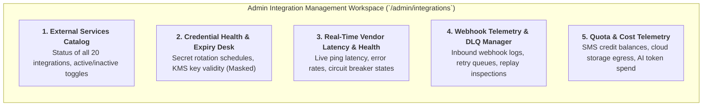

### 11.1 Key Capabilities & Access Controls
- **Zero Secret Exposure**: The Admin UI displays masked credential references (`sec_fast2sms_***`) and health indicators; full private keys are never transmitted to the browser or rendered in DOM elements.
- **Granular Controls**: Administrators can pause external wire ingestion, toggle fallback SMS providers, or view webhook dead-letter queues. All sensitive mutations mandate Super Admin role with verified TOTP MFA and generate immutable audit logs (`RULE-AUD-001`).

---

## 12. Monitoring, Logging and Audit

All external integration activity is continuously monitored to ensure rapid incident detection, cost accounting, and legal compliance.

### 12.1 Core Prometheus Telemetry Metrics

| Metric Name | Type | Target Operational Threshold | Description |
| :--- | :---: | :---: | :--- |
| `integration_requests_total` | Counter | Monitored by Integration ID | Total outbound requests dispatched to external vendor endpoints. |
| `integration_latency_seconds` | Histogram | $P95 < 500\text{ms}$ (Standard APIs) | End-to-end network request duration. |
| `integration_errors_total` | Counter | **$< 1.0\%$ of total calls** | Total integration failures segmented by status code and provider. |
| `webhook_inbound_events_total` | Counter | Track growth rate | Total inbound webhook callbacks received and verified. |
| `webhook_signature_failures_total`| Counter | Alert on any spike ($> 0$) | Number of inbound webhooks rejected due to invalid HMAC signatures. |
| `integration_circuit_breaker_trips`| Counter | Alert on any trip | Number of times a vendor circuit breaker transitioned to `OPEN`. |

### 12.2 Safe Logging Rules & Audit Retention
- **Strict Data Redaction**: Log scrubbers automatically strip HTTP `Authorization` headers, `Cookie` headers, API key parameters, and sensitive payload fields (passwords, OTP codes, Aadhaar/PAN numbers) from all log outputs.
- **Audit Ledger Retention**: All administrative configuration changes, key rotations, and webhook security failures are persisted to PostgreSQL's immutable `audit_logs` table and retained for **7 years** (`RULE-AUD-001`).

---

## 13. Architecture Diagrams

The following nine architectural diagrams synthesize and visualize the multi-provider integration plane across every operational flow.

### 13.1 Diagram 1: Overall Integration Ecosystem Mesh
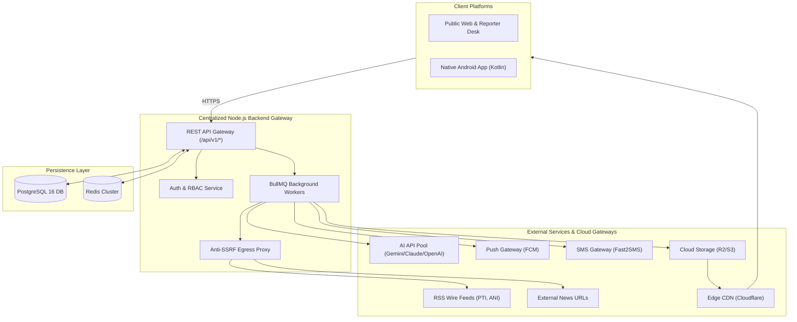

### 13.2 Diagram 2: Internal Backend and External Provider Communication
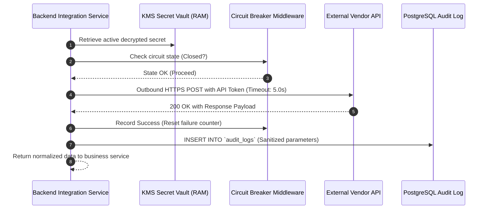

### 13.3 Diagram 3: RSS Ingestion and Authorization Flow
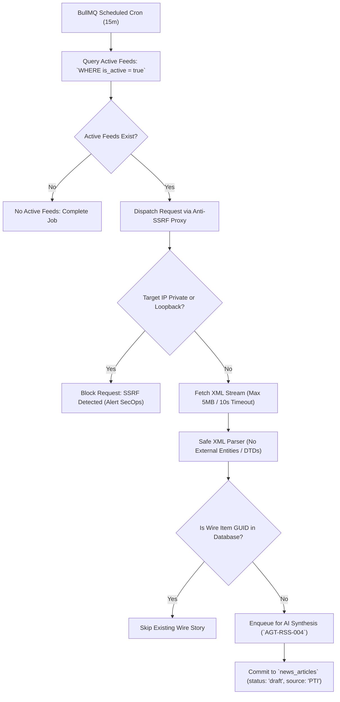

### 13.4 Diagram 4: AI Agents → API Pool → AI Provider Flow
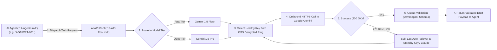

### 13.5 Diagram 5: MCP Integration Flow
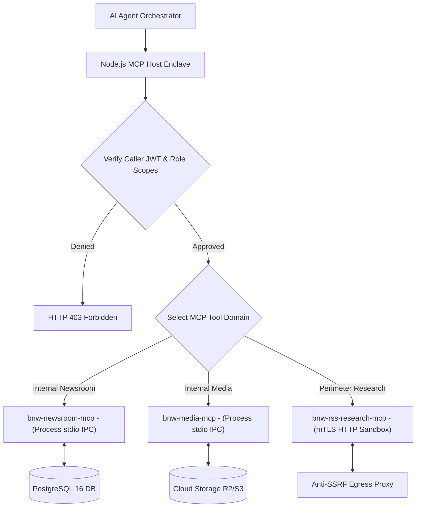

### 13.6 Diagram 6: Notification Delivery Flow
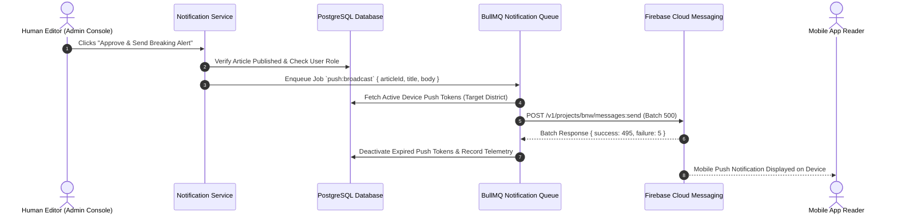

### 13.7 Diagram 7: Webhook Inbound and Outbound Flow
```mermaid
flowchart TD
    subgraph Inbound_Flow["Inbound Vendor Webhook Flow"]
        InReq["Inbound Webhook POST"] --> InSig{"Verify HMAC-SHA256 & Timestamp"}
        InSig -- Invalid --> InReject["Reject: 401 Unauthorized"]
        InSig -- Valid --> InNonce{"Check Redis Nonce"}
        InNonce -- Replayed --> InReject
        InNonce -- Fresh --> InAck["Immediate 200 OK Ack"]
        InAck --> InQueue["BullMQ Queue: `webhook:process`"]
        InQueue --> InMutate["Execute Idempotent DB Mutation"]
    end

    subgraph Outbound_Flow["Outbound Partner Webhook Flow"]
        Event["Platform Event Triggered (e.g. `NEWS_PUBLISHED`)"] --> OutSign["Sign Payload with Private HMAC-SHA256"]
        OutSign --> OutDispatch["HTTPS POST with `X-BNW-Signature`"]
        OutDispatch --> OutCheck{"Partner Responded 200 OK?"}
        OutCheck -- Yes --> OutSuccess["Log Delivery Success"]
        OutCheck -- No --> OutRetry["Exponential Backoff Retry (Max 3)"]
        OutRetry --> OutDLQ["Move to Dead-Letter Queue (DLQ)"]
    end
```

### 13.8 Diagram 8: Integration Failure and Recovery Flow
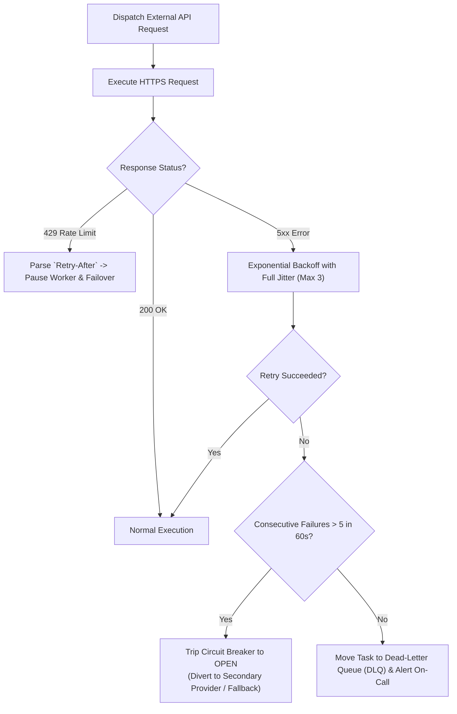

### 13.9 Diagram 9: Shared Backend Integration for Web and Native Android
```mermaid
flowchart LR
    subgraph Client_Plane["Client Applications"]
        Web["Web Portal (React/PWA)"]
        Android["Native Android App (Kotlin SDK 34+)"]
    end

    subgraph Shared_Backend["Unified Shared Backend (Node.js)"]
        API["API Gateway (`/api/v1/*`)"]
        Auth["Unified Auth Guard"]
        IntegrationPlane["Shared Integration Plane"]
    end

    subgraph External_Services["Third-Party Providers"]
        FCM["FCM Push"]
        SMS["SMS Gateways"]
        S3["Cloud Storage"]
        Gemini["Google Gemini AI"]
    end

    Web -->|HTTPS REST| API
    Android -->|HTTPS REST (Zero WebViews)| API

    API --> Auth --> IntegrationPlane
    IntegrationPlane --> FCM
    IntegrationPlane --> SMS
    IntegrationPlane --> S3
    IntegrationPlane --> Gemini
```

---

## 14. Provider Evaluation Framework

To prevent premature vendor lock-in, unvetted recurring cloud expenditures, and compliance liabilities, all third-party integration candidates must be formally evaluated against the platform's **Fifteen-Point Vendor Evaluation Framework** prior to technical adoption.

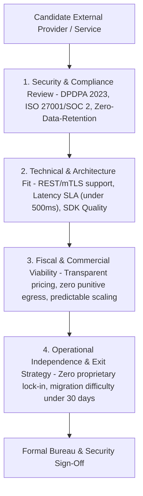

### 14.1 The Fifteen Evaluation Dimensions

| Dimension | Evaluation Criteria & Minimum Requirement | Mandatory Verification Artifact |
| :--- | :--- | :--- |
| **1. Technical Compatibility** | Modern REST/JSON or Webhook interface; supports TLS 1.3; idempotency support. | Official API documentation & OpenAPI/Swagger specification. |
| **2. Security Posture** | SOC 2 Type II or ISO 27001 certified; supports customer-managed encryption keys. | Third-party security compliance audit summary. |
| **3. Privacy & DPDPA 2023** | Complies with Indian DPDPA regulations; zero cross-border transfer of sensitive PII. | Signed Data Processing Agreement (DPA) with DPDPA clauses. |
| **4. Data Location & Sovereignty** | Primary data processing and persistence hosted within Indian cloud regions (Mumbai/Hyderabad). | Cloud vendor region confirmation documentation. |
| **5. Service Reliability (SLA)** | Contractual uptime SLA $\ge 99.9\%$; public real-time incident status page. | Official Service Level Agreement terms. |
| **6. Documentation & Developer SDK** | High-quality, actively maintained TypeScript/Node.js or Kotlin SDKs. | GitHub repository health, commit velocity, and documentation review. |
| **7. API Rate Limits & Concurrency** | Accommodates breaking news surges ($\ge 500\text{ req/min}$); clear `Retry-After` headers. | Published rate-limit tiers and concurrency quotas. |
| **8. Pricing Model & Predictability** | Linear usage-based pricing; no punitive surprise surcharges; predictable cost scaling. | Commercial pricing schedule with volume tier discounts. |
| **9. Free-Tier & Quota Policies** | Free-tier terms do not permit vendor data harvesting for model training. | Commercial Terms of Service review. |
| **10. Commercial Legal Terms** | Indemnification against third-party copyright or intellectual property claims. | Master Services Agreement (MSA) legal review. |
| **11. Data Retention Policy** | Zero retention of prompt data or processed webhook payloads beyond transmission. | Written privacy policy and data retention schedule. |
| **12. Vendor Lock-In Risk** | Uses open industry standards (S3 API, CloudEvents, standard webhooks); no proprietary protocols. | Architecture dependency review. |
| **13. Migration Difficulty** | Pluggable architecture allows switching to an alternative provider within $\le 30\text{ days}$. | Provider abstraction layer design validation. |
| **14. Customer Support SLA** | 24/7 emergency incident escalation with $< 1\text{-hour}$ response time for SEV-1 outages. | Support tier contract terms. |
| **15. Exit Strategy & Data Portability**| Complete exportability of all historical logs and data in standard formats (JSON/CSV). | Verified data export tooling and offboarding protocol. |

---

## 15. Integration Decision Register

The following Architecture Decision Records (ADRs) document the foundational choices, statuses, and governance actions across all platform integration domains.

| Decision ID | Integration Area | Decision / Architectural Question | Status | Available Options Evaluated | Proposed Recommendation | Architectural Reasoning | Dependencies | Approval Required From | Next Action |
| :--- | :--- | :--- | :---: | :--- | :--- | :--- | :--- | :--- | :--- |
| **ADR-INT-001** | External Ingress Plane | Should clients connect directly to third-party APIs or route via backend? | **Confirmed** | A: Direct client SDKs<br/>B: Backend control plane | **B: Single Backend Control Plane** | Eliminates credential leakage from browser/APK; centralizes rate limits and DPDPA audit logging (`RULE-SEC-001`). | Node.js Gateway | Principal Architect | Enforce backend API proxying for all external services. |
| **ADR-INT-002** | RSS Wire Scraping | How should untrusted RSS feeds be ingested safely? | **Confirmed** | A: Direct HTTP fetch<br/>B: Anti-SSRF Egress Proxy | **B: Anti-SSRF Egress Proxy (`RULE-SEC-008`)** | Pre-resolves DNS and blocks private IP spaces (RFC 1918/6598) and cloud metadata services (`169.254.169.254`). | Docker Sandbox | SecOps Lead | Implement DNS pre-check in egress proxy container. |
| **ADR-INT-003** | AI Multi-Provider Mesh | How should commercial AI LLMs be integrated? | **Confirmed** | A: Direct API calls<br/>B: Centralized API Pool | **B: Centralized Multi-Provider API Pool** | Decouples agents from vendors; enables sub-1.5s automatic failover (`FEAT-API-002`) and KMS key masking. | `19-API-Pool.md` | Principal AI Architect | Proceed with API Pool gateway implementation. |
| **ADR-INT-004** | Tool Protocol Standard | Which standard should govern AI agent tool calling? | **Confirmed** | A: Custom REST bridges<br/>B: Model Context Protocol | **B: Model Context Protocol (MCP)** | Open industry standard; decouples tools from models; enforces strict read/write permission tiers. | `18-MCP.md` | Principal AI Architect | Implement MCP Host and Central Tool Registry. |
| **ADR-INT-005** | Media Storage & CDN | Which cloud object storage foundation should be adopted? | **Proposed** | A: AWS S3 + CloudFront<br/>B: Cloudflare R2 + CDN | **B: Cloudflare R2 + Cloudflare CDN** | Zero egress bandwidth fees save up to $80\%$ of distribution costs for high-volume video and news photos. | Cloud Procurement | DevOps / Finance | Conduct 30-day regional latency benchmark in MP/UP. |
| **ADR-INT-006** | Indian Mobile SMS Gateway | Which gateway should handle OTP phone verification? | **Pending Approval** | A: Twilio<br/>B: Fast2SMS / MSG91 | **B: Fast2SMS or MSG91 (DLT Approved)** | Fully compliant with Indian TRAI DLT regulations; cost-effective domestic Indian routing ($< \text{₹}0.20/\text{OTP}$). | TRAI DLT Registration | SecOps / Bureau Chief | Register entity headers and OTP templates on DLT portal. |
| **ADR-INT-007** | Push Notification Service | Which push engine should power breaking mobile alerts? | **Proposed** | A: OneSignal<br/>B: Firebase Cloud Messaging | **B: Firebase Cloud Messaging (FCM)** | Industry standard for Android native push; high delivery reliability across Indian mobile telcos; zero licensing cost. | Android SDK | Mobile Lead / Product | Validate FCM project service account configuration. |
| **ADR-INT-008** | Inbound Webhook Verification | How should third-party webhooks be authenticated? | **Confirmed** | A: Shared API tokens<br/>B: HMAC-SHA256 Signatures | **B: HMAC-SHA256 with Timestamp Nonce** | Neutralizes replay attacks and parameter tampering; validates payload integrity before queue dispatch. | `15-Security.md` | SecOps Lead | Enforce raw byte buffer capture for signature verification. |
| **ADR-INT-009** | Video Transcoding Compute | Should transcoding run on managed SaaS or self-hosted? | **Proposed** | A: AWS MediaConvert<br/>B: Self-Hosted FFmpeg Workers | **B: Self-Hosted FFmpeg in BullMQ Workers** | Drastically lower per-minute compute cost; complete control over multi-bitrate HLS ladders and VTT sprites. | Docker Worker Pods | DevOps / SRE | Benchmark 60-second video transcoding latency on worker nodes. |
| **ADR-INT-010** | Database Search Integration | Should search rely on external SaaS (Algolia) or internal DB? | **Confirmed** | A: Algolia / Elastic SaaS<br/>B: PostgreSQL Full-Text + pgvector | **B: Native PostgreSQL 16 tsvector + pgvector** | Zero recurring third-party search subscription costs; zero external data sync latency; private archive search. | `12-Database.md` | Lead Backend Engineer | Configure Hindi stemming dictionaries in PostgreSQL. |
| **ADR-INT-011** | Error & APM Observability | Which platform should track application exceptions? | **Proposed** | A: Datadog<br/>B: Sentry + Prometheus/Grafana | **B: Sentry (Error Tracking) + Prometheus (APM)** | Open-source friendly; excellent React/Kotlin SDKs; enables self-hosted telemetry without vendor lock-in. | DevOps Infrastructure | DevOps / SRE | Configure PII data scrubbers on Sentry client initializers. |

---

## 16. Cross-Document Traceability

The integration architecture maintains seamless bidirectional traceability across all preceding architectural and governance documentation:

| Document Reference | Upstream Specification Requirement | Integration Architecture Realization | Status |
| :--- | :--- | :--- | :---: |
| [`docs/01-PRD.md`](file:///c:/Users/pp/Downloads/BREAKING-NEWS-WALA-main/docs/01-PRD.md) | High-speed mobile news delivery; rapid editorial triage; wire feed aggregation. | Centralized integration catalog providing instant wire ingestion and push notification delivery (Section 4). | **Fulfilled** |
| [`docs/02-Features.md`](file:///c:/Users/pp/Downloads/BREAKING-NEWS-WALA-main/docs/02-Features.md) | Multi-Key AI Vault (`FEAT-API-001`), RSS Ingestion (`FEAT-RSS-001`), URL Desk (`FEAT-RSS-002`). | Complete technical integration specifications (`INT-RSS-001`, `INT-URL-002`, `INT-AIP-003`). | **Fulfilled** |
| [`docs/04-NFR.md`](file:///c:/Users/pp/Downloads/BREAKING-NEWS-WALA-main/docs/04-NFR.md) | $P95$ API latency $< 250\text{ms}$; 99.9% uptime; Core Web Vitals optimization. | Strict 5s connection timeouts, circuit breakers, exponential backoff, and CDN edge caching (Section 8). | **Fulfilled** |
| [`docs/05-Workflows.md`](file:///c:/Users/pp/Downloads/BREAKING-NEWS-WALA-main/docs/05-Workflows.md) | Wire Ingestion (`WF-RSS-02`), Media Upload (`WF-11`), Breaking Notification (`WF-NOT-01`). | End-to-end integration workflows, sequence diagrams, and failure handling runbooks (Section 13). | **Fulfilled** |
| [`docs/06-Business-Rules.md`](file:///c:/Users/pp/Downloads/BREAKING-NEWS-WALA-main/docs/06-Business-Rules.md) | AI Subservience (`RULE-AI-001`), Active RSS sources only (`RULE-RSS-005`), Anti-SSRF (`RULE-SEC-008`). | Strict enforcement of active feed queries, private IP blocking, and draft-only ingestion states (Section 4.2). | **Fulfilled** |
| [`docs/11-Architecture.md`](file:///c:/Users/pp/Downloads/BREAKING-NEWS-WALA-main/docs/11-Architecture.md) | Event-driven micro-modular backend; Node.js runtime; BullMQ queue cluster. | Unified integration plane integrated into Node.js core with Redis BullMQ background prioritization (Section 3). | **Fulfilled** |
| [`docs/12-Database.md`](file:///c:/Users/pp/Downloads/BREAKING-NEWS-WALA-main/docs/12-Database.md) | PostgreSQL 16 schema, append-only `audit_logs` triggers, read replicas. | Normalized schema mapping (Section 7); immutable integration audit logging (Section 12). | **Fulfilled** |
| [`docs/13-API.md`](file:///c:/Users/pp/Downloads/BREAKING-NEWS-WALA-main/docs/13-API.md) | Endpoints `/api/v1/webhooks/*`, `/api/v1/media/*`, `/api/v1/ai/*`. | Administrative, webhook, and operational API gateway endpoint specifications detailed in Section 5. | **Fulfilled** |
| [`docs/14-Auth.md`](file:///c:/Users/pp/Downloads/BREAKING-NEWS-WALA-main/docs/14-Auth.md) | Zero-trust authentication, Super Admin MFA, token version validation. | Role-based integration access gating and Super Admin MFA for secret rotation (Section 6 & 11). | **Fulfilled** |
| [`docs/15-Security.md`](file:///c:/Users/pp/Downloads/BREAKING-NEWS-WALA-main/docs/15-Security.md) | Anti-SSRF Architecture (`13`), Zero Client Keys (`RULE-SEC-002`), Anti-Prompt Injection (`RSK-014`). | Hardware KMS encryption at rest, raw HMAC webhook validation, and Anti-SSRF proxy execution (Section 5 & 6). | **Fulfilled** |
| [`docs/16-Storage.md`](file:///c:/Users/pp/Downloads/BREAKING-NEWS-WALA-main/docs/16-Storage.md) | Cloud storage R2/S3, Edge CDN, FFmpeg transcoding workers. | Media storage integration (`INT-STR-011`, `INT-CDN-012`, `INT-VID-013`) perfectly harmonized. | **Fulfilled** |
| [`docs/17-Agents.md`](file:///c:/Users/pp/Downloads/BREAKING-NEWS-WALA-main/docs/17-Agents.md) | 14 specialized AI agents, tool broker allowlisting, human review gates. | Integration plane directly powers agent data retrieval and wire ingestion pipelines (Section 4.2). | **Fulfilled** |
| [`docs/18-MCP.md`](file:///c:/Users/pp/Downloads/BREAKING-NEWS-WALA-main/docs/18-MCP.md) | Model Context Protocol tooling, read/write governance, Anti-SSRF proxy. | MCP integration specifications (`INT-MCP-006`, `INT-MCP-007`) matching protocol contracts. | **Fulfilled** |
| [`docs/19-API-Pool.md`](file:///c:/Users/pp/Downloads/BREAKING-NEWS-WALA-main/docs/19-API-Pool.md) | Multi-provider AI key vault, quota tracking, sub-1.5s automatic failover. | AI provider integrations (`INT-AIP-003`, `004`, `005`) managed via central API Pool gateway. | **Fulfilled** |

---

## 17. Open Questions and Technical Risks

The following technical risks and open architectural decisions require formal executive and engineering sign-off prior to production deployment:

1. **TRAI DLT Template Registration Lead Times**:
   - *Risk*: Commercial SMS gateways in India enforce strict Distributed Ledger Technology (DLT) compliance under TRAI regulations. Registering the entity header ("BRKNEW") and specific Devanagari OTP templates can take 2 to 4 weeks.
   - *Recommendation*: Initiate commercial entity onboarding with Fast2SMS or MSG91 immediately during early Phase 1 development to avoid launch delays.
2. **Push Notification Delivery Rates Across Aggressive Android OEMs**:
   - *Risk*: Chinese smartphone OEMs popular in rural Madhya Pradesh and Uttar Pradesh (Xiaomi, Vivo, Oppo) employ aggressive battery optimization that can kill background FCM listeners.
   - *Recommendation*: The Native Android application must implement an FCM high-priority channel and guide users through OEM-specific "Auto-start" and "Battery Optimization Exemption" permissions during onboarding.
3. **Cloudflare R2 vs. AWS S3 Regional Latency in Tier-2/Tier-3 Districts**:
   - *Risk*: While Cloudflare R2 provides game-changing zero egress bandwidth fees, AWS S3 Standard possesses deep local infrastructure in Mumbai (`ap-south-1`).
   - *Recommendation*: Execute an empirical 30-day network latency benchmark uploading 10MB video files from mobile connections in Varanasi, Rewa, and Niwari to measure real-world uplink speeds.

---

## 18. Glossary

| Term | Technical & Editorial Definition |
| :--- | :--- |
| **Webhook** | An HTTP callback mechanism where an external vendor pushes asynchronous event notifications to a platform URL immediately upon state changes (e.g., payment confirmation, media transcode completion). |
| **HMAC-SHA256** | Hash-based Message Authentication Code utilizing the SHA-256 cryptographic hash function to verify both data integrity and authenticity of a webhook request using a shared secret. |
| **Replay Attack** | An adversarial attack where a valid network transmission is fraudulently repeated or delayed to execute duplicate transactions or unauthorized operations. |
| **Anti-SSRF Proxy** | An isolated egress proxy that intercepts outbound requests, pre-resolves domain DNS records, and blocks private IP spaces (RFC 1918/6598) and cloud metadata services (`169.254.169.254`). |
| **Dead-Letter Queue (DLQ)** | A specialized message queue holding messages or webhook events that failed to process successfully after maximum retry thresholds, preserving them for manual inspection. |
| **Circuit Breaker** | A resilience design pattern that detects consecutive failures in an external service and temporarily halts outbound traffic, preventing cascading application timeouts. |
| **Exponential Backoff with Jitter** | An algorithmic retry strategy where delay durations increase exponentially with added randomized variance, preventing network thundering-herd congestion. |
| **Idempotency** | The mathematical property of an operation whereby performing it multiple times yields the exact same result as performing it once, preventing duplicate billing or draft commits. |
| **TRAI DLT** | Telecom Regulatory Authority of India Distributed Ledger Technology; a mandatory blockchain-based regulatory framework governing commercial SMS sending and preventing spam. |
| **WORM Audit Trail** | Write Once Read Many immutable database logging ensuring that all historical integration activities, webhook events, and administrative changes cannot be altered or erased. |