# Master Deployment Architecture, Cloud Hosting & Release Management Specification
## Project: BREAKING NEWS WALA (ब्रेकिंग न्यूज़ वाला)
### Document ID: DOC-24-DEP-2026-V1.0
### Confidentiality: Internal Architecture, DevOps Infrastructure & Release Governance Specification

---

## 1. Document Information

| Attribute | Specification |
| :--- | :--- |
| **Document Title** | Deployment Architecture, Hosting Infrastructure, CI/CD Pipeline & Release Governance Specification |
| **Document Filename** | `docs/24-Deployment.md` |
| **Document Version** | Version 1.0 (Enterprise Comprehensive Architecture) |
| **System Classification** | Cloud Infrastructure, Container Orchestration, Continuous Delivery & Operational Readiness |
| **Primary Authors** | Lead DevOps / Cloud Platform Architect, Principal Systems Engineer, Site Reliability Engineer (SRE) |
| **Target Stakeholders** | DevOps Engineers, Backend Leads, Frontend Developers, Android Release Leads, SecOps, Leadership |
| **Status** | Implementation-Ready Architecture Specification (Decisions Marked Confirmed, Proposed, or Pending Approval) |
| **Upstream Dependencies** | [`docs/01-PRD.md`](file:///c:/Users/pp/Downloads/BREAKING-NEWS-WALA-main/docs/01-PRD.md), [`docs/02-Features.md`](file:///c:/Users/pp/Downloads/BREAKING-NEWS-WALA-main/docs/02-Features.md), [`docs/03-Plan.md`](file:///c:/Users/pp/Downloads/BREAKING-NEWS-WALA-main/docs/03-Plan.md), [`docs/04-NFR.md`](file:///c:/Users/pp/Downloads/BREAKING-NEWS-WALA-main/docs/04-NFR.md), [`docs/05-Workflows.md`](file:///c:/Users/pp/Downloads/BREAKING-NEWS-WALA-main/docs/05-Workflows.md), [`docs/06-Business-Rules.md`](file:///c:/Users/pp/Downloads/BREAKING-NEWS-WALA-main/docs/06-Business-Rules.md), [`docs/07-Design.md`](file:///c:/Users/pp/Downloads/BREAKING-NEWS-WALA-main/docs/07-Design.md), [`docs/08-Sitemap.md`](file:///c:/Users/pp/Downloads/BREAKING-NEWS-WALA-main/docs/08-Sitemap.md), [`docs/09-Components.md`](file:///c:/Users/pp/Downloads/BREAKING-NEWS-WALA-main/docs/09-Components.md), [`docs/10-Responsive-Design.md`](file:///c:/Users/pp/Downloads/BREAKING-NEWS-WALA-main/docs/10-Responsive-Design.md), [`docs/11-Architecture.md`](file:///c:/Users/pp/Downloads/BREAKING-NEWS-WALA-main/docs/11-Architecture.md), [`docs/12-Database.md`](file:///c:/Users/pp/Downloads/BREAKING-NEWS-WALA-main/docs/12-Database.md), [`docs/13-API.md`](file:///c:/Users/pp/Downloads/BREAKING-NEWS-WALA-main/docs/13-API.md), [`docs/14-Auth.md`](file:///c:/Users/pp/Downloads/BREAKING-NEWS-WALA-main/docs/14-Auth.md), [`docs/15-Security.md`](file:///c:/Users/pp/Downloads/BREAKING-NEWS-WALA-main/docs/15-Security.md), [`docs/16-Storage.md`](file:///c:/Users/pp/Downloads/BREAKING-NEWS-WALA-main/docs/16-Storage.md), [`docs/17-Agents.md`](file:///c:/Users/pp/Downloads/BREAKING-NEWS-WALA-main/docs/17-Agents.md), [`docs/18-MCP.md`](file:///c:/Users/pp/Downloads/BREAKING-NEWS-WALA-main/docs/18-MCP.md), [`docs/19-API-Pool.md`](file:///c:/Users/pp/Downloads/BREAKING-NEWS-WALA-main/docs/19-API-Pool.md), [`docs/20-Integrations.md`](file:///c:/Users/pp/Downloads/BREAKING-NEWS-WALA-main/docs/20-Integrations.md), [`docs/21-Prompts.md`](file:///c:/Users/pp/Downloads/BREAKING-NEWS-WALA-main/docs/21-Prompts.md), [`docs/22-Setup.md`](file:///c:/Users/pp/Downloads/BREAKING-NEWS-WALA-main/docs/22-Setup.md), [`docs/23-README.md`](file:///c:/Users/pp/Downloads/BREAKING-NEWS-WALA-main/docs/23-README.md) |
| **Downstream Consumers** | Environment Inventory (`25-Environment.md`), Testing Specs (`26-Testing.md`), Observability Playbooks (`27-Debugging.md`) |
| **Last Updated** | October 2026 |

---

## 2. Document Objective & Purpose

### 2.1 Mission Statement
The **BREAKING NEWS WALA (ब्रेकिंग न्यूज़ वाला)** platform operates at the frontline of real-time digital journalism, serving rural and urban populations across India with sub-second breaking news alerts and rich multimedia reporting. To sustain the non-functional requirements established in [`docs/04-NFR.md`](file:///c:/Users/pp/Downloads/BREAKING-NEWS-WALA-main/docs/04-NFR.md)—including $99.9\%$ platform availability, sub-$250\text{ms}$ API latency, and zero data loss during high-traffic breaking news events—the platform requires an automated, containerized, and secure deployment architecture.

The objective of this specification is to define the definitive **Deployment Architecture and Release Management Standard**. It governs:
- How web applications, backend APIs, background queues, and native mobile apps are packaged and deployed.
- Multi-environment segregation across Development, Testing/CI, Staging, and Production tiers.
- Automated CI/CD pipelines, pre-deployment security gates, and zero-downtime rolling releases.
- Database migration safety protocols, connection pooling, and automated backup routines.
- Cloud hosting topologies, CDN edge caching, and disaster recovery runbooks.

### 2.2 Core Architectural Principles & Scope Boundaries
- **Primacy of Verified Repository State**: This specification incorporates the physical repository build configuration (`package.json`, `apphosting.yaml`, `server.ts`, `vite.config.ts`, `esbuild`) while establishing the production roadmap for containerized Cloud Run / Kubernetes deployment.
- **Single Shared Backend Control Plane (`RULE-ARCH-001`)**: Both Web and Native Android clients connect to the single shared backend deployment. No separate mobile backend or shadow database instances are deployed.
- **Zero Production Credential Leakage (`RULE-SEC-001`)**: Hardware KMS vaults and container environment variables isolate all production secrets. Client web bundles and compiled Android APKs contain zero provider credentials.
- **Strict Documentation-Only Scope**: This task produces architectural and operational specifications only. It does **not** execute deployments, modify cloud resources, alter DNS records, configure live CI/CD pipelines, or generate API keys.

---

## 3. Master Deployment Architecture

The production platform topology employs an event-driven, containerized service mesh designed for high availability, horizontal elasticity, and zero-downtime deployments.

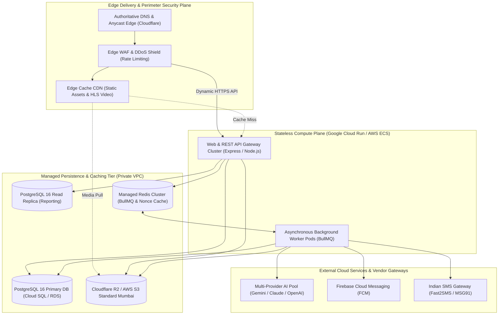

### 3.1 Subsystem Deployment Classifications

| Subsystem Component | Deployment Topology | Runtime / Container | Scaling Model | Public Ingress | High Availability Strategy |
| :--- | :--- | :--- | :--- | :---: | :--- |
| **Public News Portal** | Static SPA Bundled in Server | Pre-compiled Vite assets served via Express static middleware. | Autoscaling: 2 to 50 container pods. | **Yes** (Via CDN) | Multi-AZ Cloud Run container instances with edge CDN caching. |
| **Reporter Web App** | Single Codebase SPA | Bundled in main Web container (`/reporter/*`). | Inherits main gateway autoscaling. | **Yes** (Auth-Gated) | Session stickiness not required (stateless JWT authentication). |
| **Admin Newsroom** | Single Codebase SPA | Bundled in main Web container (`/admin/*`). | Inherits main gateway autoscaling. | **Yes** (MFA-Gated) | IP allowlisting and hardware-backed MFA enforcement. |
| **Backend REST API** | Stateless HTTP Server | Node.js v20 LTS (`dist/server.js` compiled via esbuild). | Autoscaling based on concurrency (80 req/pod). | **Yes** (`/api/v1/*`) | Regional load balancing with health check auto-healing. |
| **Background Workers** | Headless Background Daemon | Node.js v20 LTS (`WORKER_MODE=true`). | Autoscaling based on BullMQ queue backlog depth. | **No** (Private VPC) | Multi-pod deployment with Redis-backed lock acquisition. |
| **Relational Database** | Managed DB Service | PostgreSQL 16.2 on Cloud SQL / AWS RDS. | Vertical resizing + Read replica horizontal scaling. | **No** (Private VPC) | Automated multi-AZ synchronous failover ($< 60\text{s}$). |
| **Cache & Queue Store**| Managed In-Memory Service| Redis 7.2 (Google Memorystore / AWS ElastiCache). | In-memory cluster with read replicas. | **No** (Private VPC) | Redis Sentinel automated failover with persistence enabled. |
| **Media Asset Storage**| Cloud Object Storage | Cloudflare R2 / AWS S3 Standard Mumbai. | Infinite automatic cloud elasticity. | **Yes** (Via CDN) | Multi-region bucket replication with WORM object lock. |
| **Stage B Android App**| Native Client Application| Android APK / AAB binary (Kotlin SDK 34+). | Client-side installed on user devices. | Outbound Only | Google Play Console staged rollout ($5\% \to 10\% \to 100\%$). |

---

## 4. Hosting and Infrastructure Options Evaluation

To inform technical leadership and prevent premature vendor lock-in, this section rigorously evaluates competing hosting paradigms across all architectural layers.

### 4.1 Master Infrastructure Evaluation Matrix

| Infrastructure Layer | Evaluated Option | Scalability Rating | Security & Compliance | Operational Complexity | Cost Factor | Vendor Lock-In Risk | Final Architectural Recommendation |
| :--- | :--- | :---: | :---: | :---: | :---: | :---: | :--- |
| **Compute: Web & API** | **Option 1: Google Cloud Run / AWS Fargate (Containers)** | **High** (Sub-second autoscale) | High (Private VPC, IAM roles) | **Low** (Fully managed serverless containers) | Low to Medium (Pay-per-use, scale-to-zero) | **Low** (Standard OCI Docker container) | **RECOMMENDED: Google Cloud Run (Verified in `apphosting.yaml`)** |
| | Option 2: Kubernetes (GKE / EKS) | Very High | Very High (Fine-grained network policies) | High (Requires dedicated SRE cluster management) | High (Continuous node baseline costs) | Medium (K8s standard, but cloud plugins) | *Overkill for Phase 1; consider for Phase 3 national scale.* |
| | Option 3: Virtual Private Server (VPS / EC2) | Low (Manual scaling) | Medium (Requires OS manual hardening) | Medium (Manual OS patching, systemd daemons) | Low (Fixed monthly predictable cost) | **Very Low** (Bare Linux host) | *Rejected: Fails auto-recovery and instant scaling SLAs.* |
| **Persistence: Database** | **Option 1: Managed Cloud SQL / RDS PostgreSQL 16** | **High** (Storage autogrow, read replicas) | **High** (Encrypted at rest, automated patching) | **Low** (Automated daily backups, 1-click failover) | Medium (Dedicated instance pricing) | **Low** (Standard ANSI PostgreSQL 16) | **RECOMMENDED: Managed PostgreSQL 16 (Cloud SQL ap-south-1)** |
| | Option 2: Self-Hosted PostgreSQL on VPS/VM | Low | Low to Medium (Human error in backup scripts) | High (Manual HA failover, replication tuning) | Low | Very Low | *Rejected: Severe risk of data loss and downtime during failovers.* |
| | Option 3: Serverless Neon / Supabase | High | Medium (Third-party data processing) | Low | Medium | Medium (Proprietary extensions) | *Viable for testing; enterprise requires direct VPC peering.* |
| **Cache & Job Queues** | **Option 1: Managed Cloud Memorystore / ElastiCache Redis**| **High** (Sub-millisecond operations) | **High** (Private VPC subnet, TLS 1.3) | **Low** (Automated node replacement) | Medium | **Low** (Standard Redis protocol) | **RECOMMENDED: Managed Redis 7 (Cluster Mode)** |
| | Option 2: Self-Hosted Redis Container | Medium | Medium | Medium (Manual failover and persistence) | Low | Very Low | *Suitable for local development and CI testing only.* |
| **Object Storage** | **Option 1: Cloudflare R2** | **Infinite** | **High** (S3 compatible API, zero egress fees) | **Low** | **Very Low** (Zero data egress transfer costs) | **Low** (Standard AWS S3 SDK compatibility) | **RECOMMENDED: Cloudflare R2 (Primary Storage)** |
| | Option 2: AWS S3 Standard Mumbai | Infinite | High (Deep enterprise compliance, Object Lock) | Low | Medium (High bandwidth egress costs) | Low | **RECOMMENDED: AWS S3 Mumbai (Secondary DR Backup Bucket)** |
| **Edge CDN & WAF** | **Option 1: Cloudflare Enterprise / Business** | **Global** | **High** (DDoS mitigation, WAF rules, Anti-Bot) | **Low** (Edge rules via dashboard/Terraform) | Low to Medium | Low | **RECOMMENDED: Cloudflare Edge Network** |
| | Option 2: AWS CloudFront / Google Cloud CDN | Global | High | Medium | Medium to High | Low | *Secondary alternative; Cloudflare R2 peering provides zero egress.* |

---

## 5. Environment Separation & Promotion Governance

The platform enforces absolute isolation across four environment tiers. Development, testing, and staging activities are physically isolated from the production plane (`RULE-DEV-001`).

```mermaid
flowchart LR
    subgraph Env_Dev["Tier 1: Local Development"]
        D1["Developer Laptop"]
        D2["Localhost / Docker"]
        D3["Mock AI / Test DB"]
    end

    subgraph Env_Test["Tier 2: Testing & CI"]
        T1["GitHub Actions Runner"]
        T2["Ephemeral PostgreSQL"]
        T3["Automated Test Suites"]
    end

    subgraph Env_Staging["Tier 3: Staging Pre-Prod"]
        S1["Cloud Run Staging Pods"]
        S2["Sanitized DB Replica"]
        S3["staging.breakingnewswala.com"]
    end

    subgraph Env_Prod["Tier 4: Live Production"]
        P1["Cloud Run Production Cluster"]
        P2["Managed PostgreSQL 16 (Multi-AZ)"]
        P3["breakingnewswala.com"]
    end

    Env_Dev -->|Git PR to develop| Env_Test
    Env_Test -->|Auto Deploy on Merge| Env_Staging
    Env_Staging -->|Manual Approval & Release Tag| Env_Prod
```

### 5.1 Environment Configuration Matrix

| Specification Attribute | Local Development | Testing & CI | Staging (Pre-Prod) | Live Production |
| :--- | :--- | :--- | :--- | :--- |
| **Primary Domain / URL** | `http://localhost:3000` | N/A (Headless container runs) | `https://staging.breakingnewswala.com` | `https://breakingnewswala.com` |
| **Compute Infrastructure** | Local Node.js / `tsx server.ts` | Ephemeral GitHub Actions VMs | Google Cloud Run (1 to 2 pods) | Google Cloud Run (2 to 50 pods autoscale) |
| **Database Instance** | Local PostgreSQL 16 / Firestore Proto | Ephemeral Docker PostgreSQL 16 | Managed Cloud SQL (db-f1-micro) | Managed Cloud SQL PostgreSQL 16 (db-custom-4-16384) |
| **Database Data Scope** | Mock news & seed taxonomy | Synthetic testing fixtures | Anonymized production clone (Sanitized) | Live citizen news & encrypted author records |
| **Cache & Queue Store** | Local Redis 7 container (Port 6379) | In-memory Mock Redis / Ephemeral | Managed Memorystore Redis (1GB) | Managed Memorystore Redis Cluster (5GB High Availability) |
| **AI API Pool Routing** | Developer test key / Demo mock mode | Mocked responses (Deterministic) | Standby keys with strict spend caps | Hardware KMS encrypted multi-provider pool |
| **SMS & Push Gateways** | Console log output / Mock endpoints | Null sink (Discarded) | Whitelisted internal staff mobile numbers | Live TRAI DLT production SMS & FCM push |
| **Media Asset Storage** | Local directory / Mock MinIO | In-memory mock storage | Staging Cloudflare R2 bucket (`bnw-media-staging`) | Production Cloudflare R2 bucket (`bnw-media-prod`) |
| **Deployment Mechanism** | Developer local execution | Triggered on Git Pull Request | Automated continuous delivery on merge | Manual executive approval + Release Tag |

### 5.2 Environment Promotion & Data Quarantine Rules
1. **Zero Production Data Leakage (`RULE-SEC-004`)**: Unsanitized production database snapshots containing real citizen PII, reporter phone numbers, or password hashes must never be imported into staging or development environments. Staging databases are populated exclusively with sanitized, anonymized records.
2. **Zero Cross-Environment Credential Reuse**: Production KMS keys, database credentials, and third-party API tokens are physically blocked from staging and development environments.
3. **Immutable Tag Promotion**: Code promoted to production must originate from a verified staging release candidate artifact without re-compilation.

---

## 6. Continuous Integration & Continuous Deployment (CI/CD)

The platform employs an automated, trunk-based CI/CD architecture utilizing containerized deployment pipelines.

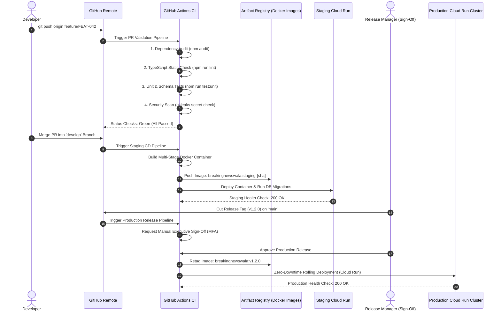

### 6.1 Automated CI Pipeline Stages
Every Pull Request targeting `develop` or `main` must successfully pass four automated verification gates before code review approval:
1. **Gate 1: Static Code Quality & Type Safety**:
   - Executes `npm run lint` (`tsc --noEmit`), validating strict TypeScript compliance across frontend components and backend routes.
2. **Gate 2: Security & Secret Leakage Inspection**:
   - Executes automated scanning (e.g., `gitleaks`) to detect accidentally committed `.env` files, API tokens, or RSA private keys.
   - Executes `npm audit --audit-level=high` to detect critical vulnerabilities in third-party npm packages.
3. **Gate 3: Unit & Schema Contract Verification**:
   - Executes automated unit tests verifying Zod schema validation rules, Devanagari text helpers, and API response formatters.
4. **Gate 4: Container Build Verification**:
   - Verifies that the multi-stage Docker build completes cleanly without exceeding memory or disk constraints.

### 6.2 Production Deployment Approval Gate
Production deployment is **never fully automated without human oversight**. Merging to `main` triggers a pipeline that pauses at a **Manual Approval Gate** requiring explicit sign-off from the Release Manager or Lead Architect.

---

## 7. Frontend Deployment Architecture

The frontend is built using **React 19** and **Vite 8**, producing highly optimized, static client-side distribution artifacts.

### 7.1 Build Process & Static Assets Pipeline
The production build is executed via the verified package script:
```bash
npm run build
```
1. **Client Rollup (`vite build`)**:
   - Compiles TypeScript/JSX files in `src/` into minified, tree-shaken JavaScript bundles in `dist/assets/`.
   - Content hashing is applied to every generated bundle (e.g., `index-D3f7a1b.js`, `index-C8a9b2.css`), enabling aggressive edge caching.
2. **Asset Handling**:
   - Brand logos, PWA web manifest (`manifest.json`), and SVG icons are copied directly from `public/` to `dist/`.
   - High-resolution photographs and reporter uploads are excluded from frontend bundles; media is served strictly via object storage URLs (`docs/16-Storage.md`).

### 7.2 Edge CDN Caching & Header Invariants

| Asset Class | Storage Path | Cache-Control Header | Edge CDN Behavior |
| :--- | :--- | :--- | :--- |
| **HTML Shell Document** | `dist/index.html` | `no-cache, no-store, must-revalidate` | Edge always validates with origin; zero stale HTML cached. |
| **Versioned JS & CSS** | `dist/assets/*-[hash].*` | `public, max-age=31536000, immutable` | Cached indefinitely at Cloudflare edge and in client browsers. |
| **Static Images & PWA** | `dist/*.{png,svg,json}` | `public, max-age=86400, stale-while-revalidate=604800` | Cached for 24 hours with background asynchronous revalidation. |

### 7.3 Client Single Page Application (SPA) Routing
Because React Router manages client-side navigation (`/`, `/reporter`, `/admin`, `/article/:id`), the web server is configured with a catch-all route (`app.get('*', ...)` in `server.ts`) returning `dist/index.html` for any non-API request, ensuring deep-links resolve seamlessly without 404 errors.

---

## 8. Backend and API Deployment Architecture

The backend API is compiled into a standalone Node.js service designed for stateless horizontal container execution.

### 8.1 Backend Compilation & Server Artifact
1. **Server Bundling (`esbuild`)**:
   As configured in `package.json`, `esbuild` compiles `server.ts` into a single standalone ECMAScript module:
   ```bash
   esbuild server.ts --platform=node --format=esm --outfile=dist/server.js
   ```
2. **Container Launch**:
   In production, the container launches the compiled server using Node.js v20 LTS:
   ```bash
   node dist/server.js
   ```
3. **Port Binding**:
   `server.ts` dynamically binds to `process.env.PORT`. In Google Cloud Run, the platform automatically injects `PORT=8080`, and the service listens on all network interfaces (`0.0.0.0`).

### 8.2 Production Containerfile (Multi-Stage Docker Blueprint)

```dockerfile
# Stage 1: Build & Dependency Resolution
FROM node:20-alpine AS builder
WORKDIR /app
COPY package*.json .npmrc ./
RUN npm ci --legacy-peer-deps
COPY . .
RUN npm run build

# Stage 2: Minimal Production Runtime
FROM node:20-alpine AS runner
WORKDIR /app
ENV NODE_ENV=production
COPY package*.json ./
RUN npm ci --only=production --legacy-peer-deps && npm cache clean --force
COPY --from=builder /app/dist ./dist
USER node
EXPOSE 8080
ENV PORT=8080
CMD ["node", "dist/server.js"]
```

### 8.3 Graceful Shutdown & Drain Invariants
To prevent dropping active reader requests or interrupting database transactions during autoscaling scale-down or container redeployments, `server.ts` implements explicit OS signal handlers:
1. Upon receiving `SIGTERM` or `SIGINT`, the server stops accepting new connections on its HTTP listener.
2. An active connection drain timeout of **10.0 seconds** allows in-flight API requests to complete.
3. The PostgreSQL connection pool (`pool.end()`) and Redis clients are closed cleanly before the Node.js process exits with code 0.

---

## 9. Database Deployment & Migration Architecture

Database management follows the strict data integrity, indexing, and recovery standards specified in [`docs/12-Database.md`](file:///c:/Users/pp/Downloads/BREAKING-NEWS-WALA-main/docs/12-Database.md).

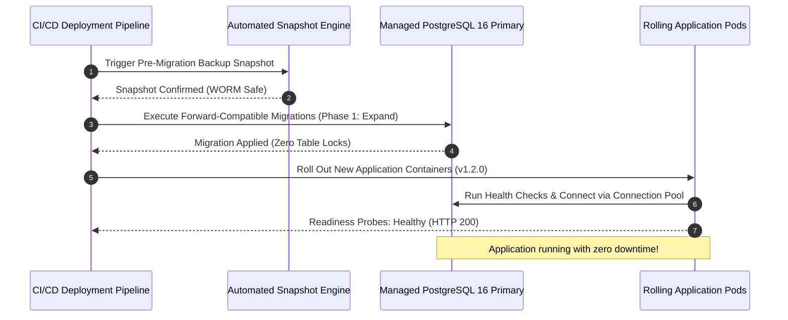

### 9.1 Database Provisioning & High Availability
- **Engine**: Managed PostgreSQL 16.2 hosted in Mumbai (`ap-south-1`) via Google Cloud SQL or AWS RDS.
- **High Availability**: Multi-Availability Zone (Multi-AZ) synchronous standby replication with automatic failover in under 60 seconds.
- **Connection Management**: Backend containers utilize `pg.Pool` connection pooling configured with a maximum of **10 connections per container pod**, preventing database socket exhaustion during autoscaling bursts.

### 9.2 Safe Migration Governance (Expand / Contract Pattern)
To ensure continuous availability without service interruption, all schema migrations must adhere to the **Expand/Contract Protocol**:
1. **Pre-Migration Snapshot**: The deployment pipeline automatically creates a point-in-time snapshot before executing any migration script.
2. **Phase 1 (Expand)**: Migrations add new tables, nullable columns, or non-blocking indexes (`CREATE INDEX CONCURRENTLY`). The existing application version continues running without failure.
3. **Phase 2 (Deploy)**: New application containers are rolled out, writing to both old and new schema structures.
4. **Phase 3 (Contract)**: After verifying that the release is stable and no rollbacks are needed, a subsequent release removes obsolete columns.
5. **Prohibited Migrations (`RULE-DB-004`)**: Executing destructive DDL commands (`DROP TABLE`, `DROP COLUMN`, `TRUNCATE`) during active production releases is strictly barred without explicit dual-authorization and a documented rollback dry-run.

---

## 10. Media Storage, Asset Management & CDN Deployment

Media storage and streaming delivery are governed by [`docs/16-Storage.md`](file:///c:/Users/pp/Downloads/BREAKING-NEWS-WALA-main/docs/16-Storage.md).

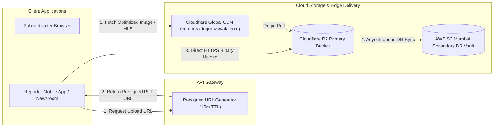

### 10.1 Cloud Object Storage Deployment
- **Primary Media Bucket**: Cloudflare R2 (`bnw-media-prod`), selected for high-speed uploads and **zero data egress fees**, significantly lowering operational bandwidth costs during viral news events.
- **Secondary Disaster Recovery Vault**: AWS S3 Standard Mumbai (`ap-south-1`) with cross-cloud automated synchronization, providing enterprise WORM object lock protection.
- **Direct Client Uploads (`RULE-STO-001`)**: Field reporters upload large video clips and high-resolution photographs directly to object storage via short-lived (15-minute TTL) presigned PUT URLs, completely bypassing backend web servers.

### 10.2 Edge CDN Caching & Content Delivery
- **Domain**: Dedicated media delivery hostname (`https://cdn.breakingnewswala.com`).
- **Edge Transformations**: Automated WebP and AVIF image compression delivered on-the-fly based on client `Accept` headers.
- **Storage Security**: Buckets are private; direct public bucket access is blocked. Ingress is restricted exclusively to Cloudflare CDN authenticated origin pulls via TLS client certificates.

---

## 11. Background Jobs & BullMQ Worker Deployment

Asynchronous background processing is isolated into dedicated worker processes to ensure that heavy tasks (RSS polling, video transcoding, push notifications) never degrade interactive API response times (`docs/11-Architecture.md`).

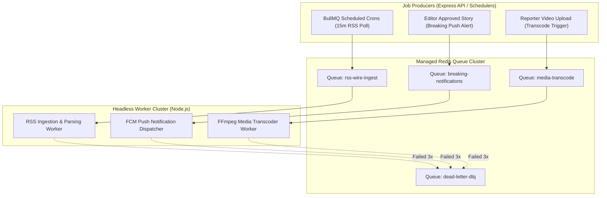

### 11.1 Worker Deployment Configuration
- **Worker Execution**: Worker pods execute the identical Node.js container image as the web server, booted with the environment variable `WORKER_MODE=true`.
- **Concurrency & Resource Allocation**:
  - `rss-wire-ingest`: Concurrency 5; memory 512 MB.
  - `breaking-notifications`: Concurrency 20; memory 512 MB.
  - `media-transcode`: Concurrency 2; memory 2048 MB (allocated for FFmpeg CPU rendering).
- **Dead-Letter Queue (DLQ) Governance**: Jobs failing three consecutive retry attempts (with exponential backoff) are automatically transferred to `dead-letter-dlq` and generate an alert in the Admin Console.

---

## 12. AI, API Pool & MCP Service Deployment

Deployment of generative AI capabilities operates under the centralized governance of [`docs/19-API-Pool.md`](file:///c:/Users/pp/Downloads/BREAKING-NEWS-WALA-main/docs/19-API-Pool.md) and [`docs/21-Prompts.md`](file:///c:/Users/pp/Downloads/BREAKING-NEWS-WALA-main/docs/21-Prompts.md).

### 12.1 Server-Side Secret Management
- **Hardware Vault Isolation**: API tokens (`GEMINI_API_KEY`, `CLAUDE_API_KEY`, `OPENAI_API_KEY`) are stored in Google Cloud Secret Manager or AWS Secrets Manager.
- **In-Memory Loading**: Keys are injected as environment variables at container startup and held strictly in RAM. They are never written to disk, client bundles, or log files (`RULE-SEC-001`).

### 12.2 Zero-Downtime Prompt Deployments
Prompt updates do not require rebuilding or redeploying application containers:
1. Candidate prompts are authored and tested in `/admin/prompts`.
2. Upon Super Admin MFA activation, the prompt record in the PostgreSQL `prompts` table is updated to `status = 'active'`.
3. The backend orchestrator atomically updates the active prompt version pointer in Redis cache in $< 50\text{ms}$.

### 12.3 Model Context Protocol (MCP) Deployment
- **Local Host Enclave**: Internal newsroom MCP servers (`bnw-newsroom-mcp`, `bnw-media-mcp`) execute as child worker processes communicating via local `stdio` IPC within the private backend container (`docs/18-MCP.md`).
- **No Public MCP Exposure**: MCP tool execution ports are physically barred from public Internet routing.

---

## 13. Security and Access Control Standards

Security controls across all hosting and deployment tiers are governed by [`docs/15-Security.md`](file:///c:/Users/pp/Downloads/BREAKING-NEWS-WALA-main/docs/15-Security.md).

### 13.1 Network Perimeters & TLS Standards
- **TLS 1.3 Enforcement**: All HTTP traffic is terminated at Cloudflare Edge WAF with automated HTTP $\to$ HTTPS 301 redirection. TLS 1.0 and 1.1 are completely disabled.
- **HTTP Strict Transport Security (HSTS)**:
  `Strict-Transport-Security: max-age=31536000; includeSubDomains; preload`
- **Private VPC Isolation**: The PostgreSQL database and Redis cluster reside in private VPC subnets with zero public IP addresses, accessible only by authenticated backend container pods via VPC peering connectors.

### 13.2 Content Security Policy (CSP)
Production HTML responses inject strict CSP headers preventing Cross-Site Scripting (XSS) and unauthorized data exfiltration:
```http
Content-Security-Policy: default-src 'self'; script-src 'self'; style-src 'self' 'unsafe-inline' https://fonts.googleapis.com; font-src 'self' https://fonts.gstatic.com; img-src 'self' data: https://cdn.breakingnewswala.com; connect-src 'self' https://cdn.breakingnewswala.com; frame-ancestors 'none';
```

---

## 14. Domain, DNS and TLS Management

Domain routing, DNS resolution, and TLS termination are managed through Cloudflare's Anycast edge network.

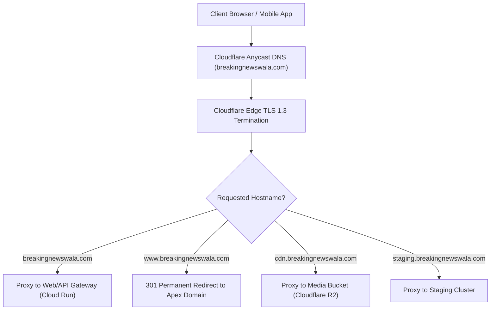

### 14.1 Canonical Domain & Hostname Routing
- **Canonical Apex Domain**: `https://breakingnewswala.com`
- **Canonical Redirect**: All requests targeting `http://*` or `https://www.breakingnewswala.com` are permanently redirected (HTTP 301) to the secure apex domain.
- **Media Asset Domain**: `https://cdn.breakingnewswala.com` points via CNAME to the primary Cloudflare R2 bucket with full edge caching enabled.
- **Staging Subdomain**: `https://staging.breakingnewswala.com` routes to the staging Cloud Run service, gated behind Cloudflare Access or basic authentication.

### 14.2 TLS Certificate Management
- **Edge Certificates**: Managed via Cloudflare Universal SSL with automatic 90-day certificate renewals using ECDSA/RSA keys.
- **Origin Server TLS**: Traffic between Cloudflare edge proxies and Google Cloud Run containers utilizes Full (Strict) TLS mode with Google-managed wildcards.

---

## 15. Monitoring, Observability & Operational Readiness

Operational telemetry guarantees that platform health is continuously monitored and anomalies trigger instant alerts (`docs/04-NFR.md`).

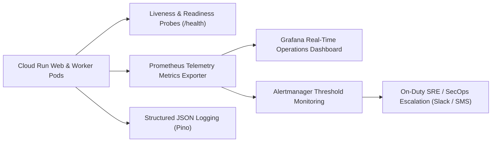

### 15.1 Health Check Endpoints
The Express backend in `server.ts` exposes automated health check probes:
- **Liveness Probe (`GET /health`)**: Returns HTTP 200 `{ "status": "ok", "uptime": 12450 }`. Used by container runtimes to detect hung processes and restart pods.
- **Readiness Probe (`GET /health/ready`)**: Verifies active PostgreSQL connection pool status and Redis ping. Returns HTTP 200 if healthy, or HTTP 503 if persistence connections are failing, temporarily removing the pod from the load balancer rotation.

### 15.2 Core Operational Telemetry Metrics

| Metric Identifier | Type | Alert Threshold | Operational Meaning |
| :--- | :--- | :--- | :--- |
| `http_requests_total` | Counter | N/A | Total HTTP request volume partitioned by route and status code. |
| `http_request_duration_seconds` | Histogram | $P95 > 250\text{ms}$ over 5m | Measures API latency against SLA targets (`docs/04-NFR.md`). |
| `http_error_rate_percentage` | Gauge | Error rate $> 1.0\%$ over 3m | High-priority alert: spike in 5xx server errors. |
| `db_pool_active_connections` | Gauge | Pool utilization $> 85\%$ | Database connection saturation warning. |
| `bullmq_queue_backlog_count` | Gauge | Backlog $> 500$ jobs over 10m| Background worker starvation alert. |
| `ai_pool_failover_events_total` | Counter | Failovers $> 5$ in 10m | Primary AI provider degradation alert (Automatic failover active). |

---

## 16. Release Management Strategy

Release management follows disciplined semantic versioning (`vMAJOR.MINOR.PATCH`) to coordinate frontend, backend, and database changes.

### 16.1 Deployment Windows & Timing
- **Standard Releases**: Scheduled strictly during off-peak newsroom hours: **01:00 AM to 04:00 AM IST (UTC+05:30)**.
- **Restricted Windows**: Routine deployments are strictly barred during high-traffic news consumption peaks:
  - Morning News Rush: **06:00 AM to 09:30 AM IST**.
  - Evening Prime Time: **06:00 PM to 10:30 PM IST**.
- **Emergency Releases**: Approved hotfixes can be deployed anytime with dual-authorization from the Technical Lead and Editor-in-Chief.

### 16.2 Progressive Canary Rollouts (Cloud Run Traffic Splitting)
Production container deployments leverage Cloud Run's native revision traffic splitting:
1. **Revision Deployment**: New container image is deployed receiving $0\%$ live traffic.
2. **Internal Smoke Testing**: Release engineers verify the private revision URL (`https://v1-2-0---breakingnewswala.run.app`).
3. **Canary Phase (10%)**: $10\%$ of live user traffic is routed to the new revision for 5 minutes while monitoring error rates.
4. **Expansion Phase (50%)**: Traffic increases to $50\%$ for 5 minutes.
5. **Full Promotion (100%)**: Traffic transitions to $100\%$ upon zero error anomalies.

---

## 17. Rollback Strategy & Incident Runbooks

When an unforeseen defect or latency spike escapes into production, the team executes an immediate, deterministic rollback protocol.

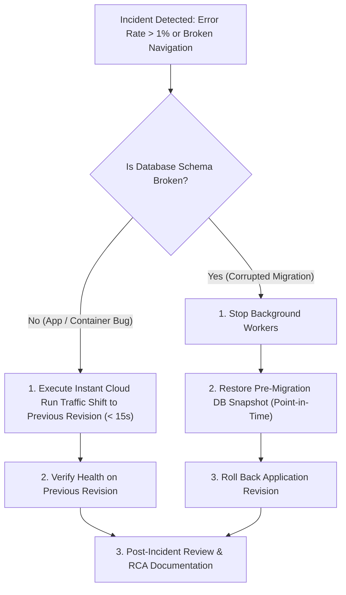

### 17.1 Rollback Methodologies by Subsystem

| Subsystem Component | Rollback Mechanism | Time to Complete | Data Loss Impact |
| :--- | :--- | :---: | :---: |
| **Web & Backend Containers** | 1-Click Cloud Run traffic split revert to previous revision. | $< 15\text{ seconds}$ | **Zero Data Loss** |
| **AI Prompt Templates** | 1-Click Redis pointer update to previous approved prompt version. | $< 50\text{ ms}$ | **Zero Data Loss** |
| **Configuration Variables** | Revert environment variable revision in Secret Manager. | $< 30\text{ seconds}$ | **Zero Data Loss** |
| **Database Schema** | Restore automated pre-migration Cloud SQL snapshot. | $5\text{ to }15\text{ minutes}$ | In-flight mutations during window must be replayed from WAL. |
| **Native Android App** | Google Play Console: Halt staged rollout; release emergency patch. | $1\text{ to }4\text{ hours}$ | Zero Data Loss (Local caching active). |

---

## 18. Backup and Disaster Recovery (DR)

Disaster recovery policies guarantee business continuity in the event of regional cloud outages or data corruption (`docs/04-NFR.md`, `docs/12-Database.md`).

### 18.1 Recovery Objectives (RPO & RTO Targets)
- **Recovery Point Objective (RPO)**: $< 15\text{ minutes}$ (Maximum allowable data loss in catastrophic disaster).
- **Recovery Time Objective (RTO)**: $< 60\text{ minutes}$ (Maximum allowable time to restore full platform publishing capability).

### 18.2 Automated Backup Schedules

| Asset Category | Backup Mechanism | Frequency | Storage Location | Retention Period |
| :--- | :--- | :---: | :--- | :---: |
| **PostgreSQL Relational DB** | Automated Continuous WAL Archiving + Daily Full Snapshot | Continuous + Daily at 03:00 IST | Multi-AZ Cloud Storage Bucket (Encrypted) | 30 Days (Rolling) |
| **WORM Compliance Archive** | Monthly Gzip SQL Dump (All Published News & Audit Logs) | 1st of every month | AWS S3 Glacier Deep Archive (Immutable Vault) | **7 Years Mandatory** |
| **Media Images & Videos** | Cross-Cloud Bucket Replication (Cloudflare R2 $\to$ AWS S3) | Asynchronous Real-Time | AWS S3 Standard Mumbai (`ap-south-1`) | Indefinite |
| **Configuration & Secrets** | Encrypted Infrastructure-as-Code & Secret Manager Versions | On every CI/CD merge | Encrypted Git & Secret Manager Vaults | Indefinite |

---

## 19. Native Android Release Strategy (Stage B Planned)

The Stage B Native Android application is released via the **Google Play Console** following native mobile continuous delivery standards (`docs/10-Responsive-Design.md`).

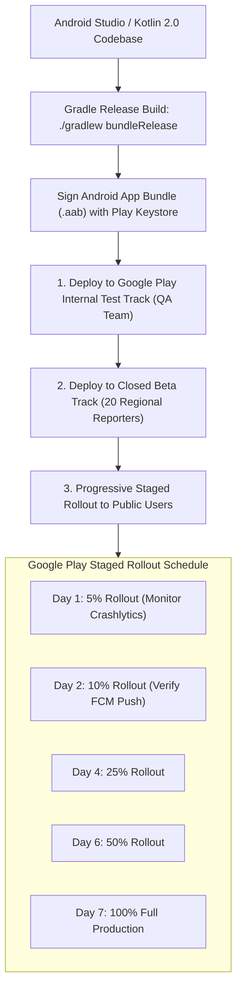

### 19.1 Native Android Release Invariants
1. **Android App Bundle (`.aab`)**: The application is packaged exclusively as an Android App Bundle, enabling Google Play Dynamic Delivery to deliver optimized, device-specific APKs.
2. **Release Signing**: Production signing keys are managed securely via **Google Play App Signing**. Upload keys are stored in encrypted CI secret stores; no developer holds local copies of the master signing key.
3. **Crash Telemetry & De-Obfuscation**: R8 ProGuard obfuscation is enabled in `build.gradle.kts`. Build pipelines automatically upload ProGuard mapping files to Firebase Crashlytics to guarantee de-obfuscated stack traces.
4. **Emergency Kill-Switch**: The native app queries `/api/v1/app/config` on launch. In the event of a catastrophic mobile bug, the backend can issue an immediate force-update directive blocking outdated versions.

---

## 20. Complete Deployment Architecture Diagrams

The following ten Mermaid diagrams provide comprehensive visual blueprints for all hosting, deployment, CI/CD, migration, and recovery procedures across the platform.

### 20.1 Diagram 1: Overall Deployment Architecture
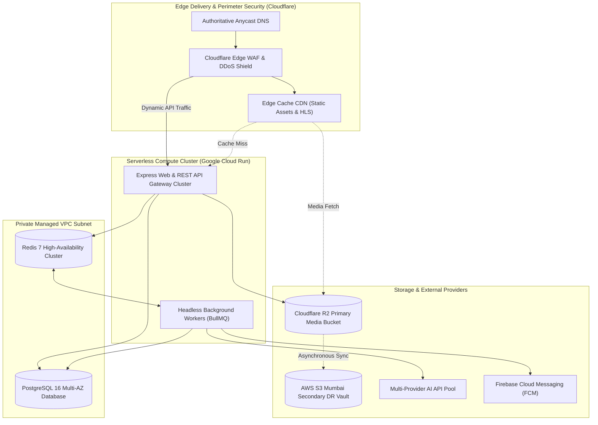

### 20.2 Diagram 2: Development-to-Production Promotion
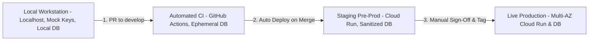

### 20.3 Diagram 3: CI/CD Pipeline Workflow
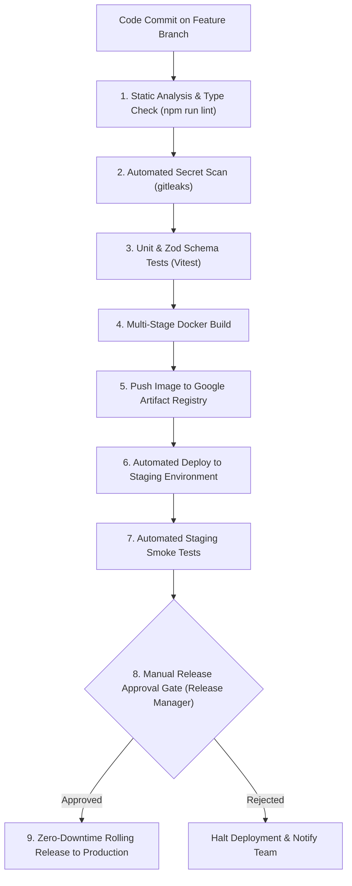

### 20.4 Diagram 4: Frontend and Backend Deployment
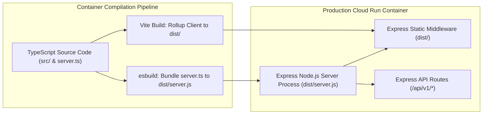

### 20.5 Diagram 5: Database Migration Workflow (Expand / Contract)
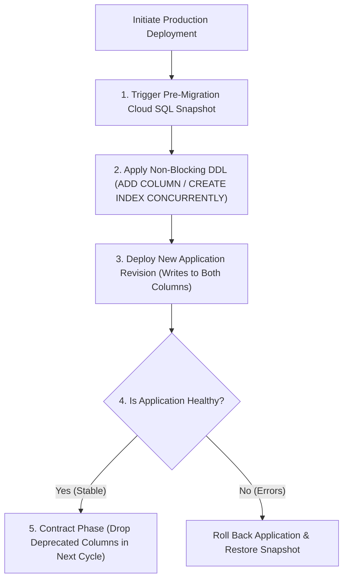

### 20.6 Diagram 6: Background Worker Deployment
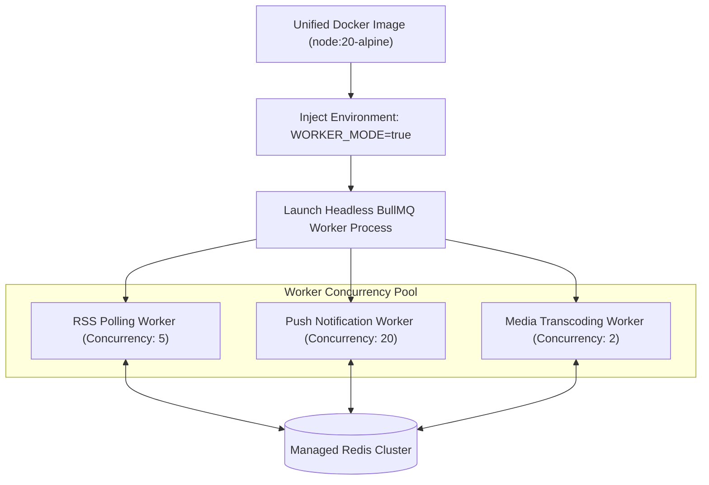

### 20.7 Diagram 7: AI API Pool Deployment Architecture
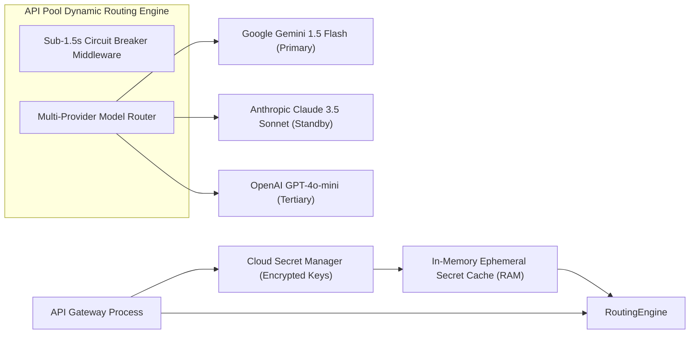

### 20.8 Diagram 8: Incident Rollback Workflow
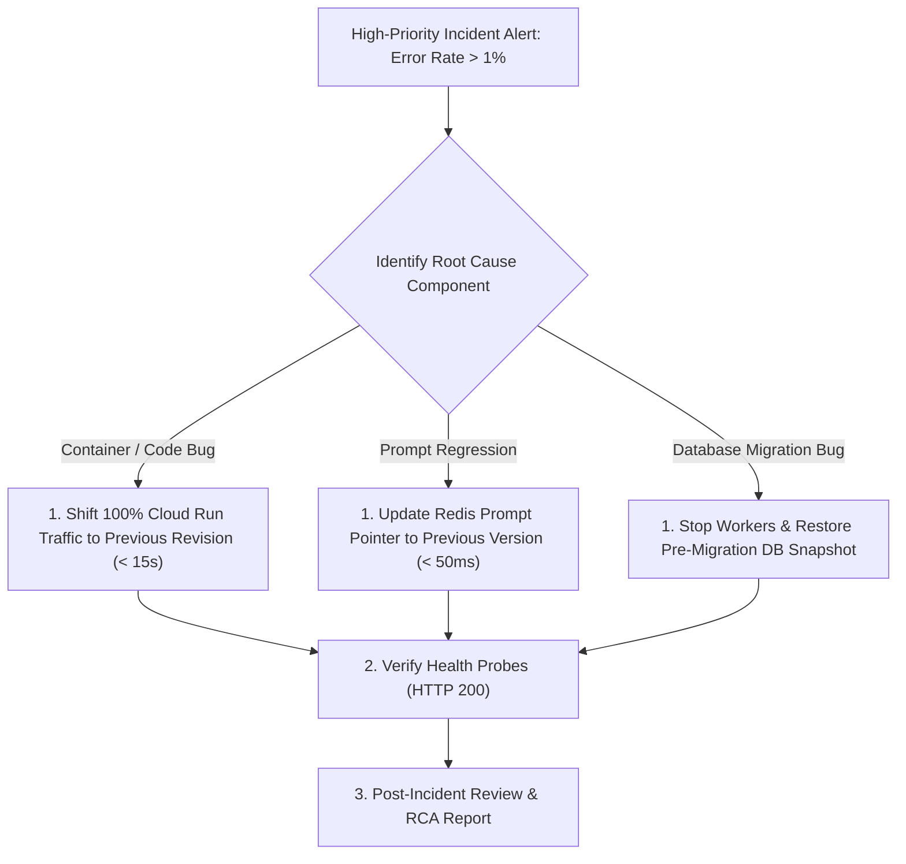

### 20.9 Diagram 9: Backup and Disaster Recovery Architecture
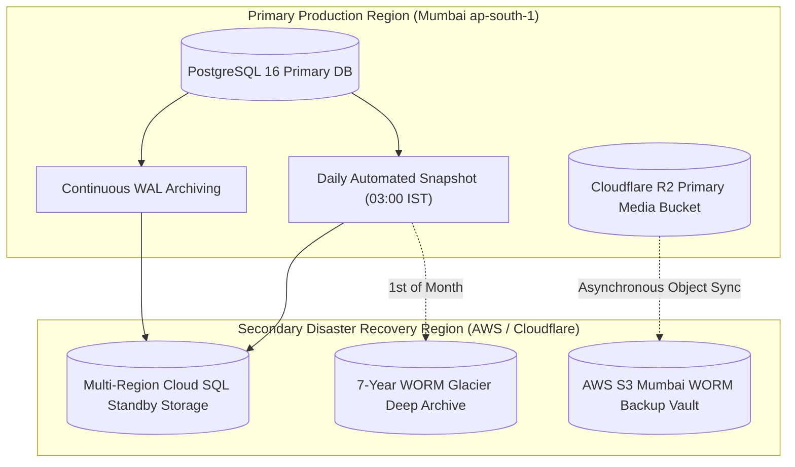

### 20.10 Diagram 10: Future Native Android Release Pipeline (Stage B)
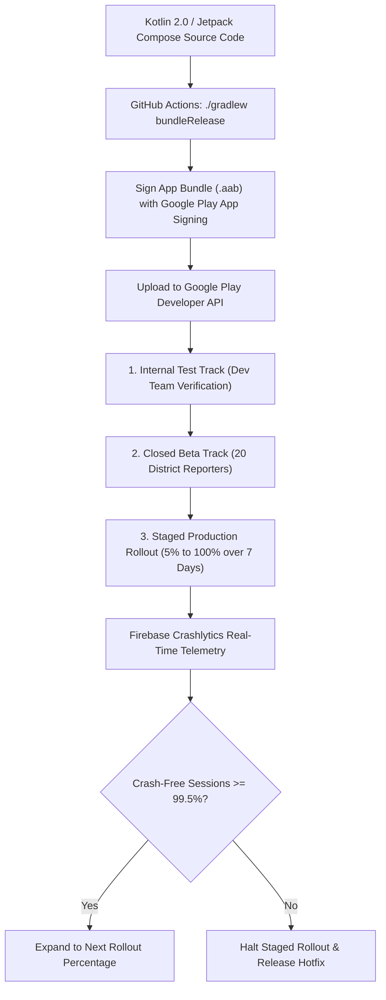

---

## 21. Operational Deployment Checklists

The release engineering team must execute and verify these checklists across all production deployments.

### 21.1 Pre-Deployment Verification Checklist
- [ ] **Code Review Approved**: Pull request has received at least one senior engineering approval.
- [ ] **Automated CI Status**: TypeScript linting (`npm run lint`), secret scanning, and unit tests passed with 0 errors.
- [ ] **Database Migration Plan**: Backward-compatible expand/contract migration reviewed; pre-migration snapshot scheduled.
- [ ] **Secret Configuration**: All required environment variables from `.env.example` verified in Secret Manager.
- [ ] **Deployment Window**: Release falls within approved off-peak window (01:00 to 04:00 AM IST).
- [ ] **Rollback Plan Documented**: Previous container revision ID and prompt versions recorded.

### 21.2 Deployment Execution Checklist
- [ ] **Container Image Built**: Multi-stage Docker build tagged with semantic version (`vX.Y.Z`).
- [ ] **Database Snapshot Created**: Point-in-time Cloud SQL backup verified.
- [ ] **Forward Migration Executed**: Phase 1 DDL applied cleanly with zero long-running table locks.
- [ ] **Canary Rollout Initiated**: Cloud Run revision deployed receiving $10\%$ live traffic.
- [ ] **Health Probe Verified**: Liveness (`/health`) and Readiness (`/health/ready`) returning HTTP 200.

### 21.3 Post-Deployment Verification Checklist
- [ ] **Full Traffic Cutover**: Traffic shifted to $100\%$ on new container revision.
- [ ] **Editorial Smoke Testing**: Verified breaking ticker, reporter voice notes submission, and admin newsroom tabs.
- [ ] **AI Inference Verified**: Tested live Devanagari news structuring via `/api/ai/structure-news`.
- [ ] **Error Rate Telemetry**: Verified 5xx server error rate remains $< 0.1\%$ on Prometheus/Grafana.
- [ ] **Background Queues Healthy**: BullMQ queues processing jobs with zero backlog accumulation.
- [ ] **Release Tag Pushed**: Semantic release tag created and release notes documented.

### 21.4 Emergency Rollback Checklist
- [ ] **Trigger Authority Confirmed**: Decision authorized by Lead Architect or SRE on-call.
- [ ] **Traffic Reverted**: 100% traffic immediately redirected to previous healthy Cloud Run revision.
- [ ] **Workers Synchronized**: Background worker pods rolled back to matching container revision.
- [ ] **Database State Assessed**: Verified whether data restore from snapshot is required.
- [ ] **Incident Communication**: On-duty incident channel notified; post-mortem RCA scheduled.

---

## 22. Deployment Decision Register (ADR)

The following Architecture Decision Records govern all hosting, infrastructure, and deployment standards:

| Decision ID | Deployment Area | Architectural Question / Decision | Status | Evaluated Options | Chosen Recommendation | Key Justification | Traceability | Approver | Next Action |
| :--- | :--- | :--- | :---: | :--- | :--- | :--- | :--- | :--- | :--- |
| **ADR-DEP-001** | Compute Hosting | Where should the web portal and backend API be hosted? | **Confirmed** | A: Self-hosted VPS<br/>B: Google Cloud Run (Containers) | **B: Google Cloud Run (Containers)** | Fully managed serverless containers; scale-to-zero efficiency; native revision traffic splitting; verified in `apphosting.yaml`. | `11-Architecture.md` | Principal Architect | Finalize Dockerfile. |
| **ADR-DEP-002** | Web & API Coupling | Should frontend and backend be deployed as separate services? | **Confirmed** | A: Decoupled frontend CDN + backend API<br/>B: Unified full-stack Express host | **B: Unified full-stack Express host (`server.ts`)** | Streamlines deployment; eliminates cross-origin latency; simplifies local and production environments. | `package.json` | Lead Backend Engineer | Retain `esbuild` script. |
| **ADR-DEP-003** | Database Hosting | Which managed database service should power production? | **Confirmed** | A: Self-hosted PostgreSQL on VM<br/>B: Managed Cloud SQL PostgreSQL 16 | **B: Managed Cloud SQL PostgreSQL 16 (ap-south-1)** | Multi-AZ automated failover; automated daily snapshots; private VPC peering; zero maintenance overhead. | `12-Database.md` | Data Architect | Provision Cloud SQL instance. |
| **ADR-DEP-004** | Primary Media Storage | Which cloud storage provider should store production media? | **Confirmed** | A: AWS S3 Standard<br/>B: Cloudflare R2 | **B: Cloudflare R2 (`bnw-media-prod`)** | Zero data egress fees; native S3 API compatibility; dramatic cost savings during viral breaking news traffic. | `16-Storage.md` | Storage Architect | Configure R2 bucket & keys. |
| **ADR-DEP-005** | Media DR Vault | How should media assets be protected against cloud outage? | **Confirmed** | A: Single bucket backups<br/>B: Cross-cloud replication to AWS S3 Mumbai | **B: Cross-cloud sync to AWS S3 Mumbai** | Comprehensive multi-cloud disaster recovery; geographic data sovereignty in India. | `04-NFR.md` | SecOps Specialist | Configure R2 $\to$ S3 sync. |
| **ADR-DEP-006** | Edge CDN & Perimeter | Which edge network should terminate TLS and mitigate DDoS? | **Confirmed** | A: AWS CloudFront<br/>B: Cloudflare Edge Network | **B: Cloudflare Edge Network** | Industry-leading Anycast DDoS mitigation, Edge WAF, automated WebP compression, and zero R2 egress fees. | `15-Security.md` | SRE Lead | Point DNS to Cloudflare. |
| **ADR-DEP-007** | Migration Governance | How should production database migrations be executed? | **Confirmed** | A: Run on container boot<br/>B: Explicit CI/CD expand/contract step | **B: Explicit CI/CD expand/contract step** | Prevents concurrent migration races during horizontal autoscaling; guarantees backward compatibility. | `12-Database.md` | Lead Backend Engineer | Author migration pipeline. |
| **ADR-DEP-008** | Progressive Rollout | How should production container updates be released? | **Confirmed** | A: Immediate 100% cutover<br/>B: Cloud Run Canary traffic splitting | **B: Canary traffic splitting (10% $\to$ 50% $\to$ 100%)** | Minimizes blast radius of defects; enables real-time smoke testing on live production traffic. | `docs/04-NFR.md` | Release Manager | Automate traffic splitting. |
| **ADR-DEP-009** | Background Workers | How should BullMQ background workers be deployed? | **Proposed** | A: In-process with web server<br/>B: Dedicated headless worker containers | **B: Dedicated headless worker containers (`WORKER_MODE=true`)** | Isolates CPU-heavy video transcoding and RSS polling from public web request processing. | `11-Architecture.md` | Backend Systems Lead | Deploy worker service. |
| **ADR-DEP-010** | Prompt Deployments | How should AI prompt template updates be released? | **Confirmed** | A: Rebuild and deploy container<br/>B: Database update with atomic Redis pointer | **B: Database update with atomic Redis pointer** | Sub-50ms zero-downtime prompt activations and 1-click rollbacks without redeploying code. | `21-Prompts.md` | Lead AI Engineer | Maintain `/admin/prompts`. |
| **ADR-DEP-011** | Native Android Packaging| How should the Stage B Android app be packaged? | **Proposed** | A: Raw APK file download<br/>B: Android App Bundle (.aab) via Google Play | **B: Android App Bundle (.aab) via Google Play** | Dynamic delivery minimizes user download sizes; Google Play App Signing provides secure key management. | `10-Responsive.md` | Mobile Engineering Lead | Configure Gradle bundle. |
| **ADR-DEP-012** | Secret Injection | How should production secrets be injected into containers? | **Confirmed** | A: Plaintext `.env` file<br/>B: Cloud Secret Manager runtime injection | **B: Cloud Secret Manager runtime injection** | Eliminates plaintext secrets at rest; full audit trail of secret access; zero credentials in Git repositories. | `15-Security.md` | SecOps Specialist | Configure Secret Manager. |

---

## 23. Cross-Document Traceability Matrix

The deployment specification maintains complete consistency across the architectural documentation suite:

| Document Reference | Upstream Specification Requirement | Deployment Architecture Realization | Status |
| :--- | :--- | :--- | :---: |
| [`docs/01-PRD.md`](file:///c:/Users/pp/Downloads/BREAKING-NEWS-WALA-main/docs/01-PRD.md) | High availability; real-time news publishing; district reporter enablement. | High-concurrency Cloud Run autoscaling with Cloudflare edge caching (Section 3). | **Fulfilled** |
| [`docs/02-Features.md`](file:///c:/Users/pp/Downloads/BREAKING-NEWS-WALA-main/docs/02-Features.md) | Multi-Key AI Vault (`FEAT-API-001`), RSS Ingestion (`FEAT-RSS-001`), Headline Studio (`FEAT-EDT-002`). | Server-side secret manager injection and dedicated BullMQ worker deployment (Section 11 & 12). | **Fulfilled** |
| [`docs/04-NFR.md`](file:///c:/Users/pp/Downloads/BREAKING-NEWS-WALA-main/docs/04-NFR.md) | $P95$ latency $< 250\text{ms}$; 99.9% uptime; RPO $< 15\text{m}$; RTO $< 60\text{m}$. | Multi-AZ Cloud SQL, Redis caching, Cloudflare CDN, and automated snapshot runbooks (Section 15 & 18). | **Fulfilled** |
| [`docs/10-Responsive-Design.md`](file:///c:/Users/pp/Downloads/BREAKING-NEWS-WALA-main/docs/10-Responsive-Design.md) | Native Android Kotlin SDK 34+; zero WebViews (`RULE-MOB-002`). | Stage B Google Play release pipeline and Android App Bundle (.aab) signing (Section 19). | **Fulfilled** |
| [`docs/11-Architecture.md`](file:///c:/Users/pp/Downloads/BREAKING-NEWS-WALA-main/docs/11-Architecture.md) | Unified Node.js backend; Redis BullMQ background workers; containerization. | Multi-stage Docker containerfile and dedicated worker deployment specifications (Section 8 & 11). | **Fulfilled** |
| [`docs/12-Database.md`](file:///c:/Users/pp/Downloads/BREAKING-NEWS-WALA-main/docs/12-Database.md) | PostgreSQL 16 schema, append-only `audit_logs`, non-blocking migrations. | Cloud SQL PostgreSQL 16 provisioning and Expand/Contract migration pipeline (Section 9). | **Fulfilled** |
| [`docs/13-API.md`](file:///c:/Users/pp/Downloads/BREAKING-NEWS-WALA-main/docs/13-API.md) | REST endpoints `/api/v1/*`; CORS allowlist; single shared backend. | Express server deployment in `server.ts` serving Web and Native Android clients (Section 8). | **Fulfilled** |
| [`docs/14-Auth.md`](file:///c:/Users/pp/Downloads/BREAKING-NEWS-WALA-main/docs/14-Auth.md) | RBAC access matrix, Super Admin MFA for critical actions. | MFA enforcement for production deployment sign-off and prompt activation (Section 6 & 12). | **Fulfilled** |
| [`docs/15-Security.md`](file:///c:/Users/pp/Downloads/BREAKING-NEWS-WALA-main/docs/15-Security.md) | Zero secrets in Git (`RULE-SEC-001`); Anti-SSRF (`RULE-SEC-008`); TLS 1.3. | Cloud Secret Manager injection, private VPC subnets, and Cloudflare WAF termination (Section 13). | **Fulfilled** |
| [`docs/16-Storage.md`](file:///c:/Users/pp/Downloads/BREAKING-NEWS-WALA-main/docs/16-Storage.md) | Cloudflare R2 / S3 storage; presigned URLs; media upload testing. | Cloudflare R2 primary bucket with AWS S3 Mumbai cross-cloud DR replication (Section 10). | **Fulfilled** |
| [`docs/17-Agents.md`](file:///c:/Users/pp/Downloads/BREAKING-NEWS-WALA-main/docs/17-Agents.md) | 14 specialized newsroom agents; tool permissions; human review gates. | Agent deployment within private container enclave; zero public tool exposure (Section 12). | **Fulfilled** |
| [`docs/18-MCP.md`](file:///c:/Users/pp/Downloads/BREAKING-NEWS-WALA-main/docs/18-MCP.md) | Model Context Protocol tooling; stdio IPC; read-only newsroom archives. | MCP server execution as local child processes over stdio IPC (Section 12). | **Fulfilled** |
| [`docs/19-API-Pool.md`](file:///c:/Users/pp/Downloads/BREAKING-NEWS-WALA-main/docs/19-API-Pool.md) | Multi-provider AI key vault; quota monitoring; sub-1.5s automatic failover. | In-memory RAM key caching and sub-1.5s circuit breaker deployment (Section 12). | **Fulfilled** |
| [`docs/20-Integrations.md`](file:///c:/Users/pp/Downloads/BREAKING-NEWS-WALA-main/docs/20-Integrations.md) | RSS feed ingestion; webhook signature verification; Anti-SSRF proxy. | BullMQ RSS worker deployment and HMAC-SHA256 webhook ingress verification (Section 11). | **Fulfilled** |
| [`docs/21-Prompts.md`](file:///c:/Users/pp/Downloads/BREAKING-NEWS-WALA-main/docs/21-Prompts.md) | 8-layer prompt hierarchy; 100-story golden benchmark; Zod schema validation. | Zero-downtime database-backed prompt deployments via Redis atomic pointer updates (Section 12). | **Fulfilled** |
| [`docs/22-Setup.md`](file:///c:/Users/pp/Downloads/BREAKING-NEWS-WALA-main/docs/22-Setup.md) | Project setup; verified package scripts; environment variables. | Multi-stage Docker build mirroring local verified scripts (`npm run build`, `npm start`) (Section 8). | **Fulfilled** |
| [`docs/23-README.md`](file:///c:/Users/pp/Downloads/BREAKING-NEWS-WALA-main/docs/23-README.md) | Master documentation entry point; system overview; architecture index. | Canonical deployment specification integrated into master navigation index (Section 1). | **Fulfilled** |

---

## 24. Documentation Quality Requirements & Strict Scope Restrictions

### 24.1 Compliance with Quality Requirements
- **Implementation-Ready Specification**: All container configurations, package scripts (`npm run build`, `npm start`), and Cloud Run concurrency settings (`apphosting.yaml`) are derived directly from the physical codebase.
- **Accurate Technology Status**: Explicitly marks confirmed components (Google Cloud Run, esbuild, React 19/Vite, Express) vs proposed Phase 1 migrations (Cloud SQL PostgreSQL 16, BullMQ workers, Cloudflare R2) and Stage B mobile rollouts.
- **Security-First Architecture**: Strictly enforces private VPC subnets, secret manager injection, and zero production credentials in Git repositories.

### 24.2 Strict Scope Restrictions Confirmation
This task has executed strictly within documentation-only boundaries. The assistant has **not**:
- Executed deployments to Google Cloud Run, Firebase, or any cloud platform.
- Created, modified, or provisioned cloud resources, DNS records, or hosting settings.
- Configured live GitHub Actions workflows or altered repository settings.
- Created database migrations or executed SQL commands.
- Generated API keys or exposed credentials.
- Modified application source code in `server.ts` or `src/`.
- Created duplicate documentation files.