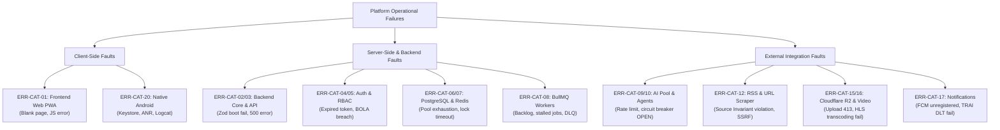
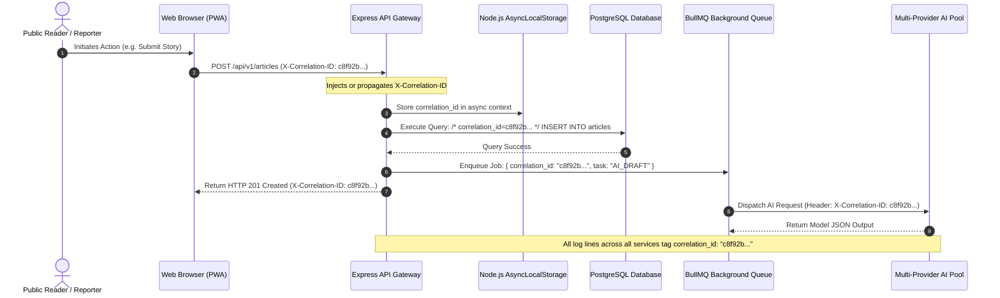
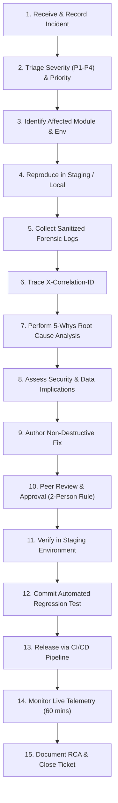
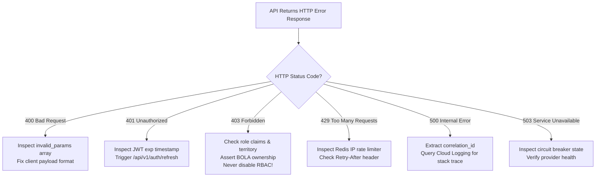
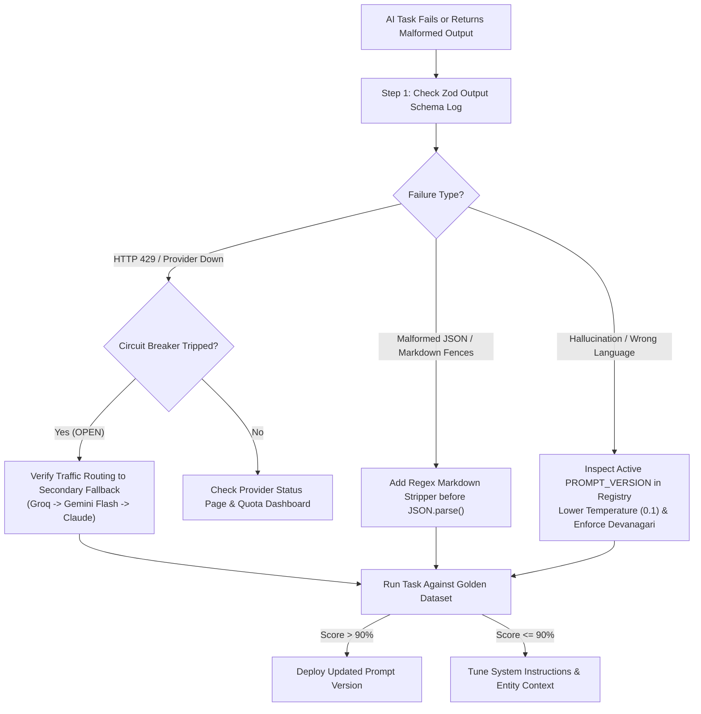
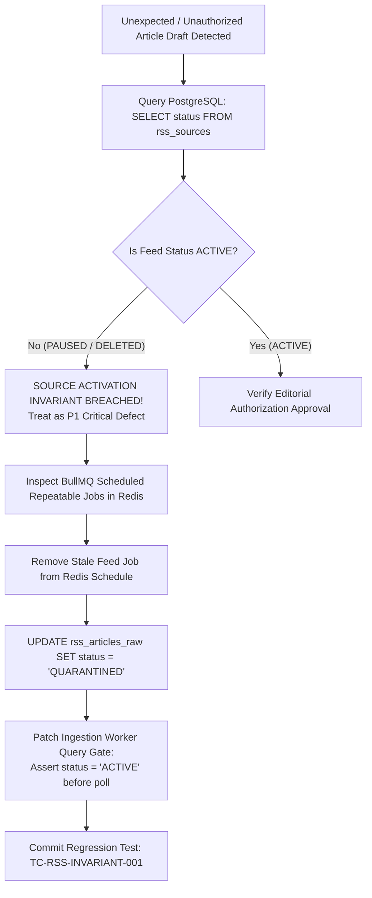
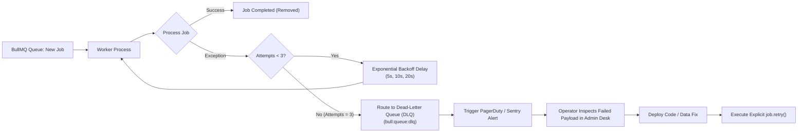
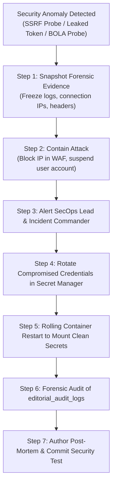
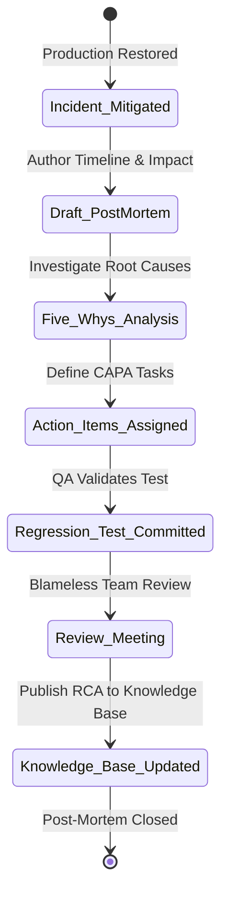

# BREAKING NEWS WALA — Debugging, Error Handling & Troubleshooting Specification
**Document ID**: `BNW-DOC-27-DEBUG`  
**Document Version**: `v1.0.0`  
**Classification**: `Technical / Operational Architecture & Observability`  
**Status**: `Approved Standard`  
**Governing Documents**: `docs/01-PRD.md` through `docs/26-Testing.md`  
**Canonical Location**: `docs/27-Debugging.md`  

---

## 1. Document Information & Governance Status

This document defines the canonical Debugging, Error Handling, and Operational Troubleshooting Specification for the BREAKING NEWS WALA multi-platform digital news syndication ecosystem. It provides the structured procedures, diagnostic workflows, error standards, and incident response protocols required to maintain system stability, data integrity, and editorial reliability.

### 1.1 Governance Metadata
- **Project**: BREAKING NEWS WALA (Hyperlocal Indic Digital News Platform)
- **Document Authority**: System Architect, DevOps & Platform Engineering Lead, SecOps Lead, QA Lead
- **Review Cycle**: Quarterly or immediately following a post-incident root cause review
- **Target Systems**: Web Progressive Web App (PWA), Central Newsroom Admin Portal, Reporter Mobile Application, Node.js Backend API Microservices, PostgreSQL Relational Database, Redis Cache / BullMQ Queues, Multi-Provider AI API Pool, Model Context Protocol (MCP) Tool Servers, and Stage B Native Kotlin Android Application (SDK 34+).

---

## 2. Document Objective & Purpose

The objective of this specification is to provide technical teams (developers, QA engineers, site reliability engineers, editors, and security auditors) with an unambiguous, repeatable diagnostic methodology to:
1. **Detect & Triage Failures Rapidly**: Systematically identify runtime exceptions, performance degradation, and infrastructure faults before users or editorial workflows are impacted.
2. **Trace Distributed Execution**: Correlate single user or automated actions across browsers, API gateways, database connection pools, background worker queues, AI model providers, and external cloud integrations using uniform correlation IDs.
3. **Diagnose Subsystem Anomalies**: Provide deep-dive troubleshooting procedures for database locks, queue stalls, AI provider rate limits, RSS feed ingestion violations, and media transcoding pipelines.
4. **Respond to Security Incidents**: Isolate compromised tokens, block SSRF attempts, detect prompt injection payloads, and quarantine unauthorized RSS imports without compromising forensic evidence.
5. **Enforce Safe Remediation**: Establish strict boundaries prohibiting insecure ad-hoc fixes (e.g., disabling authorization checks, bypassing editorial gates, or editing production databases manually).
6. **Prevent Defect Recurrence**: Institute structured Root Cause Analysis (RCA) post-mortems and mandatory regression test authoring for all resolved P1/P2 defects.

---

## 3. Debugging Principles

Technical troubleshooting at BREAKING NEWS WALA is governed by eleven mandatory engineering principles:

```
+-----------------------------------------------------------------------------------------+
|                                CORE DEBUGGING PRINCIPLES                                |
|                                                                                         |
|   1. REPRODUCE BEFORE FIXING      Isolate root cause in staging before patching code    |
|   2. ROOT CAUSE OVER SYMPTOMS     Never mask underlying errors with silent fallbacks    |
|   3. PRESERVE FORENSIC EVIDENCE   Safeguard logs, headers, and request dumps for triage |
|   4. STRUCTURED OBSERVABILITY     JSON logs with mandatory request & correlation IDs    |
|   5. ZERO SECRET EXPOSURE         Mask all credentials, tokens, PII, and raw passwords  |
|   6. ZERO SECURITY BYPASS         Never disable RBAC or auth gates to resolve a bug     |
|   7. NON-DESTRUCTIVE REMEDIATION  No ad-hoc DB mutations without backup & sign-off     |
|   8. MANDATORY TEST VALIDATION    Verify fixes with automated unit/integration tests    |
|   9. PERMANENT REGRESSION TESTS   Every bug fix must include an automated regression test|
|  10. DOCUMENTED INCIDENT RECORD   Maintain searchable knowledge base of resolved bugs   |
|  11. SEPARATE FAULT DOMAINS       Distinguish app bugs from cloud provider outages      |
+-----------------------------------------------------------------------------------------+
```

### 3.1 Reproduce Before Attempting a Fix
Engineers must reproduce reported defects in local or staging environments using synthetic test fixtures before authoring code modifications. Guesswork fixes that cannot demonstrate reproduction are prohibited.

### 3.2 Root Cause Identification Over Symptom Masking
Adding empty catch blocks, `catch (e) { return null; }`, or fallback dummy data to suppress UI crashes without fixing underlying API, database, or network errors is strictly forbidden.

### 3.3 Forensic Evidence Preservation
During active production incidents, operators must preserve diagnostic artifacts (container stdout logs, Sentry event payloads, Redis queue dumps, and HTTP request headers) prior to rolling container restarts.

### 3.4 Structured and Searchable Observability
All logging across backend services, workers, and API routers must output structured JSON to stdout, containing standard machine-searchable metadata fields.

### 3.5 Absolute Protection of Secrets and PII
Diagnostic logs, error responses, and Sentry reports must **never** record cryptographic keys, database passwords, session tokens, user phone numbers, or credit card details.

### 3.6 Absolute Prohibition of Security Bypasses
Under no circumstances may an engineer resolve an authorization or territory error by disabling permission checks, assigning temporary admin rights, or modifying role middleware without formal approval.

### 3.7 Non-Destructive Remediation Standard
Direct manual modification of production database rows via raw SQL commands during live incidents is prohibited without a pre-executed snapshot, secondary peer sign-off, and explicit rollback SQL scripts.

### 3.8 Mandatory Pre-Release Verification
All hotfixes must be verified against the automated CI test suite in Staging before promotion to Production.

### 3.9 Mandatory Regression Testing for Resolved Bugs
Every resolved defect must be accompanied by an automated regression test reproducing the original failure condition, ensuring the defect cannot recur in future releases.

### 3.10 Centralized Knowledge Base & Incident Recording
Root causes, diagnostic paths, and resolutions must be documented in the platform's troubleshooting knowledge base to accelerate future incident triaging.

### 3.11 Separation of Fault Domains
Troubleshooting workflows must rigorously decouple application-level logic errors from third-party provider outages (e.g., Google AI Studio downtime, Cloudflare network outages, TRAI SMS gateway delays).

---

## 4. Error Classification System

BREAKING NEWS WALA classifies all platform failures across **20 structured operational categories**, establishing standard symptoms, diagnostic evidence, initial containment responses, and escalation paths.

| Category ID | Error Category | Description & Typical Symptoms | Primary Diagnostic Evidence | Initial Containment Response | Escalation Path |
| :--- | :--- | :--- | :--- | :--- | :--- |
| **ERR-CAT-01** | **Frontend Client Errors** | Blank white screen, React render crash, unhandled JS promise rejection. | Browser DevTools console, Sentry browser breadcrumbs. | Clear browser service worker cache; inspect console bundle source maps. | Frontend Lead |
| **ERR-CAT-02** | **Backend Core Errors** | Process startup abort, uncaught Node.js exception, unhandled rejection. | Container stdout logs, Cloud Run crash logs. | Inspect Zod environment schema validation error; verify port binding. | Platform Eng |
| **ERR-CAT-03** | **API Transport & Routing** | HTTP 404 on API endpoints, HTTP 400 malformed JSON, CORS origin blocked. | Express request logs, HTTP access log, `X-Correlation-ID`. | Validate URL prefix (`/api/v1/*`); check `CORS_ALLOWED_ORIGINS` in env. | Backend Lead |
| **ERR-CAT-04** | **Authentication Failures** | HTTP 401 Unauthorized, invalid JWT signature, expired token rejection. | Auth service logs, JWT claims payload, Redis token blacklist. | Verify token expiry timestamp; inspect cookie `HttpOnly`/`Secure` flags. | SecOps Lead |
| **ERR-CAT-05** | **Authorization & RBAC** | HTTP 403 Forbidden on reporter submission, BOLA resource breach. | Express RBAC middleware logs, user role claims, territory table. | Verify reporter district assignment; confirm story ownership. **Never disable RBAC!** | SecOps Lead |
| **ERR-CAT-06** | **Database & Persistence** | PostgreSQL connection pool exhaustion, deadlock, query timeout (> 5s). | Cloud SQL metrics, Prisma query logs, `pg_stat_activity`. | Inspect active connections; kill blocking idle transactions; check indices. | Database Admin |
| **ERR-CAT-07** | **Cache & Redis Failures** | Redis connection refused, memory limit exceeded, eviction spike. | Redis INFO output, Memorystore metrics, connection error logs. | Restart local Redis proxy; verify memory cap (`allkeys-lru`); check network. | DevOps Lead |
| **ERR-CAT-08** | **Background Worker Errors**| BullMQ queue backlog accumulating, worker process OOM crash, stuck jobs. | BullMQ dashboard, queue Redis keys (`bnw:queue:*`), worker logs. | Scale worker replicas; inspect dead-letter queue (DLQ) for poison jobs. | Backend Lead |
| **ERR-CAT-09** | **AI Agent Execution Errors**| Agent drafting generates empty output, hallucinations, missing entities. | Agent execution logs, prompt input payload, output schema diff. | Inspect prompt version in registry; test task against golden dataset. | AI Lead |
| **ERR-CAT-10** | **AI API Pool & Quotas** | HTTP 429 Too Many Requests from Gemini/Groq, circuit breaker trips OPEN. | AI Pool router metrics, Prometheus `ai_pool_failovers_total`. | Verify automatic fallback to secondary provider; check provider quota dashboard. | AI Lead |
| **ERR-CAT-11** | **Prompt & Schema Validation**| AI output fails Zod parsing; missing required fields or malformed JSON. | Model response payload, Zod validation error stack. | Refine prompt format instructions; adjust JSON mode schema constraints. | AI Lead |
| **ERR-CAT-12** | **RSS & URL Ingestion** | Feed XML parse failure, unselected/deactivated feed imports news. | Ingestion worker logs, `rss_sources` DB status, raw XML dump. | Verify Source Activation Invariant; pause rogue feed in DB; purge unapproved drafts. | Content Lead |
| **ERR-CAT-13** | **MCP Tool Execution Errors**| MCP child process timeout (> 30s), stdio socket disconnect, tool failure. | MCP client audit logs, child process stderr output. | Restart MCP tool server sandbox; verify tool argument types. | AI Lead |
| **ERR-CAT-14** | **Webhook Verification** | HTTP 401 Invalid Signature, replay attack blocked, timestamp drift. | Inbound webhook logs, `X-BNW-Signature` header, Redis nonces. | Verify shared HMAC secret; check sender server clock synchronization. | SecOps Lead |
| **ERR-CAT-15** | **Media Storage Errors** | Cloudflare R2 upload failure, presigned URL signature mismatch, 403. | S3 SDK error response, Cloudflare dashboard, bucket permissions. | Verify R2 API credentials in Secret Manager; test bucket CORS policy. | DevOps Lead |
| **ERR-CAT-16** | **Video Transcoding Errors**| HLS transcoding job fails in BullMQ; missing `.m3u8` playlist. | Transcoder worker logs, ffmpeg stderr stream, source file codec. | Verify video container format; inspect worker memory allocation. | Media Lead |
| **ERR-CAT-17** | **Notification Dispatch** | FCM device token unregistered, Web Push VAPID 410 Gone, SMS failure. | Notification queue logs, Firebase Admin error, SMS gateway logs. | Purge dead device tokens from DB; verify SMS TRAI DLT template ID. | Product Lead |
| **ERR-CAT-18** | **Deployment & Config** | Cloud Run revision crash-loop, missing env secret, migration failed. | Cloud Build logs, Cloud Run revision logs, Zod boot errors. | Compare mounted secrets against `docs/25-Environment.md` Zod schema. | DevOps Lead |
| **ERR-CAT-19** | **Security Incidents** | Suspected credential leak, SSRF probe detected, prompt injection exploit. | WAF security logs, Cloud Audit logs, reverse proxy access logs. | Isolate affected account; rotate leaked secret immediately; alert incident team. | SecOps Lead |
| **ERR-CAT-20** | **Native Android Failures** | Kotlin app startup crash, Keystore decryption failure, ANR freeze. | Android Logcat, Firebase Crashlytics, Google Play Console Vitals. | Inspect stack trace; verify Retrofit base URL; check Keystore encryption. | Mobile Lead |

---

## 5. Severity and Priority Framework

Incidents and defects are triaged using a strict separation between **Severity** (technical impact on the platform) and **Priority** (urgency of operational resolution).

### 5.1 Severity Levels
- **Critical (P1)**: Total platform outage; core public news rendering down; active security breach or credential leakage; unapproved bypass of editorial publishing controls; catastrophic data loss or corruption.
- **High (P2)**: Significant failure of a major platform subsystem; editorial news filing blocked; AI drafting failing with all fallbacks exhausted; reporter authentication broken across an entire district; background queue completely halted.
- **Medium (P3)**: Partial feature degradation with an available workaround; individual RSS feed crawler failing; social sharing link broken; non-critical localized translation errors; search sorting edge case.
- **Low (P4)**: Minor cosmetic flaw; UI padding or alignment defect; documentation typo; non-blocking performance deviation within acceptable bounds.

### 5.2 Priority Levels
- **Urgent (Resolution Priority 1)**: Immediate, round-the-clock incident response; war room activation; continuous stakeholder updates until mitigated.
- **Elevated (Resolution Priority 2)**: Active investigation during working hours; resolution expected within the current business day.
- **Normal (Resolution Priority 3)**: Standard sprint prioritization; planned remediation and release.
- **Low (Resolution Priority 4)**: Backlog candidate; scheduled during regular maintenance cycles.

### 5.3 Operational Triage Matrix
| Severity | Business Impact | Required Approvals for Hotfix | Release Mechanism |
| :--- | :--- | :--- | :--- |
| **Critical (P1)** | Complete outage, security breach, direct-publish exploit | System Architect + SecOps Lead + Chief Editor | Expedited Emergency Hotfix Pipeline |
| **High (P2)** | Editorial review blocked, AI pool total failure | Tech Lead + QA Lead | Staging Verified Hotfix |
| **Medium (P3)** | Isolated feature bug with workaround | Engineering Lead | Standard CI/CD Release Candidate |
| **Low (P4)** | Cosmetic imperfection, minor non-blocking issue | Feature Owner | Regular Sprint Deployment |


---

## 6. Error Response Standards

All API endpoints across BREAKING NEWS WALA (`/api/v1/*`) must adhere to a deterministic, structured error response format conforming to **RFC 7807 (Problem Details for HTTP APIs)** as governed by `docs/13-API.md`.

```json
{
  "type": "https://api.breakingnewswala.in/errors/ERR_RESOURCE_FORBIDDEN",
  "title": "Access Denied",
  "status": 403,
  "detail": "You do not have permission to modify articles filed in district 'Varanasi'.",
  "code": "ERR_TERRITORY_UNAUTHORIZED",
  "correlation_id": "c8f92b1a-5f34-4b92-91f2-1084b6f12345",
  "timestamp": "2026-10-31T04:45:00.123Z",
  "invalid_params": [],
  "retry_after_sec": null
}
```

### 6.1 Standard Error Response Schema Fields
- `type` (URI String): Canonical URI identifying the specific error category documentation.
- `title` (String): Short, human-readable summary of the problem category.
- `status` (Integer): Standard HTTP status code (400, 401, 403, 404, 409, 422, 429, 500, 503).
- `detail` (String): Client-safe explanation of the specific error occurrence.
- `code` (String): Machine-readable platform error code (e.g., `ERR_AUTH_EXPIRED`, `ERR_VALIDATION_FAILED`, `ERR_AI_QUOTA_EXHAUSTED`).
- `correlation_id` (UUID): Unique request tracking identifier shared across frontend, backend, and logs.
- `timestamp` (ISO-8601 String): UTC timestamp of error generation.
- `invalid_params` (Array): Field-level validation breakdown for HTTP 400/422 errors (`[{"field": "title", "reason": "Title is required"}]`).
- `retry_after_sec` (Integer or Null): Recommended client backoff delay in seconds for HTTP 429 or 503 responses.

### 6.2 Client-Safe Messages versus Diagnostic Redaction
Under no circumstances may the following diagnostic details be leaked in public API error responses:
- **Stack Traces**: V8 runtime call stacks must be completely stripped in Staging and Production; they are logged strictly to internal container stdout.
- **Database Internals**: Raw PostgreSQL error strings, table names, or query fragments (e.g., `duplicate key value violates unique constraint "users_email_key"`) must be mapped to safe generic messages: `"An account with this email already exists."`
- **Internal Infrastructure**: Hostnames, IP addresses, Redis connection strings, and Cloud Run service IDs must never be exposed.

---

## 7. Logging and Request Correlation

Observability across microservices, background queues, and AI agents depends on structured logging and end-to-end distributed correlation tracking.

### 7.1 Distributed Correlation Tracking Architecture
Every request entering the platform is assigned a unique `X-Correlation-ID` header at the edge reverse proxy or generated by the Express correlation middleware:

```
[Web / Android Client] ---> [Cloudflare CDN] ---> [API Gateway / Express Server]
       |                                                    |
       | Injects or generates X-Correlation-ID              | Stores in AsyncLocalStorage
       v                                                    v
[Backend REST Router]  ===========================> [Structured Winston Logger]
       |                                                    |
       +---> [Prisma Database Query]                       | All log events tagged with:
       |     /* correlation_id=c8f92b... */                 | correlation_id, request_id,
       |                                                    | actor_id, service, duration_ms
       +---> [BullMQ Job Metadata]                          |
       |     { correlation_id: "c8f92b..." }                v
       |                                          [Cloud Logging / Sentry]
       +---> [AI API Pool Driver Request]
             X-Correlation-ID: c8f92b...
```

- **AsyncLocalStorage Context**: The backend uses Node.js `AsyncLocalStorage` to store the correlation ID for the duration of the asynchronous request lifecycle, ensuring all downstream database queries, queue dispatches, and log statements automatically inherit the correlation ID without explicit parameter drilling.
- **SQL Query Tagging**: All Prisma database queries append a SQL comment header containing the correlation ID (`/* correlation_id=... */`), enabling DBAs to link slow queries directly to specific user actions in `pg_stat_activity`.
- **Worker Propagation**: When enqueuing background tasks (e.g., RSS crawling, media transcoding, notifications), the correlation ID is included in the BullMQ job metadata. Worker processes initialize their execution context with this ID.

### 7.2 Structured JSON Log Format
All log lines written by backend containers must be formatted as single-line JSON:

```json
{
  "timestamp": "2026-10-31T04:45:00.123Z",
  "level": "ERROR",
  "service": "bnw-backend-api",
  "environment": "production",
  "request_id": "req-98234-abcd",
  "correlation_id": "c8f92b1a-5f34-4b92-91f2-1084b6f12345",
  "actor_id": "usr_rep_88321",
  "ip_address": "203.0.113.45",
  "operation": "CREATE_ARTICLE_DRAFT",
  "error_code": "ERR_TERRITORY_UNAUTHORIZED",
  "duration_ms": 42.5,
  "message": "Reporter attempted to file story in unassigned territory",
  "context": {
    "reporter_territory": "Meerut",
    "requested_territory": "Varanasi",
    "article_headline_hash": "e3b0c44298fc1c149afbf4c8996fb92427ae41e4649b934ca495991b7852b855"
  }
}
```

### 7.3 Log Levels and Operational Thresholds
- **FATAL**: Unrecoverable process crash, immediate container termination, database connection permanent failure.
- **ERROR**: Handled exceptions, API 5xx responses, failed background jobs, circuit breaker trips, unauthorized access attempts.
- **WARN**: Deprecated API usages, transient provider retries, high memory/latency threshold warnings (> 80%), rate limit breaches.
- **INFO**: Successful system startup, user authentication events, article status state machine transitions, deployment events.
- **DEBUG**: Verbose payload inspections, raw SQL queries, local development troubleshooting. (Strictly disabled in Production).

### 7.4 Mandatory Secret Masking Policy
All Winston logger output streams must pass through a strict regex-based data redaction middleware (`LOG_REDACT_KEYS`):
- Any JSON key matching `password`, `token`, `secret`, `authorization`, `cookie`, `apiKey`, or `credential` must have its value replaced with `"[REDACTED]"`.
- User phone numbers and email addresses must be masked (e.g., `+91 98****1234`, `j***@example.com`).

---

## 8. Frontend Debugging

Frontend troubleshooting addresses client-side failures in web browsers and the Progressive Web App (PWA).

### 8.1 Common Frontend Failure Modes & Diagnostic Procedures

| Symptom | Probable Root Causes | Diagnostic Procedure | Safe Corrective Action |
| :--- | :--- | :--- | :--- |
| **Blank White Screen** | Unhandled JavaScript error prior to React mounting; broken bundle chunk. | Open DevTools Console; check for `Uncaught TypeError` or chunk load failure. | Wrap root components in React `<ErrorBoundary>`; deploy fix with updated chunk hash. |
| **CORS Policy Rejection** | Origin mismatch; missing `Access-Control-Allow-Origin` header on API response. | Inspect DevTools Network tab; compare `Origin` header against `CORS_ALLOWED_ORIGINS` in env. | Add the frontend domain to `CORS_ALLOWED_ORIGINS` in backend environment; restart backend. |
| **Infinite Auth Redirect Loop**| Stale session cookie; frontend expects token in local storage; expired refresh token. | Inspect DevTools Application tab -> Cookies; check `bnw_session` cookie presence and expiry. | Clear stale cookies; ensure client router handles 401 by redirecting cleanly to `/login`. |
| **Broken Devanagari Hindi Text**| Missing web font (`Noto Sans Devanagari`); CSS `line-clamp` clipping top matras. | Inspect computed CSS in DevTools; verify `font-family` fallbacks and `line-height >= 1.5`. | Set `line-height: 1.6` on Devanagari text containers; verify Google Font link loads. |
| **Stale PWA Cache / Old Content**| Service Worker serving outdated static assets; cache-first routing stuck. | Open Application -> Service Workers -> Check "Update on reload"; unregister worker. | Increment Service Worker cache version (`bnw-cache-v2`); enforce Network-First on news API. |
| **Media Failed to Load (Image/Video)**| Broken CDN URL; mixed content HTTP blocked on HTTPS; expired presigned URL. | Inspect failed image request in Network tab; check status (403, 404, or mixed content). | Ensure `VITE_CDN_BASE_URL` uses HTTPS; check signed URL expiration window in backend. |

---

## 9. Backend and API Debugging

Backend troubleshooting focuses on Node.js process lifecycles, Express routing, and API error states.

### 9.1 Server Startup Failures Diagnostic Workflow
When a backend container crashes during boot:
1. **Check Exit Code**:
   - Exit code 1 indicates application-level fatal error or failed Zod configuration validation.
   - Exit code 137 indicates container Out-Of-Memory (OOM) kill by Kubernetes / Cloud Run.
2. **Inspect Zod Boot Log**:
   - Locate the formatted startup error: `Configuration validation failed on startup: [DATABASE_URL, JWT_ACCESS_SECRET]`.
   - Remediate missing environment variables in Secret Manager without exposing secrets in logs.
3. **Verify Port Binding**:
   - Check if `PORT` is occupied: `EADDRINUSE :::3000`. Ensure single process ownership per port.
4. **Database Handshake Verification**:
   - Check if PostgreSQL is reachable (`SELECT 1`). If `ECONNREFUSED`, verify database host firewall and Cloud SQL Auth Proxy settings.

### 9.2 API 4xx/5xx Diagnostic Workflow
```
[Client Reports HTTP 500 / 4xx Failure]
       |
       v
[Step 1: Extract Correlation ID from Response Header: X-Correlation-ID]
       |
       v
[Step 2: Query Centralized Logs: correlation_id == "c8f92b..."]
       |
       +---> If 400 Bad Request: Inspect Zod validation issue in context
       |
       +---> If 401 Unauthorized: Inspect JWT expiry or missing bearer token
       |
       +---> If 403 Forbidden: Inspect RBAC role check and territory claims
       |
       +---> If 429 Too Many Requests: Inspect Redis rate limit counter for client IP
       |
       +---> If 500 Internal Error: Inspect unhandled exception stack trace
       |
       v
[Step 3: Reproduce in Staging Environment using Synthetic Request Payload]
       |
       v
[Step 4: Author Fix & Regression Test -> CI Pipeline -> Staging Verification]
```

---

## 10. Authentication and Permission Debugging

Authentication and authorization failures represent the highest security sensitivity. Troubleshooting must resolve access issues without lowering security barriers.

### 10.1 Diagnostic Matrix for Access Failures
| Symptom / Error | Investigation Steps | Root Cause Determination | Safe Resolution |
| :--- | :--- | :--- | :--- |
| **HTTP 401 `ERR_AUTH_EXPIRED`** | Decode JWT payload using `jwt.decode()`; inspect `exp` claim against current UTC epoch. | Token expired after 15 minutes; refresh token rotation failed or was not triggered by client. | Client must invoke `/api/v1/auth/refresh` to obtain fresh token; re-login if refresh expired. |
| **HTTP 401 `ERR_TOKEN_INVALID`** | Inspect server logs for `JsonWebTokenError: invalid signature`. | Token was signed with different secret (e.g., across backend nodes) or secret was rotated. | Ensure all clustered backend instances share identical `JWT_ACCESS_SECRET` from Secret Manager. |
| **HTTP 403 `ERR_TERRITORY_UNAUTHORIZED`**| Compare reporter's assigned district ID in `reporter_profiles` against article `district_id`. | Reporter attempted to file a story outside their assigned geographical boundary. | Confirm reporter assignment with Admin. **Never disable territory checks in code!** |
| **HTTP 403 `ERR_DIRECT_PUBLISH_DENIED`**| Check reporter's `is_trusted` flag in database. | Reporter has `NORMAL_REPORTER` role and cannot publish directly without editorial review. | Story must transition to `SUBMITTED` for editor approval. If eligible, Admin toggles `is_trusted`. |
| **HTTP 403 `ERR_BOLA_RESOURCE_FORBIDDEN`**| Check article `author_id` against authenticated user's `sub` claim in JWT. | User attempted to edit or delete an article belonging to another reporter (BOLA attack). | Reject request. Verify client UI only renders edit buttons for author-owned articles. |

### 10.2 Cardinal Security Rule for Permission Debugging
> **Cardinal Rule**: Never resolve an authorization or permission error by temporarily granting `ADMIN` privileges, disabling role middleware, or bypassing database territory checks. Any resolution that weakens access controls is treated as a security violation.


---

## 11. Database and Cache Debugging

Database and cache issues directly threaten platform availability, data consistency, and transactional integrity as governed by `docs/12-Database.md`.

### 11.1 PostgreSQL Diagnostic Procedures
1. **Connection Pool Exhaustion**:
   - *Symptoms*: Backend logs display `PrismaClientInitializationError: Timed out fetching a new connection from the connection pool`.
   - *Diagnostic Query*:
     ```sql
     SELECT state, count(*) FROM pg_stat_activity GROUP BY state;
     SELECT pid, query_start, state, query FROM pg_stat_activity WHERE state != 'idle' ORDER BY query_start ASC LIMIT 10;
     ```
   - *Safe Resolution*: Identify and terminate rogue unindexed queries using `SELECT pg_terminate_backend(<pid>)`. Increase `DB_POOL_MAX_CONNECTIONS` in backend configuration to match Cloud Run container concurrency.
2. **Slow Query Investigation**:
   - *Symptoms*: API latency spikes on article feed queries (`GET /api/v1/articles`).
   - *Diagnostic Action*: Prefix query with `EXPLAIN (ANALYZE, BUFFERS)` to detect sequential scans (`Seq Scan`).
   - *Resolution*: Verify composite indices exist on `(status, published_at DESC)` and `(category_id, published_at DESC)`.
3. **Database Migration Failures**:
   - *Symptoms*: Deployment fails during `prisma migrate deploy` with `Migration ... failed to apply cleanly`.
   - *Safe Resolution*: Inspect the `_prisma_migrations` table to identify the rolled-back or stuck migration. Resolve manually in staging using `npx prisma migrate resolve --rolled-back <migration_name>`; apply idempotent schema fixes before re-deploying.
4. **Transaction Deadlocks**:
   - *Symptoms*: PostgreSQL logs throw `ERROR: deadlock detected; Process <pid> waits for ShareLock`.
   - *Resolution*: Ensure multi-table transactional updates (e.g., article update + notification insert + audit log) always acquire table locks in identical deterministic sequence across all controllers.

### 11.2 Redis Cache Troubleshooting
- **Connection Outages**: If Redis fails, backend services fall back directly to database queries. Logs emit `WARN: Redis connection failed, falling back to direct DB read`.
- **Cache Inconsistency**: If an edited article continues displaying stale content on the frontend, check Redis cache keys:
  ```bash
  # Diagnostic Redis CLI check
  redis-cli GET bnw:article:slug:<article_slug>
  # Manually evict stale key if invalidation hook failed
  redis-cli DEL bnw:article:slug:<article_slug>
  ```
- **Memory Pressure & Eviction Spikes**: Check `redis-cli INFO memory`. If `used_memory` approaches `maxmemory`, verify that `maxmemory-policy` is set to `allkeys-lru` and investigate large cached JSON payloads.

---

## 12. Queue and Background Worker Debugging

Background jobs (RSS crawling, AI drafting, media transcoding, notifications) run asynchronously via BullMQ on Redis.

### 12.1 Queue Backlog & Worker Stall Diagnosis
1. **Queue Stalls & Backlogs**:
   - Inspect queue depth using BullMQ metrics or Redis inspection:
     ```bash
     redis-cli HGETALL bull:rss_ingest:meta
     redis-cli LLEN bull:rss_ingest:wait
     ```
   - If `wait` count is escalating while `active` count is zero, worker container processes have died or lost connection to Redis.
2. **Stuck / Stalled Jobs**:
   - A job is flagged as `stalled` if the worker processing it fails to renew the job lock within `stalledInterval` (30 seconds). BullMQ automatically moves stalled jobs back to `wait` up to `BULLMQ_DEFAULT_JOB_ATTEMPTS=3`.
3. **Poison Messages & Dead-Letter Queue (DLQ)**:
   - A job that fails all 3 attempts transitions to `failed`. Operators inspect the failed job's `failedReason` and stack trace via the Admin Newsroom Queue Inspector.
   - **Cardinal Rule**: Never blindly delete queued jobs. Inspect the payload, fix the parsing error or upstream bug, and trigger an explicit retry via `job.retry()`.
4. **Delayed versus Failed Jobs**:
   - Distinguish intentional scheduled delays (e.g., quiet-hours notification hold) from failed jobs by checking job state: `delayed` indicates a scheduled future execution timestamp.

---

## 13. AI Agent and Prompt Debugging

AI Agent failures require a structured diagnostic sequence separating prompt template defects from upstream provider outages as governed by `docs/17-Agents.md` and `docs/21-Prompts.md`.

### 13.1 Eight-Step AI Diagnostic Sequence
When an autonomous agent generates malformed, hallucinated, or unparseable output:

```
+-----------------------------------------------------------------------------------------+
|                               AI DIAGNOSTIC SEQUENCE                                    |
|                                                                                         |
|   [1] Identify Agent & Task Type        (e.g., AGENT_DRAFTING / breaking news draft)     |
|   [2] Identify Prompt Version           (Inspect PROMPT_VERSION_DRAFTING in registry)   |
|   [3] Identify Provider & Model Target  (Inspect AI API Pool routing: Groq vs Gemini)   |
|   [4] Check Sanitized Context & Input   (Verify source text, entity tokens, word count) |
|   [5] Inspect Zod Schema Validation     (Identify exact field that failed parsing)      |
|   [6] Check Raw Model Response & Error  (Inspect raw JSON string and finish_reason)     |
|   [7] Compare Against Golden Dataset    (Run benchmark prompt against baseline fixture) |
|   [8] Escalate for Prompt or Model Fix  (Author prompt patch or adjust temperature)     |
+-----------------------------------------------------------------------------------------+
```

### 13.2 Common AI Failure Modes & Root Causes
- **Malformed JSON / Schema Failure**: Model output includes Markdown formatting (e.g., ```json ... ```) or trailing commas. *Fix*: Enable native `response_format: { type: "json_object" }` or sanitize Markdown fences before parsing.
- **Hallucinated Facts & Fabricated Quotes**: Model invents casualty numbers or quotes not present in source text. *Fix*: Lower temperature (`0.1` to `0.2`); strengthen prompt instruction: `"Extract strictly from the provided source facts. Never extrapolate."`
- **Language / Script Deviation**: Model outputs Hinglish or English instead of Devanagari Hindi. *Fix*: Add system role constraint: `"Output exclusively in Devanagari Hindi script (हिन्दी)."`; run golden translation benchmark.
- **Prompt Injection Defense**: If raw source text contains adversarial injection instructions, verify that the agent system prompt cleanly isolates untrusted data inside designated XML tags (`<source_facts>...</source_facts>`).

---

## 14. API Pool and AI Provider Troubleshooting

The Multi-Provider AI API Pool (`docs/19-API-Pool.md`) manages external provider traffic across Gemini, Groq, Claude, OpenAI, DeepSeek, and Mistral.

### 14.1 Provider Failure Triage Matrix
| Symptom / Error Code | Root Cause Determination | Automated System Action | Operator Corrective Action |
| :--- | :--- | :--- | :--- |
| **HTTP 429 Too Many Requests** | Provider requests-per-minute (RPM) or tokens-per-minute (TPM) quota hit. | Circuit breaker increments failure count; routes traffic to secondary fallback provider. | Verify quota dashboard with provider; request quota increase. **Never rotate keys to bypass limits!** |
| **HTTP 401 Unauthorized** | Provider API key expired, revoked, or incorrectly configured in Secret Manager. | Circuit breaker trips to OPEN; routes to fallback provider. | Generate fresh API key in provider console; update GCP Secret Manager version; restart service. |
| **HTTP 504 / Socket Timeout** | Provider experiencing infrastructure latency; request hangs > 15 seconds. | Aborts request; retries once with exponential backoff; triggers fallback. | Monitor provider status page; adjust `AI_TIMEOUT_MS` if provider reports degraded performance. |
| **Circuit Breaker Stuck OPEN**| Provider returned >= 5 consecutive failures (`FAILURE_THRESHOLD=5`). | All calls bypass provider; single canary probe allowed every 60 seconds (`HALF-OPEN`). | Check provider health; if resolved, wait for canary probe to succeed or reset circuit via admin API. |

---

## 15. RSS and External Content Troubleshooting

External RSS feed ingestion and URL scraping represent critical operational pipelines subject to the **Source Activation Invariant** (`docs/20-Integrations.md`).

### 15.1 The Source Activation Invariant Violation Investigation
> **Critical Architectural Defect**: If news content from an unselected, unauthorized, deactivated, or deleted RSS feed enters the platform, it is treated as a **P1 Critical Security & Business Rule Defect**.

#### Mandatory 8-Step Investigation Protocol
When unexpected or unauthorized syndicated content is detected:
1. **Query Database Registry**: Check `rss_sources` for the feed's status: `SELECT id, url, status, updated_at FROM rss_sources WHERE url LIKE '%<feed_domain>%'`.
2. **Verify Active Status**: If `status != 'ACTIVE'` (e.g., `status = 'PAUSED'`), the ingestion pipeline has violated the Source Activation Invariant.
3. **Inspect Ingestion Queue**: Query BullMQ Redis keys for scheduled jobs: `redis-cli SMEMBERS bull:rss_ingest:repeat`. Check if deleted feeds remain in the repeating job schedule.
4. **Audit Feed-to-Article Mapping**: Inspect the `source_feed_id` on the unauthorized imported draft. Verify if it was mistakenly linked to an active feed via an invalid URL redirect.
5. **Inspect DNS & Redirect Logs**: Check if an authorized feed domain issued an HTTP 301/302 redirect pointing to an unapproved third-party URL.
6. **Halt Rogue Ingestion Job**: Immediately remove the rogue feed job from BullMQ and update database status to `REVOKED`.
7. **Quarantine Ingested Content**: Transition all raw articles originating from that feed to `QUARANTINED` status (`UPDATE rss_articles_raw SET status = 'QUARANTINED' WHERE feed_id = ...`).
8. **Permanent Pipeline Patch**: **Never simply hide the unexpected article in the frontend.** The root cause in the crawler scheduler must be patched and a regression test added.

### 15.2 External URL Scraping & SSRF Diagnostics
- **SSRF Blocked Event**: If scraper logs emit `WARN: SSRF attempt blocked for target URL: http://169.254.169.254`, verify that the internal network was protected and log the actor IP address for security review.
- **Scraper Payload Rejection**: If external web page download aborts with `HTTP 413 Payload Too Large`, the target URL served a payload exceeding `URL_MAX_FETCH_SIZE_BYTES=5242880` (5 MB).


---

## 16. Model Context Protocol (MCP) Debugging

The Model Context Protocol (`docs/18-MCP.md`) provides standardized, sandboxed tool interfaces connecting AI models to platform tools and external resources.

### 16.1 MCP Diagnostic Flowchart & Triage Matrix
| Failure Mode | Probable Root Causes | Diagnostic Investigation Steps | Safe Remediation |
| :--- | :--- | :--- | :--- |
| **MCP Server Connection Failure** | Child process failed to launch; broken `stdio` pipe. | Check child process exit code; inspect `stderr` logs of the tool server container. | Verify node binary path and permissions in `config/mcp-servers.json`. |
| **Tool Execution Timeout (> 30s)** | Tool hanging on external network socket or database lock. | Check MCP client timer; inspect target endpoint reachability. | Kill child process; adjust `MCP_CLIENT_TIMEOUT_MS`; inspect network firewall. |
| **Tool Permission Rejection** | Agent attempted to invoke a tool outside its assigned scope. | Check MCP gateway RBAC log; inspect agent role token claims. | Verify agent capabilities in `docs/17-Agents.md`. **Never grant unapproved tools!** |
| **Prompt Injection via Tool Output** | Poisoned external tool result attempting system override. | Inspect raw tool output JSON string before context injection. | Ensure output sanitizer escapes all control tokens (<system>, triple backticks); strip raw HTML. |
| **MCP Secret Leakage Defense** | Sensitive credentials logged in tool arguments. | Search tool execution audit logs for unredacted API keys. | Redact parameters; verify MCP servers use local secret references, not CLI flags. |

---

## 17. Webhook Debugging

Inbound webhooks (RSS syndication pushes, payment gateway callbacks) and outbound dispatches are debugged using cryptographic validation and replay analysis.

### 17.1 Webhook Failure Modes & Diagnostic Protocols
1. **Invalid Signature (HTTP 401 `ERR_WEBHOOK_SIGNATURE_MISMATCH`)**:
   - *Root Cause*: The HMAC-SHA256 signature calculated by the server does not match `X-BNW-Signature`.
   - *Diagnostic Steps*:
     - Verify that the shared webhook secret matches between sender and GCP Secret Manager (`WEBHOOK_INGESTION_SECRET`).
     - **Critical Pitfall**: Ensure the HMAC is computed over the **raw unparsed HTTP request buffer**. If Express parsed the JSON body prior to HMAC calculation, formatting differences (whitespace, key ordering) will corrupt the computed hash.
     - Verify constant-time comparison via `crypto.timingSafeEqual()`.
2. **Timestamp Drift (HTTP 400 `ERR_WEBHOOK_TIMESTAMP_EXPIRED`)**:
   - *Diagnostic Steps*: Compare `X-BNW-Timestamp` against server time. If difference exceeds `WEBHOOK_TIMESTAMP_TOLERANCE_SEC=300` (5 minutes), check sender NTP server synchronization.
3. **Replay Rejection (HTTP 409 `ERR_WEBHOOK_REPLAY_DETECTED`)**:
   - *Root Cause*: A request with an identical `X-BNW-Nonce` was processed within the last 24 hours.
   - *Investigation*: Inspect Redis key: `redis-cli GET bnw:webhook:nonce:<nonce_uuid>`. If key exists, request is a duplicate or malicious replay.
4. **Safe Event Replay Protocol**:
   - Never replay production webhook events against live database endpoints. Replays must be executed in a dedicated Staging sandbox with fresh synthetic nonces.

---

## 18. Media and Video Storage Debugging

Media pipeline troubleshooting addresses file upload rejections, storage permission errors, and video transcoding stalls as governed by `docs/16-Storage.md`.

### 18.1 Media Failure Triage Matrix
| Failure Symptom | Root Cause Determination | Diagnostic Steps | Safe Corrective Action |
| :--- | :--- | :--- | :--- |
| **HTTP 413 Payload Too Large** | File size exceeds limits (10 MB for images, 100 MB for video). | Inspect `Content-Length` header in Express request logs. | Inform user of size limits; compress video on client prior to upload. |
| **HTTP 400 Invalid MIME Type** | Magic byte inspection detected binary mismatch (e.g. `.exe` disguised as `.jpg`). | Run `file --mime-type <temp_file>` on uploaded buffer; inspect first 16 bytes. | Reject file permanently; log security event if executable signatures detected. |
| **HTTP 403 S3/R2 Access Denied** | Storage credentials expired or bucket policy misconfigured. | Inspect Cloudflare R2 dashboard; verify `STORAGE_ACCESS_KEY_ID` in Secret Manager. | Rotate R2 API token; ensure token has Object Read/Write permissions on target bucket. |
| **HTTP 403 Expired Presigned URL** | Presigned media URL accessed after its 3600-second expiration. | Inspect `X-Amz-Date` and `X-Amz-Expires` query parameters in URL. | Client must request a fresh presigned URL from `/api/v1/media/presign`. |
| **HLS Transcoding Worker Stall** | ffmpeg child process OOM killed during multi-bitrate video encoding. | Check worker container exit code; inspect memory usage in Cloud Monitoring. | Increase worker container RAM to 2GB; verify input video codec compatibility. |

---

## 19. Notification Troubleshooting

Notification failures must be diagnosed by isolating the exact point of failure across the four-stage notification lifecycle.

```
+-----------------------------------------------------------------------------------------+
|                              NOTIFICATION FAILURE ISOLATION                             |
|                                                                                         |
|   [Stage 1] Generation Gate   ---> User opted out or quiet hours active?                |
|                   |                                                                     |
|                   v                                                                     |
|   [Stage 2] Queue Dispatch    ---> BullMQ job enqueued and picked up by worker?         |
|                   |                                                                     |
|                   v                                                                     |
|   [Stage 3] Provider Delivery ---> FCM, VAPID, or SMS gateway returned 200 OK?          |
|                   |                                                                     |
|                   v                                                                     |
|   [Stage 4] Client Display    ---> Device permission granted and notification shown?    |
+-----------------------------------------------------------------------------------------+
```

### 19.1 Diagnostic Checklist by Notification Stage
1. **Stage 1 (Generation)**: Query `user_notification_preferences`. If user disabled the story category, generation was intentionally suppressed (not an error). Check if quiet hours (22:00-07:00 IST) held the notification.
2. **Stage 2 (Queue Dispatch)**: Check BullMQ queue depth: `redis-cli LLEN bull:notification_dispatch:wait`. If queue is stalled, restart notification worker instances.
3. **Stage 3 (Provider Delivery)**:
   - *FCM Push*: If Firebase returns `messaging/registration-token-not-registered`, remove the stale device token from `user_device_tokens`.
   - *Web Push*: If VAPID endpoint returns `410 Gone`, delete expired browser subscription from database.
   - *Indian SMS*: If Fast2SMS returns template rejection, verify that SMS content strictly matches the approved TRAI DLT template text.
4. **Stage 4 (Client Display)**: If provider delivered successfully but user saw no alert, inspect client device notification permissions in OS settings.

---

## 20. Native Android Debugging (Stage B Kotlin SDK 34+)

The future mobile implementation of BREAKING NEWS WALA is a **100% Native Android application written in Kotlin using Android Jetpack and Jetpack Compose (Zero WebViews)**.

### 20.1 Common Native Android Issues & Diagnostics
- **Startup Crash (Crash on Launch)**:
  - *Diagnostics*: Capture crash dump via Android Logcat: `adb logcat -b crash`.
  - *Common Causes*: Dependency injection (`Hilt`) initialization failure; missing `google-services.json` in build flavor; missing permission declarations in `AndroidManifest.xml`.
- **Authentication & Token Decryption Errors**:
  - *Symptoms*: App forces user to log in on every cold start; logcat throws `KeyStoreException` or `AEADBadTagException`.
  - *Root Cause*: Hardware Keystore master key invalidated (e.g., user changed device screen lock).
  - *Safe Resolution*: Catch decryption exception; clear corrupted `EncryptedSharedPreferences`; prompt user for clean re-login.
- **Network & Retrofit Connection Timeouts**:
  - *Diagnostics*: Inspect network traffic via Android Studio Network Profiler.
  - *Resolution*: Verify `API_BASE_URL` in `BuildConfig` matches production domain; verify network security config permits HTTPS; assert zero cleartext traffic (`usesCleartextTraffic="false"`).
- **FCM Push Notification Not Received**:
  - *Diagnostics*: Inspect Logcat: `adb logcat -s FirebaseMessaging`. Verify `onNewToken()` successfully transmitted FCM registration token to backend `/api/v1/notifications/register-device`.
- **ProGuard / R8 Obfuscation Bugs**:
  - *Symptoms*: App works in debug build variant but crashes in release build with `NoSuchMethodException` or empty JSON parsing.
  - *Root Cause*: R8 minification stripped reflection metadata on data classes.
  - *Resolution*: Add explicit `@Keep` annotations or ProGuard keep rules for all API response data transfer objects (DTOs).

---

## 21. Deployment and Configuration Troubleshooting

Deployment failures are diagnosed by validating container startup sequences, Secret Manager bindings, and database migration states as governed by `docs/24-Deployment.md` and `docs/25-Environment.md`.

### 21.1 Deployment Failure Diagnostic Matrix
| Failure Stage | Symptoms | Root Cause | Safe Resolution |
| :--- | :--- | :--- | :--- |
| **Cloud Build Compilation** | Docker build fails with exit code 1; TypeScript errors. | Syntax error or type mismatch caught by `tsc --noEmit`. | Fix type error locally; run `npm run build` to verify before pushing commit. |
| **Container Boot Crash-Loop**| Cloud Run revision fails health check; instances terminate. | Missing or invalid required environment variable caught by Zod schema. | Check Cloud Run logs for `Configuration validation failed`; update Secret Manager. |
| **Pre-Deploy DB Migration** | Cloud Build halts at `prisma migrate deploy` step. | Migration conflict, missing foreign key, or lock timeout. | Run migration against staging database; inspect `_prisma_migrations` table for errors. |
| **Canary Health Probe Failure**| Cloud Run rolls back after 5 minutes; `/api/v1/health` 500. | Database connection pool cannot reach Cloud SQL; VPC connector issue. | Verify Cloud SQL Auth Proxy settings and VPC Serverless Access Connector status. |
| **SSL / Custom Domain Error**| Browser shows `ERR_SSL_VERSION_OR_CIPHER_MISMATCH`. | Cloudflare edge certificate provisioning delay or DNS mismatch. | Verify DNS CNAME points to `ghs.googlehosted.com` or Cloudflare proxy; check SSL mode. |

---

## 22. Security Incident Handling

Security-related errors require an immediate, coordinated forensic containment protocol separating incident handling from ordinary bug fixing.

```
+-----------------------------------------------------------------------------------------+
|                               SECURITY INCIDENT RESPONSE PROTOCOL                       |
|                                                                                         |
|   [1] IDENTIFY & CLASSIFY   ---> Detect anomaly via WAF, audit log, or alert            |
|   [2] PRESERVE EVIDENCE     ---> Snapshot container memory, connection IPs, raw logs   |
|   [3] CONTAIN & ISOLATE     ---> Revoke session, block offending IP, pause endpoint    |
|   [4] NOTIFY SECOPS LEAD    ---> Escalate to Incident Response Commander immediately     |
|   [5] ROTATE CREDENTIALS    ---> Deploy new Secret Manager version + rolling restart    |
|   [6] ASSESS SCOPE          ---> Query audit logs to determine compromised data bounds   |
|   [7] RECOVER SAFELY        ---> Verify clean deployment revision in staging first      |
|   [8] POST-MORTEM & RCA     ---> Author blameless root cause analysis report            |
|   [9] REGRESSION DEFENSE    ---> Commit automated security regression test to CI        |
+-----------------------------------------------------------------------------------------+
```

### 22.1 Nine-Step Security Incident Protocol
1. **Identify & Classify**: Incident detected via WAF alerts, rate-limit triggers, or audit log anomalies. Classify severity (P1 Critical).
2. **Preserve Forensic Evidence**: Take snapshots of Cloud Logging streams, request headers, IP addresses, and database audit records before restarting containers or clearing caches.
3. **Contain & Restrict Access**:
   - Suspend compromised user accounts (`status = 'SUSPENDED'`).
   - Add malicious IP ranges to Cloudflare WAF blocklists.
   - If an endpoint is actively exploited, trigger maintenance mode for that specific route.
4. **Notify SecOps Lead**: Alert Incident Commander via dedicated out-of-band communication channel (Signal / secure phone bridge).
5. **Rotate Compromised Credentials**:
   - Generate fresh secrets in Secret Manager (dual-key rollover protocol).
   - Trigger rolling service restarts to mount new secret versions.
   - Revoke compromised keys at provider consoles immediately.
6. **Assess Impact & Data Scope**: Execute forensic audit queries on `editorial_audit_logs` and `access_logs` to establish the exact window and records accessed.
7. **Safe Recovery**: Deploy verified, patched container revision; verify integrity of database records.
8. **Document Incident Post-Mortem**: Author detailed RCA report within 48 hours.
9. **Implement Preventive Controls**: Add automated regression tests and WAF rules blocking the exploited attack vector.


---

## 23. Troubleshooting Knowledge Base

This troubleshooting knowledge base compiles twelve representative, high-frequency operational failure scenarios across all architectural domains, detailing precise root causes, diagnostic procedures, corrective actions, and regression test references.

| Issue ID | Operational Category | Symptoms | Likely Causes | Diagnostic Procedure | Safe Corrective Action | Escalation Condition | Related Document | Regression Test Reference |
| :--- | :--- | :--- | :--- | :--- | :--- | :--- | :--- | :--- |
| **KB-ERR-001** | Frontend Client | Blank white screen on article page load. | React runtime crash due to unhandled `null` author object; chunk load failure. | Open browser DevTools Console; inspect Sentry event for `Cannot read properties of null`. | Add null-safe optional chaining (`author?.name`); wrap view in `<ErrorBoundary>`. | Affects > 1% of public visitors. | `docs/09-Components.md` | `TC-FE-RENDER-001` |
| **KB-ERR-002** | Database Engine | API response latency spikes; connection timeouts. | PostgreSQL connection pool exhausted by long-running unindexed queries. | Run `SELECT pid, state, query FROM pg_stat_activity WHERE state != 'idle'` in Cloud SQL. | Terminate blocking PIDs; add composite index on `(category_id, published_at DESC)`. | Connection pool remains > 90% full for > 2m. | `docs/12-Database.md` | `TC-DB-POOL-001` |
| **KB-ERR-003** | AI API Pool | Automated drafting halts; HTTP 429 errors in logs. | Primary provider (Groq) rate limits exceeded; fallback not triggering. | Check AI API Pool router logs; inspect circuit breaker state for provider `groq`. | Enable secondary provider fallback (Gemini Flash); request RPM increase from provider. | All configured fallback providers fail. | `docs/19-API-Pool.md` | `TC-AIPOOL-ROUTING-001` |
| **KB-ERR-004** | RSS Ingestion | Deactivated feed continues generating news drafts. | **Source Activation Invariant violated**: BullMQ cron schedule retained paused feed. | Query `rss_sources` for `status = 'PAUSED'`; check BullMQ repeatable jobs list. | Purge repeating job from Redis; verify crawler checks `status = 'ACTIVE'` prior to poll. | Any unauthorized syndicated content published. | `docs/20-Integrations.md` | `TC-RSS-INVARIANT-001` |
| **KB-ERR-005** | Security / Auth | Reporter receives HTTP 403 when updating draft. | User attempted to edit an article belonging to another reporter (BOLA attack). | Compare JWT `sub` claim against article `author_id` in database. | Reject request with HTTP 403 Forbidden. **Never disable author ownership check!** | Systematic probe across sequential article IDs. | `docs/14-Auth.md` | `TC-AUTH-RBAC-001` |
| **KB-ERR-006** | Cache & Redis | Updated article headline shows old text on Web PWA. | Redis cache invalidation hook failed to purge `bnw:article:slug:<slug>`. | Query Redis: `redis-cli GET bnw:article:slug:<slug>`; compare with database row. | Manually evict key (`redis-cli DEL ...`); patch article update controller to call eviction. | Widespread cache staleness across articles. | `docs/11-Architecture.md` | `TC-CACHE-EVICT-001` |
| **KB-ERR-007** | Webhooks | Inbound partner push returns HTTP 401 Unauthorized. | HMAC-SHA256 signature mismatch due to JSON body pre-parsing in Express. | Check if Express body-parser modified raw request buffer before HMAC calculation. | Use `express.raw({type: 'application/json'})` for webhook route to preserve raw buffer. | Legitimate partner feed blocked completely. | `docs/20-Integrations.md` | `TC-WEBHOOK-HMAC-001` |
| **KB-ERR-008** | Media Storage | Reporter image upload fails with HTTP 400 Bad Request. | Magic byte inspection detected binary mismatch (e.g. `.exe` disguised as `.jpg`). | Inspect first 16 bytes of uploaded buffer in temporary storage. | Reject upload permanently; log security alert for suspicious binary upload. | Repeated executable upload attempts by same user. | `docs/16-Storage.md` | `TC-MEDIA-MIME-001` |
| **KB-ERR-009** | Notifications | FCM push notifications failing for Android users. | Stale FCM device tokens returning `NotRegistered` from Firebase. | Check notification worker logs for Firebase Admin SDK error code `registration-token-not-registered`. | Purge invalid registration tokens from `user_device_tokens` database table. | Push delivery success rate drops < 90%. | `docs/20-Integrations.md` | `TC-NOTIF-FCM-001` |
| **KB-ERR-010** | Native Android | Mobile app crashes immediately on cold launch. | Android Keystore decryption failure due to altered device lock screen. | Inspect Android Logcat for `KeyStoreException: Key user not authenticated`. | Catch Keystore exception; clear corrupted SharedPreferences; trigger re-authentication. | Crash-free session rate drops < 99.5%. | `docs/01-PRD.md` | `TC-AND-KEYSTORE-001` |
| **KB-ERR-011** | Security / SSRF | URL scraper throws `SSRF_TARGET_REJECTED`. | Scraper prevented from fetching link-local cloud metadata (`169.254.169.254`). | Inspect URL ingestion log for target IP resolution; verify SSRF filter blocked socket. | Normal defense behavior; log offending user/IP; block repeated malicious submitters. | Multiple SSRF probes targeting private subnets. | `docs/15-Security.md` | `TC-SEC-SSRF-001` |
| **KB-ERR-012** | Deployment | Cloud Run container fails to start; exits with code 1. | Mandatory environment variable missing from GCP Secret Manager (Zod schema fail). | Inspect container boot logs for `Configuration validation failed: [DATABASE_URL]`. | Add missing secret reference in Secret Manager deployment manifest. | Deployment rollback triggered automatically. | `docs/25-Environment.md` | `TC-ENV-BOOT-001` |

---

## 24. Standard Debugging Workflow

All technical troubleshooting must follow the structured **15-Step Debugging Lifecycle** to guarantee root cause resolution, security compliance, and permanent regression defense:

```
+-----------------------------------------------------------------------------------------+
|                                15-STEP DEBUGGING LIFECYCLE                              |
|                                                                                         |
|   [Phase 1: Detection & Triage]                                                         |
|     1. Receive and log incident ticket with reproduction details                        |
|     2. Assign severity (P1-P4) and priority based on platform impact                    |
|     3. Identify affected functional module, service, and environment                    |
|                                                                                         |
|   [Phase 2: Investigation & Isolation]                                                  |
|     4. Reproduce failure in local development or staging environment                    |
|     5. Collect sanitized diagnostic logs and forensic evidence                          |
|     6. Trace request lifecycle using X-Correlation-ID across all subsystems             |
|     7. Perform 5-Whys root cause analysis (identify architectural defect)               |
|     8. Evaluate security, privacy, and data-integrity implications                      |
|                                                                                         |
|   [Phase 3: Remediation & Verification]                                                 |
|     9. Author minimal, non-destructive fix addressing root cause                        |
|    10. Conduct code review and obtain mandatory peer approvals (2-person rule)          |
|    11. Verify patch in staging environment against synthetic test fixtures              |
|    12. Author and execute automated regression test reproducing original bug            |
|                                                                                         |
|   [Phase 4: Release & Closure]                                                          |
|    13. Deploy patch via standard automated CI/CD deployment pipeline                    |
|    14. Monitor post-release telemetry metrics and error rates for 60 minutes            |
|    15. Document root cause in knowledge base and close incident ticket                  |
+-----------------------------------------------------------------------------------------+
```

---

## 25. Escalation and Operational Ownership

Operational ownership is organized by functional domain. Technical teams own specific subsystems, diagnostic responsibilities, and escalation boundaries.

| Platform Domain / Subsystem | Primary Engineering Owner | Secondary Escalation | Responsibilities & Diagnostic Authorities |
| :--- | :--- | :--- | :--- |
| **Frontend Web PWA & UI** | Frontend Engineering Lead | System Architect | Browser rendering, PWA service workers, responsive layouts, DevTools console triage. |
| **Backend Core & REST APIs**| Backend Engineering Lead | DevOps Lead | Express routing, Zod validation, HTTP status codes, correlation ID propagation. |
| **Relational Database (PostgreSQL)**| Database Administrator (DBA)| Backend Lead | Connection pooling, slow query indexing, migration scripts, ACID transactions, PITR. |
| **In-Memory Cache & BullMQ**| Platform Engineering Lead | DevOps Lead | Redis cluster health, memory caps, worker stalls, dead-letter queue (DLQ) triage. |
| **Authentication & RBAC** | Security Operations (SecOps) | System Architect | JWT validation, password hashing, session cookies, BOLA defense, territory checks. |
| **AI API Pool & Prompts** | AI / Machine Learning Lead | Backend Lead | Multi-provider routing, circuit breakers, prompt templates, golden dataset evaluations. |
| **Model Context Protocol (MCP)**| AI Tooling Engineer | AI Lead | Tool process sandboxing, stdio pipes, tool discovery, execution timeouts. |
| **RSS & Content Syndication**| Content Operations Lead | Backend Lead | Source Activation Invariant, feed parsing, deduplication, raw ingestion queues. |
| **Media Storage & Transcoding**| Media Infrastructure Lead| DevOps Lead | Cloudflare R2 uploads, magic byte verification, HLS transcoding, presigned URLs. |
| **Notification Services** | Product Operations Lead | Backend Lead | Web push VAPID, Android FCM tokens, Indian SMS TRAI DLT template compliance. |
| **Native Android Mobile** | Mobile Engineering Lead | System Architect | 100% Native Kotlin SDK 34+, Android Keystore, Logcat crashes, offline Room sync. |
| **Cloud Infrastructure & Deploy**| DevOps / SRE Lead | SecOps Lead | Cloud Run containers, GCP Secret Manager, Cloud Build CI/CD, canary rollbacks. |

---

## 26. Root Cause Analysis (RCA) and Prevention

For all P1 (Critical) and P2 (High) incidents, the technical team must complete a formal blameless post-mortem report within 48 hours of incident mitigation.

### 26.1 Post-Incident Root Cause Analysis Template
```markdown
# Incident Post-Mortem Report: [INCIDENT-ID]

### 1. Executive Summary
- Incident ID: INC-2026-XXXX
- Date & Time: YYYY-MM-DD HH:MM UTC
- Severity Level: P1 - Critical / P2 - High
- Impact Duration: XX minutes
- Systems Affected: [e.g., RSS Ingestion, AI API Pool, Newsroom API]
- Incident Commander: [Role Title]

### 2. User & Business Impact
- Approximate users impacted: XX
- Published articles delayed: XX
- Failed API requests: XX (HTTP 5xx error rate: X.X%)

### 3. Incident Timeline (All times in UTC)
- HH:MM - Anomaly detected via [Monitoring Alert / Editor Report]
- HH:MM - Incident Commander triaged issue and initiated war room
- HH:MM - Forensic evidence collected; root cause isolated to [Subsystem]
- HH:MM - Containment action executed [e.g., fallback provider activated]
- HH:MM - Verified patch deployed to Staging
- HH:MM - Production hotfix deployed; health checks verified healthy
- HH:MM - Incident formally closed

### 4. Root Cause Analysis (The 5 Whys Methodology)
1. Why did the failure occur? [Immediate technical cause]
2. Why did that condition happen? [Subsystem trigger]
3. Why was that not prevented? [Process or architectural gap]
4. Why was that gap present? [Design limitation]
5. Why was it not detected earlier? [Testing or observability blindspot]

### 5. Corrective and Preventive Actions (CAPA)
| Action Item | Engineering Owner | Target Completion Date | Ticket ID |
| :--- | :--- | :--- | :--- |
| Author automated regression test | QA Lead | YYYY-MM-DD | BNW-XXX |
| Update deployment manifest in Secret Manager | DevOps Lead | YYYY-MM-DD | BNW-XXX |
| Add Prometheus alert for early detection | SRE Lead | YYYY-MM-DD | BNW-XXX |

### 6. Blameless Culture Affirmation
This post-mortem focuses on systemic, architectural, and procedural improvements rather than individual blame.
```

---

## 27. Debugging and Recovery Diagrams

The following 9 architectural Mermaid diagrams illustrate error hierarchies, correlation tracking, diagnostic trees, and recovery lifecycles.

### 27.1 Diagram 1: Error Classification Hierarchy


### 27.2 Diagram 2: Request and Correlation Tracing Sequence


### 27.3 Diagram 3: Standard 15-Step Debugging Workflow


### 27.4 Diagram 4: API Error Investigation Diagnostic Tree


### 27.5 Diagram 5: AI Agent and API Pool Troubleshooting Workflow


### 27.6 Diagram 6: RSS Unauthorized Import Forensic Investigation


### 27.7 Diagram 7: Queue Failure and Dead-Letter Queue (DLQ) Recovery


### 27.8 Diagram 8: Security Incident Handling Protocol


### 27.9 Diagram 9: Root Cause Analysis (RCA) Lifecycle State Machine


---

## 28. Cross-Document Traceability Matrix

| Reference Document | Section / Requirement | Alignment in `27-Debugging.md` |
| :--- | :--- | :--- |
| `docs/01-PRD.md` | Core vision, Indic news focus, native Android Stage B | Sections 2, 8.1, 20, 27.1 (Devanagari rendering, Native Android Logcat triage) |
| `docs/04-NFR.md` | Latency, throughput, reliability, recovery NFRs | Sections 11.1, 18.1, 23 (Sub-50ms cache diagnostics, slow query triage) |
| `docs/05-Workflows.md` | News lifecycle, editorial review workflows | Sections 6, 10.1, 24 (Editorial queue stall triage, status machine tracing) |
| `docs/06-Business-Rules.md`| Role permissions, territory isolation, direct-publish | Sections 3.6, 10, 23 (BOLA defense, territory mismatch, direct-publish denial) |
| `docs/11-Architecture.md` | Microservices, execution planes, Redis caching | Sections 7.1, 11.2, 27.2 (Distributed correlation tracing, cache eviction triage) |
| `docs/12-Database.md` | PostgreSQL schema, connection pooling, migrations | Sections 11.1, 21.1, 23 (Pool exhaustion diagnostics, `pg_stat_activity` queries) |
| `docs/13-API.md` | REST API v1 contracts, RFC 7807 error responses | Section 6 (RFC 7807 problem details, correlation ID, sanitized client errors) |
| `docs/14-Auth.md` | JWT authentication, refresh cookies, password hashing | Sections 7.4, 10, 22 (Token expiration, cookie attributes, secret masking) |
| `docs/15-Security.md` | Threat modeling, zero-trust secrets, SSRF protection | Sections 8.3, 15.2, 22 (SSRF probe defense, forensic incident response) |
| `docs/16-Storage.md` | Cloudflare R2, image resizing, video transcoding | Section 18 (MIME magic byte verification, HLS transcoder worker OOM triage) |
| `docs/17-Agents.md` | Autonomous AI agents, editorial workflows | Section 13 (8-Step AI diagnostic sequence, golden dataset evaluations) |
| `docs/18-MCP.md` | Model Context Protocol servers, stdio sandboxing | Section 16 (MCP tool process crash triage, stdio pipe inspection, tool timeouts) |
| `docs/19-API-Pool.md` | Multi-Provider AI API Pool, circuit breakers, quotas | Sections 14, 23, 27.5 (Provider 429 quota triage, circuit breaker reset procedures) |
| `docs/20-Integrations.md` | RSS feeds, webhooks, Indian SMS, FCM push | Sections 15.1, 17, 19 (Source Activation Invariant investigation, HMAC triage) |
| `docs/21-Prompts.md` | Prompt versioning, zero credentials in prompts | Section 13 (Prompt template version mismatch triage, prompt injection defense) |
| `docs/24-Deployment.md` | Cloud Run deployment, health checks, canary rollouts | Section 21 (Container boot crash-loop triage, canary health probe failures) |
| `docs/25-Environment.md` | Public vs private boundaries, Zod schema validation | Sections 9.1, 21.1 (Zod environment startup failure diagnostics, secret mounts) |
| `docs/26-Testing.md` | Automated testing strategies, quality gates | Sections 3.9, 23, 26 (Mandatory automated regression tests for bug fixes) |
| `docs/28-Contributing.md` | Development standards, code review protocols | Section 24 (Step 10 peer review and 2-person approval rules for patches) |

---

## 29. Documentation Quality Requirements & Strict Scope Restrictions

### 29.1 Quality Affirmations
- **Complete Operational Coverage**: This specification provides practical, end-to-end diagnostic methodologies covering all platform tiers from client browsers to cloud databases and AI model providers.
- **Strict Invariant Safeguards**: Codifies mandatory investigations for critical architectural violations (Source Activation Invariant, BOLA authorization attempts, SSRF probes).
- **Security-First Remediation**: Explicitly forbids ad-hoc security bypasses, unredacted logging of secrets, or manual production database tampering without auditable procedures.

### 29.2 Strict Scope Restrictions Compliance
In accordance with task constraints:
1. **Documentation-Only Boundary**: No application source code was modified, no new logging packages were installed, and no production services were restarted.
2. **Zero Production Mutation**: No live databases, queues, or environment variables were altered.
3. **Zero Real Secrets Exposed**: All diagnostic examples utilize strictly synthetic placeholders and standard UUID correlation tracking.
4. **Single Canonical Location**: Maintained exclusively at `docs/27-Debugging.md` (`c:\Users\pp\Downloads\BREAKING-NEWS-WALA-main\docs\27-Debugging.md`). No duplicate or stray documentation files exist.
