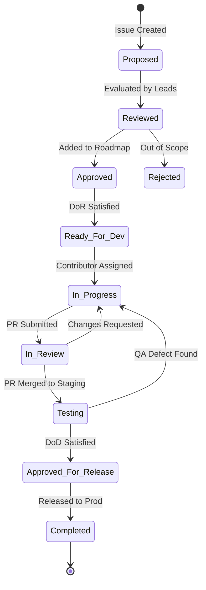
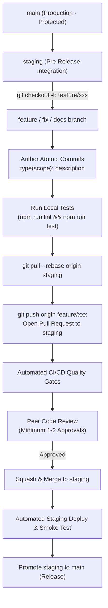
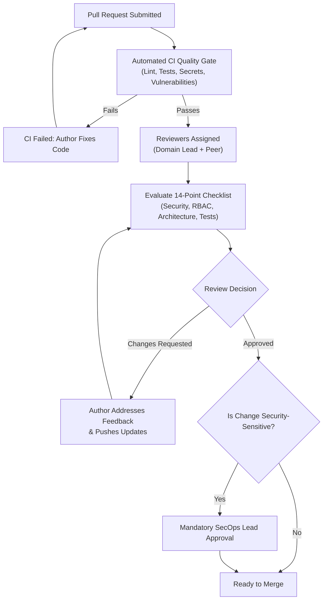
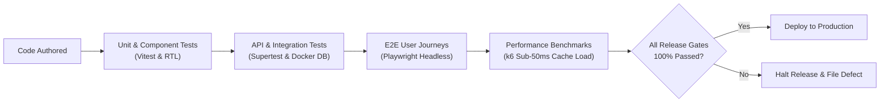
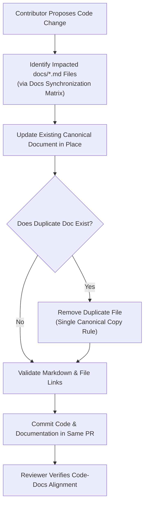
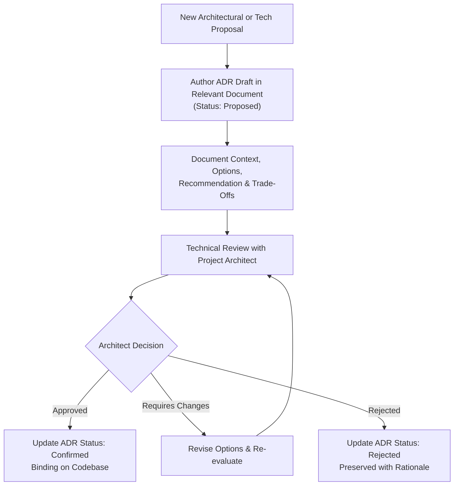
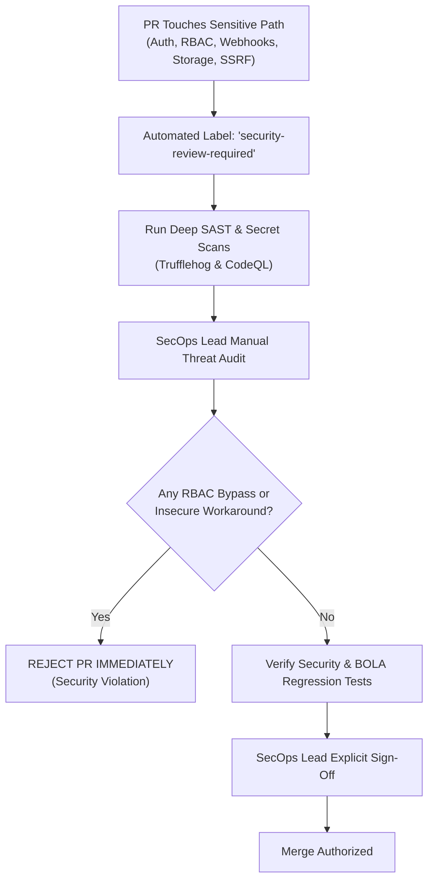

# BREAKING NEWS WALA — Contribution Guidelines & Development Standards
**Document ID**: `BNW-DOC-28-CONTR`  
**Document Version**: `v1.0.0`  
**Classification**: `Technical / Engineering Standards & Governance`  
**Status**: `Approved Standard`  
**Governing Documents**: `docs/01-PRD.md` through `docs/27-Debugging.md`  
**Canonical Location**: `docs/28-Contributing.md`  

---

## 1. Document Information & Governance Status

This document defines the canonical Contribution Guidelines and Engineering Development Standards for the BREAKING NEWS WALA multi-platform digital news syndication ecosystem. It establishes the mandatory protocols, architectural boundaries, coding practices, review standards, and quality gates that govern all code, documentation, and configuration contributions across the platform.

### 1.1 Governance Metadata
- **Project**: BREAKING NEWS WALA (Hyperlocal Indic Digital News Ecosystem)
- **Document Authority**: Project Architect, Engineering Leads, SecOps Lead, QA Lead, Chief Editor
- **Review Cycle**: Semi-annually or upon major architectural revision
- **Target Contributors**: Internal Core Developers, Community Contributors, UI/UX Designers, QA Automation Engineers, Security Auditors, Technical Writers, and AI Prompt Engineers working across Web PWA, Backend REST APIs, PostgreSQL, Redis/BullMQ, AI API Pool, MCP Tool Servers, and the Stage B Native Kotlin Android Application.

---

## 2. Document Objective & Purpose

The objective of this specification is to maintain exceptional software quality, architectural integrity, and editorial security while enabling seamless, disciplined collaboration.

Specifically, this document governs:
1. **Developer Preparation**: Mandating thorough pre-implementation review of requirements, architecture, and business rules before authoring code.
2. **Standardized Git & Commit Hygiene**: Enforcing Conventional Commits, branch naming standards, and clean, reviewable change histories with zero credential leakage.
3. **Engineering Discipline**: Codifying frontend, backend, database, API, AI agent, and mobile contribution standards across TypeScript, Node.js, PostgreSQL, and Kotlin.
4. **Editorial & Architectural Safeguards**: Protecting core invariants (the Source Activation Invariant, Backend RBAC supremacy, AI Schema Validity != Factual Truth, Zero WebViews on Android, and Light-Theme Brand Preservation).
5. **Quality & Security Review Gates**: Defining the Definition of Ready (DoR), Definition of Done (DoD), two-person approval rules, and automated CI/CD testing gates.
6. **Documentation & Decision Governance**: Eliminating drift between code and documentation, establishing ADR proposal workflows, and enforcing single canonical copies.

---

## 3. Contributor Roles and Responsibilities

Contribution responsibilities are structured by operational role to maintain clear accountability across the delivery lifecycle.

| Contributor Role | Primary Operational Responsibilities | Governance & Review Authorities |
| :--- | :--- | :--- |
| **Project Owner** | Strategic vision, business milestones, external partner relationships, final release authorization. | Approves roadmap milestones and brand asset modifications. |
| **Product Manager** | Feature requirements, acceptance criteria, editorial workflows, user feedback triage. | Authors PRDs; approves Definition of Ready (DoR) for new features. |
| **Project Architect** | System topology, cross-cutting technical standards, API contracts, architectural decision records (ADRs). | Mandatory approver for all architectural, database schema, and integration ADRs. |
| **Frontend Developer** | Web PWA interfaces, React components, Tailwind styling, Devanagari typography, client-side routing. | Ensures compliance with design system, responsive breakpoints, and WCAG 2.1 AA. |
| **Backend Developer** | Node.js Express REST APIs, business rule enforcement, background BullMQ queues, rate limiters. | Enforces server-side authorization, input validation, and RFC 7807 error responses. |
| **Database Engineer** | PostgreSQL schema design, indexing, connection pooling, migration safety, transactional integrity. | Reviews all Prisma migrations; verifies backward compatibility and zero data loss. |
| **UI/UX Designer** | Visual design, component libraries, typography scale, responsive wireframes, asset management. | Custodian of approved brand colors (`#FDE900`, `#ED1727`, `#344FD6`) and light theme. |
| **AI Prompt Engineer** | Agent prompts, multi-provider model routing, golden benchmark evaluation datasets, hallucination safeguards. | Reviews prompt versions; verifies Zod schema outputs and prompt injection defenses. |
| **QA Automation Engineer**| Automated test suites (Unit, Component, Integration, API, E2E, k6 Load), regression test coverage. | Quality gatekeeper; verifies Definition of Done (DoD) before release approval. |
| **Security Reviewer (SecOps)**| Threat modeling, vulnerability scanning, secret hygiene, RBAC auditing, SSRF/BOLA verification. | Mandatory approver for all authentication, cryptography, and external integration PRs. |
| **DevOps / SRE Lead** | Container orchestration (Cloud Run), GCP Secret Manager, Cloud Build CI/CD, canary rollbacks. | Owns deployment pipelines, environment separation, and infrastructure health. |
| **Native Android Developer**| 100% Native Kotlin implementation (SDK 34+), Android Keystore, FCM push handlers, offline Room DB. | Enforces zero WebViews; ensures strict alignment with shared `/api/v1/*` backend. |
| **Technical Writer** | Platform documentation, API contract documentation, setup guides, release notes. | Prevents code-documentation drift; enforces single canonical document rules. |

---

## 4. Before Starting Work (Mandatory Preparation)

To prevent wasted effort, conflicting implementations, or unauthorized scope expansion, contributors must execute the **Nine-Step Preparation Protocol** before authoring code:

```
+-----------------------------------------------------------------------------------------+
|                                9-STEP PREPARATION PROTOCOL                              |
|                                                                                         |
|   1. READ PROJECT OVERVIEW         Understand mission, Indic news focus, and Stage A/B  |
|   2. REVIEW SPECIFIC REQUIREMENTS  Inspect docs/01-PRD.md and docs/02-Features.md       |
|   3. AUDIT GOVERNING RULES         Check docs/06-Business-Rules.md for permission boundaries|
|   4. CHECK ARCHITECTURE & DECISIONS Verify docs/11-Architecture.md and approved ADRs    |
|   5. INSPECT TECHNICAL CONTRACTS   Review API (13-API), Database (12), and Security (15)|
|   6. MAP SUBSYSTEM DEPENDENCIES    Identify impact on queues, storage, and AI API pool  |
|   7. CONFIRM TASK SCOPE            Verify acceptance criteria and Definition of Ready   |
|   8. IDENTIFY UNRESOLVED DECISIONS Do NOT invent architecture for pending proposals     |
|   9. OBTAIN FORMAL APPROVAL        Secure task assignment and approval before branching |
+-----------------------------------------------------------------------------------------+
```

> **Mandatory Rule**: Contributors must never independently convert a proposed architecture, unapproved external provider, or pending business rule into production code without documented consensus in the relevant Decision Register.

---

## 5. Task and Feature Lifecycle

Work items proceed through a deterministic ten-state lifecycle to ensure full transparency and quality gating from conception to release.

```
  [PROPOSED] ---> [REVIEWED] ---> [APPROVED] ---> [READY_FOR_DEV] ---> [IN_PROGRESS]
                                                                             |
                                                                             v
  [COMPLETED] <--- [RELEASED] <--- [TESTING] <--- [IN_REVIEW] <--------------+
       |
  (Deferred / Rejected may branch from Reviewed, Approved, or In Review)
```

### 5.1 Lifecycle State Definitions
1. **PROPOSED**: Feature idea, bug report, or technical improvement submitted via issue tracker with problem statement and business justification.
2. **REVIEWED**: Evaluated by Product Manager and System Architect for requirement alignment, feasibility, and architectural fit.
3. **APPROVED**: Accepted into the project roadmap; prioritized against current milestone goals.
4. **READY_FOR_DEV**: Acceptance criteria established; Definition of Ready (DoR) verified; dependencies satisfied; assigned to contributor.
5. **IN_PROGRESS**: Contributor actively authoring code and tests on a dedicated branch.
6. **IN_REVIEW**: Pull Request opened; undergoing peer code review, automated static analysis, and security evaluation.
7. **TESTING**: Pull Request merged to Staging; undergoing automated integration, performance, and QA validation.
8. **APPROVED_FOR_RELEASE**: Meets all Definition of Done (DoD) criteria and release quality gates.
9. **COMPLETED / RELEASED**: Deployed to production; verified in live telemetry; documentation updated.
10. **DEFERRED / REJECTED**: Out of scope, duplicate, or unaligned with platform objectives; documented with rationale.


---

## 6. Git and Branching Strategy

BREAKING NEWS WALA enforces a disciplined Git branching strategy designed to keep the release branch stable while enabling fast, parallel feature development.

### 6.1 Branching Topology
- **`main` (Production Branch)**:
  - Represents production-ready code deployed to live Cloud Run environments.
  - **Protected Branch**: Direct commits and force-pushes (`git push --force`) are permanently disabled.
  - Merges into `main` require a clean pull request, 100% passing automated CI quality gates, and peer approval.
- **`staging` (Integration Branch)**:
  - Serves as the integration and pre-release verification environment. Automatically deploys to the Staging Cloud Run cluster upon merge.
- **Supporting Ephemeral Branches**:
  - Contributors branch from `staging` (or `main` for hotfixes) using standardized naming conventions.

### 6.2 Branch Naming Conventions
All branch names must be lowercase, use forward slash separators, and include a concise hyphen-separated description:

| Branch Category | Naming Pattern | Purpose & Example |
| :--- | :--- | :--- |
| **Feature** | `feature/<short-description>` | New user-facing or platform capability (`feature/reporter-graphics-studio`). |
| **Bug Fix** | `fix/<short-description>` | Non-critical defect resolution (`fix/devanagari-font-clipping`). |
| **Hotfix** | `hotfix/<short-description>` | Critical P1 production defect patched directly from `main` (`hotfix/webhook-replay-defense`). |
| **Documentation** | `docs/<short-description>` | Updates or additions to project documentation (`docs/28-contributing-guide`). |
| **Testing** | `test/<short-description>` | Authoring or refactoring automated test suites (`test/playwright-auth-suite`). |
| **Refactoring** | `refactor/<short-description>`| Code cleanup with zero behavioral change (`refactor/bullmq-worker-pools`). |

### 6.3 Branch Hygiene and Synchronization
- **Rebase on Base Branch**: Before requesting review, contributors must rebase their feature branch onto the latest `staging` commit (`git pull --rebase origin staging`) to ensure linear history and resolve merge conflicts locally.
- **Branch Cleanup**: Merged feature and bugfix branches must be deleted automatically upon PR merge to keep the repository clean.

---

## 7. Commit Standards

BREAKING NEWS WALA follows the **Conventional Commits v1.0.0** specification. Structured commit messages enable automated semantic versioning, changelog generation, and clear forensic traceability.

### 7.1 Commit Message Structure
```
<type>(<scope>): <short description in present imperative tense>

[optional body explaining technical motivation and architectural context]

[optional footer referencing issue IDs or breaking changes]
```

### 7.2 Allowed Commit Types
- `feat`: A new feature or capability for users or editors.
- `fix`: A bug fix or defect resolution.
- `docs`: Documentation updates, additions, or corrections.
- `test`: Adding missing tests or correcting existing test suites.
- `refactor`: A code change that neither fixes a bug nor adds a feature.
- `perf`: A code change that improves performance or latency.
- `security`: Security enhancements, vulnerability patches, or secret hygiene updates.
- `build`: Changes that affect the build system or external dependencies (`package.json`, `vite.config.ts`).
- `ci`: Changes to CI/CD configuration files and test scripts.
- `chore`: Routine maintenance tasks or housekeeping.

### 7.3 Representative Commit Examples
- `feat(reporter): implement territory boundary validation during news submission`
- `fix(rss): enforce source activation invariant on paused feed schedules`
- `security(auth): implement constant-time hmac comparison on inbound webhooks`
- `test(aipool): add fallback circuit breaker test for groq rate limits`
- `docs(api): document rfc 7807 error response format for public endpoints`

### 7.4 Mandatory Commit Rules
1. **Atomic Commits**: One commit should represent a single logical unit of work. Never bundle unrelated bug fixes, formatting changes, and new features into a monolithic commit.
2. **Present Imperative Mood**: Write `"add validation"` instead of `"added validation"` or `"adds validation"`.
3. **Zero Secrets in Commits**: Never commit `.env` files, API keys, private certificates, or local test credentials. Git pre-commit hooks (`trufflehog`) reject commits containing high-entropy secret patterns.

---

## 8. General Coding Standards

All code contributed to BREAKING NEWS WALA must meet rigorous engineering standards ensuring readability, maintainability, modularity, and security across the entire codebase.

### 8.1 Readability & Separation of Concerns
- **Explicit Over Implicit**: Write clear, self-documenting code. Avoid clever, obscure one-liners that obscure business logic.
- **Separation of Concerns**: Strictly decouple transport layers (Express routes), validation gates (Zod schemas), business services, and database persistence layers. Controllers must remain thin, delegating domain logic to dedicated service modules.
- **Modular Directory Structure**: Code must be organized by domain feature rather than technical type where feasible, grouping related components, hooks, services, and tests together.

### 8.2 Standard Naming Conventions
- **Files & Directories**: `kebab-case` for utility files, services, and routes (`article-service.ts`, `rss-crawler.ts`); `PascalCase` for React components (`NewsCard.tsx`, `HeaderTicker.tsx`).
- **Variables & Functions**: `camelCase` (`fetchLatestNews`, `isStoryApproved`).
- **Classes, Types & Interfaces**: `PascalCase` (`ArticleRecord`, `UserProfileDTO`).
- **Constants & Enums**: `UPPER_SNAKE_CASE` (`MAX_POLL_INTERVAL_MS`, `SOURCE_STATUS_ACTIVE`).
- **Boolean Flags**: Must use affirmative prefixes (`isPublished`, `hasValidToken`, `canDirectPublish`).

### 8.3 Defensive Programming & Validation
- **Boundary Validation**: Every entry point receiving external data (HTTP bodies, query parameters, webhook payloads, RSS XML, MCP tool results) must validate inputs against strongly typed Zod schemas.
- **Fail-Fast Error Handling**: Throw explicit, typed errors at the point of failure rather than returning ambiguous `null` or `false` values that propagate undetected.
- **Zero Silent Fallbacks**: Never catch exceptions and suppress them with empty catch blocks. Catch, log with structured context, and return appropriate RFC 7807 problem details.

---

## 9. Frontend Contribution Standards

Frontend development is governed by `docs/07-Design.md`, `docs/09-Components.md`, and `docs/10-Responsive-Design.md`. Contributors must maintain the approved brand visual identity, Hindi-first typography, and accessible design system.

### 9.1 Brand Visual Identity Preservation
The visual identity of BREAKING NEWS WALA is an approved, non-negotiable brand asset:
- **Core Approved Brand Color Palette**:
  - **Brand Yellow**: `#FDE900` (Used for primary accent banners, breaking tickers, and urgent highlights).
  - **Brand Red**: `#ED1727` (Used for "BREAKING NEWS" badges, live flash alerts, and critical tags).
  - **Brand Blue**: `#344FD6` (Used for primary navigation accents, category tabs, and active links).
- **Brand Logo Immutability**: The original logo asset (`/public/logo.png`) must **never be altered, recolored, distorted, or replaced**. All header and PWA splash screen components must render the canonical vector or high-resolution PNG asset.
- **Light-Theme System Mandate**: BREAKING NEWS WALA is engineered exclusively around an **approved light-theme design system**. Contributors must not introduce unapproved dark-mode toggles or low-contrast dark palettes.

### 9.2 Hindi-First Typography & Devanagari Standards
- **Font Stack**: All text styling must utilize the approved font hierarchy: `Noto Sans Devanagari`, `Hind`, and system sans-serif fallbacks.
- **Line-Height Safety**: To prevent clipping of Devanagari vowel matras and conjuncts (e.g., क्ष, त्र, ज्ञ, ष्ट्र), all text elements must maintain a minimum `line-height` of `1.5` (preferably `leading-relaxed` or `leading-normal` in Tailwind).
- **Text Truncation**: When clipping multi-line headlines, use standard CSS `line-clamp-2` or `line-clamp-3`. Never manually truncate Devanagari strings using character-count slices (`str.slice(0, 50)`), as this splits multi-byte Unicode combining marks and corrupts characters.

### 9.3 Responsive Layouts & Accessibility (WCAG 2.1 AA)
- **Mobile-First Breakpoint Architecture**: All components must be designed for mobile screens (360px) first, scaling gracefully to Tablet (768px) and Desktop (1280px+).
- **Touch Target Bounds**: All buttons, links, and interactive elements must have minimum touch dimensions of `48 x 48 dp` (`min-h-[48px] min-w-[48px]`).
- **Contrast Ratios**: Normal text must maintain a contrast ratio of at least `4.5:1` against its background; headlines and large buttons must maintain at least `3.0:1`.
- **Zero Private Environment Leakage**: Frontend code must **never** import or bundle private backend configuration. Only non-sensitive operational parameters explicitly carrying the `VITE_` prefix (`import.meta.env.VITE_*`) may be referenced in client components.

---

## 10. Backend Contribution Standards

Backend services are governed by `docs/11-Architecture.md`, `docs/13-API.md`, and `docs/15-Security.md`. Backend code enforces business integrity, data consistency, and authorization.

### 10.1 API-First Architecture & Single Shared Backend
- **Single Unified Backend**: The backend Express REST API (`/api/v1/*`) serves both the Web PWA and future Stage B Native Android applications identically. Contributors must **never** author a separate or duplicate backend for mobile clients.
- **Server-Side Enforcement Supremacy**: Client-side form validations and UI button states are cosmetic conveniences. All authorization checks, territory scoping, role boundaries, and rate limits must be strictly executed on the backend.

### 10.2 RESTful Endpoint Conventions & Validation
- **Resource-Oriented URIs**: Use plural nouns (`/api/v1/articles`, `/api/v1/reporters`, `/api/v1/categories`). Use standard HTTP verbs: `GET` (read), `POST` (create), `PUT` (idempotent replace), `PATCH` (partial update), `DELETE` (remove).
- **Zod Schema Gate**: Every controller must validate `req.body`, `req.query`, and `req.params` against an explicit Zod schema before invoking business services.
- **Standardized Error Formatting**: All rejected requests must return structured RFC 7807 problem details via the centralized error middleware.

### 10.3 Background Processing & Idempotency
- **Asynchronous Decoupling**: Time-intensive operations (RSS crawling, AI drafting, image transcoding, notification dispatch) must never execute synchronously within HTTP request lifecycles. Controllers must enqueue jobs into BullMQ and return immediate `202 Accepted` responses.
- **Idempotency Keys**: Mutating operations that risk duplicate charges or records (article submissions, reporter payouts) must require and validate an `Idempotency-Key` header stored in Redis.


---

## 11. Database Contribution Standards

Database schema design, queries, and migrations are governed by `docs/12-Database.md`. Contributions must guarantee data integrity, relational consistency, and non-destructive schema evolution.

### 11.1 PostgreSQL Schema Design Conventions
- **Table Naming**: Lowercase, plural nouns using `snake_case` (`articles`, `rss_sources`, `reporter_profiles`, `editorial_audit_logs`).
- **Column Naming**: Lowercase `snake_case` with explicit semantic naming (`published_at`, `is_trusted`, `author_id`, `created_at`).
- **Primary Keys**: Standard UUID v4 (`id UUID PRIMARY KEY DEFAULT gen_random_uuid()`).
- **Foreign Keys**: Explicit relation names with foreign key constraints and index coverage on foreign key columns (`author_id UUID REFERENCES users(id) ON DELETE RESTRICT`).
- **Timestamps**: Mandatory `created_at TIMESTAMPTZ DEFAULT NOW()` and `updated_at TIMESTAMPTZ DEFAULT NOW()` on all core tables.

### 11.2 Migration Safety and Zero-Downtime Schema Evolution
- **Prisma Migrations**: All schema changes must be authored via Prisma (`npx prisma migrate dev --name <migration_name>`). Hand-crafted raw DDL scripts executed outside Prisma are prohibited.
- **Non-Destructive Evolution Pattern (Expand and Contract)**:
  1. *Expand Phase*: Add new nullable columns or tables first. Deploy code that writes to both old and new columns.
  2. *Backfill Phase*: Backfill data asynchronously in background workers.
  3. *Contract Phase*: Deploy code that reads exclusively from new columns. Deprecate and safely remove old columns in a subsequent release.
- **Prohibited Destructive Operations**: Committing migrations containing `DROP TABLE`, `DROP COLUMN`, or changing column types without backward-compatible backfills is strictly prohibited.
- **Index Performance Review**: Any new column frequently queried in `WHERE`, `JOIN`, or `ORDER BY` clauses must include an index definition in the Prisma schema, with composite indexes matching query filter order.

---

## 12. API and Integration Contribution Standards

API development is governed by `docs/13-API.md`, `docs/19-API-Pool.md`, and `docs/20-Integrations.md`. All external interactions must maintain security, rate limits, and reliability.

### 12.1 API Contract Governance
- **OpenAPI Synchronization**: When authoring or updating an endpoint in `/api/v1/*`, contributors must simultaneously update the corresponding contract documentation. Implementation and API documentation must never drift apart.
- **Strict Pagination Standard**: Endpoints returning lists must support pagination (`page` and `limit`, or cursor-based). The `limit` parameter must be strictly capped at a maximum of `100` items to prevent memory exhaustion DoS attacks.
- **Sorting Whitelists**: Dynamic sorting parameters (`sort=field:direction`) must be validated against an explicit whitelist of indexed columns. Raw user input strings must never be concatenated into SQL `ORDER BY` clauses.

### 12.2 Integration Abstraction & The AI API Pool Rule
- **Driver Abstraction Pattern**: External integrations (SMS gateways, media storage, push notifications) must be encapsulated behind provider driver interfaces, allowing third-party services to be swapped or mocked during testing without modifying core business logic.
- **The Mandatory AI API Pool Rule**:
  > **Strict Architectural Rule**: Contributors must **never** make direct HTTP calls or hardcode vendor SDK clients (e.g., direct `@google/genai` or Anthropic SDK invocations) inside business controllers or workers. All generative AI requests must be routed through the centralized **Multi-Provider AI API Pool** (`docs/19-API-Pool.md`) to ensure automatic latency balancing, quota protection, circuit breaking, and server-side secret management.
- **Webhook HMAC Integrity**: All inbound webhooks must enforce cryptographic signature verification using HMAC-SHA256 calculated over the **raw unparsed request buffer**, verified using `crypto.timingSafeEqual()`, and protected against replay attacks via Redis nonce caching.

---

## 13. AI Agent and Prompt Contribution Standards

Contributions to AI agents (`docs/17-Agents.md`), prompt templates (`docs/21-Prompts.md`), and Model Context Protocol servers (`docs/18-MCP.md`) must adhere to strict editorial and safety boundaries.

### 13.1 Prompt Versioning and Registry Management
- **Semantic Prompt Versioning**: Prompts are treated as version-controlled code assets residing in `./config/prompts/`. Any modification to prompt instructions, system roles, or few-shot examples requires incrementing the semantic version (e.g., `PROMPT_VERSION_DRAFTING=v1.1.0`).
- **Zod Output Schemas**: All generative agent prompts must enforce structured JSON output validated against strongly typed Zod schemas. Free-form, unstructured text outputs are prohibited for automated editorial workflows.

### 13.2 Mandatory AI Editorial Safeguards
1. **The Human Editorial Review Gate**: Autonomous agents cannot publish articles directly to public channels. Agent-generated articles must be persisted strictly with status `DRAFT_AI` and routed to the Central Newsroom desk for human editor review and approval.
2. **Untrusted External Content Isolation**: All external text (RSS feed descriptions, scraped URL HTML, user comments) must be treated as untrusted data. When constructing LLM prompts, external text must be escaped and wrapped within explicit data boundaries (e.g., `<source_facts>...</source_facts>`) to prevent direct and indirect prompt injection attacks.
3. **Model Context Protocol (MCP) Sandboxing**: MCP tool servers must execute as isolated `stdio` child processes with restricted OS permissions, read-only filesystem mounts, and strict execution timeouts (`MCP_CLIENT_TIMEOUT_MS=30000`). Tools must never bypass backend RBAC authorization.

---

## 14. Native Android Contribution Standards (Stage B Kotlin SDK 34+)

The future mobile client for BREAKING NEWS WALA is a **100% Native Android application written in Kotlin using modern Android SDK (API Level 34+, Android 14) and Jetpack Compose**.

### 14.1 Core Android Architecture Standards
- **Zero WebViews Invariant**:
  > **Strict Architectural Mandate**: Contributors must **never** use `android.webkit.WebView` as the application architecture, content renderer, or navigation wrapper. The application must be 100% native Kotlin using Jetpack Compose UI components.
- **Single Shared Backend**: Android clients connect exclusively to the unified backend REST API (`https://api.breakingnewswala.in/api/v1/*`). Creating a separate mobile backend, custom mobile microservices, or duplicated business logic is strictly prohibited.
- **Architecture Pattern**: Modern Android architecture following official Google guidelines: UI Layer (Jetpack Compose) -> ViewModel (StateFlow) -> Domain / UseCase Layer -> Data Layer (Retrofit REST Client + Room Offline Database).

### 14.2 Mobile Security and Device Integration
- **Hardware-Isolated Token Storage**: Authentication tokens must be persisted using `EncryptedSharedPreferences` backed by the hardware-isolated Android Keystore (`AndroidKeyStore` provider, `MasterKey` AES256-GCM). Tokens must never be stored in plain SharedPreferences or SQLite.
- **Runtime Permissions**: Implement explicit runtime permission requests for Camera, Gallery, and Push Notifications (`POST_NOTIFICATIONS`) with clear educational dialogs explaining why the permission is required.
- **Zero Private Secrets in APK**: Private backend secrets, database connection strings, and AI provider API keys must **never** be compiled into Android code, assets, or Gradle build files. Only public client identifiers (e.g., `google-services.json`) are permitted.

---

## 15. Testing Requirements for Contributors

Code quality is proven through automated verification. Contributions must adhere to the testing standards codified in `docs/26-Testing.md`.

### 15.1 Mandatory Test Coverage by Change Type
| Contribution Type | Required Test Coverage | Primary Test Framework |
| :--- | :--- | :--- |
| **Business Logic & Utilities** | Unit tests covering positive paths, boundary conditions, and negative errors (>= 85% coverage). | Vitest |
| **Frontend UI Components** | Component tests validating rendering, form validations, loading skeletons, and ARIA roles. | React Testing Library |
| **API Endpoints & Controllers** | Contract and integration tests validating request schemas, auth, status codes, and error formatting. | Supertest |
| **Critical User Journeys** | End-to-end tests validating full browser flows (reporter filing, editor approval, public read). | Playwright |
| **Bug Fixes (Defect Patches)** | **Mandatory automated regression test** reproducing the original failure before the fix. | Vitest / Supertest |
| **AI Prompt Modifications** | Benchmark evaluation against the 100-story golden test dataset verifying accuracy and schema validity. | Custom AI Evaluation Runner |
| **Native Android Features** | Unit tests for ViewModels/Repositories (Robolectric) and Compose UI tests (Espresso). | JUnit / Robolectric / Espresso |

> **Verification Rule**: A successful local build alone (`npm run build`) is **not** sufficient evidence of correctness. Contributors must submit empirical proof of passing automated tests with every pull request.


---

## 16. Security Contribution Requirements

Security is built into every layer of BREAKING NEWS WALA. Contributors must adhere to the security mandates defined in `docs/15-Security.md`.

### 16.1 The Ten Mandatory Security Rules
```
+-----------------------------------------------------------------------------------------+
|                               TEN MANDATORY SECURITY RULES                              |
|                                                                                         |
|   1. ZERO SECRETS IN GIT          Never commit API keys, credentials, or private certs  |
|   2. ZERO SECRETS IN FRONTEND     Never expose private keys in Vite bundles or client JS|
|   3. ZERO SECRETS IN ANDROID APK  Never compile private server credentials into APKs    |
|   4. STRICT RBAC & TERRITORY      Never bypass role checks or district assignments      |
|   5. ZERO SECURITY WORKAROUNDS    Never disable WAF, auth gates, or checks to fix a bug |
|   6. COMPLETE INPUT VALIDATION    Validate all external payloads against Zod schemas    |
|   7. UNTRUSTED EXTERNAL INPUT     Treat all RSS XML, scraped URLs, and comments as risky|
|   8. PRIVACY & PII PROTECTION     Encrypt personal data at rest; mask tokens in logs    |
|   9. LEAST-PRIVILEGE ACCESS       Scope service accounts and MCP tools strictly         |
|  10. MANDATORY AUDIT LOGGING      Record immutable audit entries for privileged actions |
+-----------------------------------------------------------------------------------------+
```

### 16.2 Mandatory Security Review Gate
Any pull request that introduces or modifies code in the following sensitive categories requires mandatory review and explicit sign-off from the **Security Reviewer (SecOps Lead)** before it can be merged:
- Authentication, session cookie handling, or JWT signing logic (`docs/14-Auth.md`).
- Authorization middleware, role-based access control (RBAC), or territory scoping (`docs/06-Business-Rules.md`).
- Cryptographic implementations, webhook HMAC signatures, or password hashing.
- File upload handlers, magic byte MIME validators, or presigned URL generators (`docs/16-Storage.md`).
- External URL scrapers, RSS feed parsers, or SSRF protection logic (`docs/20-Integrations.md`).
- Changes to environment variable validation schemas or secret references (`docs/25-Environment.md`).

---

## 17. Code Review Standards

Code reviews serve as the primary peer quality gate ensuring architectural alignment, maintainability, and security.

### 17.1 Comprehensive Code Review Checklist
Reviewers must evaluate pull requests across fourteen specific engineering dimensions:
1. **Requirement Alignment**: Does the PR fulfill the approved requirements in `docs/01-PRD.md` and `docs/02-Features.md` without unauthorized scope expansion?
2. **Business Rules**: Are territory restrictions, reporter approval gates, and editorial review workflows strictly preserved?
3. **Architecture Consistency**: Does the code respect platform boundaries (e.g., single shared API, AI API Pool routing, zero WebViews)?
4. **Code Quality**: Is the code clean, readable, modular, and self-documenting?
5. **Security**: Are inputs validated? Are secrets protected? Are SSRF/BOLA/XSS vulnerabilities mitigated?
6. **Authorization**: Are permissions enforced on the backend? Are hidden UI buttons backed by server-side gates?
7. **Data Integrity**: Are database transactions atomic (ACID)? Are foreign key cascades safe?
8. **API Compatibility**: Does the change preserve backward compatibility for existing Web and future Android clients?
9. **Performance**: Are database queries indexed? Is caching utilized where appropriate? Are heavy tasks asynchronous?
10. **Accessibility**: Does the UI meet WCAG 2.1 AA standards (touch target >= 48dp, contrast >= 4.5:1)?
11. **Responsive Behavior**: Does the layout render cleanly across mobile (360px), tablet (768px), and desktop (1280px+)?
12. **Test Coverage**: Are unit, integration, and regression tests included? Did all automated CI suites pass?
13. **Documentation Synchronization**: Are related documentation files updated in the same PR?
14. **Deployment Impact**: Are migrations safe? Are required environment variables documented in `docs/25-Environment.md`?

### 17.2 Review Responsibilities and Merge Approval Rules
- **Author Responsibilities**: Perform self-review before opening PR; provide comprehensive PR description; resolve reviewer feedback promptly; avoid adding unrelated changes to an open PR.
- **Reviewer Responsibilities**: Provide constructive, respectful feedback; explain the architectural reasoning behind requested changes; complete reviews within 24 business hours.
- **Merge Approval Rules**: Every PR requires at least **one approved peer review**. PRs modifying core architecture, security, or database schemas require **two approved reviews** including the System Architect or SecOps Lead. Zero unresolved change requests are permitted at merge time.

---

## 18. Pull Request Standards & Template

All contributions must be submitted using the standardized Pull Request template to ensure consistent documentation of changes, verification evidence, and impact analysis.

### 18.1 Standard Pull Request Template
```markdown
## Pull Request: [type(scope): concise description]

### 1. Summary & Objective
- **Related Issue / Task**: #[Issue Number]
- **Governing Requirement**: [e.g., docs/06-Business-Rules.md #2.1]
- **Summary**: Concise explanation of what this PR implements or fixes and the technical motivation.

### 2. Scope of Changes
- [ ] Frontend Web PWA
- [ ] Backend REST API (`/api/v1/*`)
- [ ] Relational Database / Prisma Migration
- [ ] Background Worker / Queue (BullMQ)
- [ ] Multi-Provider AI API Pool / Prompts
- [ ] Model Context Protocol (MCP) Tools
- [ ] External Integration (RSS / SMS / FCM / R2)
- [ ] Future Native Android Implementation
- [ ] Platform Documentation

### 3. Technical Approach & Architecture
Brief description of the implementation strategy, design patterns used, and architectural decisions made.

### 4. Verification & Testing Evidence
- [ ] Unit tests added / updated (`npm run test:unit`)
- [ ] Integration / API contract tests added (`npm run test:integration`)
- [ ] Automated regression test added (if bug fix)
- [ ] Static type check passed (`npm run lint`)
- **Empirical Proof**:
  ```text
  [Paste command output showing passing tests or benchmark results]
  ```

### 5. Impact Analysis
- **Database Schema Impact**: [None / Non-destructive migration included]
- **API Contract Impact**: [None / Backward-compatible addition]
- **Security & Secret Impact**: [Verified zero secrets in code; RBAC enforced on backend]
- **Documentation Updated**: [List of updated docs/*.md files]

### 6. Contributor Checklist
- [ ] I have executed a self-review of my code.
- [ ] My code adheres to the project's coding and formatting standards.
- [ ] I have not committed any `.env` files, credentials, or private keys.
- [ ] I have updated all relevant documentation files in this PR.
- [ ] I have preserved the approved brand colors and light-theme design system.
```

---

## 19. Documentation Contribution Standards

Documentation at BREAKING NEWS WALA is treated as a first-class engineering deliverable. Code and documentation must be authored, reviewed, and merged synchronously.

### 19.1 Documentation Synchronization Matrix
When contributing code changes, contributors must update the corresponding governing documentation files in the same pull request:

| Code / Platform Change Category | Governing Documentation File(s) That MUST Be Updated |
| :--- | :--- |
| **New Feature or Requirement** | `docs/01-PRD.md`, `docs/02-Features.md`, `docs/03-Plan.md` |
| **Editorial Workflow or Rule** | `docs/05-Workflows.md`, `docs/06-Business-Rules.md` |
| **UI Component or Theme** | `docs/07-Design.md`, `docs/09-Components.md`, `docs/10-Responsive-Design.md` |
| **System Architecture / Microservice** | `docs/11-Architecture.md` |
| **Database Model or Migration**| `docs/12-Database.md` |
| **REST API Route or Contract** | `docs/13-API.md` |
| **Authentication, JWT, Session** | `docs/14-Auth.md` |
| **Security, SSRF, Encryption** | `docs/15-Security.md` |
| **Media, R2 Storage, Transcoding**| `docs/16-Storage.md` |
| **AI Agent, Prompts, MCP** | `docs/17-Agents.md`, `docs/18-MCP.md`, `docs/21-Prompts.md` |
| **AI Provider or Routing** | `docs/19-API-Pool.md` |
| **External Integration or RSS** | `docs/20-Integrations.md` |
| **Environment Variables or Secrets**| `docs/25-Environment.md` |
| **Test Suites or Quality Gates** | `docs/26-Testing.md` |
| **Error Handling or Runbooks** | `docs/27-Debugging.md` |
| **Contribution & Git Workflow** | `docs/28-Contributing.md` |

### 19.2 Single Canonical Copy Mandate
Every documentation document exists strictly at its single designated path within the `docs/` directory. Contributors must **never** create duplicate copies, legacy version copies (e.g., `11-Architecture_v2.md`), or fragmented sub-files. Existing documents must be updated in place.

---

## 20. Documentation and Decision Governance

Architectural decisions are governed through formal Architectural Decision Records (ADRs) tracked within platform documentation.

### 20.1 Decision States
Every architectural decision is classified into one of five formal states:
- **Confirmed**: Formally reviewed, approved by the Project Architect, and binding upon all contributors.
- **Proposed**: Authored with technical justification; currently under active review.
- **Pending Approval**: Review complete; awaiting final sign-off from designated authority (SecOps, Chief Editor).
- **Deferred**: Postponed to a future milestone (e.g., Stage B Native Android decisions).
- **Rejected**: Evaluated and formally discarded; preserved in decision registers with rationale to prevent re-litigation.

### 20.2 Proposing or Modifying Architectural Decisions
To propose a new decision or modify an existing one:
1. Author an ADR entry in the relevant document's Decision Register with unique ID (`ADR-[DOMAIN]-[NUMBER]`).
2. Include Context, Available Options, Recommendation, Technical Rationale, Dependencies, and Required Approver.
3. If proposing to supersede an established decision, mark the new ADR as `Proposed (Supersedes ADR-XXX-YYY)`.
4. **Never silently overwrite past decisions**: Past confirmed decisions remain in effect until the superseding ADR is formally approved by the Project Architect.

---

## 21. Definition of Ready (DoR) and Definition of Done (DoD)

To maintain rigorous quality standards, work items must satisfy two formal checklists at the beginning and conclusion of development.

### 21.1 Definition of Ready (DoR) Checklist
A feature, task, or bug fix is **Ready for Development** only when:
- [ ] **Clear Objective**: The user story or technical problem statement is explicitly defined.
- [ ] **Acceptance Criteria**: Verifiable, testable success criteria are documented.
- [ ] **Governing Documentation Identified**: Relevant requirement, business rule, and API documents are referenced.
- [ ] **Dependencies Resolved**: Required upstream APIs, database schemas, or provider keys are available.
- [ ] **Architectural Alignment**: The feature complies with approved architecture; any novel design has an approved ADR.
- [ ] **Test Expectations Defined**: The required testing levels (Unit, Integration, E2E) are identified.
- [ ] **Formal Approval**: Task is assigned and approved by the Product Manager or Technical Lead.

### 21.2 Definition of Done (DoD) Checklist
A task is **Done and Ready for Release** only when:
- [ ] **Implementation Complete**: Code authored and strictly fulfills all acceptance criteria.
- [ ] **Code Standards Verified**: Code adheres to naming, modularity, and TypeScript standards; zero linting warnings.
- [ ] **Automated Tests Passing**: 100% pass on all new and existing unit, component, API, and integration tests.
- [ ] **Regression Test Included**: Automated regression test committed if resolving a defect.
- [ ] **Security Review Complete**: Verified zero secrets in code; authorization enforced on backend; SecOps approval secured if sensitive.
- [ ] **Peer Code Review Completed**: At least one approved peer review (two for architecture/security); all comments resolved.
- [ ] **Documentation Synchronized**: All governing documents updated in place within the same PR.
- [ ] **Performance & Accessibility Verified**: Latency benchmarks satisfied; WCAG 2.1 AA contrast verified.
- [ ] **Clean CI/CD Pipeline**: PR passes all automated Cloud Build / GitHub Actions pipeline stages.


---

## 22. Contribution and Collaboration Principles

Sustainable, high-velocity software engineering requires mutual respect, intellectual honesty, and strict engineering discipline.

### 22.1 Professional Collaboration Values
1. **Respectful & Constructive Communication**: Code reviews and technical debates must focus strictly on code, architecture, and empirical evidence, never on individuals. Critique code, not authors.
2. **Evidence-Based Engineering**: Technical assertions must be supported by empirical evidence (profiling benchmarks, automated test outputs, documentation references) rather than intuition or personal preference.
3. **Strict Scope Discipline**: Contributors must maintain strict focus on the approved task scope. Unapproved "while-I-am-here" refactoring or speculative features increase review overhead and release risk and are strictly discouraged.
4. **Transparent Blocker Reporting**: If an unexpected architectural contradiction, missing dependency, or security obstacle arises, report it immediately in the issue tracker rather than working around it with hacky compromises.
5. **Production Discipline**: Live production environments are sacred. Ad-hoc testing, manual database edits, or unreviewed hotfixes in production are strictly forbidden.

---

## 23. Contribution Workflow Diagrams

The following 7 architectural Mermaid diagrams illustrate the contributor lifecycles, Git branches, code reviews, decision governance, and security gates.

### 23.1 Diagram 1: Task Lifecycle State Machine


### 23.2 Diagram 2: Branch and Pull Request Workflow


### 23.3 Diagram 3: Code Review Process


### 23.4 Diagram 4: Testing and Release Readiness Pipeline


### 23.5 Diagram 5: Documentation Update Workflow


### 23.6 Diagram 6: Architecture Decision Approval Protocol


### 23.7 Diagram 7: Security-Sensitive Change Review


---

## 24. Contributor Checklists

### 24.1 Checklist: Before Starting Development
- [ ] I have read the project overview and understood the mission in `docs/01-PRD.md`.
- [ ] I have verified the feature requirements in `docs/02-Features.md`.
- [ ] I have verified applicable business rules in `docs/06-Business-Rules.md`.
- [ ] I have confirmed architectural decisions in `docs/11-Architecture.md` and related ADRs.
- [ ] I have verified that my task satisfies the **Definition of Ready (DoR)**.
- [ ] I have not invented unapproved architecture or external integrations for pending proposals.

### 24.2 Checklist: Before Submitting a Pull Request
- [ ] I have created a clean branch from `staging` following standard naming (`feature/`, `fix/`).
- [ ] I have authored small, atomic commits using Conventional Commits (`type(scope): description`).
- [ ] I have validated that my code adheres to naming, formatting, and TypeScript standards.
- [ ] I have executed `npm run lint` (`tsc --noEmit`) and resolved all warnings.
- [ ] I have verified that zero secrets, credentials, or `.env` files are committed.
- [ ] I have preserved the approved brand colors (Yellow `#FDE900`, Red `#ED1727`, Blue `#344FD6`) and light theme.
- [ ] I have authored and passed automated unit, integration, and regression tests (`docs/26-Testing.md`).
- [ ] I have updated all corresponding documentation files in `docs/` in this same PR.
- [ ] I have rebased my branch onto the latest `staging` commit without merge conflicts.

### 24.3 Checklist: Before Merging a Pull Request
- [ ] All automated CI/CD checks (linting, tests, secret scans) are 100% passing.
- [ ] At least one approved peer review has been recorded (two for architecture/security).
- [ ] SecOps Lead sign-off has been received if modifying authentication, RBAC, or integrations.
- [ ] All reviewer comments and discussion threads have been explicitly resolved.
- [ ] Implementation and documentation are perfectly aligned with zero drift.

### 24.4 Checklist: Before Release to Production
- [ ] Pre-flight health checks and smoke tests verified in Staging environment.
- [ ] Pre-deploy database migrations (`prisma migrate deploy`) verified non-destructive.
- [ ] Zero Critical or High open defects in the Defect Management backlog.
- [ ] Performance latency targets (sub-50ms cache read, sub-300ms SSR) verified under load.
- [ ] Human editorial sign-off confirmed on all content publishing pathways.
- [ ] Cloud Run rolling update deployment configured with automated canary rollback triggers.

---

## 25. Contribution Decision Register

The following Architectural Decision Records (ADRs) document confirmed contribution practices, Git standards, and review governance.

| ADR ID | Contribution Area | Decision / Question | Status | Available Options | Recommendation | Reasoning | Dependencies | Approver | Next Action |
| :--- | :--- | :--- | :--- | :--- | :--- | :--- | :--- | :--- | :--- |
| **ADR-CONTR-001**| Commit Standard | Format for Git commit messages | **Confirmed** | 1. Freeform commits<br>2. Conventional Commits v1.0.0 | **Option 2: Conventional Commits** | Standardized semantic types (`feat`, `fix`, `docs`); enables automated changelogs. | Git Toolchain | System Architect | Configure commitlint hook. |
| **ADR-CONTR-002**| Branching Model | Recommended Git branching model | **Confirmed** | 1. GitHub Flow (`main` only)<br>2. Trunk-Based with Staging (`main` + `staging` + feature branches) | **Option 2: Trunk-Based with Staging** | Protects production `main`; provides dedicated integration environment for automated smoke tests. | Cloud Run Staging| DevOps Lead | Protect `main` and `staging` branches. |
| **ADR-CONTR-003**| Documentation Sync| Protocol for updating documentation alongside code | **Confirmed** | 1. Periodic batch doc updates<br>2. Synchronous update in same PR | **Option 2: Synchronous update in same PR** | Completely eliminates code-documentation drift; treats docs as first-class engineering deliverables. | PR Review | Tech Writer | Enforce in PR review checklist. |
| **ADR-CONTR-004**| Single Backend Rule| Backend architecture for future Native Android | **Confirmed** | 1. Separate Android BFF backend<br>2. Single unified `/api/v1/*` backend | **Option 2: Single unified backend** | Zero duplicate business logic; single authentication perimeter; shared data models. | `docs/11-Arch.md` | System Architect | Bind Android Retrofit to `/api/v1/*`. |
| **ADR-CONTR-005**| Android WebViews | Architectural stance on WebViews in future Android app | **Confirmed** | 1. Allow hybrid WebViews<br>2. 100% Native Kotlin SDK 34+ (Zero WebViews) | **Option 2: 100% Native Kotlin (Zero WebViews)** | Strict PRD compliance; superior performance; hardware Android Keystore security. | `docs/01-PRD.md` | Mobile Lead | Enforce zero WebViews in Android Lint. |
| **ADR-CONTR-006**| Brand Preservation| Policy on theme variations and brand logo modifications | **Confirmed** | 1. User customizable themes<br>2. Strict light-theme + approved brand palette | **Option 2: Strict light-theme + approved brand palette** | Preserves high-visibility news brand identity (Yellow `#FDE900`, Red `#ED1727`, Blue `#344FD6`). | `docs/07-Design.md`| Chief Editor | Lock Tailwind theme palette. |
| **ADR-CONTR-007**| AI Pool Gateway | Routing rule for generative AI provider SDK calls | **Confirmed** | 1. Direct SDK calls in controllers<br>2. Mandatory Multi-Provider AI API Pool routing | **Option 2: Mandatory AI API Pool routing** | Server-side secret protection; dynamic circuit breaking; automated provider failover. | `docs/19-API-Pool`| AI Lead | Block direct AI SDK imports in lint. |
| **ADR-CONTR-008**| Two-Person Rule | Review requirements for security and architectural PRs | **Confirmed** | 1. Single reviewer approval<br>2. Mandatory two-person approval for sensitive changes | **Option 2: Mandatory two-person approval** | Defense-in-depth against accidental security regressions or unapproved architectural drift. | GitHub Settings | SecOps Lead | Configure codeowners for sensitive paths. |
| **ADR-CONTR-009**| Regression Testing| Testing requirement for resolved bug fixes | **Confirmed** | 1. Optional test if time permits<br>2. Mandatory automated regression test reproducing bug | **Option 2: Mandatory automated regression test** | Permanently prevents regression recurrence; validates root cause fix empirically. | `docs/26-Testing` | QA Lead | Require test in bugfix PRs. |
| **ADR-CONTR-010**| Issue Tracker Selection| Platform for issue tracking and sprint management | **Proposed** | 1. GitHub Issues & Projects<br>2. Linear<br>3. Jira | **Option 1: GitHub Issues & Projects** | Co-located with repository; seamless PR linking; zero additional external SaaS overhead. | Project Setup | Product Manager | Set up project board template. |
| **ADR-CONTR-011**| Pre-Commit Hook Tool| Automation tool for local git pre-commit verification | **Proposed** | 1. Manual developer execution<br>2. Husky + lint-staged | **Option 2: Husky + lint-staged** | Catches formatting, linting, and secret leakage errors locally before pushing to remote. | `package.json` | DevOps Lead | Configure Husky pre-commit hooks. |
| **ADR-CONTR-012**| Non-Destructive Migrations| Policy on handling breaking database schema changes | **Confirmed** | 1. Direct column replacement<br>2. Expand-and-contract non-destructive pattern | **Option 2: Expand-and-contract pattern** | Eliminates downtime during rolling container deployments; guarantees safe rollback capability. | `docs/12-Database`| DBA | Mandate in database review standards. |

---

## 26. Cross-Document Traceability Matrix

| Reference Document | Section / Requirement | Alignment in `28-Contributing.md` |
| :--- | :--- | :--- |
| `docs/01-PRD.md` | Mission, Indic news focus, native Android Stage B | Sections 2, 9.2, 14, 25 (Native Kotlin SDK 34+, Devanagari typography standards) |
| `docs/02-Features.md` | Feature breakdown, reporter workflow, graphics studio | Sections 5, 9.1 (Feature lifecycles, graphics studio brand constraints) |
| `docs/03-Plan.md` | Roadmap phases, Stage A Web PWA vs Stage B Android | Sections 3, 5, 20 (Role assignments, roadmap milestone alignment) |
| `docs/04-NFR.md` | Latency, throughput, reliability, accessibility NFRs | Sections 8.3, 9.3, 15, 24.4 (WCAG 2.1 AA, sub-50ms cache, k6 testing) |
| `docs/05-Workflows.md` | News lifecycle, editorial review workflows | Sections 4, 10.1, 13.2 (Editorial review gates, news state machine preservation) |
| `docs/06-Business-Rules.md`| Role permissions, territory isolation, publishing rules | Sections 4, 10.1, 16.1, 17.1 (Backend RBAC supremacy, territory scoping) |
| `docs/07-Design.md` | Design system, typography, color palette, brand rules | Section 9.1 (Preservation of Yellow `#FDE900`, Red `#ED1727`, Blue `#344FD6`, logo) |
| `docs/09-Components.md` | Component hierarchy, modal states, UI patterns | Section 9.3 (Reusable components, touch bounds >= 48dp, mobile-first design) |
| `docs/10-Responsive-Design.md`| Breakpoints, touch targets, multi-device layouts | Section 9.3 (Responsive breakpoint standards from 360px to 1920px) |
| `docs/11-Architecture.md` | Microservices, execution planes, single shared API | Sections 10.1, 12.2 (Single backend for Web and Android, service decoupling) |
| `docs/12-Database.md` | PostgreSQL schema, connection pooling, migrations | Sections 11, 25 (Prisma migration standards, expand-and-contract pattern) |
| `docs/13-API.md` | REST API contracts, RFC 7807 error responses | Sections 10.2, 12.1 (Resource URIs, Zod validation gates, RFC 7807 errors) |
| `docs/14-Auth.md` | JWT authentication, refresh cookies, password hashing | Sections 14.2, 16.2 (Hardware Keystore token storage, session cookie security) |
| `docs/15-Security.md` | Threat modeling, zero-trust secrets, SSRF protection | Sections 7.4, 16 (Ten Mandatory Security Rules, zero secrets in Git/frontend) |
| `docs/16-Storage.md` | Cloudflare R2, image resizing, video transcoding | Sections 11.2, 16.2 (Magic byte MIME validation, HLS transcoding async jobs) |
| `docs/17-Agents.md` | Autonomous AI agents, editorial assistants | Section 13 (Agent boundaries, mandatory human editorial review gate) |
| `docs/18-MCP.md` | Model Context Protocol servers, stdio sandboxing | Section 13.2 (Tool execution sandboxing, stdio pipes, tool timeouts) |
| `docs/19-API-Pool.md` | Multi-Provider AI API Pool, circuit breakers, quotas | Sections 12.2, 25 (Mandatory AI API Pool routing rule; zero direct SDK calls) |
| `docs/20-Integrations.md` | RSS feeds, webhooks, Indian SMS, FCM push | Sections 12.2, 13.2 (Source Activation Invariant, webhook HMAC verification) |
| `docs/21-Prompts.md` | Prompt versioning, zero credentials in prompts | Section 13.1 (Semantic prompt versioning, structured Zod output schemas) |
| `docs/22-Setup.md` | Developer setup, local environments | Section 4 (Pre-development setup protocol, synthetic test fixtures) |
| `docs/24-Deployment.md` | Cloud Run deployment, health checks, canary rollouts | Sections 6.1, 24.4 (Cloud Run staging/production branches, canary triggers) |
| `docs/25-Environment.md` | Public vs private boundaries, Zod schema validation | Sections 9.3, 16.1 (Strict `VITE_` prefix boundary, fail-fast Zod boot validation) |
| `docs/26-Testing.md` | Automated testing strategies, quality gates | Sections 15, 21.2, 23.4 (Unit, Component, Integration, API, E2E test gates) |
| `docs/27-Debugging.md` | Diagnostic procedures, error tracing | Sections 8.3, 23 (RFC 7807 problem details, correlation ID log propagation) |

---

## 27. Documentation Quality Requirements & Strict Scope Restrictions

### 27.1 Quality Affirmations
- **Professional Engineering Standards**: This document establishes clear, unambiguous contribution standards designed to support internal core teams and open-source contributors while protecting platform stability.
- **Strict Invariant Safeguards**: Codifies mandatory development rules for all non-negotiable architectural boundaries (Source Activation Invariant, Single Shared Backend, Zero WebViews on Android, Brand Palette Preservation, and Mandatory Human Editorial Review).
- **Zero Ambiguity Governance**: Reusable checklists (DoR, DoD, Pre-Dev, Pre-PR, Pre-Merge, Pre-Release) ensure that quality expectations are objectively verifiable before release.

### 27.2 Strict Scope Restrictions Compliance
In accordance with task constraints:
1. **Documentation-Only Boundary**: No application code was authored, no GitHub branch settings or repository configurations were altered, and no CI/CD workflows were modified.
2. **Zero Inventions of Live Settings**: Contribution and review practices reflect verified documentation without inventing non-existent GitHub branch rules, issue platforms, or employee assignments.
3. **Single Canonical Location**: Maintained exclusively at `docs/28-Contributing.md` (`c:\Users\pp\Downloads\BREAKING-NEWS-WALA-main\docs\28-Contributing.md`). No duplicate or stray documentation files exist.
