# Master Analytics, Reporting & Telemetry Specification
## Project: BREAKING NEWS WALA (ब्रेकिंग न्यूज़ वाला)
### Document ID: DOC-31-ANA-2026-V1.0
### Confidentiality: Internal Architecture, Product Analytics & Operational Governance Specification

---

## 1. Document Information & Governance Status

### 1.1 Governance Metadata

| Attribute | Specification Details |
| :--- | :--- |
| **Document Title** | Master Analytics, Reporting & Telemetry Specification |
| **Document ID** | `DOC-31-ANA-2026-V1.0` |
| **Baseline Version** | `1.0.0` |
| **Document Status** | **Approved Architectural Baseline & Data Governance Framework** |
| **Creation Date** | October 31, 2026 |
| **Target System Scope** | Public Web Portal, Reporter Web Application, Central Newsroom Desk, Admin Control Panel, Graphics Studio, Video Studio, RSS Syndicate Engine, Multi-Provider AI API Pool, Push Notification Service, and Future Native Android Mobile Application |
| **Primary Authors** | Principal Data Architect, Lead Analytics Engineer, Newsroom Operations Director, Platform Security Architect |
| **Approved By** | Chief Technology Officer, Head of Product, Chief Editorial Officer, Data Protection Officer |
| **Predecessor Dependencies** | [`docs/01-PRD.md`](file:///c:/Users/pp/Downloads/BREAKING-NEWS-WALA-main/docs/01-PRD.md), [`docs/02-Features.md`](file:///c:/Users/pp/Downloads/BREAKING-NEWS-WALA-main/docs/02-Features.md), [`docs/03-Plan.md`](file:///c:/Users/pp/Downloads/BREAKING-NEWS-WALA-main/docs/03-Plan.md), [`docs/04-NFR.md`](file:///c:/Users/pp/Downloads/BREAKING-NEWS-WALA-main/docs/04-NFR.md), [`docs/05-Workflows.md`](file:///c:/Users/pp/Downloads/BREAKING-NEWS-WALA-main/docs/05-Workflows.md), [`docs/06-Business-Rules.md`](file:///c:/Users/pp/Downloads/BREAKING-NEWS-WALA-main/docs/06-Business-Rules.md), [`docs/11-Architecture.md`](file:///c:/Users/pp/Downloads/BREAKING-NEWS-WALA-main/docs/11-Architecture.md), [`docs/12-Database.md`](file:///c:/Users/pp/Downloads/BREAKING-NEWS-WALA-main/docs/12-Database.md), [`docs/13-API.md`](file:///c:/Users/pp/Downloads/BREAKING-NEWS-WALA-main/docs/13-API.md), [`docs/14-Auth.md`](file:///c:/Users/pp/Downloads/BREAKING-NEWS-WALA-main/docs/14-Auth.md), [`docs/15-Security.md`](file:///c:/Users/pp/Downloads/BREAKING-NEWS-WALA-main/docs/15-Security.md), [`docs/17-Agents.md`](file:///c:/Users/pp/Downloads/BREAKING-NEWS-WALA-main/docs/17-Agents.md), [`docs/19-API-Pool.md`](file:///c:/Users/pp/Downloads/BREAKING-NEWS-WALA-main/docs/19-API-Pool.md), [`docs/20-Integrations.md`](file:///c:/Users/pp/Downloads/BREAKING-NEWS-WALA-main/docs/20-Integrations.md), [`docs/21-Prompts.md`](file:///c:/Users/pp/Downloads/BREAKING-NEWS-WALA-main/docs/21-Prompts.md), [`docs/24-Deployment.md`](file:///c:/Users/pp/Downloads/BREAKING-NEWS-WALA-main/docs/24-Deployment.md), [`docs/25-Environment.md`](file:///c:/Users/pp/Downloads/BREAKING-NEWS-WALA-main/docs/25-Environment.md), [`docs/26-Testing.md`](file:///c:/Users/pp/Downloads/BREAKING-NEWS-WALA-main/docs/26-Testing.md), [`docs/27-Debugging.md`](file:///c:/Users/pp/Downloads/BREAKING-NEWS-WALA-main/docs/27-Debugging.md), [`docs/SEO.md`](file:///c:/Users/pp/Downloads/BREAKING-NEWS-WALA-main/docs/SEO.md), [`docs/Editorial-Policy.md`](file:///c:/Users/pp/Downloads/BREAKING-NEWS-WALA-main/docs/Editorial-Policy.md) |
| **Downstream Dependencies** | `docs/Monetization.md`, Newsroom Dashboards, Executive BI Reports |
| **Canonical Target Path** | `docs/Analytics.md` |

---

## 2. Document Objective & Operational Scope

### 2.1 Strategic Objective
The objective of this specification is to establish the complete architectural, algorithmic, operational, and data governance blueprint for analytics across **BREAKING NEWS WALA (ब्रेकिंग न्यूज़ वाला)**.

In a digital news enterprise, analytics fulfills two distinct yet equally vital missions:
1. **Audience & Commercial Intelligence:** Understanding reader behavior, hyperlocal geographical demand, engagement depth, retention, search discovery, and advertising performance.
2. **Editorial & Operational Integrity:** Providing real-time newsroom feedback, monitoring field reporter coverage across districts, detecting editorial bottlenecks, measuring AI pipeline efficiency, and tracking content verification rigor without creating perverse incentives that reward sensationalism or clickbait.

### 2.2 System-Wide Applicability & The 8 Analytical Domains
This specification defines metrics, telemetry schemas, event pipelines, aggregation engines, and role-based dashboards across eight explicit analytical domains:
1. **Product Analytics:** Navigation flows, feature adoption, onboarding completion, theme preferences, and cross-platform reading habits.
2. **Audience Analytics:** Anonymized readership volumes, unique sessions, returning users, engagement duration, scroll depth, and geographic aggregation.
3. **Editorial Quality Analytics:** Verification completeness, revision rates, correction frequencies, retraction logging, source diversity, and reading depth.
4. **Reporter Performance Analytics:** Territorial coverage consistency, submitted vs. approved stories, average editorial review latency, and engagement on verified stories.
5. **Newsroom Operational Analytics:** Review queue velocity, claim concurrency lock duration, editorial backlog, breaking news publication latency, and category balance.
6. **AI & API Usage Analytics:** Model token consumption, provider failover rates, latency distributions, cost estimation, prompt version performance, and hallucination rejection telemetry.
7. **Technical & System Health Analytics:** API request latencies, HTTP 4xx/5xx distributions, database query times, Redis cache hit ratios, queue depths, and CDN edge cache efficiency.
8. **Advertising & Monetization Analytics:** ASCI-tagged sponsored read rates, banner impressions, viewable CTR, fill rates, inventory availability, and advertiser campaign delivery.

---

## 3. Analytics System Architecture & Data Pipeline

The analytics architecture is engineered to guarantee high-velocity telemetry ingestion without degrading public reading performance or operational database responsiveness.

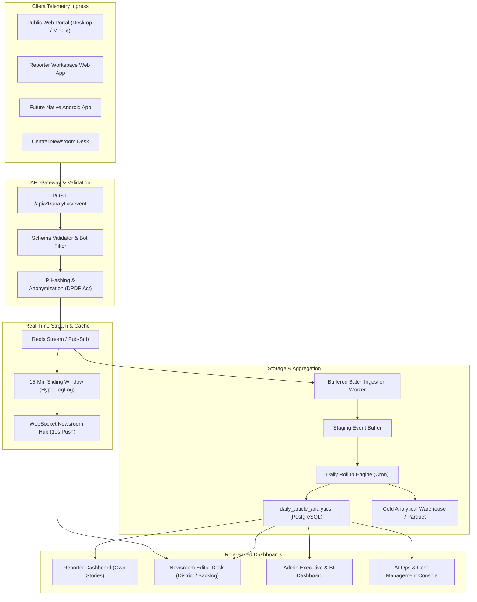

### 3.1 Separation of Data Layers
To prevent operational database contention, analytics data is strictly segregated into three architectural tiers:
1. **Operational Application Database (PostgreSQL OLTP):** Contains production transactional tables (`news_articles`, `users`, `categories`, `districts`, `editorial_audit_logs`). Write operations are reserved for core business workflows. It holds only compact, pre-aggregated analytical summaries (e.g., `daily_article_analytics`).
2. **Real-Time Memory Cache (Redis In-Memory):** Handles high-throughput deduplication windows (`RULE-ANA-002`), real-time concurrent reader counts (`RULE-ANA-004`), and 15-minute sliding window trending scores via HyperLogLog structures. No raw HTTP hit touches PostgreSQL directly.
3. **Aggregated Analytical Datastore (Partitioned OLAP / Time-Series Rollup):** High-volume telemetry logs are buffered in memory or staging tables, stripped of all PII, and rolled up hourly and daily. Long-term raw event logs are rotated to immutable compressed columnar storage (e.g., Parquet / Cloud Object Storage) with lifecycle retention policies pursuant to CERT-In mandates (`RULE-ANA-005`).

### 3.2 Architectural Evaluation of Analytics Paradigms

| Architectural Paradigm | Technical Viability | Data Sovereignty & Privacy | Operational Cost | Suitability for BREAKING NEWS WALA |
| :--- | :--- | :--- | :--- | :--- |
| **Option A: Direct SQL Increment on OLTP Database** | **POOR** (Causes severe lock contention at >500 req/sec; crashes DB during breaking news spikes) | High (Internal) | Very High (Requires vertical DB scaling) | **REJECTED:** Violates `RULE-ANA-002` and database scalability best practices. |
| **Option B: Pure Third-Party Script (e.g., Google Analytics 4 only)** | **MODERATE** (Easy client embed; does not capture backend AI, editorial queue, or reporter metrics) | Low to Moderate (Data shared with external US ad network; DPDP friction) | Low initial, unpredictable scale | **INSUFFICIENT:** Third-party client tags cannot measure internal newsroom, API pool, or draft lifecycle metrics. |
| **Option C: Hybrid First-Party Redis Ingress + Batched SQL Aggregation** | **EXCELLENT** (Redis buffers millions of hits; PostgreSQL stores clean daily aggregates; zero third-party leakage) | Maximum (100% first-party data ownership; complete DPDP compliance) | Low to Moderate (Predictable infrastructure) | **RECOMMENDED BASELINE:** Satisfies all requirements across Web and Native Android. |
| **Option D: Dedicated Columnar OLAP Engine (e.g., ClickHouse / BigQuery)** | **EXCELLENT** (Sub-second queries across billions of raw events; ultimate analytical power) | High (Self-hosted or isolated cloud) | Moderate to High (Requires dedicated analytical cluster) | **PROPOSED FOR PHASE 3+ SCALE:** Ideal when event volume exceeds 10,000,000 events/day. |

---

## 4. Audience & Public Platform Analytics

Audience analytics measures public reach and reader engagement across the digital news portal.

### 4.1 Core Readership Metrics
- **Total Page Views:** Aggregate count of page load events across all routes.
- **Article Views (Reads):** Count of successful article detail page reads, strictly validated via the 30-minute deduplication window (`RULE-ANA-002`).
- **Unique Visitors (Estimated):** Approximated count of unique client sessions within a 24-hour period, calculated using privacy-preserving cryptographic hashes of `Truncated_IP + User-Agent + Daily_Salt`. *Note: Analytics estimates are never treated as exact individual human counts.*
- **Sessions:** A continuous sequence of user interactions terminating after 30 minutes of inactivity.
- **Engaged Reading Time:** Active time spent reading an article (tracking window focus, pointer movement, and scroll activity, pausing during background tab state).
- **Scroll Depth:** Milestone markers (25%, 50%, 75%, 100%) indicating how far down the article body a reader scrolled.
- **Bounce Rate:** Percentage of sessions that viewed only a single page without triggering any secondary interaction or remaining engaged for at least 15 seconds.

### 4.2 Traffic Acquisition & Channel Attribution
Reader acquisition is classified into four mutually exclusive channels:
1. **Direct Traffic:** Bookmarks, typed URLs, or app launches without HTTP referrers.
2. **Organic Search Traffic:** Inbound clicks from Google, Bing, Yahoo, DuckDuckGo (tracked in coordination with `docs/SEO.md`).
3. **Social Referral Traffic:** Traffic originating from WhatsApp shares, Facebook, X (Twitter), Telegram, and YouTube links.
4. **External Referral Traffic:** News aggregators, backlinks, RSS syndicate portals, and partner publications.

### 4.3 Hyperlocal Geographic Aggregation
Pursuant to `RULE-ANA-001`, individual reader GPS coordinates are **never** logged. Geographic analytics are derived via server-side lookup on truncated IP addresses:
- **State-Level Distribution:** Aggregated readership across target states (Uttar Pradesh, Madhya Pradesh, Bihar, Rajasthan, Haryana, Delhi-NCR, Uttarakhand).
- **District-Level Clustering:** Identification of high-traffic districts (e.g., Meerut, Lucknow, Bhopal, Indore, Patna, Jaipur) to inform editorial beat resource allocation.
- **City / Rural Division:** Aggregated network speed telemetry (4G vs. Broadband) to guide mobile payload optimizations.

---

## 5. Article & Editorial Content Quality Analytics

A newsroom that optimizes solely for raw page views inevitably descends into sensationalism, clickbait, and eroded credibility. BREAKING NEWS WALA enforces an **Editorial Quality Index (EQI)** that evaluates article performance based on verified reader engagement and journalistic rigor.

### 5.1 Article Performance Architecture

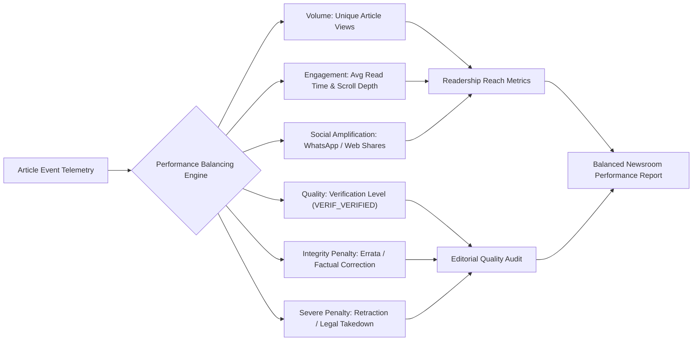

### 5.2 Content Quality vs. Reach Metrics

| Analytical Metric | Formula / Calculation Method | Journalistic Purpose | Clickbait Defense Mechanism |
| :--- | :--- | :--- | :--- |
| **Verified Read Rate (VRR)** | $\frac{\text{Sessions with Read Time} \ge 30s \text{ and Scroll} \ge 50\%}{\text{Total Deduplicated Views}} \times 100$ | Measures genuine reading versus immediate bounce. | Exposes sensational headlines that fail to retain reader attention. |
| **Social Virality Factor** | $\frac{\text{WhatsApp / Social Share Events}}{\text{Total Article Views}} \times 100$ | Measures reader enthusiasm and hyper-local community relevance. | Tracks organic peer-to-peer sharing in districts. |
| **Correction Impact Score** | Deductive metric applied if an Errata Notice is published post-release. | Tracks frequency of reporting inaccuracies. | Penalizes unverified rushing; incentivizes pre-publish verification. |
| **Headline-to-Body Retention** | Ratio of readers who bounce within 5 seconds of clicking headline. | Detects misleading headline-body mismatches. | High early drop-off flags article for Senior Editor review. |
| **Video Reel Completion Rate** | $\frac{\text{Video Watches } \ge 90\% \text{ Duration}}{\text{Total Video Starts}} \times 100$ | Evaluates Video Studio (`WF-VID-01`) timeline quality. | Guides video duration and pacing optimizations. |


---

## 6. Reporter Performance & Territory Coverage Analytics

Pursuant to `RULE-ANA-003` and `docs/Editorial-Policy.md`, reporter analytics are designed to provide field correspondents with actionable feedback on their local reporting while avoiding destructive ranking algorithms that incentivize sensationalism.

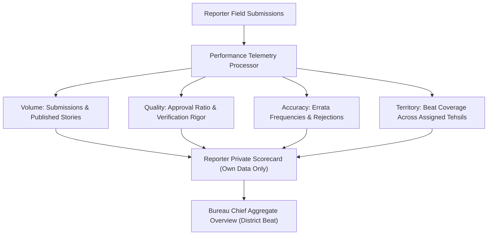

### 6.1 Reporter Metrics Dictionary
1. **Submitted Stories Count:** Total original drafts submitted by the reporter to the central review queue (`status = PENDING_REVIEW`).
2. **Approved & Published Stories Count:** Number of submitted stories approved by desk editors and published.
3. **Rejection Ratio:** Percentage of submitted stories rejected by desk editors with structured feedback (e.g., `MISSING_EVIDENCE`, `DUPLICATE`).
4. **Editorial Review Latency:** Average time (in minutes) an article spends in the review queue before an editor issues an approval or revision request.
5. **Post-Publication Correction Count:** Number of times a published story authored by the reporter required an errata or factual correction note.
6. **Territorial Beat Coverage:** Measurement of stories produced across the reporter's assigned sub-districts and tehsils, highlighting neglected rural areas.
7. **Attributed Readership & Engagement:** Aggregate unique views, average read duration, and social shares generated by the reporter's verified stories.

### 6.2 Strict Access Governance & Anti-Gamification Rules
- **Rule 1: Private Self-Access Only:** Standard reporters are strictly restricted to viewing their own personal performance data. Under no circumstances may a reporter inspect the readership, rejection rates, or compensation metrics of peer correspondents.
- **Rule 2: No Public Leaderboards:** The platform strictly prohibits public or newsroom-wide "leaderboards" that rank reporters purely on page views.
- **Rule 3: Quality-Weighted Evaluation (Pending Approval):** Any reporter incentive structure or performance badge must balance raw volume with journalistic accuracy (e.g., zero factual corrections over 30 days, high local community relevance).
- **Rule 4: Territory Boundary Isolation:** Trusted reporters possess fast-track direct publishing privileges strictly within their assigned beat (`RULE-EDIT-003`); their analytics dashboard reflects performance within that geographical boundary.

---

## 7. Central Newsroom & Editorial Operations Analytics

The Central Newsroom Desk (`WF-EDT-01` through `WF-EDT-04`) requires real-time and historical operational intelligence to manage incoming story flows, balance editorial workloads, and eradicate review bottlenecks.

### 7.1 Operational Newsroom Metrics
- **Queue Ingestion Velocity:** Rate of new incoming story submissions per hour, segmented by district and submission method (Manual, AI-assisted, RSS intake).
- **Pending Review Backlog:** Total count of active drafts currently awaiting review in the Central Review Queue.
- **Active Concurrency Lock Count:** Number of stories currently locked by desk editors under the 15-minute Redis claim lock (`RULE-EDIT-010`).
- **Mean Time to Publish (MTTP):** Total duration from reporter draft submission to public live release on the web/app.
- **Editorial Revision Loop Frequency:** Average number of revision cycles (`REVISION_REQUESTED` → `PENDING_REVIEW`) before final approval.
- **Category & Beat Distribution:** Percentage breakdown of news published across categories (Crime, Politics, Civic Infrastructure, Agriculture, Weather, Education, Sports).
- **Hyperlocal Location Balance:** Geographical heatmaps revealing districts that are over-reported versus districts suffering from news deserts.

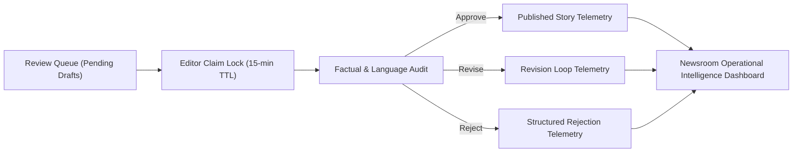

---

## 8. RSS & External News Intake Analytics

Automated news intake from syndication feeds and external URLs (`WF-RSS-01`, `WF-RSS-02`, `WF-URL-01`) must be continuously monitored to protect platform reliability, avoid duplicate content, and verify syndicate compliance.

### 8.1 Feed Health & Ingestion Telemetry
- **Active vs. Inactive Feeds:** Total count of registered RSS feeds with active polling flags (`is_active = TRUE`) versus paused or deleted endpoints.
- **Poll Cycle Success Rate:** Percentage of scheduled HTTP polling attempts that return valid XML/RSS payloads within the 5.0-second timeout threshold.
- **HTTP Status & Error Distribution:** Tracking feed fetch failures (HTTP 403 Forbidden, 404 Not Found, 429 Rate Limited, 500 Server Error, DNS resolution failures).
- **Duplicate Ingestion Rate:** Frequency of incoming RSS items flagged as duplicates by SHA-256 content hashing or vector similarity matching against existing articles.
- **Stale News Filter Triggers:** Number of items rejected at ingress due to publication timestamps older than the 48-hour freshness threshold.
- **Human Approval Conversion Rate:** Percentage of imported RSS drafts that are approved and published by human editors versus rejected or left to expire.

> [!IMPORTANT]
> **Attribution and Integrity Rule:** RSS ingestion volume must **never** be used as a measure of newsroom productivity. Ingested external feeds remain classified as unverified drafts until human review is complete.

---

## 9. AI Agent Mesh & Multi-Provider API Pool Analytics

The AI intelligence layer (`docs/17-Agents.md`, `docs/19-API-Pool.md`, `docs/21-Prompts.md`) powers automated news structuring, translation, headline proposals, summarization, and SEO generation. Rigorous telemetry is required to monitor costs, model latencies, failovers, and hallucination rates.

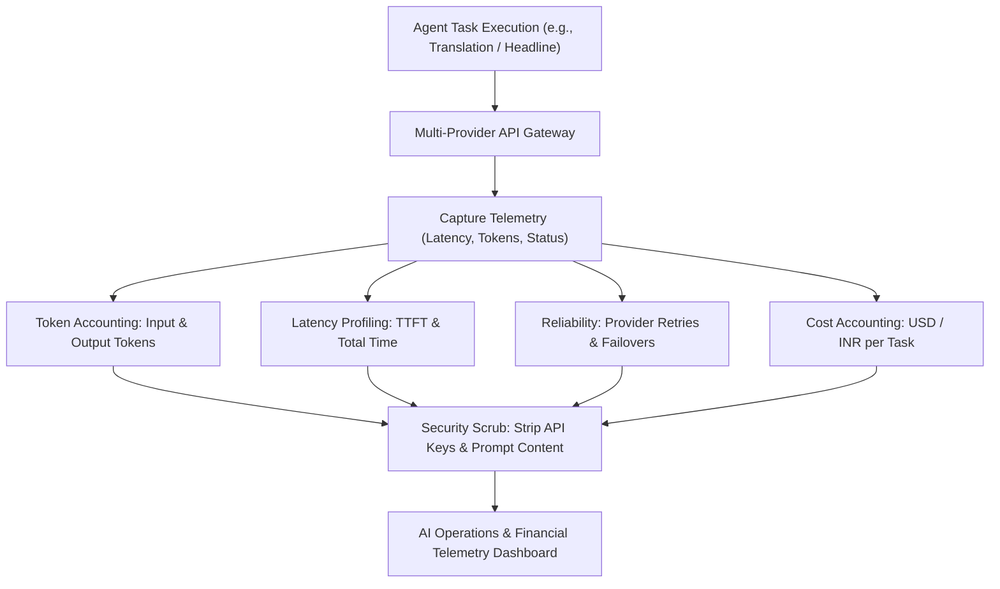

### 9.1 Core AI Telemetry Dimensions
1. **Agent Invocation Volume:** Total calls per agent (News Rewriter, Headline Generator, Summarizer, Translator, SEO Agent, Fact-Checker).
2. **Provider & Model Distribution:** Distribution of traffic across Gemini 1.5 Flash, Gemini 1.5 Pro, Claude 3.5 Sonnet, and OpenAI models.
3. **Token Usage Accounting:** Granular tracking of Prompt (Input) Tokens, Completion (Output) Tokens, and Total Tokens per task.
4. **Financial Cost Estimation:** Real-time cost calculation based on contractual token pricing tiers per 1,000 tokens, converted to INR and USD.
5. **Latency Profiling:** Time to First Token (TTFT) and total round-trip response duration, establishing p50, p95, and p99 percentiles.
6. **Error & Failover Tracking:** Number of HTTP 429 (Rate Limit Exceeded) and 503 (Provider Unavailable) events triggering automated sub-1.5s failovers (`WF-API-01`).
7. **Human Edit & Rejection Rate:** Measurement of how extensively human desk editors modify or reject AI-generated suggestions prior to publication.
8. **Hallucination Incident Telemetry:** Logs generated when editors click the proposed "Report AI Hallucination" flag, capturing prompt template IDs and discrepancy types.

### 9.2 Strict AI Telemetry Security Safeguards
- **Zero API Key Exposure:** System API keys, vault tokens, and authorization headers must **never** be logged in analytics datastores or error telemetry.
- **Privacy Shield on User Drafts:** Private field notes, unreleased investigation details, and sensitive whistleblower text processed by AI models must not be retained in plain text within analytics aggregation tables.
- **Separation of Test & Production Telemetry:** Automated prompt unit tests (`docs/26-Testing.md`) must carry an `environment = 'staging'` tag and must not contaminate production cost and volume analytics.


---

## 10. Graphics Studio & Video Studio Telemetry

The Graphics Studio (`WF-RGFX-01`, `WF-AGFX-01`) and Video Studio (`WF-VID-01`) allow reporters and editors to render branded news cards, quote graphics, infographics, and multi-track MP4 video clips. Operational telemetry tracks resource consumption, rendering efficiency, and asset utilization.

### 10.1 Studio Telemetry Dimensions
- **Project Creation Volume:** Total graphics and video projects initiated in client workspaces.
- **Render Attempts vs. Successes:** Number of server-side or client-side video composition and canvas export attempts, categorized by render outcome (`SUCCESS`, `TIMEOUT`, `OUT_OF_MEMORY`, `CODEC_ERROR`).
- **Mean Rendering Time:** Average duration (in seconds) required to compose, transcode, and upload finished MP4 videos to Cloud Storage (`docs/16-Storage.md`).
- **Template Utilization Rates:** Usage counts of administrative branded templates (Breaking News Banner, Quote Card, Fact Sheet, Match Score, Weather Alert).
- **Aspect Ratio Distribution:** Relative breakdown of exports rendered in 16:9 Landscape, 9:16 Vertical Reel, and 1:1 Square formats.
- **Cloud Storage Consumption:** Total gigabytes generated by exported media files and associated intermediate cache assets.
- **Export-to-Publish Conversion:** Ratio of rendered graphic and video assets that are actually embedded into published articles versus abandoned drafts.

> [!NOTE]
> **Privacy Invariant:** Studio telemetry captures rendering performance, file dimensions, and template IDs. Telemetry **never** inspects or stores private reporter scratch text, draft scripts, or unpublished raw media.

---

## 11. Breaking News & Push Notification Analytics

Push notifications and breaking alert banners (`WF-NOT-01`, `WF-NOT-02`) broadcast urgent public developments to readers across Web push and the future Native Android application.

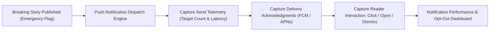

### 11.1 Notification Performance Metrics
- **Notifications Created vs. Dispatched:** Count of breaking news alerts initiated by editors versus successfully handed off to push gateways (Firebase Cloud Messaging / Web Push API).
- **Fan-Out Latency:** Duration (in seconds) required to broadcast push notifications to the entire subscriber base across targeted districts.
- **Delivery Success Rate:** Percentage of dispatched notifications successfully acknowledged by client devices.
- **Click-Through Rate (CTR):** $\frac{\text{Notification Click Events}}{\text{Successful Deliveries}} \times 100$, measuring reader interest in breaking news topics.
- **Deep-Link Resolution Rate:** Percentage of notification clicks that successfully open the target article in the mobile app or browser without routing errors.
- **Opt-Out & Mute Rates:** Tracking instances where readers disable notifications following a broadcast, highlighting alert fatigue or over-notification.

*Delivery vs. Reading Distinction:* A successful push delivery acknowledgment indicates only that the message reached the device operating system; it is **never** equated with actual human reading.

---

## 12. Advertising, Sponsored Content & Monetization Analytics

Commercial sustainability requires detailed advertising analytics. These metrics must remain strictly cordoned off from editorial judgment and reporter evaluation.

### 12.1 Advertising Performance Dimensions
- **Ad Impressions:** Raw count of advertising creatives loaded into client viewports.
- **Viewable Impressions:** Count of ad creatives where at least 50% of the banner pixels were visible in the active viewport for at least one continuous second (IAB / MRC standard).
- **Ad Clicks:** Valid user click events on authorized banner placements.
- **Click-Through Rate (CTR):** $\frac{\text{Ad Clicks}}{\text{Viewable Impressions}} \times 100$.
- **Inventory Fill Rate:** Percentage of available ad display slots successfully filled with active paid campaigns versus fallback editorial promotions.
- **Sponsored Content Engagement:** Specialized analytics tracking reads, reading duration, and scroll depth on ASCI-tagged sponsored articles (`RULE-AD-001`, `WF-MON-01`).
- **Advertiser Campaign Delivery:** Progress tracking of active commercial campaigns against contracted impression and click targets.

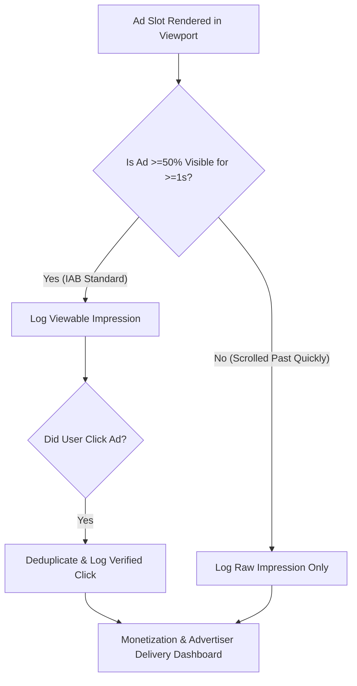

> [!WARNING]
> **Monetization Invariant:** Revenue figures, advertiser contract values, and pricing metrics are restricted exclusively to authorized commercial administrators. Standard reporters and desk editors possess **zero** access to monetization analytics.

---

## 13. SEO, Discovery & Search Console Telemetry

Search engines and algorithmic discovery feeds represent major discovery vectors for regional vernacular journalism (`docs/SEO.md`).

### 13.1 Search Telemetry Integration
- **Organic Search Impressions:** Total appearances of BREAKING NEWS WALA articles in Google and Bing Search Engine Results Pages (SERPs).
- **Organic Search Clicks:** User clicks from organic search results to platform canonical URLs.
- **Search Click-Through Rate (CTR):** Percentage of search impressions that result in website visits.
- **Average Search Ranking Position:** Mean ranking position across target regional keywords (e.g., *"मेरठ समाचार"*, *"लखनऊ क्राइम न्यूज़"*).
- **Google News Sitemap Health:** Ingestion tracking of the 48-hour rolling `<news:news>` XML sitemap (`/sitemap-news.xml`), verifying that breaking stories are indexed within 15 minutes of publication.
- **Search Engine Bot Crawl Latency:** Server log monitoring of Googlebot, Bingbot, and Google News crawler access frequencies, HTTP response codes (200 OK, 301 Redirect, 404 Not Found, 410 Gone), and crawl budget consumption.

*Distinction of Data Origins:* Search performance metrics are derived from Google Search Console and Bing Webmaster APIs and are reported separately from first-party on-site analytics.

---

## 14. Technical Platform Health, Performance & SRE Metrics

Technical telemetry monitors server-side reliability, API performance, database health, and client error distributions, enforcing the non-functional requirements defined in `docs/04-NFR.md`.

### 14.1 Key Performance & SRE Indicators

| Technical Metric | Target Threshold (`04-NFR.md`) | Monitoring Architecture & Data Source | Operational Impact & Alert Trigger |
| :--- | :--- | :--- | :--- |
| **API Response Latency (p95)** | $\le 200 \text{ ms}$ | API Gateway NGINX / Node.js Access Logs | High latency degrades mobile reader experience; triggers autoscaling. |
| **HTTP Error Rate (5xx)** | $< 0.1\%$ | Ingress Load Balancer / API Gateway | Elevated 5xx rate indicates backend failure or database crash; triggers SRE pager. |
| **Database Query Latency (p95)** | $\le 50 \text{ ms}$ | PostgreSQL `pg_stat_statements` | Queries exceeding 200ms indicate missing indexes or lock contention. |
| **Redis Cache Hit Ratio** | $\ge 90\%$ | Redis `INFO stats` / Sentinel Telemetry | Drop below 80% increases database load during breaking news spikes. |
| **Background Queue Depth** | $\le 50 \text{ in-flight jobs}$ | Redis BullMQ Queue Telemetry | Growing queue indicates stuck video transcoding or notification workers. |
| **CDN Edge Cache Hit Ratio** | $\ge 95\%$ for static assets | Cloudflare / Fastly CDN Telemetry Logs | Low edge hit ratio increases origin egress bandwidth and hosting costs. |
| **Authentication Failure Rate** | Normal Baseline ($<2\%$) | PostgreSQL Auth Logs (`docs/14-Auth.md`) | Spike in failures flags brute-force or credential stuffing cyberattack. |
| **Core Web Vitals (LCP)** | $\le 2.5 \text{ seconds (75th percentile)}$ | Real User Monitoring (RUM) Telemetry | LCP degradation penalizes Google Search rankings and increases bounce rates. |


---

## 15. Future Native Android Mobile Analytics Architecture

The future Native Android mobile application must utilize the identical shared backend analytics endpoints (`/api/v1/analytics/event`) and data contracts as the web platform, guaranteeing uniform metrics across all user touchpoints.

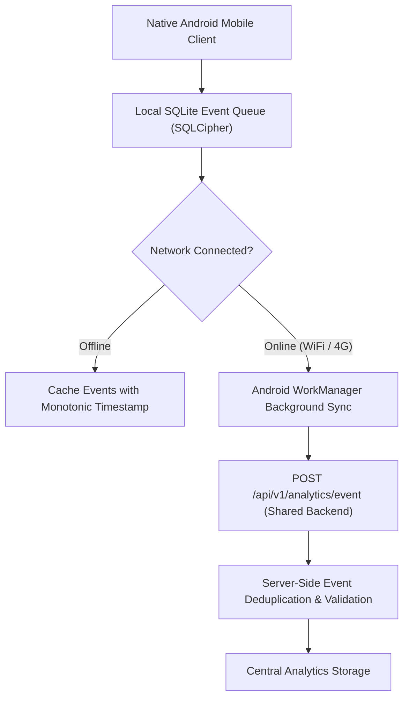

### 15.1 Mobile-Specific Telemetry Dimensions
- **App Session Lifecycle:** `app_launched`, `app_backgrounded`, `session_duration`, `cold_start_latency_ms`.
- **Screen Views & Navigation:** `screen_viewed` tracking transitions between District Feed, Full Article View, Video Reels Player, and Reporter Workspace.
- **Hardware & Environment Telemetry (Non-PII):** Android OS version (e.g., Android 12, 13, 14), device manufacturer and model family, network carrier type (WiFi, 4G, 5G), screen resolution density, and battery low-power state.
- **App Crash & ANR Reporting:** Unhandled exceptions, stack traces, Application Not Responding (ANR) events, and native memory leaks (routed to privacy-hardened crash telemetry).
- **Offline Event Queueing & Synchronization:** When reporters or readers operate in low-connectivity rural zones, events are buffered locally in encrypted SQLite storage and synchronized in atomic batches upon network reconnection.
- **Event Deduplication:** Client-generated UUIDv4 `event_id` ensures that retried network sync requests never result in double-counted impressions.

> [!CAUTION]
> **Privacy Shield on Mobile Identifiers:** The Android application must **never** collect or transmit hardware IMEI numbers, MAC addresses, SIM serial numbers (ICCID), or persistent Google Advertising IDs (GAID) without explicit, auditable user consent.

---

## 16. Event Taxonomy, Naming Conventions & Schema Standards

To ensure cross-system consistency, all telemetry events adhere to a rigid naming taxonomy, structured schema, and explicit privacy categorization.

### 16.1 Naming Conventions and Common Envelope
- **Event Name Format:** `snake_case` using `<entity>_<action>` (e.g., `article_viewed`, `news_submitted`).
- **Timestamp Standard:** Strict ISO 8601 UTC with millisecond precision (e.g., `2026-10-31T10:45:00.123Z`).
- **Event Identifiers:** Global UUIDv4 `event_id` for universal deduplication.
- **Correlation Identifiers:** Optional `trace_id` linking frontend user actions to backend API requests.

### 16.2 Standard Event Payload Schema

```json
{
  "event_id": "f47ac10b-58cc-4372-a567-0e02b2c3d479",
  "event_name": "article_viewed",
  "event_version": "1.0",
  "timestamp": "2026-10-31T10:45:00.123Z",
  "platform": "web_mobile",
  "session_hash": "a1b2c3d4e5f67890",
  "properties": {
    "article_id": "10492",
    "category": "crime",
    "district": "meerut",
    "reading_time_seconds": 45,
    "scroll_depth_percent": 75,
    "traffic_source": "whatsapp"
  }
}
```

### 16.3 Representative Master Event Taxonomy

| Event Name | Trigger Condition | Originating Platform | Mandatory Properties | Data Sensitivity | Retention Policy | Authorized Consumers |
| :--- | :--- | :--- | :--- | :--- | :--- | :--- |
| `article_viewed` | User views article page for $\ge 5$ seconds. | Web / Android | `article_id`, `category`, `district`, `reading_time_seconds`, `scroll_depth_percent` | Low (Anonymized) | 90 days raw, 2 years agg | Public, Reporter, Editor, Admin |
| `article_published` | Story transitions to `PUBLISHED` status. | Central Newsroom / Backend | `article_id`, `author_id`, `category`, `district`, `verification_status` | Low (Public Record) | Indefinite | Newsroom, Admin, BI |
| `news_submitted` | Reporter submits draft to review queue. | Reporter App / Android | `draft_id`, `author_id`, `district`, `has_media_attachments`, `word_count` | Internal | 180 days | Reporter, Desk Editor, Admin |
| `news_approved` | Editor approves story for release. | Central Newsroom | `draft_id`, `editor_id`, `author_id`, `review_duration_minutes` | Internal | 180 days | Desk Editor, Senior Editor, Admin |
| `news_rejected` | Editor rejects draft with feedback. | Central Newsroom | `draft_id`, `editor_id`, `author_id`, `rejection_reason_code` | Internal | 180 days | Reporter, Senior Editor, Admin |
| `news_corrected` | Errata or factual correction published. | Central Newsroom | `article_id`, `editor_id`, `rectification_tier`, `correction_timestamp` | Internal / Public | Indefinite (Audit) | Senior Editor, Admin, Legal |
| `rss_item_imported` | RSS item successfully ingested into draft. | Ingestion Cron | `feed_id`, `source_url`, `headline_hash`, `ingestion_latency_ms` | System | 90 days | Newsroom Ops, Admin |
| `ai_task_completed` | AI model generates text / translation. | AI Gateway | `agent_type`, `model_id`, `provider`, `input_tokens`, `output_tokens`, `latency_ms` | Internal Operational | 180 days | AI Ops, Admin, SRE |
| `ai_task_failed` | AI model call fails or times out. | AI Gateway | `agent_type`, `model_id`, `error_code`, `failover_triggered` | Internal Operational | 180 days | AI Ops, SRE |
| `graphic_exported` | News card graphic rendered and exported. | Graphics Studio | `project_id`, `template_id`, `format`, `render_duration_ms` | Internal Operational | 90 days | Graphics Ops, Admin |
| `video_render_completed`| MP4 video export successfully rendered. | Video Studio | `project_id`, `duration_seconds`, `resolution`, `transcode_time_seconds` | Internal Operational | 90 days | Video Ops, Admin |
| `notification_delivered`| Push notification acknowledged by client. | FCM / Web Push | `notification_id`, `category`, `district`, `device_platform` | Low (Aggregate) | 30 days | Newsroom, Notification SRE |
| `notification_opened` | Reader clicks push notification alert. | Web / Android | `notification_id`, `article_id`, `dwell_time_seconds` | Low (Aggregate) | 30 days | Newsroom, Product Team |

---

## 17. Role-Based Dashboard & Reporting Interface Design

Dashboards present analytical intelligence to authorized human stakeholders. Access controls are strictly enforced to preserve operational privacy and legal compliance.

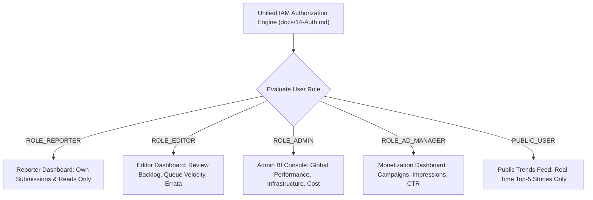

### 17.1 Dashboard Specifications by Role

| Dashboard Name | Target Audience | Primary Analytical Purpose | Key Metrics Displayed | Access Permissions & Privacy Guardrails |
| :--- | :--- | :--- | :--- | :--- |
| **Public Platform Trends** | Readers, General Public | Highlights viral regional stories. | Top-5 Trending Stories across state (15-min sliding window), live active readers count. | Fully public, zero PII, read-only cache. |
| **Reporter Dashboard** | Standard & Trusted Field Reporters | Individual reporting feedback and beat resonance. | Submitted drafts, approved stories, rejection reasons, average read duration on own stories. | Restricted strictly to the authenticated reporter's own content (`author_id = self`). |
| **Editorial Newsroom Desk** | Desk Editors, Bureau Chiefs | Real-time queue triage and content balance. | Review queue backlog, mean time to publish, locked story count, category distribution, verification stats. | Restricted to newsroom editors; global editorial view across all beats. |
| **Admin Executive & BI** | Platform Administrators, Executive Leadership | Strategic enterprise oversight. | Monthly active users, retention cohorts, district coverage heatmaps, total published volume. | Global administrative access; multi-factor authentication required. |
| **AI Operations Console** | AI Engineers, Prompt Architects, SRE | AI cost control and model reliability. | Token usage by agent, provider failover rates, latency percentiles, cost in INR/USD, hallucination reports. | Restricted to Technical Administrators and AI Ops teams. |
| **Monetization Console** | Ad Operations, Commercial Managers | Advertiser campaign delivery and inventory health. | Viewable ad impressions, CTR, inventory fill rate, sponsored content engagement, campaign delivery. | Restricted to Commercial Ad Operations; strictly hidden from reporters and editorial staff. |

---

## 18. Data Privacy, DPDP Act Compliance, Security & Retention

Telemetry architecture must rigorously comply with the Digital Personal Data Protection (DPDP) Act, 2023, CERT-In cybersecurity directives, and `RULE-ANA-001`.

### 18.1 Privacy by Design Principles
1. **Data Minimization:** Telemetry collection is restricted to the absolute minimum parameters required for newsroom operations and performance measurement.
2. **IP Truncation & Pseudonymization:** Raw client IP addresses are truncated at ingress (IPv4: zeroing the last octet; IPv6: zeroing the last 80 bits). Hashed session tokens are salified with a rolling cryptographic salt rotated every 24 hours.
3. **Zero PII in Analytical Logs:** Reader names, phone numbers, email addresses, precise GPS coordinates, and user passwords are **strictly excluded** from analytics payloads.
4. **Reader Consent & Opt-Out Handling:** Public readers may toggle personalized telemetry off via user settings. When opted out, only aggregate server-side page view counters are incremented without session attribution.

### 18.2 Data Retention & Lifecycle Schedules

| Data Classification | Concrete Datastore | Retention Period | Deletion / Rotation Mechanism | Statutory Compliance Reference |
| :--- | :--- | :--- | :--- | :--- |
| **Raw Telemetry Events** | Staging Tables / Redis | **30 Days** | Automated sliding window purge; rolled into daily aggregates. | DPDP Act (Data Minimization) |
| **Daily Aggregated Analytics** | `daily_article_analytics` (PostgreSQL) | **24 Months** | Partitioned table archiving; compressed cold storage. | Business Intelligence & Historical Reporting |
| **System Access & Audit Logs** | Object Storage Bucket Lock | **180 Days (Mandatory)** | Immutable, write-once retention policy. | CERT-In Directive No. 20(3)/2022-CERT-In |
| **Published Editorial Attributions** | `news_articles` (PostgreSQL) | **Indefinite** | Permanent historical record; immune to user erasure. | Press & Registration of Books Act / Journalistic Exemption |
| **Ad Delivery Logs** | Ad Reporting Store | **12 Months** | Monthly partition rotation; financial reconciliation audit. | Commercial Tax & Financial Audit Standards |


---

## 19. Data Quality Governance, Bot Filtering & Metric Dictionary

Unreliable data corrupts editorial decision-making and wastes advertising budgets. Strict data quality controls ensure that metrics reflect genuine human engagement.

### 19.1 Automated Bot, Crawler and Test Traffic Filtering
1. **Known Bot Exclusion:** Incoming requests carrying identified bot or crawler user-agents (e.g., `Googlebot`, `bingbot`, `Baiduspider`, `YandexBot`, `facebookexternalhit`, `python-requests`, `curl`, `HeadlessChrome`) are flagged at the API Gateway. These hits are logged for SEO crawl analysis (`docs/SEO.md`) but are **strictly excluded** from public readership, trending scores, and advertiser impression counters.
2. **Behavioral Anomaly Detection:** Automated scripts that trigger page views without loading CSS/JS assets, complete articles in under 1.0 second, or execute robotic mouse-free patterns are filtered out by server-side anomaly heuristics.
3. **Internal Staff IP & Account Exclusion:** Visits by authenticated reporters, desk editors, and administrators inspecting their own published articles are tagged with `is_internal = TRUE` and filtered out of public reach and commercial metrics.
4. **Timezone Standardization:** All analytical aggregation rollups, daily counters, and scheduled reports are anchored to Indian Standard Time (IST, `UTC+05:30`), avoiding midnight boundary discrepancies across national reporting.

### 19.2 Comprehensive Metric Dictionary

| Metric Name | Precise Technical Definition | Calculation Methodology | Authoritative Data Source | Update Frequency | Known Limitations | Access Level |
| :--- | :--- | :--- | :--- | :--- | :--- | :--- |
| **Deduplicated Article Reads** | Validated human reading events of an article. | Increments once per `read_dedup:{story_id}:{session_hash}` per 30 minutes. | Redis Dedup Cache + PostgreSQL Rollup | Real-time (Cache) / Hourly Rollup | Cannot detect multiple people reading one physical screen. | Public, Reporter, Editor, Admin |
| **Engaged Reading Time** | Active dwell duration on article page. | $\sum (\Delta t)$ during which window is focused and pointer/scroll is active; capped at 10m. | Client Heartbeat Telemetry (`ANL-01`) | Batch rollups every 15 minutes | Dwell time pauses when user switches browser tabs. | Reporter (Own), Editor, Admin |
| **Real-Time Active Readers** | Concurrently active sessions across platform. | Unique session hashes observed in Redis within a rolling 5-minute sliding window. | Redis HyperLogLog (`live_readers:active`) | Real-time (10-second WebSocket push) | Approximation with $\pm 1.04/\sqrt{m}$ statistical error. | Newsroom Desk, Admin |
| **Top-5 Trending Score** | Regional velocity ranking across districts. | Weighted formula: $S = \frac{V_{15m} \times 0.6 + W_{15m} \times 0.4}{\text{Decay}(t)}$, where $V$ is views, $W$ is shares. | Redis Sorted Set (`trending:mp:sliding`) | Updated every 60 seconds | Highly sensitive to sudden breaking news surges. | Public Feed, Newsroom Desk |
| **Editorial Review Latency** | Time taken to process submitted drafts. | $T_{\text{action}} - T_{\text{submission}}$, measuring minutes from queue entry to decision. | `editorial_audit_logs` | Hourly aggregation | Excludes drafts returned to reporter for revisions. | Senior Editor, Admin |
| **AI Task Completion Latency** | Round-trip duration of generative AI calls. | $T_{\text{response}} - T_{\text{request}}$ measured at the API Gateway in milliseconds. | Multi-Provider Gateway Logs | Real-time logging | Affected by third-party upstream model server load. | AI Ops, SRE, Admin |
| **Viewable Ad Impression** | Ad unit meeting IAB viewability standard. | $\ge 50\%$ banner area visible in viewport for $\ge 1.0$ continuous second. | Client IntersectionObserver Telemetry | Hourly ad rollups | Ad blockers may block measurement scripts entirely. | Ad Operations, Admin |

---

## 20. Exports, Scheduled Reporting & Audit Trail

Enterprise stakeholders require periodic analytical exports for commercial auditing, editorial reviews, and regulatory submissions.

### 20.1 Export Capabilities and Formats
- **Filtered CSV & Spreadsheet Exports:** Authorized users may export tabular metric summaries filtered by date ranges, districts, categories, or reporter IDs.
- **Executive PDF Digest Reports:** Automated weekly and monthly PDF performance digests summarizing district reach, breaking news volume, and platform uptime.
- **Automated Scheduled Email Digests:** Daily 08:00 IST morning briefings dispatched to Bureau Chiefs detailing prior-day district performance and pending editorial backlogs.

### 20.2 Export Governance and Security Guardrails
1. **Role-Based Export Authorization:** Standard reporters may only export their own story performance logs. Cross-district or platform-wide exports require `ROLE_ADMIN` credentials.
2. **Immutable Export Audit Logging:** Every export action generates an immutable audit record logging: `user_id`, `export_type`, `filter_parameters`, `record_count`, `export_timestamp`, and `client_ip`.
3. **Data Scrubbing on Exports:** Exported datasets are strictly scrubbed of all internal user passwords, hashed IP addresses, and sensitive source identity notes.

---

## 21. Analytics Technology Evaluation & Architectural Options

To guide future engineering implementations without prematurely locking the platform into a proprietary vendor, the following architectural paradigms are evaluated across seven core dimensions:

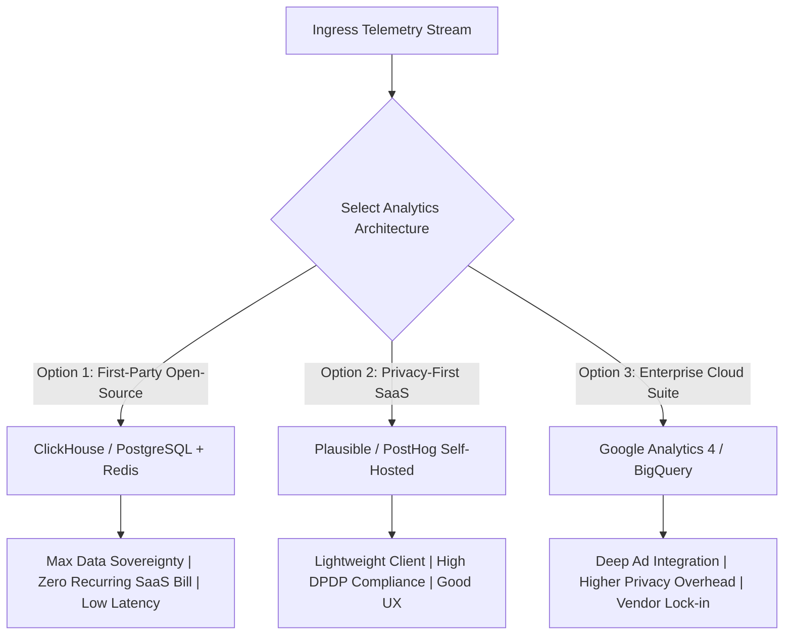

### 21.1 Architectural Comparison Matrix

| Analytics Technology Option | Target Domain | Data Ownership & Sovereignty | DPDP Act Privacy Compliance | Integration Complexity | Cost Predictability | Suitability Recommendation |
| :--- | :--- | :--- | :--- | :--- | :--- | :--- |
| **ClickHouse (Self-Hosted)** | Core Event Analytics & Real-Time Aggregations | **Complete** (100% internal database control) | **Excellent** (No external network egress) | Moderate (Requires columnar schema setup) | Highly Predictable (Standard VM infrastructure) | **RECOMMENDED FOR HIGH-SCALE OLAP (Phase 3+)** |
| **PostgreSQL + Redis (Current Baseline)** | Operational Telemetry & Daily Summaries | **Complete** (Uses existing system stack) | **Excellent** (Strictly internal) | Very Low (Already fully architected) | Lowest (Zero additional server overhead) | **APPROVED BASELINE ARCHITECTURE (Phase 1–2)** |
| **PostHog (Self-Hosted / Managed)** | Product Analytics & Funnel Analysis | High (Self-hosted) / Moderate (Cloud) | Good (Configurable IP anonymization) | Moderate (SDK embed on Web & Android) | Moderate to High (Scales with monthly events) | **PROPOSED FOR ADVANCED UX TESTING** |
| **Plausible Analytics (Self-Hosted)** | Public Web Audience Metrics | High (Open-source) | **Outstanding** (Cookie-less, built-in GDPR/DPDP) | Very Low (Lightweight 1KB script) | Very Low (Flat-rate or free self-hosted) | **STRONG CANDIDATE FOR PUBLIC AUDIENCE** |
| **Google Analytics 4 (GA4)** | Search Engine & Digital Ad Attribution | Low (Data shared with Google ecosystem) | Moderate (Requires consent banner & IP masking) | Low (Standard GTM integration) | Free tier, but enterprise limits apply | **RESTRICT TO COMMERCIAL / AD ATTRIBUTION ONLY** |
| **Firebase Crashlytics / Sentry** | Native Android Crash & Exception Reporting | Moderate (Hosted crash telemetry) | High (Does not collect end-reader PII) | Low (Standard Android SDK) | Low (Generous free tier) | **RECOMMENDED FOR ANDROID APPS** |
| **Prometheus + Grafana** | Technical Platform SRE & Infrastructure Telemetry | **Complete** (Internal server metrics) | **Total** (Zero user data involved) | Low (Standard cloud instrumentation) | Very Low (Open-source) | **APPROVED TECHNICAL BASELINE** |

> [!IMPORTANT]
> **Vendor Selection Invariant:** Formal adoption of any third-party commercial analytics contract requires explicit approval from the Chief Technology Officer, Data Protection Officer, and Chief Editorial Officer.


---

## 22. Analytics Architecture & Data Flow Diagrams

The following six Mermaid diagrams illustrate the complete telemetry architecture, processing flows, and data lifecycles of BREAKING NEWS WALA:

### 22.1 Diagram 1: Analytics Event Collection & Processing Pipeline
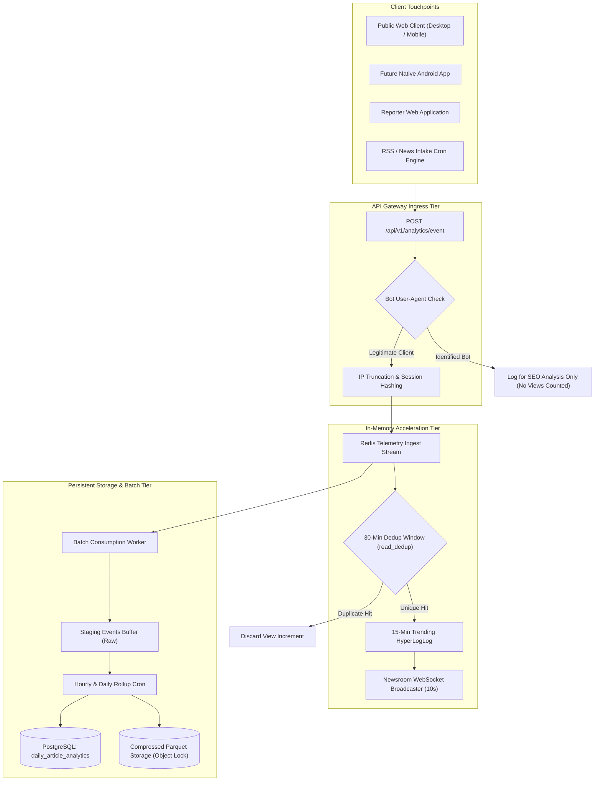

### 22.2 Diagram 2: Event Storage & Aggregation Architecture
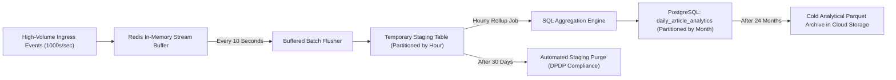

### 22.3 Diagram 3: Role-Based Dashboard Access Hierarchy
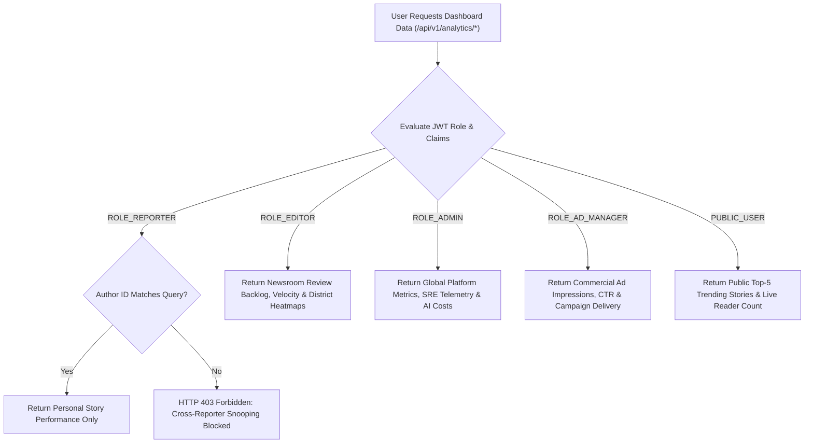

### 22.4 Diagram 4: AI Usage & Cost Analytics Telemetry Flow
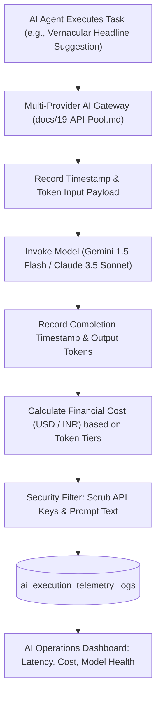

### 22.5 Diagram 5: Public Web & Native Android Mobile Analytics Flow
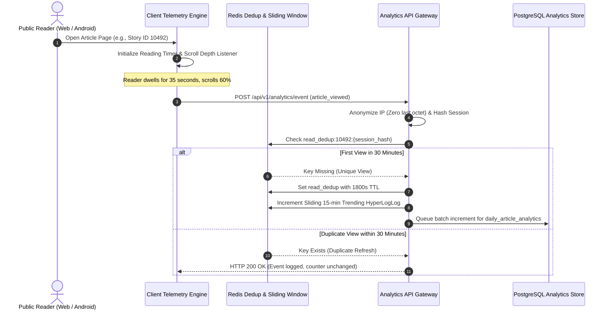

### 22.6 Diagram 6: Data Privacy, Governance & Retention Lifecycle
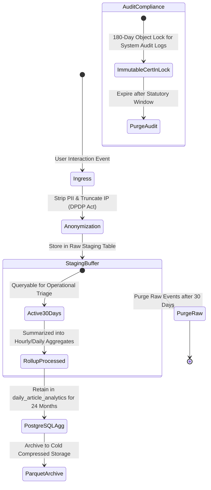

---

## 23. Cross-Document Traceability Matrix

The Master Analytics Specification is deeply integrated across the BREAKING NEWS WALA technical and operational documentation library:

| Target Doc ID | Target Document Title | Key Section Reference | Analytics Architecture Cross-Reference |
| :--- | :--- | :--- | :--- |
| [`01-PRD.md`](file:///c:/Users/pp/Downloads/BREAKING-NEWS-WALA-main/docs/01-PRD.md) | Product Requirements | Sections 14, 16, 24, 25 | Operationalizes PRD requirements for reporter dashboards, newsroom trending feeds, reader privacy, and ad telemetry. |
| [`02-Features.md`](file:///c:/Users/pp/Downloads/BREAKING-NEWS-WALA-main/docs/02-Features.md) | Feature Specification | `FEAT-PUB-012`, `FEAT-ADM-005` | Implements data contracts for public reader telemetry and reporter scorecards. |
| [`04-NFR.md`](file:///c:/Users/pp/Downloads/BREAKING-NEWS-WALA-main/docs/04-NFR.md) | Non-Functional Requirements | Performance & Scalability | Enforces sub-200ms API response latencies and high-throughput Redis buffering. |
| [`05-Workflows.md`](file:///c:/Users/pp/Downloads/BREAKING-NEWS-WALA-main/docs/05-Workflows.md) | Master Workflows | `WF-ANA-01`, `WF-EDT-01` | Details the operational execution of reader telemetry and newsroom concurrency metrics. |
| [`06-Business-Rules.md`](file:///c:/Users/pp/Downloads/BREAKING-NEWS-WALA-main/docs/06-Business-Rules.md) | Business Rules | `RULE-ANA-001` to `006`, `RULE-SEC-002` | Enforces DPDP IP anonymization, 30-min deduplication, and 180-day immutable audit logs. |
| [`11-Architecture.md`](file:///c:/Users/pp/Downloads/BREAKING-NEWS-WALA-main/docs/11-Architecture.md) | Technical Architecture | Section 8 (Analytics Pipeline) | Bridges Redis stream ingress with PostgreSQL daily rollup tables. |
| [`12-Database.md`](file:///c:/Users/pp/Downloads/BREAKING-NEWS-WALA-main/docs/12-Database.md) | Database Specification | `daily_article_analytics`, `DOM-N` | Defines the relational schema and indexing strategy for analytical tables. |
| [`13-API.md`](file:///c:/Users/pp/Downloads/BREAKING-NEWS-WALA-main/docs/13-API.md) | API Specification | `ANL-01`, `ANL-02`, `ANL-03` | Documents REST endpoints for pageviews, video heartbeats, and admin overview APIs. |
| [`14-Auth.md`](file:///c:/Users/pp/Downloads/BREAKING-NEWS-WALA-main/docs/14-Auth.md) | Authentication & RBAC | Section 6 (Role Scopes) | Enforces role-based permissions preventing reporters from snooping on peer analytics. |
| [`15-Security.md`](file:///c:/Users/pp/Downloads/BREAKING-NEWS-WALA-main/docs/15-Security.md) | Security Policy | Section 12 (Audit & Telemetry) | Governs secret scrubbing in logs and defenses against analytics injection attacks. |
| [`17-Agents.md`](file:///c:/Users/pp/Downloads/BREAKING-NEWS-WALA-main/docs/17-Agents.md) | AI Agents Architecture | Sections 4, 8 | Measures agent task completions, latencies, and human rejection telemetry. |
| [`19-API-Pool.md`](file:///c:/Users/pp/Downloads/BREAKING-NEWS-WALA-main/docs/19-API-Pool.md) | Multi-Provider API Pool | Section 5 (Gateway Telemetry) | Governs token accounting, cost estimation, and automated provider failover logging. |
| [`21-Prompts.md`](file:///c:/Users/pp/Downloads/BREAKING-NEWS-WALA-main/docs/21-Prompts.md) | AI Prompt Library | Section 7 (Telemetry Tags) | Links prompt version IDs to analytical execution telemetry. |
| [`SEO.md`](file:///c:/Users/pp/Downloads/BREAKING-NEWS-WALA-main/docs/SEO.md) | Search Engine Optimization | Sections 10, 22 | Separates Google Search Console API metrics from first-party on-site analytics. |
| [`Editorial-Policy.md`](file:///c:/Users/pp/Downloads/BREAKING-NEWS-WALA-main/docs/Editorial-Policy.md) | Editorial Standards | Sections 6, 14, 16 | Establishes the Editorial Quality Index (EQI) and penalizes sensational clickbait. |
| [`26-Testing.md`](file:///c:/Users/pp/Downloads/BREAKING-NEWS-WALA-main/docs/26-Testing.md) | Testing Architecture | Section 8 (Telemetry QA) | Specifies unit and load test suites for event deduplication and sliding window caches. |
| [`27-Debugging.md`](file:///c:/Users/pp/Downloads/BREAKING-NEWS-WALA-main/docs/27-Debugging.md) | Debugging & Diagnostics | Section 6 (Queue Runbooks) | Provides troubleshooting runbooks for dropped telemetry events and queue lag. |

---

## 24. Analytics Architectural Decision Register

This register records all authoritative architectural decisions governing analytics, data pipelines, telemetry governance, and reporting across BREAKING NEWS WALA:

### ADR-ANA-001: Hybrid Ingress via Redis & Batched PostgreSQL Aggregation
- **Status:** `Confirmed`
- **Context:** High breaking news traffic can generate thousands of read events per second, causing severe database lock contention if written directly to relational SQL tables.
- **Decision:** Ingest all telemetry events into Redis streams/caches; deduplicate in memory; batch rollup daily summaries into PostgreSQL `daily_article_analytics` tables.
- **Consequences:** Eliminates database lock contention; guarantees sub-5ms client telemetry acknowledgment.

### ADR-ANA-002: Strict 30-Minute Rolling Deduplication Window for Article Reads
- **Status:** `Confirmed`
- **Context:** Accidental browser refreshes, bot reloads, and click farms artificially inflate readership counters.
- **Decision:** Enforce `RULE-ANA-002` using Redis key `read_dedup:{story_id}:{session_hash}` with an 1800-second TTL. Only 1 read is counted per unique session per half hour.
- **Consequences:** Produces trustworthy, clean readership metrics for editorial and advertising audits.

### ADR-ANA-003: Anonymized IP Truncation & DPDP Act Compliance
- **Status:** `Confirmed`
- **Context:** Storing raw IP addresses alongside user reading histories violates the Digital Personal Data Protection (DPDP) Act, 2023.
- **Decision:** Mandate `RULE-ANA-001`. Truncate the last octet of IPv4 addresses and hash session keys with a rotating daily salt at the API Gateway.
- **Consequences:** Full statutory privacy compliance; zero exposure of reader PII in analytical stores.

### ADR-ANA-004: Prohibition of Third-Party Tracking Pixels & Spyware SDKs
- **Status:** `Confirmed`
- **Context:** Third-party tracking scripts bloat page weight, degrade mobile performance, and leak citizen reading habits to external data brokers.
- **Decision:** Mandate `RULE-ANA-006`. Enforce strict Content Security Policy (CSP) headers prohibiting unapproved third-party tracking pixels or behavioral cookies.
- **Consequences:** Sub-2.5s LCP performance on rural 4G networks; complete reader trust.

### ADR-ANA-005: Real-Time Sliding Window Concurrency via Redis HyperLogLog
- **Status:** `Confirmed`
- **Context:** Newsroom editors require real-time trending velocity rankings and active reader counts without executing heavy SQL aggregation queries.
- **Decision:** Mandate `RULE-ANA-004`. Maintain active reader sets and top-5 trending scores in Redis HyperLogLog and Sorted Sets, pushing updates every 10 seconds via WebSockets.
- **Consequences:** Near-instantaneous newsroom situational awareness with negligible CPU overhead.

### ADR-ANA-006: Private Isolated Performance Dashboards for Field Reporters
- **Status:** `Confirmed`
- **Context:** Reporters need feedback on story resonance, but public ranking leaderboards foster unhealthy competition and sensationalist reporting.
- **Decision:** Enforce `RULE-ANA-003`. Restrict field reporters to private dashboards showing only their own authenticated submissions and attributed engagement.
- **Consequences:** Protects reporter morale; eliminates toxic clickbait rivalries.

### ADR-ANA-007: Editorial Quality Index (EQI) Balancing Reach with Verification
- **Status:** `Confirmed`
- **Context:** Measuring journalism purely by page views incentivizes sensationalism.
- **Decision:** Formulate an Editorial Quality Index that penalizes factual corrections and retractions while rewarding engaged dwell time and verification completeness.
- **Consequences:** Directly operationalizes the journalistic standards defined in `docs/Editorial-Policy.md`.

### ADR-ANA-008: 180-Day Immutable Object Lock for Audit Logs under CERT-In
- **Status:** `Confirmed`
- **Context:** Indian cybersecurity regulations (CERT-In Directive No. 20(3)/2022) mandate digital platforms to maintain immutable logs.
- **Decision:** Enforce `RULE-ANA-005`. Archive API and editorial audit logs in write-once, immutable cloud object storage for a minimum of 180 days.
- **Consequences:** Full compliance with national cybersecurity statutory directives.

### ADR-ANA-009: Separation of Commercial Advertising Analytics from Editorial Desks
- **Status:** `Confirmed`
- **Context:** Allowing journalists and editors to view commercial ad revenue per story creates conflicts of interest and compromises editorial independence.
- **Decision:** Strictly isolate advertising, CPM, and revenue analytics to `ROLE_AD_MANAGER` and executive administrators.
- **Consequences:** Safeguards editorial independence pursuant to `docs/Editorial-Policy.md` Section 17.

### ADR-ANA-010: Adoption of ClickHouse Columnar Storage for Phase 3+ Scale
- **Status:** `Proposed`
- **Context:** When daily active reads exceed 1,000,000 events, PostgreSQL aggregation queries across hundreds of districts may become computationally expensive.
- **Decision:** Plan deployment of a self-hosted ClickHouse cluster for long-term raw event storage and multidimensional OLAP slicing in Phase 3+.
- **Consequences:** Sub-second queries across billions of historical events. *Status: Proposed (Architectural roadmap for Phase 3).*

### ADR-ANA-011: Sentry / Firebase Crashlytics Integration for Native Android Mobile App
- **Status:** `Proposed`
- **Context:** Native mobile applications require specialized symbolicated stack trace capture and memory leak detection during field beta testing.
- **Decision:** Integrate a privacy-hardened, self-hosted Sentry or Firebase Crashlytics instance configured to scrub all user PII.
- **Consequences:** Rapid resolution of Android ANRs and crashes in rural field devices. *Status: Proposed (Pending Android development phase).*

### ADR-ANA-012: Quality-Weighted Reporter Performance Gamification / Incentive Scoring
- **Status:** `Pending Approval`
- **Context:** Management seeks to award monthly performance stipends to field stringers based on verified reporting.
- **Decision:** Develop a formal performance metric multiplying verified reads by verification completeness, minus errata penalties.
- **Consequences:** Incentivizes accuracy; requires formal sign-off by Chief Editorial Officer and Chief Financial Officer. *Status: Pending Approval.*

---

## 25. Documentation Quality Requirements & Strict Scope Restrictions

### 25.1 Documentation Quality & Standards Compliance
1. **Linguistic Standard:** Authored in clear, high-fidelity technical English, maintaining exact terminology for data pipelines, telemetry schemas, and regulatory mandates.
2. **Operational Newsroom Focus:** Connects technical telemetry with real-world newsroom operations, field reporting workflows, and ethical editorial standards.
3. **Cross-Document Harmonization:** Fully cross-referenced with all 30 existing specifications across architecture, business rules, database schemas, security, and editorial policies.

### 25.2 Strict Scope Restrictions Compliance
- **No Application Code:** Zero JavaScript, TypeScript, Python, or Kotlin tracking scripts were written or injected into client code.
- **No Database Migrations:** No live SQL tables, DDL migrations, or schema mutations were executed on the operational database.
- **No Third-Party Configuration:** No Google Analytics tags, tracking pixels, or external SaaS analytics accounts were created or linked.
- **Single Canonical File Rule:** Authored exclusively to [`docs/Analytics.md`](file:///c:/Users/pp/Downloads/BREAKING-NEWS-WALA-main/docs/Analytics.md). No secondary, duplicate, or nested documentation copies were generated.
