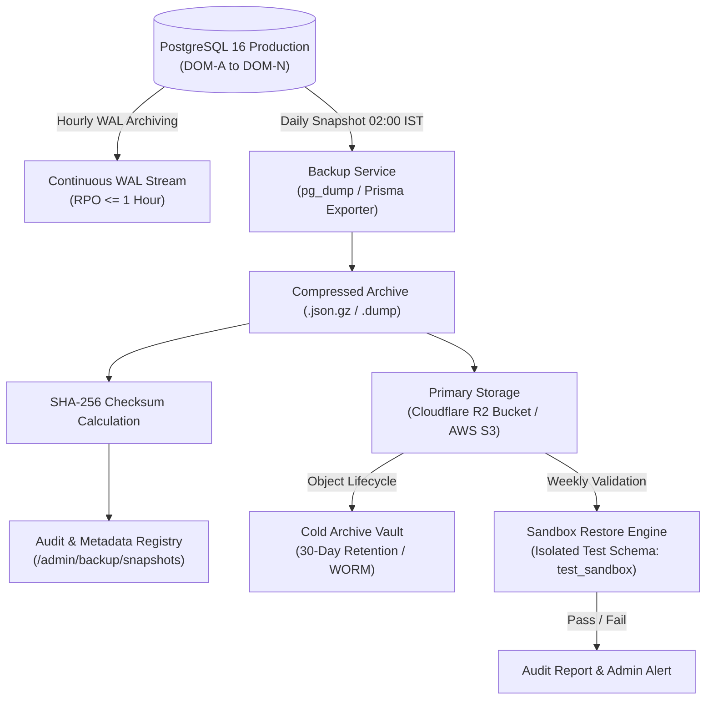

# Database Backup & Restoration Operational Runbook
## Project: BREAKING NEWS WALA (ब्रेकिंग न्यूज़ वाला)
### Document ID: DOC-RUN-BKP-2026-V1.0
### Scope: Database Snapshots, Cryptographic Verification, Multi-Tier Storage & Non-Destructive Restore
### Authority: Master Prompt 09 (`BNW-MASTER-009`) — Section 8 Database Backup & Recovery

---

## 1. Objective & Operational Mandate

This operational runbook governs all database backup, retention, cryptographic integrity verification, and restoration procedures for the central PostgreSQL cluster powering **BREAKING NEWS WALA**.

### Non-Negotiable Invariants
- **Non-Destructive Testing Invariant**: Automated or routine restore testing must **never** overwrite, mutate, or disrupt the active production database. Restore verification is executed in an isolated sandbox staging schema or transient container.
- **Single Central Database**: Exactly one shared PostgreSQL database cluster serves all client surfaces (Web, Reporter, Newsroom, Admin). All backups encompass the full relational domain map (`DOM-A` through `DOM-N`).
- **Cryptographic Validation**: Every backup archive must be paired with an immutable SHA-256 checksum recorded at creation time and re-verified prior to extraction or restore.

---

## 2. Backup Strategy & Architecture



### 2.1 Backup Tiers & Schedules

| Backup Type | Frequency | Execution Window | Retention Policy | Storage Destination |
| :--- | :--- | :--- | :--- | :--- |
| **Full Snapshot** | Daily | 02:00 IST (Off-peak) | 30 Days | Primary R2/S3 Bucket + Cold Vault |
| **Incremental WAL** | Continuous / Hourly | Every 60 minutes | 7 Days | Hot Storage Volume + S3 Bucket |
| **Pre-Migration Snapshot** | Ad-hoc | Prior to `prisma migrate deploy` | 90 Days | Primary R2/S3 Bucket |
| **Sandbox Restore Test** | Weekly | Sundays 04:00 IST | Transient (Auto-dropped) | Isolated Staging Environment |

---

## 3. Automated Backup Generation Procedure

### 3.1 Via Admin Control Panel or REST API
Administrative superusers can trigger an immediate backup snapshot via:
- **Admin Control Desk**: Navigate to `/security` $\rightarrow$ **बैकअप व रिकवरी (DR)** subtab $\rightarrow$ Click **"नया बैकअप स्नैपशॉट बनाएं"**.
- **REST API Endpoint**:
  ```http
  POST /api/v1/admin/backup/create
  Authorization: Bearer <SUPER_ADMIN_JWT>
  Content-Type: application/json

  {
    "description": "Pre-deployment scheduled snapshot"
  }
  ```

### 3.2 Automated Shell Script (Cron / CI/CD)
Location: `scripts/backup-database.sh`
```bash
#!/usr/bin/env bash
set -euo pipefail

TIMESTAMP=$(date +"%Y%m%d_%H%M%S")
BACKUP_DIR="/var/backups/bnw-database"
BACKUP_FILE="${BACKUP_DIR}/bnw_db_snapshot_${TIMESTAMP}.dump"
CHECKSUM_FILE="${BACKUP_FILE}.sha256"

mkdir -p "${BACKUP_DIR}"

echo "[INFO] Commencing pg_dump for BREAKING NEWS WALA database..."
pg_dump -h "${DB_HOST:-localhost}" \
        -p "${DB_PORT:-5432}" \
        -U "${DB_USER:-postgres}" \
        -d "${DB_NAME:-breaking_news_wala}" \
        -F c \
        -b \
        -v \
        -f "${BACKUP_FILE}"

echo "[INFO] Computing SHA-256 checksum..."
sha256sum "${BACKUP_FILE}" | awk '{print $1}' > "${CHECKSUM_FILE}"
CHECKSUM=$(cat "${CHECKSUM_FILE}")

echo "[INFO] Backup complete: ${BACKUP_FILE}"
echo "[INFO] SHA-256 Checksum: ${CHECKSUM}"

# Upload to Object Storage (Cloudflare R2 / AWS S3)
if command -v aws &> /dev/null; then
  echo "[INFO] Syncing snapshot to encrypted object storage..."
  aws s3 cp "${BACKUP_FILE}" "s3://${STORAGE_BACKUP_BUCKET:-bnw-backups}/database/${TIMESTAMP}/" --endpoint-url "${STORAGE_ENDPOINT}"
  aws s3 cp "${CHECKSUM_FILE}" "s3://${STORAGE_BACKUP_BUCKET:-bnw-backups}/database/${TIMESTAMP}/" --endpoint-url "${STORAGE_ENDPOINT}"
fi
```

---

## 4. Cryptographic Integrity Verification

Before any restoration or after any transfer, verify the archive's SHA-256 checksum against the recorded registry:

```bash
# Verify checksum via shell
EXPECTED_SHA=$(cat bnw_db_snapshot_20261102.dump.sha256)
ACTUAL_SHA=$(sha256sum bnw_db_snapshot_20261102.dump | awk '{print $1}')

if [ "${EXPECTED_SHA}" = "${ACTUAL_SHA}" ]; then
  echo "[PASS] Cryptographic integrity verified. Archive is uncorrupted."
else
  echo "[FATAL] Checksum mismatch! Expected ${EXPECTED_SHA}, got ${ACTUAL_SHA}."
  exit 1
fi
```

Via the API engine:
```http
POST /api/v1/admin/backup/verify
Authorization: Bearer <SUPER_ADMIN_JWT>
Content-Type: application/json

{
  "backupId": "bkp_1730538000000"
}
```

---

## 5. Non-Destructive Sandbox Restore Verification Procedure

To comply with the non-destructive testing mandate:
1. Spin up a temporary sandbox schema (`sandbox_restore_test`) or isolated PostgreSQL container.
2. Ingest the backup archive into the isolated schema.
3. Validate row counts across primary domains (`articles`, `users`, `categories`, `districts`, `audit_logs`).
4. Validate referential integrity constraints.
5. Drop the temporary schema upon test completion.
6. Record the test run in the Backup Restore Audit Log (`BackupRestoreTestResult`).

```http
POST /api/v1/admin/backup/test-restore
Authorization: Bearer <SUPER_ADMIN_JWT>
Content-Type: application/json

{
  "backupId": "bkp_1730538000000",
  "isolatedSandbox": true
}
```

---

## 6. Disaster Recovery Full Database Restoration Procedure

> [!CAUTION]
> **PRODUCTION OUTAGE ONLY**: Execute this procedure only during an official disaster declaration approved by the Chief Technology Officer or Incident Commander.

### Step-by-Step Restoration Protocol
1. **Declare Maintenance Mode**: Route edge traffic to a static CDN maintenance page.
2. **Terminate Active Connections**:
   ```sql
   SELECT pg_terminate_backend(pid) 
   FROM pg_stat_activity 
   WHERE datname = 'breaking_news_wala' AND pid <> pg_backend_pid();
   ```
3. **Verify Target Backup Integrity**:
   Confirm SHA-256 checksum matches metadata registry.
4. **Restore Database via pg_restore**:
   ```bash
   pg_restore -h "${DB_HOST}" \
              -p "${DB_PORT}" \
              -U "${DB_USER}" \
              -d "breaking_news_wala" \
              --clean \
              --if-exists \
              --no-owner \
              --no-privileges \
              -v \
              "bnw_db_snapshot_latest.dump"
   ```
5. **Run Prisma Migration Verification**:
   ```bash
   npx prisma migrate status --schema=packages/backend/prisma/schema.prisma
   ```
6. **Verify Service Health**:
   Execute `/api/v1/admin/monitoring/health` and verify all probes report `HEALTHY`.
7. **Disable Maintenance Mode**: Restore live DNS traffic.

