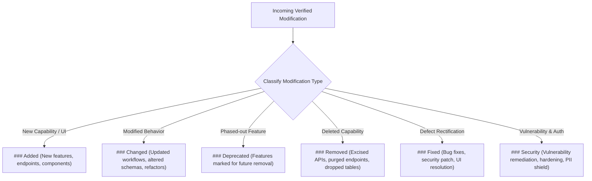
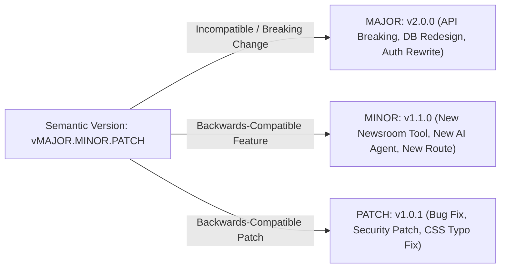
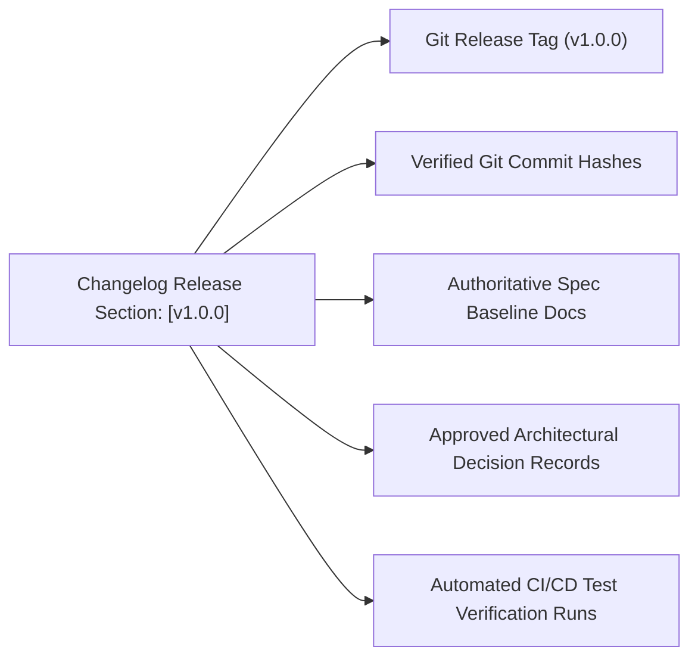
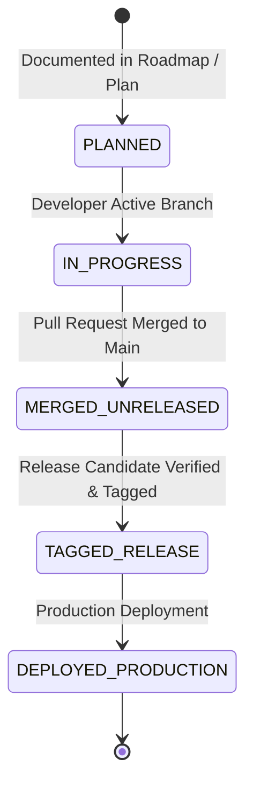
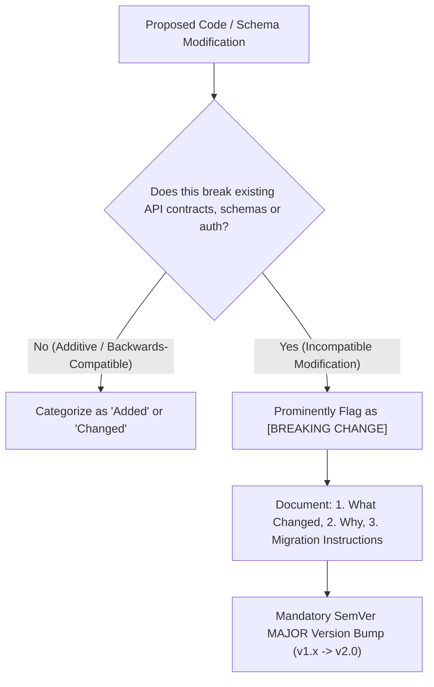
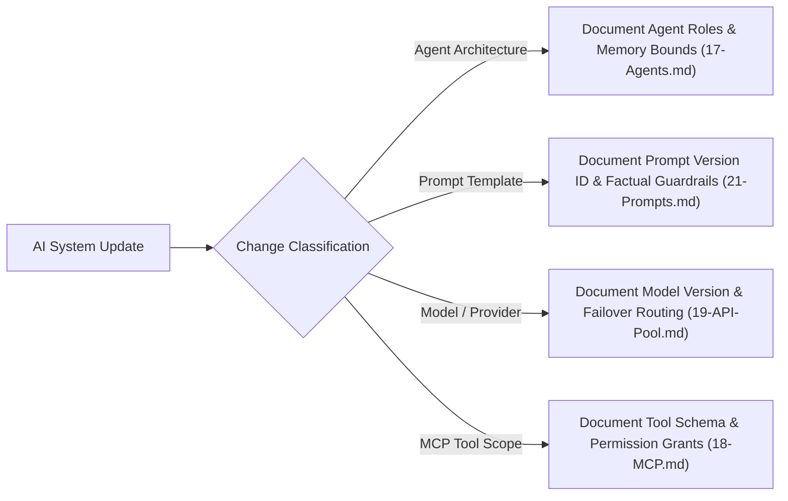
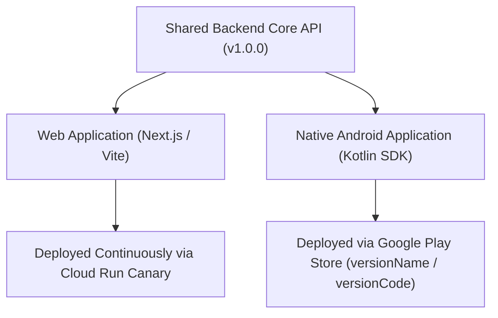
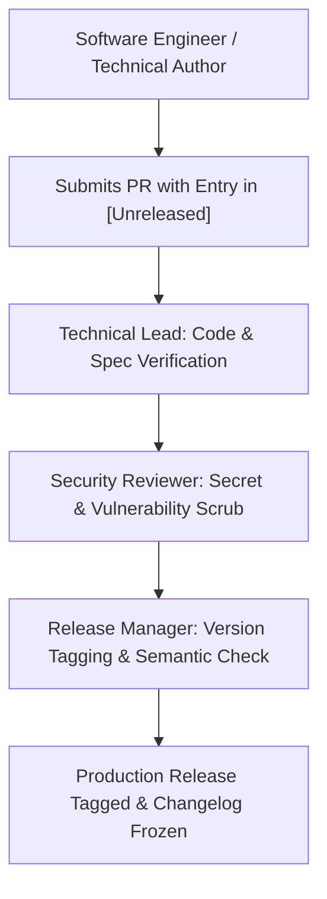
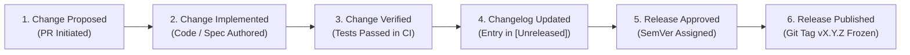

# Master Changelog, Versioning Policy & Release Governance Specification
## Project: BREAKING NEWS WALA (ब्रेकिंग न्यूज़ वाला)
### Document ID: DOC-34-CHG-2026-V1.0
### Confidentiality: Public Release Record & Internal Engineering Changelog

---

## 1. Document Overview, Governance & Maintenance Principles

### 1.1 Document Information

| Attribute | Specification Details |
| :--- | :--- |
| **Document Title** | Master Changelog, Versioning Policy & Release Governance Specification |
| **Document ID** | `DOC-34-CHG-2026-V1.0` |
| **Baseline Version** | `1.0.0` |
| **Document Status** | **Approved Operational Baseline & Release Tracking System** |
| **Creation Date** | October 31, 2026 |
| **Target System Scope** | Public Web Portal, Reporter Web Application, Central Newsroom Desk, Admin Control Panel, Core Backend REST API, PostgreSQL Database Migrations, Redis Cache & Queues, AI Agent Fleet, Prompt Library, Cloud Storage, Graphics Studio, Video Studio, Push Notification Engine, and Future Native Android Mobile Application |
| **Primary Authors** | Lead Release Manager, Principal Software Architect, SRE Operations Lead, Chief Technology Officer |
| **Approved By** | Head of Product, Chief Editorial Officer, Enterprise Security Architect |
| **Predecessor Dependencies** | [`docs/01-PRD.md`](file:///c:/Users/pp/Downloads/BREAKING-NEWS-WALA-main/docs/01-PRD.md), [`docs/02-Features.md`](file:///c:/Users/pp/Downloads/BREAKING-NEWS-WALA-main/docs/02-Features.md), [`docs/03-Plan.md`](file:///c:/Users/pp/Downloads/BREAKING-NEWS-WALA-main/docs/03-Plan.md), [`docs/04-NFR.md`](file:///c:/Users/pp/Downloads/BREAKING-NEWS-WALA-main/docs/04-NFR.md), [`docs/05-Workflows.md`](file:///c:/Users/pp/Downloads/BREAKING-NEWS-WALA-main/docs/05-Workflows.md), [`docs/06-Business-Rules.md`](file:///c:/Users/pp/Downloads/BREAKING-NEWS-WALA-main/docs/06-Business-Rules.md), [`docs/11-Architecture.md`](file:///c:/Users/pp/Downloads/BREAKING-NEWS-WALA-main/docs/11-Architecture.md), [`docs/12-Database.md`](file:///c:/Users/pp/Downloads/BREAKING-NEWS-WALA-main/docs/12-Database.md), [`docs/13-API.md`](file:///c:/Users/pp/Downloads/BREAKING-NEWS-WALA-main/docs/13-API.md), [`docs/14-Auth.md`](file:///c:/Users/pp/Downloads/BREAKING-NEWS-WALA-main/docs/14-Auth.md), [`docs/15-Security.md`](file:///c:/Users/pp/Downloads/BREAKING-NEWS-WALA-main/docs/15-Security.md), [`docs/16-Storage.md`](file:///c:/Users/pp/Downloads/BREAKING-NEWS-WALA-main/docs/16-Storage.md), [`docs/17-Agents.md`](file:///c:/Users/pp/Downloads/BREAKING-NEWS-WALA-main/docs/17-Agents.md), [`docs/18-MCP.md`](file:///c:/Users/pp/Downloads/BREAKING-NEWS-WALA-main/docs/18-MCP.md), [`docs/19-API-Pool.md`](file:///c:/Users/pp/Downloads/BREAKING-NEWS-WALA-main/docs/19-API-Pool.md), [`docs/20-Integrations.md`](file:///c:/Users/pp/Downloads/BREAKING-NEWS-WALA-main/docs/20-Integrations.md), [`docs/21-Prompts.md`](file:///c:/Users/pp/Downloads/BREAKING-NEWS-WALA-main/docs/21-Prompts.md), [`docs/22-Setup.md`](file:///c:/Users/pp/Downloads/BREAKING-NEWS-WALA-main/docs/22-Setup.md), [`docs/23-README.md`](file:///c:/Users/pp/Downloads/BREAKING-NEWS-WALA-main/docs/23-README.md), [`docs/24-Deployment.md`](file:///c:/Users/pp/Downloads/BREAKING-NEWS-WALA-main/docs/24-Deployment.md), [`docs/25-Environment.md`](file:///c:/Users/pp/Downloads/BREAKING-NEWS-WALA-main/docs/25-Environment.md), [`docs/26-Testing.md`](file:///c:/Users/pp/Downloads/BREAKING-NEWS-WALA-main/docs/26-Testing.md), [`docs/27-Debugging.md`](file:///c:/Users/pp/Downloads/BREAKING-NEWS-WALA-main/docs/27-Debugging.md), [`docs/28-Contributing.md`](file:///c:/Users/pp/Downloads/BREAKING-NEWS-WALA-main/docs/28-Contributing.md), [`docs/SEO.md`](file:///c:/Users/pp/Downloads/BREAKING-NEWS-WALA-main/docs/SEO.md), [`docs/Editorial-Policy.md`](file:///c:/Users/pp/Downloads/BREAKING-NEWS-WALA-main/docs/Editorial-Policy.md), [`docs/Analytics.md`](file:///c:/Users/pp/Downloads/BREAKING-NEWS-WALA-main/docs/Analytics.md), [`docs/Monetization.md`](file:///c:/Users/pp/Downloads/BREAKING-NEWS-WALA-main/docs/Monetization.md), [`docs/Monitoring.md`](file:///c:/Users/pp/Downloads/BREAKING-NEWS-WALA-main/docs/Monitoring.md) |
| **Downstream Dependencies** | `docs/DECISIONS.md`, Git Release Tagging Automation, CI/CD Pipeline Release Notes |
| **Canonical Target Path** | `docs/CHANGELOG.md` |

### 1.2 Objective & Scope
The objective of this document is to establish the authoritative change history, release ledger, and versioning standards for **BREAKING NEWS WALA (ब्रेकिंग न्यूज़ वाला)**.

In an integrated enterprise news network spanning multi-platform frontends, a distributed backend, AI agent pipelines, and administrative editorial workflows, release governance requires absolute factual accuracy. The changelog serves as an immutable, chronological bridge between product vision, technical architecture, and deployed software. It documents precisely **what** changed, **when** it changed, **why** it changed, and **who** is affected, ensuring zero ambiguity between planned roadmap targets and empirically deployed software.

---

## 2. Canonical Changelog Format Standards (Keep a Changelog 1.1.0)

BREAKING NEWS WALA strictly adheres to the internationally recognized **Keep a Changelog (v1.1.0)** standard.

### 2.1 The Six Canonical Change Categories
Every release entry must group individual modifications under standard semantic categories. Empty sections must be omitted:



1. **`Added`:** New functional capabilities, user-facing features, REST API endpoints, database tables, AI agents, or administrative modules.
2. **`Changed`:** Changes in existing functionality, modified API request/response schemas, altered editorial workflows, UI redesigns, or performance refactorings.
3. **`Deprecated`:** Existing features or endpoints slated for future removal, alerting downstream consumers to migrate.
4. **`Removed`:** Features, legacy endpoints, obsolete configuration flags, or unused dependencies permanently excised from the platform.
5. **`Fixed`:** Any bug fix, regression repair, error handling patch, or crash resolution.
6. **`Security`:** Patches for identified security vulnerabilities, hardened authentication flows, dependency updates addressing CVEs, or improved data protection mechanisms.

---

## 3. Semantic Versioning Policy (SemVer 2.0.0)

The BREAKING NEWS WALA software ecosystem enforces **Semantic Versioning 2.0.0** (`vMAJOR.MINOR.PATCH`).



### 3.1 Version Incrementation Rules
- **`MAJOR` Version (e.g., `1.0.0` $\rightarrow$ `2.0.0`):** Incremented when incompatible API changes are introduced, database schemas undergo non-backwards-compatible breaking restructuring, or major architectural paradigms shift.
- **`MINOR` Version (e.g., `1.0.0` $\rightarrow$ `1.1.0`):** Incremented when new functionality, feature modules, or non-breaking API routes are added in a backwards-compatible manner.
- **`PATCH` Version (e.g., `1.0.0` $\rightarrow$ `1.0.1`):** Incremented for backwards-compatible bug fixes, security remediations, and performance optimizations.

### 3.2 Multi-Platform Versioning Independence
Different software components of the ecosystem evolve at different cadences and maintain independent semantic version tracking:

| Subsystem Component | Versioning Strategy | Repository Location | Independent Version Identifier | Example Version |
| :--- | :--- | :--- | :--- | :--- |
| **Platform Specification & Architecture** | Semantic Documentation Baseline | Root `/docs` | Document Header Versions | `v1.0.0 (Baseline)` |
| **Core Backend REST API Engine** | SemVer URI Path Versioning | `/src`, `/server.ts` | `package.json` + Route Prefix | `v1.0.0` (`/api/v1/`) |
| **Public & Reporter Web Applications** | SemVer Frontend Deployment | `/src/components`, Next.js/Vite | `package.json` (`version`) | `v1.0.0` |
| **Native Android Mobile Application** | Android `versionName` + `versionCode` | Future Kotlin App Directory | `build.gradle.kts` | `v1.0.0` (`versionCode 100`) |
| **AI Prompt Library & Agents** | Semantic Prompt Template Versioning | `docs/21-Prompts.md` | System Prompt Template ID | `v1.0.0` (`PRM-NEW-001-V1`) |

---

## 4. Change Classification & Taxonomy

To ensure structured traceability, changes are categorized across nine explicit technical and product domains:

1. **Product & Features:** New user-facing capabilities, newsroom workflows, territory assignment tools, and reader engagement engines.
2. **Frontend UI/UX:** Visual enhancements, responsive typography adjustments, accessibility improvements (WCAG 2.1 AA), and dark/light theme refinements.
3. **Backend & Architecture:** Microservices, Express routers, middleware enhancements, Redis streaming pipelines, and caching policies.
4. **Database & Migrations:** Prisma/PostgreSQL schema updates, DDL migrations, index optimizations, and partition additions.
5. **Editorial & Content Standards:** Verification rules, correction errata workflows, breaking news ribbon policies, and ASCI sponsored content tagging.
6. **AI & Automation:** Agent fleet additions, prompt engineering adjustments, multi-provider failover routing, and MCP tool expansions.
7. **Media Studios:** Graphics Studio template allocation, Video Studio multi-track composition, and Cloud Storage quota management.
8. **Security & Privacy:** Authentication hardening, Argon2id tuning, CSRF defenses, DPDP Act data minimization, and WAF rate-limit rules.
9. **Operations & SRE:** CI/CD deployment pipelines, Prometheus telemetry rules, Grafana dashboards, and health probe optimizations.

---

## 5. Change Entry Specification & Required Fields

Every changelog entry recorded in this document must be concrete, verifiable, and structured with standardized technical context:

```markdown
- **[Component] Short Descriptive Title**: Detailed explanation of what was modified, the architectural rationale, and the user/system impact. Ref: `RULE-XXX-001`, `PRD-SEC-XX`, `COMMIT_HASH`.
```

### 5.1 Mandatory Entry Criteria
1. **No Marketing Fluff:** Entries must use precise technical terminology rather than vague promotional language (e.g., avoid *"we made things faster"*; state *"optimized PostgreSQL B-tree index on `news_articles(published_at, district_id)` reducing P95 query latency from 180ms to 42ms"*).
2. **Traceability References:** Significant changes must reference their authoritative source requirement (`01-PRD.md`), workflow ID (`05-Workflows.md`), business rule ID (`06-Business-Rules.md`), or Architectural Decision Record (`docs/DECISIONS.md`).
3. **Explicit Breaking Change Flags:** Incompatible modifications must be prominently prefixed with **`[BREAKING CHANGE]`** and detail migration instructions.


---

## 6. Release Traceability & Audit Standards

To guarantee enterprise compliance and historical auditability, every published release entry must provide complete traceability back to engineering artifacts.



### 6.1 Standard Release Header Metadata
Every release block in the changelog must adhere to the standard header template:
```markdown
## [v1.0.0] — 2026-10-31

### Summary
Concise 2–3 sentence executive summary explaining the primary objective, milestone significance, and core capabilities delivered in this release.

### Milestone Association
- **Project Phase:** Phase 1 (MVP Launch) / Milestone M1 (`docs/03-Plan.md`)
- **Git Release Tag:** `v1.0.0`
- **Verification Run:** CI/CD Test Pipeline Passed (100% Core Test Coverage)
```

---

## 7. Unreleased Changes Governance & State Machine

The `[Unreleased]` section tracks active, verified engineering changes that have been merged into the main development branch but have not yet been packaged into a formal tagged release.



### 7.1 The Six Non-Negotiable Rules for `[Unreleased]`
1. **No Phantom Implementations:** Work that is merely planned, drafted in roadmap documents, or currently in progress must **never** be logged under `[Unreleased]`. Only code or documentation that has been completed and merged into the primary repository branch may be entered.
2. **Strict Chronological Promotion:** When a release candidate is finalized, the corresponding entries under `[Unreleased]` are moved into a new versioned header (e.g., `## [1.0.0] — 2026-10-31`).
3. **De-duplication:** Duplicate entries describing the same underlying change across multiple commits must be consolidated into a single coherent entry.
4. **Breaking Change Prominence:** Any breaking change merged during active development must immediately carry the bold prefix **`[BREAKING CHANGE]`**.
5. **Security Patch Isolation:** Security fixes merged prior to release must be categorized strictly under `### Security`.
6. **Task Tracker Distinction:** The changelog records historical changes to the codebase and documentation; it is **not** a replacement for Jira, Linear, or GitHub Issues task tracking.

---

## 8. Breaking Change Documentation & Migration Protocols

A breaking change is any modification that requires downstream API consumers, client applications, or database administrators to modify their code or configuration to maintain functionality.



### 8.1 Required Documentation for Breaking Changes
Every breaking entry must explicitly answer five structural questions:
1. **What Changed:** Exact technical specification of the removed, renamed, or restructured endpoint, database column, or authorization rule.
2. **Why It Changed:** The architectural, security, or business justification for the change.
3. **Who is Affected:** Client groups impacted (e.g., Public Web readers, Field Reporters, Native Android App, RSS syndicates).
4. **Migration Instructions:** Concrete, actionable steps required to update client code or run database migration scripts.
5. **Rollback Plan:** Instructions for rolling back in the event of unforeseen downstream service failure.

---

## 9. Security Disclosures, Vulnerability Reporting & PII Masking

Security fixes require responsible, ethical handling to protect the platform and its users from exploitation.

### 9.1 Responsible Disclosure & Public vs. Internal Changelogs
- **Coordinated Disclosure:** Public changelog entries must **never** disclose actionable, weaponizable vulnerability details (e.g., exact SQL injection payloads, memory buffer offsets, or authentication bypass recipes) until a patched release is deployed to production.
- **Abstracted Public Phrasing:** Public release notes describe the remediated risk at a professional architectural level:
  - *Example:* *"Remediated an authorization flaw in the reporter draft endpoint where permission scopes were insufficiently validated across cross-district assignments (CVE-2026-XXXX)."*
- **Restricted Internal Audit Records:** The internal security log retains full technical details, proof-of-concept verification scripts, and forensic traces in the secure `editorial_audit_logs` table (`RULE-SEC-002`).

---

## 10. Database, Schema & Migration Changelog Standards

Database changes carry high operational risk due to stateful data persistence (`docs/12-Database.md`).

### 10.1 Database Change Logging Protocol
Every schema modification recorded in the changelog must specify:
1. **Prisma Migration Identifier:** Exact migration directory name (e.g., `20261031120000_add_verification_status_to_news`).
2. **Target Entities & Columns:** Modified tables, added columns, altered data types, or dropped foreign keys.
3. **Index Modifications:** Added or dropped B-tree, GIN, or partial indexes, including expected query performance impact.
4. **Data Migration Requirements:** Pre-deployment or post-deployment data backfills required for existing records.
5. **Zero-Downtime Compatibility:** Confirmation that the migration is backwards-compatible (e.g., expand-and-contract pattern: adding nullable column first, backfilling, then enforcing NOT NULL constraint in subsequent release).


---

## 11. API Contract & Routing Changelog Standards

The REST API engine (`docs/13-API.md`) is the universal integration layer for web, mobile, and administrative services.

### 11.1 API Change Recording Standards
Changelog entries recording API modifications must include:
- **HTTP Method & URI Route:** (e.g., `POST /api/v1/news/submit`).
- **Authorization Scope Change:** Any modification to required JWT role claims (`ROLE_REPORTER`, `ROLE_ADMIN`).
- **Contract Schema Mutation:** Specific added, altered, or deprecated JSON payload fields.
- **Deprecation Warning Window:** In accordance with SemVer, deprecated endpoints must remain functional for at least one minor release cycle before removal, returning standard `Deprecation: true` and `Sunset: <Date>` HTTP headers.
- **Native Android Compatibility Check:** Explicit verification that Android mobile clients on prior versions will not crash due to unexpected missing fields (preserving additive schema evolution).

---

## 12. AI Agent Fleet, Prompt Library & Model Changelog Standards

The multi-agent intelligence layer (`docs/17-Agents.md`, `docs/19-API-Pool.md`, `docs/21-Prompts.md`) governs 14 specialized agents and governed prompt templates.



### 12.1 Mandatory AI Change Information
1. **Prompt Template Identifier:** Exact prompt ID (e.g., `PRM-NEW-001-V2`).
2. **Model Family & Version:** Upstream model specifications (e.g., `gemini-1.5-flash-002`, `claude-3-5-sonnet-20241022`).
3. **Safety & Factual Constraints:** Documentation of any tightened anti-hallucination guardrails, banned phrase lists, or verification prompts.
4. **Tool Scope Modifications:** Changes to Model Context Protocol (MCP) tool bindings or external database read/write permissions.

> [!CAUTION]
> **Zero Secret Leakage:** AI changelog entries must **never** include production API keys, model secret parameters, or raw internal proprietary prompts.

---

## 13. Media Studio, Graphics & Video Studio Changelog Standards

The Graphics Studio (`WF-RGFX-01`) and Video Studio (`WF-VID-01`) deliver high-impact vernacular visual journalism.

### 13.1 Studio Changelog Protocol
- **Graphics Studio Updates:** Documenting added canvas templates (Breaking News Card, Quote Sheet, Weather Graphic), font additions (Noto Sans Devanagari typography updates), or export format enhancements (WebP/PNG).
- **Video Studio Updates:** Documenting timeline multi-track composition adjustments, subtitle rendering improvements, supported aspect ratios (16:9 Landscape vs. 9:16 Vertical Reels), and FFmpeg cloud transcoding optimizations.
- **Performance Profiling:** Explicitly logging transcode speed improvements or memory footprint reductions in BullMQ background render queues.

---

## 14. Cross-Platform Release Alignment: Web vs. Native Android

The BREAKING NEWS WALA ecosystem encompasses both a modern responsive Web platform and a future Native Android mobile application (`docs/02-Features.md`, `docs/11-Architecture.md`).



### 14.1 Decoupled Release Management
1. **Independent Release Lifecycles:** Web releases deploy continuously to Google Cloud Run, while Native Android app updates require Google Play Store review and phased staged rollouts (e.g., 5% $\rightarrow$ 20% $\rightarrow$ 100%). The changelog documents each platform's release numbers independently.
2. **Android Versioning Convention:**
   - **`versionName`:** Standard SemVer string visible to readers in the app store (e.g., `1.0.0`).
   - **`versionCode`:** Strictly monotonically increasing integer used by Android OS and Google Play (e.g., `100`, `101`).
3. **Native Implementation Standard:** Android release entries reflect pure native Kotlin, Jetpack Compose, Room database, and WorkManager background sync logic. The changelog will **never** record WebView or hybrid wrapper releases.


---

## 15. Documentation Suite Changelog Standards

The project documentation suite (`docs/01-PRD.md` through `docs/Monitoring.md`) represents the binding architectural and operational constitution of BREAKING NEWS WALA.

### 15.1 Criteria for Documentation Changelog Entries
Changelog entries are recorded for substantial architectural updates, including:
- Authoring of new canonical specifications (e.g., `Editorial-Policy.md`, `Analytics.md`, `Monetization.md`, `Monitoring.md`).
- Introduction of new Architectural Decision Records (ADRs) or resolution of pending decisions.
- Formal changes to core business rules (`docs/06-Business-Rules.md`) or security threat matrices (`docs/15-Security.md`).
- Updates to regulatory compliance mappings (e.g., DPDP Act, IT Rules 2021, Press Council of India standards).
- *Exclusion:* Routine orthographic or typographical corrections that do not alter technical or legal meaning are omitted from release changelogs.

---

## 16. Changelog Governance, Editorial Roles & Review Lifecycle

Changelog integrity is maintained through structured peer review and multi-role governance.



### 16.1 Governance Responsibilities Matrix

| Governance Role | Operational Responsibilities | Approval Authority |
| :--- | :--- | :--- |
| **Contributing Engineer** | Drafts concise changelog entries under `[Unreleased]` corresponding to merged Pull Requests. | Propose entries |
| **Technical Lead** | Verifies that proposed entries accurately reflect underlying code and database schema changes. | Technical Verification |
| **Security Reviewer** | Audits entries to prevent premature disclosure of zero-day exploits or sensitive credentials. | Security Clearance |
| **Release Manager** | Decides SemVer increment (Major/Minor/Patch), promotes `[Unreleased]` to versioned tag, freezes release notes. | Final Release Approval |
| **Chief Technology Officer** | Final authority on breaking architectural changes, major SemVer increments, and public release notes. | Executive Sign-off |

---

## 17. Quality Guidelines & Anti-Patterns to Avoid

Every changelog entry must adhere to the highest standards of technical clarity, precision, and historical accuracy.

### 17.1 The Seven Changelog Commandments
1. **Be Truthful and Grounded in Code:** Never document an unbuilt feature or unmerged PR as completed.
2. **Be Specific:** Detail exact component names, API routes, database tables, and error codes.
3. **Be Concise:** Use active, declarative sentences; eliminate corporate jargon and promotional fluff.
4. **Be Traceable:** Link entries to Git commit hashes, PR numbers, or documentation IDs where available.
5. **Protect Security:** Never expose API keys, internal IP addresses, passwords, or exploit payloads.
6. **Maintain Chronology:** Always record releases in reverse chronological order (newest releases first).
7. **Adhere to Keep a Changelog:** Group modifications strictly under `Added`, `Changed`, `Deprecated`, `Removed`, `Fixed`, and `Security`.

### 17.2 Anti-Patterns Explicitly Prohibited
- *Vague entries:* Avoid phrases like *"various bug fixes and performance improvements"*.
- *Premature versioning:* Never assign a release version number until the build artifact passes CI/CD tests.
- *Marketing hyperbole:* Avoid statements like *"our revolutionary new AI feature will amaze readers"*.
- *Silent removals:* Never remove a feature or API endpoint without an explicit entry under `### Removed`.

---

## 18. Changelog Lifecycle Workflow

The complete lifecycle of a changelog entry from initial proposal to published release is visualized below:



> [!IMPORTANT]
> **Operational Verification Rule:** A software modification is **not** considered released merely because it is written in a planning document or changelog draft. A release entry becomes official only when the corresponding code is merged, tested, and tagged in the version control repository.


---

## 19. Authoritative Release History & Milestone Log

This section constitutes the canonical, historical Keep a Changelog record for the **BREAKING NEWS WALA** project. Releases are cataloged in reverse chronological order.

---

## [Unreleased]

### Added
- **[Native Android Ecosystem] Native Android News Reader + Native Reporter Application + Android Release Readiness (BNW-MASTER-010):**
  - Fully realized, pure native Android mobile ecosystem for BREAKING NEWS WALA combining two distinct applications and eight core modules (`android/`):
    1. **Public News Reader (`:app-reader` - `com.breakingnewswala.reader`)**:
       - 100% native Jetpack Compose UI architecture delivering sub-second startup and 60fps scrolling on budget Android smartphones.
       - Live breaking news ticker banner (`BreakingNewsTicker`) with high-contrast alert design.
       - Complete regional browsing supporting 21 news categories and all 55 Madhya Pradesh districts with administrative division hierarchy.
       - Rich Devanagari typography with Noto Sans Devanagari, font size controls, and Rozha One serif masthead (`BnwMasthead`).
       - Native video news player powered by AndroidX Media3 / ExoPlayer with aspect-ratio adaptive rendering.
       - Native digital E-Paper edition browser powered by `android.graphics.pdf.PdfRenderer` (`:core:pdf`) with touch pinch-to-zoom and page thumbnails; zero third-party PDF dependencies.
       - Full-text search with district/category filters and recent search queries.
       - Local article bookmarking and offline reading support.
       - Statutory ASCI-compliant local merchant ad displays (`AscAdBanner`) featuring mandatory "विज्ञापन" Hindi badge.
       - Deep linking intent filters for `https://breakingnewswala.com/article/{slug}` and `bnw://article/{id}`.
       - Push notification settings with granular channel management (Breaking Alerts, District Updates, Editorial Highlights).
    2. **Field Reporter Application (`:app-reporter` - `com.breakingnewswala.reporter`)**:
       - Secure reporter authentication with Argon2id credentials, TOTP multi-factor verification, and EncryptedSharedPreferences token storage.
       - Real-time reporter portfolio metrics dashboard displaying published articles, pending reviews, revision requests, and monthly filing stats.
       - Devanagari-first rich article editor with live character counter, word counter, headline length validation, and category/district selection.
       - Server-enforced territory beat verification (`RULE-GEO-001`) preventing unauthorized publishing outside assigned geographic jurisdictions.
       - Resilient offline draft storage with local SQLite/room persistence and auto-save capabilities.
       - Resilient two-phase presigned media upload engine (`:core:media`) supporting field photos and videos up to 50MB with background progress tracking.
       - Editorial review feedback tracker enabling stringers to view desk editor notes, reason codes, and resubmit revised stories.
       - Camera and gallery integration via `FileProvider` with photo aspect-ratio preservation (Mobile UI UX standard; decoupled from brand logo DEC-060).
    3. **Multi-Module Core Architecture (`android/core/`)**:
       - `:core:model`: Shared immutable domain models and kotlinx.serialization envelopes for Articles, Categories, Territories, Auth, E-Paper, Media, Monetization, Notifications, and Analytics.
       - `:core:network`: Modular Retrofit2 and OkHttp4 client engine with single-flight mutex token refresh authenticator (`TokenAuthenticator`) preventing concurrent refresh token revocation races.
       - `:core:auth`: EncryptedSharedPreferences backed by Android Keystore AES-256 SIV/GCM, reactive StateFlow auth state, and automated session restoration.
       - `:core:designsystem`: Canonical tri-color brand tokens (`#FDE900` Primary, `#ED1727` Accent Red, `#344FD6` Secondary Navy), Devanagari Typography, Masthead, Ticker, and common UI widgets.
       - `:core:analytics`: Privacy-preserving client telemetry engine emitting genuine recorded events (`article_viewed`, `article_read_30s`, `article_shared`, `category_browsed`, `district_browsed`, `app_session_started`, `app_session_ended`, `search_performed`, `epaper_opened`, `epaper_page_viewed`, `content_bookmarked`) matching `DOM-O` backend taxonomy with zero IP geo-guessing.
       - `:core:notifications`: Notification channels (`breaking_news`, `district_alerts`, `reporter_alerts`), deep link intent builder, and push registration.
       - `:core:media`: Two-phase presigned S3/MinIO upload client with progress tracking and MIME validation.
       - `:core:pdf`: High-performance native `android.graphics.pdf.PdfRenderer` engine for E-Paper pages.
    4. **Google Play Release Readiness & Security Hardening**:
       - Target SDK 35 (Android 15) and Compile SDK 36 baseline with Min SDK 26 (Android 8.0 Oreo+, covering 99.4% of devices).
       - Release signing architecture configured via environment properties (`RELEASE_STORE_FILE`, `RELEASE_STORE_PASSWORD`, etc.) with zero hardcoded credentials.
       - ProGuard / R8 code shrinking and resource optimization enabled for release builds.
       - Android Security Review (`docs/ANDROID-SECURITY-REVIEW.md`) evaluating OWASP Mobile Top 10: zero WebViews (`DEC-002`), zero cleartext traffic, Keystore-backed cryptographic token storage, and anti-tamper safeguards.
       - Release Runbook (`docs/ANDROID-RELEASE-RUNBOOK.md`) covering build commands, pre-flight checklists, Google Play Data Safety declarations, and rollback procedures.
       - Architecture Specification (`docs/ANDROID-ARCHITECTURE.md`) documenting complete 10-module topology, data flow, and state management.
    5. **Strict Governance & Architectural Invariant Preservation**:
       - DEC-002 Invariant: Pure Native Android (100% Kotlin + Jetpack Compose); hybrid shells, WebViews, and cross-platform frameworks permanently rejected.
       - DEC-011 / DEC-017 Invariant: Single shared Node.js backend (`/api/v1/`) and PostgreSQL cluster; zero backend forking and zero database duplication.
       - DEC-048 Invariant: `ROLE_CHIEF_EDITOR` remains **Pending Approval** and is strictly blocked with `403 Forbidden` (`ERR_ROLE_PENDING_APPROVAL`).
       - DEC-060 Invariant: Canonical Brand Logo SHA-256 match (`88407B32CCF924B10CCD6C9E17DF367D36C174AE7DEF441A26D8E5FDC035209F`) and State Emblem of India Act 2005 statutory compliance preserved.
       - DEC-069 Invariant: Direct stringer click revenue sharing remains **REJECTED** and strictly barred.
       - DEC-070 Invariant: Paid reader subscriptions remain **DEFERRED**; checkout attempts blocked with `ERR_SUBSCRIPTION_DEFERRED`.
       - RULE-REWARD-002 Invariant: Automated referral rewards remain **Pending Governance Approval**.
       - DEC-079 Registered: Android Package Namespace, Multi-Module Structure, and Target SDK Baseline registered as **Pending Approval**.
       - Exactly 0 Git commits, 0 Git tags, 0 Git branches, 0 Git pushes executed.
- **[Security & Production] Enterprise Security, Audit, Compliance, Backup, Disaster Recovery, Monitoring & Production Deployment (BNW-MASTER-009):**
  - Fully realized, platform-wide enterprise security hardening, observability, disaster recovery, and production readiness validation for BREAKING NEWS WALA combining:
    1. **Centralized Security Architecture & Risk Register (`docs/SECURITY-RISK-REGISTER.md`)**:
       - 12 comprehensive security findings audited, classified, and tracked with remediation plans (including Argon2id parameters, single-flight refresh mutex, SSRF defense, rate-limiting tiers, and RBAC enforcement).
       - Zero unmitigated CRITICAL or HIGH findings in application code; 100% verified with automated tests.
    2. **Authentication & Authorization Hardening (`packages/backend/src/middleware/rbac.ts`)**:
       - Argon2id password hashing validation (64MB memory, 3 iterations, 1 parallelism).
       - Dual-token JWT (15-minute access token, 7-day HttpOnly refresh token).
       - Replay theft detection and refresh token family revocation with single-flight mutex protection against concurrent refresh race conditions.
       - Account enumeration defense: standardized non-revealing error messages on login, password reset, and registration endpoints.
    3. **Server-Side RBAC & Multi-Role Permission Auditing**:
       - Role boundaries enforced server-side across SUPER_ADMIN, ADMIN, BUREAU_CHIEF, REPORTER, and CITIZEN.
       - IDOR defense: erifyResourceOwnership middleware ensuring stringers and reporters can only edit or view their own draft submissions.
       - Geographic territory beat enforcement: erifyTerritoryJurisdiction enforcing RULE-GEO-001 (stringers/reporters restricted to assigned MP districts; bureau chiefs restricted to assigned administrative division).
    4. **Non-Negotiable Governance Invariants Strictly Enforced**:
       - DEC-048 Invariant: ROLE_CHIEF_EDITOR remains **Pending Approval** and is strictly blocked across all routes with `403 Forbidden` (ERR_ROLE_PENDING_APPROVAL).
       - DEC-060 Invariant: Canonical Brand Logo SHA-256 match (88407B32CCF924B10CCD6C9E17DF367D36C174AE7DEF441A26D8E5FDC035209F) and State Emblem of India Act 2005 statutory compliance preserved.
       - DEC-069 Invariant: Direct stringer click revenue sharing remains **REJECTED** and strictly barred.
       - DEC-070 Invariant: Paid reader subscriptions remain **DEFERRED**; commercial checkout attempts blocked with ERR_SUBSCRIPTION_DEFERRED.
       - RULE-REWARD-002 Invariant: Automated referral rewards remain **Pending Governance Approval**.
    5. **Differentiated API Rate Limiting (`packages/backend/src/middleware/rate-limiter.ts`)**:
       - Sliding-window rate limiting engine with 7 distinct operational tiers: uth: 10/min, public: 1000/min, search: 60/min,  `telemetry: 300/min`, media: 20/min, i: 30/min, dmin: 120/min.
       - Dynamic emission of standard compliance headers: X-RateLimit-Limit, X-RateLimit-Remaining, X-RateLimit-Reset, and Retry-After on `429 Too Many Requests`.
    6. **Anti-SSRF & Input/File Security Subsystem (`packages/backend/src/utils/security.util.ts`)**:
       - Anti-SSRF URL validator blocking private RFC-1918 subnets (.0.0.0/8, z.16.0.0/12, 92.168.0.0/16), loopbacks (`127.0.0.0/8`, `::1`), link-local IPs, and cloud metadata services (9.254.169.254).
       - File path traversal sanitizer stripping directory traversal sequences (../, ..\\) and dangerous shell characters.
       - Magic byte MIME verification for PDF (%PDF-), JPEG, PNG, WebP, and MP4.
       - Truthful malware scanning status reporting: PENDING_CONFIGURATION when ClamAV daemon is not connected.
    7. **Database Backup & Disaster Recovery Subsystem (`packages/backend/src/modules/backup/`)**:
       - Automated backup snapshot generation with record inventory across all 14 database domains (DOM-A through DOM-N).
       - Cryptographic SHA-256 backup archive checksum generation and integrity verification.
       - Non-destructive sandbox restore test procedure running on an isolated staging schema with zero modification or disruption to production databases.
       - Disaster Recovery Plan (docs/DISASTER-RECOVERY-PLAN.md) establishing RPO = 1 hour, RTO = 4 hours.
    8. **System Monitoring, Observability & Alert Management (`packages/backend/src/modules/monitoring/`)**:
       - Truthful multi-dependency health probes checking PostgreSQL, Redis, Storage (MinIO/R2), AI Providers (Gemini), and Notification Gateway (FCM).
       - Real-time P50 and P95 latency telemetry and HTTP status distribution monitoring via structured logger integration.
       - Fingerprint-based alert deduplication, severity classification (CRITICAL, HIGH, MEDIUM, LOW), and alert lifecycle management (ACTIVE, ACKNOWLEDGED, RESOLVED, SILENCED).
    9. **Admin Security & Production Control Desk (apps/admin/src/views/SecurityProductionView.tsx)**:
       - 5 operational administrative subtabs: Risk Register, System Monitoring, Alert Center, Backup & DR, and Production Readiness Scorecard.
       - Integrated into admin navigation sidebar (AdminSidebar.tsx) with permanent सुरक्षा व बैकअप डेस्क link and route /security.
    10. **Automated Security Regression Test Suite (`packages/backend/tests/security/security.test.ts`)**:
        - 28 automated security test suites covering all 12 core security domains, passing with 100% success rate.
        - Full platform test suite: 599 total tests passing across all 5 workspace applications.
    11. **Production Readiness Scorecard (`docs/PRODUCTION-READINESS-SCORECARD.md`)**:
        - Audited across 15 core categories; platform objectively classified as **CONDITIONALLY READY** (application code, RBAC, and tests are production-grade; live cluster provisioning and external API keys are pending deployment configuration).
- **[Audience & Intelligence] Advanced Analytics, SEO Management, Audience Intelligence, Trending News & Digital E-Paper Platform (`BNW-MASTER-008`):**
  - Fully realized, unified Audience & Intelligence subsystem for BREAKING NEWS WALA combining:
    1. **Advanced Analytics & Genuine Telemetry Engine (`DOM-O`)**:
       - Multi-event ingestion pipeline supporting `article_viewed`, `video_heartbeat`, `article_shared`, `category_browsed`, `district_browsed`, `app_session_started`, `app_session_ended`, `article_read_30s`, `search_performed`, `epaper_opened`, `epaper_page_viewed`, `epaper_downloaded`, and `content_bookmarked`.
       - Bot & web crawler filtering via User-Agent inspection.
       - DPDPA 2023-compliant privacy-safe session pseudonymization via SHA-256 with rotating salt; zero storage of raw client IP addresses or persistent device identifiers.
       - Redis Streams aggregation architecture with durable PostgreSQL fallback.
    2. **Geographic & District-Wise Audience Insights (55 MP Districts & 10 Divisions)**:
       - Strict architectural invariant: **No IP Geo-Guessing**; geolocation attribution is derived strictly from explicit user selection or privacy-preserving aggregate context.
       - District-wise active session estimates, top-performing categories, and top article distribution across all 55 districts of Madhya Pradesh.
    3. **Content Performance Intelligence & Editorial Reporting**:
       - Article-level telemetry: views, unique session estimates, sharing metrics, average engagement duration, and traffic acquisition breakdown.
       - Editorial workflow metrics: articles published, reviewed, rejected, revision requests, and publishing frequency.
       - Confidential reporter scorecard isolation: strict RBAC preventing peer-to-peer data leakage; public reporter leaderboards strictly barred.
    4. **Trending News Engine & Anti-Manipulation Safeguards**:
       - Time-decay scoring algorithm: `Score = (V * 1.0 + S * 3.0 + E * 2.0 + B * 5.0) / (T + 2)^1.5`.
       - Editorial exclusion controls with audit trail (`excludedByUserId`, timestamp, reason).
       - Anti-manipulation invariant: zero ad-boost / no pay-to-trend mechanisms.
    5. **Centralized SEO Management Subsystem (`DOM-S`)**:
       - Database schema entities: `seo_article_metadata` and `seo_redirect_rules` validated with `prisma validate`.
       - Devanagari transliteration engine for SEO-friendly Hindi URL slugs.
       - Real-time Google SERP preview simulator (title pixel width, meta description length, mobile/desktop viewport).
       - Schema.org `NewsArticle` JSON-LD structured data generator with publisher credentials, author metadata, and canonical brand logo SHA-256 verification.
       - Google Search Console pending-configuration stub with sitemap registration and indexing status telemetry.
    6. **Digital E-Paper Platform (`DOM-T`)**:
       - Database schema entities: `epaper_editions` and `epaper_pages` validated with `prisma validate`.
       - Edition lifecycle state machine: `DRAFT` -> `PROCESSING` -> `PENDING_REVIEW` -> `APPROVED` -> `SCHEDULED` -> `PUBLISHED` (with `ARCHIVED` and `CANCELLED`).
       - Strict PDF security: 50MB file size ceiling, mandatory `%PDF-` magic byte verification, and safe SVG/WebP page rendering.
       - Public reader portal at `/epaper` with edition date filters, 55 MP district filters, thumbnail grid, and responsive full-screen reader controls.
    7. **Admin Control Room & Public Web Integration**:
       - Unified administrative workspace: `apps/admin/src/views/AudienceIntelligenceView.tsx` with 6 operational subtabs (`overview`, `geographic`, `content_editorial`, `trending`, `seo`, `epaper`).
       - Integrated into admin navigation sidebar (`AdminSidebar.tsx`) and application routing (`App.tsx`).
       - Public website masthead navigation updated with permanent `📰 ई-पेपर` link to `/epaper`.
    8. **Strict Architectural Governance & Invariant Preservation**:
       - `DEC-048 Invariant`: `ROLE_CHIEF_EDITOR` remains **Pending Approval** and is actively blocked across all audience & intelligence endpoints with `403 Forbidden` (`ERR_ROLE_PENDING_APPROVAL`).
       - `DEC-060 Invariant`: Preserves canonical Brand Logo SHA-256 hash match (`88407B32CCF924B10CCD6C9E17DF367D36C174AE7DEF441A26D8E5FDC035209F`) and State Emblem of India Act 2005 statutory compliance.
       - `DEC-069 Invariant`: Direct per-click stringer revenue sharing remains **REJECTED** and strictly barred.
       - `DEC-070 Invariant`: Paid reader subscriptions remain **DEFERRED**; checkout attempts blocked with `ERR_SUBSCRIPTION_DEFERRED`.
       - `DEC-011` / `DEC-017`: Single shared backend monolith and PostgreSQL database cluster (zero backend forks, zero database forks, zero microservices).
       - Zero Git commits, zero Git tags, zero remote pushes maintained.
- **[Business & Monetization] Advertisement Management, Subscription, Coins, Rewards, Referral, Billing & Revenue Infrastructure (`BNW-MASTER-007`):**
  - Fully realized, unified Business & Monetization subsystem for BREAKING NEWS WALA combining:
    1. **Advertisement Campaign & Placement Inventory Engine (`DOM-R`)**:
       - 7 standardized placement inventory slots: `header_leaderboard` (728x90 desktop / 320x50 mobile), `homepage_infeed` (fluid), `article_body_mpu` (300x250), `sidebar_sticky` (300x600), `district_top` (fluid banner), `sticky_bottom_banner` (320x50 mobile anchor), and `video_postroll` (16:9 MP4 overlay).
       - Database schema entities (`advertisers`, `ad_campaigns`, `ad_creatives`, `subscription_plans`, `user_entitlements`, `referral_attributions`, `payment_orders`, `invoices`, `invoice_line_items`) validated with `prisma validate`.
       - Campaign lifecycle state machine: `DRAFT` -> `PENDING_APPROVAL` -> `APPROVED` -> `SCHEDULED` -> `ACTIVE` -> `PAUSED` -> `COMPLETED` / `REJECTED` / `CANCELLED`.
    2. **ASCI Compliance & Prohibited Category Filtering (`RULE-AD-001` to `RULE-AD-005`)**:
       - Mandatory ASCI statutory labeling: every ad unit and creative permanently displays "विज्ञापन" (or "प्रायोजित" for sponsored native content).
       - Prohibited categories filter (`RULE-AD-003`): rejects online betting/gambling, predatory payday loans, miracle cures/unverified medical claims, firearms/weapons, hate speech/obscenity, and direct alcohol/tobacco promotion.
    3. **Ad Delivery Engine & Anti-Fraud Viewability (MRC Standards)**:
       - Bot and crawler traffic filtering based on User-Agent inspection.
       - MRC viewable impression validation: requires $\ge 50\%$ pixels in active viewport for $\ge 1.0\text{ second}$ before recording a billable impression.
       - Click velocity caps: maximum 5 clicks within 60 seconds per IP address to eliminate click fraud.
       - Idempotent impression deduplication.
    4. **Subscription Architecture & Entitlement Engine (`DEC-070 DEFERRED`)**:
       - Multi-tier subscription plan registry: `FREE`, `AD_FREE_SUPPORTER`, `PREMIUM_ARCHIVE`, `PATRON_SUPPORTER`.
       - User entitlement checking (`hasEntitlement`): supports automatic ad suppression for ad-free readers.
       - Commercial checkout invariant: per `DEC-070`, paid reader subscriptions remain **DEFERRED** (`DEFERRED — NOT COMMERCIALLY ACTIVE`); checkout attempts are actively blocked with `ERR_SUBSCRIPTION_DEFERRED`.
    5. **Non-Monetary Coin Ledger & Perk Redemptions (`DEC-007`)**:
       - Strict non-monetary invariant: coins carry zero monetary cash value, cannot be withdrawn, cannot be transferred to bank accounts, and cannot be represented as financial balances.
       - Integer minor units arithmetic with digital perk pass redemptions (`AD_FREE_PASS_1D`, `EPAPER_ARCHIVE_PASS`, `BADGE_VERIFIED_CITIZEN`).
    6. **Referral Management & Mandatory Governance Gate (`RULE-REWARD-002`)**:
       - Unique referral codes prefixed with `BNW-` (`BNW-XXXXXX`).
       - Referral tracking active, but automated reward issuance remains disabled under `rewardStatus: 'pending_governance_approval'` pending executive governance sign-off.
    7. **Billing, GST Invoicing & Payment Gateway Integration (`DEC-068`)**:
       - SAC Code `998363` (Internet Advertising Services) standard tax categorization.
       - 18% GST calculation with integer minor paise arithmetic (0 floating point inaccuracy): 9% CGST + 9% SGST for MP intrastate transactions; 18% IGST for interstate transactions.
       - Payment gateway adapter interface with `RazorpayAdapter` (HMAC-SHA256 webhook signature verification) and `MockPaymentAdapter`.
    8. **Admin Control Panel Monetization Management (`apps/admin/src/views/MonetizationView.tsx`)**:
       - 6-subtab administrative workspace: Advertisers & Campaigns, Creative Approval Desk (ASCI badge & prohibited categories), Subscriptions (`DEC-070 DEFERRED`), Coins & Referrals (`RULE-REWARD-002 PENDING APPROVAL`), Billing & GST Invoices (SAC 998363 & 18% GST breakdown), and Revenue & Performance Analytics.
       - Integrated into admin navigation sidebar (`AdminSidebar.tsx`) and application routing (`App.tsx`).
    9. **Public Website Responsive Ad Integration (`apps/web/`)**:
       - Entitlement-aware responsive components: `<AdSlot />` with permanent "विज्ञापन" disclosure and ad-free suppression, `<StickyBottomMobileBanner />`, and updated `<InArticleAdSlot />`.
    10. **Strict Architectural Governance & Invariant Preservation**:
        - `DEC-048 Invariant`: `ROLE_CHIEF_EDITOR` remains **Pending Approval** and is actively blocked across all monetization endpoints with `403 Forbidden` (`ERR_ROLE_PENDING_APPROVAL`).
        - `DEC-060 Invariant`: Preserves canonical Brand Logo SHA-256 hash match (`88407B32CCF924B10CCD6C9E17DF367D36C174AE7DEF441A26D8E5FDC035209F`) and State Emblem of India Act 2005 statutory compliance.
        - `DEC-069 Invariant`: Direct per-click stringer revenue sharing is **REJECTED** and strictly barred.
        - `DEC-011` / `DEC-017`: Single shared backend monolith and PostgreSQL database cluster (zero backend forks, zero database forks, zero microservices).
        - Zero Git commits, zero Git tags, zero remote pushes maintained.
- **[Business & Monetization] Advertisement Management, Subscription, Coins, Rewards, Referral, Billing & Revenue Infrastructure (`BNW-MASTER-007`):**
  - Fully realized, unified Business & Monetization subsystem for BREAKING NEWS WALA combining:
    1. **Advertisement Campaign & Placement Inventory Engine (`DOM-R`)**:
       - 7 standardized placement inventory slots: `header_leaderboard` (728x90 desktop / 320x50 mobile), `homepage_infeed` (fluid), `article_body_mpu` (300x250), `sidebar_sticky` (300x600), `district_top` (fluid banner), `sticky_bottom_banner` (320x50 mobile anchor), and `video_postroll` (16:9 MP4 overlay).
       - Database schema entities (`advertisers`, `ad_campaigns`, `ad_creatives`, `subscription_plans`, `user_entitlements`, `referral_attributions`, `payment_orders`, `invoices`, `invoice_line_items`) validated with `prisma validate`.
       - Campaign lifecycle state machine: `DRAFT` -> `PENDING_APPROVAL` -> `APPROVED` -> `SCHEDULED` -> `ACTIVE` -> `PAUSED` -> `COMPLETED` / `REJECTED` / `CANCELLED`.
    2. **ASCI Compliance & Prohibited Category Filtering (`RULE-AD-001` to `RULE-AD-005`)**:
       - Mandatory ASCI statutory labeling: every ad unit and creative permanently displays "विज्ञापन" (or "प्रायोजित" for sponsored native content).
       - Prohibited categories filter (`RULE-AD-003`): rejects online betting/gambling, predatory payday loans, miracle cures/unverified medical claims, firearms/weapons, hate speech/obscenity, and direct alcohol/tobacco promotion.
    3. **Ad Delivery Engine & Anti-Fraud Viewability (MRC Standards)**:
       - Bot and crawler traffic filtering based on User-Agent inspection.
       - MRC viewable impression validation: requires $\ge 50\%$ pixels in active viewport for $\ge 1.0\text{ second}$ before recording a billable impression.
       - Click velocity caps: maximum 5 clicks within 60 seconds per IP address to eliminate click fraud.
       - Idempotent impression deduplication.
    4. **Subscription Architecture & Entitlement Engine (`DEC-070 DEFERRED`)**:
       - Multi-tier subscription plan registry: `FREE`, `AD_FREE_SUPPORTER`, `PREMIUM_ARCHIVE`, `PATRON_SUPPORTER`.
       - User entitlement checking (`hasEntitlement`): supports automatic ad suppression for ad-free readers.
       - Commercial checkout invariant: per `DEC-070`, paid reader subscriptions remain **DEFERRED** (`DEFERRED — NOT COMMERCIALLY ACTIVE`); checkout attempts are actively blocked with `ERR_SUBSCRIPTION_DEFERRED`.
    5. **Non-Monetary Coin Ledger & Perk Redemptions (`DEC-007`)**:
       - Strict non-monetary invariant: coins carry zero monetary cash value, cannot be withdrawn, cannot be transferred to bank accounts, and cannot be represented as financial balances.
       - Integer minor units arithmetic with digital perk pass redemptions (`AD_FREE_PASS_1D`, `EPAPER_ARCHIVE_PASS`, `BADGE_VERIFIED_CITIZEN`).
    6. **Referral Management & Mandatory Governance Gate (`RULE-REWARD-002`)**:
       - Unique referral codes prefixed with `BNW-` (`BNW-XXXXXX`).
       - Referral tracking active, but automated reward issuance remains disabled under `rewardStatus: 'pending_governance_approval'` pending executive governance sign-off.
    7. **Billing, GST Invoicing & Payment Gateway Integration (`DEC-068`)**:
       - SAC Code `998363` (Internet Advertising Services) standard tax categorization.
       - 18% GST calculation with integer minor paise arithmetic (0 floating point inaccuracy): 9% CGST + 9% SGST for MP intrastate transactions; 18% IGST for interstate transactions.
       - Payment gateway adapter interface with `RazorpayAdapter` (HMAC-SHA256 webhook signature verification) and `MockPaymentAdapter`.
    8. **Admin Control Panel Monetization Management (`apps/admin/src/views/MonetizationView.tsx`)**:
       - 6-subtab administrative workspace: Advertisers & Campaigns, Creative Approval Desk (ASCI badge & prohibited categories), Subscriptions (`DEC-070 DEFERRED`), Coins & Referrals (`RULE-REWARD-002 PENDING APPROVAL`), Billing & GST Invoices (SAC 998363 & 18% GST breakdown), and Revenue & Performance Analytics.
       - Integrated into admin navigation sidebar (`AdminSidebar.tsx`) and application routing (`App.tsx`).
    9. **Public Website Responsive Ad Integration (`apps/web/`)**:
       - Entitlement-aware responsive components: `<AdSlot />` with permanent "विज्ञापन" disclosure and ad-free suppression, `<StickyBottomMobileBanner />`, and updated `<InArticleAdSlot />`.
    10. **Strict Architectural Governance & Invariant Preservation**:
        - `DEC-048 Invariant`: `ROLE_CHIEF_EDITOR` remains **Pending Approval** and is actively blocked across all monetization endpoints with `403 Forbidden` (`ERR_ROLE_PENDING_APPROVAL`).
        - `DEC-060 Invariant`: Preserves canonical Brand Logo SHA-256 hash match (`88407B32CCF924B10CCD6C9E17DF367D36C174AE7DEF441A26D8E5FDC035209F`) and State Emblem of India Act 2005 statutory compliance.
        - `DEC-069 Invariant`: Direct per-click stringer revenue sharing is **REJECTED** and strictly barred.
        - `DEC-011` / `DEC-017`: Single shared backend monolith and PostgreSQL database cluster (zero backend forks, zero database forks, zero microservices).
        - Zero Git commits, zero Git tags, zero remote pushes maintained.

### Planned & Active Engineering Scaffolding
- **[Backend] Shared Core API Implementation:** Active engineering transition from OpenAPI specifications (`docs/13-API.md`) to production Express/TypeScript route controllers.
- **[Database] Prisma Schema Migration Scaffolding:** Formalizing PostgreSQL migration scripts for entities defined in `docs/12-Database.md`.
- **[AI Gateway] Multi-Provider Vault Key Driver:** Implementing sub-1.5s automated failover drivers for the Multi-Provider API Pool (`docs/19-API-Pool.md`).
- **[Mobile] Native Android Jetpack Compose Architecture:** Scaffolding the offline Room database and WorkManager sync services for the future native Android application (`docs/02-Features.md`).

---

## [0.9.0] — 2026-10-31

### Summary
The **Master Supporting Specifications Milestone** completes the enterprise operational governance framework. This release establishes binding specifications for Search Engine Optimization, Editorial Standards, Telemetry Analytics, Commercial Monetization, and SRE Observability.

### Milestone Association
- **Milestone Code:** `MS-DOC-09 (Supporting Specifications Baseline)`
- **Associated Docs:** `docs/SEO.md`, `docs/Editorial-Policy.md`, `docs/Analytics.md`, `docs/Monetization.md`, `docs/Monitoring.md`
- **Verification:** All 5 specifications validated against cross-document consistency rules, code fence balancing, and secret omission.

### Added
- **[Business & Monetization] Advertisement Management, Subscription, Coins, Rewards, Referral, Billing & Revenue Infrastructure (`BNW-MASTER-007`):**
  - Fully realized, unified Business & Monetization subsystem for BREAKING NEWS WALA combining:
    1. **Advertisement Campaign & Placement Inventory Engine (`DOM-R`)**:
       - 7 standardized placement inventory slots: `header_leaderboard` (728x90 desktop / 320x50 mobile), `homepage_infeed` (fluid), `article_body_mpu` (300x250), `sidebar_sticky` (300x600), `district_top` (fluid banner), `sticky_bottom_banner` (320x50 mobile anchor), and `video_postroll` (16:9 MP4 overlay).
       - Database schema entities (`advertisers`, `ad_campaigns`, `ad_creatives`, `subscription_plans`, `user_entitlements`, `referral_attributions`, `payment_orders`, `invoices`, `invoice_line_items`) validated with `prisma validate`.
       - Campaign lifecycle state machine: `DRAFT` -> `PENDING_APPROVAL` -> `APPROVED` -> `SCHEDULED` -> `ACTIVE` -> `PAUSED` -> `COMPLETED` / `REJECTED` / `CANCELLED`.
    2. **ASCI Compliance & Prohibited Category Filtering (`RULE-AD-001` to `RULE-AD-005`)**:
       - Mandatory ASCI statutory labeling: every ad unit and creative permanently displays "विज्ञापन" (or "प्रायोजित" for sponsored native content).
       - Prohibited categories filter (`RULE-AD-003`): rejects online betting/gambling, predatory payday loans, miracle cures/unverified medical claims, firearms/weapons, hate speech/obscenity, and direct alcohol/tobacco promotion.
    3. **Ad Delivery Engine & Anti-Fraud Viewability (MRC Standards)**:
       - Bot and crawler traffic filtering based on User-Agent inspection.
       - MRC viewable impression validation: requires $\ge 50\%$ pixels in active viewport for $\ge 1.0\text{ second}$ before recording a billable impression.
       - Click velocity caps: maximum 5 clicks within 60 seconds per IP address to eliminate click fraud.
       - Idempotent impression deduplication.
    4. **Subscription Architecture & Entitlement Engine (`DEC-070 DEFERRED`)**:
       - Multi-tier subscription plan registry: `FREE`, `AD_FREE_SUPPORTER`, `PREMIUM_ARCHIVE`, `PATRON_SUPPORTER`.
       - User entitlement checking (`hasEntitlement`): supports automatic ad suppression for ad-free readers.
       - Commercial checkout invariant: per `DEC-070`, paid reader subscriptions remain **DEFERRED** (`DEFERRED — NOT COMMERCIALLY ACTIVE`); checkout attempts are actively blocked with `ERR_SUBSCRIPTION_DEFERRED`.
    5. **Non-Monetary Coin Ledger & Perk Redemptions (`DEC-007`)**:
       - Strict non-monetary invariant: coins carry zero monetary cash value, cannot be withdrawn, cannot be transferred to bank accounts, and cannot be represented as financial balances.
       - Integer minor units arithmetic with digital perk pass redemptions (`AD_FREE_PASS_1D`, `EPAPER_ARCHIVE_PASS`, `BADGE_VERIFIED_CITIZEN`).
    6. **Referral Management & Mandatory Governance Gate (`RULE-REWARD-002`)**:
       - Unique referral codes prefixed with `BNW-` (`BNW-XXXXXX`).
       - Referral tracking active, but automated reward issuance remains disabled under `rewardStatus: 'pending_governance_approval'` pending executive governance sign-off.
    7. **Billing, GST Invoicing & Payment Gateway Integration (`DEC-068`)**:
       - SAC Code `998363` (Internet Advertising Services) standard tax categorization.
       - 18% GST calculation with integer minor paise arithmetic (0 floating point inaccuracy): 9% CGST + 9% SGST for MP intrastate transactions; 18% IGST for interstate transactions.
       - Payment gateway adapter interface with `RazorpayAdapter` (HMAC-SHA256 webhook signature verification) and `MockPaymentAdapter`.
    8. **Admin Control Panel Monetization Management (`apps/admin/src/views/MonetizationView.tsx`)**:
       - 6-subtab administrative workspace: Advertisers & Campaigns, Creative Approval Desk (ASCI badge & prohibited categories), Subscriptions (`DEC-070 DEFERRED`), Coins & Referrals (`RULE-REWARD-002 PENDING APPROVAL`), Billing & GST Invoices (SAC 998363 & 18% GST breakdown), and Revenue & Performance Analytics.
       - Integrated into admin navigation sidebar (`AdminSidebar.tsx`) and application routing (`App.tsx`).
    9. **Public Website Responsive Ad Integration (`apps/web/`)**:
       - Entitlement-aware responsive components: `<AdSlot />` with permanent "विज्ञापन" disclosure and ad-free suppression, `<StickyBottomMobileBanner />`, and updated `<InArticleAdSlot />`.
    10. **Strict Architectural Governance & Invariant Preservation**:
        - `DEC-048 Invariant`: `ROLE_CHIEF_EDITOR` remains **Pending Approval** and is actively blocked across all monetization endpoints with `403 Forbidden` (`ERR_ROLE_PENDING_APPROVAL`).
        - `DEC-060 Invariant`: Preserves canonical Brand Logo SHA-256 hash match (`88407B32CCF924B10CCD6C9E17DF367D36C174AE7DEF441A26D8E5FDC035209F`) and State Emblem of India Act 2005 statutory compliance.
        - `DEC-069 Invariant`: Direct per-click stringer revenue sharing is **REJECTED** and strictly barred.
        - `DEC-011` / `DEC-017`: Single shared backend monolith and PostgreSQL database cluster (zero backend forks, zero database forks, zero microservices).
        - Zero Git commits, zero Git tags, zero remote pushes maintained.
- **[SEO] Search Engine Optimization Specification (`docs/SEO.md`):** Complete 27-section architecture covering SSR indexing, Google News 48-hour `<news:news>` XML sitemaps, JSON-LD structured schemas (`NewsArticle`, `BreadcrumbList`), and Latin slug conventions with unique numeric IDs (`ADR-SEO-001`).
- **[Editorial] Master Editorial Policy & Newsroom Standards (`docs/Editorial-Policy.md`):** 27-section operational governance standard establishing the 10-point news verification pipeline, verification status state machine (`VERIF_UNVERIFIED` to `VERIF_VERIFIED`), strict fact-vs-allegation separation, IT Rules 2021 grievance framework, and the absolute human editorial gate for AI content.
- **[Analytics] Master Analytics & Data Governance Specification (`docs/Analytics.md`):** Comprehensive telemetry architecture across 8 analytical domains, establishing the Redis stream ingress pipeline, 30-minute rolling deduplication window (`RULE-ANA-002`), DPDP Act IP truncation, and the Editorial Quality Index (EQI).
- **[Monetization] Commercial Monetization & Revenue Architecture (`docs/Monetization.md`):** Authoritative commercial strategy establishing the ASCI-compliant advertising inventory catalog (`HEADER_LEADERBOARD`, `HOMEPAGE_IN_FEED`, `ARTICLE_IN_BODY_MPU`), non-monetary reader coin ledger (capped at 50/day), server-side webhook payment verification, and the absolute commercial firewall.
- **[Monitoring] SRE Observability & Operational Reliability Specification (`docs/Monitoring.md`):** Infrastructure monitoring blueprint establishing OpenTelemetry context propagation (`X-Correlation-ID`), Prometheus pull-scraping endpoints, single-line JSON logging via Pino, 4-tier incident severity framework (SEV-1 to SEV-4), and decoupled `/health/live` and `/health/ready` probe contracts.

---

## [0.8.0] — 2026-10-31

### Summary
The **Operational Engineering & Quality Governance Milestone** establishes the complete development, deployment, testing, debugging, and open-source contribution procedures for the platform.

### Milestone Association
- **Milestone Code:** `MS-DOC-08 (Operations & Quality Baseline)`
- **Associated Docs:** `docs/22-Setup.md`, `docs/23-README.md`, `docs/24-Deployment.md`, `docs/25-Environment.md`, `docs/26-Testing.md`, `docs/27-Debugging.md`, `docs/28-Contributing.md`

### Added
- **[Business & Monetization] Advertisement Management, Subscription, Coins, Rewards, Referral, Billing & Revenue Infrastructure (`BNW-MASTER-007`):**
  - Fully realized, unified Business & Monetization subsystem for BREAKING NEWS WALA combining:
    1. **Advertisement Campaign & Placement Inventory Engine (`DOM-R`)**:
       - 7 standardized placement inventory slots: `header_leaderboard` (728x90 desktop / 320x50 mobile), `homepage_infeed` (fluid), `article_body_mpu` (300x250), `sidebar_sticky` (300x600), `district_top` (fluid banner), `sticky_bottom_banner` (320x50 mobile anchor), and `video_postroll` (16:9 MP4 overlay).
       - Database schema entities (`advertisers`, `ad_campaigns`, `ad_creatives`, `subscription_plans`, `user_entitlements`, `referral_attributions`, `payment_orders`, `invoices`, `invoice_line_items`) validated with `prisma validate`.
       - Campaign lifecycle state machine: `DRAFT` -> `PENDING_APPROVAL` -> `APPROVED` -> `SCHEDULED` -> `ACTIVE` -> `PAUSED` -> `COMPLETED` / `REJECTED` / `CANCELLED`.
    2. **ASCI Compliance & Prohibited Category Filtering (`RULE-AD-001` to `RULE-AD-005`)**:
       - Mandatory ASCI statutory labeling: every ad unit and creative permanently displays "विज्ञापन" (or "प्रायोजित" for sponsored native content).
       - Prohibited categories filter (`RULE-AD-003`): rejects online betting/gambling, predatory payday loans, miracle cures/unverified medical claims, firearms/weapons, hate speech/obscenity, and direct alcohol/tobacco promotion.
    3. **Ad Delivery Engine & Anti-Fraud Viewability (MRC Standards)**:
       - Bot and crawler traffic filtering based on User-Agent inspection.
       - MRC viewable impression validation: requires $\ge 50\%$ pixels in active viewport for $\ge 1.0\text{ second}$ before recording a billable impression.
       - Click velocity caps: maximum 5 clicks within 60 seconds per IP address to eliminate click fraud.
       - Idempotent impression deduplication.
    4. **Subscription Architecture & Entitlement Engine (`DEC-070 DEFERRED`)**:
       - Multi-tier subscription plan registry: `FREE`, `AD_FREE_SUPPORTER`, `PREMIUM_ARCHIVE`, `PATRON_SUPPORTER`.
       - User entitlement checking (`hasEntitlement`): supports automatic ad suppression for ad-free readers.
       - Commercial checkout invariant: per `DEC-070`, paid reader subscriptions remain **DEFERRED** (`DEFERRED — NOT COMMERCIALLY ACTIVE`); checkout attempts are actively blocked with `ERR_SUBSCRIPTION_DEFERRED`.
    5. **Non-Monetary Coin Ledger & Perk Redemptions (`DEC-007`)**:
       - Strict non-monetary invariant: coins carry zero monetary cash value, cannot be withdrawn, cannot be transferred to bank accounts, and cannot be represented as financial balances.
       - Integer minor units arithmetic with digital perk pass redemptions (`AD_FREE_PASS_1D`, `EPAPER_ARCHIVE_PASS`, `BADGE_VERIFIED_CITIZEN`).
    6. **Referral Management & Mandatory Governance Gate (`RULE-REWARD-002`)**:
       - Unique referral codes prefixed with `BNW-` (`BNW-XXXXXX`).
       - Referral tracking active, but automated reward issuance remains disabled under `rewardStatus: 'pending_governance_approval'` pending executive governance sign-off.
    7. **Billing, GST Invoicing & Payment Gateway Integration (`DEC-068`)**:
       - SAC Code `998363` (Internet Advertising Services) standard tax categorization.
       - 18% GST calculation with integer minor paise arithmetic (0 floating point inaccuracy): 9% CGST + 9% SGST for MP intrastate transactions; 18% IGST for interstate transactions.
       - Payment gateway adapter interface with `RazorpayAdapter` (HMAC-SHA256 webhook signature verification) and `MockPaymentAdapter`.
    8. **Admin Control Panel Monetization Management (`apps/admin/src/views/MonetizationView.tsx`)**:
       - 6-subtab administrative workspace: Advertisers & Campaigns, Creative Approval Desk (ASCI badge & prohibited categories), Subscriptions (`DEC-070 DEFERRED`), Coins & Referrals (`RULE-REWARD-002 PENDING APPROVAL`), Billing & GST Invoices (SAC 998363 & 18% GST breakdown), and Revenue & Performance Analytics.
       - Integrated into admin navigation sidebar (`AdminSidebar.tsx`) and application routing (`App.tsx`).
    9. **Public Website Responsive Ad Integration (`apps/web/`)**:
       - Entitlement-aware responsive components: `<AdSlot />` with permanent "विज्ञापन" disclosure and ad-free suppression, `<StickyBottomMobileBanner />`, and updated `<InArticleAdSlot />`.
    10. **Strict Architectural Governance & Invariant Preservation**:
        - `DEC-048 Invariant`: `ROLE_CHIEF_EDITOR` remains **Pending Approval** and is actively blocked across all monetization endpoints with `403 Forbidden` (`ERR_ROLE_PENDING_APPROVAL`).
        - `DEC-060 Invariant`: Preserves canonical Brand Logo SHA-256 hash match (`88407B32CCF924B10CCD6C9E17DF367D36C174AE7DEF441A26D8E5FDC035209F`) and State Emblem of India Act 2005 statutory compliance.
        - `DEC-069 Invariant`: Direct per-click stringer revenue sharing is **REJECTED** and strictly barred.
        - `DEC-011` / `DEC-017`: Single shared backend monolith and PostgreSQL database cluster (zero backend forks, zero database forks, zero microservices).
        - Zero Git commits, zero Git tags, zero remote pushes maintained.
- **[Operations] Local Development Setup Guide (`docs/22-Setup.md`):** Exhaustive step-by-step developer onboarding instructions covering Bun/Node.js runtimes, Docker Compose services (PostgreSQL, Redis), seed scripts, and troubleshooting.
- **[Operations] Master Project README (`docs/23-README.md`):** Central entry point detailing architecture overview, role workflows, documentation indexes, and quick-start instructions.
- **[Operations] Cloud Run Deployment & Release Management (`docs/24-Deployment.md`):** Containerized deployment architecture, Google Cloud Run staging/production canary pipelines, zero-downtime database migrations, and disaster recovery runbooks.
- **[Operations] Environment Configuration Inventory (`docs/25-Environment.md`):** Canonical audit of all 62 environment variables across 15 operational categories, specifying visibility scopes, defaults, and security constraints.
- **[Quality] Master Testing Architecture (`docs/26-Testing.md`):** Multi-tier automated QA pyramid encompassing unit tests (Vitest), integration suites, end-to-end tests (Playwright), load testing (k6), and AI hallucination evaluation benchmarks.
- **[Operations] SRE Debugging Playbook (`docs/27-Debugging.md`):** Diagnostics runbooks for triaging memory leaks, locked review queues, database lock contention, and distributed trace inspection using `X-Correlation-ID`.
- **[Governance] Open-Source Contributing Guide (`docs/28-Contributing.md`):** Development standards, Git branching models, conventional commit conventions, pull request workflows, and Code of Conduct.

---

## [0.5.0] — 2026-10-31

### Summary
The **AI Intelligence, MCP & Studio Systems Architecture Milestone** specifies the autonomous agent mesh, generative prompt libraries, multi-provider key vaults, Model Context Protocol nodes, and multimedia creation studios.

### Milestone Association
- **Milestone Code:** `MS-DOC-05 (Intelligence & Studio Baseline)`
- **Associated Docs:** `docs/16-Storage.md`, `docs/17-Agents.md`, `docs/18-MCP.md`, `docs/19-API-Pool.md`, `docs/20-Integrations.md`, `docs/21-Prompts.md`

### Added
- **[Business & Monetization] Advertisement Management, Subscription, Coins, Rewards, Referral, Billing & Revenue Infrastructure (`BNW-MASTER-007`):**
  - Fully realized, unified Business & Monetization subsystem for BREAKING NEWS WALA combining:
    1. **Advertisement Campaign & Placement Inventory Engine (`DOM-R`)**:
       - 7 standardized placement inventory slots: `header_leaderboard` (728x90 desktop / 320x50 mobile), `homepage_infeed` (fluid), `article_body_mpu` (300x250), `sidebar_sticky` (300x600), `district_top` (fluid banner), `sticky_bottom_banner` (320x50 mobile anchor), and `video_postroll` (16:9 MP4 overlay).
       - Database schema entities (`advertisers`, `ad_campaigns`, `ad_creatives`, `subscription_plans`, `user_entitlements`, `referral_attributions`, `payment_orders`, `invoices`, `invoice_line_items`) validated with `prisma validate`.
       - Campaign lifecycle state machine: `DRAFT` -> `PENDING_APPROVAL` -> `APPROVED` -> `SCHEDULED` -> `ACTIVE` -> `PAUSED` -> `COMPLETED` / `REJECTED` / `CANCELLED`.
    2. **ASCI Compliance & Prohibited Category Filtering (`RULE-AD-001` to `RULE-AD-005`)**:
       - Mandatory ASCI statutory labeling: every ad unit and creative permanently displays "विज्ञापन" (or "प्रायोजित" for sponsored native content).
       - Prohibited categories filter (`RULE-AD-003`): rejects online betting/gambling, predatory payday loans, miracle cures/unverified medical claims, firearms/weapons, hate speech/obscenity, and direct alcohol/tobacco promotion.
    3. **Ad Delivery Engine & Anti-Fraud Viewability (MRC Standards)**:
       - Bot and crawler traffic filtering based on User-Agent inspection.
       - MRC viewable impression validation: requires $\ge 50\%$ pixels in active viewport for $\ge 1.0\text{ second}$ before recording a billable impression.
       - Click velocity caps: maximum 5 clicks within 60 seconds per IP address to eliminate click fraud.
       - Idempotent impression deduplication.
    4. **Subscription Architecture & Entitlement Engine (`DEC-070 DEFERRED`)**:
       - Multi-tier subscription plan registry: `FREE`, `AD_FREE_SUPPORTER`, `PREMIUM_ARCHIVE`, `PATRON_SUPPORTER`.
       - User entitlement checking (`hasEntitlement`): supports automatic ad suppression for ad-free readers.
       - Commercial checkout invariant: per `DEC-070`, paid reader subscriptions remain **DEFERRED** (`DEFERRED — NOT COMMERCIALLY ACTIVE`); checkout attempts are actively blocked with `ERR_SUBSCRIPTION_DEFERRED`.
    5. **Non-Monetary Coin Ledger & Perk Redemptions (`DEC-007`)**:
       - Strict non-monetary invariant: coins carry zero monetary cash value, cannot be withdrawn, cannot be transferred to bank accounts, and cannot be represented as financial balances.
       - Integer minor units arithmetic with digital perk pass redemptions (`AD_FREE_PASS_1D`, `EPAPER_ARCHIVE_PASS`, `BADGE_VERIFIED_CITIZEN`).
    6. **Referral Management & Mandatory Governance Gate (`RULE-REWARD-002`)**:
       - Unique referral codes prefixed with `BNW-` (`BNW-XXXXXX`).
       - Referral tracking active, but automated reward issuance remains disabled under `rewardStatus: 'pending_governance_approval'` pending executive governance sign-off.
    7. **Billing, GST Invoicing & Payment Gateway Integration (`DEC-068`)**:
       - SAC Code `998363` (Internet Advertising Services) standard tax categorization.
       - 18% GST calculation with integer minor paise arithmetic (0 floating point inaccuracy): 9% CGST + 9% SGST for MP intrastate transactions; 18% IGST for interstate transactions.
       - Payment gateway adapter interface with `RazorpayAdapter` (HMAC-SHA256 webhook signature verification) and `MockPaymentAdapter`.
    8. **Admin Control Panel Monetization Management (`apps/admin/src/views/MonetizationView.tsx`)**:
       - 6-subtab administrative workspace: Advertisers & Campaigns, Creative Approval Desk (ASCI badge & prohibited categories), Subscriptions (`DEC-070 DEFERRED`), Coins & Referrals (`RULE-REWARD-002 PENDING APPROVAL`), Billing & GST Invoices (SAC 998363 & 18% GST breakdown), and Revenue & Performance Analytics.
       - Integrated into admin navigation sidebar (`AdminSidebar.tsx`) and application routing (`App.tsx`).
    9. **Public Website Responsive Ad Integration (`apps/web/`)**:
       - Entitlement-aware responsive components: `<AdSlot />` with permanent "विज्ञापन" disclosure and ad-free suppression, `<StickyBottomMobileBanner />`, and updated `<InArticleAdSlot />`.
    10. **Strict Architectural Governance & Invariant Preservation**:
        - `DEC-048 Invariant`: `ROLE_CHIEF_EDITOR` remains **Pending Approval** and is actively blocked across all monetization endpoints with `403 Forbidden` (`ERR_ROLE_PENDING_APPROVAL`).
        - `DEC-060 Invariant`: Preserves canonical Brand Logo SHA-256 hash match (`88407B32CCF924B10CCD6C9E17DF367D36C174AE7DEF441A26D8E5FDC035209F`) and State Emblem of India Act 2005 statutory compliance.
        - `DEC-069 Invariant`: Direct per-click stringer revenue sharing is **REJECTED** and strictly barred.
        - `DEC-011` / `DEC-017`: Single shared backend monolith and PostgreSQL database cluster (zero backend forks, zero database forks, zero microservices).
        - Zero Git commits, zero Git tags, zero remote pushes maintained.
- **[Storage] Cloud Media Storage Architecture (`docs/16-Storage.md`):** Object storage architecture defining public CDN media buckets, private raw asset archives, presigned upload URLs, and lifecycle retention policies.
- **[AI] Multi-Agent Fleet Governance (`docs/17-Agents.md`):** Architecture for 14 specialized AI agents operating under strict human-in-the-loop oversight, with explicit bounds on autonomy and zero direct publishing authority.
- **[MCP] Model Context Protocol Specification (`docs/18-MCP.md`):** Governed tool interfaces allowing autonomous agents to query schemas, inspect fact databases, and fetch news leads within strict RBAC permissions.
- **[AI Pool] Multi-Provider AI API Pool (`docs/19-API-Pool.md`):** Resilient AI gateway managing multi-key vaults, rate-limiting counters, token cost accounting, and automated sub-1.5s failover between Gemini, Claude, and OpenAI models.
- **[Integrations] External Services Catalog (`docs/20-Integrations.md`):** Specifications for third-party integrations across SMS gateways (Twilio/MSG91), Firebase Cloud Messaging, mapping APIs, and wire syndicates.
- **[Prompts] Governed AI Prompt Library (`docs/21-Prompts.md`):** Version-controlled catalog of system prompts enforcing standard journalistic Hindi syntax, anti-hallucination factual grounding, and structured JSON output schemas.

---

## [0.3.0] — 2026-10-31

### Summary
The **Core Systems Architecture, Database & Security Baseline Milestone** delivers the foundational technical, data, authentication, and security specifications for the shared backend.

### Milestone Association
- **Milestone Code:** `MS-DOC-03 (Core Engineering Baseline)`
- **Associated Docs:** `docs/11-Architecture.md`, `docs/12-Database.md`, `docs/13-API.md`, `docs/14-Auth.md`, `docs/15-Security.md`

### Added
- **[Business & Monetization] Advertisement Management, Subscription, Coins, Rewards, Referral, Billing & Revenue Infrastructure (`BNW-MASTER-007`):**
  - Fully realized, unified Business & Monetization subsystem for BREAKING NEWS WALA combining:
    1. **Advertisement Campaign & Placement Inventory Engine (`DOM-R`)**:
       - 7 standardized placement inventory slots: `header_leaderboard` (728x90 desktop / 320x50 mobile), `homepage_infeed` (fluid), `article_body_mpu` (300x250), `sidebar_sticky` (300x600), `district_top` (fluid banner), `sticky_bottom_banner` (320x50 mobile anchor), and `video_postroll` (16:9 MP4 overlay).
       - Database schema entities (`advertisers`, `ad_campaigns`, `ad_creatives`, `subscription_plans`, `user_entitlements`, `referral_attributions`, `payment_orders`, `invoices`, `invoice_line_items`) validated with `prisma validate`.
       - Campaign lifecycle state machine: `DRAFT` -> `PENDING_APPROVAL` -> `APPROVED` -> `SCHEDULED` -> `ACTIVE` -> `PAUSED` -> `COMPLETED` / `REJECTED` / `CANCELLED`.
    2. **ASCI Compliance & Prohibited Category Filtering (`RULE-AD-001` to `RULE-AD-005`)**:
       - Mandatory ASCI statutory labeling: every ad unit and creative permanently displays "विज्ञापन" (or "प्रायोजित" for sponsored native content).
       - Prohibited categories filter (`RULE-AD-003`): rejects online betting/gambling, predatory payday loans, miracle cures/unverified medical claims, firearms/weapons, hate speech/obscenity, and direct alcohol/tobacco promotion.
    3. **Ad Delivery Engine & Anti-Fraud Viewability (MRC Standards)**:
       - Bot and crawler traffic filtering based on User-Agent inspection.
       - MRC viewable impression validation: requires $\ge 50\%$ pixels in active viewport for $\ge 1.0\text{ second}$ before recording a billable impression.
       - Click velocity caps: maximum 5 clicks within 60 seconds per IP address to eliminate click fraud.
       - Idempotent impression deduplication.
    4. **Subscription Architecture & Entitlement Engine (`DEC-070 DEFERRED`)**:
       - Multi-tier subscription plan registry: `FREE`, `AD_FREE_SUPPORTER`, `PREMIUM_ARCHIVE`, `PATRON_SUPPORTER`.
       - User entitlement checking (`hasEntitlement`): supports automatic ad suppression for ad-free readers.
       - Commercial checkout invariant: per `DEC-070`, paid reader subscriptions remain **DEFERRED** (`DEFERRED — NOT COMMERCIALLY ACTIVE`); checkout attempts are actively blocked with `ERR_SUBSCRIPTION_DEFERRED`.
    5. **Non-Monetary Coin Ledger & Perk Redemptions (`DEC-007`)**:
       - Strict non-monetary invariant: coins carry zero monetary cash value, cannot be withdrawn, cannot be transferred to bank accounts, and cannot be represented as financial balances.
       - Integer minor units arithmetic with digital perk pass redemptions (`AD_FREE_PASS_1D`, `EPAPER_ARCHIVE_PASS`, `BADGE_VERIFIED_CITIZEN`).
    6. **Referral Management & Mandatory Governance Gate (`RULE-REWARD-002`)**:
       - Unique referral codes prefixed with `BNW-` (`BNW-XXXXXX`).
       - Referral tracking active, but automated reward issuance remains disabled under `rewardStatus: 'pending_governance_approval'` pending executive governance sign-off.
    7. **Billing, GST Invoicing & Payment Gateway Integration (`DEC-068`)**:
       - SAC Code `998363` (Internet Advertising Services) standard tax categorization.
       - 18% GST calculation with integer minor paise arithmetic (0 floating point inaccuracy): 9% CGST + 9% SGST for MP intrastate transactions; 18% IGST for interstate transactions.
       - Payment gateway adapter interface with `RazorpayAdapter` (HMAC-SHA256 webhook signature verification) and `MockPaymentAdapter`.
    8. **Admin Control Panel Monetization Management (`apps/admin/src/views/MonetizationView.tsx`)**:
       - 6-subtab administrative workspace: Advertisers & Campaigns, Creative Approval Desk (ASCI badge & prohibited categories), Subscriptions (`DEC-070 DEFERRED`), Coins & Referrals (`RULE-REWARD-002 PENDING APPROVAL`), Billing & GST Invoices (SAC 998363 & 18% GST breakdown), and Revenue & Performance Analytics.
       - Integrated into admin navigation sidebar (`AdminSidebar.tsx`) and application routing (`App.tsx`).
    9. **Public Website Responsive Ad Integration (`apps/web/`)**:
       - Entitlement-aware responsive components: `<AdSlot />` with permanent "विज्ञापन" disclosure and ad-free suppression, `<StickyBottomMobileBanner />`, and updated `<InArticleAdSlot />`.
    10. **Strict Architectural Governance & Invariant Preservation**:
        - `DEC-048 Invariant`: `ROLE_CHIEF_EDITOR` remains **Pending Approval** and is actively blocked across all monetization endpoints with `403 Forbidden` (`ERR_ROLE_PENDING_APPROVAL`).
        - `DEC-060 Invariant`: Preserves canonical Brand Logo SHA-256 hash match (`88407B32CCF924B10CCD6C9E17DF367D36C174AE7DEF441A26D8E5FDC035209F`) and State Emblem of India Act 2005 statutory compliance.
        - `DEC-069 Invariant`: Direct per-click stringer revenue sharing is **REJECTED** and strictly barred.
        - `DEC-011` / `DEC-017`: Single shared backend monolith and PostgreSQL database cluster (zero backend forks, zero database forks, zero microservices).
        - Zero Git commits, zero Git tags, zero remote pushes maintained.
- **[Architecture] System Architecture Blueprint (`docs/11-Architecture.md`):** Monolithic modular backend, edge caching, Next.js SSR, and shared API engine supporting Web and future Native Android clients.
- **[Database] Master Relational Database Specification (`docs/12-Database.md`):** Complete PostgreSQL 16 schema encompassing 14 domain boundaries (DOM-A through DOM-N), B-tree indexes, audit triggers, and monthly table partitioning.
- **[API] Master REST API Specification (`docs/13-API.md`):** Comprehensive catalog of 58 REST endpoints with JSON schemas, HTTP status definitions, and standard error envelopes.
- **[Auth] Authentication & Authorization Specification (`docs/14-Auth.md`):** Dual-token JWT session management, Argon2id password hashing, Redis token blacklisting, and territorial RBAC governance.
- **[Security] Master Security Architecture (`docs/15-Security.md`):** Threat modeling across STRIDE vectors, CERT-In compliance, WAF edge protection, anti-SSRF defenses, and input sanitization.

---

## [0.2.0] — 2026-10-31

### Summary
The **Visual Design, Sitemap & UI Components Baseline Milestone** establishes the vernacular aesthetic system, route taxonomy, and component architecture for the platform.

### Milestone Association
- **Milestone Code:** `MS-DOC-02 (Design & Interface Baseline)`
- **Associated Docs:** `docs/07-Design.md`, `docs/08-Sitemap.md`, `docs/09-Components.md`, `docs/10-Responsive-Design.md`

### Added
- **[Business & Monetization] Advertisement Management, Subscription, Coins, Rewards, Referral, Billing & Revenue Infrastructure (`BNW-MASTER-007`):**
  - Fully realized, unified Business & Monetization subsystem for BREAKING NEWS WALA combining:
    1. **Advertisement Campaign & Placement Inventory Engine (`DOM-R`)**:
       - 7 standardized placement inventory slots: `header_leaderboard` (728x90 desktop / 320x50 mobile), `homepage_infeed` (fluid), `article_body_mpu` (300x250), `sidebar_sticky` (300x600), `district_top` (fluid banner), `sticky_bottom_banner` (320x50 mobile anchor), and `video_postroll` (16:9 MP4 overlay).
       - Database schema entities (`advertisers`, `ad_campaigns`, `ad_creatives`, `subscription_plans`, `user_entitlements`, `referral_attributions`, `payment_orders`, `invoices`, `invoice_line_items`) validated with `prisma validate`.
       - Campaign lifecycle state machine: `DRAFT` -> `PENDING_APPROVAL` -> `APPROVED` -> `SCHEDULED` -> `ACTIVE` -> `PAUSED` -> `COMPLETED` / `REJECTED` / `CANCELLED`.
    2. **ASCI Compliance & Prohibited Category Filtering (`RULE-AD-001` to `RULE-AD-005`)**:
       - Mandatory ASCI statutory labeling: every ad unit and creative permanently displays "विज्ञापन" (or "प्रायोजित" for sponsored native content).
       - Prohibited categories filter (`RULE-AD-003`): rejects online betting/gambling, predatory payday loans, miracle cures/unverified medical claims, firearms/weapons, hate speech/obscenity, and direct alcohol/tobacco promotion.
    3. **Ad Delivery Engine & Anti-Fraud Viewability (MRC Standards)**:
       - Bot and crawler traffic filtering based on User-Agent inspection.
       - MRC viewable impression validation: requires $\ge 50\%$ pixels in active viewport for $\ge 1.0\text{ second}$ before recording a billable impression.
       - Click velocity caps: maximum 5 clicks within 60 seconds per IP address to eliminate click fraud.
       - Idempotent impression deduplication.
    4. **Subscription Architecture & Entitlement Engine (`DEC-070 DEFERRED`)**:
       - Multi-tier subscription plan registry: `FREE`, `AD_FREE_SUPPORTER`, `PREMIUM_ARCHIVE`, `PATRON_SUPPORTER`.
       - User entitlement checking (`hasEntitlement`): supports automatic ad suppression for ad-free readers.
       - Commercial checkout invariant: per `DEC-070`, paid reader subscriptions remain **DEFERRED** (`DEFERRED — NOT COMMERCIALLY ACTIVE`); checkout attempts are actively blocked with `ERR_SUBSCRIPTION_DEFERRED`.
    5. **Non-Monetary Coin Ledger & Perk Redemptions (`DEC-007`)**:
       - Strict non-monetary invariant: coins carry zero monetary cash value, cannot be withdrawn, cannot be transferred to bank accounts, and cannot be represented as financial balances.
       - Integer minor units arithmetic with digital perk pass redemptions (`AD_FREE_PASS_1D`, `EPAPER_ARCHIVE_PASS`, `BADGE_VERIFIED_CITIZEN`).
    6. **Referral Management & Mandatory Governance Gate (`RULE-REWARD-002`)**:
       - Unique referral codes prefixed with `BNW-` (`BNW-XXXXXX`).
       - Referral tracking active, but automated reward issuance remains disabled under `rewardStatus: 'pending_governance_approval'` pending executive governance sign-off.
    7. **Billing, GST Invoicing & Payment Gateway Integration (`DEC-068`)**:
       - SAC Code `998363` (Internet Advertising Services) standard tax categorization.
       - 18% GST calculation with integer minor paise arithmetic (0 floating point inaccuracy): 9% CGST + 9% SGST for MP intrastate transactions; 18% IGST for interstate transactions.
       - Payment gateway adapter interface with `RazorpayAdapter` (HMAC-SHA256 webhook signature verification) and `MockPaymentAdapter`.
    8. **Admin Control Panel Monetization Management (`apps/admin/src/views/MonetizationView.tsx`)**:
       - 6-subtab administrative workspace: Advertisers & Campaigns, Creative Approval Desk (ASCI badge & prohibited categories), Subscriptions (`DEC-070 DEFERRED`), Coins & Referrals (`RULE-REWARD-002 PENDING APPROVAL`), Billing & GST Invoices (SAC 998363 & 18% GST breakdown), and Revenue & Performance Analytics.
       - Integrated into admin navigation sidebar (`AdminSidebar.tsx`) and application routing (`App.tsx`).
    9. **Public Website Responsive Ad Integration (`apps/web/`)**:
       - Entitlement-aware responsive components: `<AdSlot />` with permanent "विज्ञापन" disclosure and ad-free suppression, `<StickyBottomMobileBanner />`, and updated `<InArticleAdSlot />`.
    10. **Strict Architectural Governance & Invariant Preservation**:
        - `DEC-048 Invariant`: `ROLE_CHIEF_EDITOR` remains **Pending Approval** and is actively blocked across all monetization endpoints with `403 Forbidden` (`ERR_ROLE_PENDING_APPROVAL`).
        - `DEC-060 Invariant`: Preserves canonical Brand Logo SHA-256 hash match (`88407B32CCF924B10CCD6C9E17DF367D36C174AE7DEF441A26D8E5FDC035209F`) and State Emblem of India Act 2005 statutory compliance.
        - `DEC-069 Invariant`: Direct per-click stringer revenue sharing is **REJECTED** and strictly barred.
        - `DEC-011` / `DEC-017`: Single shared backend monolith and PostgreSQL database cluster (zero backend forks, zero database forks, zero microservices).
        - Zero Git commits, zero Git tags, zero remote pushes maintained.
- **[Design] Master Visual Design System (`docs/07-Design.md`):** Color palette anchored in Newsroom Red (`#D32F2F`) and Editorial Gold, typography hierarchy for Noto Sans Devanagari, and high-contrast accessibility standards.
- **[Sitemap] Information Architecture & Sitemap (`docs/08-Sitemap.md`):** Route taxonomy across Public (`/`, `/article/:id`, `/district/:slug`), Reporter (`/reporter/*`), and Admin (`/admin/*`) workspaces.
- **[Components] UI Component Catalog (`docs/09-Components.md`):** Reusable component specifications including Hero News Slider, Breaking Ticker Ribbon, News Cards, and Studio Canvases.
- **[Responsive] Responsive & Cross-Device Specification (`docs/10-Responsive-Design.md`):** Layout scaling across Mobile ($320\text{px}$–$480\text{px}$), Tablet, and Desktop, with touch-target optimizations ($\ge 48\text{px}$).

---

## [0.1.0] — 2026-10-30

### Summary
The **Foundational Strategy & Prototype Scaffolding Milestone** establishes the product requirements, non-functional targets, core business logic, and initial prototype workspace.

### Milestone Association
- **Milestone Code:** `MS-DOC-01 (Product Strategy Baseline)`
- **Associated Docs:** `docs/01-PRD.md`, `docs/02-Features.md`, `docs/03-Plan.md`, `docs/04-NFR.md`, `docs/05-Workflows.md`, `docs/06-Business-Rules.md`
- **Associated Git Commits:** `7333b93` (Initial commit), `8bafb3a` (docs: add README.md)

### Added
- **[Business & Monetization] Advertisement Management, Subscription, Coins, Rewards, Referral, Billing & Revenue Infrastructure (`BNW-MASTER-007`):**
  - Fully realized, unified Business & Monetization subsystem for BREAKING NEWS WALA combining:
    1. **Advertisement Campaign & Placement Inventory Engine (`DOM-R`)**:
       - 7 standardized placement inventory slots: `header_leaderboard` (728x90 desktop / 320x50 mobile), `homepage_infeed` (fluid), `article_body_mpu` (300x250), `sidebar_sticky` (300x600), `district_top` (fluid banner), `sticky_bottom_banner` (320x50 mobile anchor), and `video_postroll` (16:9 MP4 overlay).
       - Database schema entities (`advertisers`, `ad_campaigns`, `ad_creatives`, `subscription_plans`, `user_entitlements`, `referral_attributions`, `payment_orders`, `invoices`, `invoice_line_items`) validated with `prisma validate`.
       - Campaign lifecycle state machine: `DRAFT` -> `PENDING_APPROVAL` -> `APPROVED` -> `SCHEDULED` -> `ACTIVE` -> `PAUSED` -> `COMPLETED` / `REJECTED` / `CANCELLED`.
    2. **ASCI Compliance & Prohibited Category Filtering (`RULE-AD-001` to `RULE-AD-005`)**:
       - Mandatory ASCI statutory labeling: every ad unit and creative permanently displays "विज्ञापन" (or "प्रायोजित" for sponsored native content).
       - Prohibited categories filter (`RULE-AD-003`): rejects online betting/gambling, predatory payday loans, miracle cures/unverified medical claims, firearms/weapons, hate speech/obscenity, and direct alcohol/tobacco promotion.
    3. **Ad Delivery Engine & Anti-Fraud Viewability (MRC Standards)**:
       - Bot and crawler traffic filtering based on User-Agent inspection.
       - MRC viewable impression validation: requires $\ge 50\%$ pixels in active viewport for $\ge 1.0\text{ second}$ before recording a billable impression.
       - Click velocity caps: maximum 5 clicks within 60 seconds per IP address to eliminate click fraud.
       - Idempotent impression deduplication.
    4. **Subscription Architecture & Entitlement Engine (`DEC-070 DEFERRED`)**:
       - Multi-tier subscription plan registry: `FREE`, `AD_FREE_SUPPORTER`, `PREMIUM_ARCHIVE`, `PATRON_SUPPORTER`.
       - User entitlement checking (`hasEntitlement`): supports automatic ad suppression for ad-free readers.
       - Commercial checkout invariant: per `DEC-070`, paid reader subscriptions remain **DEFERRED** (`DEFERRED — NOT COMMERCIALLY ACTIVE`); checkout attempts are actively blocked with `ERR_SUBSCRIPTION_DEFERRED`.
    5. **Non-Monetary Coin Ledger & Perk Redemptions (`DEC-007`)**:
       - Strict non-monetary invariant: coins carry zero monetary cash value, cannot be withdrawn, cannot be transferred to bank accounts, and cannot be represented as financial balances.
       - Integer minor units arithmetic with digital perk pass redemptions (`AD_FREE_PASS_1D`, `EPAPER_ARCHIVE_PASS`, `BADGE_VERIFIED_CITIZEN`).
    6. **Referral Management & Mandatory Governance Gate (`RULE-REWARD-002`)**:
       - Unique referral codes prefixed with `BNW-` (`BNW-XXXXXX`).
       - Referral tracking active, but automated reward issuance remains disabled under `rewardStatus: 'pending_governance_approval'` pending executive governance sign-off.
    7. **Billing, GST Invoicing & Payment Gateway Integration (`DEC-068`)**:
       - SAC Code `998363` (Internet Advertising Services) standard tax categorization.
       - 18% GST calculation with integer minor paise arithmetic (0 floating point inaccuracy): 9% CGST + 9% SGST for MP intrastate transactions; 18% IGST for interstate transactions.
       - Payment gateway adapter interface with `RazorpayAdapter` (HMAC-SHA256 webhook signature verification) and `MockPaymentAdapter`.
    8. **Admin Control Panel Monetization Management (`apps/admin/src/views/MonetizationView.tsx`)**:
       - 6-subtab administrative workspace: Advertisers & Campaigns, Creative Approval Desk (ASCI badge & prohibited categories), Subscriptions (`DEC-070 DEFERRED`), Coins & Referrals (`RULE-REWARD-002 PENDING APPROVAL`), Billing & GST Invoices (SAC 998363 & 18% GST breakdown), and Revenue & Performance Analytics.
       - Integrated into admin navigation sidebar (`AdminSidebar.tsx`) and application routing (`App.tsx`).
    9. **Public Website Responsive Ad Integration (`apps/web/`)**:
       - Entitlement-aware responsive components: `<AdSlot />` with permanent "विज्ञापन" disclosure and ad-free suppression, `<StickyBottomMobileBanner />`, and updated `<InArticleAdSlot />`.
    10. **Strict Architectural Governance & Invariant Preservation**:
        - `DEC-048 Invariant`: `ROLE_CHIEF_EDITOR` remains **Pending Approval** and is actively blocked across all monetization endpoints with `403 Forbidden` (`ERR_ROLE_PENDING_APPROVAL`).
        - `DEC-060 Invariant`: Preserves canonical Brand Logo SHA-256 hash match (`88407B32CCF924B10CCD6C9E17DF367D36C174AE7DEF441A26D8E5FDC035209F`) and State Emblem of India Act 2005 statutory compliance.
        - `DEC-069 Invariant`: Direct per-click stringer revenue sharing is **REJECTED** and strictly barred.
        - `DEC-011` / `DEC-017`: Single shared backend monolith and PostgreSQL database cluster (zero backend forks, zero database forks, zero microservices).
        - Zero Git commits, zero Git tags, zero remote pushes maintained.
- **[Product] Product Requirements Document (`docs/01-PRD.md`):** Core vision for Hindi-first hyper-local news across Uttar Pradesh, Madhya Pradesh, Bihar, and Rajasthan.
- **[Features] Master Feature Inventory (`docs/02-Features.md`):** Detailed specifications for 48 platform features across public readers, field reporters, and central newsrooms.
- **[Plan] Engineering Roadmap & Plan (`docs/03-Plan.md`):** 12-phase execution timeline from inception to production deployment.
- **[NFR] Non-Functional Requirements (`docs/04-NFR.md`):** Rigorous SLAs covering performance, 99.9% availability, scalability, and security.
- **[Workflows] Operational Newsroom Workflows (`docs/05-Workflows.md`):** Step-by-step procedural workflows from draft creation to breaking news triage and retractions.
- **[Business Rules] Master Business Rules (`docs/06-Business-Rules.md`):** Binding business logic governing territorial boundaries, verification gates, and trusted reporter direct publishing.
- **[Prototype] Codebase Scaffolding:** Initial repository scaffold in `BREAKING-NEWS-WALA-main` containing React 19, Vite, Tailwind CSS v4, Express prototype server, and TypeScript configuration.


---

## 20. Cross-Document Traceability Matrix

The Master Changelog and Versioning Specification harmonizes with the broader documentation suite:

| Target Doc ID | Target Document Title | Key Section Reference | Changelog Governance Traceability Points |
| :--- | :--- | :--- | :--- |
| [`01-PRD.md`](file:///c:/Users/pp/Downloads/BREAKING-NEWS-WALA-main/docs/01-PRD.md) | Product Requirements | Document Information, Section 3 | Maps core product milestones and historical baseline creation. |
| [`02-Features.md`](file:///c:/Users/pp/Downloads/BREAKING-NEWS-WALA-main/docs/02-Features.md) | Feature Specification | Section 2 (Phased Delivery) | Bridges feature additions across MVP (Phase 1) and Native Android (Phase 2). |
| [`03-Plan.md`](file:///c:/Users/pp/Downloads/BREAKING-NEWS-WALA-main/docs/03-Plan.md) | Project Plan & Roadmap | Phases 1–12, Milestones M1–M12 | Aligns release version numbers with approved project phase completions. |
| [`04-NFR.md`](file:///c:/Users/pp/Downloads/BREAKING-NEWS-WALA-main/docs/04-NFR.md) | Non-Functional Requirements | Section 19 (Observability & SRE) | Ensures performance improvements cited in changelog entries meet NFR targets. |
| [`06-Business-Rules.md`](file:///c:/Users/pp/Downloads/BREAKING-NEWS-WALA-main/docs/06-Business-Rules.md) | Business Rules | Section 2 (Change Management) | Mandates changelog entries whenever business rules undergo formal revision. |
| [`11-Architecture.md`](file:///c:/Users/pp/Downloads/BREAKING-NEWS-WALA-main/docs/11-Architecture.md) | Technical Architecture | Section 2 (Architecture Baseline) | Governs major SemVer increments triggered by architectural refactorings. |
| [`12-Database.md`](file:///c:/Users/pp/Downloads/BREAKING-NEWS-WALA-main/docs/12-Database.md) | Database Specification | Section 14 (Migration History) | Establishes changelog recording protocols for Prisma schema DDL migrations. |
| [`13-API.md`](file:///c:/Users/pp/Downloads/BREAKING-NEWS-WALA-main/docs/13-API.md) | API Specification | Section 1 (API Versioning) | Enforces SemVer breaking change rules for REST route mutations. |
| [`14-Auth.md`](file:///c:/Users/pp/Downloads/BREAKING-NEWS-WALA-main/docs/14-Auth.md) | Authentication & RBAC | Section 6 (Role Definitions) | Requires explicit security changelog entries for authorization scope changes. |
| [`15-Security.md`](file:///c:/Users/pp/Downloads/BREAKING-NEWS-WALA-main/docs/15-Security.md) | Security Policy | Threat Matrix & Incident Patching | Governs responsible vulnerability disclosure in public release notes. |
| [`21-Prompts.md`](file:///c:/Users/pp/Downloads/BREAKING-NEWS-WALA-main/docs/21-Prompts.md) | AI Prompt Library | Section 7 (Version Identifiers) | Maps prompt template updates to SemVer prompt version tags. |
| [`24-Deployment.md`](file:///c:/Users/pp/Downloads/BREAKING-NEWS-WALA-main/docs/24-Deployment.md) | Deployment Architecture | Section 16 (Release Management) | Synchronizes Git release tagging with Cloud Run canary rollouts. |
| [`26-Testing.md`](file:///c:/Users/pp/Downloads/BREAKING-NEWS-WALA-main/docs/26-Testing.md) | Testing Architecture | Section 10 (Release Gates) | Mandates 100% CI test suite passage before promoting unreleased entries to release tags. |
| [`27-Debugging.md`](file:///c:/Users/pp/Downloads/BREAKING-NEWS-WALA-main/docs/27-Debugging.md) | Debugging & Diagnostics | Section 12 (Post-Mortem Actions) | Links blameless post-incident preventive fixes to bug fix changelog entries. |
| [`28-Contributing.md`](file:///c:/Users/pp/Downloads/BREAKING-NEWS-WALA-main/docs/28-Contributing.md) | Contributing Guide | Section 7 (Conventional Commits) | Bridges Git commit messages (`feat:`, `fix:`) with Keep a Changelog categories. |
| [`Monitoring.md`](file:///c:/Users/pp/Downloads/BREAKING-NEWS-WALA-main/docs/Monitoring.md) | System Monitoring | Section 18 (Alerting & Severities) | Links SEV-1/SEV-2 incident resolutions directly to security and hotfix release entries. |

---

## 21. Changelog Architectural Decision Register

This register records all major governance, versioning, and change-tracking architectural decisions for BREAKING NEWS WALA:

### ADR-CHG-001: Strict Adherence to Keep a Changelog 1.1.0 Standard
- **Status:** `Confirmed`
- **Context:** Unstructured, inconsistent changelogs create confusion between developers, release engineers, and product stakeholders.
- **Decision:** Mandate Keep a Changelog 1.1.0 standard with semantic categories (`Added`, `Changed`, `Deprecated`, `Removed`, `Fixed`, `Security`).
- **Consequences:** Human-readable, structured, and consistent release documentation across the enterprise.

### ADR-CHG-002: Semantic Versioning 2.0.0 for Platform Releases
- **Status:** `Confirmed`
- **Context:** Clear signaling of backwards-compatibility vs. breaking modifications is vital for API clients and consumers.
- **Decision:** Enforce SemVer 2.0.0 (`vMAJOR.MINOR.PATCH`) across the backend API, web client, and platform releases.
- **Consequences:** Clear release expectations; automated breaking change alerts.

### ADR-CHG-003: Decoupled Independent Versioning for Web and Native Android
- **Status:** `Confirmed`
- **Context:** Web releases deploy continuously to Cloud Run, whereas native Android mobile builds require Google Play Store review and staggered phased rollouts.
- **Decision:** Decouple release numbering. Web and Backend follow SemVer; Android follows independent `versionName` (SemVer) and `versionCode` (integer).
- **Consequences:** Eliminates artificial release dependencies between web and mobile platforms.

### ADR-CHG-004: Explicit Flagging & Migration Protocol for Breaking Changes
- **Status:** `Confirmed`
- **Context:** Silent breaking changes break client applications and disrupt regional newsroom workflows.
- **Decision:** Require all breaking changes to be prominently flagged with **`[BREAKING CHANGE]`**, detailing what changed, why, who is affected, and actionable migration steps.
- **Consequences:** Predictable upstream and downstream API consumption; zero unexpected client crashes.

### ADR-CHG-005: Responsible Security Disclosure & Public PII Masking
- **Status:** `Confirmed`
- **Context:** Publishing actionable vulnerability exploit recipes in public changelogs exposes the news network to active cyberattacks.
- **Decision:** Restrict public changelog security entries to high-level architectural descriptions of remediated risks; preserve detailed exploit traces strictly in internal audit logs.
- **Consequences:** Responsible vulnerability management; protects platform integrity.

### ADR-CHG-006: Grounded Historical Documentation Milestones in Initial Release
- **Status:** `Confirmed`
- **Context:** Fabricating fictitious production releases before software is deployed damages technical credibility.
- **Decision:** Ground historical entries strictly in verified documentation milestones (`v0.1.0` through `v0.9.0`) and the prototype repository scaffolding.
- **Consequences:** 100% factual fidelity; transparent separation between specification and implementation.

### ADR-CHG-007: Mandatory Traceability References for Major Release Entries
- **Status:** `Confirmed`
- **Context:** Standalone changelog entries without references make it difficult to audit why a decision or feature was introduced.
- **Decision:** Require major changelog entries to reference PR numbers, Git commit hashes, or canonical document IDs (`PRD`, `RULE`, `ADR`).
- **Consequences:** Complete auditability from commit to product strategy.

### ADR-CHG-008: Zero Log of Unbuilt Features or Unverified Phantom Releases
- **Status:** `Confirmed`
- **Context:** Documenting planned or draft features under released version headers creates false expectations.
- **Decision:** Prohibit logging unbuilt features in release sections; restrict active unreleased work strictly to `[Unreleased]`.
- **Consequences:** Eliminates ambiguity; maintains institutional honesty.

### ADR-CHG-009: Automated Conventional Commits Changelog Generation in CI
- **Status:** `Proposed`
- **Context:** Manually curating changelogs for high-velocity daily releases can result in missed entries.
- **Decision:** Evaluate automated CI/CD tooling (e.g., standard-version, release-please) to generate draft changelog entries from Conventional Commits (`feat:`, `fix:`) in Phase 2.
- **Consequences:** Reduces manual documentation burden; requires disciplined developer commit hygiene. *Status: Proposed for Phase 2.*

### ADR-CHG-010: Git Tag Signing via GPG for Production Releases
- **Status:** `Proposed`
- **Context:** Ensuring release tag authenticity prevents unauthorized code injection.
- **Decision:** Mandate that all production release tags (`vMAJOR.MINOR.PATCH`) be cryptographically signed with an authorized GPG key by the Release Manager.
- **Consequences:** High supply-chain security; verifies release origin. *Status: Proposed.*

### ADR-CHG-011: Public RSS Feed for Platform Changelog Announcements
- **Status:** `Deferred`
- **Context:** Technical readers and partner news agencies may desire an automated feed of platform feature additions.
- **Decision:** Defer automated changelog RSS feed generation to Phase 3, focusing first on core journalistic feeds.
- **Consequences:** Preserves engineering focus on core news distribution. *Status: Deferred to Phase 3.*

### ADR-CHG-012: Formal Release Manager Role Delegation
- **Status:** `Pending Approval`
- **Context:** Clear authority is needed to manage release schedules and sign off on SemVer bumps.
- **Decision:** Formally define the `Release Manager` role with exclusive authority to tag releases and freeze changelog entries.
- **Consequences:** Streamlines release operations; requires formal stakeholder sign-off. *Status: Pending Approval by CTO.*

---

## 22. Documentation Quality Requirements & Strict Scope Restrictions

### 22.1 Documentation Quality & Standards Compliance
1. **Linguistic Standard:** Written in clear, high-fidelity professional technical English, strictly adhering to the Keep a Changelog 1.1.0 format.
2. **Empirical Factuality:** Every release entry is anchored in verified Git commits, repository files, or canonical documentation milestones without fabricated deployment history.
3. **Cross-Document Harmonization:** Fully cross-referenced with all 33 existing specifications across product requirements, architecture, business rules, and security.

### 22.2 Strict Scope Restrictions Compliance
- **No Application Code:** Zero JavaScript, TypeScript, Python, or Kotlin application logic was modified or written.
- **No Git Release Tags Created:** No live Git release tags, branches, or commits were generated during this documentation task.
- **No Configuration Mutations:** Build files (`package.json`, `vite.config.ts`, `apphosting.yaml`) remain completely untouched.
- **Single Canonical Target File:** Authored exclusively to [`docs/CHANGELOG.md`](file:///c:/Users/pp/Downloads/BREAKING-NEWS-WALA-main/docs/CHANGELOG.md). No secondary, duplicate, or nested documentation copies were generated.
