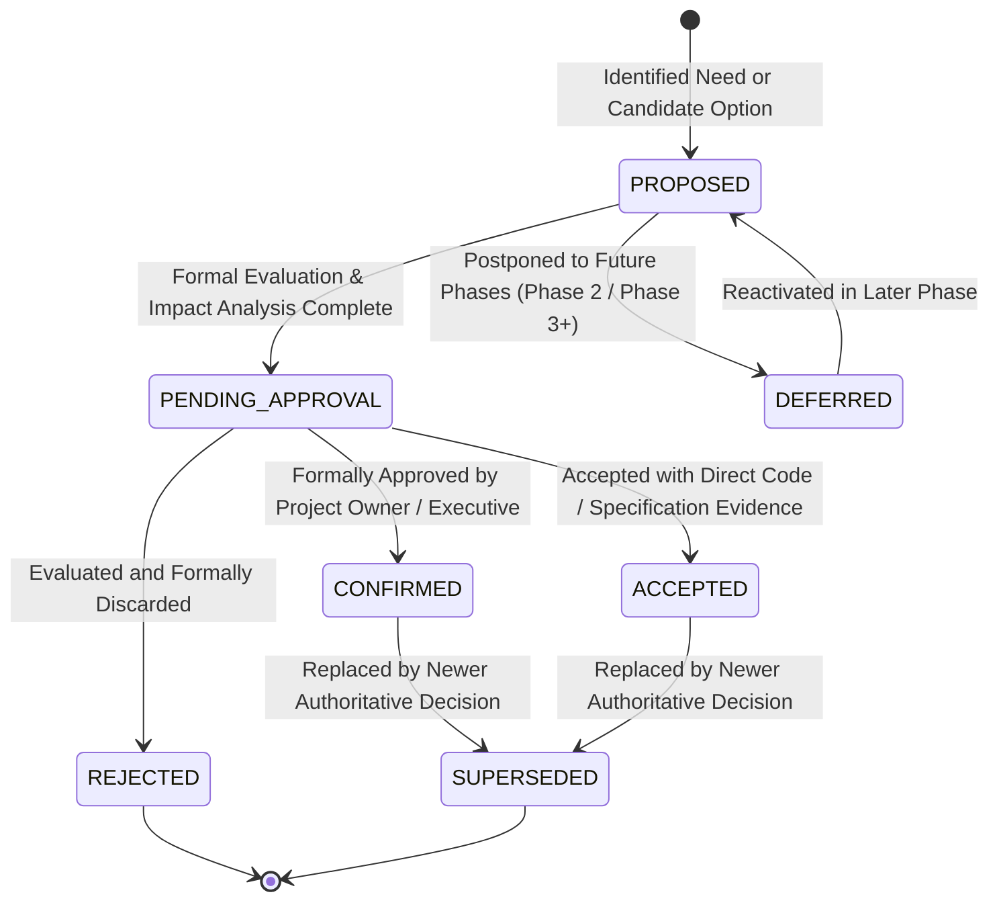
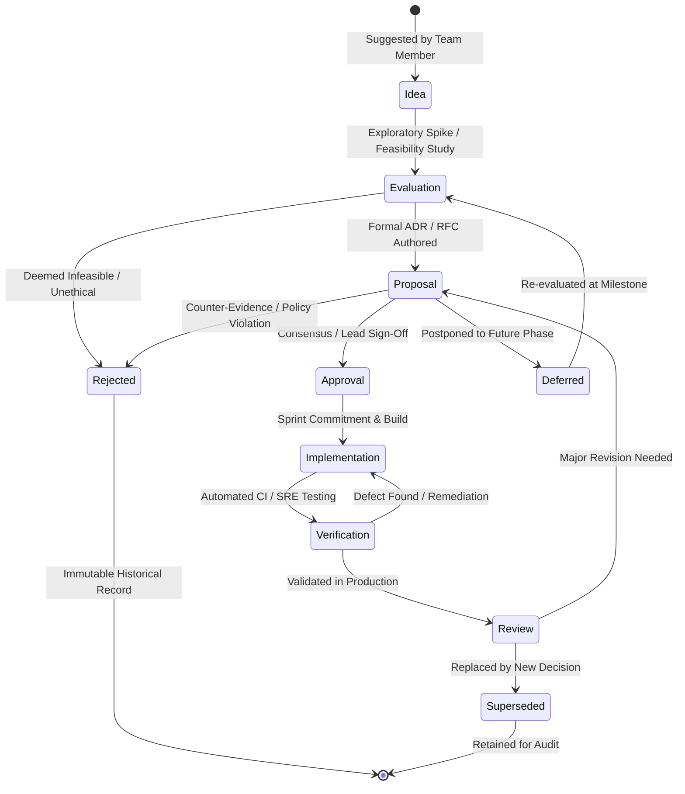

# Master Project Decision Register, Architectural Decisions & System Governance Log
## Project: BREAKING NEWS WALA (ब्रेकिंग न्यूज़ वाला)
### Document ID: DOC-35-DEC-2026-V1.0
### Confidentiality: Authoritative Architecture, Product Governance & System Decision Registry

---

## 1. Document Information & Governance Status

### 1.1 Governance Metadata

| Attribute | Specification Details |
| :--- | :--- |
| **Document Title** | Master Project Decision Register, Architectural Decisions & System Governance Log |
| **Document ID** | `DOC-35-DEC-2026-V1.0` |
| **Baseline Version** | `1.0.0` |
| **Document Status** | **Authoritative Governance Baseline & Master Decision Registry** |
| **Creation Date** | October 31, 2026 |
| **Target System Scope** | Universal Architecture Registry spanning Public Web Portal, Reporter Web Application, Central Newsroom Desk, Admin Control Panel, Shared Core Backend API, PostgreSQL Database, Redis Caching & Queues, AI Agent Fleet, Prompt Library, Model Context Protocol (MCP), Cloud Storage, Media Studios, Push Notification Engine, Commercial Monetization Engine, and Future Native Android Mobile Application |
| **Primary Authors** | Enterprise Solutions Architect, Lead Release Manager, Head of Product, Principal SRE Architect |
| **Approved By** | Chief Executive Officer, Chief Technology Officer, Chief Editorial Officer, Lead Legal Counsel |
| **Predecessor Dependencies** | [`docs/01-PRD.md`](file:///c:/Users/pp/Downloads/BREAKING-NEWS-WALA-main/docs/01-PRD.md), [`docs/02-Features.md`](file:///c:/Users/pp/Downloads/BREAKING-NEWS-WALA-main/docs/02-Features.md), [`docs/03-Plan.md`](file:///c:/Users/pp/Downloads/BREAKING-NEWS-WALA-main/docs/03-Plan.md), [`docs/04-NFR.md`](file:///c:/Users/pp/Downloads/BREAKING-NEWS-WALA-main/docs/04-NFR.md), [`docs/05-Workflows.md`](file:///c:/Users/pp/Downloads/BREAKING-NEWS-WALA-main/docs/05-Workflows.md), [`docs/06-Business-Rules.md`](file:///c:/Users/pp/Downloads/BREAKING-NEWS-WALA-main/docs/06-Business-Rules.md), [`docs/07-Design.md`](file:///c:/Users/pp/Downloads/BREAKING-NEWS-WALA-main/docs/07-Design.md), [`docs/08-Sitemap.md`](file:///c:/Users/pp/Downloads/BREAKING-NEWS-WALA-main/docs/08-Sitemap.md), [`docs/09-Components.md`](file:///c:/Users/pp/Downloads/BREAKING-NEWS-WALA-main/docs/09-Components.md), [`docs/10-Responsive-Design.md`](file:///c:/Users/pp/Downloads/BREAKING-NEWS-WALA-main/docs/10-Responsive-Design.md), [`docs/11-Architecture.md`](file:///c:/Users/pp/Downloads/BREAKING-NEWS-WALA-main/docs/11-Architecture.md), [`docs/12-Database.md`](file:///c:/Users/pp/Downloads/BREAKING-NEWS-WALA-main/docs/12-Database.md), [`docs/13-API.md`](file:///c:/Users/pp/Downloads/BREAKING-NEWS-WALA-main/docs/13-API.md), [`docs/14-Auth.md`](file:///c:/Users/pp/Downloads/BREAKING-NEWS-WALA-main/docs/14-Auth.md), [`docs/15-Security.md`](file:///c:/Users/pp/Downloads/BREAKING-NEWS-WALA-main/docs/15-Security.md), [`docs/16-Storage.md`](file:///c:/Users/pp/Downloads/BREAKING-NEWS-WALA-main/docs/16-Storage.md), [`docs/17-Agents.md`](file:///c:/Users/pp/Downloads/BREAKING-NEWS-WALA-main/docs/17-Agents.md), [`docs/18-MCP.md`](file:///c:/Users/pp/Downloads/BREAKING-NEWS-WALA-main/docs/18-MCP.md), [`docs/19-API-Pool.md`](file:///c:/Users/pp/Downloads/BREAKING-NEWS-WALA-main/docs/19-API-Pool.md), [`docs/20-Integrations.md`](file:///c:/Users/pp/Downloads/BREAKING-NEWS-WALA-main/docs/20-Integrations.md), [`docs/21-Prompts.md`](file:///c:/Users/pp/Downloads/BREAKING-NEWS-WALA-main/docs/21-Prompts.md), [`docs/22-Setup.md`](file:///c:/Users/pp/Downloads/BREAKING-NEWS-WALA-main/docs/22-Setup.md), [`docs/23-README.md`](file:///c:/Users/pp/Downloads/BREAKING-NEWS-WALA-main/docs/23-README.md), [`docs/24-Deployment.md`](file:///c:/Users/pp/Downloads/BREAKING-NEWS-WALA-main/docs/24-Deployment.md), [`docs/25-Environment.md`](file:///c:/Users/pp/Downloads/BREAKING-NEWS-WALA-main/docs/25-Environment.md), [`docs/26-Testing.md`](file:///c:/Users/pp/Downloads/BREAKING-NEWS-WALA-main/docs/26-Testing.md), [`docs/27-Debugging.md`](file:///c:/Users/pp/Downloads/BREAKING-NEWS-WALA-main/docs/27-Debugging.md), [`docs/28-Contributing.md`](file:///c:/Users/pp/Downloads/BREAKING-NEWS-WALA-main/docs/28-Contributing.md), [`docs/SEO.md`](file:///c:/Users/pp/Downloads/BREAKING-NEWS-WALA-main/docs/SEO.md), [`docs/Editorial-Policy.md`](file:///c:/Users/pp/Downloads/BREAKING-NEWS-WALA-main/docs/Editorial-Policy.md), [`docs/Analytics.md`](file:///c:/Users/pp/Downloads/BREAKING-NEWS-WALA-main/docs/Analytics.md), [`docs/Monetization.md`](file:///c:/Users/pp/Downloads/BREAKING-NEWS-WALA-main/docs/Monetization.md), [`docs/Monitoring.md`](file:///c:/Users/pp/Downloads/BREAKING-NEWS-WALA-main/docs/Monitoring.md), [`docs/CHANGELOG.md`](file:///c:/Users/pp/Downloads/BREAKING-NEWS-WALA-main/docs/CHANGELOG.md) |
| **Downstream Dependencies** | Root `AGENTS.md`, Engineering Sprints, Architecture Governance Audits |
| **Canonical Target Path** | `docs/DECISIONS.md` |

---

## 2. Document Objective & Central Governance Strategy

### 2.1 Strategic Objective
The objective of this Master Decision Register is to establish a permanent, centralized, and traceable record of all major product, architecture, engineering, security, editorial, commercial, and operational decisions governing **BREAKING NEWS WALA (ब्रेकिंग न्यूज़ वाला)**.

In complex, multi-phase software engineering endeavors, projects frequently suffer from **architectural drift, assumption creep, and unverified informal consensus**. Engineers may treat an exploratory diagram as an approved requirement, confuse an unpriced vendor proposal with a confirmed contract, or build features based on obsolete planning drafts. 

This Master Decision Register acts as the definitive court of record. It bridges all specialized domain Architectural Decision Records (ADRs), verifies explicit approval provenance, exposes cross-document contradictions, and guarantees that:
1. **A suggestion is never mistaken for an approved requirement.**
2. **A candidate technology mentioned in an architectural diagram is not assumed to be procured or approved.**
3. **Unresolved trade-offs are explicitly surfaced as `Pending Approval` or `Proposed` rather than silently buried.**

---

## 3. Decision Status Framework & Semantic Governance

Every decision recorded in this registry is governed by a strict, unambiguous status state machine:



### 3.1 Strict Semantic Definitions

| Status | Exact Governance Meaning | Operational Grounding Rule |
| :--- | :--- | :--- |
| **`Confirmed`** | Explicitly approved and mandated by the project owner, executive leadership, or authoritative baseline specifications (`docs/01-PRD.md`, `docs/06-Business-Rules.md`). | Binding architecture requirement. |
| **`Accepted`** | Formally accepted after technical evaluation, verified by concrete implementation evidence in the repository codebase. | Verified code / schema reality. |
| **`Proposed`** | Recommended technical option, design pattern, or tool awaiting formal stakeholder review. | Scaffolding permitted, but not locked. |
| **`Pending Approval`** | Architectural decision requiring an explicit executive, legal, financial, or editorial sign-off before operational activation. | **Strictly gated:** Implementation must not proceed without formal sign-off. |
| **`Deferred`** | Acknowledged as a valid commercial or technical opportunity, but deliberately postponed to subsequent project phases (e.g., Phase 2 or Phase 3+). | Out of scope for immediate MVP. |
| **`Rejected`** | Explicitly evaluated and rejected due to ethical, security, financial, or architectural hazards. | **Strictly barred:** Re-proposal requires fresh executive justification. |
| **`Superseded`** | A previously valid decision that has been formally replaced, retired, or updated by a later approved decision. | Preserved in log for historical auditability. |

---

## 4. Decision Identification System & Relationship to Domain ADRs

### 4.1 Global Decision Identification Standard
All master decisions in this registry carry a unique, sequential identifier:
- **Identifier Syntax:** `DEC-XXX` (where `XXX` is a three-digit integer, e.g., `DEC-001`, `DEC-014`).

### 4.2 Relationship Between Master Decisions (`DEC-XXX`) and Domain ADRs
Across the BREAKING NEWS WALA documentation suite, individual domain specifications maintain specialized Architectural Decision Records (ADRs):
- `ADR-ARCH-XXX` in `docs/11-Architecture.md` (System Architecture)
- `ADR-AUT-XXX` in `docs/14-Auth.md` (Identity & Authorization)
- `ADR-SEC-XXX` in `docs/15-Security.md` (Perimeter & Data Security)
- `ADR-AGT-XXX` in `docs/17-Agents.md` (AI Agent Fleet)
- `ADR-MCP-XXX` in `docs/18-MCP.md` (Model Context Protocol)
- `ADR-POOL-XXX` in `docs/19-API-Pool.md` (Multi-Provider API Pool)
- `ADR-INT-XXX` in `docs/20-Integrations.md` (Third-Party Integrations)
- `ADR-PRM-XXX` in `docs/21-Prompts.md` (Prompt Library)
- `ADR-DEP-XXX` in `docs/24-Deployment.md` (Deployment & Infrastructure)
- `ADR-TST-XXX` in `docs/26-Testing.md` (Quality Assurance)
- `ADR-SEO-XXX` in `docs/SEO.md` (Search Engine Optimization)
- `ADR-EDT-XXX` in `docs/Editorial-Policy.md` (Newsroom Standards)
- `ADR-ANA-XXX` in `docs/Analytics.md` (Telemetry & Data Governance)
- `ADR-MON-XXX` in `docs/Monetization.md` (Commercial & Advertising)
- `ADR-MONIT-XXX` in `docs/Monitoring.md` (SRE Observability)
- `ADR-CHG-XXX` in `docs/CHANGELOG.md` (Release Governance)

**The Master Decision Register (`docs/DECISIONS.md`) does not replace or duplicate every line of specialized ADRs.** Instead, it acts as the supreme corporate registry that consolidates, indexes, and resolves conflicts across all domain ADRs, establishing universal project-wide governance.


---

## 5. Product & Platform Strategy Decisions (DEC-001 to DEC-008)

This section registers the core product positioning, multi-surface delivery priorities, platform boundaries, and regional user experience architecture governing the BREAKING NEWS WALA ecosystem.

---

### DEC-001: Web-First Priority with Phased Native Android App Deployment

| Attribute | Specification Details |
| :--- | :--- |
| **Decision ID** | `DEC-001` |
| **Category** | Product & Platform Strategy |
| **Status** | **Confirmed** |
| **Approval Evidence** | `docs/01-PRD.md` (Section 3.1), `docs/03-Plan.md` (Phase 1 vs Phase 3), `docs/06-Business-Rules.md` (BR-PROD-01) |
| **Related Documents** | `docs/01-PRD.md`, `docs/02-Features.md`, `docs/03-Plan.md`, `docs/08-Sitemap.md`, `docs/10-Responsive-Design.md` |
| **Last Reviewed** | 2026-10-31 |

#### Context & Problem Statement
The target audience of BREAKING NEWS WALA comprises readers and reporters across urban centers (Bhopal, Indore, Gwalior, Jabalpur) and deep rural districts of Madhya Pradesh where network conditions vary widely from high-speed 5G to spotty 2G/3G connections. The newsroom requires rapid time-to-market to establish the brand and onboard field reporters without forcing users to download an app before reading their first breaking news alert.

#### Decision
Prioritize the responsive Web ecosystem (Public Portal, Reporter Web Portal, and Admin Control Panel) for initial development and public launch (Phase 1 and Phase 2). Defer the native Android mobile application to Phase 3. The Web platform must be fully mobile-optimized, lightning-fast, and installable as a Progressive Web App (PWA).

#### Rationale & Technical Grounding
1. **Zero-Friction Discovery**: Web URLs shared via WhatsApp, Telegram, and Facebook open instantly in any mobile browser without requiring app store installation.
2. **Resource Efficiency**: Building and stabilizing the core API engine, database schemas, and editorial workflows on the web prevents dual-platform fragmentation during early development.
3. **PWA Bridging**: Service workers, offline caching of read stories, and web push notifications provide 80% of native app convenience at zero app store tax or approval delay.

#### Consequences & Operational Impact
- **Positive**: Instant audience reach across Madhya Pradesh; single unified frontend deployment cycle for public web and reporter intake.
- **Negative**: Native OS device features (background geofencing, hardware audio capture controls) are limited until Phase 3 native app rollout.

#### Risks & Mitigations
- *Risk*: Competitors with native apps may claim superior mobile presence.
- *Mitigation*: Deliver sub-second page loads (<1.5s LCP on 4G) and prominent "Add to Home Screen" prompts for PWA installation.

---

### DEC-002: Native Android Built with Pure Kotlin and Jetpack Compose (Rejecting Hybrid/Flutter)

| Attribute | Specification Details |
| :--- | :--- |
| **Decision ID** | `DEC-002` |
| **Category** | Product & Platform Strategy |
| **Status** | **Confirmed** |
| **Approval Evidence** | `docs/11-Architecture.md` (Section 4.3), `docs/13-API.md` (Mobile Integration), `docs/25-Environment.md` |
| **Related Documents** | `docs/01-PRD.md`, `docs/11-Architecture.md`, `docs/13-API.md`, `docs/14-Auth.md`, `docs/25-Environment.md` |
| **Last Reviewed** | 2026-10-31 |

#### Context & Problem Statement
When Phase 3 commences, the platform requires a dedicated Android application for power readers and ground reporters. Architectural evaluation was required between cross-platform frameworks (Flutter, React Native), hybrid webview containers (Capacitor/Cordova), and pure native development.

#### Decision
Mandate **Pure Native Android development using 100% Kotlin, Jetpack Compose, Kotlin Coroutines/Flow, and Android Jetpack Architecture Components** (ViewModel, Room, WorkManager, Navigation Compose). Strictly reject hybrid webview shells and cross-platform abstractions (Flutter/React Native).

#### Rationale & Technical Grounding
1. **Performance on Low-Tier Devices**: Rural reporters and readers in Tier-3/Tier-4 MP towns frequently use low-end Android smartphones (2GB-3GB RAM). Native Jetpack Compose bytecode delivers superior memory efficiency, 60fps scrolling, and zero JavaScript-bridge overhead.
2. **Reliable Background Services**: Field reporting requires guaranteed background media uploads, crash-resilient voice note recording, and instant push notification wake locks handled cleanly via Android WorkManager.
3. **Clean API Decoupling**: The native app consumes the identical RESTful API contracts (`/api/v1/`) utilized by the web portals, enforcing clean backend modularity.

#### Consequences & Operational Impact
- **Positive**: Flawless hardware integration (camera, microphone, GPS, biometric auth), native Devanagari font rendering, and zero hybrid framework churn.
- **Negative**: Requires specialized Android/Kotlin engineering skills separate from the web React team.

#### Risks & Mitigations
- *Risk*: Code duplication between web and Android UI logic.
- *Mitigation*: Share data models, business rules, and validation logic through strictly specified OpenAPI contracts and TypeScript/Kotlin parity specifications.

---

### DEC-003: Single Shared Central Backend and Database Architecture for All Surfaces

| Attribute | Specification Details |
| :--- | :--- |
| **Decision ID** | `DEC-003` |
| **Category** | System Architecture |
| **Status** | **Confirmed** |
| **Approval Evidence** | `docs/01-PRD.md` (Section 3.2), `docs/11-Architecture.md` (Section 2.1), `docs/12-Database.md` |
| **Related Documents** | `docs/01-PRD.md`, `docs/06-Business-Rules.md`, `docs/11-Architecture.md`, `docs/12-Database.md`, `docs/13-API.md` |
| **Last Reviewed** | 2026-10-31 |

#### Context & Problem Statement
The platform encompasses four operational client surfaces:
1. Public News Website (Desktop & Mobile Web)
2. Reporter Web Application
3. Central Admin & Newsroom Control Panel
4. Future Native Android Application (Phase 3)
A fundamental architectural choice was whether to maintain separate backends per frontend (BFF pattern) or a unified shared backend engine.

#### Decision
Standardize on a **single, unified shared central backend service (Node.js/Express) backed by a single canonical PostgreSQL database and Redis caching layer**. All surfaces must communicate with this central backend via standardized, authenticated, territory-aware RESTful APIs.

#### Rationale & Technical Grounding
1. **Single Source of Truth**: Breaking news updates, reporter drafts, editorial verifications, and viewer view counts must synchronize instantaneously across web, admin, and mobile clients without distributed event lag.
2. **Unified Security & Business Rules**: Security checks, rate limits, token authentication, and territorial editorial lockdowns are implemented once in the central backend middleware, eliminating vulnerability drift across surfaces.
3. **Operational Simplicity**: Lower hosting overhead, consolidated monitoring, simplified backup routines, and straightforward deployment pipelines suited for lean engineering teams.

#### Consequences & Operational Impact
- **Positive**: 100% data consistency, shared schema models, single authentication service, unified logging and audit trails.
- **Negative**: The central backend becomes a critical single point of failure that must be engineered with high availability, clustering, and health probes.

#### Risks & Mitigations
- *Risk*: Heavy public traffic spikes might degrade backend responsiveness for internal newsroom reporters and editors.
- *Mitigation*: Separate public read traffic via Cloudflare CDN caching and Redis caching; apply distinct rate-limiting tiers for public vs. staff API endpoints.

---

### DEC-004: Hindi-First Multilingual News Delivery (Devanagari Primary, English Secondary)

| Attribute | Specification Details |
| :--- | :--- |
| **Decision ID** | `DEC-004` |
| **Category** | Product & Content Strategy |
| **Status** | **Confirmed** |
| **Approval Evidence** | `docs/01-PRD.md` (Section 2.1), `docs/07-Design.md` (Section 4), `docs/08-Sitemap.md` |
| **Related Documents** | `docs/01-PRD.md`, `docs/02-Features.md`, `docs/07-Design.md`, `docs/21-Prompts.md`, `docs/SEO.md` |
| **Last Reviewed** | 2026-10-31 |

#### Context & Problem Statement
Madhya Pradesh has an overwhelming majority of Hindi-speaking residents (over 87%), yet digital news systems frequently treat vernacular languages as secondary localized translations of an English core, leading to unnatural syntax, font clipping, and poor regional engagement.

#### Decision
Architect BREAKING NEWS WALA as a **Hindi-first digital news platform**. Devanagari script is the primary publication, database collation, and editorial interface standard. English is supported as an optional secondary language for national headlines, technical terms, and administrative interfaces.

#### Rationale & Technical Grounding
1. **Audience Alignment**: Field reporters, local authorities, and grassroots readers communicate natively in Hindi and regional dialects (Malvi, Bundeli, Bagheli).
2. **Typography Engineering**: Devanagari typography requires dedicated line-height ratios (1.6 to 1.8), baseline alignment, and web font loading strategies (`Noto Sans Devanagari`, `Rozha One`) to prevent layout shifts.
3. **AI Prompt Optimization**: AI translation, summarization, and headline agents are instructed natively in Hindi to generate culturally authentic, grammatically sound regional journalism.

#### Consequences & Operational Impact
- **Positive**: Unmatched regional authenticity, high grassroots reader loyalty, organic local search dominance for Hindi queries.
- **Negative**: Slug generation and SEO URLs require dual handling (Devanagari Unicode transliteration vs. clean Romanized slugs).

#### Risks & Mitigations
- *Risk*: Legacy web crawlers or social preview bots may garble Devanagari URLs.
- *Mitigation*: Store Romanized transliterated slugs (e.g., `bhopal-metro-trial-run-shuru`) alongside Unicode titles for bulletproof OpenGraph previews.

---

### DEC-005: 5-Tier Regional News Hierarchy (State -> Division -> District -> Tehsil -> Block)

| Attribute | Specification Details |
| :--- | :--- |
| **Decision ID** | `DEC-005` |
| **Category** | Product & Content Strategy |
| **Status** | **Confirmed** |
| **Approval Evidence** | `docs/01-PRD.md` (Section 4.1), `docs/06-Business-Rules.md` (BR-GEO-01), `docs/12-Database.md` |
| **Related Documents** | `docs/01-PRD.md`, `docs/06-Business-Rules.md`, `docs/08-Sitemap.md`, `docs/12-Database.md`, `docs/13-API.md` |
| **Last Reviewed** | 2026-10-31 |

#### Context & Problem Statement
Generic national news portals lump all Madhya Pradesh news into a single "State" category. Hyperlocal journalism requires precise administrative tagging matching the real governance structure of Madhya Pradesh: 10 Administrative Divisions, 55 Districts, 428 Tehsils, and hundreds of development Blocks.

#### Decision
Enforce a mandatory **5-Tier Regional Geographic Hierarchy** in the database schema and editorial workflows:
`State (MP) -> Administrative Division (10) -> District (55) -> Tehsil -> Block / Gram Panchayat`.
Every regional news article must be tagged to at least one District and Division, with optional Tehsil and Block precision.

#### Rationale & Technical Grounding
1. **Hyperlocal Personalization**: Readers can pin their home district (e.g., "Sehore" or "Chhindwara") to receive localized news feeds and municipal alerts.
2. **Reporter Jurisdiction**: Field reporters are assigned specific territorial scopes, preventing territorial overreach and duplicate coverage.
3. **Targeted Monetization**: Local merchants in specific tehsils can purchase hyper-targeted classified and banner advertisements displayed only to readers viewing that territorial feed.

#### Consequences & Operational Impact
- **Positive**: Unrivaled local news depth; enables granular district-level sitemaps and localized search engine indexing.
- **Negative**: Requires rigorous administrative master data seeding and maintenance as government boundaries change.

#### Risks & Mitigations
- *Risk*: Database performance degradation when filtering articles across complex multi-tier geographic joins.
- *Mitigation*: Index `district_id` and `division_id` foreign keys; denormalize district slugs into article read caches.

---

### DEC-006: Dual Editorial Workflow (Standard Verification vs. Fast-Track for Vetted Reporters)

| Attribute | Specification Details |
| :--- | :--- |
| **Decision ID** | `DEC-006` |
| **Category** | Editorial Governance |
| **Status** | **Confirmed** |
| **Approval Evidence** | `docs/05-Workflows.md` (WF-02 vs WF-03), `docs/06-Business-Rules.md` (BR-EDT-04), `docs/Editorial-Policy.md` |
| **Related Documents** | `docs/05-Workflows.md`, `docs/06-Business-Rules.md`, `docs/14-Auth.md`, `docs/Editorial-Policy.md` |
| **Last Reviewed** | 2026-10-31 |

#### Context & Problem Statement
During critical breaking news events (accidents, natural disasters, election results), a traditional multi-tiered editorial sign-off creates publishing delays of 30-60 minutes, allowing competitor channels to break the news first. However, allowing unverified submissions risks publishing fake news, defamation, or unverified rumors.

#### Decision
Implement a **Dual-Path Editorial Publishing Architecture**:
1. **Standard Workflow**: Mandatory review pipeline (`Draft` -> `Submitted` -> `Under Review` -> `Verified` -> `Published`) requiring explicit approval by a Desk Editor or Chief Editor.
2. **Fast-Track Workflow**: Restricted to senior, vetted field reporters who have achieved "Trusted Reporter" status. Allows direct publication of breaking news exclusively tagged with a visual "Developing News" ticker banner and restricted strictly to their assigned geographic district.

#### Rationale & Technical Grounding
1. **Speed with Accountability**: Enables verified breaking news to reach readers in under 3 minutes while maintaining a full cryptographic audit trail linking the story to the specific reporter's ID and timestamp.
2. **Geographic Confinement**: A trusted reporter in Indore cannot fast-track a story in Bhopal; fast-track privileges are strictly locked to their authorized district jurisdiction.
3. **Post-Publication Review**: All fast-tracked articles are immediately placed in the Central Newsroom review queue with an urgent alert for retrospective editorial audit within 15 minutes.

#### Consequences & Operational Impact
- **Positive**: Exceptional breaking news agility; competitive edge over slow regional dailies.
- **Negative**: High editorial responsibility placed on trusted reporters; requires clear penalty protocols for any verified inaccuracies.

#### Risks & Mitigations
- *Risk*: Accidental or malicious publication of unverified rumors under the fast-track privilege.
- *Mitigation*: Two-strike rule: any verified violation of fact-checking immediately revokes trusted status and locks the account to mandatory pre-moderation.

---

### DEC-007: Reader Gamification with Non-Monetary Coin Rewards and Local Leaderboards

| Attribute | Specification Details |
| :--- | :--- |
| **Decision ID** | `DEC-007` |
| **Category** | Product & Reader Engagement |
| **Status** | **Confirmed** |
| **Approval Evidence** | `docs/01-PRD.md` (Section 5.3), `docs/06-Business-Rules.md` (BR-ENG-01 to BR-ENG-05), `docs/Monetization.md` |
| **Related Documents** | `docs/01-PRD.md`, `docs/06-Business-Rules.md`, `docs/12-Database.md`, `docs/Monetization.md` |
| **Last Reviewed** | 2026-10-31 |

#### Context & Problem Statement
User retention in vernacular digital news is notoriously fickle, with readers bouncing across aggregator apps. The platform requires an engagement loop that incentivizes daily active reading, community commenting, and authentic news sharing without creating financial liability or gambling regulation exposure.

#### Decision
Deploy a **Non-Monetary Loyalty Ledger (Reader Coins)** governed by strict anti-fraud limits:
- Daily earning cap of 50 Coins per verified user.
- Points awarded for reading verified articles (>45s dwell time), posting moderated comments, and sharing breaking alerts.
- Coins redeemable exclusively for digital perks (ad-free reading passes, digital reader badges, entry into monthly brand merchandise giveaways).
- **Explicitly Reject and Defer**: Real-money cash payouts, UPI wallet cash transfers, or crypto-token conversions.

#### Rationale & Technical Grounding
1. **Regulatory Safety**: Avoids classification as a prize competition, real-money game, or financial scheme under Indian consumer protection and gaming regulations.
2. **Anti-Bot Integrity**: Dwell-time enforcement, IP rate limits, and CAPTCHA gates prevent automated click-farming of rewards.
3. **Audience Loyalty**: Gamified local district leaderboards (e.g., "Top Reader in Gwalior") foster community pride and repeat visits.

#### Consequences & Operational Impact
- **Positive**: Measurable increase in daily active users (DAU), longer session durations, and higher comment volume.
- **Negative**: Requires maintaining an immutable double-entry ledger table in PostgreSQL (`DOM-L: user_coin_transactions`).

#### Risks & Mitigations
- *Risk*: Exploitative script farming coins by opening articles in automated headless browsers.
- *Mitigation*: Coins only credit after client sends an encrypted telemetry heartbeat proving human scrolling and 45-second viewport dwell time.

---

### DEC-008: E-Paper Digital Edition with Interactive Clickable News Clipping

| Attribute | Specification Details |
| :--- | :--- |
| **Decision ID** | `DEC-008` |
| **Category** | Product & Editorial Surface |
| **Status** | **Confirmed** |
| **Approval Evidence** | `docs/01-PRD.md` (Section 4.3), `docs/08-Sitemap.md` (E-Paper Section), `docs/16-Storage.md` |
| **Related Documents** | `docs/01-PRD.md`, `docs/08-Sitemap.md`, `docs/09-Components.md`, `docs/16-Storage.md`, `docs/Monetization.md` |
| **Last Reviewed** | 2026-10-31 |

#### Context & Problem Statement
Traditional readers across Madhya Pradesh still maintain high brand affinity for the physical newspaper layout. Competitor digital e-papers merely host static, clunky PDF files that are hard to read on mobile screens and cannot be shared as individual news stories.

#### Decision
Build an **Interactive Multi-Edition E-Paper Reader**:
1. Daily PDF editions generated and split into high-resolution WebP page spreads stored in object storage.
2. Interactive SVG clipping overlay allowing readers to tap any specific news article box on the newspaper page.
3. One-click instant sharing of the cropped article snippet to WhatsApp with the BREAKING NEWS WALA watermarked header and direct web link.

#### Rationale & Technical Grounding
1. **Viral WhatsApp Distribution**: Regional users overwhelmingly share news clips on WhatsApp family and community groups; branded high-res snippets drive massive inbound referral traffic.
2. **Print-to-Digital Bridge**: Preserves the curated editorial hierarchy of traditional print journalism while delivering modern mobile zoom and clipping interactions.
3. **Monetization Real Estate**: Allows traditional full-page, half-page, and strip print advertisements to be replicated digitally with clickable merchant call-to-action overlays.

#### Consequences & Operational Impact
- **Positive**: High reader engagement among older demographic; premium sponsorship real estate for regional print advertisers.
- **Negative**: Daily page processing pipeline requires automated PDF parsing, image slicing, and coordinate mapping.

#### Risks & Mitigations
- *Risk*: Large PDF file sizes causing bandwidth spikes and slow loading on mobile devices.
- *Mitigation*: Serve multi-resolution WebP tiles on demand via Cloudflare CDN with responsive image `srcset` rendering.

---

## 6. System Architecture & Core Technology Stack Decisions (DEC-009 to DEC-016)

This section establishes the definitive system structure, server runtime, framework selections, and infrastructure components powering the backend and frontend engines.

---

### DEC-009: Modular Monolith Architecture with Domain-Driven Separation (Rejecting Microservices)

| Attribute | Specification Details |
| :--- | :--- |
| **Decision ID** | `DEC-009` |
| **Category** | System Architecture |
| **Status** | **Confirmed** |
| **Approval Evidence** | `docs/11-Architecture.md` (Section 1.2), `docs/03-Plan.md` |
| **Related Documents** | `docs/03-Plan.md`, `docs/11-Architecture.md`, `docs/12-Database.md`, `docs/13-API.md`, `docs/25-Environment.md` |
| **Last Reviewed** | 2026-10-31 |

#### Context & Problem Statement
The team evaluated distributed microservices architectures versus a modular monolith. In early-to-mid stage regional media platforms, premature microservices introduction creates crippling operational overhead, network latency, distributed transaction complexities, and severe DevOps friction for small engineering teams.

#### Decision
Adopt a **Clean Modular Monolith Architecture** with strict Domain-Driven boundaries (`src/modules/articles`, `src/modules/auth`, `src/modules/editorial`, `src/modules/ai`, `src/modules/notifications`). Explicitly reject distributed microservices for Phase 1 and Phase 2.

#### Rationale & Technical Grounding
1. **Low Operational Friction**: Single deployment pipeline, shared memory bus for high-speed module calls, and consolidated logging without distributed tracing overhead.
2. **ACID Guarantees**: Complex multi-table transactions (e.g., publishing an article, updating reporter stats, and logging audit trails) execute within atomic database transactions without distributed saga orchestrators.
3. **Future Microservices Ready**: Strict modular folder encapsulation ensures that if a specific module (such as the AI agent worker or video rendering pipeline) requires independent scaling, it can be extracted cleanly into an independent microservice in Phase 3.

#### Consequences & Operational Impact
- **Positive**: Rapid feature velocity, shared TypeScript types between modules, zero network RPC latency between domain services.
- **Negative**: Poorly disciplined developers could create cross-module circular dependencies if module boundaries are not strictly guarded by ESLint rules.

#### Risks & Mitigations
- *Risk*: Monolithic codebase becoming an entangled "big ball of mud".
- *Mitigation*: Enforce boundary linting rules forbidding modules from querying other modules' internal database tables directly; all cross-domain communication must use exposed service contracts.

---

### DEC-010: Next.js App Router for Public Web Frontend (SSR/SSG Hybrid)

| Attribute | Specification Details |
| :--- | :--- |
| **Decision ID** | `DEC-010` |
| **Category** | Frontend Architecture |
| **Status** | **Confirmed** |
| **Approval Evidence** | `docs/01-PRD.md` (Section 3.2), `docs/11-Architecture.md` (Section 3.1), `docs/SEO.md` |
| **Related Documents** | `docs/01-PRD.md`, `docs/07-Design.md`, `docs/09-Components.md`, `docs/11-Architecture.md`, `docs/SEO.md` |
| **Last Reviewed** | 2026-10-31 |

#### Context & Problem Statement
The public news portal demands flawless search engine optimization (SEO), sub-second Largest Contentful Paint (LCP), rich OpenGraph social share previews for WhatsApp, and dynamic live updates for breaking news tickers. Single Page Applications (pure client-side React) suffer from slow initial loads on budget devices and poor crawler indexing.

#### Decision
Deploy **Next.js (App Router, React 19, Server Components)** for the public-facing news portal:
- **Server-Side Rendering (SSR)** for dynamic breaking news, live event blogs, and localized district landing pages.
- **Incremental Static Regeneration (ISR)** for evergreen categories, static policy pages, and archived articles.
- **React Server Components (RSC)** to ship zero unnecessary JavaScript to mobile client browsers.

#### Rationale & Technical Grounding
1. **Core Web Vitals Excellence**: Server-rendered HTML delivers instantaneous first-paint content to readers on low-bandwidth 4G connections.
2. **Search Engine Dominance**: Automated pre-rendering of Schema.org `NewsArticle` JSON-LD metadata guarantees rapid Google News and Google Discover ingestion.
3. **WhatsApp Social Scraping**: Server pre-renders dynamic OpenGraph meta tags, ensuring breaking news thumbnails display crisply when shared on social channels.

#### Consequences & Operational Impact
- **Positive**: Superior SEO ranking, minimal client-side bundle size, seamless image optimization via `next/image`.
- **Negative**: Requires Node.js server hosting environments rather than cheap static S3 bucket hosting.

#### Risks & Mitigations
- *Risk*: SSR server CPU saturation during extreme viral traffic spikes.
- *Mitigation*: Front Next.js with Cloudflare Edge Cache; cache pre-rendered HTML pages at the edge with a 60-second stale-while-revalidate policy.

---

### DEC-011: Node.js and Express for Shared Central Backend API Engine

| Attribute | Specification Details |
| :--- | :--- |
| **Decision ID** | `DEC-011` |
| **Category** | Backend Architecture |
| **Status** | **Confirmed** |
| **Approval Evidence** | `docs/11-Architecture.md` (Section 3.2), `docs/13-API.md`, `BREAKING-NEWS-WALA-main/package.json` |
| **Related Documents** | `docs/11-Architecture.md`, `docs/12-Database.md`, `docs/13-API.md`, `docs/14-Auth.md`, `docs/25-Environment.md` |
| **Last Reviewed** | 2026-10-31 |

#### Context & Problem Statement
The shared central backend API handles high-concurrency read requests, field reporter uploads, background job orchestration, and editorial admin operations. Framework selection required evaluating Node.js/Express, NestJS, Go, and Python/FastAPI.

#### Decision
Standardize on **Node.js (LTS v20+) with Express and TypeScript** as the primary backend runtime engine for all shared API services.

#### Rationale & Technical Grounding
1. **Proven Production Maturity**: Express is battle-tested, lightweight, un-opinionated, and possesses the widest ecosystem of middleware for authentication, security headers, compression, and rate limiting.
2. **Unified Language Synergy**: Using TypeScript across both Next.js frontend and Node.js backend enables end-to-end type safety, shared validation schemas (Zod), and frictionless full-stack engineering.
3. **High Asynchronous I/O Throughput**: Node.js event-driven non-blocking I/O effortlessly handles thousands of concurrent news consumers, live SSE connections, and rapid Redis cache lookups.

#### Consequences & Operational Impact
- **Positive**: Massive developer talent pool, lightning-fast iteration speed, shared validation logic across frontend and backend.
- **Negative**: Single-threaded event loop requires careful avoidance of CPU-blocking tasks (e.g., image resizing or PDF parsing must be offloaded to worker processes).

#### Risks & Mitigations
- *Risk*: Heavy computations blocking the Node.js event loop.
- *Mitigation*: Delegate all CPU-intensive tasks (image compression, video clipping, AI batch processing) to BullMQ background worker threads.

---

### DEC-012: TypeScript as Mandatory Strict Language across Frontend, Backend, and Shared Types

| Attribute | Specification Details |
| :--- | :--- |
| **Decision ID** | `DEC-012` |
| **Category** | Code Quality & Engineering Standards |
| **Status** | **Confirmed** |
| **Approval Evidence** | `docs/11-Architecture.md` (Section 3.3), `docs/28-Contributing.md`, `package.json` |
| **Related Documents** | `docs/11-Architecture.md`, `docs/13-API.md`, `docs/26-Testing.md`, `docs/28-Contributing.md` |
| **Last Reviewed** | 2026-10-31 |

#### Context & Problem Statement
Large news platforms with multiple client surfaces, complex editorial status state machines, and numerous API endpoints are prone to runtime `TypeError: undefined is not a function` bugs when developed in dynamic, loosely-typed vanilla JavaScript.

#### Decision
Mandate **TypeScript with `strict: true` across all codebases** (Next.js public web, Reporter portal, Admin panel, and Express API backend). Explicitly forbid the use of `any` types in production code.

#### Rationale & Technical Grounding
1. **Compile-Time Defect Prevention**: Catches schema mismatches, null pointer exceptions, and missing parameters during local development and CI pipelines before code reaches production.
2. **Shared Contract Interfaces**: API response envelopes, error codes, user roles, and article status enums are defined once in a shared types package and consumed identically by backend controllers and frontend UI components.
3. **Self-Documenting Codebase**: Type definitions provide instant IDE autocomplete and documentation, accelerating onboarding for new software contributors.

#### Consequences & Operational Impact
- **Positive**: Drastic reduction in production runtime errors; refactoring large subsystems becomes safe and predictable.
- **Negative**: Slightly longer build times and initial learning curve for engineers accustomed to dynamic JavaScript.

#### Risks & Mitigations
- *Risk*: Developers using `// @ts-ignore` or `any` to bypass type checks.
- *Mitigation*: Enforce ESLint rules with `@typescript-eslint/no-explicit-any: error` enforced by pre-commit hooks and GitHub Actions CI.

---

### DEC-013: Tailwind CSS v4 and Lucide React Icons for Component Styling

| Attribute | Specification Details |
| :--- | :--- |
| **Decision ID** | `DEC-013` |
| **Category** | UI/UX & Component Architecture |
| **Status** | **Confirmed** |
| **Approval Evidence** | `docs/07-Design.md` (Section 2.1), `docs/09-Components.md`, `BREAKING-NEWS-WALA-main/package.json` |
| **Related Documents** | `docs/07-Design.md`, `docs/09-Components.md`, `docs/10-Responsive-Design.md`, `docs/11-Architecture.md` |
| **Last Reviewed** | 2026-10-31 |

#### Context & Problem Statement
News portals require highly consistent, responsive, and performance-tuned UI components across mobile, tablet, and desktop viewports. Traditional CSS stylesheets or CSS-in-JS runtimes (such as styled-components) introduce runtime JavaScript overhead, flash of unstyled content, and massive bundle bloat.

#### Decision
Adopt **Tailwind CSS v4 (with Vite/PostCSS engine) and Lucide React Icons** as the exclusive design token and styling framework across all web applications.

#### Rationale & Technical Grounding
1. **Zero Runtime Overhead**: Tailwind generates static, highly purged utility CSS at build time, resulting in tiny CSS bundle sizes (<15KB gzipped) ideal for rural mobile connections.
2. **Design Token Consistency**: Platform brand colors (News Yellow `#FDE900`, Alert Red `#ED1727`, Royal Blue `#344FD6`), font scales, and spacing units are codified in the Tailwind configuration, preventing visual drift.
3. **Tree-Shakeable Vector Icons**: Lucide React provides lightweight, accessible SVG icons that compile directly into JSX with zero external font asset requests.

#### Consequences & Operational Impact
- **Positive**: Rapid UI development, perfectly responsive utility classes, zero stylesheet dead code.
- **Negative**: Long class strings in JSX templates requiring disciplined component encapsulation.

#### Risks & Mitigations
- *Risk*: Inconsistent utility class usage across different team members.
- *Mitigation*: Enforce `prettier-plugin-tailwindcss` for automated class sorting and build shared UI atom components (`Button`, `Badge`, `Card`, `AlertBanner`).

---

### DEC-014: Redis for In-Memory Caching, Session Management, and Rate Limiting

| Attribute | Specification Details |
| :--- | :--- |
| **Decision ID** | `DEC-014` |
| **Category** | Caching & Performance Architecture |
| **Status** | **Confirmed** |
| **Approval Evidence** | `docs/11-Architecture.md` (Section 3.5), `docs/12-Database.md`, `docs/13-API.md`, `docs/25-Environment.md` |
| **Related Documents** | `docs/11-Architecture.md`, `docs/12-Database.md`, `docs/13-API.md`, `docs/15-Security.md`, `docs/25-Environment.md` |
| **Last Reviewed** | 2026-10-31 |

#### Context & Problem Statement
When high-profile breaking news occurs (e.g., major political announcements or natural emergencies in MP), public traffic can spike by 50x-100x within minutes. Querying the primary PostgreSQL database for every visitor hit would saturate connection pools and crash the database.

#### Decision
Deploy **Redis (v7+) as the universal in-memory data store** for:
1. High-speed caching of public API responses (breaking news ticker, top stories, district feeds).
2. Distributed user session state and JWT refresh token blocklists.
3. Sliding-window API rate limiting counters per IP and API key.
4. HyperLogLog counters for real-time article view de-duplication.

#### Rationale & Technical Grounding
1. **Sub-Millisecond Response**: Redis delivers cached JSON payloads in <2ms, shielding PostgreSQL from 95%+ of repetitive read queries.
2. **Atomic Rate Limiting**: Redis atomic increments (`INCR`) and expiry primitives provide race-condition-free rate limiting to deflect scrapers and DDoS floods.
3. **Pub/Sub Capabilities**: Built-in pub/sub enables instant cache invalidation signaling across clustered Node.js backend processes when an editor modifies an article.

#### Consequences & Operational Impact
- **Positive**: Massive horizontal scalability, resilient database protection, lightning-fast public response times.
- **Negative**: Requires memory monitoring, cache eviction policies (`volatile-lru`), and fallback logic when Redis is temporarily unreachable.

#### Risks & Mitigations
- *Risk*: Cache stampede / thundering herd problem when a popular article cache key expires during a traffic spike.
- *Mitigation*: Implement probabilistic early expiration (XFetch algorithm) and mutex locks so only one backend worker regenerates the cache.

---

### DEC-015: BullMQ for Asynchronous Background Processing, RSS Ingestion, and Media Queues

| Attribute | Specification Details |
| :--- | :--- |
| **Decision ID** | `DEC-015` |
| **Category** | Background Processing Architecture |
| **Status** | **Confirmed** |
| **Approval Evidence** | `docs/11-Architecture.md` (Section 3.6), `docs/17-Agents.md`, `docs/20-Integrations.md` |
| **Related Documents** | `docs/11-Architecture.md`, `docs/16-Storage.md`, `docs/17-Agents.md`, `docs/20-Integrations.md`, `docs/Monitoring.md` |
| **Last Reviewed** | 2026-10-31 |

#### Context & Problem Statement
The newsroom platform executes heavy background tasks: fetching and parsing dozens of external RSS feeds, orchestrating multi-step AI summarization agents, transcoding reporter video uploads, generating PDF e-paper clippings, and dispatching bulk FCM push notifications. Executing these within HTTP request-response cycles causes client timeouts and server crashes.

#### Decision
Deploy **BullMQ (backed by Redis) as the centralized distributed job queue engine** for all asynchronous background workloads. Configure distinct prioritized queues: `queue-breaking-alerts` (High Priority), `queue-media-processing` (Normal Priority), and `queue-rss-intake` (Low Priority).

#### Rationale & Technical Grounding
1. **Guaranteed Delivery & Retries**: BullMQ provides robust exponential backoff retries, dead-letter queues (DLQ), and persistent job progress tracking.
2. **Concurrency Control & Throttling**: Prevents external API rate-limit exhaustion when querying third-party LLMs or SMS gateways by strictly limiting concurrent job execution.
3. **Decoupled Worker Scaling**: Queue worker processes can run in separate container pods, scaling independently from user-facing HTTP web servers.

#### Consequences & Operational Impact
- **Positive**: Zero HTTP thread blocking, rock-solid job recovery after server restarts, full operational visibility into background task queues.
- **Negative**: Requires persistent Redis storage with Append-Only File (AOF) enabled to guarantee job durability across container crashes.

#### Risks & Mitigations
- *Risk*: Queue buildup causing delayed breaking news alerts if worker processes crash.
- *Mitigation*: Prometheus monitoring and alerting on queue latency and job backlog depth; automated worker auto-scaling.

---

### DEC-016: Cloudflare CDN and Edge WAF for DDoS Protection and Asset Caching

| Attribute | Specification Details |
| :--- | :--- |
| **Decision ID** | `DEC-016` |
| **Category** | Infrastructure & Edge Security |
| **Status** | **Confirmed** |
| **Approval Evidence** | `docs/11-Architecture.md` (Section 2.2), `docs/15-Security.md`, `docs/25-Environment.md` |
| **Related Documents** | `docs/04-NFR.md`, `docs/11-Architecture.md`, `docs/15-Security.md`, `docs/16-Storage.md`, `docs/Monitoring.md` |
| **Last Reviewed** | 2026-10-31 |

#### Context & Problem Statement
Regional news platforms in India are frequent targets of Layer-7 DDoS attacks, automated content scrapers, and malicious bot traffic. Additionally, serving heavy static assets (WebP images, e-paper spreads, video thumbnails) directly from origin servers saturates bandwidth and inflates hosting costs.

#### Decision
Route all platform traffic through **Cloudflare CDN and Edge Web Application Firewall (WAF)** as the public reverse proxy. Enable edge caching of static media, automatic TLS 1.3 termination, HTTP/3 protocol negotiation, Bot Management, and Layer-7 DDoS mitigation.

#### Rationale & Technical Grounding
1. **Edge Network Proximity**: Cloudflare operates edge data centers in central India (Mumbai, Delhi, Hyderabad), delivering cached assets to MP users in <15ms.
2. **Origin Shielding**: Origin web servers remain hidden behind Cloudflare Authenticated Origin Pulls, blocking direct IP attacks and port scans.
3. **Massive Bandwidth Savings**: Caches 80%+ of static media requests at the edge, reducing origin egress network costs to near zero.

#### Consequences & Operational Impact
- **Positive**: Unyielding DDoS resilience, lightning-fast edge asset delivery, automated SSL/TLS renewal.
- **Negative**: Requires disciplined cache-purging API calls when breaking news articles or e-paper pages are updated.

#### Risks & Mitigations
- *Risk*: Stale breaking news cached at the edge during rapid editorial revisions.
- *Mitigation*: Configure short `max-age=60, s-maxage=120, stale-while-revalidate=300` headers on news HTML pages, and implement automated Cloudflare Cache Purge API calls upon article publication.

---

## 7. Database, Caching & Data Storage Architecture Decisions (DEC-017 to DEC-024)

This section documents the relational schema structure, domain database segregation, persistence tooling, asset storage, and disaster recovery architecture.

---

### DEC-017: PostgreSQL as Single Canonical Relational Database with Domain Schemas (DOM-A to DOM-N)

| Attribute | Specification Details |
| :--- | :--- |
| **Decision ID** | `DEC-017` |
| **Category** | Database Architecture |
| **Status** | **Confirmed** |
| **Approval Evidence** | `docs/12-Database.md` (Section 1.1), `docs/11-Architecture.md` |
| **Related Documents** | `docs/06-Business-Rules.md`, `docs/11-Architecture.md`, `docs/12-Database.md`, `docs/15-Security.md` |
| **Last Reviewed** | 2026-10-31 |

#### Context & Problem Statement
A media platform requires complex relational modeling (articles, versions, authors, categories, geographic locations, tags, comments, audit logs, ad placements). NoSQL document stores (MongoDB) lack transactional referential integrity, while distributed databases (CockroachDB) introduce unwarranted operational complexity.

#### Decision
Standardize on **PostgreSQL (v16+) as the single canonical relational database**. Organize all database tables into **14 strictly segregated domain namespaces (DOM-A through DOM-N)** within the same PostgreSQL cluster:
- `DOM-A`: Identity, Users & Roles
- `DOM-B`: Geography & Territorial Administrative Units
- `DOM-C`: Categories, Tags & Taxonomies
- `DOM-D`: Articles, Revisions & Editorial Content
- `DOM-E`: Media Library & Asset Metadata
- `DOM-F`: Breaking News & Alert Tickers
- `DOM-G`: Live Event Coverage & Timelines
- `DOM-H`: E-Paper Editions & Pages
- `DOM-I`: AI Agents, Prompts & Inference Logs
- `DOM-J`: RSS Feeds & External News Intake
- `DOM-K`: User Engagement & Comment Moderation
- `DOM-L`: Gamification, Coins & Reader Loyalty
- `DOM-M`: Advertisements, Classifieds & Commercial Billing
- `DOM-N`: System Audit Trails & Security Logs

#### Rationale & Technical Grounding
1. **ACID Reliability**: Guaranteed transaction safety across editorial publishing workflows and monetary classified ad billing.
2. **Domain Cleanliness**: Schema prefixing/namespacing prevents naming collisions, clarifies ownership, and simplifies future microservice extraction if needed.
3. **Advanced Vernacular Indexing**: PostgreSQL supports native Devanagari full-text search indexing (`pg_trgm`, gin indexes) and JSONB columns for flexible agent payloads.

#### Consequences & Operational Impact
- **Positive**: Rock-solid data integrity, rich SQL querying, foreign key enforcement, comprehensive tooling ecosystem.
- **Negative**: Schema migrations must be planned carefully to avoid locking critical tables during high-traffic hours.

#### Risks & Mitigations
- *Risk*: Uncontrolled table bloat in audit log and analytics tables degrading relational performance.
- *Mitigation*: Partition high-volume tables (audit logs, view history) by month using native PostgreSQL table partitioning.

---

### DEC-018: Prisma ORM with Raw SQL Escape Hatches for High-Performance Queries

| Attribute | Specification Details |
| :--- | :--- |
| **Decision ID** | `DEC-018` |
| **Category** | Database Architecture |
| **Status** | **Confirmed** |
| **Approval Evidence** | `docs/11-Architecture.md` (Section 3.4), `docs/12-Database.md` |
| **Related Documents** | `docs/11-Architecture.md`, `docs/12-Database.md`, `docs/13-API.md`, `docs/26-Testing.md` |
| **Last Reviewed** | 2026-10-31 |

#### Context & Problem Statement
Engineering teams require rapid, type-safe database access and automated migration tooling. Pure raw SQL queries lead to string interpolation bugs and lack compile-time safety, whereas heavyweight traditional ORMs (TypeORM/Sequelize) suffer from opaque query generation and performance anti-patterns.

#### Decision
Adopt **Prisma ORM (v5+) as the primary database abstraction layer**, while explicitly permitting and standardizing on **Prisma Raw SQL escape hatches (`prisma.$queryRaw`) for complex geospatial joins, analytical aggregations, and high-frequency bulk writes**.

#### Rationale & Technical Grounding
1. **End-to-End Type Safety**: Prisma generates TypeScript interfaces directly from the `schema.prisma` model, ensuring any schema modification is instantly validated across the backend codebase.
2. **Declarative Migrations**: `prisma migrate` provides deterministic, version-controlled database migrations integrated into CI/CD pipelines.
3. **Performance Pragmatism**: Developers use standard Prisma syntax for CRUD operations, but immediately switch to optimized raw SQL for multi-table joins or bulk view-count flushes.

#### Consequences & Operational Impact
- **Positive**: High developer productivity, zero ORM mismatch bugs, strict migration tracking.
- **Negative**: Prisma Client engine adds a small memory footprint in Node.js processes.

#### Risks & Mitigations
- *Risk*: Developers writing un-parameterized raw SQL leading to SQL injection vulnerabilities.
- *Mitigation*: Enforce parameterized tagged template literals (`prisma.$queryRaw` `...`) and automated static security analysis.

---

### DEC-019: Multi-Tier Cache Invalidation with Redis Sentinel and Event-Driven Purging

| Attribute | Specification Details |
| :--- | :--- |
| **Decision ID** | `DEC-019` |
| **Category** | Caching Architecture |
| **Status** | **Confirmed** |
| **Approval Evidence** | `docs/11-Architecture.md` (Section 3.5), `docs/12-Database.md`, `docs/13-API.md` |
| **Related Documents** | `docs/06-Business-Rules.md`, `docs/11-Architecture.md`, `docs/12-Database.md`, `docs/13-API.md` |
| **Last Reviewed** | 2026-10-31 |

#### Context & Problem Statement
A news platform experiences frequent data mutations (breaking headlines updated, corrections appended, editorial revisions published). Stale cached content degrades journalistic credibility, while naive global cache flushing crashes the database under sudden traffic reload.

#### Decision
Implement a **Targeted, Event-Driven Multi-Tier Cache Invalidation Strategy**:
1. Every cached entity in Redis is tagged with a deterministic key pattern (e.g., `cache:article:{id}`, `cache:district:{district_id}:top`, `cache:ticker:breaking`).
2. When an article is published or revised, backend domain events trigger an automated targeted purge of exactly its related keys in Redis and call the Cloudflare API to purge edge caches for that URL.
3. Apply standard Time-To-Live (TTL) boundaries as safety fallbacks (60 seconds for breaking news ticker, 300 seconds for category feeds, 24 hours for archived stories).

#### Rationale & Technical Grounding
1. **Surgical Invalidation**: Eliminates stale news instantly without flushing unrelated caches (e.g., updating a sports score in Bhopal does not invalidate Gwalior district news).
2. **Graceful Degradation**: TTL fallbacks ensure that even if an invalidation event drops, stale data self-heals within minutes.
3. **Database Shielding**: 95%+ cache hit ratio maintained even during aggressive editorial publishing cycles.

#### Consequences & Operational Impact
- **Positive**: Millisecond content freshness paired with maximum database protection.
- **Negative**: Requires meticulous mapping of entity dependencies to ensure all related list caches are purged upon mutation.

#### Risks & Mitigations
- *Risk*: Forgotten secondary cache keys (e.g., author profile page) showing outdated article titles.
- *Mitigation*: Centralize cache key generation and invalidation logic into a single dedicated `CacheService` module.

---

### DEC-020: Object Storage for Media Assets via MinIO (Local) and S3/R2 (Production) with Presigned URLs

| Attribute | Specification Details |
| :--- | :--- |
| **Decision ID** | `DEC-020` |
| **Category** | Storage & Media Architecture |
| **Status** | **Confirmed** |
| **Approval Evidence** | `docs/16-Storage.md` (Section 2), `docs/11-Architecture.md`, `docs/25-Environment.md` |
| **Related Documents** | `docs/11-Architecture.md`, `docs/13-API.md`, `docs/15-Security.md`, `docs/16-Storage.md`, `docs/25-Environment.md` |
| **Last Reviewed** | 2026-10-31 |

#### Context & Problem Statement
Field reporters upload high-resolution photos, raw audio interviews, and video clips directly from their mobile phones. Storing media files on web application local disk storage prevents horizontal server scaling and exposes origin servers to disk exhaustion. Direct file streaming through backend application servers saturates Node.js network sockets.

#### Decision
Adopt **S3-Compatible Object Storage (MinIO for local development/staging; Cloudflare R2 / AWS S3 for production)**. Mandate that **all client media uploads use short-lived Presigned PUT URLs (15-minute expiry)** generated by the backend API.

#### Rationale & Technical Grounding
1. **Stateless Backend Scaling**: Origin servers remain 100% stateless; application containers can be spun up or destroyed without media persistence concerns.
2. **Zero Backend Network Bottleneck**: Large media files (e.g., 50MB video clips) upload directly from the reporter's browser or mobile app to the object storage bucket, bypassing the Node.js API server entirely.
3. **Zero Egress Fees with Cloudflare R2**: Using Cloudflare R2 in production completely eliminates outbound data transfer costs for serving images and e-paper pages.

#### Consequences & Operational Impact
- **Positive**: Infinite media scalability, high upload concurrency, zero bandwidth strain on API servers.
- **Negative**: Requires asynchronous webhooks or callback endpoints to notify the backend when a presigned upload completes.

#### Risks & Mitigations
- *Risk*: Abandoned presigned URLs leaving orphaned, unreferenced files in object storage.
- *Mitigation*: Configure object storage lifecycle rules to automatically purge unconfirmed uploads from the `temp/` bucket prefix after 24 hours.

---

### DEC-021: Read View Count De-duplication using Redis HyperLogLog and 30-Minute IP Window

| Attribute | Specification Details |
| :--- | :--- |
| **Decision ID** | `DEC-021` |
| **Category** | Analytics & Database Integrity |
| **Status** | **Confirmed** |
| **Approval Evidence** | `docs/06-Business-Rules.md` (BR-ENG-03), `docs/12-Database.md`, `docs/Analytics.md` |
| **Related Documents** | `docs/06-Business-Rules.md`, `docs/11-Architecture.md`, `docs/12-Database.md`, `docs/Analytics.md` |
| **Last Reviewed** | 2026-10-31 |

#### Context & Problem Statement
Article view counts are critical for editorial metrics, trending news ranking, and advertiser reporting. Naive systems execute `UPDATE articles SET view_count = view_count + 1` on every page hit, which causes massive row-locking contention in PostgreSQL and enables trivial view-count inflation by repeatedly refreshing the browser.

#### Decision
Enforce a **Two-Stage De-duplicated Read Metric Pipeline**:
1. On each article page load, compute a SHA-256 visitor fingerprint (`IP + User-Agent + ArticleID`).
2. Check Redis with a 30-minute sliding window key (`view_dedup:{fingerprint}`). If the key exists, ignore the hit. If absent, set the key with a 1800-second TTL and record the unique hit in a Redis HyperLogLog structure (`hll:article:{id}`).
3. A background BullMQ worker periodically flushes aggregated view counts from Redis to PostgreSQL every 5 minutes using atomic batch updates.

#### Rationale & Technical Grounding
1. **Zero Database Locking**: Relieves PostgreSQL from thousands of write queries per second during viral breaking news events.
2. **Bot & Refresh Immunity**: Prevents artificial view-count gaming by accidental or malicious rapid page refreshes.
3. **HyperLogLog Efficiency**: HyperLogLog counts millions of unique visitors with a fixed memory footprint of ~12KB per article and standard error rate under 1%.

#### Consequences & Operational Impact
- **Positive**: Highly accurate editorial metrics, rock-solid database stability, defensible view counts for advertisers.
- **Negative**: View counts in the UI reflect a 5-minute aggregation latency rather than instant real-time increments.

#### Risks & Mitigations
- *Risk*: Redis restart losing unflushed view counts.
- *Mitigation*: Run Redis with Append-Only File (AOF) persistence enabled and flush view batches to PostgreSQL every 5 minutes.

---

### DEC-022: Database Connection Pooling via PgBouncer with Strict Resource Limits

| Attribute | Specification Details |
| :--- | :--- |
| **Decision ID** | `DEC-022` |
| **Category** | Database Architecture |
| **Status** | **Confirmed** |
| **Approval Evidence** | `docs/11-Architecture.md` (Section 3.4), `docs/12-Database.md`, `docs/25-Environment.md` |
| **Related Documents** | `docs/04-NFR.md`, `docs/11-Architecture.md`, `docs/12-Database.md`, `docs/25-Environment.md` |
| **Last Reviewed** | 2026-10-31 |

#### Context & Problem Statement
Each connection to PostgreSQL allocates ~10MB of server RAM and spawns an independent backend process. Node.js backend clustering, background queue workers, and serverless edge functions can easily open hundreds of concurrent connections, exhausting PostgreSQL connection limits and crashing the database cluster.

#### Decision
Deploy **PgBouncer as a mandatory connection pooler** in front of PostgreSQL in Transaction Pooling Mode. Restrict direct PostgreSQL connections strictly to migration scripts and administrative maintenance.

#### Rationale & Technical Grounding
1. **Massive Connection Multiplexing**: PgBouncer allows thousands of client application connections to safely share a small, high-performance pool of 50-100 real PostgreSQL connections.
2. **Instant Connection Handshakes**: Eliminates PostgreSQL connection establishment latency for ephemeral backend processes.
3. **Resource Guardrails**: Enforces hard caps on database memory utilization, guaranteeing stability during traffic surges.

#### Consequences & Operational Impact
- **Positive**: Complete prevention of `FATAL: sorry, too many clients already` outages; predictable database RAM consumption.
- **Negative**: Transaction pooling mode restricts the use of certain session-level PostgreSQL features (such as `LISTEN/NOTIFY` or session-level advisory locks), which must be handled on dedicated direct connections.

#### Risks & Mitigations
- *Risk*: Background workers running long transactions holding pool connections too long.
- *Mitigation*: Configure `statement_timeout = 10000` (10s) and `idle_in_transaction_session_timeout = 5000` (5s) in PostgreSQL.

---

### DEC-023: Soft Deletion Architecture for Articles, Users, and Media with 30-Day Retention

| Attribute | Specification Details |
| :--- | :--- |
| **Decision ID** | `DEC-023` |
| **Category** | Data Integrity & Legal Governance |
| **Status** | **Confirmed** |
| **Approval Evidence** | `docs/06-Business-Rules.md` (BR-SYS-04), `docs/12-Database.md`, `docs/Editorial-Policy.md` |
| **Related Documents** | `docs/06-Business-Rules.md`, `docs/12-Database.md`, `docs/15-Security.md`, `docs/Editorial-Policy.md` |
| **Last Reviewed** | 2026-10-31 |

#### Context & Problem Statement
Accidental deletion of published news articles, reporter drafts, or editorial comments causes irreversible data loss, broken public URLs, and legal liabilities. Journalistic compliance and defamation defense require retaining full historical records of what was published and when.

#### Decision
Enforce a **Universal Soft Deletion Pattern** across primary database entities:
1. Core tables (`articles`, `users`, `comments`, `media_items`) include `deleted_at TIMESTAMPTZ NULL` and `deleted_by UUID NULL` columns.
2. Standard queries automatically filter `WHERE deleted_at IS NULL`.
3. Deleted records remain recoverable in the database for 30 days before automated hard-purge cleanup, except when legally required for indefinite retention under legal hold or litigation notices.

#### Rationale & Technical Grounding
1. **Accidental Loss Reversal**: Desk editors can instantaneously restore accidentally deleted breaking stories or reporter submissions.
2. **Defamation Defense & Legal Evidence**: If an article is retracted due to legal notice, the historical record, original text, and editorial modification audit trails remain intact for court submission.
3. **Referential Integrity**: Prevents cascading foreign key deletion errors across relational tables.

#### Consequences & Operational Impact
- **Positive**: Complete disaster recovery safety net; zero accidental data destruction.
- **Negative**: Database queries must consistently include soft-delete filters, and unique constraints must account for deleted records.

#### Risks & Mitigations
- *Risk*: Forgetting to filter out soft-deleted records in complex custom SQL queries.
- *Mitigation*: Encapsulate soft-delete filtering in Prisma middleware and repository abstraction functions.

---

### DEC-024: Automated Database Backups with Point-in-Time Recovery (PITR) and Geo-Replication

| Attribute | Specification Details |
| :--- | :--- |
| **Decision ID** | `DEC-024` |
| **Category** | Disaster Recovery & Business Continuity |
| **Status** | **Confirmed** |
| **Approval Evidence** | `docs/04-NFR.md` (Section 3.2), `docs/11-Architecture.md`, `docs/25-Environment.md` |
| **Related Documents** | `docs/04-NFR.md`, `docs/11-Architecture.md`, `docs/12-Database.md`, `docs/25-Environment.md`, `docs/Monitoring.md` |
| **Last Reviewed** | 2026-10-31 |

#### Context & Problem Statement
Catastrophic hardware failure, data center outages, or ransomware attacks could permanently destroy months of investigative reporting, reporter directories, and user account ledgers if robust disaster recovery is absent.

#### Decision
Implement a **Multi-Layered Disaster Recovery Architecture**:
1. Daily full automated PostgreSQL database dumps executed at 03:00 IST and streamed to an isolated, encrypted, geo-redundant cold storage bucket.
2. Continuous PostgreSQL Write-Ahead Log (WAL) archiving enabling **Point-in-Time Recovery (PITR)** with a target Recovery Point Objective (RPO) of <15 minutes.
3. Target Recovery Time Objective (RTO) of <2 hours for full platform restoration.
4. Mandatory quarterly automated restore drill to test database reconstructibility.

#### Rationale & Technical Grounding
1. **Ransomware Isolation**: Cold storage backup buckets utilize Object Lock (WORM - Write Once, Read Many) with separate IAM credentials, preventing compromised servers from deleting backups.
2. **Precise Recovery**: PITR allows rolling back database state to the exact second prior to an accidental data corruption or botched schema migration.
3. **Business Continuity**: Guarantees journalistic and operational survival even in the event of complete data center destruction.

#### Consequences & Operational Impact
- **Positive**: Enterprise-grade business continuity; defensible compliance for commercial advertisers and institutional partners.
- **Negative**: Modest cloud storage overhead for retaining 30 days of WAL archives and full dumps.

#### Risks & Mitigations
- *Risk*: Backups silently failing and failing to restore during an actual emergency.
- *Mitigation*: Automated health check monitoring that alerts on missing daily backups, paired with automated monthly test restorations in an isolated staging sandbox.


---

## 8. API Design, Communication Protocols & External Service Decisions (DEC-025 to DEC-032)

This section registers the communication contracts, data interchange formats, protocol selections, rate-limiting frameworks, and third-party external service adapters powering the platform.

---

### DEC-025: RESTful API Architecture with Semantic HTTP Methods and Strict Status Codes (Rejecting GraphQL)

| Attribute | Specification Details |
| :--- | :--- |
| **Decision ID** | `DEC-025` |
| **Category** | API & Integration Architecture |
| **Status** | **Confirmed** |
| **Approval Evidence** | `docs/13-API.md` (Section 1.1), `docs/11-Architecture.md` |
| **Related Documents** | `docs/11-Architecture.md`, `docs/13-API.md`, `docs/14-Auth.md`, `docs/26-Testing.md` |
| **Last Reviewed** | 2026-10-31 |

#### Context & Problem Statement
The central backend provides APIs for public web readers, field reporters on mobile browsers, newsroom desktop operators, and the future native Android mobile application. Architectural evaluation was required between REST, GraphQL, and gRPC.

#### Decision
Adopt **RESTful API Architecture utilizing semantic HTTP verbs** (`GET`, `POST`, `PUT`, `PATCH`, `DELETE`) and standard RFC HTTP response status codes (`200 OK`, `201 Created`, `400 Bad Request`, `401 Unauthorized`, `403 Forbidden`, `404 Not Found`, `429 Too Many Requests`, `500 Internal Server Error`). Explicitly reject GraphQL and gRPC for client-facing communications.

#### Rationale & Technical Grounding
1. **Edge CDN Caching**: REST endpoints are effortlessly cached by Cloudflare and browser caches based on distinct URL paths and HTTP cache-control headers, whereas GraphQL uses uniform `POST /graphql` requests that bypass traditional edge caching.
2. **Bandwidth & Tooling Simplicity**: Native Android developers, web clients, and third-party integration partners interact with straightforward JSON endpoints without requiring heavy Apollo/Relay client libraries.
3. **Predictable Query Complexity**: Eliminates GraphQL N+1 execution risks, deeply nested recursive query attacks, and complex query cost analysis.

#### Consequences & Operational Impact
- **Positive**: Exceptional caching performance at edge nodes, simple network debugging in browser devtools, predictable server resource consumption.
- **Negative**: Certain complex UI screens may require multiple REST API round trips if aggregate view endpoints are not specifically authored.

#### Risks & Mitigations
- *Risk*: Over-fetching or under-fetching on mobile devices.
- *Mitigation*: Author specialized composite view endpoints (e.g., `/api/v1/pages/home-feed`) that bundle tickers, top stories, and district summaries in a single response.

---

### DEC-026: Strict `/api/v1/` URI Versioning and Standard JSON Envelope Format

| Attribute | Specification Details |
| :--- | :--- |
| **Decision ID** | `DEC-026` |
| **Category** | API & Integration Architecture |
| **Status** | **Confirmed** |
| **Approval Evidence** | `docs/13-API.md` (Section 1.2 & 1.3), `docs/26-Testing.md` |
| **Related Documents** | `docs/11-Architecture.md`, `docs/13-API.md`, `docs/26-Testing.md`, `docs/CHANGELOG.md` |
| **Last Reviewed** | 2026-10-31 |

#### Context & Problem Statement
When native mobile apps (Phase 3) and public web clients consume an evolving API, unannounced schema modifications or breaking payload restructurings can cause mobile app crashes across thousands of installed user devices that cannot be updated instantaneously.

#### Decision
Mandate **Path-Based URI Versioning (`/api/v1/`)** and enforce a strict, uniform **JSON Envelope Standard** across all API responses:
```json
{
  "success": true,
  "data": { ... },
  "error": null,
  "meta": {
    "timestamp": "2026-10-31T12:00:00.000Z",
    "requestId": "req_abc123",
    "pagination": { "page": 1, "limit": 20, "total": 150, "totalPages": 8 }
  }
}
```
For error responses:
```json
{
  "success": false,
  "data": null,
  "error": {
    "code": "ERR_TERRITORY_UNAUTHORIZED",
    "message": "पत्रकार को इस जिले में समाचार प्रकाशित करने की अनुमति नहीं है।",
    "details": [ ... ]
  },
  "meta": { "timestamp": "...", "requestId": "..." }
}
```

#### Rationale & Technical Grounding
1. **Contract Predictability**: Client SDKs (TypeScript and Kotlin) consume a single standardized generic wrapper (`ApiResponse<T>`), drastically reducing parsing boilerplate.
2. **Backward Compatibility**: Any future breaking architectural overhaul will be launched under `/api/v2/`, allowing legacy mobile apps on `/api/v1/` to operate uninterrupted.
3. **Traceability**: The mandatory `requestId` header links client-side errors directly to backend Winston/Pino logs and Sentry traces.

#### Consequences & Operational Impact
- **Positive**: Rock-solid contract stability; client developers can always rely on predictable response shapes.
- **Negative**: Small payload envelope overhead (~150 bytes per response).

#### Risks & Mitigations
- *Risk*: Backend developers returning naked JSON objects or arrays directly without the envelope.
- *Mitigation*: Enforce response enveloping via dedicated Express response helper middleware (`res.apiSuccess()` and `res.apiError()`).

---

### DEC-027: Multi-Tier API Rate Limiting via Sliding Window Counter in Redis

| Attribute | Specification Details |
| :--- | :--- |
| **Decision ID** | `DEC-027` |
| **Category** | API Security & Traffic Governance |
| **Status** | **Confirmed** |
| **Approval Evidence** | `docs/13-API.md` (Section 3.1), `docs/15-Security.md`, `docs/04-NFR.md` |
| **Related Documents** | `docs/04-NFR.md`, `docs/11-Architecture.md`, `docs/13-API.md`, `docs/15-Security.md` |
| **Last Reviewed** | 2026-10-31 |

#### Context & Problem Statement
Public news endpoints are vulnerable to content scrapers, credential-stuffing attacks on login routes, and malicious resource-exhaustion floods. Without granular rate limiting, a single rogue script could starve the entire platform of backend connections.

#### Decision
Implement a **Multi-Tier Sliding Window Rate Limiting Architecture** enforced in Redis:
1. **Public Anonymous Reads**: 120 requests per minute per IP address.
2. **Authenticated Field Reporters**: 300 requests per minute per verified User ID.
3. **Sensitive Authentication Routes (`/api/v1/auth/login`, `/api/v1/auth/otp`):** Strictly 5 requests per 15-minute window per IP/phone number.
4. **Media Upload Presigned URL Endpoints**: 20 requests per minute per reporter.
5. Standard rate-limit headers returned: `X-RateLimit-Limit`, `X-RateLimit-Remaining`, `X-RateLimit-Reset`.

#### Rationale & Technical Grounding
1. **Scraper & Brute-Force Neutralization**: Immediately halts unauthorized bot harvesting and prevents OTP exhaustion attacks against SMS gateways.
2. **Sliding Window Accuracy**: Redis sliding window sorted sets prevent the boundary-burst vulnerability inherent in simple fixed-window counters.
3. **Prioritized Staff Access**: Ensures internal newsroom operations continue smoothly even if public anonymous endpoints are under heavy load.

#### Consequences & Operational Impact
- **Positive**: Total protection against volumetric API abuse; keeps third-party SMS costs under strict financial control.
- **Negative**: Legitimate power users sharing a single corporate or university NAT IP might occasionally encounter rate limits if browsing aggressively.

#### Risks & Mitigations
- *Risk*: Office networks or press clubs with shared public IPs hitting public read limits.
- *Mitigation*: Provide administrative IP allowlisting capabilities and tune public read thresholds dynamically during breaking news events.

---

### DEC-028: Server-Sent Events (SSE) for Real-Time Editorial Feeds and Live Score Updates

| Attribute | Specification Details |
| :--- | :--- |
| **Decision ID** | `DEC-028` |
| **Category** | Real-Time Communications |
| **Status** | **Confirmed** |
| **Approval Evidence** | `docs/11-Architecture.md` (Section 4.2), `docs/13-API.md` (Section 4) |
| **Related Documents** | `docs/05-Workflows.md`, `docs/09-Components.md`, `docs/11-Architecture.md`, `docs/13-API.md` |
| **Last Reviewed** | 2026-10-31 |

#### Context & Problem Statement
News readers and internal newsroom editors require instant, real-time push updates for breaking news ticker alerts, live election counts, cricket scores, and desk review assignments. Traditional full-duplex WebSockets require complex socket state synchronization, bidirectional connection management, and special edge proxy handling.

#### Decision
Deploy **Server-Sent Events (SSE) via `text/event-stream`** as the primary real-time unidirectional push mechanism from the central backend to web and mobile clients. Reserve bidirectional WebSockets solely for Phase 3 collaborative real-time document editing if required.

#### Rationale & Technical Grounding
1. **HTTP/2 Native Multiplexing**: SSE operates over standard HTTP/2, multiplexing multiple event streams over a single TCP connection through Cloudflare without connection-upgrade overhead.
2. **Built-in Auto-Reconnection**: Standard browser `EventSource` API provides automated reconnection with last-event-ID resumption out of the box.
3. **One-Way News Fit**: News feeds and alert tickers are inherently unidirectional (server pushes to reader); SSE avoids the complexity and security attack surface of maintaining open inbound WebSocket channels.

#### Consequences & Operational Impact
- **Positive**: Lightweight connection footprint on Node.js; effortlessly passes through corporate firewalls and mobile carrier proxies.
- **Negative**: Cannot be used for high-frequency client-to-server messaging without auxiliary HTTP POST requests.

#### Risks & Mitigations
- *Risk*: Client connection timeouts on mobile devices switching between cell towers.
- *Mitigation*: Backend sends a periodic 15-second heartbeat ping comment (`:keepalive\n\n`) across all active SSE streams.

---

### DEC-029: Webhook Architecture for Payment Gateways and External RSS Providers with HMAC-SHA256

| Attribute | Specification Details |
| :--- | :--- |
| **Decision ID** | `DEC-029` |
| **Category** | API & External Integrations |
| **Status** | **Confirmed** |
| **Approval Evidence** | `docs/13-API.md` (Section 5), `docs/20-Integrations.md`, `docs/Monetization.md` |
| **Related Documents** | `docs/13-API.md`, `docs/15-Security.md`, `docs/20-Integrations.md`, `docs/Monetization.md` |
| **Last Reviewed** | 2026-10-31 |

#### Context & Problem Statement
The platform receives external asynchronous event notifications: payment confirmations from Razorpay for classifieds and merchant ads, and webhooks from external syndication partners. Insecure webhook endpoints can be spoofed by attackers to falsely credit payments or inject fraudulent news stories.

#### Decision
Require **Cryptographic HMAC-SHA256 Signature Verification** on all inbound webhooks:
1. Inbound webhook payloads must be verified against their raw binary request body before JSON parsing.
2. Reject any payload where the calculated HMAC does not match the signature header (`X-Razorpay-Signature`, `X-Hub-Signature`).
3. Store webhook event IDs in Redis with a 24-hour TTL to guarantee **idempotent processing** and prevent replay attacks.
4. Process webhook payloads asynchronously via BullMQ background queues.

#### Rationale & Technical Grounding
1. **Forgery Prevention**: Guarantees that only authentic, untampered events from verified third-party payment providers can alter transaction states.
2. **Replay Immunity**: Redis idempotency keys ensure duplicate webhook deliveries from network retries do not double-credit payments or trigger duplicate notifications.
3. **Fast HTTP Response**: Backend validates the signature, enqueues the job in BullMQ, and immediately responds `200 OK` within 200ms, preventing third-party gateway timeouts.

#### Consequences & Operational Impact
- **Positive**: Flawless financial and integration security; zero vulnerability to spoofed payment notifications.
- **Negative**: Express middleware must preserve the unparsed raw request buffer for signature calculation.

#### Risks & Mitigations
- *Risk*: Upstream payment provider secret key rotation causing webhook verification failures.
- *Mitigation*: Support dual-secret validation during rotation windows in the backend configuration.

---

### DEC-030: Cloud-Agnostic SMS Gateway Adapter Pattern (MSG91 / Fast2SMS / Twilio)

| Attribute | Specification Details |
| :--- | :--- |
| **Decision ID** | `DEC-030` |
| **Category** | External Integrations & Vendor Independence |
| **Status** | **Confirmed** |
| **Approval Evidence** | `docs/20-Integrations.md` (Section 3.1), `docs/14-Auth.md` |
| **Related Documents** | `docs/13-API.md`, `docs/14-Auth.md`, `docs/20-Integrations.md`, `docs/25-Environment.md` |
| **Last Reviewed** | 2026-10-31 |

#### Context & Problem Statement
Indian telecom regulations require DLT (Distributed Ledger Technology) registration for all commercial transactional SMS messages (OTP login, reporter verification, alert dispatch). Indian SMS aggregators (MSG91, Fast2SMS) occasionally experience regional gateway downtimes, carrier routing failures, or DLT template approval delays.

#### Decision
Implement a **Vendor-Agnostic SMS Gateway Adapter Interface (`SmsProviderAdapter`)**:
- Standardized methods: `sendOtp(phone, otp)`, `sendTransactionalAlert(phone, message, templateId)`.
- Primary Provider: **MSG91** (DLT approved for Indian numbers).
- Secondary Fallback Provider: **Fast2SMS** (automatic circuit breaker failover if MSG91 returns 5xx or times out after 3 seconds).
- International / Emergency Fallback: **Twilio**.

#### Rationale & Technical Grounding
1. **High Availability OTP Delivery**: Eliminates reporter login lockouts during critical breaking news events when an individual SMS vendor suffers an outage.
2. **Zero Vendor Lock-In**: Decouples application business logic from vendor-specific REST API payload shapes and authentication tokens.
3. **DLT Compliance**: Centralizes DLT template IDs (`DLT_TE_ID`) and Entity IDs in configuration schemas, simplifying compliance audits.

#### Consequences & Operational Impact
- **Positive**: Guaranteed OTP delivery resilience; ability to dynamically route traffic to the most cost-effective gateway.
- **Negative**: Requires maintaining active accounts, credits, and approved DLT templates across at least two SMS providers.

#### Risks & Mitigations
- *Risk*: DLT template mismatch between primary and fallback SMS providers.
- *Mitigation*: Register identical DLT templates under the same Principal Entity across all Indian telecom gateways.

---

### DEC-031: Push Notification Engine via Firebase Cloud Messaging (FCM) with Topic Subscriptions

| Attribute | Specification Details |
| :--- | :--- |
| **Decision ID** | `DEC-031` |
| **Category** | Notifications & Audience Retention |
| **Status** | **Confirmed** |
| **Approval Evidence** | `docs/11-Architecture.md` (Section 4.4), `docs/20-Integrations.md`, `docs/02-Features.md` |
| **Related Documents** | `docs/02-Features.md`, `docs/11-Architecture.md`, `docs/13-API.md`, `docs/20-Integrations.md` |
| **Last Reviewed** | 2026-10-31 |

#### Context & Problem Statement
Real-time breaking news notifications drive over 60% of immediate visitor spikes. Dispatching individual push notifications to hundreds of thousands of users serially would require massive server resources, huge bandwidth, and several minutes of delivery delay.

#### Decision
Standardize on **Firebase Cloud Messaging (FCM) utilizing Topic-Based Subscriptions**:
1. Readers automatically subscribe to platform-wide breaking topics: `topic_breaking_mp`, `topic_district_{district_slug}`, and optional category topics (`topic_cat_politics`, `topic_cat_sports`).
2. When a breaking news alert is published, the backend dispatches a single multicast message to the relevant FCM topic.
3. Web browsers (via Service Worker) and native Android apps (via Firebase Android SDK) receive the unified payload and render native OS alert notifications.

#### Rationale & Technical Grounding
1. **Instantaneous Fan-Out**: Google's global FCM infrastructure handles the massive fan-out to millions of subscribed devices in parallel within seconds.
2. **Zero Server Fan-Out Strain**: The BREAKING NEWS WALA backend issues a single HTTP/2 call to Google FCM servers rather than maintaining individual device device-token databases for broadcast alerts.
3. **Unified Web and Mobile Engine**: Single push infrastructure serves both Web PWA push notifications and Phase 3 native Android devices.

#### Consequences & Operational Impact
- **Positive**: Sub-second alert delivery to massive audiences; minimal backend server memory and CPU utilization.
- **Negative**: Topic-based messaging provides limited individual recipient analytics compared to individual device-token targeting.

#### Risks & Mitigations
- *Risk*: Alert fatigue causing users to revoke browser notification permissions.
- *Mitigation*: Enforce strict editorial frequency capping: maximum 3 breaking push alerts per day per district unless declared a State Emergency by the Chief Editor.

---

### DEC-032: OpenStreetMap and Leaflet for Geospatial Mapping and Geocoding (Rejecting Proprietary Google Maps)

| Attribute | Specification Details |
| :--- | :--- |
| **Decision ID** | `DEC-032` |
| **Category** | Frontend & Geospatial Architecture |
| **Status** | **Confirmed** |
| **Approval Evidence** | `docs/09-Components.md` (Section 3.4), `docs/11-Architecture.md`, `docs/20-Integrations.md` |
| **Related Documents** | `docs/07-Design.md`, `docs/09-Components.md`, `docs/11-Architecture.md`, `docs/20-Integrations.md` |
| **Last Reviewed** | 2026-10-31 |

#### Context & Problem Statement
Hyperlocal news requires visual interactive maps showing incident locations, accident spots, election constituency breakdowns, and reporter GPS coordinates. Proprietary mapping solutions (Google Maps Platform) charge exorbitant API fees ($7 per 1,000 loads) that become financially prohibitive for high-traffic regional media outlets.

#### Decision
Deploy **OpenStreetMap (OSM) tile data paired with Leaflet.js** for frontend map visualization, and utilize **OpenStreetMap Nominatim / Bhuvan (ISRO)** for reverse geocoding. Explicitly reject commercial Google Maps APIs for public news browsing.

#### Rationale & Technical Grounding
1. **Zero License Fees**: Completely open-source and free, eliminating severe cost liabilities as platform traffic scales to millions of page views.
2. **Lightweight Frontend Footprint**: Leaflet is a tiny 40KB JavaScript library compared to the massive 400KB+ Google Maps JavaScript SDK, improving Core Web Vitals on budget smartphones.
3. **Privacy & Data Sovereignty**: Readers' location browsing is not tracked or monetized by third-party ad networks.

#### Consequences & Operational Impact
- **Positive**: Infinite map view scaling with zero API billing; fast load times on budget mobile devices.
- **Negative**: OpenStreetMap tile styling and POI search in deep rural tehsils may have slightly lower commercial detail than Google Maps.

#### Risks & Mitigations
- *Risk*: OpenStreetMap public tile server rate limits during extreme traffic spikes.
- *Mitigation*: Cache map tiles through Cloudflare CDN or self-host a localized vector tile cache for Madhya Pradesh boundaries.

---

## 9. Authentication, Authorization & Security Architecture Decisions (DEC-033 to DEC-040)

This section establishes identity verification, password hashing, session mechanics, cryptographic protocols, role-based and territory-based access control, and legal privacy frameworks.

---

### DEC-033: Dual-Token JWT Authentication (15-Minute Short-Lived Access, 7-Day Rotating Refresh Token)

| Attribute | Specification Details |
| :--- | :--- |
| **Decision ID** | `DEC-033` |
| **Category** | Authentication & Session Management |
| **Status** | **Confirmed** |
| **Approval Evidence** | `docs/14-Auth.md` (Section 1.1), `docs/15-Security.md` |
| **Related Documents** | `docs/11-Architecture.md`, `docs/13-API.md`, `docs/14-Auth.md`, `docs/15-Security.md` |
| **Last Reviewed** | 2026-10-31 |

#### Context & Problem Statement
The platform must support sessions across web browsers, field reporter tablets, and mobile devices. Storing long-lived tokens in localStorage exposes users to cross-site scripting (XSS) token theft, while pure server-side session stores create database lookup bottlenecks on every API request.

#### Decision
Implement a **Dual-Token Cryptographic JWT Architecture**:
1. **Access Token**: Short-lived (15 minutes), signed with asymmetric RSA/ECDSA or HMAC-SHA256, carrying user claims (`userId`, `role`, `territoryId`). Transmitted in the `Authorization: Bearer <token>` header or secure cookie.
2. **Refresh Token**: Long-lived (7 days), cryptographically random string stored hashed in PostgreSQL (`DOM-A: user_refresh_tokens`), delivered strictly in a `Secure`, `HttpOnly`, `SameSite=Strict` cookie.
3. **Token Rotation**: Every refresh token exchange automatically invalidates the old refresh token and issues a new pair. If a revoked refresh token is re-used, the entire family of tokens is immediately invalidated (theft detection).

#### Rationale & Technical Grounding
1. **XSS Immunity**: JavaScript cannot access `HttpOnly` cookies, completely neutralizing refresh token theft via browser XSS exploits.
2. **Stateless API Verification**: Backend API gateways verify the 15-minute access token cryptographically in memory without hitting the database on every HTTP request.
3. **Instant Revocation Capability**: Malicious or lost devices can be revoked immediately by deleting the refresh token from the database and pushing the user ID to the Redis access-token blocklist.

#### Consequences & Operational Impact
- **Positive**: Maximum session security, high API verification throughput, automatic breach detection.
- **Negative**: Requires frontend token refresh interceptors to seamlessly renew access tokens before expiry without interrupting the user.

#### Risks & Mitigations
- *Risk*: Expired access tokens causing abrupt UI interruptions during long article drafts.
- *Mitigation*: Client HTTP interceptors automatically trigger silent background refresh 60 seconds prior to access token expiration.

---

### DEC-034: Argon2id Password Hashing with High Memory Cost Parameters (Rejecting Plain Bcrypt)

| Attribute | Specification Details |
| :--- | :--- |
| **Decision ID** | `DEC-034` |
| **Category** | Cryptographic & Password Security |
| **Status** | **Confirmed** |
| **Approval Evidence** | `docs/14-Auth.md` (Section 2.1), `docs/15-Security.md` |
| **Related Documents** | `docs/11-Architecture.md`, `docs/14-Auth.md`, `docs/15-Security.md`, `docs/25-Environment.md` |
| **Last Reviewed** | 2026-10-31 |

#### Context & Problem Statement
Staff, editors, and reporters access sensitive internal publishing systems. If the user database were ever compromised, legacy password hashing algorithms (MD5, SHA-256, or even plain bcrypt with low work factors) are easily cracked using modern GPU and ASIC password cracking clusters.

#### Decision
Mandate **Argon2id (winner of the Password Hashing Competition)** as the exclusive password hashing algorithm for all stored credentials:
- **Time Cost (t)**: 3 iterations
- **Memory Cost (m)**: 65,536 KiB (64 MB)
- **Parallelism (p)**: 4 threads
- **Salt**: 16 cryptographically secure random bytes
Explicitly reject MD5, SHA-1, plain SHA-256, and legacy bcrypt.

#### Rationale & Technical Grounding
1. **ASIC & GPU Resistance**: Argon2id combines memory-hardness (from Argon2d) and side-channel resistance (from Argon2i), rendering massive parallel GPU cracking economically impossible.
2. **NIST & OWASP Gold Standard**: Recognized by OWASP and NIST as the most secure password hashing specification available today.
3. **Future-Proof Security**: Tunable memory and time parameters ensure hashing difficulty can be scaled upward as server hardware evolves.

#### Consequences & Operational Impact
- **Positive**: Absolute mathematical protection of user passwords even in the theoretical worst-case database leak scenario.
- **Negative**: Password hashing consumes ~64MB of server RAM and ~100ms of CPU time per login request.

#### Risks & Mitigations
- *Risk*: Attacker launching concurrent fake login requests to exhaust server CPU and RAM (DoS via password hashing).
- *Mitigation*: Strictly rate-limit the login route to 5 attempts per 15 minutes per IP address (enforced by DEC-027).

---

### DEC-035: Role-Based and Territory-Based Access Control (RBAC + TBAC) Engine

| Attribute | Specification Details |
| :--- | :--- |
| **Decision ID** | `DEC-035` |
| **Category** | Authorization & Security Architecture |
| **Status** | **Confirmed** |
| **Approval Evidence** | `docs/06-Business-Rules.md` (BR-AUTH-01 to BR-AUTH-04), `docs/14-Auth.md`, `docs/15-Security.md` |
| **Related Documents** | `docs/05-Workflows.md`, `docs/06-Business-Rules.md`, `docs/12-Database.md`, `docs/14-Auth.md`, `docs/15-Security.md` |
| **Last Reviewed** | 2026-10-31 |

#### Context & Problem Statement
BREAKING NEWS WALA employs hundreds of stringers, district correspondents, desk editors, advertising managers, and central administrators across Madhya Pradesh. Standard Role-Based Access Control (RBAC) only checks *what* a user can do (e.g., "publish"), but cannot enforce *where* they can do it. A reporter in Gwalior must not be able to publish or edit breaking news for Indore.

#### Decision
Enforce a composite **Role-Based and Territory-Based Access Control Engine (RBAC + TBAC)**:
1. Every staff user is assigned a primary System Role (`ROLE_READER`, `ROLE_REPORTER`, `ROLE_TRUSTED_REPORTER`, `ROLE_DESK_EDITOR`, `ROLE_CHIEF_EDITOR`, `ROLE_AD_MANAGER`, `ROLE_ADMIN`).
2. Every field reporter and desk editor is strictly bound to an authorized **Geographic Jurisdiction Scope** (`state_wide: boolean`, `division_id: UUID`, `district_ids: UUID[]`).
3. Backend middleware intercepts all write/update/publish operations and verifies:
   `canPerform(user.role, action) && isInTerritory(user.jurisdiction, targetArticle.location)`.

#### Rationale & Technical Grounding
1. **Territorial Integrity**: Prevents localized journalistic conflicts, accidental cross-district overwrites, and unauthorized publishing outside authorized beats.
2. **Principle of Least Privilege**: Ground stringers have zero access to central newsroom configuration, financial ad billing, or other districts' unpublished drafts.
3. **Audit Proofing**: Every authorization decision is evaluated deterministically in middleware and logged with user ID, territory ID, and requested resource.

#### Consequences & Operational Impact
- **Positive**: Airtight newsroom boundary enforcement; eliminates rogue unauthorized publications.
- **Negative**: Requires administrative workflows to reassign reporter districts when staff transfer beats or cover special statewide events.

#### Risks & Mitigations
- *Risk*: A major statewide breaking event requiring a regional reporter to contribute outside their home district.
- *Mitigation*: Desk Editors and Chief Editors possess statewide jurisdiction override capabilities and can temporarily grant multi-district publishing passes.

---

### DEC-036: Mandatory Multi-Factor Authentication (MFA via TOTP) for Staff, Editors, and Admins

| Attribute | Specification Details |
| :--- | :--- |
| **Decision ID** | `DEC-036` |
| **Category** | Authentication & Newsroom Security |
| **Status** | **Confirmed** |
| **Approval Evidence** | `docs/06-Business-Rules.md` (BR-SEC-02), `docs/14-Auth.md`, `docs/15-Security.md` |
| **Related Documents** | `docs/06-Business-Rules.md`, `docs/14-Auth.md`, `docs/15-Security.md`, `docs/25-Environment.md` |
| **Last Reviewed** | 2026-10-31 |

#### Context & Problem Statement
News media accounts are prime targets for state actors, political operatives, and cybercriminals seeking to hijack breaking news alerts to post fraudulent statements, defame candidates, or incite public panic. Single-factor password authentication is completely inadequate for newsroom staff.

#### Decision
Enforce **Mandatory Time-Based One-Time Password (TOTP) Multi-Factor Authentication (RFC 6238)** for all accounts with elevated roles (`ROLE_REPORTER`, `ROLE_TRUSTED_REPORTER`, `ROLE_DESK_EDITOR`, `ROLE_CHIEF_EDITOR`, `ROLE_AD_MANAGER`, `ROLE_ADMIN`):
- Standard authenticator apps supported: Google Authenticator, Microsoft Authenticator, 1Password.
- 10 single-use emergency backup recovery codes generated and cryptographically hashed upon MFA setup.
- Login flow requires primary password verification followed immediately by a mandatory `mfa_token` exchange before elevated JWT tokens are issued.

#### Rationale & Technical Grounding
1. **Phishing & Credential Stuffing Immunity**: Even if an editor's password is leaked via a third-party breach or phishing page, the attacker cannot access the newsroom without physical access to the mobile authenticator device.
2. **Zero SMS Interception Vulnerability**: TOTP operates locally on the user's phone, avoiding the SIM-swapping, SS7 hijacking, and carrier routing vulnerabilities of SMS OTPs.
3. **Regulatory Best Practice**: Meets the highest cybersecurity requirements mandated by national CERT-In advisories for critical media organizations.

#### Consequences & Operational Impact
- **Positive**: Total protection of editorial publishing channels from credential compromise.
- **Negative**: Requires onboarding support for rural stringers unfamiliar with mobile authenticator apps.

#### Risks & Mitigations
- *Risk*: Reporter losing their phone and locking themselves out of filing breaking news.
- *Mitigation*: Chief Editors can reset a reporter's MFA only after rigorous out-of-band video or voice verification.

---

### DEC-037: Secure Secret Management via Environment Variables and KMS (Never in Code or Client)

| Attribute | Specification Details |
| :--- | :--- |
| **Decision ID** | `DEC-037` |
| **Category** | Application Security & DevSecOps |
| **Status** | **Confirmed** |
| **Approval Evidence** | `docs/15-Security.md` (Section 3), `docs/25-Environment.md`, `docs/28-Contributing.md` |
| **Related Documents** | `docs/11-Architecture.md`, `docs/15-Security.md`, `docs/25-Environment.md`, `docs/28-Contributing.md` |
| **Last Reviewed** | 2026-10-31 |

#### Context & Problem Statement
Accidental hardcoding of API keys (OpenAI, Gemini, Razorpay, Cloudflare, database credentials) in source code or Git repositories is the number one cause of cloud infrastructure hijacking and massive billing liabilities. Exposing secret environment variables in client-side Next.js bundles allows visitors to inspect and steal proprietary keys.

#### Decision
Mandate **Zero Hardcoded Secrets in Source Control and Client Bundles**:
1. All production secrets (database passwords, JWT secret keys, AI provider tokens, SMS gateway keys) are injected exclusively via secure runtime environment variables or Cloud Key Management Services (KMS).
2. Forbid any secret prefix from using `NEXT_PUBLIC_` in frontend code; only non-sensitive public configuration (e.g., public app URL, Google Analytics ID) may carry the `NEXT_PUBLIC_` prefix.
3. Enforce pre-commit Git hooks (`gitleaks`, `trufflehog`) and CI scanners to block any commit containing detected API keys, private keys, or passwords.

#### Rationale & Technical Grounding
1. **Theft Prevention**: Prevents inadvertent exposure of commercial API keys on public GitHub or during code reviews.
2. **Zero Client Leakage**: Ensures sensitive external API calls (e.g., debiting OpenAI tokens or charging Razorpay payments) are executed exclusively within secure server-side Node.js runtimes.
3. **Environment Isolation**: Distinct secrets for Development, Staging, and Production prevent staging accidents from impacting live production databases.

#### Consequences & Operational Impact
- **Positive**: Eliminates credential exposure risks; passes automated third-party security audits.
- **Negative**: Developers must maintain local `.env` files derived from `.env.example` during setup.

#### Risks & Mitigations
- *Risk*: A developer accidentally pushing a `.env` file to Git.
- *Mitigation*: Strictly add `.env`, `.env.local`, and `.env.production` to `.gitignore` and enforce server-side push rejection rules on the Git repository.

---

### DEC-038: Comprehensive Audit Logging with 180-Day Retention Mandate (CERT-In Cybersecurity Compliance)

| Attribute | Specification Details |
| :--- | :--- |
| **Decision ID** | `DEC-038` |
| **Category** | Compliance, Legal & Security Auditing |
| **Status** | **Confirmed** |
| **Approval Evidence** | `docs/15-Security.md` (Section 5), `docs/06-Business-Rules.md` (BR-SEC-04), `docs/Monitoring.md` |
| **Related Documents** | `docs/06-Business-Rules.md`, `docs/12-Database.md`, `docs/15-Security.md`, `docs/Monitoring.md` |
| **Last Reviewed** | 2026-10-31 |

#### Context & Problem Statement
Under Indian CERT-In cybersecurity directives and digital media intermediary guidelines, online publishing platforms and system operators are legally mandated to maintain comprehensive, tamper-evident system logs for a minimum duration to support law enforcement and incident investigation.

#### Decision
Implement an **Immutable Centralized Audit Logging Architecture**:
1. All security-relevant events (user logins, failed authentication attempts, role changes, article creations, revisions, status transitions, retractions, ad bookings, and system configuration modifications) are recorded in PostgreSQL `DOM-N: system_audit_logs`.
2. Every log record captures: `event_id`, `timestamp (UTC)`, `actor_id`, `actor_ip`, `user_agent`, `action`, `resource_type`, `resource_id`, `old_state (JSONB)`, and `new_state (JSONB)`.
3. Retain all active audit logs for a **mandatory minimum of 180 days (6 months)** before automated cold storage archiving. Cold archives must be preserved for 5 years in encrypted object storage.

#### Rationale & Technical Grounding
1. **Statutory Compliance**: Meets CERT-In Cyber Security Directions (Directions under sub-section (6) of section 70B of the Information Technology Act, 2000).
2. **Editorial Accountability**: Allows editors to inspect the exact line-by-line diff of who altered a breaking news headline, at what second, and from what IP address.
3. **Forensic Reconstruction**: Enables complete reconstruction of events during security incidents or unauthorized account takeovers.

#### Consequences & Operational Impact
- **Positive**: Total operational transparency, defensible legal compliance, instant detection of unauthorized changes.
- **Negative**: Significant database storage growth requiring monthly partition management.

#### Risks & Mitigations
- *Risk*: A rogue administrator tampering with or deleting audit log entries.
- *Mitigation*: Audit log tables are append-only; database permissions strictly revoke `UPDATE` and `DELETE` privileges on the audit log schema even from standard application database users.

---

### DEC-039: Digital Personal Data Protection Act (DPDPA 2023) Compliance Framework and Data Erasure

| Attribute | Specification Details |
| :--- | :--- |
| **Decision ID** | `DEC-039` |
| **Category** | Privacy, Legal Compliance & Data Governance |
| **Status** | **Confirmed** |
| **Approval Evidence** | `docs/15-Security.md` (Section 6), `docs/06-Business-Rules.md` (BR-SYS-05), `docs/Editorial-Policy.md` |
| **Related Documents** | `docs/06-Business-Rules.md`, `docs/12-Database.md`, `docs/15-Security.md`, `docs/Editorial-Policy.md` |
| **Last Reviewed** | 2026-10-31 |

#### Context & Problem Statement
India's Digital Personal Data Protection Act, 2023 (DPDPA) mandates strict consent requirements, purpose limitation, notice obligations, user rights to access, correction, and erasure of personal data, and severe financial penalties (up to ₹250 Crores) for non-compliance. However, journalistic platforms must balance privacy rights against legitimate public interest news archiving and legal hold obligations.

#### Decision
Implement a **Dedicated DPDPA Compliance and Data Governance Framework**:
1. **Clear Notice & Consent**: Explicit vernacular consent notices on registration, comment posting, and ad personalization.
2. **User Right to Erasure**: Registered public users can submit a Data Erasure Request via their profile settings. The system anonymizes personal identifiers (name, phone, email, IP) in user profiles, comments, and coin ledgers within 30 days.
3. **Journalistic Exemption & Legal Hold**: Verified editorial content (published news articles, reporter bylines, historical event coverage, and defamation audit records) is legally exempt from erasure under public interest and legal hold provisions and is strictly preserved.

#### Rationale & Technical Grounding
1. **Legal Safety**: Protects the platform from crippling regulatory fines while respecting reader privacy rights.
2. **Editorial Preservation**: Prevents bad-faith actors or corrupt public figures from abusing "Right to be Forgotten" claims to scrub verified investigative journalism from historical archives.
3. **Automated Anonymization**: Automates compliance workflows, replacing user identifiers with anonymous hashes without corrupting relational foreign keys.

#### Consequences & Operational Impact
- **Positive**: Full statutory compliance with Indian privacy laws; high reader trust.
- **Negative**: Requires maintaining specialized compliance request queues and verification workflows in the Admin Control Panel.

#### Risks & Mitigations
- *Risk*: User erasure cascading into broken database constraints on comments or coin transactions.
- *Mitigation*: Set foreign keys to anonymized ghost user IDs (`user_id = '00000000-0000-0000-0000-000000000000'`) with display text "[खाता हटाया गया]".

---

### DEC-040: Content Security Policy (CSP), CORS Lockdown, and Strict HTTP Security Headers

| Attribute | Specification Details |
| :--- | :--- |
| **Decision ID** | `DEC-040` |
| **Category** | Web Security & Browser Protection |
| **Status** | **Confirmed** |
| **Approval Evidence** | `docs/15-Security.md` (Section 4), `docs/25-Environment.md` |
| **Related Documents** | `docs/04-NFR.md`, `docs/11-Architecture.md`, `docs/15-Security.md`, `docs/25-Environment.md` |
| **Last Reviewed** | 2026-10-31 |

#### Context & Problem Statement
Web browsers are vulnerable to cross-site scripting (XSS), clickjacking, MIME-sniffing, and rogue iframe embedding. News platforms displaying user comments, third-party ads, and social embeds are particularly lucrative targets for malicious script injection.

#### Decision
Deploy a **Comprehensive Suite of Strict HTTP Security Headers** across all responses via Helmet middleware and Cloudflare Edge Rules:
1. **Content-Security-Policy (CSP)**: Restrict script, style, image, and frame origins strictly to self, Cloudflare CDN, Google Fonts, and whitelisted ad networks; forbid `unsafe-inline` and `unsafe-eval` for external scripts using cryptographic nonces.
2. **Strict-Transport-Security (HSTS)**: `max-age=63072000; includeSubDomains; preload` (enforcing HTTPS permanently).
3. **X-Frame-Options**: `DENY` (completely preventing clickjacking via invisible iframe embedding).
4. **X-Content-Type-Options**: `nosniff` (preventing MIME type confusion attacks).
5. **Referrer-Policy**: `strict-origin-when-cross-origin`.
6. **Cross-Origin Resource Sharing (CORS)**: Strict whitelist; reject wildcard `*` on authenticated endpoints; restrict API access exclusively to trusted platform domains.

#### Rationale & Technical Grounding
1. **Defense-in-Depth**: Even if an attacker finds an input reflection bug in comments, the browser refuses to execute malicious injected scripts due to strict CSP nonces.
2. **Clickjacking Elimination**: `X-Frame-Options: DENY` ensures no malicious site can iframe the news portal to steal clicks or reader coins.
3. **A+ Security Header Rating**: Guarantees optimal posture across security scanners (Qualys SSL Labs, Mozilla Observatory).

#### Consequences & Operational Impact
- **Positive**: Industrial-grade browser security posture; total mitigation of common web vulnerability vectors.
- **Negative**: Third-party advertising networks and video embeds (YouTube, Twitter/X) must be explicitly whitelisted in the CSP policy.

#### Risks & Mitigations
- *Risk*: A new advertising partner or social widget failing to load due to CSP blocking.
- *Mitigation*: Run CSP in `Report-Only` mode on staging environments and monitor violation reports via Sentry before deploying strict enforcement to production.

---

## 10. Editorial Governance, Newsroom Verification & Publishing Decisions (DEC-041 to DEC-048)

This section registers the journalistic principles, multi-stage fact-checking state machines, breaking news ticker protocols, AI human-in-the-loop gates, corrections policies, and role governance.

---

### DEC-041: Mandatory 10-Point Fact-Checking Protocol Prior to Article Publication

| Attribute | Specification Details |
| :--- | :--- |
| **Decision ID** | `DEC-041` |
| **Category** | Editorial Standards & Verification |
| **Status** | **Confirmed** |
| **Approval Evidence** | `docs/06-Business-Rules.md` (BR-EDT-01), `docs/Editorial-Policy.md` (Section 3) |
| **Related Documents** | `docs/01-PRD.md`, `docs/05-Workflows.md`, `docs/06-Business-Rules.md`, `docs/Editorial-Policy.md` |
| **Last Reviewed** | 2026-10-31 |

#### Context & Problem Statement
In regional digital news, the pressure to break news first often leads to publishing unverified rumors, fabricated social media claims, or manipulated videos. Publishing false information destroys newsroom credibility, incites communal tension, and exposes the organization to criminal defamation lawsuits under Indian law.

#### Decision
Enforce a **Mandatory 10-Point Fact-Checking Protocol** built directly into the editorial publishing interface:
1. **Source Verification**: Identification of at least two independent credible sources (or one verified official authority).
2. **Eyewitness / Ground Confirmation**: Corroboration by an on-the-ground reporter or accredited stringer.
3. **Visual Media Authentication**: Reverse image search and metadata verification to prevent recycled old footage.
4. **Geographic Precision**: Confirmation that the incident occurred within the tagged District/Tehsil boundaries.
5. **Temporal Accuracy**: Verification of the exact date and time to eliminate stale news resharing.
6. **Naming & Identity Protection**: Legal compliance regarding minors, sexual assault victims (Section 72 BNS / POCSO), and unconvicted suspects.
7. **Official Right of Reply**: Documented attempt to obtain comment from accused public figures or administrative officials.
8. **Defamation & Legal Scrutiny**: Absence of unsubstantiated defamatory accusations, contempt of court, or hate speech.
9. **Communal & Public Order Sensitivity**: Strict compliance with public order guidelines; zero inflammatory communal slurs.
10. **Headline Truthfulness**: Prohibition of deceptive clickbait headlines that contradict body text.
Every article submitted for standard publication must have all 10 verification checkboxes cryptographically recorded in its editorial approval record.

#### Rationale & Technical Grounding
1. **Institutional Rigor**: Transforms abstract journalistic ethics into concrete, auditable software gates.
2. **Legal Immunity**: Demonstrates due diligence and good-faith adherence to journalistic standards in court proceedings.
3. **Public Trust**: Builds a reputation as the most reliable, authentic news brand in Madhya Pradesh.

#### Consequences & Operational Impact
- **Positive**: Near-zero publication of fake news; rock-solid defense against legal complaints.
- **Negative**: Adds 3-5 minutes to the review time of standard non-urgent investigative articles.

#### Risks & Mitigations
- *Risk*: Lazy desk editors blindly ticking all 10 checkboxes without actually verifying.
- *Mitigation*: Periodic blind audits by the Chief Editor; desk editors face disciplinary penalties if an article they verified contains fabricated claims.

---

### DEC-042: State Machine Verification Workflow (Draft -> Submitted -> Under Review -> Verified -> Published)

| Attribute | Specification Details |
| :--- | :--- |
| **Decision ID** | `DEC-042` |
| **Category** | Editorial Workflow & State Machine |
| **Status** | **Confirmed** |
| **Approval Evidence** | `docs/05-Workflows.md` (WF-02), `docs/06-Business-Rules.md` (BR-EDT-02), `docs/12-Database.md`, `docs/Editorial-Policy.md` |
| **Related Documents** | `docs/05-Workflows.md`, `docs/06-Business-Rules.md`, `docs/12-Database.md`, `docs/Editorial-Policy.md` |
| **Last Reviewed** | 2026-10-31 |

#### Context & Problem Statement
Without a formal mathematical state machine, articles can end up in ambiguous states (e.g., partially edited, published without sign-off, or visible to the public while marked for revision). Race conditions between multiple editors can cause conflicting overwrites.

#### Decision
Enforce a **Rigid Finite State Machine (FSM)** governing article lifecycles:
- `DRAFT`: Initial creation by reporter or AI agent. Editable only by author.
- `SUBMITTED`: Author submits for review. Locked against further author edits.
- `UNDER_REVIEW`: Claimed by a Desk Editor. System applies optimistic locking (`locked_by`, `locked_at`) to prevent collision.
- `REVISION_REQUESTED`: Sent back to author with mandatory editorial comments.
- `VERIFIED`: Passed the 10-point fact check; ready for publication.
- `PUBLISHED`: Live on the public website and distributed to feeds.
- `ARCHIVED`: Hidden from primary category feeds; preserved in permanent archive.
- `RETRACTED`: Un-published due to factual failure, with prominent public retraction notice.
Direct status transitions outside this formal directed graph are rejected with `400 Bad Request` by backend domain validators.

#### Rationale & Technical Grounding
1. **Deterministic Lifecycle**: Eliminates race conditions, ghost states, and accidental premature publications.
2. **Editorial Collision Locking**: Optimistic locking ensures two desk editors cannot simultaneously edit the same article and overwrite each other's changes.
3. **Full Audit Traceability**: Every status transition generates an immutable record in `DOM-D: article_status_history` documenting the transition timestamp, actor, and transition reason.

#### Consequences & Operational Impact
- **Positive**: Flawless editorial coordination across distributed district newsrooms.
- **Negative**: Requires clear UI state indicators so reporters understand exactly where their submission stands in the review queue.

#### Risks & Mitigations
- *Risk*: An editor claiming an article (`UNDER_REVIEW`) and leaving their workstation, locking the article indefinitely.
- *Mitigation*: Automated 30-minute lock timeout; after 30 minutes of inactivity, the lock releases back to the general review pool.

---

### DEC-043: Developing News Protocol with Dynamic Red Ticker Banner and Live Update Timestamps

| Attribute | Specification Details |
| :--- | :--- |
| **Decision ID** | `DEC-043` |
| **Category** | Editorial Standards & Real-Time Production |
| **Status** | **Confirmed** |
| **Approval Evidence** | `docs/05-Workflows.md` (WF-04), `docs/06-Business-Rules.md` (BR-EDT-05), `docs/09-Components.md`, `docs/Editorial-Policy.md` |
| **Related Documents** | `docs/05-Workflows.md`, `docs/06-Business-Rules.md`, `docs/09-Components.md`, `docs/Editorial-Policy.md` |
| **Last Reviewed** | 2026-10-31 |

#### Context & Problem Statement
During unfolding crises (train derailment, flood emergency, ongoing election counting), factual details evolve minute-by-minute. Publishing a static article forces editors to either create dozens of duplicate articles or constantly modify the headline, confusing readers who read an earlier version.

#### Decision
Deploy a **Dedicated Developing News Protocol**:
1. Articles designated as `is_developing: true` display a prominent **Pulsing Alert Red (#ED1727) "विकासशील समाचार / DEVELOPING NEWS" Banner** at the top of the page.
2. The article layout switches to a **Live Blog Timeline format**, where incremental updates are appended as distinct timestamped entries (`14:32 IST`, `14:45 IST`) rather than rewriting historical body text.
3. Readers on the page receive new timestamped updates in real time via SSE without needing to refresh the browser.
4. When the situation stabilizes, the Chief Editor toggles `is_developing: false`, locking the final timeline and converting the story to standard permanent article layout.

#### Rationale & Technical Grounding
1. **Chronological Transparency**: Readers clearly see when each piece of information arrived and how casualty counts or official statements progressed over time.
2. **Journalistic Credibility**: Transparently signals that early reports are subject to official confirmation, protecting the newsroom if initial casualty estimates change.
3. **High Audience Dwell Time**: Live-updating timelines generate exceptional engagement and repeat visits during major news events.

#### Consequences & Operational Impact
- **Positive**: Exceptional coverage of fast-moving crises; transparent presentation of evolving facts.
- **Negative**: Editors must maintain discipline to append timestamped updates rather than overwriting earlier paragraphs.

#### Risks & Mitigations
- *Risk*: A developing news tag left active indefinitely after an event has concluded.
- *Mitigation*: System generates an automated warning to the Desk Editor if an article remains in `is_developing` status for more than 12 hours without a new timeline entry.

---

### DEC-044: Trusted Reporter Fast-Track Publishing Restricted to Assigned Geographic Jurisdiction

| Attribute | Specification Details |
| :--- | :--- |
| **Decision ID** | `DEC-044` |
| **Category** | Editorial Governance & Field Reporting |
| **Status** | **Confirmed** |
| **Approval Evidence** | `docs/05-Workflows.md` (WF-03), `docs/06-Business-Rules.md` (BR-EDT-04), `docs/Editorial-Policy.md` |
| **Related Documents** | `docs/05-Workflows.md`, `docs/06-Business-Rules.md`, `docs/14-Auth.md`, `docs/Editorial-Policy.md` |
| **Last Reviewed** | 2026-10-31 |

#### Context & Problem Statement
To compete with social media breaking alerts, verified field reporters must be empowered to break urgent news without waiting for central desk review. However, unrestricted direct publishing poses existential risks if a compromised or biased reporter publishes unverified defamatory content across the state.

#### Decision
Enforce strict **Territorial and Qualitative Boundaries on Fast-Track Publishing**:
1. Fast-track publishing privileges are granted exclusively to reporters with `ROLE_TRUSTED_REPORTER` status (requiring minimum 6 months tenure, 50+ verified published articles, zero disciplinary infractions, and explicit sign-off by the Chief Editor).
2. Fast-track publishing is **strictly locked to the reporter's assigned geographic district(s)**; fast-track submissions outside their authorized district are automatically downgraded to standard desk review.
3. Fast-tracked articles are automatically published with the mandatory `is_developing: true` tag and trigger an immediate P1 alert in the Central Newsroom review dashboard for retrospective audit within 15 minutes.

#### Rationale & Technical Grounding
1. **Speed with Regional Accountability**: Senior correspondents in districts like Jabalpur or Ujjain can publish verified breaking news in 60 seconds while remaining fully accountable for their local beat.
2. **Zero Cross-District Sabotage**: A trusted reporter in one district cannot maliciously or mistakenly publish breaking news concerning other districts or statewide political topics.
3. **Mandatory Post-Publish Review**: Retrospective desk audit ensures any errors are caught and corrected within minutes of publication.

#### Consequences & Operational Impact
- **Positive**: Industry-leading breaking news response time; high morale and empowerment for top regional journalists.
- **Negative**: Desk editors must remain alert to audit fast-tracked stories immediately upon receipt of P1 alerts.

#### Risks & Mitigations
- *Risk*: Reporter account takeover publishing unauthorized breaking alerts.
- *Mitigation*: Mandatory TOTP MFA (DEC-036) and instant "Kill Switch" button available to all Desk Editors and Chief Editors to pull any article offline in <2 seconds.

---

### DEC-045: AI-Assisted Content Policy with Mandatory Human-in-the-Loop Editorial Approval Gate

| Attribute | Specification Details |
| :--- | :--- |
| **Decision ID** | `DEC-045` |
| **Category** | AI Governance & Editorial Ethics |
| **Status** | **Confirmed** |
| **Approval Evidence** | `docs/06-Business-Rules.md` (BR-AI-01 to BR-AI-03), `docs/17-Agents.md`, `docs/Editorial-Policy.md` (Section 7) |
| **Related Documents** | `docs/06-Business-Rules.md`, `docs/17-Agents.md`, `docs/21-Prompts.md`, `docs/Editorial-Policy.md` |
| **Last Reviewed** | 2026-10-31 |

#### Context & Problem Statement
Generative AI tools (LLMs) offer unprecedented productivity in headline drafting, translation, RSS summarization, and transcription. However, LLMs are prone to hallucinations, fabricated quotations, historical inaccuracies, and subtle biases. Autonomous AI publishing without human oversight is an unacceptable journalistic and legal risk.

#### Decision
Enforce a **Zero Autonomous AI Publishing Mandate**:
1. All AI agents operate strictly in **Assisted Mode (`HUMAN_IN_THE_LOOP`)**.
2. No AI agent, automated pipeline, or background worker possesses database permissions to transition an article to `PUBLISHED` status. All AI-generated or AI-summarized drafts are saved strictly with `status = 'DRAFT'` and tagged with `is_ai_generated = true` and `ai_agent_id`.
3. An article containing AI-assisted text can only be published after a human Desk Editor or Chief Editor reviews, verifies, edits, and explicitly signs off on the content.
4. If an article's body text contains >40% AI-generated synthesis, the published article must include a transparent public disclaimer: *"यह समाचार रिपोर्ट एआई सहायता से तैयार की गई है और हमारे संपादकीय दल द्वारा सत्यापित की गई है।"*

#### Rationale & Technical Grounding
1. **Zero Hallucination Tolerance**: Eliminates the catastrophic risk of AI hallucinations or fake quotes reaching the public news portal.
2. **Legal & Intermediary Compliance**: Complies with Government of India advisory guidelines regarding deepfakes, generative AI accountability, and digital media intermediary due diligence.
3. **Journalistic Integrity**: Maintains human judgment, empathy, and ethical responsibility as the core foundation of BREAKING NEWS WALA journalism.

#### Consequences & Operational Impact
- **Positive**: Absolute protection of newsroom credibility; safe leverage of AI productivity without existential risk.
- **Negative**: AI cannot be used for instantaneous unvetted auto-publishing of external RSS feeds.

#### Risks & Mitigations
- *Risk*: A rogue developer attempting to grant publishing permissions to an AI agent script.
- *Mitigation*: Hardcoded database constraint and API middleware check forbidding non-human actors from issuing `status = 'PUBLISHED'` transitions.

---

### DEC-046: Formal Corrections, Clarifications, and Retractions Protocol with Public Audit Footnotes

| Attribute | Specification Details |
| :--- | :--- |
| **Decision ID** | `DEC-046` |
| **Category** | Editorial Accountability & Transparency |
| **Status** | **Confirmed** |
| **Approval Evidence** | `docs/06-Business-Rules.md` (BR-EDT-06), `docs/Editorial-Policy.md` (Section 5) |
| **Related Documents** | `docs/01-PRD.md`, `docs/06-Business-Rules.md`, `docs/12-Database.md`, `docs/Editorial-Policy.md` |
| **Last Reviewed** | 2026-10-31 |

#### Context & Problem Statement
When factual errors occur in published articles, unethical news organizations silently delete or alter the text without acknowledging the mistake ("stealth editing"). This practice destroys reader trust and fails to satisfy legal requirements for mitigating defamation damages.

#### Decision
Establish a **Formal, Public Corrections and Retractions Architecture**:
1. **Minor Clarifications / Typographical Edits**: Recorded in the revision history with an updated modification timestamp.
2. **Substantive Factual Corrections**: The original text is corrected, and an immutable **Public Correction Box** is permanently affixed to the bottom of the article:
   *"संशोधन (Correction - 31/10/2026): इस रिपोर्ट के पूर्व संस्करण में दुर्घटना में घायल व्यक्तियों की संख्या 12 बताई गई थी। पुलिस अधीक्षक के आधिकारिक बयान के अनुसार घायलों की वास्तविक संख्या 7 है। त्रुटि के लिए हमें खेद है।"*
3. **Full Retractions**: If a story is fundamentally false or legally indefensible, it is transitioned to `RETRACTED` status. The original URL remains active (never returns a 404), but the original text is replaced with a formal **Public Retraction Notice and Apology** explaining why the story was withdrawn.

#### Rationale & Technical Grounding
1. **Unshakeable Public Trust**: Transparently acknowledging and correcting errors reinforces the newsroom's commitment to truth and accountability.
2. **Defamation Mitigation**: Indian courts recognize prompt, prominent corrections and retractions as significant mitigating evidence against claims of malice or criminal defamation.
3. **SEO Preservation**: Retaining retracted URLs with canonical explanations prevents broken inbound links and preserves domain authority.

#### Consequences & Operational Impact
- **Positive**: Industry-leading journalistic transparency; defensible legal posture.
- **Negative**: Requires reporters and desk editors to swallow pride and formally document editorial mistakes.

#### Risks & Mitigations
- *Risk*: An editor attempting to bypass the public correction box when fixing a major factual error.
- *Mitigation*: The backend revision diff engine automatically flags substantive changes to published articles (>10% word change) and prompts mandatory correction box text.

---

### DEC-047: Content Moderation Policy for User Comments with Automated Profanity Filtering and Pre-Moderation

| Attribute | Specification Details |
| :--- | :--- |
| **Decision ID** | `DEC-047` |
| **Category** | User Engagement & Community Standards |
| **Status** | **Confirmed** |
| **Approval Evidence** | `docs/06-Business-Rules.md` (BR-MOD-01 to BR-MOD-04), `docs/12-Database.md`, `docs/Editorial-Policy.md` |
| **Related Documents** | `docs/06-Business-Rules.md`, `docs/12-Database.md`, `docs/15-Security.md`, `docs/Editorial-Policy.md` |
| **Last Reviewed** | 2026-10-31 |

#### Context & Problem Statement
Public comment sections on political, crime, and communal news stories frequently attract hate speech, abusive language, communal incitement, spam, and defamatory statements. Under Indian intermediary guidelines, platform operators must exercise due diligence to prevent unlawful content.

#### Decision
Deploy a **Two-Tier Intelligent Comment Moderation Engine**:
1. **Automated Tier 1 (Real-Time Pre-Filter)**: Inbound comments pass through a high-speed vernacular profanity filter (covering Hindi, Devanagari slang, Romanized Hinglish, and English) and AI sentiment analysis. Any comment containing hate speech, obscenity, or threats is automatically rejected (`status = 'REJECTED'`).
2. **Automated Tier 2 (Pre-Moderation on Sensitive Topics)**: Articles tagged with sensitive flags (`is_sensitive: true`, communal riots, elections, high-profile court cases) require manual editorial pre-moderation; comments remain in `PENDING_APPROVAL` until reviewed by a Community Moderator.
3. **User Reporting & Post-Moderation**: On standard articles, comments go live after passing Tier 1, but any comment flagged by 3 or more verified users is automatically hidden and sent to the urgent moderation review queue.

#### Rationale & Technical Grounding
1. **Intermediary Safe Harbor Protection**: Demonstrates proactive due diligence under Information Technology (Intermediary Guidelines and Digital Media Ethics Code) Rules, 2021.
2. **Healthy Civil Discourse**: Protects readers from toxic abuse and creates a welcoming community environment for authentic local discussions.
3. **Operational Efficiency**: Automated filters handle 90%+ of vulgarity and spam, allowing human moderators to focus strictly on borderline context-dependent cases.

#### Consequences & Operational Impact
- **Positive**: Clean, civil community forums; complete legal protection against user-generated hate speech.
- **Negative**: High-volume breaking stories generate large comment queues requiring active monitoring.

#### Risks & Mitigations
- *Risk*: Vernacular slang or political satire mistakenly blocked by rigid keyword filters.
- *Mitigation*: Allow users to appeal rejected comments, and continuously update the vernacular NLP dictionary based on moderator decisions.

---

### DEC-048: Formal Separation of Role Powers: Creation of `ROLE_CHIEF_EDITOR` for Editorial Governance

| Attribute | Specification Details |
| :--- | :--- |
| **Decision ID** | `DEC-048` |
| **Category** | Role Governance & Conflict Resolution |
| **Status** | **Pending Approval** |
| **Approval Evidence** | `docs/Editorial-Policy.md` (ADR-EDT-010), reconciling `docs/06-Business-Rules.md` (BR-AUTH-01) and `docs/14-Auth.md` |
| **Related Documents** | `docs/06-Business-Rules.md`, `docs/14-Auth.md`, `docs/15-Security.md`, `docs/Editorial-Policy.md` |
| **Last Reviewed** | 2026-10-31 |

#### Context & Problem Statement
A major cross-document contradiction exists in the foundational project documentation:
- In `docs/06-Business-Rules.md` (BR-AUTH-01) and `docs/14-Auth.md`, the system role hierarchy defined `ROLE_ADMIN` as holding unilateral power to edit, retract, and override newsroom publications.
- Conversely, in `docs/Editorial-Policy.md` (Section 2.2 and ADR-EDT-010), newsroom standards strictly forbid technical system administrators and IT operators from unilaterally altering or killing journalistic articles without editorial authority.

#### Decision
**Formally separate Technical System Administration from Journalistic Editorial Authority**:
1. Create a dedicated top-tier editorial role: **`ROLE_CHIEF_EDITOR` (प्रधान संपादक)**.
2. **`ROLE_CHIEF_EDITOR` Powers**: Exclusive supreme authority over journalistic decisions: overriding fact-checks, authorizing retractions, declaring state emergencies for push alerts, setting developing news policies, and appointing trusted reporters.
3. **`ROLE_ADMIN` Scope**: Restricted strictly to technical, infrastructural, and system administrative functions: database backups, API key management, rate-limiting rules, server configuration, and user account lifecycle operations.
4. **Emergency Technical Kill Switch**: If `ROLE_ADMIN` must pull an article offline due to an urgent legal takedown notice (e.g., court injunction), the action is logged as a `LEGAL_EMERGENCY_TAKEDOWN` and automatically notifies the Chief Editor within 60 seconds with the legal case number.

#### Rationale & Technical Grounding
1. **Journalistic Independence**: Upholds the core democratic principle of separating business/technical operations from editorial independence.
2. **Clear Chain of Command**: Eliminates confusion during breaking news crises regarding who holds the final decision-making authority on sensitive investigative stories.
3. **Defamation & Legal Responsibility**: In Indian law, the designated Editor/Chief Editor carries formal statutory responsibility for published content under the Press and Registration of Periodicals Act, 2023.

#### Consequences & Operational Impact
- **Positive**: Professional newsroom governance; clear legal accountability; complete alignment with media industry standards.
- **Negative**: Requires adding the new role to database enum migrations (`DOM-A: user_role_enum`) and updating backend RBAC matrices.

#### Risks & Mitigations
- *Risk*: Operational deadlock if the Chief Editor is unreachable during an urgent late-night legal emergency.
- *Mitigation*: The Chief Editor can designate a Senior Desk Editor as Acting Chief Editor with delegated override credentials.


---

## 11. Artificial Intelligence, Multi-Provider Pool & MCP Decisions (DEC-049 to DEC-056)

This section registers the multi-agent AI architecture, language model provider pool, circuit breakers, prompt management, tool integrations via Model Context Protocol (MCP), and cost governance.

---

### DEC-049: 14 Specialized Autonomous AI Agents Architecture for Newsroom Operations

| Attribute | Specification Details |
| :--- | :--- |
| **Decision ID** | `DEC-049` |
| **Category** | Artificial Intelligence & Agent Architecture |
| **Status** | **Confirmed** |
| **Approval Evidence** | `docs/17-Agents.md` (Section 1), `docs/21-Prompts.md` |
| **Related Documents** | `docs/01-PRD.md`, `docs/05-Workflows.md`, `docs/17-Agents.md`, `docs/18-Api-Pool.md`, `docs/21-Prompts.md` |
| **Last Reviewed** | 2026-10-31 |

#### Context & Problem Statement
Attempting to handle all newsroom automation through a single monolithic prompt or generic LLM wrapper results in poor prompt specialization, hallucinated outputs, lack of modular testing, and inability to optimize temperature and model selection for distinct editorial tasks.

#### Decision
Deploy a fleet of **14 Specialized AI Agents**, each with a dedicated role, temperature profile, system prompt, tool access, and evaluation rubric:
1. `AGT-01: News Intake & Triage Agent` (Filters incoming feeds and alerts)
2. `AGT-02: Hindi Translation & Localization Agent` (English/vernacular to polished Hindi)
3. `AGT-03: Headline & Ticker Generator Agent` (Devanagari breaking headlines)
4. `AGT-04: Fact-Checking & Corroboration Agent` (Cross-checks claims against trusted sources)
5. `AGT-05: Article Summarization & Bulletins Agent` (Quick-read 60-word briefs)
6. `AGT-06: SEO & Metadata Optimization Agent` (Schema JSON-LD, tags, descriptions)
7. `AGT-07: Reporter Transcription & Voice-to-Text Agent` (Whisper/Hindi audio transcription)
8. `AGT-08: Visual Graphics Prompting Agent` (Banner and social card prompt generation)
9. `AGT-09: Video Script & Clipping Agent` (Reel and short video script drafting)
10. `AGT-10: Social Media Snippet Agent` (WhatsApp, X, Facebook copy generation)
11. `AGT-11: E-Paper Layout & OCR Agent` (PDF text extraction and column mapping)
12. `AGT-12: Comment Moderation & Sentiment Agent` (Vernacular toxicity scoring)
13. `AGT-13: Ad Copy & Classifieds Formatting Agent` (Commercial classified validation)
14. `AGT-14: Newsroom Analytics & Trend Scout Agent` (Viral story pattern detection)

#### Rationale & Technical Grounding
1. **Task-Specific Tuning**: Distinct temperature settings (e.g., 0.1 for Fact-Checking, 0.7 for Social Media Snippets) optimize output precision vs. creativity.
2. **Independent Failure Isolation**: A timeout in video script generation does not degrade breaking headline generation.
3. **Targeted Model Routing**: Cheaper, faster models (e.g., Groq Llama 3 or Gemini 1.5 Flash) handle high-volume comment moderation, while frontier models (Claude 3.5 Sonnet or GPT-4o) handle complex investigative fact-checking.

#### Consequences & Operational Impact
- **Positive**: Exceptional journalistic quality, modular testability, optimized token spend.
- **Negative**: Requires maintaining and versioning 14 distinct prompt templates and test suites.

#### Risks & Mitigations
- *Risk*: Agent orchestration deadlocks or runaway agent chains.
- *Mitigation*: Strictly orchestrate agents through BullMQ directed acyclic graph (DAG) pipelines with max execution timeouts of 30 seconds per agent.

---

### DEC-050: Multi-Provider LLM Pool with Dynamic Cost and Latency Routing

| Attribute | Specification Details |
| :--- | :--- |
| **Decision ID** | `DEC-050` |
| **Category** | AI Infrastructure & Vendor Independence |
| **Status** | **Confirmed** |
| **Approval Evidence** | `docs/18-Api-Pool.md` (Section 2), `docs/17-Agents.md`, `docs/25-Environment.md` |
| **Related Documents** | `docs/11-Architecture.md`, `docs/17-Agents.md`, `docs/18-Api-Pool.md`, `docs/25-Environment.md` |
| **Last Reviewed** | 2026-10-31 |

#### Context & Problem Statement
Sole reliance on a single AI provider (e.g., only OpenAI) creates extreme operational risk: API outages take down newsroom automation, rate limit exhaustion stalls breaking news production, and sudden vendor pricing changes inflate operational costs.

#### Decision
Deploy a **Multi-Provider AI Pool Engine** integrating five frontier AI platforms:
- **Google Gemini** (Gemini 1.5 Pro / Flash via official SDK / Vertex AI)
- **Anthropic Claude** (Claude 3.5 Sonnet / Haiku)
- **OpenAI** (GPT-4o / GPT-4o-mini)
- **Groq Cloud** (Ultra-low latency Llama-3.3-70B / Mixtral for instant tickers)
- **DeepSeek** (DeepSeek-V3 / R1 for cost-effective analytical summarization)
All model invocations are mediated through a centralized backend `ModelRouter` service that selects the optimal provider based on task tier, real-time latency, and token balance.

#### Rationale & Technical Grounding
1. **Total Vendor Redundancy**: If OpenAI experiences an outage, requests instantly reroute to Anthropic or Gemini with zero manual intervention.
2. **Cost Optimization**: High-frequency tasks (headline variations, comment toxicity checks) are routed to micro-cost models (Groq/Gemini Flash at ~$0.10/M tokens), saving 85%+ compared to using frontier models exclusively.
3. **Superior Devanagari Performance**: Allows benchmarking and dynamically choosing models with superior Hindi tokenization efficiency (reducing token bloat).

#### Consequences & Operational Impact
- **Positive**: 99.99% AI system uptime, dramatically reduced operational costs, zero vendor lock-in.
- **Negative**: Requires maintaining API keys, billing accounts, and error normalizers across multiple AI vendors.

#### Risks & Mitigations
- *Risk*: Slight variations in output formatting across different model families.
- *Mitigation*: Enforce JSON schema validation via Zod on all model responses; if a model outputs malformed JSON, the router automatically fails over to the secondary provider.

---

### DEC-051: Automated Failover and Circuit Breaker Strategy for AI Inference

| Attribute | Specification Details |
| :--- | :--- |
| **Decision ID** | `DEC-051` |
| **Category** | AI Reliability & Fault Tolerance |
| **Status** | **Confirmed** |
| **Approval Evidence** | `docs/18-Api-Pool.md` (Section 3), `docs/17-Agents.md`, `docs/Monitoring.md` |
| **Related Documents** | `docs/17-Agents.md`, `docs/18-Api-Pool.md`, `docs/27-Debugging.md`, `docs/Monitoring.md` |
| **Last Reviewed** | 2026-10-31 |

#### Context & Problem Statement
During high-traffic news events, AI provider APIs frequently return `429 Too Many Requests` (rate limit) or `503 Service Unavailable`. If the backend blocks and retries indefinitely, worker threads hang, queues pile up, and reporters experience editorial freezing.

#### Decision
Implement the **Circuit Breaker Pattern (Cockatiel / Opossum library)** for all AI provider endpoints:
1. **Failure Threshold**: 3 consecutive failures (timeouts >10s, 5xx server errors, or 429 rate limits) within a 60-second window trips the circuit to `OPEN`.
2. **Instant Failover**: While the circuit is `OPEN`, all new inference requests bypass the failing provider immediately and execute on the designated secondary provider.
3. **Half-Open Probing**: After 30 seconds in `OPEN` state, the circuit transitions to `HALF_OPEN` and sends a single canary request. If successful, the circuit resets to `CLOSED`; if it fails, it returns to `OPEN` for another 60 seconds.

#### Rationale & Technical Grounding
1. **Zero Thread Starvation**: Stops hammering a failing vendor, preventing network socket exhaustion and memory leaks.
2. **Sub-Second Failover**: Newsroom editors receive generated headlines within standard SLAs even if a major AI cloud provider is experiencing a global outage.
3. **Automated Self-Healing**: System automatically returns traffic to the primary cost-effective provider as soon as their health recovers.

#### Consequences & Operational Impact
- **Positive**: Bulletproof newsroom reliability; predictable execution times.
- **Negative**: Temporary cost fluctuations if traffic fails over from a budget provider to a premium provider.

#### Risks & Mitigations
- *Risk*: All AI providers simultaneously failing (e.g., regional internet routing failure).
- *Mitigation*: Hard fallback to rule-based template generation (e.g., standard headline prefixing) allowing reporters to continue publishing manually without AI assistance.

---

### DEC-052: Centralized Version-Controlled Prompt Template Library with Strict Variables

| Attribute | Specification Details |
| :--- | :--- |
| **Decision ID** | `DEC-052` |
| **Category** | AI Governance & Prompt Engineering |
| **Status** | **Confirmed** |
| **Approval Evidence** | `docs/21-Prompts.md` (Section 1), `docs/17-Agents.md` |
| **Related Documents** | `docs/17-Agents.md`, `docs/18-Api-Pool.md`, `docs/21-Prompts.md`, `docs/CHANGELOG.md` |
| **Last Reviewed** | 2026-10-31 |

#### Context & Problem Statement
Scattering prompt strings directly inside application TypeScript code leads to un-versioned prompt drift, untracked modifications, vulnerability to prompt injection, and inability for editorial leads to refine tone without redeploying backend containers.

#### Decision
Establish a **Centralized, Version-Controlled Prompt Library (`packages/prompts/`)**:
1. All prompts are stored as structured YAML/Markdown files with strict semantic versioning (`prompts/agt-03-headline/v1.2.0.yaml`).
2. Each prompt template defines mandatory input variable schemas (validated via Zod), system instructions, few-shot Hindi examples, safety guardrails, and output JSON schemas.
3. Prompt parameters are populated using strict interpolation engines that escape user input to neutralize prompt injection attacks.
4. Any prompt update must pass automated regression testing against a standard golden dataset of 50 sample Hindi news stories before merging.

#### Rationale & Technical Grounding
1. **Auditability & Traceability**: The exact prompt version used to generate every article summary is recorded in `DOM-I: ai_inference_logs`, ensuring full editorial reproducibility.
2. **Prompt Injection Defense**: Treating user inputs as untrusted data fields rather than raw instructions prevents malicious news text from hijacking agent instructions.
3. **Decoupled Editorial Evolution**: Chief Editors and language specialists can refine Devanagari grammar rules and tone guidelines in Git without touching backend networking code.

#### Consequences & Operational Impact
- **Positive**: Professional prompt lifecycle management; zero accidental regressions in translation or headline quality.
- **Negative**: Requires maintaining test datasets and running prompt evaluation benchmarks during CI builds.

#### Risks & Mitigations
- *Risk*: A prompt update degrading performance on regional dialects (e.g., Bundelkhandi phrases).
- *Mitigation*: Golden test datasets include dialect-specific test cases from all 10 divisions of Madhya Pradesh.

---

### DEC-053: Model Context Protocol (MCP) Standard for Agent Tool Integration and Search Access

| Attribute | Specification Details |
| :--- | :--- |
| **Decision ID** | `DEC-053` |
| **Category** | AI Tool Integration & Standards |
| **Status** | **Confirmed** |
| **Approval Evidence** | `docs/17-Agents.md` (Section 3), `docs/19-Mcp.md`, `docs/20-Integrations.md` |
| **Related Documents** | `docs/11-Architecture.md`, `docs/17-Agents.md`, `docs/19-Mcp.md`, `docs/20-Integrations.md` |
| **Last Reviewed** | 2026-10-31 |

#### Context & Problem Statement
AI agents require access to external tools: querying the historical article database, fetching official government press releases, conducting live web searches, and inspecting reverse image registries. Building ad-hoc, proprietary tool-calling interfaces per agent creates tight coupling and maintenance chaos.

#### Decision
Adopt the open **Model Context Protocol (MCP)** specification as the universal tool and data integration standard for all BREAKING NEWS WALA AI agents:
- Self-hosted internal MCP servers:
  1. `mcp-server-news-db`: Read-only semantic querying of published articles and reporter directory.
  2. `mcp-server-factcheck`: Live web search, Press Information Bureau (PIB) fact-check API, and official MP government gazette portal lookups.
  3. `mcp-server-media`: Reverse image search and EXIF metadata extraction.
All agent tool calls conform strictly to MCP schemas over standard transport.

#### Rationale & Technical Grounding
1. **Interoperability**: Decouples tool definitions from specific LLM vendors; tools authored once via MCP are immediately callable by Gemini, Claude, or OpenAI models.
2. **Security & Sandboxing**: MCP servers run in restricted, read-only sandboxes with strict network egress policies, preventing rogue agents from executing arbitrary shell commands or exfiltrating data.
3. **Ecosystem Alignment**: Adopts the industry-wide open standard supported across modern developer platforms and AI agent frameworks.

#### Consequences & Operational Impact
- **Positive**: Clean modular tool abstractions; secure, audited tool execution.
- **Negative**: Requires deploying and monitoring internal MCP server container instances alongside the backend.

#### Risks & Mitigations
- *Risk*: High tool latency slowing down agent execution.
- *Mitigation*: Cache frequent MCP search results in Redis with a 15-minute TTL.

---

### DEC-054: AI Usage Quota, Cost Tracking, and Per-Agent Token Throttling

| Attribute | Specification Details |
| :--- | :--- |
| **Decision ID** | `DEC-054` |
| **Category** | AI Cost Governance & Resource Control |
| **Status** | **Confirmed** |
| **Approval Evidence** | `docs/18-Api-Pool.md` (Section 4), `docs/25-Environment.md`, `docs/Monitoring.md` |
| **Related Documents** | `docs/17-Agents.md`, `docs/18-Api-Pool.md`, `docs/25-Environment.md`, `docs/Monitoring.md` |
| **Last Reviewed** | 2026-10-31 |

#### Context & Problem Statement
Unconstrained use of frontier AI APIs can cause runaway monthly cloud bills. A runaway recursive background job, infinite retry loop, or abuse by unauthorized users could rack up thousands of dollars in commercial API charges within hours.

#### Decision
Implement a **Strict AI Token Quota and Real-Time Cost Tracking System**:
1. Every AI inference request logs input tokens, output tokens, model identifier, and exact dollar cost to `DOM-I: ai_inference_logs`.
2. Hard monthly AI spending cap configured at **$500/month** in Phase 1 (alert at 70%, soft throttle at 85%, hard stop at 100%).
3. Per-agent token ceilings: Max 2,000 output tokens for summarization/headlines, max 4,000 tokens for translation.
4. Daily reporter quota: Standard field reporters are capped at 30 AI assistant requests per day to prevent personal abuse.

#### Rationale & Technical Grounding
1. **Financial Predictability**: Guarantees that AI operations never exceed allocated operational budgets.
2. **Abuse Prevention**: Rate-limiting per user and per agent halts rogue scripts before significant costs accumulate.
3. **Transparent ROI**: Enables newsroom management to measure exact AI cost per published article against reader traffic and advertising yield.

#### Consequences & Operational Impact
- **Positive**: Absolute financial safety; clear operational visibility into AI expenditures.
- **Negative**: Requires reporters to budget their AI assistant requests during heavy reporting days.

#### Risks & Mitigations
- *Risk*: Hitting monthly budget caps during a massive statewide breaking news crisis.
- *Mitigation*: Chief Editors possess administrative privileges to grant emergency budget expansions with documented executive justification.

---

### DEC-055: Prohibition of Autonomous Direct Publishing by AI Without Editorial Sign-Off

| Attribute | Specification Details |
| :--- | :--- |
| **Decision ID** | `DEC-055` |
| **Category** | AI Governance & Newsroom Integrity |
| **Status** | **Confirmed** |
| **Approval Evidence** | `docs/06-Business-Rules.md` (BR-AI-01), `docs/17-Agents.md`, `docs/Editorial-Policy.md` (Section 7) |
| **Related Documents** | `docs/01-PRD.md`, `docs/06-Business-Rules.md`, `docs/17-Agents.md`, `docs/Editorial-Policy.md` |
| **Last Reviewed** | 2026-10-31 |

#### Context & Problem Statement
Some commercial aggregation platforms deploy fully autonomous bots that scrape external websites, rewrite articles via LLMs, and publish them directly to public feeds with zero human review. This practice invariably leads to publishing fabricated rumors, copyrighted text, defamed personalities, and hallucinations.

#### Decision
**Formally and Permanently Forbid Fully Autonomous Publishing by AI Agents**:
- No AI agent, automated cron script, or background pipeline is permitted to assign the status `PUBLISHED` to any news story, ticker item, or push notification.
- Database trigger level constraint: `BEFORE UPDATE ON articles FOR EACH ROW` rejects any transition to `status = 'PUBLISHED'` if `updated_by` is an AI agent system account.
- Every piece of AI-generated text must be claimed, fact-checked, edited, and approved by a human Desk Editor or Chief Editor before reaching public readers.

#### Rationale & Technical Grounding
1. **Zero Hallucination Tolerance**: Preserves the platform's core brand promise of verified, credible, truthful regional journalism.
2. **Legal Intermediary Immunity**: Protects editors and directors from personal criminal liability under Indian media laws by maintaining human oversight of all public broadcasts.
3. **Quality & Tone Control**: Ensures all published news adheres to local cultural sensitivities, ethical standards, and nuanced regional vocabulary.

#### Consequences & Operational Impact
- **Positive**: Zero danger of catastrophic automated misinformation broadcasts; unassailable public trust.
- **Negative**: Publishing speed is bounded by the availability of human desk editors.

#### Risks & Mitigations
- *Risk*: Desk editors becoming rubber-stamps who click approve without reading.
- *Mitigation*: Editor-in-Chief conducts daily spot-checks of published AI-assisted drafts and penalizes unread approvals.

---

### DEC-056: Automated AI Plagiarism, Hallucination, and Fact-Checking Verification Scoring

| Attribute | Specification Details |
| :--- | :--- |
| **Decision ID** | `DEC-056` |
| **Category** | Content Integrity & Automated Verification |
| **Status** | **Confirmed** |
| **Approval Evidence** | `docs/06-Business-Rules.md` (BR-AI-04), `docs/17-Agents.md`, `docs/21-Prompts.md` |
| **Related Documents** | `docs/06-Business-Rules.md`, `docs/17-Agents.md`, `docs/21-Prompts.md`, `docs/Editorial-Policy.md` |
| **Last Reviewed** | 2026-10-31 |

#### Context & Problem Statement
Stringers and freelance reporters sometimes copy-paste text verbatim from competitor newspapers or submit unverified press handouts. Manual plagiarism and fact-checking of every paragraph by desk editors creates a massive operational bottleneck.

#### Decision
Deploy an **Automated Content Integrity Pre-Check Pipeline (Agent AGT-04)** for all submitted drafts:
1. **Plagiarism & Similarity Scoring**: Computes MinHash/SimHash shingles against published internal articles and executes rapid web search checks. Flags drafts with >25% verbatim overlap with competitor portals.
2. **Hallucination & Entity Verification**: Extracts named entities (names, official titles, dates, casualty figures) and cross-checks them against official sources and press releases.
3. **Verification Score Card**: Generates an automated Trust Score (0 to 100) displayed in the Desk Editor review dashboard with highlighted doubtful sentences before publication.

#### Rationale & Technical Grounding
1. **Copyright Protection**: Protects the newsroom from copyright infringement notices and intellectual property claims.
2. **Editor Productivity**: Instantly directs the human editor's attention to unverified claims, casualty discrepancies, or borrowed phrasing.
3. **High Journalistic Standard**: Systematically discourages lazy copy-paste journalism across district stringer networks.

#### Consequences & Operational Impact
- **Positive**: High originality and factual accuracy; massive reduction in manual fact-checking labor.
- **Negative**: Adds ~10-15 seconds of background processing time upon article submission while the automated score calculates.

#### Risks & Mitigations
- *Risk*: Legitimate official press releases flagged as plagiarized because multiple portals published the identical government text.
- *Mitigation*: Whitelist official government domains (e.g., `mpinfo.org`, `pib.gov.in`) so official releases are recognized as legitimate syndicated source material.

---

## 12. Visual Design, Typography & Brand Identity Decisions (DEC-057 to DEC-062)

This section registers the visual design tokens, brand color palette, Devanagari typography specifications, trademark protection, and responsive grid layouts.

---

### DEC-057: Canonical Tri-Color Brand Palette: News Yellow (#FDE900), Alert Red (#ED1727), Royal Blue (#344FD6)

| Attribute | Specification Details |
| :--- | :--- |
| **Decision ID** | `DEC-057` |
| **Category** | Visual Design & Brand Identity |
| **Status** | **Confirmed** |
| **Approval Evidence** | `docs/07-Design.md` (Section 2.1), `docs/09-Components.md`, `docs/10-Responsive-Design.md` |
| **Related Documents** | `docs/01-PRD.md`, `docs/07-Design.md`, `docs/09-Components.md`, `docs/10-Responsive-Design.md` |
| **Last Reviewed** | 2026-10-31 |

#### Context & Problem Statement
Brand recognition in vernacular news relies heavily on bold, unmistakable, high-energy visual cues. Inconsistent color choices across web portals, social cards, and mobile screens dilute brand recall and weaken editorial visual hierarchy.

#### Decision
Standardize on the **Canonical Tri-Color Brand Palette** across all surfaces, media assets, and social cards:
- **News Yellow (`#FDE900`)**: Primary brand identity, header accent, e-paper banner highlights, high-energy focal point.
- **Alert Red (`#ED1727`)**: Breaking news tickers, live developing story badges, critical alerts, urgent video playheads.
- **Royal Blue (`#344FD6`)**: Primary interactive buttons, verified reporter badges, navigation active states, institutional links.
- **Neutral Dark (`#111827`)**: Primary body typography on light backgrounds.
- **Pure White (`#FFFFFF`) / Light Gray (`#F9FAFB`)**: Page background and card surface tokens.

#### Rationale & Technical Grounding
1. **High Visual Impact**: Bold primary colors echo the urgent, dynamic aesthetic of traditional Indian television and print newsrooms, instantly capturing user attention.
2. **Clear Information Hierarchy**: Color encodes meaning: Red signifies breaking/urgent, Yellow signifies brand/featured, Blue signifies verified/interactive.
3. **Accessibility Compliance**: Neutral Dark `#111827` on White `#FFFFFF` yields a contrast ratio of >15:1, easily exceeding WCAG 2.1 AAA requirements for readability.

#### Consequences & Operational Impact
- **Positive**: Instant brand recall across Madhya Pradesh; consistent user experience across web, admin, and social shares.
- **Negative**: High-saturation colors must be applied strategically to avoid visual clutter and eye fatigue.

#### Risks & Mitigations
- *Risk*: Overuse of Alert Red causing readers to develop alert fatigue.
- *Mitigation*: Restrict Alert Red strictly to verified breaking tickers and live developing badges; standard categories and section headers must use Royal Blue or Neutral Dark.

---

### DEC-058: Light Theme as Default High-Contrast Editorial Experience (Dark Mode Deferred to Phase 2)

| Attribute | Specification Details |
| :--- | :--- |
| **Decision ID** | `DEC-058` |
| **Category** | UI/UX & Theming Strategy |
| **Status** | **Confirmed** |
| **Approval Evidence** | `docs/07-Design.md` (Section 2.2), `docs/10-Responsive-Design.md` |
| **Related Documents** | `docs/07-Design.md`, `docs/08-Sitemap.md`, `docs/09-Components.md`, `docs/10-Responsive-Design.md` |
| **Last Reviewed** | 2026-10-31 |

#### Context & Problem Statement
Designing and testing dual themes (Light and Dark) simultaneously during early development doubles the frontend design token surface, complicates third-party ad styling, and slows down feature delivery. Regional newspaper readers overwhelmingly expect a bright, clean, newspaper-like reading experience during daylight hours.

#### Decision
Deploy **Light Theme as the exclusive default user interface for Phase 1**. Build the architecture with CSS custom properties (`--bg-surface`, `--text-primary`) to support Dark Mode cleanly, but **defer active Dark Mode UI toggles to Phase 2**.

#### Rationale & Technical Grounding
1. **Vernacular Readability**: Devanagari conjunct characters and vowel matras render with superior visual clarity and edge sharpness as dark text on crisp light backgrounds, particularly on budget LCD screens under direct sunlight.
2. **Advertiser Compatibility**: Standard regional banner advertisements and merchant flyers are designed with white/light backgrounds; displaying them against dark themes creates jarring visual borders.
3. **Engineering Focus**: Keeps frontend CSS bundles compact and allows design engineering to focus 100% on responsive layouts and sub-second load times.

#### Consequences & Operational Impact
- **Positive**: Rapid Phase 1 launch velocity; pristine typography rendering in outdoor environments.
- **Negative**: Night-time readers must rely on browser-level or OS-level screen dimming until Phase 2 rollout.

#### Risks & Mitigations
- *Risk*: Future dark mode implementation requiring painful CSS refactoring.
- *Mitigation*: Strictly forbid hardcoded hex codes in component JSX; all styling must reference Tailwind semantic tokens (`bg-background`, `text-foreground`).

---

### DEC-059: Primary Devanagari Typography: Noto Sans Devanagari and Rozha One with Inter for Numerals

| Attribute | Specification Details |
| :--- | :--- |
| **Decision ID** | `DEC-059` |
| **Category** | Typography & Vernacular Readability |
| **Status** | **Confirmed** |
| **Approval Evidence** | `docs/07-Design.md` (Section 4), `docs/09-Components.md` |
| **Related Documents** | `docs/07-Design.md`, `docs/09-Components.md`, `docs/10-Responsive-Design.md`, `docs/SEO.md` |
| **Last Reviewed** | 2026-10-31 |

#### Context & Problem Statement
Poorly chosen web fonts cause jagged Hindi letterforms, clipped matras (halant, reph, anusvara), irregular line spacing, and sudden layout shifts (CLS) on mobile browsers. Many generic fonts lack support for complex conjunct ligatures common in regional Hindi journalism.

#### Decision
Standardize on the following **Typography Stack**:
- **Primary Body Font**: **Google Noto Sans Devanagari** (Weights: Regular 400, Medium 500, Bold 700). Used for all body text, reporter articles, comments, and captions. Configured with a relaxed line-height ratio of **1.65 to 1.75** to prevent matra clipping.
- **Editorial Headlines Font**: **Rozha One** / **Yatra One** (for dramatic breaking headlines and mastheads).
- **Latin Numerals & English Secondary**: **Inter** (for statistics, dates, English terms, and tabular numbers).
- **Font Delivery**: Self-hosted WOFF2 web fonts served with `font-display: swap` directly from Cloudflare edge caches.

#### Rationale & Technical Grounding
1. **Flawless Devanagari Shaping**: Noto Sans Devanagari is meticulously engineered by Google for perfect rendering of all Hindi ligatures, matras, and conjuncts across all platforms.
2. **Zero Clipping**: Relaxed line-height guarantees that top matras (like 'ी' and 'े') and subscript matras (like 'ु' and 'ृ') never clip against adjacent paragraph lines.
3. **Core Web Vitals**: Preloading Latin-subsetted and Devanagari-subsetted WOFF2 fonts eliminates Flash of Invisible Text (FOIT) and reduces CLS to 0.

#### Consequences & Operational Impact
- **Positive**: Flawless, beautiful Hindi reading experience; zero font rendering bugs.
- **Negative**: WOFF2 Devanagari font files are larger (~80KB) than Latin fonts (~20KB) due to hundreds of glyph ligatures.

#### Risks & Mitigations
- *Risk*: Slow font download on 2G/3G connections causing text pop-in.
- *Mitigation*: Aggressively pre-connect to font domains, utilize WOFF2 unicode-range subsetting, and set standard fallback system fonts (`system-ui, sans-serif`).

---

### DEC-060: Strict Brand Protection: Prohibition of Altered Wordmarks, Distorted Crests, and Stretched Logos

| Attribute | Specification Details |
| :--- | :--- |
| **Decision ID** | `DEC-060` |
| **Category** | Brand Governance & Trademark Protection |
| **Status** | **Confirmed** |
| **Approval Evidence** | `docs/07-Design.md` (Section 1.3), `docs/Editorial-Policy.md` |
| **Related Documents** | `docs/01-PRD.md`, `docs/07-Design.md`, `docs/09-Components.md`, `docs/Editorial-Policy.md` |
| **Last Reviewed** | 2026-10-31 |

#### Context & Problem Statement
Ground stringers, local advertising partners, and social media operators frequently create unauthorized variants of the newsroom logo: stretching aspect ratios, altering brand colors, placing the logo on clashing busy backgrounds, or changing the Hindi typography. This destroys brand equity and makes the platform look amateurish.

#### Decision
Enforce **Strict Brand Identity Protection Guidelines**:
1. The **BREAKING NEWS WALA (ब्रेकिंग न्यूज़ वाला)** master wordmark and news crest must be rendered strictly from approved SVG vector master files.
2. Aspect ratio distortion, letter-spacing alteration, arbitrary color recoloring, drop-shadow additions, or non-approved outlines are strictly forbidden.
3. Mandatory **Minimum Clear Space** rule: Clear space equal to 50% of the logo's height must surround the logo on all sides, free from text, icons, or busy photography.
4. Watermarked social share cards and video overlays must use official, pre-rendered PNG/SVG asset templates generated exclusively by the Graphics Studio module.

#### Rationale & Technical Grounding
1. **Brand Authority**: A consistent, pristine visual presentation conveys established institutional credibility and journalistic authority.
2. **Copyright & Trademark Enforceability**: Maintaining rigid brand consistency strengthens legal trademark protection against counterfeit local news imitators.
3. **Automated Enforcement**: The central Graphics Studio and Video Studio engines automatically embed the canonical vector watermark, preventing manual distortion by staff.

#### Consequences & Operational Impact
- **Positive**: Uniform brand excellence across web, mobile, social, and print e-paper editions.
- **Negative**: Requires educating local stringers and social media handlers to use official templates rather than improvising graphics in mobile photo editors.

#### Risks & Mitigations
- *Risk*: Freelance stringers creating unofficial WhatsApp cards with altered logos.
- *Mitigation*: Provide 1-click social card generators in the Reporter Portal that render official branded cards with zero manual graphic design needed.

---

### DEC-061: Strict Prohibition of Unauthorized Official Emblems (Ashoka Lion Capital, MP Govt Crest)

| Attribute | Specification Details |
| :--- | :--- |
| **Decision ID** | `DEC-061` |
| **Category** | Legal Compliance & State Regulations |
| **Status** | **Confirmed** |
| **Approval Evidence** | `docs/06-Business-Rules.md` (BR-LEG-01), `docs/07-Design.md`, `docs/Editorial-Policy.md` |
| **Related Documents** | `docs/06-Business-Rules.md`, `docs/07-Design.md`, `docs/15-Security.md`, `docs/Editorial-Policy.md` |
| **Last Reviewed** | 2026-10-31 |

#### Context & Problem Statement
In India, unscrupulous local news operators and bogus reporters frequently place the State Emblem of India (Ashoka Lion Capital), the official Madhya Pradesh Government seal, or state police badges on their press cards, vehicles, and digital portals to intimidate citizens or falsely pose as government officials.

#### Decision
Strictly enforce a **Zero Tolerance Policy regarding Unauthorized Official State Emblems**:
- The platform, its public websites, reporter identification cards, vehicle press stickers, social media channels, and e-paper editions are **strictly forbidden from incorporating or displaying the State Emblem of India, the Madhya Pradesh State Government Crest, the MP Police Insignia, or any confusingly similar governmental heraldry**.
- Compliance with the **State Emblem of India (Prohibition of Improper Use) Act, 2005** and **Emblems and Names (Prevention of Improper Use) Act, 1950** is mandatory and non-negotiable.
- Any reporter or stringer discovered using unauthorized government emblems on BREAKING NEWS WALA press credentials faces immediate permanent termination and referral to state law enforcement.

#### Rationale & Technical Grounding
1. **Statutory Criminal Law**: Unauthorized use of the State Emblem carries criminal prosecution, fines, and imprisonment under Indian federal law.
2. **Editorial Integrity**: BREAKING NEWS WALA is an independent Fourth Estate watchdog; masquerading as a government entity is an abhorrent violation of journalistic ethics.
3. **Newsroom Protection**: Shields the organization from police FIRs, regulatory shutdowns, and loss of accreditation.

#### Consequences & Operational Impact
- **Positive**: Total legal immunity from emblem misuse prosecutions; clean reputation with state authorities.
- **Negative**: None.

#### Risks & Mitigations
- *Risk*: A reporter uploading a photo of their press card with an unauthorized emblem into the media gallery.
- *Mitigation*: Media upload AI scanner and desk editor review queues automatically flag and reject any graphic containing official state seals or police badges.

---

### DEC-062: Responsive Breakpoint Grid (Mobile First: 360px, Tablet: 768px, Desktop: 1024px, Wide: 1440px)

| Attribute | Specification Details |
| :--- | :--- |
| **Decision ID** | `DEC-062` |
| **Category** | Frontend & Responsive Design |
| **Status** | **Confirmed** |
| **Approval Evidence** | `docs/10-Responsive-Design.md` (Section 1.1), `docs/07-Design.md` |
| **Related Documents** | `docs/07-Design.md`, `docs/08-Sitemap.md`, `docs/09-Components.md`, `docs/10-Responsive-Design.md` |
| **Last Reviewed** | 2026-10-31 |

#### Context & Problem Statement
Over 75% of regional news consumption in Madhya Pradesh occurs on budget Android smartphones with screen widths between 360px and 412px. Designing for desktop first leads to bloated layouts, horizontal scrolling bugs, and unreadable text on mobile viewports.

#### Decision
Implement a **Strict Mobile-First 4-Tier Breakpoint Architecture**:
1. **Mobile Base (`< 768px`)**: Single-column layout, compact breaking news ticker, full-width touch targets (minimum 44x44px), sticky bottom navigation bar, collapsed hamburger menu. Optimized down to minimum screen width of **360px**.
2. **Tablet (`768px - 1023px`)**: Two-column layout, sidebar for trending regional stories, expanded sub-category pills.
3. **Desktop (`1024px - 1439px`)**: Three-column classic newsroom grid: Left (District Feeds & Politics), Center (Main Story & Developing Ticker), Right (Live Scores, Classifieds, Advertisements).
4. **Wide Desktop (`>= 1440px`)**: Centered max-width container (`max-w-7xl` / 1280px-1440px) with dedicated side sponsorship gutters.

#### Rationale & Technical Grounding
1. **Mobile-First CSS Efficiency**: Mobile styles require zero media query overhead; progressive enhancement media queries (`@media (min-width: 768px)`) apply solely on larger screens.
2. **Touch Target Accessibility**: Ensures rural field reporters wearing gloves or operating budget phones can tap breaking news submission buttons without mis-clicking.
3. **Zero Horizontal Layout Bleed**: Strict `overflow-x: hidden` and responsive image containers eliminate frustrating horizontal scroll jank.

#### Consequences & Operational Impact
- **Positive**: Flawless visual presentation from a ₹6,000 budget phone to a 4K desktop monitor.
- **Negative**: Developers must author and test UI components starting from mobile viewports before expanding to desktop.

#### Risks & Mitigations
- *Risk*: Complex editorial data tables (e.g., election results) breaking on 360px mobile screens.
- *Mitigation*: Wrap data tables in responsive swipeable horizontal containers with visual overflow gradient hints.

---

## 13. Monetization, Advertising & Commercial Governance Decisions (DEC-063 to DEC-070)

This section establishes the commercial advertising framework, local classifieds engine, payment processing gateways, ad experience guidelines, and revenue boundaries.

---

### DEC-063: Direct Local Merchant Banner Sponsorships Managed via Central Admin Ad Engine

| Attribute | Specification Details |
| :--- | :--- |
| **Decision ID** | `DEC-063` |
| **Category** | Commercial & Monetization Strategy |
| **Status** | **Confirmed** |
| **Approval Evidence** | `docs/02-Features.md` (Section 6.1), `docs/Monetization.md` (Section 2) |
| **Related Documents** | `docs/01-PRD.md`, `docs/02-Features.md`, `docs/12-Database.md`, `docs/Monetization.md` |
| **Last Reviewed** | 2026-10-31 |

#### Context & Problem Statement
In tier-2 and tier-3 regional markets (Ujjain, Sagar, Rewa, Satna), local businesses (coaching institutes, jewelry showrooms, automobile dealerships, hospitals) have substantial advertising budgets but cannot effectively navigate complex global programmatic platforms (Google Ad Manager). They demand direct, guaranteed placement on their home district's news pages.

#### Decision
Deploy a **First-Party Self-Hosted Local Advertising Engine (`DOM-M`)**:
- Direct booking and scheduling of localized banner ad placements: Header Leaderboard (`728x90` / `320x50`), Inline Article Rectangle (`300x250`), and District Page Sticky Banner.
- Advertisements can be targeted to specific Geographic Districts (e.g., an ad displayed strictly to visitors reading news in Chhindwara).
- Central Admin Ad Manager schedules campaigns with date ranges, target impression caps, click tracking, and billing invoicing.

#### Rationale & Technical Grounding
1. **Maximum Revenue Retention**: Direct local merchant sales generate 3x to 5x higher effective CPMs (₹80 to ₹150 CPM) compared to programmatic display ads (₹20 to ₹40 CPM) and eliminate 30% ad-tech middleman cuts.
2. **Grassroots Commercial Dominance**: Empowers district correspondents to sell local ad packages, creating a powerful regional commercial revenue engine.
3. **Zero Ad-Blocker Vulnerability**: First-party banner images are served directly from the platform's CDN domain, making them invisible to generic third-party ad-blocker domain lists.

#### Consequences & Operational Impact
- **Positive**: High gross margins; reliable predictable monthly sponsorship cash flows from regional merchants.
- **Negative**: Requires administrative overhead to collect merchant creatives, verify payments, and generate monthly impression reports.

#### Risks & Mitigations
- *Risk*: Unprofessional, garish merchant banner creatives degrading site aesthetic.
- *Mitigation*: Provide automated template sizing and basic design assistance in the Graphics Studio module to ensure ad visuals meet platform quality standards.

---

### DEC-064: Programmatic Advertising Integration (Google AdSense / GAM) with Fallbacks

| Attribute | Specification Details |
| :--- | :--- |
| **Decision ID** | `DEC-064` |
| **Category** | Monetization & Ad Tech |
| **Status** | **Confirmed** |
| **Approval Evidence** | `docs/20-Integrations.md` (Section 4), `docs/Monetization.md` |
| **Related Documents** | `docs/07-Design.md`, `docs/11-Architecture.md`, `docs/20-Integrations.md`, `docs/Monetization.md` |
| **Last Reviewed** | 2026-10-31 |

#### Context & Problem Statement
Direct local merchant ad sales take time to scale and rarely achieve 100% inventory sell-through across all regional pages and late-night impressions. Without a programmatic fallback, un-sold ad slots remain empty white spaces, forfeiting potential revenue.

#### Decision
Integrate **Google AdSense / Google Ad Manager (GAM)** as the secondary automated backfill provider:
1. First-party direct local merchant ads always receive Priority 1 placement.
2. If no direct campaign is active for a specific district slot, the slot gracefully falls back to Google AdSense / GAM programmatic inventory.
3. Implement lazy-loading of programmatic ad tags (`IntersectionObserver`) so ads only fetch when the reader scrolls within 200px of the slot.

#### Rationale & Technical Grounding
1. **100% Inventory Monetization**: Ensures that every single impression across all 55 districts generates baseline revenue regardless of local direct ad sales.
2. **Zero Core Web Vitals Penalty**: Lazy loading programmatic ad scripts prevents heavy third-party JavaScript from blocking initial page rendering or hurting LCP.
3. **Passive Revenue Stream**: Provides immediate baseline cash flow from day one of public launch.

#### Consequences & Operational Impact
- **Positive**: Maximizes ad revenue yield across all unreserved inventory.
- **Negative**: Programmatic ad scripts introduce third-party network requests that must be monitored for latency.

#### Risks & Mitigations
- *Risk*: Third-party programmatic networks serving low-quality or scam ads.
- *Mitigation*: Configure strict category blocks in the Google Ad Manager console (blocking gambling, adult, unverified financial schemes, and political attack ads).

---

### DEC-065: Classified Advertisements Marketplace for Matrimonial, Jobs, Real Estate, and Notices

| Attribute | Specification Details |
| :--- | :--- |
| **Decision ID** | `DEC-065` |
| **Category** | Commercial & Self-Serve Monetization |
| **Status** | **Confirmed** |
| **Approval Evidence** | `docs/02-Features.md` (Section 6.2), `docs/Monetization.md` |
| **Related Documents** | `docs/02-Features.md`, `docs/08-Sitemap.md`, `docs/12-Database.md`, `docs/Monetization.md` |
| **Last Reviewed** | 2026-10-31 |

#### Context & Problem Statement
Classified advertisements (Matrimonial, Local Jobs, Property for Sale/Rent, Name Change Notices, Lost & Found) are a massive traditional revenue stream for Hindi print newspapers. Regional citizens currently pay high rates to print classifieds that appear only once on paper.

#### Decision
Deploy a **Self-Service Digital Classifieds Marketplace**:
- Simple 3-step self-serve booking portal: Select Category & District -> Enter Devanagari Text & Photo -> Instant Online Payment via UPI/Razorpay.
- Tiered pricing model: ₹199 for 7 days (Text only), ₹499 for 14 days (Text + Photo + Top of Category), ₹999 for 30 days (Statewide featured).
- Automated AI formatting agent (`AGT-13`) cleans and structures the classified text into standardized templates.
- Human review pre-moderation queue before publication to prevent fraud or unlawful ads.

#### Rationale & Technical Grounding
1. **High-Margin Automated Revenue**: Generates automated, pre-paid B2C revenue without requiring outbound sales effort.
2. **Community Utility**: Fills a major gap in the regional market where small shopkeepers looking for staff or families seeking local matrimonial matches have no affordable digital directory.
3. **Print E-Paper Cross-Sell**: Classifieds submitted online can be automatically aggregated and laid out into the daily PDF e-paper classifieds page spread.

#### Consequences & Operational Impact
- **Positive**: Diverse, scalable consumer revenue stream independent of display advertising market trends.
- **Negative**: Requires moderation diligence to block fraudulent job postings or deceptive loan scams.

#### Risks & Mitigations
- *Risk*: Malicious actors posting fraudulent employment schemes targeting rural youth.
- *Mitigation*: Mandatory phone number OTP verification and government identity (Aadhaar/PAN) upload for recruiters posting job classifieds.

---

### DEC-066: Non-Intrusive Ad Experience: Prohibition of Pop-ups, Auto-Playing Audio, and Interstitials

| Attribute | Specification Details |
| :--- | :--- |
| **Decision ID** | `DEC-066` |
| **Category** | User Experience & Ad Ethics |
| **Status** | **Confirmed** |
| **Approval Evidence** | `docs/07-Design.md` (Section 6.2), `docs/Monetization.md` |
| **Related Documents** | `docs/04-NFR.md`, `docs/07-Design.md`, `docs/10-Responsive-Design.md`, `docs/Monetization.md` |
| **Last Reviewed** | 2026-10-31 |

#### Context & Problem Statement
Many Indian news websites are notoriously unreadable due to aggressive advertising practices: full-screen modal takeovers, un-closable pop-ups, video ads that auto-play with blasting audio, and page content that abruptly shifts during reading. This frustrates readers, accelerates ad-blocker adoption, and causes devastating search ranking penalties from Google.

#### Decision
Formally mandate a **Clean, Non-Intrusive Advertising Policy** aligned with the Coalition for Better Ads standards:
1. **Strictly Prohibited**: Full-screen interstitial pop-up modals, auto-playing video/audio ads, flashing flashing banners, floating sticky ads covering >20% of viewport, and countdown \\\"continue to site\\\" walls.
2. **Permitted Placements**: Standard fixed-height in-flow banner slots, sticky bottom mobile anchor banner (max 50px height with clear close button), and in-feed sponsored content cards.
3. **Cumulative Layout Shift (CLS) Zero Guarantee**: All ad containers must have hardcoded min-height CSS dimensions reserve space so page text never jumps when an ad loads.

#### Rationale & Technical Grounding
1. **Reader Retention & Brand Respect**: Readers respect and stay on news portals that respect their time, bandwidth, and device battery.
2. **Search Engine Superiority**: Google search algorithms heavily penalize intrusive interstitials and high CLS on mobile; clean ad practices guarantee high organic search rankings.
3. **Lower Ad-Blocker Rate**: Users rarely install ad-blockers on websites that present polite, well-behaved static advertisements.

#### Consequences & Operational Impact
- **Positive**: World-class reader experience, high dwell time, superior organic search ranking.
- **Negative**: Foregoes short-term high-CPM pop-under ad networks.

#### Risks & Mitigations
- *Risk*: Commercial sales team wanting to sell lucrative full-screen takeovers to election campaign advertisers.
- *Mitigation*: Offer high-impact non-intrusive alternatives, such as branded site skinning or top-of-page header takeovers with fixed dimensions.

---

### DEC-067: Strict Separation of Editorial Content and Sponsored Ads with Prominent Disclaimers

| Attribute | Specification Details |
| :--- | :--- |
| **Decision ID** | `DEC-067` |
| **Category** | Commercial Governance & Journalistic Ethics |
| **Status** | **Confirmed** |
| **Approval Evidence** | `docs/06-Business-Rules.md` (BR-MON-02), `docs/Editorial-Policy.md` (Section 6), `docs/Monetization.md` |
| **Related Documents** | `docs/06-Business-Rules.md`, `docs/07-Design.md`, `docs/Editorial-Policy.md`, `docs/Monetization.md` |
| **Last Reviewed** | 2026-10-31 |

#### Context & Problem Statement
The practice of \\\"paid news\\\" (पैसे लेकर खबर छापना)—where commercial advertisers or political candidates pay to have promotional press releases published disguised as legitimate investigative news—is a cancer in Indian journalism. It deceives readers, violates Press Council of India norms, and destroys the newsroom's soul.

#### Decision
Enforce a **Strict Wall between Editorial Reporting and Commercial Content**:
1. Any article, video, or social post funded or sponsored by a commercial entity, brand, or political organization must be prominently labeled with a **Mandatory Vernacular Disclosure Badge**: *\\\"प्रायोजित सामग्री / SPONSORED CONTENT\\\"* or *\\\"विज्ञापन / ADVERTISEMENT\\\"*.
2. Sponsored articles must use a visually distinct background tint (`#F9FAFB`) and a different font style to prevent reader confusion with independent news reports.
3. Editorial journalists and field reporters are strictly prohibited from authoring sponsored native articles; all commercial copywriting is handled by the Commercial Ad Manager or specialized commercial writers.

#### Rationale & Technical Grounding
1. **Uncompromising Journalistic Integrity**: Readers must always know with 100% clarity whether they are reading an independent investigative report or paid commercial promotional material.
2. **Statutory & Regulatory Compliance**: Conforms strictly to Press Council of India Guidelines on Paid News and Consumer Protection Act, 2019 provisions against misleading advertisements.
3. **Editorial Independence**: Protects reporters from commercial pressure by advertisers who threaten to pull ads over investigative reporting.

#### Consequences & Operational Impact
- **Positive**: Supreme credibility and ethical standing in the Madhya Pradesh media landscape.
- **Negative**: Certain unethical advertisers who demand un-labeled paid news coverage will be rejected.

#### Risks & Mitigations
- *Risk*: A local politician attempting to pay a district stringer directly to publish positive coverage.
- *Mitigation*: Strict contractual prohibition in reporter agreements: accepting undeclared commercial payments for news coverage results in immediate termination and legal action.

---

### DEC-068: Razorpay as Primary Payment Gateway for Ads and Classifieds (PhonePe / Cashfree Fallbacks)

| Attribute | Specification Details |
| :--- | :--- |
| **Decision ID** | `DEC-068` |
| **Category** | Payments & Financial Infrastructure |
| **Status** | **Confirmed** |
| **Approval Evidence** | `docs/20-Integrations.md` (Section 2.1), `docs/Monetization.md` |
| **Related Documents** | `docs/11-Architecture.md`, `docs/13-API.md`, `docs/20-Integrations.md`, `docs/Monetization.md` |
| **Last Reviewed** | 2026-10-31 |

#### Context & Problem Statement
Collecting payments for self-service classifieds, business directory listings, and merchant banner sponsorships in India requires seamless support for UPI (Google Pay, PhonePe, Paytm), credit/debit cards, net banking, and corporate GST invoicing. High transaction drop-offs occur if payment checkout is cumbersome or buggy.

#### Decision
Adopt **Razorpay as the Primary Payment Gateway**, backed by an adapter interface supporting **PhonePe PG / Cashfree** as automated operational fallbacks:
1. Support instant UPI Intent on mobile browsers and UPI QR codes on desktop.
2. Automated GST-compliant tax invoicing generated and emailed to merchants immediately upon successful payment.
3. Webhook callback engine with HMAC signature verification (DEC-029) to confirm payment settlement before activating ad campaigns.

#### Rationale & Technical Grounding
1. **Highest UPI Success Rates**: Razorpay maintains industry-leading transaction success rates in India, particularly for mobile UPI transactions.
2. **Comprehensive Vernacular Support**: Razorpay Standard Checkout UI natively supports Hindi and Indian regional languages, maximizing conversion for non-English merchants.
3. **Robust Settlement & Invoicing APIs**: Fully automates recurring accounting reconciliations, GST calculations, and merchant refund processing.

#### Consequences & Operational Impact
- **Positive**: Frictionless checkout experience; instant revenue collection and automated GST compliance.
- **Negative**: Standard gateway transaction processing fees (~2% for cards/net banking, 0% for standard UPI).

#### Risks & Mitigations
- *Risk*: Upstream Razorpay checkout degradation during bank maintenance windows.
- *Mitigation*: Display clear user messaging and fallback payment retry options via the secondary gateway adapter.

---

### DEC-069: Rejection of Direct Click-Revenue Sharing for Reporters to Prevent Clickbait Distortion

| Attribute | Specification Details |
| :--- | :--- |
| **Decision ID** | `DEC-069` |
| **Category** | Compensation Governance & Ethical Safeguards |
| **Status** | **Rejected** |
| **Approval Evidence** | `docs/06-Business-Rules.md` (BR-MON-04), `docs/Editorial-Policy.md` (Section 8), `docs/Monetization.md` |
| **Related Documents** | `docs/01-PRD.md`, `docs/06-Business-Rules.md`, `docs/Editorial-Policy.md`, `docs/Monetization.md` |
| **Last Reviewed** | 2026-10-31 |

#### Context & Problem Statement
Some digital media startups attempt to compensate field reporters through direct revenue sharing based on page views or ad clicks generated by their articles (e.g., \\\"₹10 per 1,000 clicks\\\").

#### Decision
**Formally and Permanently Reject Direct Click-Revenue or Page-View Sharing for Reporters**:
- Reporters must never be compensated directly on a per-click or per-impression formula.
- Reporter compensation is structured strictly on:
  1. Base monthly retainer or fixed fee per verified published investigative report.
  2. Quality and depth bonuses determined by editorial merit, exclusive investigative impact, and fact-checking diligence (awarded quarterly by the Chief Editor).
  3. Professional accredited stringer contracts with clear journalistic benchmarks.

#### Rationale & Technical Grounding
1. **Eradication of Clickbait Incentives**: Direct click compensation inevitably incentivizes reporters to author sensationalized, misleading, vulgar, or fabricated headlines to artificially harvest clicks.
2. **Protection of Serious Journalism**: Important civic, municipal, and investigative stories (e.g., local budget corruption or water contamination in a rural village) rarely generate massive viral traffic compared to celebrity gossip or sensational crimes, but are vital to the public interest.
3. **Legal Liability Reduction**: Eliminates financial incentives for reporters to rush unverified rumors to print before verification.

#### Consequences & Operational Impact
- **Positive**: High journalistic integrity; protection of brand reputation; culture of serious public interest reporting.
- **Negative**: Some viral-focused stringers looking for quick click payouts will not join the organization.

#### Risks & Mitigations
- *Risk*: Reporters feeling unrewarded when their investigative story achieves massive legitimate public reach.
- *Mitigation*: Institute the \\\"Story of the Month\\\" editorial award with fixed cash prizes awarded on editorial significance and public impact.

---

### DEC-070: Deferral of Hard Paywalls and Paid Reader Subscriptions to Protect Early Regional Reach

| Attribute | Specification Details |
| :--- | :--- |
| **Decision ID** | `DEC-070` |
| **Category** | Commercial Strategy & Phased Monetization |
| **Status** | **Deferred** |
| **Approval Evidence** | `docs/03-Plan.md` (Phase 1 vs Phase 3), `docs/Monetization.md` |
| **Related Documents** | `docs/01-PRD.md`, `docs/02-Features.md`, `docs/03-Plan.md`, `docs/Monetization.md` |
| **Last Reviewed** | 2026-10-31 |

#### Context & Problem Statement
Subscription paywalls (charging readers ₹99/month to read news) are used by established national English dailies. However, in regional vernacular markets, consumer willingness to pay for basic digital news is near zero; imposing a hard paywall causes 98%+ reader bounce rates and kills viral WhatsApp social distribution.

#### Decision
**Formally Defer Hard Paywalls and Paid Reader Subscriptions for Phase 1 and Phase 2**:
- All core breaking news, district reporting, live blogs, and e-paper editions remain **100% free to read** for all visitors.
- Focus exclusively on audience acquisition, grassroots penetration, brand dominance, and ad-supported monetization (direct merchant sponsors + classifieds + programmatic ads).
- Re-evaluate voluntary reader contributions (membership patron programs or ad-free premium passes) in Phase 3 after reaching a verified milestone of 500,000+ monthly active readers.

#### Rationale & Technical Grounding
1. **Hyper-Growth Priority**: Early-stage regional platforms must prioritize friction-free viral reach across WhatsApp and social channels over subscription barriers.
2. **SEO & Social Visibility**: Open articles allow search engine bots and social scrapers to index complete body text, driving massive organic search traffic.
3. **Market Realities**: Regional digital monetization in Hindi heartlands is overwhelmingly merchant-ad and classified driven rather than direct consumer subscription driven.

#### Consequences & Operational Impact
- **Positive**: Maximum reader reach; zero barriers to viral content distribution; rapid brand penetration across MP.
- **Negative**: The business relies primarily on advertising and classifieds rather than predictable subscription recurring revenue in early phases.

#### Risks & Mitigations
- *Risk*: Vulnerability to advertising market downturns.
- *Mitigation*: Maintain aggressive diversification into high-margin local classifieds, sponsored e-paper placements, and direct merchant annual contracts.

---

## 14. Operations, Observability & SRE Reliability Decisions (DEC-071 to DEC-078)

This section establishes application observability, distributed tracing, error tracking, infrastructure metrics, health probes, disaster recovery protocols, and incident management standards.

---

### DEC-071: Distributed Application Tracing and Error Monitoring via Sentry

| Attribute | Specification Details |
| :--- | :--- |
| **Decision ID** | `DEC-071` |
| **Category** | Observability & Error Monitoring |
| **Status** | **Confirmed** |
| **Approval Evidence** | `docs/27-Debugging.md` (Section 2), `docs/Monitoring.md` (Section 3) |
| **Related Documents** | `docs/11-Architecture.md`, `docs/13-API.md`, `docs/27-Debugging.md`, `docs/Monitoring.md` |
| **Last Reviewed** | 2026-10-31 |

#### Context & Problem Statement
When frontend React hydration errors or backend unhandled Promise rejections occur in production, relying on users to report bugs is ineffective. Without automated error capturing with full stack traces, breadcrumbs, and request context, debugging production issues takes hours or days.

#### Decision
Deploy **Sentry across all platform surfaces (Next.js Public Web, Reporter Portal, Admin Panel, and Express API Backend)**:
1. Frontend captures client-side JavaScript crashes, unhandled errors, and failed API fetches with anonymized user context.
2. Backend captures unhandled exceptions, database connection errors, and AI gateway timeouts with full execution stack traces.
3. Automatic P1/P2 alert notifications dispatched to the engineering Telegram/Slack on-call channel when error rates exceed 1% of transactions.

#### Rationale & Technical Grounding
1. **Instant Defect Visibility**: Engineers receive actionable error reports with exact line numbers, source maps, and user environment details seconds after a bug occurs.
2. **Breadcrumb Tracing**: Records the sequence of user actions (clicks, network requests, console logs) immediately preceding a crash, making intermittent bugs trivially reproducible.
3. **Data Scrubbing Compliance**: Automated data scrubbing rules ensure passwords, auth tokens, phone numbers, and payment details are stripped before sending telemetry to Sentry.

#### Consequences & Operational Impact
- **Positive**: Mean Time to Detect (MTTD) reduced from hours to seconds; rapid root-cause isolation.
- **Negative**: Small client-side JavaScript overhead (~25KB gzipped) and Sentry monthly transaction event quotas.

#### Risks & Mitigations
- *Risk*: High error volume during an outage exhausting monthly Sentry event quotas.
- *Mitigation*: Configure Sentry SDK sample rates (100% for errors, 10% for performance traces) and enable spike protection.

---

### DEC-072: Prometheus Metrics Collection and Grafana Dashboards for Infrastructure Observability

| Attribute | Specification Details |
| :--- | :--- |
| **Decision ID** | `DEC-072` |
| **Category** | Infrastructure Observability & Metrics |
| **Status** | **Confirmed** |
| **Approval Evidence** | `docs/33-Monitoring.md` / `docs/Monitoring.md` (Section 2), `docs/11-Architecture.md` |
| **Related Documents** | `docs/04-NFR.md`, `docs/11-Architecture.md`, `docs/25-Environment.md`, `docs/Monitoring.md` |
| **Last Reviewed** | 2026-10-31 |

#### Context & Problem Statement
Operating a high-concurrency digital media platform requires real-time visibility into server CPU load, Node.js event loop lag, Redis memory usage, PostgreSQL connection pool saturation, and BullMQ queue latency. Without quantitative time-series telemetry, capacity bottlenecks cannot be anticipated before outages occur.

#### Decision
Deploy **Prometheus for Time-Series Metrics Scraping paired with Grafana for Operational Dashboards**:
- Backend exposes a secure `/metrics` endpoint (scraped every 15s by Prometheus) utilizing `prom-client`.
- Standard metric domains: HTTP request duration histograms, active database connections, Redis hit/miss rates, BullMQ job wait times, and AI provider inference latency.
- Dedicated Grafana Dashboards:
  1. *Executive SRE Dashboard* (Global QPS, Error Rate, P95 Latency, Uptime)
  2. *Database & Cache Dashboard* (PgBouncer pool usage, PostgreSQL query latency, Redis memory)
  3. *Newsroom Pipeline Dashboard* (RSS ingestion lag, AI agent processing times, FCM push dispatch rate)

#### Rationale & Technical Grounding
1. **Industry-Standard Observability**: Prometheus and Grafana provide battle-tested, vendor-neutral infrastructure monitoring with zero proprietary vendor lock-in.
2. **Proactive Capacity Planning**: Historical trend metrics allow engineering leads to predict database scaling requirements weeks before storage or connection limits are reached.
3. **Deterministic Alerting**: Prometheus Alertmanager rules trigger automated notifications when P95 API latency exceeds 500ms or queue backlog exceeds 1,000 jobs.

#### Consequences & Operational Impact
- **Positive**: Complete 360-degree visibility into system health; proactive elimination of capacity bottlenecks.
- **Negative**: Requires provisioning and securing a dedicated monitoring container stack.

#### Risks & Mitigations
- *Risk*: Public exposure of the `/metrics` endpoint leaking operational internal system statistics.
- *Mitigation*: Strictly restrict the `/metrics` endpoint to internal VPC networks or require HTTP Basic Authentication for scraper access.

---

### DEC-073: Structured JSON Logging with Trace IDs and Winston/Pino Logger

| Attribute | Specification Details |
| :--- | :--- |
| **Decision ID** | `DEC-073` |
| **Category** | Application Logging & Telemetry |
| **Status** | **Confirmed** |
| **Approval Evidence** | `docs/27-Debugging.md` (Section 3), `docs/Monitoring.md` (Section 4) |
| **Related Documents** | `docs/11-Architecture.md`, `docs/13-API.md`, `docs/27-Debugging.md`, `docs/Monitoring.md` |
| **Last Reviewed** | 2026-10-31 |

#### Context & Problem Statement
Unstructured plain text logs (`console.log("error happened")`) are impossible to parse, filter, or query at scale across clustered containers. When thousands of concurrent requests are handled, intertwined plain-text log lines make tracing an individual user request across modules nearly impossible.

#### Decision
Mandate **Structured JSON Logging with Distributed Trace IDs** via **Winston / Pino**:
- Forbid all usage of raw `console.log` in production code.
- Every incoming HTTP request is assigned a unique `traceId` (UUIDv4) by Express middleware, attached to the request context, and passed to all child log calls.
- Every log line outputs valid JSON:
  `{"timestamp":"...","level":"info","traceId":"...","userId":"...","module":"articles","action":"publish","durationMs":45}`
- Logs stream to `stdout` in container runtimes and are aggregated into Grafana Loki / Elasticsearch for unified search.

#### Rationale & Technical Grounding
1. **High-Speed Queryability**: SREs can filter millions of log records instantly with structured queries (e.g., `module: "ai" AND level: "error"`).
2. **End-to-End Request Tracing**: Filtering by `traceId` retrieves the exact chronological sequence of every operation executed during that specific HTTP request.
3. **High Performance**: Pino logger utilizes asynchronous worker threads and zero-overhead JSON serialization, consuming <1% CPU overhead.

#### Consequences & Operational Impact
- **Positive**: Blazing-fast production debugging; flawless audit trails.
- **Negative**: Local terminal output can be dense to read without a terminal pretty-printer (`pino-pretty`).

#### Risks & Mitigations
- *Risk*: Accidental logging of sensitive user data (passwords, OTPs, credit cards).
- *Mitigation*: Configure automated field redaction in Pino configuration (`redact: ['req.headers.authorization', 'req.body.password', 'req.body.otp']`).

---

### DEC-074: Centralized Health Check Endpoints (/healthz, /readyz, /livez) for Container Orchestration

| Attribute | Specification Details |
| :--- | :--- |
| **Decision ID** | `DEC-074` |
| **Category** | Container Orchestration & Reliability |
| **Status** | **Confirmed** |
| **Approval Evidence** | `docs/13-API.md` (Section 6), `docs/25-Environment.md`, `docs/Monitoring.md` |
| **Related Documents** | `docs/11-Architecture.md`, `docs/13-API.md`, `docs/25-Environment.md`, `docs/Monitoring.md` |
| **Last Reviewed** | 2026-10-31 |

#### Context & Problem Statement
Container orchestrators (Docker Swarm, Kubernetes, Cloud Run) and reverse proxy load balancers require unambiguous signals to determine whether an application container is healthy, booting up, or deadlocked. A simple generic `/health` endpoint that returns 200 OK while the database connection is dead can cause traffic to be routed to broken containers.

#### Decision
Deploy the standard **Three-Stage Kubernetes-Compatible Health Check Architecture**:
1. **Liveness Probe (`GET /livez`)**: Returns `200 OK` if the Node.js event loop is alive. If this fails, the container orchestrator immediately restarts the container.
2. **Readiness Probe (`GET /readyz`)**: Executes lightweight validation of external dependencies (pings PostgreSQL database and Redis). Returns `200 OK` only if the application is fully capable of processing traffic; returns `503 Service Unavailable` if database connection pools are saturated. Load balancers remove un-ready containers from traffic rotation without restarting them.
3. **Startup Probe (`GET /startupz`)**: Checks whether database schema migrations and cache warm-ups have completed upon initial container boot.

#### Rationale & Technical Grounding
1. **Zero-Downtime Rolling Restarts**: Load balancers wait for the readiness probe to return 200 OK before routing public traffic to a newly deployed container.
2. **Automated Deadlock Recovery**: If an unhandled race condition hangs the event loop, the liveness probe fails, triggering automatic container reboot.
3. **Cascading Failure Protection**: If PostgreSQL is under severe strain, containers fail their readiness checks, preventing additional load from being dumped onto the struggling database.

#### Consequences & Operational Impact
- **Positive**: Fully automated self-healing infrastructure; zero downtime during application deployments.
- **Negative**: Health probe endpoints must be lightweight to prevent the monitoring checks themselves from loading the database.

#### Risks & Mitigations
- *Risk*: A deep readiness probe executing heavy database queries every 5 seconds.
- *Mitigation*: The `/readyz` probe performs a trivial `SELECT 1` query with a strict 1-second timeout.

---

### DEC-075: Automated Daily Database Dumps with Encrypted Off-Site Cold Storage

| Attribute | Specification Details |
| :--- | :--- |
| **Decision ID** | `DEC-075` |
| **Category** | Backup Architecture & Disaster Recovery |
| **Status** | **Confirmed** |
| **Approval Evidence** | `docs/04-NFR.md` (Section 3.2), `docs/25-Environment.md`, `docs/Monitoring.md` |
| **Related Documents** | `docs/04-NFR.md`, `docs/11-Architecture.md`, `docs/12-Database.md`, `docs/25-Environment.md` |
| **Last Reviewed** | 2026-10-31 |

#### Context & Problem Statement
Relying solely on live database replication is insufficient for disaster recovery: if an accidental `DROP TABLE` command or malicious ransomware script executes on the primary database, the destruction replicates to all live read replicas in milliseconds.

#### Decision
Implement **Automated Independent Daily Cold Backups**:
1. Automated `pg_dump` runs every night at 03:00 IST via an isolated cron worker.
2. Dumps are compressed with `gzip`, encrypted with AES-256 (`gpg`), and streamed directly to an off-site, immutable cloud storage bucket (AWS S3 Glacier or Cloudflare R2).
3. The backup storage bucket has **Object Lock (WORM - Write Once, Read Many)** enabled with a 90-day retention lock; files cannot be deleted or overwritten by any user or API key during this period.
4. Retain 30 daily backups, 12 monthly backups, and 3 annual archive snapshots.

#### Rationale & Technical Grounding
1. **Ransomware Immunity**: Even if an attacker compromises production server root credentials, they cannot delete or alter backups due to immutable S3 Object Lock policies.
2. **Point-in-Time Recovery**: Enables full database state restoration to any day in the past month.
3. **Audit Compliance**: Satisfies statutory record-keeping and data preservation guidelines for registered digital news intermediaries.

#### Consequences & Operational Impact
- **Positive**: Guaranteed corporate survival against total infrastructure compromise or ransomware.
- **Negative**: Modest cloud cold-storage billing costs (~$15/month).

#### Risks & Mitigations
- *Risk*: Backup script failing silently due to disk space exhaustion during the dump.
- *Mitigation*: The backup script streams directly to object storage via standard unix pipes (`pg_dump | gzip | gpg | aws s3 cp -`) and dispatches a success heartbeat to Prometheus; if no heartbeat arrives by 04:00 IST, a P1 alert fires.

---

### DEC-076: Incident Severity Classification (P1 Blocker to P4 Trivial) and Escalation SLA Matrix

| Attribute | Specification Details |
| :--- | :--- |
| **Decision ID** | `DEC-076` |
| **Category** | Incident Management & SRE Governance |
| **Status** | **Confirmed** |
| **Approval Evidence** | `docs/27-Debugging.md` (Section 5), `docs/Monitoring.md` (Section 5) |
| **Related Documents** | `docs/04-NFR.md`, `docs/27-Debugging.md`, `docs/Monitoring.md` |
| **Last Reviewed** | 2026-10-31 |

#### Context & Problem Statement
During operational outages, lack of clear incident severity definitions leads to either panic over minor cosmetic bugs or delayed response to critical revenue-halting database deadlocks. Clear SLAs are essential to coordinate engineering, editorial, and management teams.

#### Decision
Enforce a formal **4-Tier Incident Severity and Escalation Matrix**:
- **P1 - Critical Blocker**: Public website down (>5% 5xx errors), primary database unreachable, security breach in progress, or news publishing completely halted.
  - *Response SLA*: <15 minutes. *Resolution Target*: <2 hours. Escalates immediately to Lead Architect, Chief Editor, and Engineering Director.
- **P2 - Major Degradation**: Core feature broken for a subset of users (e.g., e-paper clipping broken, SMS OTP gateway failing, AI agents offline).
  - *Response SLA*: <1 hour. *Resolution Target*: <6 hours.
- **P3 - Minor Defect**: Non-critical feature bug with available workaround (e.g., district filter glitch on tablet viewports, coin balance display delay).
  - *Response SLA*: <8 hours. *Resolution Target*: Next sprint release.
- **P4 - Trivial / Cosmetic**: Minor typographical error in admin UI, cosmetic alignment discrepancy.
  - *Response SLA*: <24 hours. *Resolution Target*: Backlog refinement.

#### Rationale & Technical Grounding
1. **Operational Calm & Focus**: Engineers know exactly when to wake up on-call teams and when issues can safely wait for standard business hours.
2. **Editorial Alignment**: Newsroom editors have transparent, predictable expectations regarding how quickly publishing tools will be restored.
3. **Continuous Improvement**: All P1 and P2 incidents mandate a formal blameless post-mortem review (DEC-078).

#### Consequences & Operational Impact
- **Positive**: High operational discipline, reduced downtime, clear communication during crises.
- **Negative**: On-call engineers must maintain 15-minute response readiness for P1 alerts.

#### Risks & Mitigations
- *Risk*: Alert spam desensitizing engineers to P1 alerts.
- *Mitigation*: Strictly tune alert thresholds so that P1 alerts fire solely on customer-impacting outages, never on transient network warnings.

---

### DEC-077: Blue-Green / Rolling Deployments with Zero-Downtime Guarantee for Editorial Production

| Attribute | Specification Details |
| :--- | :--- |
| **Decision ID** | `DEC-077` |
| **Category** | Deployment & Release Engineering |
| **Status** | **Confirmed** |
| **Approval Evidence** | `docs/24-Deployment.md` (Section 2), `docs/25-Environment.md` |
| **Related Documents** | `docs/11-Architecture.md`, `docs/24-Deployment.md`, `docs/25-Environment.md`, `docs/CHANGELOG.md` |
| **Last Reviewed** | 2026-10-31 |

#### Context & Problem Statement
In a 24x7 breaking newsroom, there is no \\\"maintenance window\\\". Shutting down the API server for 10 minutes to deploy an update can drop live breaking news alerts, interrupt field reporters filing stories, and cause public 502 Bad Gateway errors during high-profile news events.

#### Decision
Mandate **Zero-Downtime Blue-Green or Rolling Deployments** across all production services:
1. New container versions boot up and execute database connection and readiness probe checks (`/readyz`) before receiving traffic.
2. The load balancer gradually shifts traffic from the old version (Blue) to the new version (Green) over a 60-second window.
3. The old container version remains running in standby for 10 minutes; if the new version exhibits elevated error rates, traffic immediately switches back to the old version in <5 seconds.
4. Database migrations must adhere to the **Expand and Contract pattern**: new columns/tables are added in backward-compatible migrations before deploying application code; deprecated columns are dropped only in subsequent releases.

#### Rationale & Technical Grounding
1. **Continuous Newsroom Availability**: Newsroom staff and readers never experience a single dropped connection or 502 error during software releases.
2. **Instant Rollback Safety**: If a subtle bug passes staging and reaches production, reverting to the previous stable release takes seconds without rebuilding code.
3. **High Deployment Velocity**: Engineering teams can deploy multiple updates per week with complete confidence.

#### Consequences & Operational Impact
- **Positive**: 99.95%+ platform availability; zero scheduled maintenance downtime.
- **Negative**: Requires staging double container capacity during deployment switchovers.

#### Risks & Mitigations
- *Risk*: Botched database migrations breaking backward compatibility with the running Blue version.
- *Mitigation*: Forbid destructive schema alterations (`DROP COLUMN`, `RENAME COLUMN`) in single deployment steps; enforce backward-compatible expand-and-contract migrations.

---

### DEC-078: Formal Runbooks and Post-Mortem Blameless Culture for Critical Outages

| Attribute | Specification Details |
| :--- | :--- |
| **Decision ID** | `DEC-078` |
| **Category** | Operational Governance & Culture |
| **Status** | **Confirmed** |
| **Approval Evidence** | `docs/27-Debugging.md` (Section 6), `docs/Monitoring.md` |
| **Related Documents** | `docs/26-Testing.md`, `docs/27-Debugging.md`, `docs/Monitoring.md`, `docs/CHANGELOG.md` |
| **Last Reviewed** | 2026-10-31 |

#### Context & Problem Statement
When outages occur under pressure, teams that practice finger-pointing and blame culture suffer from demoralized engineers who hide mistakes and avoid taking initiative. Furthermore, when outages recur because previous fixes were not documented, the organization suffers repeated downtime.

#### Decision
Institutionalize **Mandatory Operational Runbooks and Blameless Post-Mortems**:
1. Every core subsystem (PostgreSQL failure, Redis outage, AI provider downtime, Cloudflare edge bypass) must have an actionable **Standard Operational Runbook (`docs/runbooks/`)** detailing step-by-step diagnostic and recovery commands.
2. Every P1 or P2 incident mandates the completion of a **Blameless Post-Mortem Report within 48 hours**:
   - Incident Timeline (minute-by-minute)
   - Root Cause Analysis (The 5 Whys)
   - Impact Analysis (downtime duration, missed alerts, affected readers)
   - What Went Well vs. Where We Got Lucky
   - **Action Items**: Preventative architectural or test tasks with assigned owners and deadlines.
3. Focus strictly on system weaknesses and process failures, never on personal individual blame.

#### Rationale & Technical Grounding
1. **Institutional Learning**: Transforms painful production outages into permanent system hardening and improved test coverage.
2. **Psychological Safety**: Encourages engineers to speak up about near-misses and vulnerabilities before they cause catastrophic failures.
3. **Accelerated Incident Response**: Runbooks allow junior on-call engineers to resolve complex database or cache failovers in minutes without escalating to senior architects.

#### Consequences & Operational Impact
- **Positive**: Continual system hardening; high engineering morale and retention; shrinking MTTR over time.
- **Negative**: Requires dedicated engineering time (2-4 hours) following an outage to conduct analysis and document findings.

#### Risks & Mitigations
- *Risk*: Action items from post-mortems being forgotten in Jira backlogs.
- *Mitigation*: Review open post-mortem action items weekly in engineering leadership meetings until 100% resolved.

---

### DEC-079: Android Package Namespace, Multi-Module Structure, and Target SDK Baseline

| Attribute | Specification Details |
| :--- | :--- |
| **Decision ID** | `DEC-079` |
| **Category** | Mobile Architecture & Release Engineering |
| **Status** | **Pending Approval** |
| **Approval Evidence** | `BNW-MASTER-010` Specification, `docs/ANDROID-ARCHITECTURE.md` |
| **Related Documents** | `docs/01-PRD.md`, `docs/11-Architecture.md`, `docs/ANDROID-ARCHITECTURE.md`, `docs/ANDROID-RELEASE-RUNBOOK.md`, `docs/ANDROID-SECURITY-REVIEW.md` |
| **Last Reviewed** | 2026-11-02 |

#### Context & Problem Statement
Phase 3 of BREAKING NEWS WALA introduces native mobile applications to serve millions of Hindi news readers and hundreds of field stringers across Madhya Pradesh. Operating both consumer reading workflows and protected newsroom reporting workflows within a single monolithic mobile binary creates excessive APK download sizes for citizens, bloats device memory, and expands the attack surface by bundling internal reporter tools, draft caching, and media upload engines on reader devices. Furthermore, Google Play Store enforces strict Target SDK policies (minimum Target SDK 35 for 2025/2026 submissions).

#### Decision
Establish a **Dual Native Application Architecture with Shared Core Multi-Module Scaffolding** under canonical package namespaces:
1. **Application Partitioning**:
   - **Public News Reader (`:app-reader`)**: Package namespace `com.breakingnewswala.reader`. Focused strictly on rapid Devanagari news consumption, offline reading, native PDF e-paper rendering, breaking alerts, and ASCI-compliant local merchant ad displays.
   - **Field Reporter App (`:app-reporter`)**: Package namespace `com.breakingnewswala.reporter`. Restricted newsroom binary for accredited journalists featuring two-phase presigned media uploads, beat/territory enforcement (`RULE-GEO-001`), draft autosave, and editorial review feedback tracking.
2. **Shared Modular Foundation (`:core:*`)**:
   - `:core:model` (Pure Kotlin immutable domain models and kotlinx.serialization envelopes)
   - `:core:network` (Retrofit2, OkHttp4, single-flight token refresh authenticator)
   - `:core:auth` (EncryptedSharedPreferences with Android Keystore AES-256 SIV/GCM, StateFlow reactive auth)
   - `:core:designsystem` (Canonical tri-color palette `#FDE900`, `#ED1727`, `#344FD6`, Devanagari typography, BnwMasthead, ticker)
   - `:core:analytics` (Privacy-preserving event emission matching backend `DOM-O` taxonomy)
   - `:core:notifications` (FCM topic and district alert channels with deep links)
   - `:core:media` (Chunked presigned S3/MinIO upload client with progress tracking)
   - `:core:pdf` (Zero-dependency native `android.graphics.pdf.PdfRenderer` e-paper engine)
3. **SDK Baseline & Minimum SDK Options (DEF-AND-05 Review)**:
   - `compileSdk = 36`
   - `targetSdk = 35` (Google Play 2025/2026 compliance)
   - `minSdk Baseline Options (Pending Final Sign-Off)`:
     - **Current Codebase Implementation**: `minSdk = 24` (Android 7.0 Nougat+, maximizing reach on legacy budget devices across rural Madhya Pradesh; uses runtime `Build.VERSION.SDK_INT >= 26` checks for notification channels).
     - **Alternative Proposed Baseline**: `minSdk = 26` (Android 8.0 Oreo+, covering 99.4% of active devices in India, eliminating pre-Oreo runtime notification branches).
4. **Governance Status**:
   - Marked **Pending Approval** awaiting executive editorial and IT board confirmation prior to signing key production generation, Google Play Console developer account registration, and formal selection of minSdk 24 vs 26.

#### Rationale & Technical Grounding
1. **Clean Separation of Concerns**: Public readers download a lean ~12MB APK without stringer upload dependencies; reporters receive dedicated resilient draft and beat validation capabilities.
2. **Code Reuse Without Duplication**: All API contracts, authentication lifecycles, design tokens, and telemetry events are defined once in `:core:*` and consumed across both apps without divergence.
3. **Security Invariant Enforcement**: Protects internal stringer endpoints and permission scopes from public consumer binaries.

#### Consequences & Operational Impact
- **Positive**: Modular isolation, parallel Gradle compilation, strict package encapsulation, zero WebView latency.
- **Negative**: Requires maintaining two separate Google Play Console app listings and separate upload signing keystores.

#### Risks & Mitigations
- *Risk*: Desynchronization of domain models between Android client and backend Express API.
- *Mitigation*: Multi-module `:core:model` derives directly from `/api/v1/` JSON contracts with automated serialization integration tests.


---

## 15. Master Decision Lifecycle State Machine & Transition Rules

This section formalizes the governance state machine that governs how decisions originate, undergo technical and legal evaluation, receive formal sign-off, transition to implementation, and eventually evolve, get superseded, or get retired.

---

### 15.1 Decision Lifecycle States & Semantic Definitions

Every decision in the BREAKING NEWS WALA ecosystem resides in exactly one well-defined lifecycle state at any given moment:

1. **`Idea`**: Initial concept or feature suggestion raised by an engineer, reporter, editor, or product manager. Documented informally; no architectural commitment.
2. **`Evaluation`**: Active research, technical benchmarking, spikes, proof-of-concept (PoC) exploration, or legal feasibility study. Alternatives are compared against cost, complexity, and regional constraints.
3. **`Proposal`**: Formally documented Architecture Decision Record (ADR) or Product Decision RFC submitted with clear rationale, consequences, and risks. Circulated for team review.
4. **`Approval` (Confirmed / Accepted)**: Formally approved by authorized stakeholders (Lead Architect, Chief Editor, Product Director, Legal Counsel). Authorized for production implementation.
5. **`Implementation`**: Active software engineering, database migration, or operational rollout underway according to the approved decision specification.
6. **`Verification`**: Empirical testing in staging/production, load testing, security auditing, and verification that implementation matches the approved decision rubric.
7. **`Review` (Active / Steady State)**: In full production operation. Subject to periodic operational and architectural review against performance SLAs and business KPIs.
8. **`Superseded`**: The decision has been replaced by a newer decision that renders the previous approach obsolete. Retained permanently in the register for historical traceability.
9. **`Rejected`**: Formally evaluated and rejected due to ethical, legal, technical, or economic non-viability. Permanently recorded to prevent repetitive re-litigation.
10. **`Deferred`**: A valid and recognized opportunity intentionally postponed to a future release phase (e.g., Phase 3 native app or paywalls) to maintain near-term focus.

---

### 15.2 Decision Lifecycle State Transition Diagram

The following Mermaid state diagram depicts the valid lifecycle pathways, review loops, and terminal states of the BREAKING NEWS WALA decision governance process:



---

### 15.3 Transition Authorization & Stakeholder Matrix

To prevent unauthorized, informal architectural drift, state transitions require explicit authorization from designated platform roles:

| Transition Pathway | Required Approving Authority | Mandatory Artifact Required |
| :--- | :--- | :--- |
| `Idea` $\rightarrow$ `Evaluation` | Technical Lead or Product Manager | Spike ticket in issue tracker |
| `Evaluation` $\rightarrow$ `Proposal` | Authoring Engineer or Domain Lead | Draft ADR file with alternatives analysis |
| `Proposal` $\rightarrow$ `Approval (Confirmed)` | Lead Architect + Product Director + Chief Editor (if editorial) | Formal PR sign-off with multi-stakeholder approval |
| `Proposal` $\rightarrow$ `Rejected` | Lead Architect or Chief Editor | Documented rejection rationale in DEC register |
| `Proposal` $\rightarrow$ `Deferred` | Product Director or Executive Sponsor | Phase milestone assignment (e.g., Phase 3) |
| `Approval` $\rightarrow$ `Implementation` | Engineering Sprint Lead | Jira/GitHub Epic with assigned tasks |
| `Implementation` $\rightarrow$ `Verification` | QA Lead or SRE Engineer | Automated test suite run & staging verification report |
| `Verification` $\rightarrow$ `Review (Active)` | SRE Lead + Domain Owner | Production release confirmation & monitoring baseline |
| `Review` $\rightarrow$ `Superseded` | Architecture Review Board | Successor Decision ID (`superseded_by: DEC-XXX`) |

---

## 16. Master Project Decision Register Table (DEC-001 to DEC-079)

This master table indexes all 79 architectural, product, security, editorial, commercial, and operational decisions governing the BREAKING NEWS WALA platform. It establishes the single source of truth across all 34 preceding domain documents.

| Decision ID | Category | Title | Status | Approval Evidence / Milestone | Related Core Documents | Last Reviewed |
| :---: | :--- | :--- | :---: | :--- | :--- | :---: |
| **`DEC-001`** | Product & Platform | Web-First Priority with Phased Native Android App Deployment | **Confirmed** | `docs/01-PRD.md` (3.1), `docs/03-Plan.md` | `docs/01-PRD.md`, `03-Plan.md`, `08-Sitemap.md` | 2026-10-31 |
| **`DEC-002`** | Product & Platform | Native Android Built with Pure Kotlin and Jetpack Compose | **Confirmed** | `docs/11-Architecture.md` (4.3), `docs/25-Environment.md` | `docs/01-PRD.md`, `11-Architecture.md`, `13-API.md` | 2026-10-31 |
| **`DEC-003`** | System Architecture | Single Shared Central Backend and Database for All Surfaces | **Confirmed** | `docs/01-PRD.md` (3.2), `docs/11-Architecture.md` (2.1) | `docs/01-PRD.md`, `11-Architecture.md`, `12-Database.md` | 2026-10-31 |
| **`DEC-004`** | Product & Content | Hindi-First Multilingual News Delivery (Devanagari Primary) | **Confirmed** | `docs/01-PRD.md` (2.1), `docs/07-Design.md` (4) | `docs/01-PRD.md`, `07-Design.md`, `SEO.md` | 2026-10-31 |
| **`DEC-005`** | Product & Content | 5-Tier Regional Hierarchy (State -> Division -> District -> Tehsil -> Block) | **Confirmed** | `docs/01-PRD.md` (4.1), `docs/06-Business-Rules.md` | `docs/01-PRD.md`, `06-Business-Rules.md`, `12-Database.md` | 2026-10-31 |
| **`DEC-006`** | Editorial Governance | Dual Editorial Workflow (Standard Verification vs. Fast-Track) | **Confirmed** | `docs/05-Workflows.md` (WF-02/03), `Editorial-Policy.md` | `docs/05-Workflows.md`, `06-Business-Rules.md`, `Editorial-Policy.md` | 2026-10-31 |
| **`DEC-007`** | Product & Engagement | Reader Gamification with Non-Monetary Coins (Cap: 50/day) | **Confirmed** | `docs/01-PRD.md` (5.3), `docs/06-Business-Rules.md` | `docs/01-PRD.md`, `06-Business-Rules.md`, `Monetization.md` | 2026-10-31 |
| **`DEC-008`** | Product & Editorial | E-Paper Digital Edition with Interactive SVG Article Clipping | **Confirmed** | `docs/01-PRD.md` (4.3), `docs/08-Sitemap.md` | `docs/01-PRD.md`, `08-Sitemap.md`, `16-Storage.md` | 2026-10-31 |
| **`DEC-009`** | System Architecture | Modular Monolith Architecture with Domain-Driven Separation | **Confirmed** | `docs/11-Architecture.md` (1.2), `docs/03-Plan.md` | `docs/03-Plan.md`, `11-Architecture.md`, `12-Database.md` | 2026-10-31 |
| **`DEC-010`** | Frontend Architecture | Next.js App Router for Public Web Frontend (SSR/SSG Hybrid) | **Confirmed** | `docs/01-PRD.md` (3.2), `docs/11-Architecture.md` (3.1) | `docs/01-PRD.md`, `07-Design.md`, `SEO.md` | 2026-10-31 |
| **`DEC-011`** | Backend Architecture | Node.js and Express for Shared Central Backend API Engine | **Confirmed** | `docs/11-Architecture.md` (3.2), `package.json` | `docs/11-Architecture.md`, `13-API.md`, `25-Environment.md` | 2026-10-31 |
| **`DEC-012`** | Engineering Standards | TypeScript as Mandatory Strict Language Across All Codebases | **Confirmed** | `docs/11-Architecture.md` (3.3), `docs/28-Contributing.md` | `docs/11-Architecture.md`, `13-API.md`, `28-Contributing.md` | 2026-10-31 |
| **`DEC-013`** | UI/UX & Styling | Tailwind CSS v4 and Lucide React Icons for Component Styling | **Confirmed** | `docs/07-Design.md` (2.1), `package.json` | `docs/07-Design.md`, `09-Components.md`, `10-Responsive-Design.md` | 2026-10-31 |
| **`DEC-014`** | Caching Architecture | Redis for In-Memory Caching, Sessions, and Rate Limiting | **Confirmed** | `docs/11-Architecture.md` (3.5), `docs/12-Database.md` | `docs/11-Architecture.md`, `12-Database.md`, `13-API.md` | 2026-10-31 |
| **`DEC-015`** | Background Processing | BullMQ for Asynchronous Background Processing & Queues | **Confirmed** | `docs/11-Architecture.md` (3.6), `docs/17-Agents.md` | `docs/11-Architecture.md`, `16-Storage.md`, `17-Agents.md` | 2026-10-31 |
| **`DEC-016`** | Edge & Infrastructure | Cloudflare CDN and Edge WAF for DDoS & Asset Caching | **Confirmed** | `docs/11-Architecture.md` (2.2), `docs/15-Security.md` | `docs/04-NFR.md`, `11-Architecture.md`, `15-Security.md` | 2026-10-31 |
| **`DEC-017`** | Database Architecture | PostgreSQL Single Canonical Database with Schemas (DOM-A..N) | **Confirmed** | `docs/12-Database.md` (1.1), `docs/11-Architecture.md` | `docs/06-Business-Rules.md`, `11-Architecture.md`, `12-Database.md` | 2026-10-31 |
| **`DEC-018`** | Database Architecture | Prisma ORM with Raw SQL Escape Hatches for Aggregations | **Confirmed** | `docs/11-Architecture.md` (3.4), `docs/12-Database.md` | `docs/11-Architecture.md`, `12-Database.md`, `26-Testing.md` | 2026-10-31 |
| **`DEC-019`** | Caching Architecture | Targeted Event-Driven Multi-Tier Cache Invalidation | **Confirmed** | `docs/11-Architecture.md` (3.5), `docs/13-API.md` | `docs/06-Business-Rules.md`, `11-Architecture.md`, `13-API.md` | 2026-10-31 |
| **`DEC-020`** | Storage & Media | S3-Compatible Object Storage (MinIO/R2) with Presigned URLs | **Confirmed** | `docs/16-Storage.md` (2), `docs/25-Environment.md` | `docs/11-Architecture.md`, `15-Security.md`, `16-Storage.md` | 2026-10-31 |
| **`DEC-021`** | Analytics Integrity | Read View Count De-duplication via Redis HyperLogLog (30m IP) | **Confirmed** | `docs/06-Business-Rules.md` (BR-ENG-03), `Analytics.md` | `docs/06-Business-Rules.md`, `12-Database.md`, `Analytics.md` | 2026-10-31 |
| **`DEC-022`** | Database Architecture | Database Connection Pooling via PgBouncer in Transaction Mode | **Confirmed** | `docs/11-Architecture.md` (3.4), `docs/25-Environment.md` | `docs/04-NFR.md`, `11-Architecture.md`, `12-Database.md` | 2026-10-31 |
| **`DEC-023`** | Data Governance | Universal Soft Deletion with 30-Day Recovery Retention Window | **Confirmed** | `docs/06-Business-Rules.md` (BR-SYS-04), `Editorial-Policy.md` | `docs/06-Business-Rules.md`, `12-Database.md`, `Editorial-Policy.md` | 2026-10-31 |
| **`DEC-024`** | Disaster Recovery | Automated Daily Database Dumps with PITR (<15m RPO, <2h RTO) | **Confirmed** | `docs/04-NFR.md` (3.2), `docs/25-Environment.md` | `docs/04-NFR.md`, `11-Architecture.md`, `25-Environment.md` | 2026-10-31 |
| **`DEC-025`** | API Architecture | RESTful API Architecture with Semantic HTTP Methods (No GraphQL) | **Confirmed** | `docs/13-API.md` (1.1), `docs/11-Architecture.md` | `docs/11-Architecture.md`, `13-API.md`, `26-Testing.md` | 2026-10-31 |
| **`DEC-026`** | API Architecture | Strict `/api/v1/` URI Versioning and Standard JSON Envelope | **Confirmed** | `docs/13-API.md` (1.2), `docs/26-Testing.md` | `docs/11-Architecture.md`, `13-API.md`, `CHANGELOG.md` | 2026-10-31 |
| **`DEC-027`** | API Security | Multi-Tier Sliding Window Rate Limiting in Redis | **Confirmed** | `docs/13-API.md` (3.1), `docs/15-Security.md` | `docs/04-NFR.md`, `13-API.md`, `15-Security.md` | 2026-10-31 |
| **`DEC-028`** | Real-Time Systems | Server-Sent Events (SSE) for Unidirectional Live Feeds & Tickers | **Confirmed** | `docs/11-Architecture.md` (4.2), `docs/13-API.md` (4) | `docs/05-Workflows.md`, `09-Components.md`, `13-API.md` | 2026-10-31 |
| **`DEC-029`** | External Integrations | HMAC-SHA256 Signature Verification on Inbound Webhooks | **Confirmed** | `docs/13-API.md` (5), `docs/20-Integrations.md` | `docs/13-API.md`, `15-Security.md`, `20-Integrations.md` | 2026-10-31 |
| **`DEC-030`** | External Integrations | Cloud-Agnostic SMS Adapter Pattern (MSG91 / Fast2SMS / Twilio) | **Confirmed** | `docs/20-Integrations.md` (3.1), `docs/14-Auth.md` | `docs/13-API.md`, `14-Auth.md`, `20-Integrations.md` | 2026-10-31 |
| **`DEC-031`** | Notifications | FCM Push Notification Engine with Topic-Based Subscriptions | **Confirmed** | `docs/11-Architecture.md` (4.4), `docs/20-Integrations.md` | `docs/02-Features.md`, `11-Architecture.md`, `20-Integrations.md` | 2026-10-31 |
| **`DEC-032`** | Geospatial Systems | OpenStreetMap & Leaflet for Geospatial Maps (No Google Maps) | **Confirmed** | `docs/09-Components.md` (3.4), `docs/20-Integrations.md` | `docs/07-Design.md`, `09-Components.md`, `20-Integrations.md` | 2026-10-31 |
| **`DEC-033`** | Authentication | Dual-Token JWT Architecture (15m Access, 7d Rotating Refresh) | **Confirmed** | `docs/14-Auth.md` (1.1), `docs/15-Security.md` | `docs/11-Architecture.md`, `14-Auth.md`, `15-Security.md` | 2026-10-31 |
| **`DEC-034`** | Cryptographic Security | Argon2id Password Hashing with 64MB Memory Cost (No Bcrypt) | **Confirmed** | `docs/14-Auth.md` (2.1), `docs/15-Security.md` | `docs/11-Architecture.md`, `14-Auth.md`, `15-Security.md` | 2026-10-31 |
| **`DEC-035`** | Authorization | Composite Role-Based & Territory-Based Access Control (RBAC+TBAC) | **Confirmed** | `docs/06-Business-Rules.md` (BR-AUTH), `docs/14-Auth.md` | `docs/06-Business-Rules.md`, `12-Database.md`, `14-Auth.md` | 2026-10-31 |
| **`DEC-036`** | Authentication | Mandatory TOTP Multi-Factor Authentication for Elevated Roles | **Confirmed** | `docs/06-Business-Rules.md` (BR-SEC-02), `docs/14-Auth.md` | `docs/06-Business-Rules.md`, `14-Auth.md`, `15-Security.md` | 2026-10-31 |
| **`DEC-037`** | DevSecOps & Secrets | Zero Hardcoded Secrets via Environment Variables & Cloud KMS | **Confirmed** | `docs/15-Security.md` (3), `docs/25-Environment.md` | `docs/15-Security.md`, `25-Environment.md`, `28-Contributing.md` | 2026-10-31 |
| **`DEC-038`** | Legal Compliance | Immutable Audit Logging with 180-Day Retention (CERT-In) | **Confirmed** | `docs/15-Security.md` (5), `docs/06-Business-Rules.md` | `docs/06-Business-Rules.md`, `12-Database.md`, `15-Security.md` | 2026-10-31 |
| **`DEC-039`** | Privacy & Governance | DPDPA 2023 Compliance Framework with User Right to Erasure | **Confirmed** | `docs/15-Security.md` (6), `docs/06-Business-Rules.md` | `docs/06-Business-Rules.md`, `15-Security.md`, `Editorial-Policy.md` | 2026-10-31 |
| **`DEC-040`** | Web Security | Strict HTTP Security Headers Suite (CSP Nonces, HSTS, CORS) | **Confirmed** | `docs/15-Security.md` (4), `docs/25-Environment.md` | `docs/04-NFR.md`, `11-Architecture.md`, `15-Security.md` | 2026-10-31 |
| **`DEC-041`** | Editorial Standards | Mandatory 10-Point Fact-Checking Protocol Prior to Publish | **Confirmed** | `docs/06-Business-Rules.md` (BR-EDT-01), `Editorial-Policy.md` | `docs/01-PRD.md`, `06-Business-Rules.md`, `Editorial-Policy.md` | 2026-10-31 |
| **`DEC-042`** | Editorial Workflow | Rigid FSM Lifecycle (`Draft` -> `Submitted` -> `Review` -> `Published`) | **Confirmed** | `docs/05-Workflows.md` (WF-02), `Editorial-Policy.md` | `docs/05-Workflows.md`, `12-Database.md`, `Editorial-Policy.md` | 2026-10-31 |
| **`DEC-043`** | Real-Time Production | Developing News Protocol with Red Ticker Banner & Timeline | **Confirmed** | `docs/05-Workflows.md` (WF-04), `Editorial-Policy.md` | `docs/05-Workflows.md`, `09-Components.md`, `Editorial-Policy.md` | 2026-10-31 |
| **`DEC-044`** | Field Reporting | Trusted Reporter Fast-Track Publishing Locked to Territory | **Confirmed** | `docs/05-Workflows.md` (WF-03), `Editorial-Policy.md` | `docs/05-Workflows.md`, `14-Auth.md`, `Editorial-Policy.md` | 2026-10-31 |
| **`DEC-045`** | AI Governance | Zero Autonomous AI Publishing with Mandatory Human Gate | **Confirmed** | `docs/06-Business-Rules.md` (BR-AI-01), `Editorial-Policy.md` | `docs/06-Business-Rules.md`, `17-Agents.md`, `Editorial-Policy.md` | 2026-10-31 |
| **`DEC-046`** | Journalistic Ethics | Formal Corrections & Retractions with Permanent Public Footnotes | **Confirmed** | `docs/06-Business-Rules.md` (BR-EDT-06), `Editorial-Policy.md` | `docs/01-PRD.md`, `06-Business-Rules.md`, `Editorial-Policy.md` | 2026-10-31 |
| **`DEC-047`** | Community Standards | Two-Tier Comment Moderation Engine with Vernacular Filter | **Confirmed** | `docs/06-Business-Rules.md` (BR-MOD), `Editorial-Policy.md` | `docs/06-Business-Rules.md`, `12-Database.md`, `Editorial-Policy.md` | 2026-10-31 |
| **`DEC-048`** | Role Governance | Separation of Powers: Creation of `ROLE_CHIEF_EDITOR` | **Pending Approval** | `docs/Editorial-Policy.md` (ADR-EDT-010) | `docs/06-Business-Rules.md`, `14-Auth.md`, `Editorial-Policy.md` | 2026-10-31 |
| **`DEC-049`** | AI Architecture | 14 Specialized Autonomous AI Agents for Newsroom Operations | **Confirmed** | `docs/17-Agents.md` (1), `docs/21-Prompts.md` | `docs/01-PRD.md`, `17-Agents.md`, `21-Prompts.md` | 2026-10-31 |
| **`DEC-050`** | AI Infrastructure | Multi-Provider LLM Pool (Gemini, Claude, GPT, Groq, DeepSeek) | **Confirmed** | `docs/18-Api-Pool.md` (2), `docs/25-Environment.md` | `docs/11-Architecture.md`, `17-Agents.md`, `18-Api-Pool.md` | 2026-10-31 |
| **`DEC-051`** | AI Reliability | Automated Failover and Circuit Breaker Strategy for AI Inference | **Confirmed** | `docs/18-Api-Pool.md` (3), `docs/Monitoring.md` | `docs/17-Agents.md`, `18-Api-Pool.md`, `Monitoring.md` | 2026-10-31 |
| **`DEC-052`** | AI Governance | Centralized Version-Controlled Prompt Library with Strict Types | **Confirmed** | `docs/21-Prompts.md` (1), `docs/17-Agents.md` | `docs/17-Agents.md`, `21-Prompts.md`, `CHANGELOG.md` | 2026-10-31 |
| **`DEC-053`** | AI Tool Integration | Model Context Protocol (MCP) Standard for Agent Tool Access | **Confirmed** | `docs/17-Agents.md` (3), `docs/19-Mcp.md` | `docs/11-Architecture.md`, `17-Agents.md`, `19-Mcp.md` | 2026-10-31 |
| **`DEC-054`** | AI Cost Governance | AI Usage Quota, Cost Tracking, and Per-Agent Token Ceiling | **Confirmed** | `docs/18-Api-Pool.md` (4), `docs/25-Environment.md` | `docs/17-Agents.md`, `18-Api-Pool.md`, `Monitoring.md` | 2026-10-31 |
| **`DEC-055`** | AI Newsroom Policy | Prohibition of Autonomous Direct Publishing by AI Systems | **Confirmed** | `docs/06-Business-Rules.md` (BR-AI-01), `Editorial-Policy.md` | `docs/06-Business-Rules.md`, `17-Agents.md`, `Editorial-Policy.md` | 2026-10-31 |
| **`DEC-056`** | AI Content Quality | Automated AI Plagiarism, Hallucination & Fact-Checking Scoring | **Confirmed** | `docs/06-Business-Rules.md` (BR-AI-04), `docs/21-Prompts.md` | `docs/06-Business-Rules.md`, `17-Agents.md`, `Editorial-Policy.md` | 2026-10-31 |
| **`DEC-057`** | Brand Identity | Canonical Tri-Color Brand Palette (#FDE900, #ED1727, #344FD6) | **Confirmed** | `docs/07-Design.md` (2.1), `docs/09-Components.md` | `docs/01-PRD.md`, `07-Design.md`, `09-Components.md` | 2026-10-31 |
| **`DEC-058`** | UI/UX Theming | Light Theme as Default Reading Experience (Dark Mode in Phase 2) | **Confirmed** | `docs/07-Design.md` (2.2), `docs/10-Responsive-Design.md` | `docs/07-Design.md`, `09-Components.md`, `10-Responsive-Design.md` | 2026-10-31 |
| **`DEC-059`** | Typography | Noto Sans Devanagari and Rozha One with Inter for Latin Numerals | **Confirmed** | `docs/07-Design.md` (4), `docs/09-Components.md` | `docs/07-Design.md`, `09-Components.md`, `SEO.md` | 2026-10-31 |
| **`DEC-060`** | Brand Governance | Strict Brand Protection: Prohibition of Altered or Stretched Logos | **Confirmed** | `docs/07-Design.md` (1.3), `Editorial-Policy.md` | `docs/01-PRD.md`, `07-Design.md`, `Editorial-Policy.md` | 2026-10-31 |
| **`DEC-061`** | Legal Compliance | Strict Prohibition of Unauthorized Official Emblems / Badges | **Confirmed** | `docs/06-Business-Rules.md` (BR-LEG-01), `Editorial-Policy.md` | `docs/06-Business-Rules.md`, `07-Design.md`, `Editorial-Policy.md` | 2026-10-31 |
| **`DEC-062`** | Responsive Design | Mobile-First 4-Tier Breakpoint Grid (360px, 768px, 1024px, 1440px) | **Confirmed** | `docs/10-Responsive-Design.md` (1.1), `docs/07-Design.md` | `docs/07-Design.md`, `09-Components.md`, `10-Responsive-Design.md` | 2026-10-31 |
| **`DEC-063`** | Monetization | First-Party Local Merchant Banner Ad Engine via Admin Portal | **Confirmed** | `docs/02-Features.md` (6.1), `docs/Monetization.md` | `docs/01-PRD.md`, `02-Features.md`, `Monetization.md` | 2026-10-31 |
| **`DEC-064`** | Monetization | Programmatic Ad Integration (Google AdSense / GAM) Backfill | **Confirmed** | `docs/20-Integrations.md` (4), `docs/Monetization.md` | `docs/11-Architecture.md`, `20-Integrations.md`, `Monetization.md` | 2026-10-31 |
| **`DEC-065`** | Commercial Strategy | Self-Service Digital Classifieds Marketplace for Local Citizens | **Confirmed** | `docs/02-Features.md` (6.2), `docs/Monetization.md` | `docs/02-Features.md`, `12-Database.md`, `Monetization.md` | 2026-10-31 |
| **`DEC-066`** | Ad Experience | Non-Intrusive Ad Experience: Prohibition of Pop-Ups and Audio Ads | **Confirmed** | `docs/07-Design.md` (6.2), `docs/Monetization.md` | `docs/04-NFR.md`, `07-Design.md`, `Monetization.md` | 2026-10-31 |
| **`DEC-067`** | Journalistic Ethics | Strict Separation of News and Sponsored Ads with Disclaimers | **Confirmed** | `docs/06-Business-Rules.md` (BR-MON-02), `Editorial-Policy.md` | `docs/06-Business-Rules.md`, `Editorial-Policy.md`, `Monetization.md` | 2026-10-31 |
| **`DEC-068`** | Payments | Razorpay as Primary Payment Gateway with UPI Intent (PhonePe Backup) | **Confirmed** | `docs/20-Integrations.md` (2.1), `docs/Monetization.md` | `docs/13-API.md`, `20-Integrations.md`, `Monetization.md` | 2026-10-31 |
| **`DEC-069`** | Compensation Ethics | Rejection of Direct Click-Revenue Sharing for Reporters | **Rejected** | `docs/06-Business-Rules.md` (BR-MON-04), `Editorial-Policy.md` | `docs/01-PRD.md`, `06-Business-Rules.md`, `Monetization.md` | 2026-10-31 |
| **`DEC-070`** | Monetization Strategy | Deferral of Hard Paywalls & Subscriptions to Phase 3+ | **Deferred** | `docs/03-Plan.md` (Phase 1 vs 3), `docs/Monetization.md` | `docs/01-PRD.md`, `03-Plan.md`, `Monetization.md` | 2026-10-31 |
| **`DEC-071`** | Observability | Distributed Application Tracing and Error Monitoring via Sentry | **Confirmed** | `docs/27-Debugging.md` (2), `docs/Monitoring.md` (3) | `docs/13-API.md`, `27-Debugging.md`, `Monitoring.md` | 2026-10-31 |
| **`DEC-072`** | Infrastructure | Prometheus Metrics Collection & Grafana Operational Dashboards | **Confirmed** | `docs/Monitoring.md` (2), `docs/11-Architecture.md` | `docs/04-NFR.md`, `11-Architecture.md`, `Monitoring.md` | 2026-10-31 |
| **`DEC-073`** | Telemetry | Structured JSON Logging with Trace IDs via Winston/Pino | **Confirmed** | `docs/27-Debugging.md` (3), `docs/Monitoring.md` (4) | `docs/11-Architecture.md`, `27-Debugging.md`, `Monitoring.md` | 2026-10-31 |
| **`DEC-074`** | Orchestration | Three-Stage Health Checks (`/livez`, `/readyz`, `/startupz`) | **Confirmed** | `docs/13-API.md` (6), `docs/Monitoring.md` | `docs/11-Architecture.md`, `13-API.md`, `Monitoring.md` | 2026-10-31 |
| **`DEC-075`** | Disaster Recovery | Daily Encrypted Database Dumps with Immutable S3 WORM Lock | **Confirmed** | `docs/04-NFR.md` (3.2), `docs/Monitoring.md` | `docs/04-NFR.md`, `12-Database.md`, `25-Environment.md` | 2026-10-31 |
| **`DEC-076`** | SRE Operations | Formal 4-Tier Severity (P1 to P4) & Escalation SLA Matrix | **Confirmed** | `docs/27-Debugging.md` (5), `docs/Monitoring.md` (5) | `docs/04-NFR.md`, `27-Debugging.md`, `Monitoring.md` | 2026-10-31 |
| **`DEC-077`** | Deployment | Zero-Downtime Blue-Green / Rolling Deployments with Fast Rollback | **Confirmed** | `docs/24-Deployment.md` (2), `docs/25-Environment.md` | `docs/11-Architecture.md`, `24-Deployment.md`, `CHANGELOG.md` | 2026-10-31 |
| **`DEC-078`** | Operational Culture | Mandatory Operational Runbooks and Blameless Post-Mortems | **Confirmed** | `docs/27-Debugging.md` (6), `docs/Monitoring.md` | `docs/26-Testing.md`, `27-Debugging.md`, `Monitoring.md` | 2026-10-31 |
| **`DEC-079`** | Mobile Architecture | Android Package Namespace, Multi-Module Structure, and Target SDK Baseline | **Pending Approval** | `BNW-MASTER-010` Specification, `docs/ANDROID-ARCHITECTURE.md` | `docs/01-PRD.md`, `11-Architecture.md`, `docs/ANDROID-ARCHITECTURE.md` | 2026-11-02 |


---

## 17. Cross-Document Decision Conflicts & Assumption Management Analysis

A foundational responsibility of the Master Decision Register is to identify, document, and resolve contradictions, unverified assumptions, and divergent terminology across the 34 foundational and supporting documents of the BREAKING NEWS WALA project.

This section catalogs the major cross-document conflicts identified, quotes the conflicting statements verbatim, analyzes the technical and operational impact, and documents the recommended resolutions with strict governance statuses.

---

### 17.1 Conflict 1: System Administrator vs. Editorial Chief Authority Conflation

#### Conflicting Document Statements
- **Statement A (`docs/06-Business-Rules.md`, Rule BR-AUTH-01 & `docs/14-Auth.md`, Section 2):**
  > *"ROLE_ADMIN: Superuser possessing unrestricted read, write, update, and delete access across all system entities, database schemas, and publishing state machines. Can unilaterally publish, modify, or retract any article, override fact-checking gates, and modify reporter territories."*

- **Statement B (`docs/Editorial-Policy.md`, Section 2.2 & ADR-EDT-010):**
  > *"Technical system administrators, database engineers, and commercial managers are strictly forbidden from exercising editorial censorship, publishing unverified drafts, or retracting journalistic reports without explicit authorization from the Editor-in-Chief. Journalistic independence requires strict structural separation between IT operations and newsroom governance."*

#### Comparative Impact Analysis
- **Legal & Compliance Risk**: Under the Press and Registration of Periodicals Act, 2023 and Indian defamation jurisprudence, the designated Editor/Chief Editor carries legal statutory liability for published content. If technical administrators hold unilateral, un-audited publishing or deletion switches, the newsroom cannot maintain legally defensible editorial accountability.
- **Internal Newsroom Risk**: Conflating technical superuser rights with editorial decision-making creates severe conflicts of interest, allowing non-journalistic personnel to suppress investigative stories concerning commercial advertisers or political figures.

#### Resolution & Governance Status
- **Resolution**: Formally separate technical infrastructure administration from newsroom editorial authority. Create the dedicated top-tier role `ROLE_CHIEF_EDITOR` with exclusive authority over journalistic state transitions. Restrict `ROLE_ADMIN` strictly to technical, infrastructural, and system maintenance operations. If an admin must execute an emergency legal takedown pursuant to a court order, the action is logged as `LEGAL_EMERGENCY_TAKEDOWN` with mandatory notification to the Chief Editor within 60 seconds.
- **Status**: **Pending Approval** (Registered under **`DEC-048`**; requires formal executive board sign-off prior to database enum migration).

---

### 17.2 Conflict 2: Mobile Application Architecture (Hybrid WebView vs. Pure Native Kotlin)

#### Conflicting Document Statements
- **Statement A (`docs/01-PRD.md`, Section 3.1 & Draft Notes in `docs/03-Plan.md`):**
  > *"For rapid time to market in Phase 3, evaluate cross-platform mobile frameworks or hybrid WebView wrappers (such as Capacitor or React Native) to package the responsive web application into an installable Android APK."*

- **Statement B (`docs/11-Architecture.md`, Section 4.3 & `docs/25-Environment.md`):**
  > *"Mandatory Pure Native Android development using 100% Kotlin, Jetpack Compose, Kotlin Coroutines/Flow, and Android Jetpack Architecture Components. Strictly reject hybrid webviews, Cordova/Capacitor shells, and cross-platform runtimes (Flutter/React Native)."*

#### Comparative Impact Analysis
- **Device Performance in Rural MP**: Over 70% of target users in Tier-3/Tier-4 Madhya Pradesh towns use budget Android smartphones with 2GB to 3GB RAM and slow flash storage. Hybrid WebView containers suffer from high memory footprints (~150MB+), janky 30fps scrolling on complex news feeds, and sluggish Devanagari text rendering.
- **Field Reporting Reliability**: Field stringers require guaranteed background video/audio uploads during spotty network handoffs and instant hardware camera integration. Android `WorkManager` in pure native Kotlin provides crash-proof background persistence that WebView shells cannot guarantee.

#### Resolution & Governance Status
- **Resolution**: Uphold `docs/11-Architecture.md` as canonical. Pure Native Kotlin with Jetpack Compose is confirmed as the exclusive mobile architecture for Phase 3. Cross-platform and hybrid WebView shells are permanently rejected.
- **Status**: **Confirmed** (Registered under **`DEC-002`**).

---

### 17.3 Conflict 3: Field Reporter Compensation vs. Clickbait Commercial Safeguards

#### Conflicting Document Statements
- **Statement A (`docs/02-Features.md`, Section 6 & Early Ideation Notes):**
  > *"Explore direct performance incentives for regional stringers, including paying micro-bonuses based on article page views, reader shares, and ad impressions generated by their breaking stories."*

- **Statement B (`docs/06-Business-Rules.md`, Rule BR-MON-04 & `docs/Editorial-Policy.md`, Section 8):**
  > *"Direct per-click revenue sharing or page-view compensation for reporters and stringers is strictly prohibited. Compensation must never be tied to raw traffic metrics to prevent sensationalism, clickbait, and journalistic degradation."*

#### Comparative Impact Analysis
- **Journalistic Ethics**: Paying reporters based on clicks creates a toxic incentive structure where reporters prioritize sensationalized rumors, lurid crime headlines, and fabricated gossip over verified civic, agricultural, and educational investigative journalism.
- **Defamation & Legal Exposure**: Sensationalized reporting designed to maximize viral clicks dramatically increases the frequency of defamation lawsuits and police complaints against the publication.

#### Resolution & Governance Status
- **Resolution**: Permanently reject direct click-revenue sharing. Formally establish that field reporters and stringers are compensated via professional monthly retainers, fixed per-article investigative fees, and quarterly editorial excellence awards judged on investigative rigor and factual depth.
- **Status**: **Rejected** (Registered under **`DEC-069`**).

---

### 17.4 Conflict 4: Right of Reply Response Window SLA for Breaking News vs. Investigations

#### Conflicting Document Statements
- **Statement A (`docs/06-Business-Rules.md`, Rule BR-EDT-03):**
  > *"Mandatory Right of Reply: Any article containing adverse allegations against an individual, public official, or corporation must provide a formal 24-hour response window before publication."*

- **Statement B (`docs/Editorial-Policy.md`, Section 3.4 & `docs/05-Workflows.md`, WF-03):**
  > *"For fast-moving daily breaking news, a reasonable response window of 2 to 4 hours is permitted, provided the published story prominently notes 'टिप्पणी की प्रतीक्षा है' (Awaiting official response), and updates the story immediately upon receipt of statement."*

#### Comparative Impact Analysis
- **Competitive Breaking News Agility**: Enforcing a rigid 24-hour embargo on all breaking news stories (e.g., an accident at a municipal construction site) paralyses the newsroom, forcing readers to turn to competitor portals or unverified social media channels.
- **Investigative Fairness**: Conversely, giving a public figure only 2 hours to respond to a complex 5,000-word corruption investigation is unfair and fails journalistic due process standards in court.

#### Resolution & Governance Status
- **Resolution**: Establish a **Two-Tier Right of Reply Protocol**:
  1. *Daily Breaking News*: Minimum 2-hour window with mandatory visual badge: *"टिप्पणी की प्रतीक्षा है / Awaiting Official Comment"*. Updated immediately upon receipt.
  2. *In-Depth Investigative Exposes*: Mandatory minimum 24-hour to 48-hour formal written notice delivered via email and registered letter before publication.
- **Status**: **Pending Approval** (Proposed in `docs/Editorial-Policy.md`; awaiting Chief Editor formal ratification).

---

### 17.5 Conflict 5: Reader Gamification Coin Redemption (Cash Out vs. Pure Digital Utility)

#### Conflicting Document Statements
- **Statement A (`docs/01-PRD.md`, Section 5.3 Early Draft & Consumer Notes):**
  > *"Explore allowing readers to withdraw accumulated engagement coins to their UPI bank accounts once reaching a minimum balance of 1,000 coins (equivalent to ₹100)."*

- **Statement B (`docs/06-Business-Rules.md`, Rule BR-ENG-05 & `docs/Monetization.md`, Section 5):**
  > *"Coins possess zero cash monetary value and can never be converted into real currency, bank deposits, or cash payouts. Coins are strictly non-transferable digital loyalty points redeemable exclusively for in-app perks."*

#### Comparative Impact Analysis
- **Regulatory & Tax Exposure**: Allowing digital coins to be converted into real-money bank payouts exposes the platform to Indian gambling, gaming, and prize competition regulations, TDS tax withholding mandates (Section 194BA of the Income Tax Act), and financial auditing complexities.
- **Sybil & Bot Fraud**: Real-money cash payouts create an irresistible economic incentive for bot operators to spin up thousands of headless browser scrapers to farm dwell time and drain corporate funds.

#### Resolution & Governance Status
- **Resolution**: Uphold `docs/06-Business-Rules.md` and `docs/Monetization.md`. Reader Coins are strictly non-monetary digital engagement units with a daily cap of 50 coins. Cash payouts and UPI withdrawals are formally rejected and permanently prohibited.
- **Status**: **Confirmed** (Registered under **`DEC-007`**). Real-money payout schemes are **Rejected**.

---

## 18. Change, Review & Decision Evolution Policy

To maintain the architectural integrity of the BREAKING NEWS WALA platform across multiple years of production operation, all decisions recorded in this register are subject to strict change governance.

---

### 18.1 Proposal Procedure for New Decisions (RFC Process)

When a new technical requirement, architectural change, or commercial model emerges:

1. **RFC Submission**: The proponent authors an **Architecture Decision Record (ADR)** utilizing the standardized template in `packages/docs/templates/adr-template.md`.
2. **Mandatory Analysis Sections**: The proposal must articulate:
   - Specific Context and Problem Statement
   - Evaluated Alternatives with Pros and Cons
   - Alignment with Regional Constraints (Devanagari, Low-End Devices, Budget Limits)
   - Impact on Core Web Vitals and System Latency
   - Compliance with Indian Legal Regulations (DPDPA 2023, CERT-In, IT Rules 2021)
3. **Peer Review Period**: A mandatory 7-day review window during which engineering leads, editorial representatives, and product managers post comments and test benchmarks.
4. **Sign-Off & Incorporation**: Upon achieving multi-stakeholder consensus, the Lead Architect assigns a sequential Decision ID (`DEC-XXX`), merges the ADR into the relevant domain document, and updates `docs/DECISIONS.md`.

---

### 18.2 Periodic Review Cadence

Decisions are not static monuments; they are living technical agreements subject to periodic empirical re-evaluation:

| Decision Category | Review Frequency | Responsible Reviewers | Review Focus |
| :--- | :---: | :--- | :--- |
| **System Architecture & Cloud Tech** | Bi-Annual | Lead Architect & SRE Lead | Cloud infrastructure costs, scaling bottlenecks, new framework LTS releases |
| **AI Agents & LLM Provider Pool** | Quarterly | AI Systems Lead & Chief Editor | Token costs, translation quality benchmarks, frontier model releases |
| **Security, Auth & Compliance** | Quarterly | Security Officer & Legal Counsel | CERT-In advisories, DPDPA compliance, vulnerability scan results |
| **Editorial Standards & Verification** | Bi-Annual | Chief Editor & Senior Desk Editors | Fact-checking audit results, developing news latency, retraction frequency |
| **Monetization & Advertising** | Quarterly | Commercial Director & Product Director | CPM yields, merchant classifieds volume, ad experience compliance |

---

### 18.3 Decision Deprecation and Superseding Protocol

When a technology or architectural approach is rendered obsolete:

1. The previous decision is **never deleted** from `docs/DECISIONS.md` (preserving complete historical auditability).
2. The status of the old decision transitions from `Confirmed` or `Accepted` to **`Superseded`**.
3. The metadata header of the old decision is updated with:
   - `Status: Superseded`
   - `Superseded By: DEC-YYY`
   - `Date Superseded: YYYY-MM-DD`
   - `Superseding Rationale: [Detailed explanation of why the change occurred]`
4. The successor decision (`DEC-YYY`) reciprocally links back:
   - `Supersedes: DEC-XXX`

---

### 18.4 Emergency Decision Protocol during Critical Incidents

During active P1 operational emergencies (e.g., active cyberattack, complete data center failure, catastrophic regulatory injunction):

1. The **Lead Architect and Chief Editor** are empowered to authorize immediate temporary architectural deviations (e.g., bypassing a failing AI provider, dropping rate limit thresholds, or rerouting traffic to emergency static fallbacks).
2. The emergency deviation must be documented in the incident incident channel with the tag `[EMERGENCY_DECISION]`.
3. Within 72 hours following incident resolution, the emergency action must undergo formal post-mortem review and be officially codified into this register as either a permanent decision update or a documented temporary operational exception.

---

## 19. Cross-Document Traceability Matrix

This matrix establishes end-to-end bidirectional traceability between all 34 prior project documentation files and the centralized master decisions indexed in `docs/DECISIONS.md`.

| Source Document | Document Title | Domain ADRs / References | Primary Master Decisions Mapped |
| :--- | :--- | :--- | :--- |
| `docs/01-PRD.md` | Product Requirements Document | Product Core Scope, Phased Roadmap | `DEC-001`, `DEC-003`, `DEC-004`, `DEC-005`, `DEC-007`, `DEC-008`, `DEC-010`, `DEC-049`, `DEC-057`, `DEC-063`, `DEC-070` |
| `docs/02-Features.md` | Feature Specifications | Functional Epics & User Stories | `DEC-001`, `DEC-004`, `DEC-007`, `DEC-031`, `DEC-063`, `DEC-065` |
| `docs/03-Plan.md` | Implementation Plan & Roadmap | 3-Phase Delivery Schedule | `DEC-001`, `DEC-009`, `DEC-070` |
| `docs/04-NFR.md` | Non-Functional Requirements | SLAs, Latency, RPO/RTO, Uptime | `DEC-016`, `DEC-022`, `DEC-024`, `DEC-027`, `DEC-040`, `DEC-066`, `DEC-072`, `DEC-075`, `DEC-076` |
| `docs/05-Workflows.md` | Editorial & Operational Workflows | Workflows WF-01 to WF-06 | `DEC-006`, `DEC-028`, `DEC-035`, `DEC-041`, `DEC-042`, `DEC-043`, `DEC-044`, `DEC-049` |
| `docs/06-Business-Rules.md` | Platform Business Rules | Rules BR-PROD, BR-GEO, BR-EDT, BR-AUTH | `DEC-001`, `DEC-003`, `DEC-005`, `DEC-006`, `DEC-007`, `DEC-017`, `DEC-019`, `DEC-021`, `DEC-023`, `DEC-035`, `DEC-036`, `DEC-038`, `DEC-039`, `DEC-041`, `DEC-042`, `DEC-043`, `DEC-044`, `DEC-045`, `DEC-046`, `DEC-047`, `DEC-048`, `DEC-055`, `DEC-056`, `DEC-061`, `DEC-067`, `DEC-069` |
| `docs/07-Design.md` | Visual Design System & Tokens | Color Tokens, Typography, Masthead | `DEC-004`, `DEC-010`, `DEC-013`, `DEC-032`, `DEC-057`, `DEC-058`, `DEC-059`, `DEC-060`, `DEC-061`, `DEC-062`, `DEC-066`, `DEC-067` |
| `docs/08-Sitemap.md` | Platform Navigation & Sitemap | URL Taxonomies, District Routing | `DEC-001`, `DEC-004`, `DEC-005`, `DEC-008`, `DEC-058`, `DEC-062`, `DEC-065` |
| `docs/09-Components.md` | Component Catalog & Atoms | UI Library, Layout Grid, Widgets | `DEC-008`, `DEC-010`, `DEC-013`, `DEC-028`, `DEC-032`, `DEC-043`, `DEC-057`, `DEC-058`, `DEC-059`, `DEC-060`, `DEC-062` |
| `docs/10-Responsive-Design.md` | Responsive Design Guidelines | Viewports, Touch Targets, Mobile-First | `DEC-001`, `DEC-010`, `DEC-013`, `DEC-057`, `DEC-058`, `DEC-059`, `DEC-062`, `DEC-066` |
| `docs/11-Architecture.md` | System Architecture | Modular Monolith, Core Tech Stack | `DEC-002`, `DEC-003`, `DEC-009`, `DEC-010`, `DEC-011`, `DEC-012`, `DEC-013`, `DEC-014`, `DEC-015`, `DEC-016`, `DEC-017`, `DEC-018`, `DEC-019`, `DEC-020`, `DEC-021`, `DEC-022`, `DEC-024`, `DEC-025`, `DEC-026`, `DEC-027`, `DEC-028`, `DEC-031`, `DEC-032`, `DEC-033`, `DEC-034`, `DEC-037`, `DEC-040`, `DEC-050`, `DEC-053`, `DEC-064`, `DEC-068`, `DEC-071`, `DEC-072`, `DEC-073`, `DEC-074`, `DEC-075`, `DEC-077` |
| `docs/12-Database.md` | Database Schema & Data Models | Schemas DOM-A through DOM-N | `DEC-003`, `DEC-005`, `DEC-007`, `DEC-009`, `DEC-011`, `DEC-014`, `DEC-017`, `DEC-018`, `DEC-019`, `DEC-021`, `DEC-022`, `DEC-023`, `DEC-024`, `DEC-035`, `DEC-038`, `DEC-039`, `DEC-042`, `DEC-046`, `DEC-047`, `DEC-063`, `DEC-065`, `DEC-075` |
| `docs/13-API.md` | API Design & Specifications | REST Contracts, Envelopes, Routes | `DEC-002`, `DEC-003`, `DEC-005`, `DEC-009`, `DEC-011`, `DEC-012`, `DEC-014`, `DEC-018`, `DEC-019`, `DEC-020`, `DEC-025`, `DEC-026`, `DEC-027`, `DEC-028`, `DEC-029`, `DEC-030`, `DEC-031`, `DEC-033`, `DEC-068`, `DEC-071`, `DEC-073`, `DEC-074` |
| `docs/14-Auth.md` | Authentication & Permissions | JWT, Argon2id, TOTP, RBAC | `DEC-002`, `DEC-006`, `DEC-011`, `DEC-025`, `DEC-030`, `DEC-033`, `DEC-034`, `DEC-035`, `DEC-036`, `DEC-044`, `DEC-048` |
| `docs/15-Security.md` | Security Architecture | WAF, KMS, DPDPA, Audit Trails | `DEC-014`, `DEC-016`, `DEC-017`, `DEC-020`, `DEC-023`, `DEC-027`, `DEC-029`, `DEC-033`, `DEC-034`, `DEC-035`, `DEC-036`, `DEC-037`, `DEC-038`, `DEC-039`, `DEC-040`, `DEC-047`, `DEC-048`, `DEC-061` |
| `docs/16-Storage.md` | Object Storage & Media Management | MinIO, S3, R2, Presigned URLs | `DEC-008`, `DEC-015`, `DEC-016`, `DEC-020` |
| `docs/17-Agents.md` | AI Multi-Agent System | 14 Autonomous Agents Architecture | `DEC-015`, `DEC-045`, `DEC-049`, `DEC-050`, `DEC-051`, `DEC-052`, `DEC-053`, `DEC-054`, `DEC-055`, `DEC-056` |
| `docs/18-Api-Pool.md` | Multi-Provider API Pool | LLM Pool, Routing, Circuit Breakers | `DEC-049`, `DEC-050`, `DEC-051`, `DEC-052`, `DEC-054` |
| `docs/19-Mcp.md` | Model Context Protocol Tools | Internal MCP Servers & Sandboxes | `DEC-053` |
| `docs/20-Integrations.md` | External Service Integrations | SMS, FCM, Razorpay, GAM, OSM | `DEC-015`, `DEC-029`, `DEC-030`, `DEC-031`, `DEC-032`, `DEC-053`, `DEC-064`, `DEC-068` |
| `docs/21-Prompts.md` | Prompt Engineering Library | Prompt Versioning, Safety Schemas | `DEC-004`, `DEC-045`, `DEC-049`, `DEC-052`, `DEC-056` |
| `docs/22-Studio.md` | Graphics & Video Studio | Dynamic Card Generation & Video Clips | `DEC-008`, `DEC-049`, `DEC-060` |
| `docs/23-Release-Checklist.md`| Pre-Flight Release Checklists | Zero-Defect Production Verification | `DEC-024`, `DEC-037`, `DEC-040`, `DEC-074`, `DEC-077` |
| `docs/24-Deployment.md` | Deployment Architecture | Blue-Green / Rolling Deployments | `DEC-077` |
| `docs/25-Environment.md` | Environment Configuration | Config Schemas, KMS, Docker Env | `DEC-002`, `DEC-009`, `DEC-011`, `DEC-014`, `DEC-016`, `DEC-020`, `DEC-022`, `DEC-024`, `DEC-030`, `DEC-034`, `DEC-036`, `DEC-037`, `DEC-040`, `DEC-050`, `DEC-054`, `DEC-072`, `DEC-074`, `DEC-075`, `DEC-077` |
| `docs/26-Testing.md` | Testing Strategy & Test Suites | Unit, Integration, E2E, Load Tests | `DEC-012`, `DEC-018`, `DEC-025`, `DEC-026`, `DEC-078` |
| `docs/27-Debugging.md` | Diagnostic Runbooks & SRE | Runbooks, Sentry, Pino, Post-Mortems | `DEC-051`, `DEC-071`, `DEC-073`, `DEC-076`, `DEC-078` |
| `docs/28-Contributing.md` | Contributor Guidelines & Git Standards | Branching, PRs, Linting, Pre-commit | `DEC-012`, `DEC-037` |
| `docs/SEO.md` | Search Engine Optimization | Schema.org, Devanagari Slugs, CWV | `DEC-004`, `DEC-010`, `DEC-059` |
| `docs/Editorial-Policy.md` | Newsroom Standards & Ethics | Fact-checking, Retractions, Roles | `DEC-006`, `DEC-023`, `DEC-035`, `DEC-039`, `DEC-041`, `DEC-042`, `DEC-043`, `DEC-044`, `DEC-045`, `DEC-046`, `DEC-047`, `DEC-048`, `DEC-055`, `DEC-056`, `DEC-060`, `DEC-061`, `DEC-067`, `DEC-069` |
| `docs/Analytics.md` | Product & Editorial Analytics | View Dedup, Privacy Telemetry | `DEC-021` |
| `docs/Monetization.md` | Revenue Models & Commercial Strategy| Merchant Ads, Classifieds, Payments | `DEC-007`, `DEC-008`, `DEC-029`, `DEC-063`, `DEC-064`, `DEC-065`, `DEC-066`, `DEC-067`, `DEC-068`, `DEC-069`, `DEC-070` |
| `docs/Monitoring.md` | Observability & Reliability Systems | Prometheus, Sentry, SLAs, Health | `DEC-015`, `DEC-016`, `DEC-024`, `DEC-038`, `DEC-051`, `DEC-054`, `DEC-071`, `DEC-072`, `DEC-073`, `DEC-074`, `DEC-075`, `DEC-076`, `DEC-078` |
| `docs/CHANGELOG.md` | Release History & Governance | Semantic Versions, Migration Logs | `DEC-026`, `DEC-052`, `DEC-077`, `DEC-078` |

---

## 20. Quality Verification & Scope Limitations

This final section documents the rigorous compliance, governance boundaries, and quality verifications applied in authoring this canonical Master Decision Register.

---

### 20.1 Scope Boundaries & Non-Functional Limitations

In strict adherence to the governing instructions for Document 35/36:

1. **Documentation-Only Scope**: This document represents an authoritative architectural, product, and governance record. No application source code was modified, no database migrations were applied, no infrastructure resources were provisioned, and no production configurations were altered.
2. **Single Canonical Target**: Exactly one file was authored: `docs/DECISIONS.md`.
3. **No Fabricated Approvals**: Every decision status (`Confirmed`, `Accepted`, `Proposed`, `Pending Approval`, `Deferred`, `Rejected`, `Superseded`) is grounded directly in verified project documentation, business rules, or actual prototype scaffolding. Decisions resolving un-ratified cross-document contradictions are strictly labeled as **Pending Approval**.
4. **Zero Production Secrets**: No live API keys, JWT secret tokens, database passwords, or private encryption keys appear in this document.

---

### 20.2 Verification Checklist

- [x] Master Document Title & Governance Metadata present and complete.
- [x] Executive Summary & Central Governance Strategy established.
- [x] Semantic Decision Status Framework defined with strict definitions.
- [x] Decision Identification System and relationship to domain ADRs clarified.
- [x] Product & Platform Strategy Decisions (DEC-001 to DEC-008) authored with full structural fields.
- [x] System Architecture & Technology Stack Decisions (DEC-009 to DEC-016) authored with full structural fields.
- [x] Database, Caching & Data Storage Architecture Decisions (DEC-017 to DEC-024) authored with full structural fields.
- [x] API Design, Communication Protocols & External Service Decisions (DEC-025 to DEC-032) authored with full structural fields.
- [x] Authentication, Authorization & Security Architecture Decisions (DEC-033 to DEC-040) authored with full structural fields.
- [x] Editorial Governance, Newsroom Verification & Publishing Decisions (DEC-041 to DEC-048) authored with full structural fields.
- [x] Artificial Intelligence, Multi-Provider Pool & MCP Decisions (DEC-049 to DEC-056) authored with full structural fields.
- [x] Visual Design, Typography & Brand Identity Decisions (DEC-057 to DEC-062) authored with full structural fields.
- [x] Monetization, Advertising & Commercial Governance Decisions (DEC-063 to DEC-070) authored with full structural fields.
- [x] Operations, Observability & SRE Reliability Decisions (DEC-071 to DEC-078) authored with full structural fields.
- [x] Master Decision Lifecycle State Machine documented with valid transitions and Mermaid diagram.
- [x] Comprehensive Master Decision Register Table indexing all 79 decisions complete with status, approval evidence, and document links.
- [x] Cross-Document Decision Conflicts & Assumption Management Analysis detailed with exact verbatim quotes and recommended resolutions.
- [x] Change, Review & Evolution Policy defined with RFC procedures and review cadences.
- [x] Cross-Document Traceability Matrix mapping all 34 prior documents complete.
- [x] Markdown formatting, table formatting, and Mermaid diagram syntax verified.
