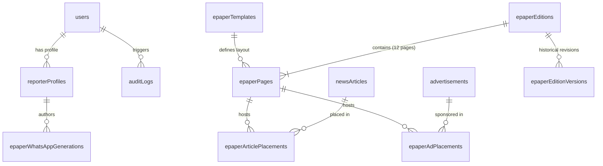
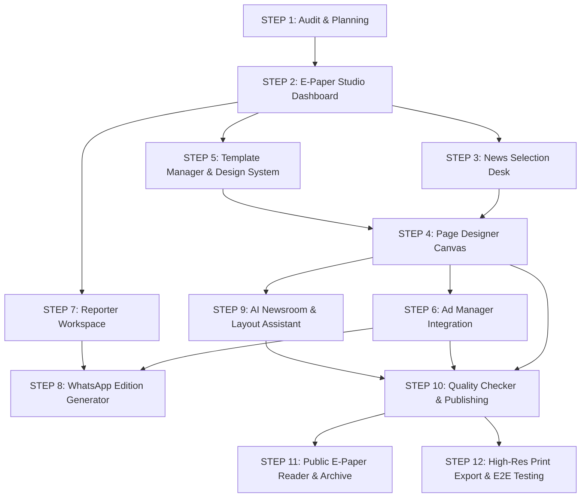

# STEP 1: COMPLETE TECHNICAL AUDIT & ARCHITECTURE PLANNING
## BREAKING NEWS WALA — E-PAPER MANAGEMENT MODULE
### Document ID: DOC-40-EPAPER-ARCH-2026-V1.0
### Phase: Architectural Discovery, System Audit & Implementation Planning
### Classification: Non-Destructive Technical Blueprint & Master Specification

---

> **MANDATE & OPERATIONAL CONSTRAINT COMPLIANCE:**  
> This document constitutes the formal deliverable for **STEP 1 — COMPLETE TECHNICAL AUDIT & ARCHITECTURE PLANNING**.  
> In strict accordance with the Step 1 execution constraints:  
> 1. **Zero Application Code Modified**: No existing JavaScript, TypeScript, or styles were modified.  
> 2. **Zero Database Mutations**: No Firestore documents, JSON persistence stores, or schemas were altered.  
> 3. **Zero Security Rule / IAM Changes**: `firestore.rules`, `storage.rules`, and Firebase Auth settings remain untouched.  
> 4. **Zero Dependency / Config Changes**: `package.json`, `apphosting.yaml`, and environment variables remain untouched.  
> 5. **Zero Destructive / Deployment Actions**: No deployments, Git commits, branches, merges, or pushes were executed.  
> 6. **Grounding in Empirical Reality**: All findings are based on direct source code inspection of the repository.

---

## 1. Project Context & Verified Repository Baseline

A rigorous inspection of the current workspace files, configurations, and remote linkages was performed. Below is the verified reality versus the reference context:

| Context Element | Reference Assumption | Verified Repository Reality | Verification Source |
| :--- | :--- | :--- | :--- |
| **GitHub Repository** | `breakingnewswala/BREAKING-NEWS-WALA` | `breakingnewswala/BREAKING-NEWS-WALA` | `git remote -v` (`origin`) |
| **Primary Branch** | `main` | `main` (synchronized with `origin/main` @ `90dab2b`) | `git status`, `git branch -vv` |
| **Firebase Project** | `breaking-news-wala` | `breaking-news-wala` | `firebase-applet-config.json`, `apphosting.yaml` |
| **App Hosting Backend**| `breakingnewswala` | `breakingnewswala` | `firebase.json` (`apphosting.backendId`) |
| **App Hosting Region** | `asia-southeast1` | `asia-southeast1` (Singapore) | `apphosting.yaml`, `docs/24-Deployment.md` |
| **Custom Firestore DB** | Unspecified | `ai-studio-breakingnewswala-81a8a8f4-57a5-4181-aa74-2ef4d34fbab7` | `firebase-applet-config.json`, `firebase.json` |
| **Firebase Storage** | `breaking-news-wala.firebasestorage.app` | `breaking-news-wala.firebasestorage.app` | `firebase-applet-config.json`, `apphosting.yaml` |
| **Production URLs** | `https://breakingnewswala.com` | `https://breakingnewswala.com`, `https://www.breakingnewswala.com` | `docs/01-PRD.md`, `docs/24-Deployment.md` |
| **Current Package Ver**| React / Vite | `v1.6.0`, React 19.0.0, Vite 6.0.0, Node.js v26.13.1 | `package.json` |
| **Active Persistence** | Firestore / Hybrid | `PERSISTENCE_MODE=firestore` in prod; `AtomicJsonStorage` in dev | `src/server/persistence/adapter.js` |

---

## 2. Complete Existing Codebase Inspection

### 2.1 Folder Structure & Repository Topology
The application is organized as a high-performance modular monorepo-lite:
```
D:\BREAKING-NEWS-WALA-main/
├── .data/                                # Local atomic JSON persistence mirror (dev/fallback)
├── .vscode/settings.json                 # Pinned OpenJDK 17 & Java tooling paths
├── docs/                                 # 35 canonical specifications (PRD, NFR, DB, API, etc.)
├── public/                               # Static assets, PWA service worker (sw.js), manifest
├── scripts/                              # Bootstrap scripts (admin-bootstrap.js)
├── src/
│   ├── components/                       # Shared UI organisms (Masthead, Footer, Nav, Tickers, Ads)
│   ├── data/                             # Mock fixtures & default templates (graphics, video, news)
│   ├── screens/                          # Top-level operational surfaces (Home, Epaper, Admin, etc.)
│   ├── server/                           # Backend Node.js API engine & domain services
│   │   ├── ai/                           # AI provider pool & multi-agent prompt coordinators
│   │   ├── audience/                     # Audience personalization & telemetry engine
│   │   ├── auth/                         # Dual JWT, Argon2id, Google ID token verification
│   │   ├── integrations/                 # RSS, WhatsApp, Social, YouTube, Webhooks
│   │   ├── monetization/                 # Ads, billing, CRM proposals, invoices, tax config
│   │   └── persistence/                  # Persistence adapters (FirestoreAdapter, LocalJsonAdapter)
│   ├── services/                         # Client API client, AI client, Canvas & Video rendering engines
│   ├── shared/                           # Seed datasets (MP 55 districts, 10 divisions, Mandi rates)
│   └── types/                            # Canonical TypeScript contracts (1,803 lines)
├── tests/                                # 19 Node.js test suites (44+ passing integration tests)
├── server.js                             # Node.js HTTP runtime with Vite dev middleware
├── vite.config.ts                        # Vite 6 + Tailwind CSS v4 compiler config
├── firebase.json                         # Firebase App Hosting & Firestore configuration
└── firestore.rules                       # Declarative Firestore security rules
```

### 2.2 Frontend Architecture
* **Framework**: **React 19.0.0** (`react`, `react-dom`) using modern functional components and hooks (`useState`, `useEffect`, `useMemo`, `useCallback`, `useRef`).
* **Bundler & Dev Server**: **Vite 6.0.0** with `@vitejs/plugin-react` and `@tailwindcss/vite` v4.
* **Code Splitting**: Heavy operational surfaces (`EpaperScreen`, `ReporterDeskScreen`, `NewsroomDeskScreen`, `AdminControlScreen`, `GraphicsStudioScreen`, `VideoStudioScreen`, `AiNewsroomScreen`, `SearchScreen`, `ProfileScreen`) are code-split using `React.lazy()` and `React.Suspense` to preserve sub-second Core Web Vitals on budget mobile devices.
* **Design System**: Brand Tri-Color Palette (Bharat Red `#ED1727`, Haldi Yellow `#FDE900`, Navy Blue `#344FD6`), Slate backgrounds (`#F8FAFC`), and Lucide React icons.
* **Typography**: Google Fonts hierarchy prioritizing **Noto Sans Devanagari** (primary body & UI), **Rozha One** (traditional masthead), and **Inter** (numerics/metadata).

### 2.3 Backend Architecture & Server Runtime
* **Runtime**: Node.js HTTP server (`server.js`) listening on `0.0.0.0:3000`.
* **Vite Middleware Integration**: In development mode (`NODE_ENV !== 'production'`), Vite is mounted as an internal middleware inside the Node server, serving React HMR and the SPA directly without requiring separate proxy processes.
* **API Routing**: Pure Node.js REST router (`src/server/apiEngine.js`, ~5,294 lines) servicing standardized contracts mounted strictly under `/api/v1/*`.
* **Static Serving**: Production builds serve precompiled assets from `dist/` with immutable caching headers for `/assets/*` and SPA fallback for extensionless routes.

### 2.4 Authentication & Session Management
* **Dual-Token JWT**: Dual-token architecture (`accessToken` expiring in 15 minutes, `refreshToken` expiring in 7 days).
* **Password Hashing**: Production-grade **Argon2id** (`argon2` npm package) for local staff authentication.
* **Google Identity Token RBAC**: Production Google Sign-In via Firebase Auth. The backend verifies cryptographic Google ID tokens (`email_verified === true`) using Google's public certs (`https://www.googleapis.com/oauth2/v3/certs`) via WebCrypto/Node.js crypto.
* **Master Admin Security Allowlist**: Master Admin elevation is strictly limited to authorized Google accounts:
  1. `breakingnewswala.com@gmail.com`
  2. `riturajtomarorchha@gmail.com`
  Unlisted accounts default strictly to `READER` mode, regardless of claims.

### 2.5 Role-Based Access Control (RBAC)
Five canonical roles exist in `src/types/index.ts`:
1. `READER`: Public citizens. Can view published articles, tickers, ads, and public e-paper editions; earn reader coins; save local bookmarks.
2. `REPORTER`: Accredited field stringers. Bound to assigned geographic districts (`assignedDistricts`); can file news drafts, upload field photos, and monitor editorial status.
3. `EDITOR`: Newsroom desk editors. Can claim stories, review 10-point fact-checks, request revisions, and approve articles for live publication.
4. `ADMIN`: Operational administrators. Manage advertising campaigns, tickers, Mandi rates, and user records.
5. `MASTER_ADMIN`: Platform owners. Complete authority over system configuration, API pool, audit logs, statewide emergency broadcasts, and high-privilege operations.

### 2.6 Geographic & Territorial Architecture
* **Madhya Pradesh Coverage**: Complete territorial dataset in `src/shared/mpHyperlocalSeed.js` encompassing all **55 districts** across **10 administrative divisions** (Bhopal, Indore, Gwalior, Jabalpur, Ujjain, Sagar, Rewa, Chambal, Narmadapuram, Shahdol).
* **District Binding**: Reporters are assigned a primary beat district and optional additional districts (`assignedDistricts`). Server-side validation (`RULE-GEO-001`) prevents reporters from filing stories outside their authorized beat without editorial clearance.

### 2.7 Existing News & Editorial Lifecycle
Articles transition through a strict state machine (`ArticleStatus` in `src/types/index.ts`):
$$\text{DRAFT} \longrightarrow \text{PENDING\_REVIEW} \longrightarrow \text{UNDER\_REVIEW} \longrightarrow \begin{cases} \text{REVISION\_REQUESTED} \longrightarrow \text{DRAFT} \\ \text{APPROVED} \longrightarrow \text{PUBLISHED} \\ \text{REJECTED} \end{cases}$$
The editorial desk enforces a **10-Point Fact-Checking Protocol** evaluating primary sources, official administrative quotes, Devanagari grammar, communal harmony, and clickbait prevention before an article can reach `APPROVED` or `PUBLISHED`.

### 2.8 Database & Persistence Architecture
* **FirestoreAdapter (`src/server/persistence/firestoreAdapter.js`)**: Production adapter targeting Cloud Firestore database `ai-studio-breakingnewswala-81a8a8f4-57a5-4181-aa74-2ef4d34fbab7`. Manages 50+ collections using an in-memory collection mirror with OCC versioning (`version`).
* **LocalJsonAdapter (`src/server/persistence/adapter.js`)**: Development and testing persistence engine utilizing atomic rename (`fs.renameSync`) to `.data/bnw_persistence.json` with backup rotation (`.bak`) and concurrency locks.

### 2.9 Existing Canvas & Graphic Rendering Assets
* **GraphicRenderer (`src/services/graphicRenderer.ts`)**: A pure HTML5 Canvas / OffscreenCanvas rendering engine that implements Devanagari text wrapping, glyph auto-scaling, layer compositing, aspect ratio scaling (1:1, 4:5, 9:16, 16:9, 3:4), and high-resolution PNG/WebP exports.
* **NewsToGraphicEngine (`src/services/newsToGraphicEngine.ts`)**: Automatically converts approved news articles into visual social cards by extracting punchy headlines, category badges, reporter credits, and featured images.

### 2.10 Existing E-Paper Implementation Baseline
* **Frontend**: `src/screens/EpaperScreen.tsx` provides a mock broadsheet viewer supporting district edition switching (Bhopal, Indore, Gwalior, Jabalpur, Niwari), zoom controls (70% to 160%), PDF download toast, page navigation (Previous / Next), and a horizontal thumbnail strip.
* **Backend**: `src/server/apiEngine.js` exposes baseline endpoints:
  - `GET /api/v1/epaper/editions`: Returns edition summaries.
  - `GET /api/v1/epaper/latest`: Returns latest published edition.
  - `GET /api/v1/epaper/editions/:id`: Returns edition detail with pages.
  - `POST /api/v1/epaper/editions/:id/(view|download)`: Records engagement telemetry.
* **Data Model**: `EpaperEdition` currently contains only basic flat metadata (`id`, `title`, `editionDate`, `districtId`, `pdfUrl`, `totalPages`, `thumbnailUrl`, `pages[]`).

---

## 3. Existing System Reuse Strategy

The E-Paper Management Module will be deeply integrated into BREAKING NEWS WALA rather than constructed as a disconnected silo. Below is the precise reuse mapping:

```
┌────────────────────────────────────────────────────────────────────────────────────────┐
│                               EXISTING REUSABLE ASSETS                                 │
├────────────────────────────┬─────────────────────────────┬─────────────────────────────┤
│   IDENTITY & PERMISSIONS   │    EDITORIAL & CONTENT      │     MEDIA & ENGINE          │
├────────────────────────────┼─────────────────────────────┼─────────────────────────────┤
│ • Firebase Auth / Dual JWT │ • Approved NewsArticles     │ • GraphicRenderer (Canvas)  │
│ • Master Admin Allowlist   │ • Article IDs & Slugs       │ • Firebase Storage Buckets  │
│ • Reporter Profiles        │ • Reporter Beat Bindings    │ • Presigned Upload Service  │
│ • User Sessions & RBAC     │ • 10-Point Fact-Check Data  │ • BnwAiService (Gemini API) │
│ • Firestore Security Rules │ • MP 55 Districts Dataset   │ • AdManager & Monetization  │
└────────────────────────────┴─────────────────────────────┴─────────────────────────────┘
                                           │
                                           ▼ (Integrated Without Duplication)
┌────────────────────────────────────────────────────────────────────────────────────────┐
│                        NEW E-PAPER MANAGEMENT SYSTEM MODULE                            │
├────────────────────────────┬─────────────────────────────┬─────────────────────────────┤
│ • Edition Management       │ • Page Layout Designer      │ • AI Ad Studio Placements   │
│ • News Selection Desk      │ • WhatsApp Edition Engine   │ • Print & Clipping Exporter │
└────────────────────────────┴─────────────────────────────┴─────────────────────────────┘
```

### Specific Asset Reuse Rules:
1. **User Accounts & Roles**: Reuse `users` collection and verified Firebase Auth tokens. The E-Paper Studio will recognize `MASTER_ADMIN` for full layout and publishing control, and `REPORTER` for workspace and WhatsApp generation.
2. **Reporter Profiles & Beats**: Reuse `reporterProfiles` and `src/shared/mpHyperlocalSeed.js`. When a reporter generates a WhatsApp Edition, their photo, designation, badge number (`BNW-REP-XXXX`), and assigned district are pulled directly from their existing profile.
3. **Approved News Sourcing**: The News Selection Desk will query existing `newsArticles` filtered strictly by `status === 'PUBLISHED'` or `status === 'APPROVED'`. Original articles remain the immutable source of truth; E-Paper layout overrides will be stored as edition layer metadata without mutating the base article.
4. **Media Storage**: All exported page broadsheets, article clippings, and WhatsApp editions will be uploaded through the existing `/api/v1/media/presigned-upload` workflow into `breaking-news-wala.firebasestorage.app`.
5. **Canvas Rendering**: Extend `GraphicRenderer` to handle high-resolution broadsheet rendering (300 DPI, physical dimension scaling) and newspaper multi-column text justification.
6. **Advertisement Engine**: Reuse `src/server/monetization/adManager.js` and existing `advertisements` collection for ad creative sourcing, click tracking, and impression logging.

---

## 4. E-Paper Module — Functional Architecture

### 4.1 Edition Management Architecture
* **Edition Types**:
  - **Daily Edition**: 12-page fixed broadsheet per district/division published daily (publishing schedule configurable by Master Admin / Editorial Desk, e.g., 05:00 AM IST target). Page categories are governed by Master Admin defaults (e.g., Page 1: Main/State Lead, Page 2: District Local, Page 3: State Governance, Page 4: Politics, Page 5: Crime & Courts, Page 6: Editorial/Op-Ed, Page 7: Agriculture & Mandi Bhav, Page 8: Business & Employment, Page 9: National, Page 10: International, Page 11: Sports, Page 12: Regional Features).
  - **Special Edition**: Variable page count (4, 8, 16, 24 pages) for breaking events, elections, festivals (Simhastha/Ujjain, Diwali), or government budget specials.
* **Physical Print Specifications**:
  - **Broadsheet Dimensions**: **32.9 cm width $\times$ 52.0 cm height** (Aspect Ratio $\approx 1:1.58$).
  - **Print Margins**: Top: 1.5 cm, Bottom: 1.5 cm, Left: 1.5 cm, Right: 1.5 cm.
  - **Available Printable Area**: $29.9\text{ cm} \times 49.0\text{ cm}$.
  - **Header Zone**: Height $3.5\text{ cm}$ (Masthead, date, edition title, price, volume/issue).
  - **Footer Zone**: Height $1.5\text{ cm}$ (Page number, website URL, statutory editor credits).
  - **Content Body Area**: $29.9\text{ cm} \times 44.0\text{ cm}$ divided into column grids.
* **Edition Versioning & Immutability**:
  - Published editions are locked. Any editorial correction creates an incremental revision (`v1.0` $\rightarrow$ `v1.1`) preserving the previous layout snapshot in `editionVersions`.

### 4.2 News Selection Desk Architecture
* **Sourcing Filter Pipeline**:
  - District / Division filter (backed by `MP_55_DISTRICTS`).
  - Category filter (Top, MP, Politics, Crime, Agriculture, Weather, Business).
  - Fact-check status (`score >= 80`, `credibilityRating === 'VERIFIED'`).
  - Media asset filter (has high-res photo $\ge 1200\text{px}$).
  - Word count / Article length bucket (Brief $< 150$ words, Standard $150-400$ words, Feature $> 400$ words).
* **Duplicate-Placement Guard**:
  - Client and server-side tracking prevents assigning the same `articleId` across multiple pages of the same edition.
* **Credit Integrity**:
  - The reporter's byline (`authorName`, `badgeNumber`) and reviewing editor's signature are immutably bound to the page element.

### 4.3 Page Designer & Newspaper Layout Engine
The designer interface adopts a newsroom-grade 3-panel layout:
```
┌──────────────────────┬──────────────────────────────────────────────┬──────────────────────┐
│     LEFT PANEL       │                CENTER PANEL                  │     RIGHT PANEL      │
│  (Assets & Palette)  │           (Interactive Canvas)               │ (Properties & Tools) │
├──────────────────────┼──────────────────────────────────────────────┼──────────────────────┤
│ [1. Page Selector]   │ • 32.9 cm x 52.0 cm Broadsheet Canvas        │ [Selected Element]   │
│   Page 1 to 12       │ • Configurable Grid (3, 4, 5, 6, 8 columns)  │ • X, Y, W, H (mm/px) │
│                      │ • Fixed Header Zone (Masthead)               │ • Column Span        │
│ [2. News Drawer]     │ • Dynamic Story Boxes with Drag & Drop       │ • Typography Scale   │
│   Filtered approved  │ • Headline, Lead, Body, Image Containers     │ • Alignment: JUSTIFY │
│   articles           │ • Advertisement Slots (L-shape, footer, etc.)│ • Image Aspect Ratio │
│                      │ • Alignment Guides & Smart Snapping          │ • Border & Padding   │
│ [3. Ad Palette]      │ • Fixed Footer Zone (Page #, Credits)        │ • Layer Ordering     │
│   Approved creatives │ • Zoom: 25% | 50% | 75% | 100% | 150%        │ • Lock / Delete      │
│                      │ • Undo / Redo History (50 states)            │                      │
│ [4. Templates]       │ • Live Text Overflow & Balance Indicators    │ [AI Layout Helper]   │
└──────────────────────┴──────────────────────────────────────────────┴──────────────────────┘
```
* **Column Grid System**:
  - Supports configurable Indian newspaper column layouts: 3 columns ($93.0\text{ mm}$ each), 4 columns ($68.5\text{ mm}$ each), 5 columns ($53.8\text{ mm}$ each), 6 columns ($44.8\text{ mm}$ each), and 8 columns ($33.0\text{ mm}$ each) with standard $5.0\text{ mm}$ gutters.

### 4.4 Newspaper Design System & Typography
* **Devanagari Justification Rule (Mandatory)**:
  - All body text in the broadsheet and WhatsApp edition must be fully justified (both left and right margins aligned).
  - The rendering engine must calculate exact Devanagari character clustering and word spacing, preventing artificial glyph clipping, broken matras, or orphan headline words.
* **Typography Hierarchy**:
  - **Main Banner Headline**: Noto Sans Devanagari ExtraBold, $48-72\text{ pt}$.
  - **Sub-Headlines / Kicker**: Noto Sans Devanagari SemiBold, $20-28\text{ pt}$.
  - **Lead Paragraph**: Noto Sans Devanagari Medium, $12-14\text{ pt}$.
  - **Body Text**: Noto Sans Devanagari Regular, $9.5-10.5\text{ pt}$, Line Height $1.35$.
  - **Dateline & Byline**: Noto Sans Devanagari Bold, $8.5-9.5\text{ pt}$.
  - **Photo Captions**: Noto Sans Devanagari Italic, $8.0\text{ pt}$.

### 4.5 Template Manager
* Standard layout presets:
  - `TPL-PAGE-01-LEAD`: Page 1 statewide mega-lead + 2 secondary stories + bottom strip ad.
  - `TPL-PAGE-DISTRICT`: Hyperlocal 4-column layout with 6 stories and 1 square sponsor ad.
  - `TPL-PAGE-OPED`: 3-column broad editorial opinion layout with central editorial column.
  - `TPL-PAGE-AGRI`: Mandi Bhav tabular price matrix + 3 agriculture investigative reports.
* Template Immutability: Stored as serialized JSON models. Modifying a template creates a new version; existing published editions keep their historic template references.

### 4.6 Advertisement Manager — AI Ad Studio Integration
* **Ad Formats**: 1:1, 3:4, 2:3, 4:3, 16:9, and custom dimensions. Placements include Full Page, Half Page (Horizontal/Vertical), Quarter Page, Column Strip, Square between stories, L-Shaped editorial wrap, Left/Right Vertical, and Horizontal Footer.
* **Statutory Compliance**: Enforces ASCI (Advertising Standards Council of India) "विज्ञापन" (Advertisement) disclosure badge on all sponsored boxes.
* **Role Permissions**:
  - **Master Admin**: Full commercial campaign management, scheduling, rate-card configuration, and global placements.
  - **Reporter**: Can upload or generate local classified advertisements for their beat district, subject to Master Admin approval before edition placement.

### 4.7 Reporter Workspace & Identity Protection
* **Reporter Attribution Guard**: An article submitted by Reporter A can never have its credit transferred to Reporter B in the E-Paper or WhatsApp edition.
* **District Binding**: Reporters can only generate localized editions/clippings for their verified assigned beats.

### 4.8 WhatsApp Edition Generator (Internal Tool)
* **Private Generation Scope**: Strict internal tool for verified staff/reporters. Generated graphics are stored with private access permissions and **never** automatically injected into public web feeds or public E-Paper pages.
* **Output Dimensions**:
  - **$1:1$ Square**: $1080 \times 1080\text{ px}$ (Optimized for WhatsApp Status & Telegram).
  - **$4:5$ Portrait**: $1080 \times 1350\text{ px}$ (Optimized for WhatsApp Direct Chat & Instagram).
* **Generation Quotas**: Rate-limited server-side to prevent resource exhaustion (default initial threshold proposed at 20 generations per reporter per day, dynamically configurable by Master Admin via settings; Master Admin unlimited).

### 4.9 AI Integration Suite
1. **AI Template Analyzer**: Inspects uploaded physical newspaper sample scans/images to detect column geometry, box coordinates, headline-to-body ratios, and ad slot allocations.
2. **AI Page Designer**: Suggests automated article-to-box layout mapping based on article priority, length, and photo orientation.
3. **AI News Researcher**: Synthesizes verified context and historical background for district news briefs.
4. **AI Editorial Assistant**: Automatically generates punchy, Devanagari-shaping compliant headlines fitting exact column character limits.
5. **AI Layout Assistant**: Recommends column re-balancing when text overflow or excessive whitespace is detected.
6. **AI Quality Assistant**: Scans complete page layouts for missing photo credits, unverified claims, and visual balance.
7. **Category AI Analyzer**: Categorizes unassigned briefs into canonical MP beats.
8. **AI Permanent Newspaper Columns**: Generates structured recurring feature modules (e.g., "आज का इतिहास", "मंडी समीक्षा", "संपादकीय दृष्टिकोण").

### 4.10 Quality Checker & 8-Step Publishing Workflow
```
[1. News Received] ────────► [2. Editorial Fact-Check] ────────► [3. Approved for E-Paper]
                                                                        │
                                                                        ▼
[6. Proof & Quality Scan] ◄── [5. Page Designed] ◄────────────── [4. Assigned to Page]
        │
        ▼
[7. Final Master Approval] ──► [8. Published & Rendered] ─────► High-Res PDF & Web Archive
```
* **Pre-Flight Validation Rules**:
  - Zero text box overflows.
  - Zero missing or broken images ($< 300\text{ DPI}$ triggers warning).
  - Zero duplicate articles within the same edition.
  - All mandatory credits (Reporter, Editor, Photographer) populated.
  - All advertisement boxes tagged with "विज्ञापन".

### 4.11 Public E-Paper Reader & Historical Archive
* **Dual Reading Modes**:
  - **Newspaper Broadsheet Mode**: Interactive zoomable canvas with thumbnail filmstrip.
  - **Article Reading Mode**: Clicking any story box opens a clean, mobile-optimized modal view with dynamic font scaling, Hindi text-to-speech audio reader, and WhatsApp sharing.
* **Article Clipping Tool**: Readers can select and crop any article box to generate a branded social clipping card ($4:5$ format) with the BREAKING NEWS WALA masthead and date.

### 4.12 Export & Print Engine
* **Web Delivery**: 150 DPI WebP / PNG page renderings for the digital reader.
* **Commercial Print Ready**: 300 DPI CMYK PDF generation conforming to ISO 12647-3 (coldset newspaper printing on standard newsprint) with $3.0\text{ mm}$ bleed margins and embedded Devanagari vector fonts.

---

## 5. Database & Data Model Architecture

### 5.1 Collection Mapping & Structure
To maintain absolute compatibility with the existing `FirestoreAdapter` and `AtomicJsonStorage`, all new entities adhere to the repository's established lowercase camelCase naming standards and optimistic concurrency control (`version` integer field):



### 5.2 Proposed Firestore Collections Schema Specification

#### 1. `epaperEditions`
* Path: `/epaperEditions/{editionId}`
```typescript
interface EpaperEditionDoc {
  id: string;                         // 'epaper-bhopal-2026-11-18'
  editionCode: string;                // 'BHP-20261118'
  title: string;                      // 'भोपाल मुख्य संस्करण'
  editionType: 'DAILY' | 'SPECIAL';  // Daily (12p) or Special
  editionDate: string;                // '2026-11-18'
  districtId: string;                 // 'dist-bhopal'
  districtName: string;               // 'भोपाल'
  divisionId: string;                 // 'div-bhopal'
  status: 'DRAFT' | 'IN_REVIEW' | 'APPROVED' | 'PUBLISHED' | 'ARCHIVED';
  totalPages: number;                 // 12 (Daily) or custom
  version: number;                    // OCC counter (1, 2, 3...)
  publishedVersion: number;           // Currently live revision
  pdfUrl?: string;                    // Cloud Storage signed/public download URL
  highResPrintPdfUrl?: string;        // 300 DPI print-ready PDF
  thumbnailUrl?: string;              // Page 1 WebP thumbnail
  createdBy: string;                  // User ID
  createdByName: string;              // Editor name
  approvedBy?: string;                // Master Admin User ID
  approvedAt?: string;
  publishedAt?: string;
  createdAt: string;
  updatedAt: string;
}
```

#### 2. `epaperPages`
* Path: `/epaperPages/{pageId}` (or `/epaperEditions/{editionId}/pages/{pageNumber}`)
```typescript
interface EpaperPageDoc {
  id: string;                         // 'epaper-bhopal-2026-11-18-p01'
  editionId: string;                  // Ref to epaperEditions
  pageNumber: number;                 // 1 to 12
  pageName: string;                   // 'प्रथम पृष्ठ - मुख्य समाचार'
  categorySlug: string;               // 'top-news'
  templateId?: string;                // Ref to epaperTemplates
  columns: number;                    // 3, 4, 5, 6, or 8
  gridDimensions: {
    widthMm: 329;
    heightMm: 520;
    printableWidthMm: 299;
    printableHeightMm: 440;
  };
  layoutData: {
    elements: EpaperPageElement[];
  };
  pageImageUrl?: string;              // Rendered preview WebP
  highResImageUrl?: string;           // 300 DPI rendered PNG
  status: 'DRAFT' | 'DESIGNED' | 'APPROVED';
  version: number;
  updatedAt: string;
}
```

#### 3. `epaperPageElements` (Embedded in `layoutData.elements`)
```typescript
interface EpaperPageElement {
  id: string;                         // Element UUID
  type: 'ARTICLE' | 'ADVERTISEMENT' | 'IMAGE' | 'MASTHEAD' | 'HEADER' | 'FOOTER' | 'COLUMN_STRIP';
  box: {
    colStart: number;                 // 1-indexed column position
    colSpan: number;                  // Number of columns spanned
    topMm: number;                    // Y-offset in mm from content top
    heightMm: number;                 // Height in mm
  };
  // Article binding
  articleId?: string;                 // Source article ID
  customHeadline?: string;            // E-Paper specific headline override
  customSubheadline?: string;
  customBodyText?: string;            // Justified body text override
  authorCredit?: string;              // Reporter name & badge
  editorCredit?: string;              // Reviewer name
  // Image binding
  imageUrl?: string;
  imageCaption?: string;
  // Advertisement binding
  adId?: string;                      // Source advertisement ID
  advertiserName?: string;
  isSponsored: boolean;               // Mandatory true for ads
  // Visual styling
  styling: {
    borderTop: boolean;
    borderBottom: boolean;
    borderLeft: boolean;
    borderRight: boolean;
    backgroundColor?: string;
  };
  locked: boolean;                    // Prevent accidental displacement
}
```

#### 4. `epaperTemplates`
* Path: `/epaperTemplates/{templateId}`
```typescript
interface EpaperTemplateDoc {
  id: string;                         // 'tpl-broadsheet-front-01'
  name: string;                       // 'दैनिक प्रथम पृष्ठ - मानक 6 कॉलम'
  editionType: 'DAILY' | 'SPECIAL' | 'WHATSAPP';
  pageNumberScope: number[];          // e.g. [1] or [2, 3, 4, 5]
  columns: number;                    // 6
  slots: Array<{
    slotId: string;
    type: 'LEAD_STORY' | 'SECONDARY_STORY' | 'BRIEF' | 'AD_SLOT';
    colStart: number;
    colSpan: number;
    topMm: number;
    heightMm: number;
    recommendedWordCount: number;
  }>;
  isSystemDefault: boolean;
  version: number;
  createdBy: string;
  createdAt: string;
}
```

#### 5. `epaperWhatsAppGenerations` (Internal-Only Private Collection)
* Path: `/epaperWhatsAppGenerations/{generationId}`
```typescript
interface EpaperWhatsAppGenerationDoc {
  id: string;                         // 'wa-gen-uuid'
  reporterId: string;                 // Ref to reporterProfiles
  reporterName: string;
  districtId: string;
  districtName: string;
  format: '1:1' | '4:5';             // 1080x1080 or 1080x1350
  rawScript: string;
  headline: string;
  bodyTextJustified: string;
  imageUrl?: string;
  adSlotIncluded: boolean;
  adId?: string;
  outputImageUrl: string;             // Private storage URL
  downloadCount: number;
  isPublic: false;                    // STRICTLY FALSE (Internal-only)
  createdAt: string;
}
```

---

## 6. Security, Permissions & Access Matrix

### 6.1 Role-Based Access Matrix
Security is strictly enforced on the server (`server.js` and `src/server/apiEngine.js`) rather than relying on frontend UI visibility:

| Operation / Capability | Public Reader | Reporter | Newsroom Editor | Master Admin |
| :--- | :---: | :---: | :---: | :---: |
| **Browse Published E-Paper** | **READ** | **READ** | **READ** | **READ** |
| **Download Public PDF / Clipping** | **PERMITTED** | **PERMITTED** | **PERMITTED** | **PERMITTED** |
| **Access E-Paper Studio Dashboard** | DENIED (403) | DENIED (403) | **ACCESS** | **ACCESS** |
| **Create / Configure New Editions** | DENIED (403) | DENIED (403) | DENIED (403) | **FULL CONTROL** |
| **Assign News to E-Paper Pages** | DENIED (403) | DENIED (403) | **PERMITTED** | **PERMITTED** |
| **Edit Page Layout Canvas** | DENIED (403) | DENIED (403) | **PERMITTED** | **FULL CONTROL** |
| **Publish E-Paper Edition to Live Web**| DENIED (403) | DENIED (403) | DENIED (403) | **EXCLUSIVE** |
| **Create System & Page Templates** | DENIED (403) | DENIED (403) | DENIED (403) | **EXCLUSIVE** |
| **Manage Global Commercial Ads** | DENIED (403) | DENIED (403) | DENIED (403) | **EXCLUSIVE** |
| **Upload District Classified Ad** | DENIED (403) | **OWN BEAT ONLY** | **REVIEW** | **FULL CONTROL** |
| **WhatsApp Edition Generator** | DENIED (403) | **OWN BEAT (20/day)**| **PERMITTED** | **UNLIMITED** |
| **View All WhatsApp Audit Logs** | DENIED (403) | DENIED (403) | DENIED (403) | **EXCLUSIVE** |
| **Trigger High-Res Print PDF Export**| DENIED (403) | DENIED (403) | **PERMITTED** | **FULL CONTROL** |

### 6.2 Firebase Security Rules Specification (Roadmap Audit)
The current `firestore.rules` file allows direct client access only to `/users` and `/articles`. For the E-Paper module:
* **Public Access**: Public read access will be permitted on `/epaperEditions/{id}` and `/epaperPages/{id}` strictly where `resource.data.status == 'PUBLISHED'`.
* **Management Operations**: All creating, updating, designing, and publishing of E-Paper editions will be executed exclusively through authenticated server-side API endpoints (`/api/v1/epaper/*`) protected by JWT tokens and Master Admin allowlist checks.
* **WhatsApp Edition Security**: `/epaperWhatsAppGenerations` documents will be restricted so readers have zero access, reporters can read only their own records (`request.auth.uid == resource.data.reporterId`), and Master Admins have global audit access.

---

## 7. Technical Risk & Dependency Analysis

| Risk Area | Severity | Root Cause / Technical Vulnerability | Architectural Remediation |
| :--- | :---: | :--- | :--- |
| **Devanagari Font Shaping & Clipping** | **CRITICAL** | Complex Devanagari ligatures (matras, halants, conjuncts) break or overlap when standard HTML canvas text rendering is improperly scaled. | Enforce preloaded Noto Sans Devanagari WebFonts via `FontFaceObserver`. Use deterministic line-height multipliers ($1.35$) and multi-pass glyph bounds measurement before rendering. |
| **Text Justification Overflow** | **HIGH** | Strict justification on Devanagari script can result in unnatural word spacing or line clipping if text boxes are too rigid. | Implement dynamic font size auto-scaling ($\pm 1.5\text{ pt}$) with hyphenation-free Devanagari word spacing bounds in `GraphicRenderer`. |
| **High-Resolution Canvas Memory Pressure** | **HIGH** | A 300 DPI broadsheet ($32.9\text{ cm} \times 52.0\text{ cm}$) translates to $\approx 3885 \times 6141\text{ px}$ ($23.8\text{ MP}$), consuming $>95\text{ MB}$ of uncompressed RAM per canvas. Low-end mobile browsers will crash. | The interactive WYSIWYG editor will operate on a responsive 72/96 DPI screen-density canvas. High-resolution 300 DPI rasterization and PDF generation will be handled in background chunks via OffscreenCanvas or server worker. |
| **Firestore Query Document Limits** | **MEDIUM** | Storing all 12 pages of an edition with deep nested element JSON inside a single document risks exceeding Firestore's $1\text{ MB}$ document limit. | Decompose editions into top-level `/epaperEditions/{id}` metadata records with dedicated `/epaperPages/{id}` page documents. |
| **Accidental Overwrite of Published Editions** | **HIGH** | An editor making a correction to Page 3 could accidentally corrupt the historical live publication. | Enforce immutable published versions (`version`). Any modification automatically writes to an incremental working draft version. |
| **WhatsApp Generation Leakage** | **MEDIUM** | Internal draft WhatsApp cards being accessible on public URLs. | Store WhatsApp generated graphics in a private storage path (`/private/whatsapp/{reporterId}/*`) served strictly through authenticated endpoints. |

---

## 8. Twelve-Step Implementation Roadmap (Dependency Map)



### Step-by-Step Specification:

#### STEP 1 — Existing System Audit & Architecture Planning (Current Phase)
* **Objective**: Comprehensive code inspection, architectural mapping, and deliverable creation.
* **Deliverable**: `docs/EPAPER_ARCHITECTURE_AUDIT.md`.
* **Zero Modification Invariant**: 100% verified.

#### STEP 2 — E-Paper Studio & Dashboard
* **Objective**: Scaffold the administrative E-Paper Studio workspace inside `AdminControlScreen` and `App.tsx`.
* **Key Features**: Edition calendar view, status filters, edition creation wizard (Daily 12p vs Special), district edition tabs.
* **Dependencies**: Step 1.
* **Reuse**: Existing admin navigation, layout drawer, role guards (`MASTER_ADMIN`, `EDITOR`).

#### STEP 3 — News Selection Desk & Editorial Workflow
* **Objective**: Sourcing desk allowing desk editors to filter approved news and assign them to specific pages.
* **Key Features**: Multi-facet filter (District, Category, Fact-Check Score, Reporter, Length), drag-to-page assignment, duplicate-placement warnings.
* **Dependencies**: Step 2.
* **Reuse**: `newsArticles` collection, `INITIAL_ARTICLES`, `apiClient.articles`.

#### STEP 4 — Page Designer & Newspaper Layout Engine
* **Objective**: Interactive 3-panel broadsheet canvas editor ($32.9\text{ cm} \times 52\text{ cm}$).
* **Key Features**: 4/6/8-column snap grids, resizable news containers, Devanagari text justification engine, element locking, undo/redo (50 states).
* **Dependencies**: Steps 3 and 5.
* **Reuse**: `GraphicRenderer` canvas primitives, Lucide icons.

#### STEP 5 — Template Manager & Newspaper Design System
* **Objective**: Presets and layout templates for broadsheet pages and section headers.
* **Key Features**: Master Admin template builder, standard 12-page daily templates, category templates, header/footer manager.
* **Dependencies**: Step 2.
* **Reuse**: `src/data/defaultTemplates.ts`, `epaperTemplates` collection.

#### STEP 6 — Advertisement Manager & AI Ad Studio Integration
* **Objective**: Commercial and classified ad placement engine with ASCI "विज्ञापन" badges.
* **Key Features**: Ad slot definitions (L-shape, footer, square), advertiser scheduling, reporter local ad submission workflow.
* **Dependencies**: Steps 4 and 5.
* **Reuse**: `src/server/monetization/adManager.js`, `advertisements` collection.

#### STEP 7 — Reporter Workspace & Profile Integration
* **Objective**: Secure field stringer portal for localized e-paper clippings and local ad drafting.
* **Key Features**: Reporter byline protection, district-bound story linking, credential badge synchronization.
* **Dependencies**: Step 2.
* **Reuse**: `ReporterDeskScreen.tsx`, `reporterProfiles` collection.

#### STEP 8 — WhatsApp Edition Generator (Internal Tool)
* **Objective**: Private, internal $1:1$ and $4:5$ visual card generator for mobile news dissemination.
* **Key Features**: Raw text intake, photo upload, Devanagari auto-justification, reporter badge overlay, per-reporter daily quota enforcement.
* **Dependencies**: Steps 6 and 7.
* **Reuse**: `NewsToGraphicEngine.ts`, `GraphicRenderer.ts`, private Firebase Storage.

#### STEP 9 — AI Newsroom & AI Design Tools
* **Objective**: Integrated Gemini AI assistance suite for e-paper workflows.
* **Key Features**: AI Template Analyzer (analyzing scan reference images), AI Headline Sizer, AI Layout Rebalancer, AI Editorial Summarizer.
* **Dependencies**: Step 4.
* **Reuse**: `BnwAiService`, `src/server/ai/providerPool.js`.

#### STEP 10 — Quality Checker & Publishing Workflow
* **Objective**: Pre-flight validation gate and Master Admin publishing authorization.
* **Key Features**: Automated overflow scanner, broken image detection, Devanagari ligature audit, atomic publication state transition (`PUBLISHED`).
* **Dependencies**: Steps 4, 6, and 9.
* **Reuse**: 10-Point Fact-Checking UI components, `AuditLogManager`.

#### STEP 11 — Public E-Paper Reader & Historical Archive
* **Objective**: Citizen-facing responsive reading experience.
* **Key Features**: Dual modes (Broadsheet Zoom & Modal Article Reader), date-based archive search, text-to-speech audio reader, social clipping generator.
* **Dependencies**: Step 10.
* **Reuse**: `src/screens/EpaperScreen.tsx`, `BnwMasthead.tsx`, reader coin wallet.

#### STEP 12 — Export Engine, Security Audit & E2E Verification
* **Objective**: High-resolution print export (300 DPI CMYK PDF) and end-to-end automated testing.
* **Key Features**: Deterministic PDF rendering, automated test suites in `tests/`, final security rules review.
* **Dependencies**: All preceding steps.
* **Reuse**: Node.js test runner (`node --test`), PDF export libraries.

---

## 9. Verification & Step 1 Completion Audit

* [x] **Repository Inspected**: Full codebase, configs, models, and tests evaluated.
* [x] **Zero Code Modifications**: No application files in `src/` or `server.js` were modified.
* [x] **Zero Database Mutations**: No Firestore records or `.data/` files were touched.
* [x] **Zero Rule / Config Changes**: `firestore.rules`, `.env`, and `apphosting.yaml` preserved intact.
* [x] **Zero Dependencies Installed**: `package.json` and `package-lock.json` untouched.
* [x] **Single Canonical Architecture Document Created**: Stored exclusively at [`docs/EPAPER_ARCHITECTURE_AUDIT.md`](file:///d:/BREAKING-NEWS-WALA-main/docs/EPAPER_ARCHITECTURE_AUDIT.md).
* [x] **Step 2 Readiness Confirmed**: Architecture and data schemas are ready for Step 2 execution upon user approval.
