# Master Editorial Policy, Journalistic Standards & Newsroom Governance Specification
## Project: BREAKING NEWS WALA (ब्रेकिंग न्यूज़ वाला)
### Document ID: DOC-30-EDT-2026-V1.0
### Confidentiality: Public Editorial Policy & Internal Newsroom Operating Standard

---

## 1. Document Information & Governance Status

### 1.1 Governance Metadata

| Attribute | Specification Details |
| :--- | :--- |
| **Document Title** | Master Editorial Policy, Journalistic Standards & Newsroom Governance Specification |
| **Document ID** | `DOC-30-EDT-2026-V1.0` |
| **Baseline Version** | `1.0.0` |
| **Document Status** | **Approved Operational Baseline & Newsroom Governance Standard** |
| **Creation Date** | October 31, 2026 |
| **Target System Scope** | Public News Web Portal, Reporter Web Application, Central Newsroom Desk, Admin Control Panel, Graphics Studio, Video Studio, RSS Syndicate Engine, Multi-Provider AI Intelligence Layer, and Future Native Android Application |
| **Language & Region** | Hindi-First (`hi-IN`) with Hyperlocal Coverage across Uttar Pradesh, Madhya Pradesh, Bihar, Rajasthan, Haryana, Delhi-NCR, Uttarakhand, and National Ingress |
| **Authoring Body** | Central Editorial Governance Board & Newsroom Standards Committee |
| **Approved By** | Chief Editorial Officer, Head of Product, Principal Security Architect, Legal Counsel |
| **Predecessor Dependencies** | [`docs/01-PRD.md`](file:///c:/Users/pp/Downloads/BREAKING-NEWS-WALA-main/docs/01-PRD.md), [`docs/02-Features.md`](file:///c:/Users/pp/Downloads/BREAKING-NEWS-WALA-main/docs/02-Features.md), [`docs/03-Plan.md`](file:///c:/Users/pp/Downloads/BREAKING-NEWS-WALA-main/docs/03-Plan.md), [`docs/04-NFR.md`](file:///c:/Users/pp/Downloads/BREAKING-NEWS-WALA-main/docs/04-NFR.md), [`docs/05-Workflows.md`](file:///c:/Users/pp/Downloads/BREAKING-NEWS-WALA-main/docs/05-Workflows.md), [`docs/06-Business-Rules.md`](file:///c:/Users/pp/Downloads/BREAKING-NEWS-WALA-main/docs/06-Business-Rules.md), [`docs/11-Architecture.md`](file:///c:/Users/pp/Downloads/BREAKING-NEWS-WALA-main/docs/11-Architecture.md), [`docs/14-Auth.md`](file:///c:/Users/pp/Downloads/BREAKING-NEWS-WALA-main/docs/14-Auth.md), [`docs/15-Security.md`](file:///c:/Users/pp/Downloads/BREAKING-NEWS-WALA-main/docs/15-Security.md), [`docs/17-Agents.md`](file:///c:/Users/pp/Downloads/BREAKING-NEWS-WALA-main/docs/17-Agents.md), [`docs/18-MCP.md`](file:///c:/Users/pp/Downloads/BREAKING-NEWS-WALA-main/docs/18-MCP.md), [`docs/19-API-Pool.md`](file:///c:/Users/pp/Downloads/BREAKING-NEWS-WALA-main/docs/19-API-Pool.md), [`docs/20-Integrations.md`](file:///c:/Users/pp/Downloads/BREAKING-NEWS-WALA-main/docs/20-Integrations.md), [`docs/21-Prompts.md`](file:///c:/Users/pp/Downloads/BREAKING-NEWS-WALA-main/docs/21-Prompts.md), [`docs/SEO.md`](file:///c:/Users/pp/Downloads/BREAKING-NEWS-WALA-main/docs/SEO.md) |
| **Downstream Dependencies** | `docs/Analytics.md`, `docs/Monetization.md`, Newsroom UI Workspaces, Reporter Onboarding Handbooks |
| **Canonical Target Path** | `docs/Editorial-Policy.md` |

---

## 2. Document Objective & Operational Scope

### 2.1 Strategic Objective
The purpose of this document is to establish the authoritative editorial constitution, journalistic standards, factual verification protocols, publication governance, and ethical safeguards for **BREAKING NEWS WALA (ब्रेकिंग न्यूज़ वाला)**.

In an era of hyper-accelerated digital news dissemination, algorithmic echo chambers, and synthetic media proliferation, the long-term enterprise value of BREAKING NEWS WALA depends entirely upon the unshakeable trust of our vernacular readership. This policy is designed not as an academic treatise on ethics, but as a rigid, code-enforced, and operationally auditable newsroom standard that bridges editorial decisions with platform architecture.

### 2.2 System-Wide Applicability
This Editorial Policy is universally binding across all interfaces, client applications, automated ingest engines, and backend processing pipelines:
1. **Public News Website:** Desktop, tablet, and mobile web presentations, including Server-Side Rendered (SSR) content, Accelerated Mobile Page views, and live breaking tickers.
2. **Reporter Web Application:** Story draft creation, multi-source evidence uploads, witness statement attachments, and submission to the editorial review desk.
3. **Admin Control Panel & Central Newsroom Desk:** Editorial review queue, atomic concurrency claim locking, fast-track publishing audits, retraction controls, and user permission management.
4. **RSS & External URL Ingestion:** Ingested wire feeds, external syndication links, and automated scraping pipelines.
5. **AI Intelligence Layer & Agents Mesh:** Text summarization, headline formulation, automated Hindi translation, automated categorization, and fact-checking assistance.
6. **Graphics Studio & Video Studio:** Visual composition, branded news card rendering, timeline rendering, video captioning, and cloud MP4 generation.
7. **Future Native Android Application:** Mobile field-reporting drafts, biometric-authenticated submissions, push notifications, and localized district feeds.

---

## 3. Core Journalistic Principles & Ethics

Every published article, video clip, push notification, social card, and breaking-news ticker broadcast by BREAKING NEWS WALA must strictly embody eleven foundational principles:

### 3.1 Accuracy and Factual Correctness
- Accuracy takes absolute precedence over speed. Under no circumstances should a story be published on the basis of unverified assumptions, rumors, or unconfirmed social media chatter.
- All numbers, statistics, casualty counts, legal charges, geographic identifiers, designations, and direct quotations must be verified against primary sources prior to publication.
- Factual fidelity must never be compromised for rhetorical punch or dramatic flair.

### 3.2 Fairness and Impartiality
- Reporting must be balanced, objective, and dispassionate. In reporting any dispute, conflict, political disagreement, or allegation, all major viewpoints must be fairly represented.
- The platform must not take sides in partisan politics, commercial conflicts, or personal disputes.
- Where an individual or organization faces severe allegations or official investigation, a fair opportunity to respond ("Right of Reply") must be documented and included in the story.

### 3.3 Independence of Editorial Decisions
- Editorial decisions are made exclusively by authorized human journalists and editors based on news value, factual evidence, and public interest.
- Commercial sponsors, advertisers, political parties, governmental authorities, investors, and platform engineers exercise zero editorial control over news selection, headlines, framing, or retractions.
- Advertisements and sponsored content are strictly cordoned off from editorial judgment.

### 3.4 Transparency of Sources
- Readers have the right to know the origin and credibility of reported information. News stories must clearly attribute information to official releases, eyewitnesses, named reporters, or verified public records.
- When an official claim cannot be independently verified, it must be explicitly attributed as an assertion (e.g., *"पुलिस के अनुसार"*, *"प्रशासन का दावा है कि"*).
- The use of anonymous sources is strictly regulated, restricted, and subject to senior editorial approval.

### 3.5 Accountability for Published Content
- The editorial board, bureau chiefs, and reporting staff take full, public responsibility for every piece of content published under the BREAKING NEWS WALA imprint.
- When errors of fact or context occur, they must be acknowledged openly, corrected transparently, and documented in an immutable public errata log without silent scrubbing.

### 3.6 Public Interest
- Newsroom resources and priority placements are allocated to stories that impact the civic, social, economic, educational, and physical well-being of our citizens.
- News reporting must expose corruption, highlight governance failures, celebrate civic achievements, and inform the public on matters affecting daily life, safety, and democratic participation.

### 3.7 Responsible Breaking-News Reporting
- Breaking news is treated as an unfolding emergency where initial information is inherently fluid and incomplete.
- Developing stories must be transparently tagged as such. Speculative commentary, unverified casualty tallies, and leaked investigative tidbits must be ruthlessly excised from breaking alerts.

### 3.8 Respect for Human Dignity and Empathy
- The newsroom must treat victims of crimes, accidents, disasters, poverty, and personal tragedies with profound sensitivity, empathy, and dignity.
- Ghoulish exploitation of human grief, intrusive questioning of bereaved relatives, and sensationalist framing of trauma are strictly prohibited.

### 3.9 Avoidance of Sensationalism and Clickbait
- Headlines, thumbnails, and push notifications must accurately reflect the substantive facts contained within the article body.
- Deceptive headlines, manufactured cliffhangers, excessive punctuation (`???`, `!!!`), alarmist hyperbole, and misleading context are prohibited.
- The use of emotionally manipulative Hindi adjectives (e.g., *"हिला देने वाला"*, *"सनसनीखेज खुलासा"*) must be avoided unless describing established historical facts.

### 3.10 Strict Separation of Verified Facts and Allegations
- An allegation is not a fact. An FIR is not a conviction. A statement by a politician is not an objective reality.
- The language of every story must scrupulously differentiate between what has been empirically verified and what is merely asserted, claimed, alleged, or denied.

### 3.11 Uncompromising Distinction Between Editorial and Commercial Content
- Readers must never be deceived into mistaking paid advertisements, corporate public relations, or sponsored campaigns for independent news reporting.
- Commercial partnerships must be conspicuously labelled pursuant to the Advertising Standards Council of India (ASCI) guidelines.

---

## 4. News Verification Policy & Verification Status Engine

### 4.1 Ten-Point Pre-Publication Verification Framework
Every factual claim intended for publication must pass through the following 10-point verification pipeline:

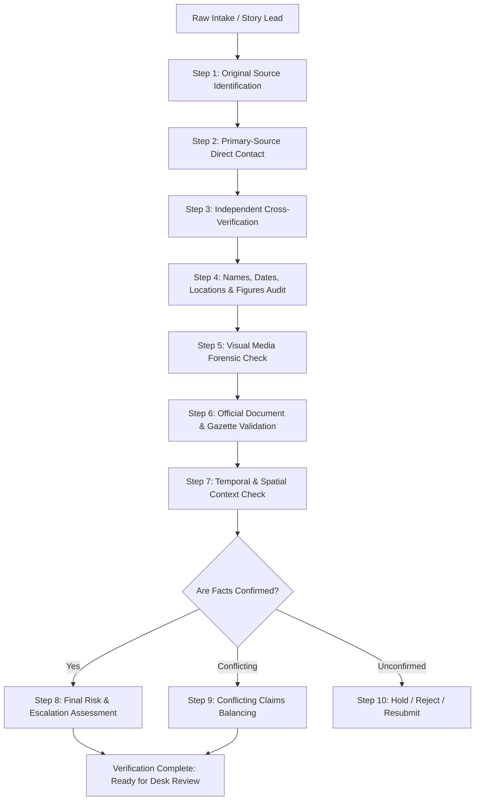

1. **Original Source Identification:** Identify the precise genesis of the claim. Trace back through secondary aggregators, WhatsApp forwards, or press releases to the foundational primary origin.
2. **Primary-Source Verification:** Direct verbal or physical contact with the primary parties involved (e.g., interviewing the eyewitness, contacting the designated spokesperson, inspecting the physical accident site).
3. **Independent Cross-Verification:** Require at least two independent, unrelated sources for any non-official claim or controversial accusation. Two social media posts repeating the same wire rumor do not constitute two independent sources.
4. **Audit of Names, Designations, Dates, Locations & Numbers:** Ensure exact spelling of names in Hindi and English, accurate official designations, precise administrative boundaries (Tehsil, District, Police Station jurisdiction), verified timestamps, and mathematical sanity of figures.
5. **Visual Media Forensic Verification:** Reverse-image search all submitted photographs. Inspect EXIF metadata where available. Verify weather patterns, architectural landmarks, uniforms, and vehicle registration plates against the claimed date and location.
6. **Official Document & Gazette Validation:** Ensure FIR copies, court orders, press releases, or government notifications are cross-checked against official department portals (e.g., e-Courts, State Police portals, Gazette notifications).
7. **Context & Chronology Check:** Guard against recycled archival news masquerading as breaking incidents. Verify that old viral videos from past years or different states are not falsely pegged to a contemporary incident.
8. **Handling Unverified Information:** If a breaking detail cannot be verified immediately but possesses urgent public safety value (e.g., an active road closure, chemical leak, or flood warning), it may only be published if explicitly framed as unconfirmed official advice, with senior editor sign-off.
9. **Handling Conflicting Reports:** When two credible institutions issue contradictory claims (e.g., police report states 2 injured, hospital bulletin states 5 injured), both figures must be published transparently with explicit attribution to their respective sources.
10. **Escalation of High-Risk Stories:** Stories involving communal clashes, custodial deaths, allegations against constitutional authorities, sexual offenses, or national security must automatically escalate to the Senior Editor and Legal Counsel before publication.

### 4.2 Verification Status State Machine

To enforce verification rigor programmatically within the platform's database and UI, every draft must carry a structured `verification_status` field governed by the following state transitions:

| Status Code | Status Name (Hindi / English) | Operational Definition | Permitted Roles to Assign | Publishing Permitted? |
| :--- | :--- | :--- | :--- | :--- |
| `VERIF_UNVERIFIED` | अपुष्ट (Unverified) | Story draft contains raw claims, leads, or wire text that have not undergone primary verification. | Reporter, AI Agent, RSS Engine | **NO** (Strictly blocked) |
| `VERIF_IN_PROGRESS` | सत्यापन जारी (Verification in Progress) | Reporter or desk editor is actively contacting sources, collecting documents, or reviewing evidence. | Reporter, Desk Editor | **NO** (Strictly blocked) |
| `VERIF_PARTIAL` | आंशिक सत्यापित (Partially Verified) | Core incident confirmed, but specific sub-claims (casualty numbers, names, motive) remain unconfirmed. | Desk Editor, Senior Editor | **CONDITIONAL** (Only with developing story tag & senior approval) |
| `VERIF_VERIFIED` | पूर्णतः सत्यापित (Verified) | All key factual claims, visual media, dates, and names cross-verified against primary records. | Desk Editor, Senior Editor, Admin | **YES** |
| `VERIF_REJECTED` | अस्वीकृत (Rejected) | Claim proven false, fabricated, defamatory, duplicate, or lacking sufficient evidentiary foundation. | Desk Editor, Senior Editor, Admin | **NO** (Archived with audit reason) |
| `VERIF_SENIOR_REVIEW` | वरिष्ठ संपादकीय समीक्षा अपेक्षित (Requires Senior Review) | High-risk, legally sensitive, or communal story requiring multi-editor consensus and legal audit. | Desk Editor, Senior Editor | **NO** (Awaiting Senior Editor sign-off) |

---

## 5. Source Reliability, Categorization & Attribution Standards

The credibility of a newsroom is determined by the rigor with which it categorizes and evaluates its sources. Every source must be evaluated against standard risk parameters:

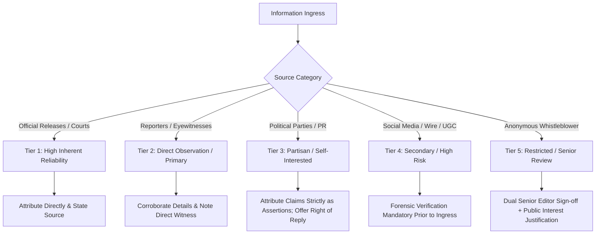

### 5.1 Comprehensive Source Reliability Matrix

| Source Category | Inherent Reliability | Verification Protocol Required | Corroboration Mandatory? | Mandatory Attribution Standard | Key Operational Risks & Failure Modes |
| :--- | :--- | :--- | :--- | :--- | :--- |
| **Government Releases & Portals** | High | Check official domain (`gov.in`, `nic.in`), verify press release ID, confirm issuance date. | No (for official stance) | *"सरकारी विज्ञप्ति के अनुसार"*, *"मंत्रालय द्वारा जारी आदेशानुसार"* | Bureaucratic spin, out-of-date policy drafts, misinterpretation of administrative circulars. |
| **Police & District Administration** | High | Contact designated Public Relations Officer (PRO) or Superintendent of Police (SP); confirm written press note. | Yes (if describing active encounter, protest, or contested crime) | *"जिलाधिकारी के अनुसार"*, *"पुलिस क्षेत्राधिकारी (CO) ने बताया कि"* | Premature police narratives, unverified confession leaks, uncritical acceptance of official accounts in custodial matters. |
| **Courts & Official Legal Filings** | Very High | Obtain certified or e-Courts copy of petition, affidavit, order, or judgment. Verify case number and bench. | No (for court proceedings) | *"उच्च न्यायालय के आदेशानुसार"*, *"दाखिल आरोप-पत्र (Chargesheet) के मुताबिक"* | Confusing an oral observation during arguments with a final binding ruling; reporting stay orders incorrectly. |
| **Political Parties & Spokespersons** | Moderate to Low (Partisan) | Record audio/video of statement; verify spokesperson authorization; check press release letterhead. | Yes (Mandatory to verify underlying factual claims) | *"पार्टी प्रवक्ता के दावों के अनुसार"*, *"विपक्षी दल ने आरोप लगाया कि"* | Unsubstantiated personal attacks, weaponized half-truths, electoral propaganda masquerading as policy news. |
| **Accredited Field Reporters** | High | Review reporter field notes, geotagged photographs, voice recordings, and direct witness contacts. | No (trusted field observations within assigned beat) | *"हमारे संवाददाता [नाम/स्थान] के अनुसार"* | Personal bias, localized pressure, vulnerability to local political or mafia coercion, confirmation bias. |
| **Eyewitnesses at Incident Site** | Moderate | Cross-interview at least two independent witnesses; verify their physical presence via location and time check. | Yes (Mandatory corroboration with physical evidence) | *"मौके पर मौजूद प्रत्यक्षदर्शियों के अनुसार"* | Post-traumatic panic exaggeration, distorted perception, rumor contagion, intentional false testimony. |
| **Corporate & Commercial PR** | Low to Moderate | Verify claims against independent regulatory filings (MCA, SEBI, ROC), audited statements, or industry experts. | Yes (Mandatory independent audit) | *"कंपनी द्वारा जारी बयान के अनुसार"* | Hyperbolic business claims, disguised marketing puffery, greenwashing, concealment of financial distress. |
| **Established Wire Agencies (PTI, UNI, etc.)** | High | Verify wire timestamp, confirm wire slug, check for subsequent correction bulletins. | No (except for high-consequence breaking casualty claims) | *"समाचार एजेंसी [नाम] के हवाले से"* | Automated ingestion of wire typos, cascading errors across syndicated networks, loss of hyper-local context. |
| **RSS Feeds & Syndicates** | Moderate | Check against authorized active RSS registry; verify upstream URL; run automated duplicate check. | Yes (Mandatory desk verification before publish) | *"संबंधित स्रोत [नाम] की रिपोर्ट के मुताबिक"* | Ingestion of stale/archived news, content farms, scraping manipulated aggregators, copyright breaches. |
| **Social Media Posts (X, Facebook, YouTube)** | Low | Verify official blue/gold badge, inspect historical account behavior, verify telephone/email contact of poster. | Yes (Absolute requirement; never publish based purely on social post) | *"सोशल मीडिया मंच [नाम] पर किए गए दावे के अनुसार"* | Account hack, deepfakes, coordinated bot swarm amplification, deceptive video trimming, unverified gossip. |
| **User-Generated Content (UGC / WhatsApp)** | Very Low | Run reverse image search; examine file EXIF; conduct direct voice interview with submitter; sign off consent. | Yes (Mandatory field reporter physical check) | *"नागरिक द्वारा उपलब्ध कराए गए वीडियो/विवरण के अनुसार"* | Malicious fabrication, staged confrontations, old viral clips presented as current incidents, identity fraud. |
| **Anonymous Sources (Whistleblowers)** | High Risk | Senior Editor and Legal Counsel must know source identity; verify documentation; verify absence of personal vendetta. | Yes (Mandatory documentary proof required) | *"नाम न छापने की शर्त पर एक वरिष्ठ अधिकारी ने बताया कि"* | Weaponization of newsroom for bureaucratic vendettas, fabricated leaks, severe defamation liability. |

### 5.2 Strict Anonymous Source Governance
1. **The Principle of Last Resort:** Anonymous sources may only be utilized when the information is of critical, undeniable public interest, cannot be obtained via public records or on-the-record interviews, and where on-the-record disclosure poses a clear threat to the source's physical safety, livelihood, or liberty.
2. **Identity Disclosure to Senior Editorial Management:** Anonymity is granted by BREAKING NEWS WALA as an institution, not by an individual reporter alone. The reporter must disclose the source's true identity, professional position, and evidentiary documentation to the Senior Editor in strict confidence.
3. **Prohibition on Anonymous Allegations:** Anonymous sources must never be used to publish personal attacks, character assassinations, moral slurs, or uncorroborated criminal allegations against any individual or entity.
4. **Public Interest Justification Audit:** Every article containing anonymous attribution must have a signed internal memorandum logged in the CMS audit trail documenting: (a) Why on-the-record sources were unavailable, (b) The corroborating evidence reviewed, and (c) The Senior Editor's explicit written authorization.


---

## 6. Breaking News & Developing Story Operational Policy

Breaking news represents the most volatile phase of news production. In the rush to report fast-moving developments, errors of fact, inflated casualty counts, and unverified allegations are most likely to occur. The following operational standards apply to all breaking news reporting:

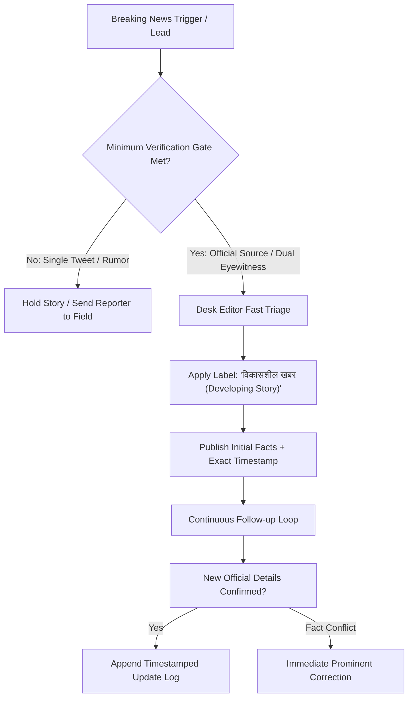

### 6.1 Speed versus Accuracy Principle
1. **Accuracy is Paramount:** It is infinitely better to be second and accurate than to be first and wrong. A speed advantage of five minutes does not justify the reputational, legal, and human harm of publishing a false casualty figure, incorrect name, or defamatory accusation.
2. **The "Breaking News" Label Restriction:** The label *"ब्रेकिंग न्यूज़ (Breaking News)"* is an editorial marker reserved strictly for urgent, high-consequence events occurring in real-time (e.g., major transportation accidents, natural disasters, high-level administrative decisions, major security alerts). It must **never** be used for evergreen stories, opinion pieces, promotional features, or routine press releases merely to inflate click-through rates.

### 6.2 Minimum Verification Threshold Before Publication
Before any breaking alert, ticker update, or push notification is dispatched, at least one of the following minimum thresholds must be satisfied:
- Direct confirmation from an on-duty administrative, police, fire, or hospital official.
- On-the-scene confirmation from an accredited field correspondent or verified trusted reporter who is physically present.
- A verified dispatch from a Tier-1 national news agency (PTI/UNI) that matches localized physical conditions.

### 6.3 Standards for Developing Stories
1. **Mandatory Visual Tagging:** Every article published during an active, unfolding event must prominently display the UI tag: **"विकासशील खबर (Developing Story) — जैसे-जैसे नई जानकारियां मिलेंगी, इस खबर को अपडेट किया जाएगा।"**
2. **Timestamp and Revision Chronology:** The article must display both the original publication timestamp (`datePublished`) and the latest revision timestamp (`dateModified`) in ISO 8601 format. Readers must see a visible change log detailing what new facts were added at each update interval (e.g., *"अपडेट (14:35 IST): अग्निशमन विभाग ने आग पर काबू पाने की पुष्टि की"*).
3. **Prohibition of Speculative Casualty Figures:**
   - Reporters and editors must never guess or quote unofficial estimates of dead or injured persons.
   - When figures are unknown or evolving, use exact administrative phrasing: *"अधिकारियों के अनुसार हताहतों की संख्या की पुष्टि की जा रही है"* or *"जिला प्रशासन ने अब तक 3 लोगों के घायल होने की पुष्टि की है।"*
   - Avoid ambiguous phrases like *"दर्जनों लोगों के मारे जाने की आशंका"* unless directly quoting an on-record emergency response commander.
4. **Protection of Identity in Accidents & Fatalities:**
   - Names of deceased or seriously injured persons must not be published until their immediate families have been officially informed by police or district administration.
   - Initial breaking reports must state only verified demographics if confirmed (e.g., *"एक 35 वर्षीय पुरुष"*), preserving family privacy during acute trauma.

---

## 7. Political & Public-Affairs Reporting Safeguards

Political reporting forms the bedrock of democratic accountability. However, political contests are characterized by aggressive rhetoric, strategic leaks, partisan spin, and personal attacks. BREAKING NEWS WALA enforces strict neutrality and verification protocols across all political coverage:

### 7.1 Impartiality and Equal Treatment
- The platform maintains complete editorial independence from all political parties, electoral alliances, ideological formations, and interest groups.
- Coverage during election campaigns must be fair, proportionate, and strictly focused on governance records, policy manifestos, public welfare issues, and verified citizen grievances.
- Editors must ensure that space, headline tone, and analytical scrutiny are applied equitably across ruling and opposition parties.

### 7.2 Clear Demarcation of Political Claims vs. Established Facts
- A press release or speech by a political figure does not transform an allegation into an established fact.
- Every claim must be explicitly attributed: *"विपक्षी दल के नेता ने आरोप लगाया कि..."*, *"सत्तारूढ़ दल के प्रवक्ता का दावा है कि..."*.
- Headlines must never state an unverified political allegation as a statement of objective truth.

```
INCORRECT HEADLINE: "विधायक ने किया 50 करोड़ का घोटाला" (Defamatory; states allegation as proven fact)
CORRECT HEADLINE:   "विधायक पर 50 करोड़ के गबन का आरोप, विपक्ष ने की जांच की मांग; विधायक ने बताया निराधार"
```

### 7.3 Mandatory Right of Reply Protocol
1. **Immediate Opportunity to Respond:** When a story contains severe allegations of corruption, criminality, moral turpitude, or professional misconduct against an identifiable individual, party, or institution, the reporter and editor have a mandatory duty to seek their response prior to publication.
2. **Documenting the Outreach:** If the subject cannot be reached, the article must explicitly document the attempt: *"इस संबंध में विधायक [नाम] से दूरभाष पर संपर्क करने का प्रयास किया गया, परंतु उनका उत्तर प्राप्त नहीं हुआ। उनका पक्ष प्राप्त होने पर खबर में शामिल किया जाएगा।"*
3. **Fair Presentation of Defense:** When a response is provided, it must be reported with equal prominence and fairness, without snide commentary or dismissive editorializing.

### 7.4 Safeguards Against Disinformation & Manipulated Media
- **Speech Trimming Defense:** Editors must never selectively edit speeches, press conferences, or interviews in a manner that strips away critical context, reverses the speaker's stated intention, or creates a false impression.
- **Weaponized Leaks:** Selective document leaks from investigative agencies or political war rooms must be treated with acute skepticism. The source's motivation must be evaluated, and the underlying documents verified independently through official filings.

---

## 8. Crime, Accident, Violence & Legal Reporting Architecture

Crime and legal reporting carry severe constitutional, legal, and human ramifications. A single inaccurate report can destroy an innocent citizen's life, compromise a police investigation, or invite contempt of court.

### 8.1 The Strict Hierarchy of Legal Status Terminology
Reporters, desk editors, and AI prompts must scrupulously adhere to the precise legal meaning of criminal justice milestones under Indian law:

| Legal Milestone | Precise Hindi Term | Correct Journalistic Usage | Prohibited Usage / Critical Failure Mode |
| :--- | :--- | :--- | :--- |
| **Allegation / Complaint** | आरोप / शिकायत | *"पीड़ित पक्ष ने मारपीट की शिकायत दर्ज कराई"* | Never describe the alleged conduct as an established crime before police registration. |
| **First Information Report (FIR)** | प्रथम सूचना रिपोर्ट (FIR) | *"पुलिस ने मामले में एफआईआर दर्ज कर जांच शुरू की"* | An FIR is merely an entry of information; it is NOT proof of guilt, nor is it a final judicial finding. |
| **Investigation** | जांच / विवेचना | *"पुलिस दल घटनास्थल पर साक्ष्य जुटा रहा है"* | Speculating on motives or leaking selective police interrogation claims as verified truths. |
| **Detention / Questioning** | हिरासत / पूछताछ | *"संदेह के आधार पर दो युवकों से पूछताछ जारी है"* | Confusing questioning or detention with formal arrest. |
| **Formal Arrest** | विधिवत गिरफ्तारी | *"पुलिस ने आरोपी को औपचारिक रूप से गिरफ्तार किया"* | Never refer to an arrested person as a *"अपराधी (Criminal)"* or *"दोषी (Guilty)"*. Use *"आरोपी (Accused)"*. |
| **Chargesheet (Final Report)** | आरोप-पत्र (चार्जशीट) | *"जांच अधिकारी ने न्यायालय में आरोप-पत्र दाखिल किया"* | Stating that filing of a chargesheet equals conviction; chargesheet reflects police claims awaiting trial. |
| **Trial Proceedings** | न्यायिक विचारण (ट्रायल) | *"अदालत ने गवाहों के बयान दर्ज किए"* | Reporting oral exchanges or questions between judge and counsel as a binding judicial ruling. |
| **Conviction** | दोषसिद्धि (दोषी करार) | *"अदालत ने आरोपी को हत्या के अपराध में दोषी ठहराया"* | Valid to use *"दोषी (Convicted)"* only after formal court judgment pronouncing guilt. |
| **Acquittal / Discharge** | दोषमुक्त / बरी | *"साक्ष्यों के अभाव में अदालत ने सभी को बाइज्जत बरी किया"* | Ignoring acquittals of individuals whose arrests were previously highlighted with sensational coverage. |

### 8.2 Innocence Presumption & Human Rights Safeguards
- **Presumption of Innocence:** Every person accused of an offense is presumed innocent until proven guilty by a competent court of law.
- **Dignity of Accused & Custodial Safeguards:** Media trials, parades of handcuffed suspects before cameras, and sensationalized "confessions" extracted in police custody have zero evidential value in court and must be reported with extreme restraint.
- **Protection of Ongoing Investigations:** Do not broadcast operational police details, rescue routes, tactical positions during anti-terrorist or hostage operations, or names of undercover officers that could jeopardize lives.

---

## 9. Sensitive Content, Minors, Vulnerability & Human Dignity Policy

Certain categories of human tragedy require heightened ethical vigilance, strict identity shields, and mandatory senior editorial oversight:

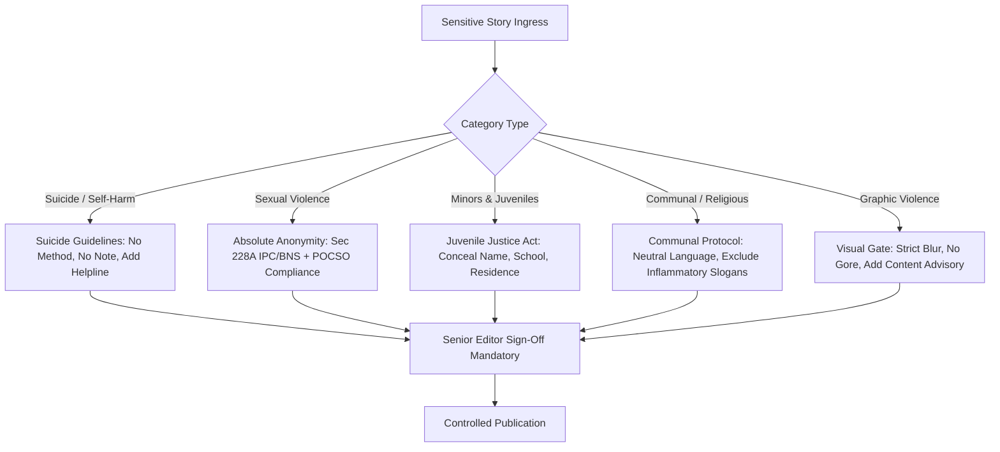

### 9.1 Reporting on Suicide and Self-Harm
1. **World Health Organization (WHO) Compliance:** Suicide reporting must follow international best practices to prevent suicide contagion (the "Werther Effect").
2. **Strict Prohibition on Methods and Locations:** Never report the specific technical method, toxic substance name, knots, or precise anatomical mechanics of suicide or self-harm.
3. **No Suicide Notes or Sensational Motives:** Suicide notes must never be published or quoted verbatim. Do not simplify complex psychological distress into simplistic triggers (e.g., *"परीक्षा में फेल होने पर उठाया खौफनाक कदम"*).
4. **Mandatory Helpline Information:** Every story discussing suicide or mental distress must conclude with an active, verified Indian suicide prevention helpline:
   > *"यदि आप या आपके जानने वाले किसी प्रकार के मानसिक तनाव या संकट से जूझ रहे हैं, तो कृपया राष्ट्रीय मानसिक स्वास्थ्य हेल्पलाइन 'किरण' (KIRAN) के टोल-फ्री नंबर 1800-599-0019 या टेली-मानस (Tele-MANAS) नंबर 14416 पर संपर्क करें। मदद हमेशा उपलब्ध है।"*

### 9.2 Complete Identity Protection in Sexual Offenses (POCSO & Section 228A IPC/BNS)
1. **Absolute Statutory Shield:** Pursuant to Section 228A of the Indian Penal Code (and corresponding Bharatiya Nyaya Sanhita provisions) and Section 23 of the POCSO Act, the identity of any victim of rape, sexual assault, or child abuse must **never** be disclosed directly or indirectly.
2. **Prohibition on Collateral Identifiers:** Never publish the victim's name, photograph, exact residential address, parents' names, school/college name, workplace, or small village neighborhood if that information could lead to their identification.
3. **Deceased Victims Included:** This statutory and ethical protection applies equally to living and deceased victims, regardless of any permission granted by family members, unless explicitly permitted by a written order of a competent High Court or the Supreme Court.

### 9.3 Protection of Minors and Juveniles
- Pursuant to Section 74 of the Juvenile Justice (Care and Protection of Children) Act, 2015, no report shall disclose the name, address, school, or any particulars calculated to lead to the identification of any child in conflict with law or a child in need of care and protection.
- Faces of minors involved in accidents, crimes, or distress must be blurred, and pseudonyms used where necessary.

### 9.4 Communal, Caste and Religious Sensitivities
- Reporting on communal clashes, religious disputes, or caste-based violence requires extraordinary restraint to prevent inflaming tensions or inciting mass violence.
- **Neutral Administrative Phrasing:** Use neutral, factual terminology (e.g., *"दो पक्षों के बीच विवाद"*, *"तनावपूर्ण स्थिति"*). Do not identify specific communities in headlines unless the communal nature of the event is officially affirmed by district administration.
- **No Propagation of Hate Speech:** Hate speeches, derogatory slurs against religious figures, or calls to violence must not be amplified or broadcast on video players.
- **Mandatory Senior Editorial Sign-off:** No story involving communal riots or religious desecration may be approved or published without the direct written sign-off of the Senior Editor.


---

## 10. RSS Feeds & External Content Intake Editorial Policy

The RSS and external URL-to-News ingestion engines (`WF-RSS-01`, `WF-RSS-02`, `WF-URL-01`) provide automated monitoring of verified news feeds and syndication partners. While these automated pipelines accelerate news discovery, external intake introduces significant risks of copyright violation, stale news ingestion, and unverified syndication errors.

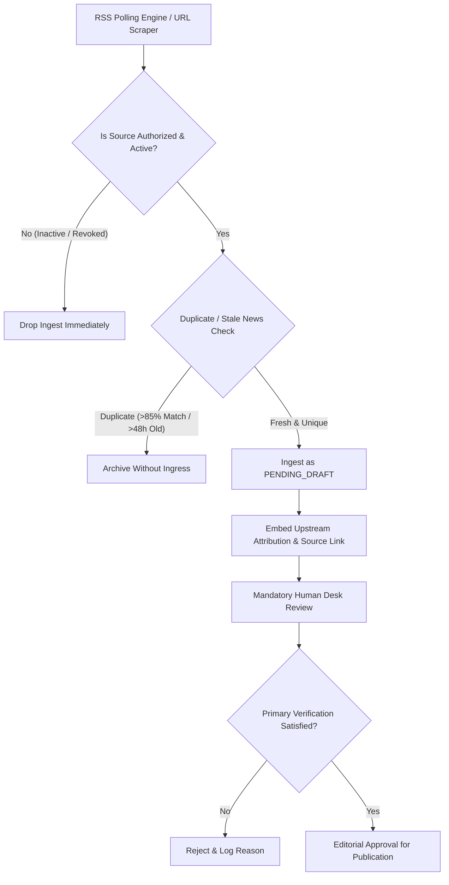

### 10.1 The Eight Non-Negotiable External Ingest Rules
1. **No Automatic Approval:** An RSS feed item or URL-scraped story is **never** automatically approved or published. Every imported item lands strictly in `status = DRAFT` / `verification_status = VERIF_UNVERIFIED`.
2. **External URL is Not Proof of Truth:** The mere fact that a claim was published on a third-party website, digital blog, or RSS feed does not constitute evidence of its factual accuracy.
3. **Active Authorization Whitelist:** Only sources formally registered in the Admin RSS Management database with `is_active = TRUE` and authenticated via `WF-RSS-01` may generate drafts.
4. **Instant Ingestion Cut-off on Deactivation:** If a source is toggled to `is_active = FALSE` or deleted, the backend ingestion cron must immediately cease polling that endpoint. Any unprocessed drafts from that source must be flagged for senior review.
5. **Mandatory Immutable Source Attribution:** All imported stories must maintain permanent metadata links to the originating publisher, canonical source URL, and syndication feed ID.
6. **No Distortion During AI Synthesis / Rewriting:** When an editor utilizes AI summarization or vernacular rewriting on an imported article, the system must not alter, exaggerate, or omit the core factual context of the original reporting.
7. **No Wholesale Plagiarism or Excessive Copying:** Full-text reproduction of third-party copyrighted news articles is strictly prohibited under Indian copyright law. The newsroom must summarize, independently report, add local context, or quote excerpts under recognized Fair Dealing provisions.
8. **Licensing and Syndicate Compliance:** Syndicated wire services (PTI, UNI, IANS) and commercial content partners must have active, verified contractual agreements on file before their feeds are integrated.

---

## 11. AI-Assisted Newsroom Operations & Ethical AI Governance

The integration of generative artificial intelligence and autonomous AI agents (`docs/17-Agents.md`, `docs/19-API-Pool.md`, `docs/21-Prompts.md`) offers substantial efficiency gains for the newsroom. However, algorithmic tools possess zero moral consciousness, no legal liability, and an inherent propensity for factual hallucinations. 

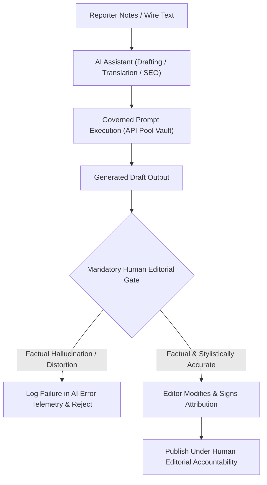

### 11.1 The Ten Mandatory AI Principles
1. **AI Output is Inherently Unverified:** Every piece of text, headline suggestion, translation, summary, or categorization produced by an LLM is treated as an unverified rough draft.
2. **Absolute Prohibition on AI Fabrication:** AI models must **never** be permitted or prompted to invent quotes, interview statements, witness names, dates, casualty figures, village names, or police station jurisdictions.
3. **Cross-Checking AI Claims:** Any factual claim introduced or synthesized by an AI tool that was not present in the primary reporter field notes must be independently cross-checked against reliable human sources.
4. **No Autonomous Publishing by AI:** No AI agent, automated pipeline, cron script, or algorithm possesses the permission to transition an article to `status = PUBLISHED`. The publishing transition requires an authenticated human session token.
5. **Human Editorial Accountability:** In all instances, legal, ethical, and editorial responsibility for published content rests entirely upon the human desk editor and bureau chief who authorized the publication. Saying *"the AI hallucinated it"* is not an acceptable legal or editorial defense.
6. **Integrity of Documentary Photographs:** AI image generators (e.g., Imagen, Midjourney) must **never** be used to generate synthetic images that masquerade as real-world news photographs of actual events, crimes, accidents, or public personalities.
7. **Synthetic Media Disclosure:** Where AI-generated graphics, diagrams, or artistic concept art are published, they must carry a conspicuous, permanent visual watermark and caption: **"प्रतीकात्मक चित्र / AI जनरेटेड ग्राफिक (Illustrative / AI-Generated Graphic)"**.
8. **Strict Governance via Prompt Library & API Pool:** Newsroom staff must only use approved, centralized prompt templates managed in `docs/21-Prompts.md` through the secure Multi-Provider AI API Pool (`docs/19-API-Pool.md`). Ad-hoc, unmonitored consumer AI tools must not be used for newsroom production.
9. **Mandatory Human Review for Sensitive Content:** AI tools must not process sensitive crime, sexual offense, communal dispute, or suicide reporting without active real-time oversight by a Senior Editor.
10. **Auditing and Hallucination Telemetry:** Any instance where an AI model introduces fabricated quotes, false numbers, or defamatory statements must be immediately flagged, recorded in the AI audit log, and reported to the Prompt Engineering Board for template revision.

### 11.2 Reader Disclosure Framework for AI Assistance
- **Routine Linguistic Assistance (No Disclosure Required):** Routine spelling correction, grammar smoothing, headline suggestions selected and edited by human journalists, and metadata tagging do not require a public reader badge.
- **Substantive AI Synthesis / Translation (Disclosure Recommended):** When an entire English wire report or government document is translated and synthesized into Hindi primarily via AI with human editorial review, an editorial note should state: *"यह खबर प्राथमिक स्रोतों और एजेंसी रिपोर्टों के आधार पर एआई भाषा अनुवाद और संपादकीय समीक्षा के साथ तैयार की गई है।"*
- **Illustrative Graphics & Synthetic Media (Mandatory Disclosure):** All non-photographic visual assets created via generative AI require a mandatory disclosure badge.

---

## 12. Hindi-First Language, Headline, Body & Style Guide

BREAKING NEWS WALA is an unapologetically Hindi-first platform designed to communicate with millions of citizens across Tier-1, Tier-2, and rural heartlands. Our language must balance dignified journalistic prose (मानक हिंदी) with natural, accessible vernacular idiom.

### 12.1 Language Philosophy and Grammar Standards
- **Natural, Accessible Hindi:** Use clear, flowing, contemporary Hindi that resonates with everyday readers while maintaining grammatical rigor. Avoid stilted, archaic Sanskritized vocabulary that confuses readers, as well as vulgar, crude street slang that degrades newsroom dignity.
- **Accurate Devanagari Typography:** Ensure precise orthography, proper matras, accurate anusvara/chandrabindu usage, and correct word spacing.
- **Technical & Administrative Precision:** When reporting on government schemes, legal statutes, police terms, or modern technology, use established Hindi terms alongside their common English counterparts in parentheses where clarification is beneficial:
  - *उदा.: "प्रथम सूचना रिपोर्ट (FIR)", "जमानत याचिका (Bail Plea)", "उप-जिलाधिकारी (SDM)"*

### 12.2 Headline and Body Architectural Standards

| Editorial Element | Permitted Standards & Best Practices | Strictly Prohibited Patterns |
| :--- | :--- | :--- |
| **Main Headlines** | - 50 to 60 characters for optimal display.<br>- Must state the core verified development clearly.<br>- Active voice, factual phrasing.<br>- Accurate reflection of article body. | - Clickbait or artificial cliffhangers (*"यह देखकर आपके होश उड़ जाएंगे"*).<br>- Sensational adjectives (*"महा-विस्फोट", "थर्राया"*).<br>- Excessive punctuation (`???`, `!!!`, `...!`).<br>- Stating allegations as proven facts. |
| **Subheadings & Intros** | - 1 to 2 concise sentences expanding on the who, what, when, and where.<br>- Contextualizes why the news matters. | - Repeating the exact headline verbatim.<br>- Irrelevant background fillers. |
| **Article Body** | - Inverted pyramid structure (most critical facts first, followed by secondary details and background).<br>- Short, scannable paragraphs (2 to 4 sentences each).<br>- Clear paragraph breaks with descriptive subheadings. | - Meandering, repetitive walls of text.<br>- Personal editorializing by the reporter in news columns (*"मुझे लगता है कि..."*). |
| **Direct Quotes** | - Exact words spoken by the source enclosed in standard quotation marks (`"..."`).<br>- Attribution must clearly name the speaker and their official designation. | - Inventing, altering, or synthesizing quotes.<br>- Removing qualifying context from a speaker's quote. |
| **Captions & Visual Alt Text** | - Descriptive Hindi caption stating who is pictured, where, when, and the credit.<br>- Example: *"मेरठ कलेक्ट्रेट में ज्ञापन सौंपते किसान संघ के प्रतिनिधि (फोटो: संवाद न्यूज एजेंसी)"* | - Generic non-descriptive captions (*"घटनास्थल का फोटो"*).<br>- Leaving image alt text empty. |
| **Breaking News Alerts / Ribbons** | - Ultra-concise (under 120 characters).<br>- Confined strictly to verified, unfolding developments.<br>- Always accompanied by an ISO timestamp. | - Using breaking alert ribbons for routine updates or promotional announcements. |

---

## 13. Visual Media, Video Studio, Audio & Copyright Architecture

Visual media has immense psychological impact. Deceptively cropped photographs, out-of-context video clips, and uncredited imagery represent severe breaches of journalistic ethics.

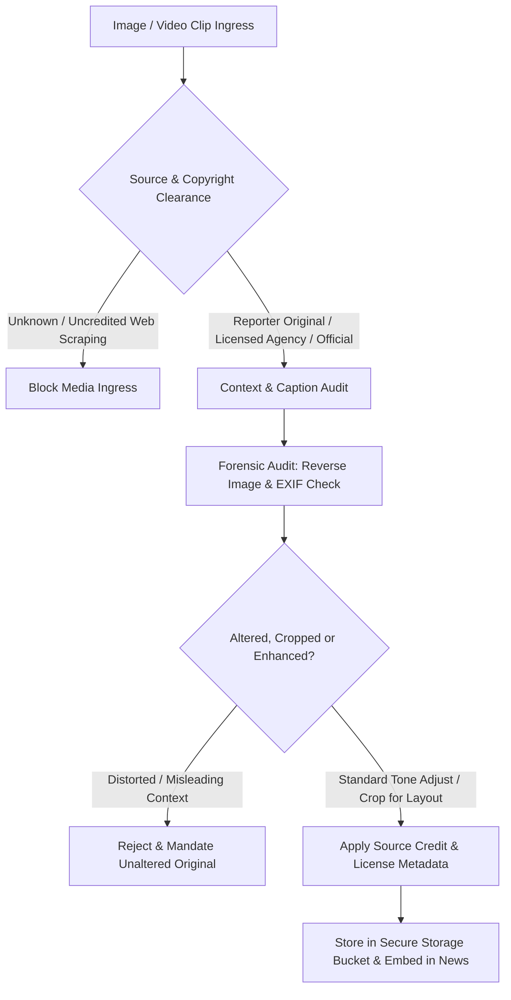

### 13.1 Categorization and Sourcing of Visual Content
1. **Original Field Photographs:** Photographs taken by accredited BREAKING NEWS WALA reporters. Must retain original EXIF metadata in raw archives and carry the reporter's byline credit.
2. **Licensed Wire Agency Media:** Images sourced from contracted agencies (PTI, Getty, Reuters). Must be credited strictly pursuant to agency licensing agreements.
3. **Official Public Relations Releases:** Photos distributed by government departments (PIB, DIPR, Police PR). Must be credited to the issuing agency: *"फोटो सौजन्य: सूचना एवं जनसंपर्क विभाग"*.
4. **User-Submitted and Social Media Footage:** Must be subjected to rigorous forensic examination (reverse-image search, landmark verification). Submitters must grant explicit written or digital publishing consent.
5. **CCTV and Surveillance Video:** CCTV clips must be verified against official police custody chains or direct merchant records. Video must be contextualized with exact camera location and timestamp.
6. **Archival & File Footage:** When publishing historical photographs or videos to illustrate a current story, they must be permanently labeled: **"फाइल फोटो / File Photo"** to prevent misleading readers.

### 13.2 Graphic Media, Gore and Deceased Privacy Safeguards
- **Prohibition on Ghoulish Imagery:** Mutilated corpses, severe burn trauma, pool of blood close-ups, and graphic physical injuries must **never** be shown in full detail.
- **Mandatory Blurring:** Where an image is essential to document an accident or violence, severe wounds, blood, and deceased human bodies must be heavily obscured using blur filters in the Graphics Studio.
- **Content Advisory Warnings:** Any story containing disturbing visuals must display a prominent reader advisory: **"सावधानी: इस खबर में दुर्घटना/हिंसा से संबंधित विचलित करने वाले दृश्य हो सकते हैं।"**
- **Strict Video Studio Rendering Standards:** Video edits produced via `docs/05-Workflows.md` (`WF-VID-01`) must not insert dramatic thriller sound effects, horror music, or blood splatter overlays into real-world tragedy reporting.


---

## 14. Corrections, Errata, Updates & Retractions Policy

Factual errors degrade public trust. The hallmark of an ethical newsroom is not the claim of infallibility, but the promptness, transparency, and integrity with which it acknowledges and corrects mistakes.

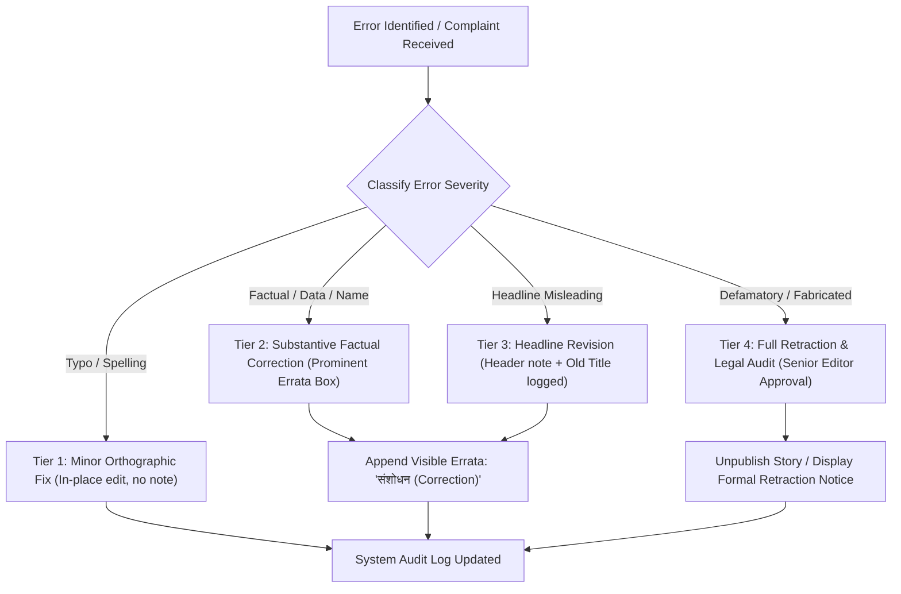

### 14.1 The Eight Classes of Editorial Rectification

| Rectification Category | Operational Definition | Who Initiates? | Who Approves? | Visible Public Note Required? | Internal Version Preserved? | Reader Notification? |
| :--- | :--- | :--- | :--- | :--- | :--- | :--- |
| **1. Minor Spelling / Typo** | Inconsequential grammar, misspelling, or punctuation fix that does not alter factual meaning. | Reporter, Desk Editor | Desk Editor | No (Silent in-place edit permitted) | Yes (In database audit history) | No |
| **2. Factual Correction** | Error in name, age, designation, number, date, location, or attribution of a statement. | Any User, Reporter, Editor | Desk Editor, Senior Editor | **YES (Mandatory Errata Box at top or bottom)** | Yes (Full diff preserved) | Optional (In app feed) |
| **3. Headline Correction** | Headline was inaccurate, exaggerated, or in conflict with verified facts in body. | Desk Editor, Reader | Senior Editor | **YES (Explicit note stating headline was changed)** | Yes (Previous headline logged) | Yes (If push notification was sent) |
| **4. Major Article Overhaul** | Substantive rewrite necessitated by fundamentally flawed initial premise or major new developments. | Senior Editor | Senior Editor, Admin | **YES (Detailed editorial note explaining the update)** | Yes (Complete historical snapshots) | Yes |
| **5. Clarification** | Story was factually true but language invited misinterpretation or lacked essential context. | Concerned Subject, Editor | Desk Editor, Senior Editor | **YES (Clarification box specifying nuanced context)** | Yes | No |
| **6. Developing Story Update** | Adding newly confirmed details, casualty numbers, or official statements as an event unfolds. | Reporter, Desk Editor | Desk Editor | **YES (Timestamped update bullet e.g., 'Update: 15:00 IST')** | Yes | Yes (For major developments) |
| **7. Formal Retraction** | Story is discovered to be entirely false, based on fabricated documents, or legally indefensible. | Legal Counsel, Senior Editor | Senior Editor, Super Admin | **YES (Article body replaced with Formal Retraction Notice)** | Yes (Permanent legal escrow retention) | Yes (Prominent public broadcast) |
| **8. Removal from Public Display (Takedown)** | Court-ordered takedown, extreme danger to life, or compliance with statutory privacy orders. | Legal Counsel, Admin | Super Admin, Legal Counsel | **YES (HTTP 410 Gone / Legal Compliance Notice displayed)** | Yes (Strictly preserved in encrypted offline legal storage) | No |

### 14.2 The "No Silent Scrubbing" Rule
- Material factual errors must **never** be silently overwritten or deleted to pretend the mistake never happened.
- The public correction notice must clearly specify: (1) What was originally stated, (2) What the corrected fact is, and (3) The date and timestamp when the correction was executed.
- Example: *"संशोधन (31 अक्टूबर 2026, 16:30 IST): इस खबर के पूर्व संस्करण में दुर्घटनाग्रस्त बस को गाजियाबाद से रवाना बताया गया था। पुलिस के अद्यतन बयान के अनुसार बस आनंद विहार डिपो की थी। इस त्रुटि को सुधार लिया गया है।"*

---

## 15. Right of Reply, Grievance Redressal & Reader Complaints Framework

BREAKING NEWS WALA maintains an open, responsive, and institutionalized grievance redressal mechanism to ensure that affected parties and public readers have a direct, dignified path to seek accountability.

### 15.1 Statutory Alignment with Information Technology Rules, 2021
Pursuant to the Information Technology (Intermediary Guidelines and Digital Media Ethics Code) Rules, 2021:
1. **Designated Resident Grievance Officer:** The platform appoints a senior editorial officer as the Resident Grievance Officer whose name, designation, and contact details are publicly displayed on the website and app.
2. **Three-Tier Redressal Hierarchy:**
   - **Tier I (Self-Regulation by Publisher):** Direct complaint to the BREAKING NEWS WALA Grievance Desk. Acknowledgment dispatched within 24 hours; decision issued within 15 days.
   - **Tier II (Self-Regulating Body):** If the complainant is unsatisfied with the Tier I decision, the matter may be appealed to the recognized digital news self-regulatory body to which BREAKING NEWS WALA is affiliated.
   - **Tier III (Oversight Mechanism):** Compliance with central governmental review as prescribed by statutory rules.

### 15.2 Operational Complaints Handling Protocol
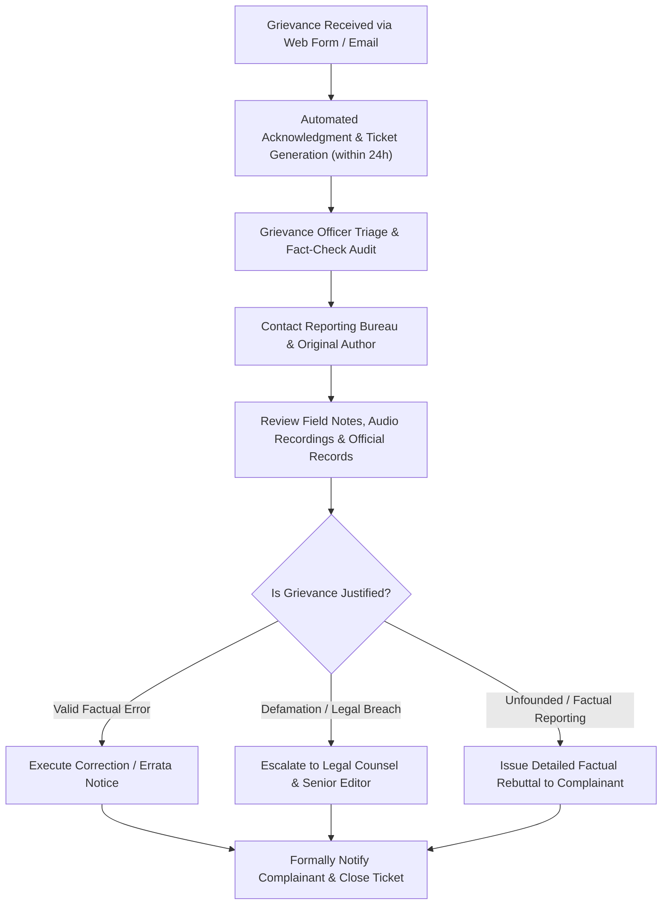

---

## 16. User-Generated Content & Reporter Responsibility Standards

The network relies on hundreds of ground reporters, field contributors, and citizen eyewitnesses. Clear lines of legal and editorial accountability are vital.

### 16.1 Categorization of Content Contributors
- **Standard Field Reporter:** An accredited or contracted journalist assigned to a specific geographical beat (District/Tehsil). Submits stories directly to the Central Editorial Review Desk (`status = PENDING_REVIEW`). Standard reporters possess **zero** direct-publishing authority.
- **Trusted Reporter:** A high-performing, verified field correspondent who has been granted fast-track publishing authority (`RULE-EDIT-002`) by the Central Administration.
- **Field Contributor / Stringer:** A freelance or part-time contributor submitting raw video clips or story leads. Must provide verifiable government ID and sign digital copyright clearance.
- **Public Reader / Citizen Journalist (UGC):** Unsolicited submissions via WhatsApp tip-lines or website portals. Must be treated as unverified tip-offs until independently investigated and confirmed by an accredited reporter.

### 16.2 Trusted Reporter Direct-Publishing Governance
Pursuant to `RULE-EDIT-002`, `RULE-EDIT-003`, `RULE-EDIT-004`, and `RULE-EDIT-008`:
1. **Territorial Boundary Enforcement:** A Trusted Reporter's fast-track publishing capability is strictly hardcoded to their officially assigned geographical jurisdiction (e.g., Meerut District). Any submission outside their designated district automatically falls back to standard editorial queue review.
2. **Real-Time Newsroom Alerts:** Whenever a Trusted Reporter publishes an article directly, a high-priority notification is broadcast via WebSocket to the Central Newsroom Desk. Desk editors have an affirmative duty to audit the live story within 10 minutes.
3. **Immediate Revocation on Breach:** Any Trusted Reporter who abuses direct-publishing privileges by broadcasting unverified rumors, defamatory personal attacks, commercial advertisements, or copyright violations will face **immediate, automated revocation** of trusted status and disciplinary suspension.

---

## 17. Advertising, Sponsored Content & Editorial Independence

Editorial credibility is entirely separate from commercial monetization. Advertisers buy commercial space; they do not buy news coverage, headline influence, or editorial silence.

### 17.1 Clear Labeling and Visual Demarcation (ASCI Compliance)
Pursuant to the guidelines of the Advertising Standards Council of India (ASCI) and `RULE-AD-001`:
1. **Mandatory Prominent Badging:** All sponsored articles, native advertisements, brand-funded features, and commercial promotions must be unambiguously labeled in prominent Devanagari script:
   - **"प्रायोजित सामग्री / Sponsored Content"** or **"विज्ञापन / Advertisement"**
2. **Visual Differentiation:** Sponsored articles must render with distinct background shading, a bordered content container, and an explicit disclaimer at the top stating: *"यह सामग्री प्रायोजक द्वारा प्रदान की गई है। इस लेख के निर्माण में ब्रेकिंग न्यूज़ वाला का संपादकीय दल शामिल नहीं है।"*
3. **Typography and Layout Separation:** Sponsored content must not mimic breaking news banners, editorial investigation badges, or official government alerts.

### 17.2 Prohibited Advertising Categories
The platform strictly rejects advertisements and sponsored campaigns promoting:
- Illegal gambling, betting apps, or unregulated financial Ponzi schemes.
- Unscientific magical remedies, fake medical cures, or superstitious amulets.
- Firearms, explosives, or illegal substances.
- Hate groups, communal organizations, or defamatory personal attack campaigns.
- Misleading surrogate advertisements for restricted products.

---

## 18. Editorial Roles, Territory Governance & Approval Matrix

Editorial responsibility must be structured hierarchically, ensuring that every published word has a designated human custodian with clear jurisdiction.

### 18.1 Editorial Roles Hierarchy

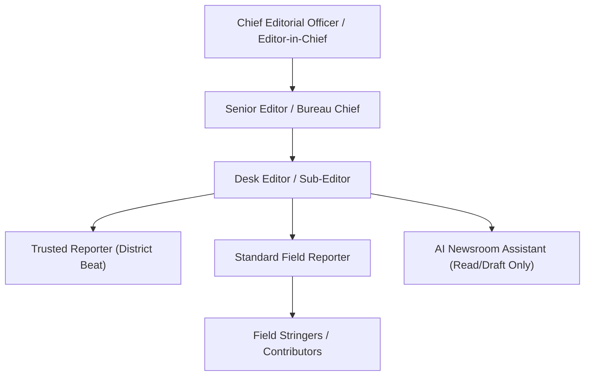

1. **Chief Editorial Officer / Editor-in-Chief:** Ultimate institutional custodian of editorial policy, supreme authority on sensitive editorial escalations, retractions, and public accountability.
2. **Senior Editor / Bureau Chief:** Oversees day-to-day newsroom operations, approves political allegations, communal incident reports, legal escalations, and major retractions.
3. **Desk Editor / Sub-Editor:** Reviews incoming drafts in the Central Review Queue, claims stories with concurrency locks, checks grammar and verification, and executes standard approvals.
4. **Trusted Reporter:** Direct-publishing authority strictly within assigned district boundaries, real-time newsroom monitoring.
5. **Standard Reporter:** Gathers news in the field, conducts interviews, writes initial drafts, attaches evidence, and submits to the queue.
6. **AI Agent (Autonomous Assistant):** Strictly assistive. Possesses **no voting, approval, or publishing authority**.

### 18.2 Comprehensive Editorial Approval Matrix

| News Category / Editorial Action | Standard Reporter | Trusted Reporter | Desk Editor | Senior Editor | Chief Editorial Officer | Legal Counsel |
| :--- | :--- | :--- | :--- | :--- | :--- | :--- |
| **Routine Local News (Civic, Weather, Sports)** | Submit Draft | Publish Directly (In District) | Approve & Publish | Approve & Publish | Approve & Publish | Not Required |
| **Breaking News Alert / Push Notification** | Submit Lead | Publish Alert (In District) | Approve & Trigger Push | Approve & Trigger Push | Full Authority | Not Required |
| **Political Allegations & Corruption Claims** | Submit Evidence | Queue Review Only | Review & Flag | **Mandatory Sign-off** | Full Authority | Advisory |
| **Crime, FIR & Arrest Reporting** | Submit Evidence | Queue Review Only | Review & Verify FIR | Approve & Publish | Full Authority | Advisory |
| **Sensitive (Suicide, Sexual Violence, Communal)** | Submit Draft | Strictly Prohibited | Queue Review Only | **Mandatory Dual Approval** | **Mandatory Sign-off** | **Mandatory Review** |
| **RSS / External URL Ingestion** | No Access | No Access | Audit & Approve | Approve & Publish | Full Authority | Not Required |
| **AI-Assisted Draft / Vernacular Rewrite** | Review & Edit | Queue Review Only | Audit & Approve | Full Authority | Full Authority | Not Required |
| **Substantive Factual Correction (Errata)** | Request Errata | Request Errata | Review & Execute | Approve & Execute | Full Authority | Not Required |
| **Formal Story Retraction / Unpublishing** | No Access | No Access | No Access | **Mandatory Sign-off** | **Mandatory Sign-off** | **Mandatory Review** |
| **Sponsored Content / Native Advertising** | No Access | No Access | Verify ASCI Tag | Approve & Schedule | Full Authority | Not Required |


---

## 19. Content Lifecycle State Machine & Auditability

The content lifecycle across BREAKING NEWS WALA enforces strict state transition rules at the database and API level. No article can bypass lifecycle gates or be published without meeting validation rules.

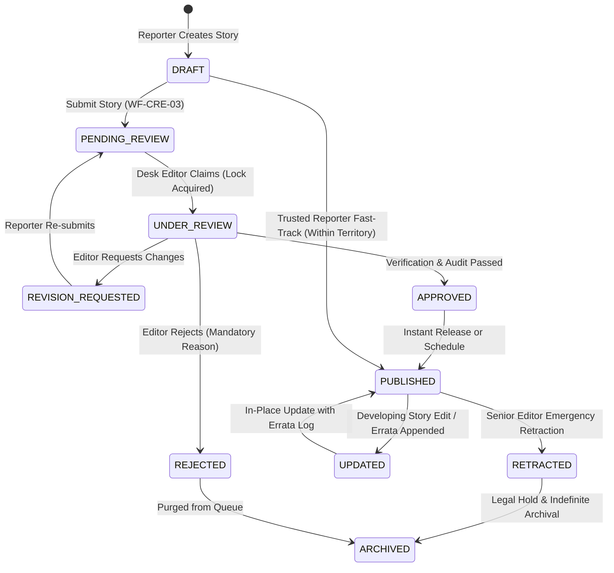

### 19.1 Permitted State Transitions and Ownership Rules

| Source State | Target State | Authorized Actors | Mandatory Prerequisites & Validation Gates |
| :--- | :--- | :--- | :--- |
| `DRAFT` | `PENDING_REVIEW` | Author (Reporter) | Valid Hindi headline (>=15 chars), body (>=100 chars), category, assigned district, at least 1 verified source. |
| `DRAFT` | `PUBLISHED` | Trusted Reporter | Actor has `ROLE_TRUSTED_REPORTER`, target district matches user territory, real-time alert dispatched (`RULE-EDIT-002`). |
| `PENDING_REVIEW` | `UNDER_REVIEW` | Desk Editor, Senior Editor | Acquires 15-minute atomic Redis concurrency lock (`RULE-EDIT-010`) preventing duplicate editor overwrites. |
| `UNDER_REVIEW` | `REVISION_REQUESTED` | Desk Editor, Senior Editor | Selects structured rejection category (e.g., `MISSING_EVIDENCE`) and inputs actionable guidance (`RULE-EDIT-005`). |
| `REVISION_REQUESTED` | `PENDING_REVIEW` | Author (Reporter) | Reporter addresses feedback, edits draft, and releases back to central review queue. |
| `UNDER_REVIEW` | `REJECTED` | Desk Editor, Senior Editor | Mandatory structured rejection reason logged in audit trail. Story is permanently blocked from public release. |
| `UNDER_REVIEW` | `APPROVED` | Desk Editor, Senior Editor | Verification status is `VERIF_VERIFIED` or approved `VERIF_PARTIAL`. Visual copyright cleared. |
| `APPROVED` | `PUBLISHED` | System Scheduler, Desk Editor | Dispatches CDN cache invalidation, SSR warm-up, and updates XML sitemaps. |
| `PUBLISHED` | `UPDATED` | Desk Editor, Senior Editor | Requires timestamped errata note if substantive facts or headlines were modified (`RULE-EDIT-006`). |
| `PUBLISHED` | `RETRACTED` | Senior Editor, Super Admin | Mandatory retraction memorandum; body replaced with retraction note; returns HTTP 410 or retains URL with notice. |
| `RETRACTED` | `ARCHIVED` | Super Admin, Compliance | Permanent retention in encrypted legal escrow database for judicial compliance. |

### 19.2 Immutable Audit Trail Architecture
Pursuant to `RULE-SEC-002` and Indian legal compliance:
- Every mutation of an article—including draft edits, status changes, reviewer comments, rejection notices, headline tweaks, and timestamp updates—generates an immutable audit log entry in the PostgreSQL `editorial_audit_logs` table.
- Log entries capture: `article_id`, `actor_user_id`, `actor_role`, `previous_state`, `new_state`, `timestamp_utc`, `ip_address`, `diff_patch`, and `justification_notes`.
- Audit logs are append-only; even administrators and database root users are prevented from modifying or deleting audit history.

---

## 20. Editorial Escalation Framework

When reporters and desk editors encounter legally volatile, ethically ambiguous, or highly contested stories, the following escalation matrix dictates the mandatory chain of command:

| Escalation Category | Risk Triggers | Initial Handler | Escalation Authority | Required Evidentiary Proof | Action Pending Resolution |
| :--- | :--- | :--- | :--- | :--- | :--- |
| **1. High-Level Political Allegation** | Allegations of massive corruption, moral turpitude, or criminal conspiracy against Ministers, MPs, or Judges. | Desk Editor | Senior Editor & Chief Editorial Officer | Documentary proof (CAG reports, court petitions, certified receipts) + Written Right of Reply. | **HOLD PUBLICATION** until Senior Editor signs written clearance. |
| **2. Communal or Caste Flare-up** | Clashes between religious groups, caste disputes, desecration of places of worship, or lynchings. | Field Reporter | Senior Editor & District Bureau Chief | Official confirmation from District Magistrate (DM) or Superintendent of Police (SP). | **HOLD PUBLICATION**; exclude unverified community names. |
| **3. Custodial Death / Police Encounter** | Death of an individual in police or judicial custody; controversial police shootouts. | Crime Reporter | Senior Editor & Legal Counsel | Official magisterial inquiry report, hospital post-mortem report, family formal complaint. | **STRICT ATTRIBUTION**; avoid presenting police version as undisputed fact. |
| **4. Contempt of Court / Gag Orders** | Sub-judice court proceedings, gag orders, in-camera trials, or ongoing matrimonial disputes. | Legal Correspondent | Legal Counsel & Senior Editor | Certified court orders; legal vetting of report language. | **LEGAL CLEARANCE MANDATORY** before public broadcast. |
| **5. AI Factual Distortion / Hallucination** | AI model synthesizes defamatory quotes or hallucinates casualty numbers in a breaking draft. | Desk Editor | Prompt Architecture Lead & Senior Editor | Primary reporter notes confirming discrepancy against AI output. | **IMMEDIATE REJECTION OF AI DRAFT**; log error in AI telemetry. |
| **6. Defamation / Legal Takedown Notice** | Formal legal notice served by an attorney demanding removal or apology for published article. | Grievance Officer | Chief Editorial Officer & Legal Counsel | Complete audit trail, original reporter recordings, published version history. | **LEGAL REVIEW WITHIN 48 HOURS**; no unilateral deletion by desk editors. |

---

## 21. Operational Editorial Checklists

These practical, actionable checklists are designed for direct integration into the CMS interfaces of the Reporter App, Central Newsroom Desk, and Admin Panel:

### Checklist A: Before Submitting a News Story (Reporter)
- [ ] Are the Who, What, Where, When, and Why clearly established in the opening paragraphs?
- [ ] Have all names, official designations, and departmental titles been checked for correct Hindi/English spelling?
- [ ] Are all numbers, casualties, monetary figures, and dates verified against primary documentation?
- [ ] If allegations are made against any individual, has their response or an attempt to contact them been recorded?
- [ ] Are all attached photographs and video clips original, or accompanied by verified licensing credits?
- [ ] Is the story free from personal commentary, emotional bias, or unsubstantiated rumors?
- [ ] Have you selected the exact district, tehsil, and news category corresponding to the event?

### Checklist B: Before Approving a Story (Desk Editor)
- [ ] Does the headline accurately reflect the facts in the body without clickbait or misleading exaggeration?
- [ ] Is the verification status set to `VERIF_VERIFIED` with at least two independent sources or an official release?
- [ ] Does the language adhere to standard journalistic Hindi (मानक हिंदी) without grammatical or spelling errors?
- [ ] Have all direct quotes been attributed to named, verified speakers?
- [ ] Are image captions descriptive and accompanied by explicit copyright attribution?
- [ ] Has an atomic concurrency lock been maintained during your review to avoid conflicting edits?
- [ ] Is the article free of defamatory assertions, hate speech, or contempt of court risks?

### Checklist C: Before Publishing Breaking News (Newsroom / Trusted Reporter)
- [ ] Is the information confirmed by an on-duty official, accredited reporter on site, or Tier-1 agency wire?
- [ ] Is the story tagged with the prominent **"विकासशील खबर (Developing Story)"** reader warning?
- [ ] Have you omitted speculative casualty figures and unconfirmed victim identities?
- [ ] Is the breaking alert concise, factual, and strictly under 120 characters?
- [ ] Have both `datePublished` and `dateModified` timestamps been initialized correctly?
- [ ] Are follow-up reporting mechanisms in place to append timestamped updates as new facts arrive?

### Checklist D: Before Publishing Political Allegations (Senior Editor)
- [ ] Has the source of the allegation been explicitly named and attributed as a political claim?
- [ ] Has the accused party been formally contacted and given a fair, reasonable opportunity to respond?
- [ ] If a response was provided, is it given balanced prominence within the story?
- [ ] If no response was received, is the outreach effort explicitly documented in the article body?
- [ ] Is the headline framed neutrally without declaring the allegation as an established fact?
- [ ] Have underlying documents (affidavits, bank records, notices) been independently inspected?

### Checklist E: Before Publishing Crime-Related News (Desk / Senior Editor)
- [ ] Are the milestones of the criminal justice system used accurately (Allegation vs. FIR vs. Arrest vs. Conviction)?
- [ ] Is the accused referred to strictly as an "आरोपी (Accused)" and not as "दोषी (Convicted)"?
- [ ] Have victim identities been fully protected in sexual offenses, child abuse, and juvenile matters?
- [ ] Have gruesome details of violence, mutilation, or suicide methods been thoroughly excised?
- [ ] Does the report avoid glorifying criminal conduct or broadcasting prejudicial media trials?

### Checklist F: Before Publishing Sensitive News (Senior Editor / Legal Counsel)
- [ ] In suicide reporting: Are all references to methods and notes omitted, and is the national helpline included?
- [ ] In communal incidents: Is the language calm, administrative, and free of inflammatory communal labels?
- [ ] In disaster reporting: Are casualty numbers confined strictly to official administration bulletins?
- [ ] Have graphic photographs and videos been blurred and accompanied by reader advisory warnings?
- [ ] Has the Chief Editorial Officer or Legal Counsel signed off on the internal escalation memorandum?

### Checklist G: Before Using an External Image or Video (Graphics / Desk Editor)
- [ ] Is the copyright ownership clearly established (Reporter Original, Agency Licensed, or Official Release)?
- [ ] Has a reverse-image search confirmed that the visual is not an old or recycled file from a past event?
- [ ] If the image is archival or conceptual, is it conspicuously watermarked with **"फाइल फोटो / File Photo"**?
- [ ] If the visual was generated using AI, is it watermarked with **"प्रतीकात्मक चित्र / AI जनरेटेड ग्राफिक"**?
- [ ] Are all graphic gore, dead bodies, and severely injured persons adequately blurred?

### Checklist H: Before Publishing AI-Assisted Content (Desk Editor)
- [ ] Has every factual assertion, number, name, and quote been cross-checked against primary reporter notes?
- [ ] Have you confirmed that the AI model did not hallucinate new details or misinterpret local idioms?
- [ ] Has the draft been thoroughly edited by a human journalist to ensure natural Hindi syntax?
- [ ] Is the publication signed off under the name and accountability of the human desk editor?
- [ ] Was the prompt executed through the governed Multi-Provider API Pool and approved prompt library?

### Checklist I: Before Publishing Sponsored Content (Ad Operations / Desk Editor)
- [ ] Is the article conspicuously tagged with **"प्रायोजित सामग्री / Sponsored Content"** pursuant to ASCI rules?
- [ ] Is the visual presentation visually separated from regular editorial news streams?
- [ ] Does the content avoid promoting prohibited categories (gambling, fake medical cures, firearms)?
- [ ] Is an explicit disclaimer displayed stating that the editorial newsroom was not involved in its creation?
- [ ] Has commercial clearance been verified by Ad Operations prior to scheduling?

### Checklist J: Before Correcting or Retracting a Story (Senior Editor / Grievance Officer)
- [ ] Has the nature and gravity of the factual error been verified against primary documentation?
- [ ] Has the appropriate rectification tier been selected (Typo vs. Factual Errata vs. Formal Retraction)?
- [ ] Does the visible errata box clearly explain what was originally published and what the correct fact is?
- [ ] Has the original version and diff patch been preserved in the immutable audit log?
- [ ] In retractions: Has Legal Counsel approved the formal retraction wording and HTTP status code handling?

---

## 22. Editorial Architecture & Newsroom Workflow Diagrams

The following seven diagrams visualize the end-to-end editorial architecture of BREAKING NEWS WALA:

### 22.1 Diagram 1: Comprehensive News Verification Workflow
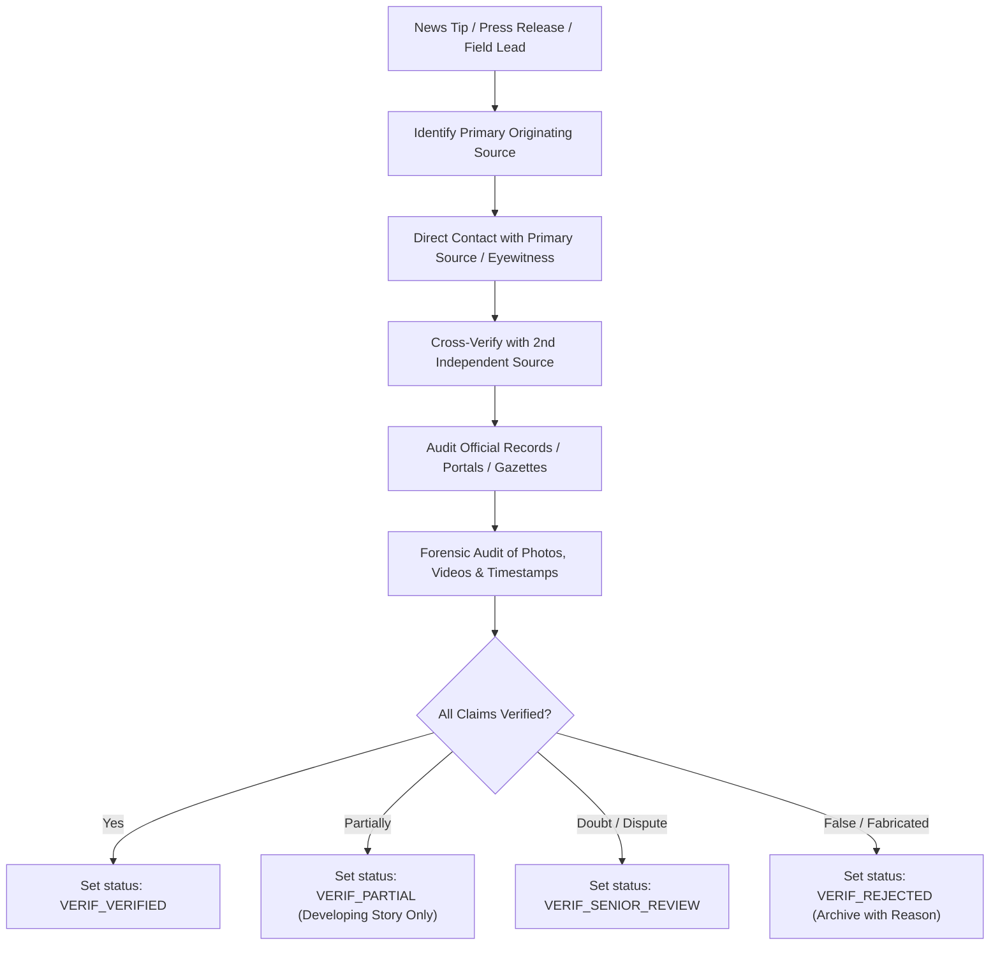

### 22.2 Diagram 2: Central Newsroom Editorial Approval Workflow
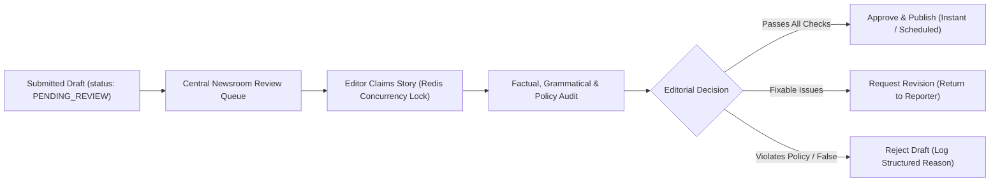

### 22.3 Diagram 3: Breaking-News Escalation & Verification Workflow
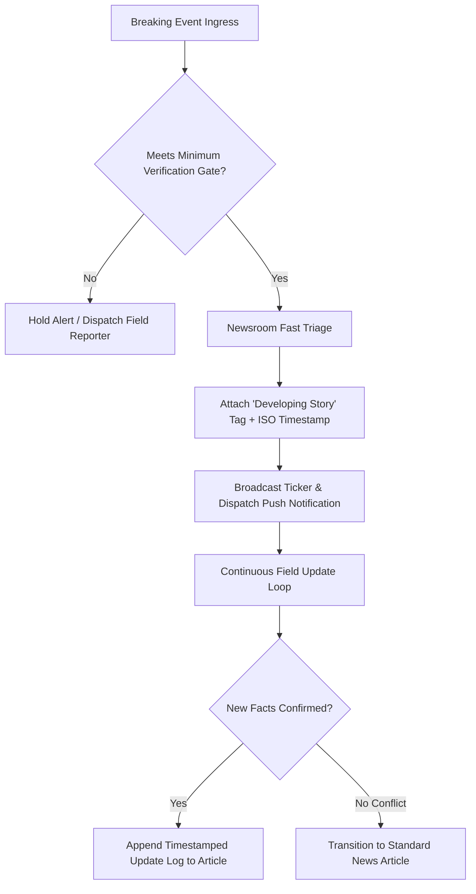

### 22.4 Diagram 4: Correction, Errata and Retraction Workflow
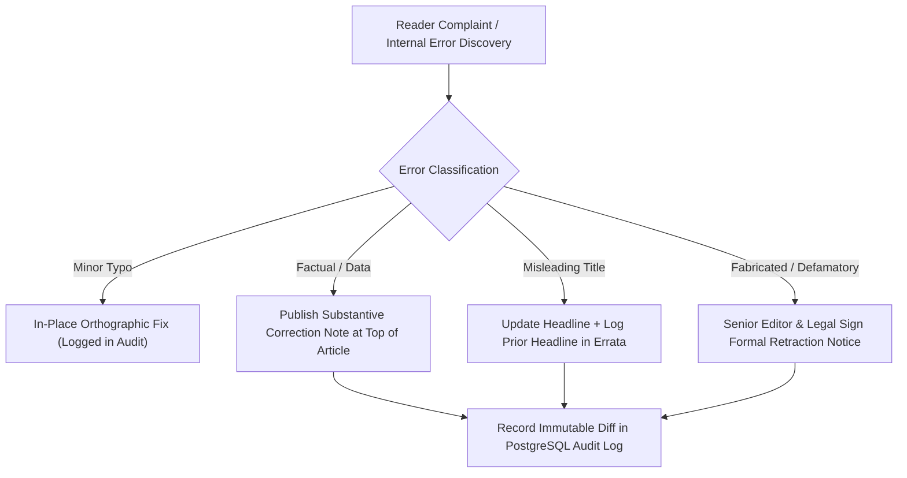

### 22.5 Diagram 5: AI-Assisted Editorial Production Workflow
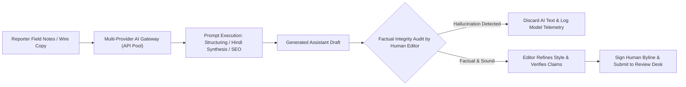

### 22.6 Diagram 6: Editorial Role and Approval Hierarchy
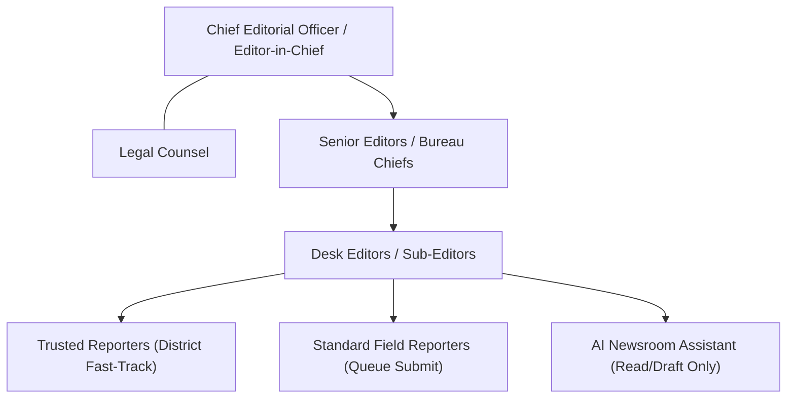

### 22.7 Diagram 7: Content Lifecycle & State Transitions
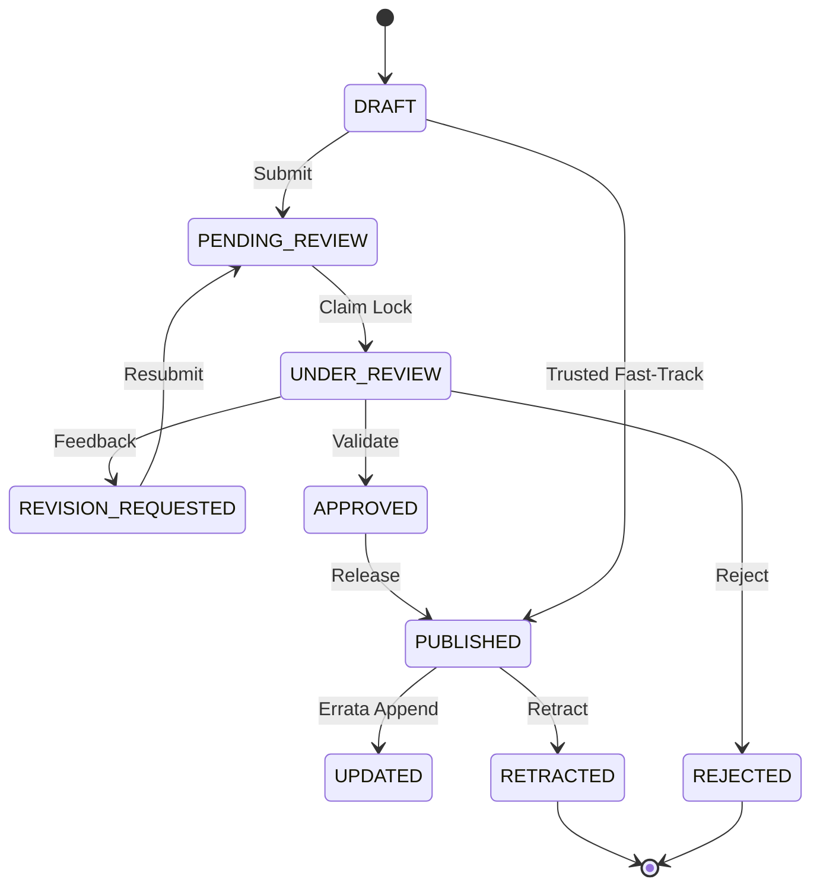

---

## 23. Cross-Platform Consistency: Web & Native Android Implementation

The editorial standards and verification gates specified in this policy must apply with identical mathematical and logical rigor across all client platforms:

### 23.1 Shared Backend Rule Enforcement
1. **Zero Client-Side Security Trust:** Neither the Web frontend nor the Native Android mobile application possesses the authority to independently transition content statuses or publish articles. All role validations, territorial jurisdiction checks, and status mutations occur strictly on the shared backend API (`docs/13-API.md`, `docs/14-Auth.md`).
2. **Universal RBAC Validation:** An API request from an Android app carrying a `ROLE_REPORTER` token attempting to publish directly will be rejected with HTTP 403 `ERR_UNAUTHORIZED_ACTION`, exactly identical to a web request.

### 23.2 Offline Field Reporting on Android
1. **Encrypted Local Draft Caching:** Pursuant to `RULE-XPLAT-005`, field reporters operating in rural, low-connectivity areas on Android devices may draft stories and cache photographs locally in encrypted SQLCipher storage.
2. **Atomic Synchronization Protocol:** When network connectivity is restored, cached drafts synchronize to the central backend in `status = DRAFT`. No draft is submitted to the central queue until cryptographic checksums and media uploads are completely validated.
3. **Biometric Session Integrity:** Pursuant to `RULE-XPLAT-008`, Android reporting apps must require biometric verification (fingerprint / face unlock) before submitting stories or accessing territorial desk feeds.


---

## 24. Legal, Regulatory & Compliance Alignment

BREAKING NEWS WALA operates within the legal framework governing freedom of speech, press accountability, cyber security, and data protection in India.

### 24.1 Key Statutory and Regulatory Codes

| Regulatory Body / Statute | Statutory Scope | Operational Newsroom Compliance Mandate |
| :--- | :--- | :--- |
| **Press Council of India (PCI)** | Norms of Journalistic Conduct | Adherence to core principles of accuracy, fairness, avoidance of obscenity, restraint in communal disputes, and protection of journalistic sources. |
| **Information Technology Rules, 2021** | Digital Media Ethics Code & Grievance Mechanism | Mandatory Level-I Grievance Officer, public disclosure of grievance contact information, 24-hour receipt acknowledgment, and compliance with judicial takedown orders. |
| **Digital Personal Data Protection Act, 2023** | Citizen Data Privacy & Processing | Public readers' PII must be protected and purgable upon request within 30 days. Crucially, journalistic published records, bylines, and editorial audit logs are retained under legal and public interest mandates. |
| **POCSO Act, 2012 (Section 23)** | Protection of Children from Sexual Offenses | Absolute statutory prohibition on revealing the name, address, photograph, family details, school, or neighborhood of any child victim or witness. |
| **Indian Penal Code / BNS (Section 228A)** | Disclosure of Identity of Certain Victims | Complete legal prohibition against publishing the identity or collateral identifying particulars of rape or sexual assault victims, punishable by imprisonment. |
| **Juvenile Justice Act, 2015 (Section 74)** | Care and Protection of Children | Absolute bar on disclosing the identity of any child in conflict with law or child in need of care and protection in any media report. |
| **ASCI Code for Self-Regulation** | Advertising & Commercial Communication | Strict labeling of native advertisements, influencer promotions, and sponsored content with unambiguous disclosures (`प्रायोजित` / `Sponsored`). |
| **Contempt of Courts Act, 1971** | Prejudicial Media Trials & Sub-Judice Reporting | Prohibition on publishing material that prejudices ongoing judicial proceedings, scandalizes the judiciary, or interferes with the due course of justice. |

> [!IMPORTANT]
> **Legal Disclaimer:** Jurisdiction-specific statutory interpretations and regulatory frameworks must be formally reviewed and certified by qualified legal counsel prior to formal operational adoption as binding institutional policy.

---

## 25. Cross-Document Traceability Matrix

This Master Editorial Policy directly integrates with, operationalizes, and enforces the architecture specified across the BREAKING NEWS WALA documentation suite:

| Target Doc ID | Document Name | Section Reference | Editorial Governance Integration Points |
| :--- | :--- | :--- | :--- |
| [`01-PRD.md`](file:///c:/Users/pp/Downloads/BREAKING-NEWS-WALA-main/docs/01-PRD.md) | Product Requirements | Sections 10, 14, 16, 25 | Operationalizes newsroom integrity, trusted reporter workflows, anti-sensationalism mandates, and ASCI sponsored content guidelines. |
| [`02-Features.md`](file:///c:/Users/pp/Downloads/BREAKING-NEWS-WALA-main/docs/02-Features.md) | Feature Specification | `FEAT-CRE-001`, `FEAT-ADM-009` | Governs reporter drafting UI, desk review queues, breaking news tickers, and retraction workflows. |
| [`05-Workflows.md`](file:///c:/Users/pp/Downloads/BREAKING-NEWS-WALA-main/docs/05-Workflows.md) | Master Workflows | `WF-CRE-01`, `WF-EDT-01`, `WF-TRU-01` | Establishes procedural rules for draft claiming, atomic concurrency locking, revision requests, and direct publishing. |
| [`06-Business-Rules.md`](file:///c:/Users/pp/Downloads/BREAKING-NEWS-WALA-main/docs/06-Business-Rules.md) | Business Rules | `RULE-EDIT-001` through `RULE-EDIT-010` | Enforces the 10 core editorial business rules, territorial bounds, and real-time newsroom alerts. |
| [`11-Architecture.md`](file:///c:/Users/pp/Downloads/BREAKING-NEWS-WALA-main/docs/11-Architecture.md) | Technical Architecture | Section 7 (Newsroom Services) | Governs backend review queue APIs, Redis locking, and event-driven notifications. |
| [`14-Auth.md`](file:///c:/Users/pp/Downloads/BREAKING-NEWS-WALA-main/docs/14-Auth.md) | Authentication & RBAC | Section 6 (Role Definitions) | Maps editorial roles (`ROLE_REPORTER`, `ROLE_TRUSTED_REPORTER`, `ROLE_ADMIN`) to database authorization scopes. |
| [`15-Security.md`](file:///c:/Users/pp/Downloads/BREAKING-NEWS-WALA-main/docs/15-Security.md) | Security Policy | Section 12 (Audit Logs) | Mandates append-only, tamper-proof audit trails for all editorial mutations (`RULE-SEC-002`). |
| [`17-Agents.md`](file:///c:/Users/pp/Downloads/BREAKING-NEWS-WALA-main/docs/17-Agents.md) | AI Agents Architecture | Sections 4, 8 (Human-in-the-Loop) | Enforces the absolute prohibition on autonomous AI publishing and requires human editorial accountability. |
| [`19-API-Pool.md`](file:///c:/Users/pp/Downloads/BREAKING-NEWS-WALA-main/docs/19-API-Pool.md) | Multi-Provider API Pool | Section 5 (Gateway Security) | Restricts all newsroom AI calls to the governed API Pool, preventing unmonitored external LLM usage. |
| [`21-Prompts.md`](file:///c:/Users/pp/Downloads/BREAKING-NEWS-WALA-main/docs/21-Prompts.md) | AI Prompt Library | Section 6 (Editorial Safeguards) | Governs strict factuality constraints embedded within system prompts (prohibiting fabricated quotes or figures). |
| [`SEO.md`](file:///c:/Users/pp/Downloads/BREAKING-NEWS-WALA-main/docs/SEO.md) | Search Engine Optimization | Sections 6, 8, 9, 20 | Aligns editorial headlines with SEO title tags, structured JSON-LD `NewsArticle` schemas, and Google News transparency policies. |
| [`26-Testing.md`](file:///c:/Users/pp/Downloads/BREAKING-NEWS-WALA-main/docs/26-Testing.md) | Testing Architecture | Section 8 (Newsroom QA) | Details automated test suites verifying state machine transitions, territorial boundaries, and RBAC security gates. |
| [`27-Debugging.md`](file:///c:/Users/pp/Downloads/BREAKING-NEWS-WALA-main/docs/27-Debugging.md) | Debugging & Diagnostics | Section 6 (Content State Debugging) | Provides triage runbooks for resolving stalled review queues, orphaned concurrency locks, and retraction sync failures. |

---

## 26. Editorial Architectural Decision Register

This register records all major editorial, governance, and ethical architectural decisions governing BREAKING NEWS WALA:

### ADR-EDT-001: Mandatory Pre-Publication Verification Status Engine
- **Status:** `Confirmed`
- **Context:** Raw drafts and wire text frequently contain unconfirmed claims that risk accidental publication.
- **Decision:** Implement a rigid `verification_status` state machine (`VERIF_UNVERIFIED`, `VERIF_IN_PROGRESS`, `VERIF_PARTIAL`, `VERIF_VERIFIED`, `VERIF_REJECTED`, `VERIF_SENIOR_REVIEW`). No article may be published unless marked `VERIF_VERIFIED` or approved `VERIF_PARTIAL`.
- **Consequences:** Eliminates premature publication; guarantees auditable verification records.

### ADR-EDT-002: Hard Territorial Boundary Restrictions for Trusted Reporters
- **Status:** `Confirmed`
- **Context:** Trusted reporters granted fast-track publishing authority may inadvertently or maliciously publish news outside their beat.
- **Decision:** Confine fast-track direct publishing strictly to the reporter's assigned district jurisdiction. Cross-district stories automatically fall back to the central newsroom review queue.
- **Consequences:** Prevents jurisdictional overreach while preserving high-velocity local coverage.

### ADR-EDT-003: Absolute Human Editorial Gate for AI Content
- **Status:** `Confirmed`
- **Context:** Generative AI tools accelerate drafting but suffer from hallucinations and lack legal accountability.
- **Decision:** Strictly prohibit autonomous AI publishing. All AI-generated drafts, translations, and summaries must be edited, verified, and published by an authenticated human editor who assumes full accountability.
- **Consequences:** Eliminates AI hallucination liability; ensures journalistic integrity.

### ADR-EDT-004: Strict Separation of Verified Facts and Allegations
- **Status:** `Confirmed`
- **Context:** Unverified accusations and FIRs are frequently sensationalized as proven guilt in digital media.
- **Decision:** Mandate precise legal terminology across all crime and political reporting. Prohibit describing accused persons as guilty prior to formal judicial conviction.
- **Consequences:** Protects constitutional presumption of innocence; shields platform from defamation lawsuits.

### ADR-EDT-005: Developing Story Tagging & ISO Timestamp Hygiene
- **Status:** `Confirmed`
- **Context:** Breaking news events evolve rapidly; readers require clear visual cues when facts are fluid.
- **Decision:** Require mandatory visual tagging (`विकासशील खबर`) and dual ISO 8601 timestamps (`datePublished`, `dateModified`) with visible update chronology logs.
- **Consequences:** Complies with Google News standards; provides readers with transparent revision tracking.

### ADR-EDT-006: Prohibition of Silent Scrubbing & Public Errata Architecture
- **Status:** `Confirmed`
- **Context:** Media outlets often silently delete or alter embarrassing factual errors, destroying reader trust.
- **Decision:** Enforce a strict "No Silent Scrubbing" policy. All substantive factual or headline corrections require a visible, permanent errata box detailing what was corrected and when.
- **Consequences:** Maximizes public credibility; maintains historical transparency.

### ADR-EDT-007: Three-Tier Grievance Redressal Architecture under IT Rules 2021
- **Status:** `Confirmed`
- **Context:** Digital news publishers in India are legally mandated to maintain institutional grievance redressal mechanisms.
- **Decision:** Appoint a designated Resident Grievance Officer and implement an auditable 3-tier grievance ticketing workflow with 24-hour receipt acknowledgment.
- **Consequences:** Full regulatory compliance with the Ministry of Information & Broadcasting; rapid resolution of reader complaints.

### ADR-EDT-008: Conspicuous Hindi-First Sponsored Content Badging
- **Status:** `Confirmed`
- **Context:** Sponsored articles disguised as news deceive readers and violate ASCI regulations.
- **Decision:** Mandate prominent Devanagari disclosure badges (`प्रायोजित सामग्री / Sponsored Content`), distinct visual styling, and an explicit disclaimer separating editorial staff from commercial content.
- **Consequences:** Full ASCI compliance; zero erosion of core news credibility.

### ADR-EDT-009: Documented Senior Editorial Justification for Anonymous Sources
- **Status:** `Confirmed`
- **Context:** Unregulated anonymous sourcing facilitates political smear campaigns and weaponized leaks.
- **Decision:** Restrict anonymous sourcing to matters of severe public interest where safety is threatened; mandate identity disclosure to Senior Editors and an immutable internal justification memorandum.
- **Consequences:** Prevents abuse of anonymity while safeguarding legitimate whistleblowers.

### ADR-EDT-010: Formalization of Chief Editorial Officer (Editor-in-Chief) Role
- **Status:** `Proposed`
- **Context:** Current business rules map administrative authority to `ROLE_ADMIN` and `ROLE_SUPER_ADMIN`, which conflates technical IT management with institutional editorial sovereignty.
- **Decision:** Formalize a distinct system role: `ROLE_CHIEF_EDITOR` (Editor-in-Chief) with supreme editorial authority, separate from infrastructure administrators.
- **Consequences:** Clear separation of editorial power from IT engineering. *Status: Proposed (Pending Executive Board sign-off).*

### ADR-EDT-011: Automated AI Hallucination Telemetry and Incident Logging
- **Status:** `Proposed`
- **Context:** AI hallucinations detected by human editors during review should be systematically collected to optimize prompt templates.
- **Decision:** Introduce a "Report AI Hallucination" button in the desk review UI that automatically captures the input notes, AI output, and specific hallucination category into a telemetry table.
- **Consequences:** Continuous improvement of prompt engineering suites; quantitative tracking of model reliability.

### ADR-EDT-012: Operational Service-Level Agreement (SLA) for Right of Reply Responses
- **Status:** `Pending Approval`
- **Context:** When seeking responses to breaking corruption allegations, reporters require a standardized operational waiting period before publishing without a response.
- **Decision:** Establish a formal 4-hour window during business hours (09:00–18:00 IST) for routine allegations, and an emergency 1-hour window for breaking news, after which stories may publish noting outreach attempts.
- **Consequences:** Standardizes newsroom velocity while respecting legal fairness. *Status: Pending Approval by Legal Counsel and Chief Editorial Officer.*

---

## 27. Documentation Quality Verification & Strict Scope Restrictions

### 27.1 Documentation Quality & Standards Compliance
1. **Professional Linguistic Standard:** Authored in clear, high-fidelity technical and journalistic English, enriched with authentic standard Hindi (मानक हिंदी) phrasing, headlines, and captions.
2. **Operational Newsroom Rigor:** Replaces abstract ethical theory with concrete database states, role permissions, approval matrices, and UI-ready checklists.
3. **Cross-Document Harmonization:** Fully cross-referenced with all 28 foundational documentation files, architecture specifications, and security policies without creating contradictions.

### 27.2 Strict Scope Restrictions Compliance
- **No Application Code:** Zero JavaScript, TypeScript, Python, or Kotlin application logic was modified or written.
- **No Schema or Database Migrations:** No live database tables, DDL scripts, or SQL migrations were executed.
- **No Configuration Mutation:** Authentication parameters, API keys, RSS cron jobs, and prompt configs remain untouched.
- **Single Canonical File Target:** Authored exclusively to [`docs/Editorial-Policy.md`](file:///c:/Users/pp/Downloads/BREAKING-NEWS-WALA-main/docs/Editorial-Policy.md). No secondary, nested, or redundant files were created.
