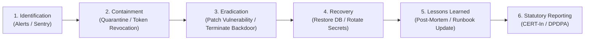

# Security Incident Response Operational Runbook
## Project: BREAKING NEWS WALA (ब्रेकिंग न्यूज़ वाला)
### Document ID: DOC-RUN-INC-2026-V1.0
### Scope: Threat Containment, Forensic Preservation, Breach Notification & CERT-In Compliance
### Authority: Master Prompt 09 (`BNW-MASTER-009`) — Section 15 Security Incident Response

---

## 1. Objective & Operational Scope

This runbook establishes standard operating procedures for identifying, triaging, containing, eradicating, and recovering from security incidents, cyber attacks, and data breaches across the **BREAKING NEWS WALA** ecosystem.

### Guiding Principles
- **Citizen Safety & Privacy First**: Safeguard reader privacy and journalist source confidentiality above operational convenience.
- **Evidence Preservation**: Never reboot or destroy compromised infrastructure without capturing memory dumps and disk snapshots for forensic analysis.
- **Statutory Timelines**: Strict adherence to the 6-hour CERT-In mandatory incident reporting window and DPDPA 2023 breach disclosure rules.

---

## 2. Incident Severity Classification Matrix

| Severity Level | Definition & Operational Impact | Response SLA | Command Lead | Examples |
| :---: | :--- | :---: | :--- | :--- |
| **P1 — CRITICAL** | Active database breach, administrative takeover, state-actor attack, ransomware, full platform outage, or source code leakage. | **$< 15$ mins** | Incident Commander (CTO) + Legal Counsel | DB exfiltration, Super Admin credential compromise, site defacement. |
| **P2 — MAJOR** | Substantial DoS attack degrading live breaking news, compromised stringer account, critical API rate exhaustion, or SSRF leak. | **$< 30$ mins** | Security Lead + SRE Lead | Layer 7 DDoS bypass, unauthorized reporter submission, rate-limiter failure. |
| **P3 — MEDIUM** | Isolated abuse of public search/comment endpoints, non-sensitive credential stuffing, single container crash, or minor CSP violation. | **$< 2$ hours** | Senior Backend Engineer | Brute-force attempt against login, crawler scraping article text. |
| **P4 — LOW** | Informational alert, expired SSL certificate on non-critical staging domain, or benign false-positive alert. | **$< 24$ hours** | DevOps Engineer | Staging webhook timeout, transient bot probe. |

---

## 3. The 6-Phase Incident Response Lifecycle



### Phase 1: Identification & Triage
- Triggered by: Automated security alert (`packages/backend/src/modules/monitoring/`), Sentry error spike, WAF anomaly, or user report.
- Actions:
  1. Incident Commander initiates emergency war room (Slack `#incident-war-room` / Signal voice bridge).
  2. Assign Incident Severity (P1 through P4).
  3. Designate Scribe to maintain immutable timestamped incident event log.

### Phase 2: Containment & Evidence Preservation
- **Immediate Containment Actions**:
  - **Account Compromise**: Revoke user's refresh token family (`POST /api/v1/auth/revoke-family`) and set `isSuspended: true` in database.
  - **IP Subnet Attack**: Apply Cloudflare edge IP block or rate-limit throttle (`X-RateLimit-Tier: auth`).
  - **Compromised Container**: Isolate the Docker container by disconnecting it from the overlay network:
    ```bash
    docker network disconnect bnw-network <compromised_container_id>
    ```
  - **Forensic Snapshot**: Capture memory dump and disk image before killing the container:
    ```bash
    docker commit <compromised_container_id> forensic-evidence:incident-<id>
    ```

### Phase 3: Eradication
- Identify the root cause (e.g., deserialization vulnerability, SSRF bypass, unpatched dependency).
- Develop and review an emergency hotfix.
- Verify hotfix against automated test suites (`packages/backend/tests/security/security.test.ts`).
- Deploy patch through CI/CD pipeline following the zero-downtime deployment runbook.

### Phase 4: Recovery & Re-hydration
- Verify system integrity using `/api/v1/admin/monitoring/health`.
- If database was tampered with, execute point-in-time recovery per `docs/BACKUP-RECOVERY-RUNBOOK.md`.
- Invalidate all active sessions by rolling `JWT_SECRET` and rotating all KMS secrets.
- Re-enable public ingress traffic under heightened monitoring for 48 hours.

### Phase 5: Post-Incident Review & Lessons Learned
Within 72 hours of incident resolution, the Incident Commander convenes a Blameless Post-Mortem:
- **Timeline**: Chronological minute-by-minute account of events.
- **Root Cause Analysis (RCA)**: 5-Whys methodology to determine underlying systemic flaws.
- **Action Items**: Preventative architectural changes logged in `docs/SECURITY-RISK-REGISTER.md` with assigned owners and deadlines.

### Phase 6: Statutory Breach Reporting (CERT-In)
Under Section 70B of the Information Technology Act and CERT-In directions:
- All cybersecurity incidents meeting mandatory reporting criteria must be submitted to CERT-In (`incident@cert-in.org.in`) within **6 hours** of confirmation.
- Format: CERT-In Incident Reporting Form with IP traces, attack vectors, impacted systems, and remedial actions taken.

