# Master Monetization, Commercial Governance & Revenue Architecture Specification
## Project: BREAKING NEWS WALA (ब्रेकिंग न्यूज़ वाला)
### Document ID: DOC-32-MON-2026-V1.0
### Confidentiality: Internal Architecture, Commercial Strategy & Financial Governance Specification

---

## 1. Document Information & Governance Status

### 1.1 Governance Metadata

| Attribute | Specification Details |
| :--- | :--- |
| **Document Title** | Master Monetization, Commercial Governance & Revenue Architecture Specification |
| **Document ID** | `DOC-32-MON-2026-V1.0` |
| **Baseline Version** | `1.0.0` |
| **Document Status** | **Approved Architectural Baseline & Commercial Strategy Blueprint** |
| **Creation Date** | October 31, 2026 |
| **Target System Scope** | Public Web Portal, Reporter Web Application, Central Newsroom Desk, Admin Control Panel, Graphics Studio, Video Studio, In-Article Ad Engine, Gamification Coin Ledger, and Future Native Android Mobile Application |
| **Primary Authors** | Head of Commercial Operations, Principal Solutions Architect, Revenue Strategy Director, Legal & Tax Compliance Counsel |
| **Approved By** | Chief Executive Officer, Chief Technology Officer, Chief Editorial Officer, Chief Financial Officer |
| **Predecessor Dependencies** | [`docs/01-PRD.md`](file:///c:/Users/pp/Downloads/BREAKING-NEWS-WALA-main/docs/01-PRD.md), [`docs/02-Features.md`](file:///c:/Users/pp/Downloads/BREAKING-NEWS-WALA-main/docs/02-Features.md), [`docs/03-Plan.md`](file:///c:/Users/pp/Downloads/BREAKING-NEWS-WALA-main/docs/03-Plan.md), [`docs/04-NFR.md`](file:///c:/Users/pp/Downloads/BREAKING-NEWS-WALA-main/docs/04-NFR.md), [`docs/05-Workflows.md`](file:///c:/Users/pp/Downloads/BREAKING-NEWS-WALA-main/docs/05-Workflows.md), [`docs/06-Business-Rules.md`](file:///c:/Users/pp/Downloads/BREAKING-NEWS-WALA-main/docs/06-Business-Rules.md), [`docs/07-Design.md`](file:///c:/Users/pp/Downloads/BREAKING-NEWS-WALA-main/docs/07-Design.md), [`docs/11-Architecture.md`](file:///c:/Users/pp/Downloads/BREAKING-NEWS-WALA-main/docs/11-Architecture.md), [`docs/12-Database.md`](file:///c:/Users/pp/Downloads/BREAKING-NEWS-WALA-main/docs/12-Database.md), [`docs/13-API.md`](file:///c:/Users/pp/Downloads/BREAKING-NEWS-WALA-main/docs/13-API.md), [`docs/14-Auth.md`](file:///c:/Users/pp/Downloads/BREAKING-NEWS-WALA-main/docs/14-Auth.md), [`docs/15-Security.md`](file:///c:/Users/pp/Downloads/BREAKING-NEWS-WALA-main/docs/15-Security.md), [`docs/16-Storage.md`](file:///c:/Users/pp/Downloads/BREAKING-NEWS-WALA-main/docs/16-Storage.md), [`docs/19-API-Pool.md`](file:///c:/Users/pp/Downloads/BREAKING-NEWS-WALA-main/docs/19-API-Pool.md), [`docs/20-Integrations.md`](file:///c:/Users/pp/Downloads/BREAKING-NEWS-WALA-main/docs/20-Integrations.md), [`docs/24-Deployment.md`](file:///c:/Users/pp/Downloads/BREAKING-NEWS-WALA-main/docs/24-Deployment.md), [`docs/25-Environment.md`](file:///c:/Users/pp/Downloads/BREAKING-NEWS-WALA-main/docs/25-Environment.md), [`docs/26-Testing.md`](file:///c:/Users/pp/Downloads/BREAKING-NEWS-WALA-main/docs/26-Testing.md), [`docs/SEO.md`](file:///c:/Users/pp/Downloads/BREAKING-NEWS-WALA-main/docs/SEO.md), [`docs/Editorial-Policy.md`](file:///c:/Users/pp/Downloads/BREAKING-NEWS-WALA-main/docs/Editorial-Policy.md), [`docs/Analytics.md`](file:///c:/Users/pp/Downloads/BREAKING-NEWS-WALA-main/docs/Analytics.md) |
| **Downstream Dependencies** | `docs/Monitoring.md`, Financial Billing Systems, Payment Gateway Integration Runbooks |
| **Canonical Target Path** | `docs/Monetization.md` |

---

## 2. Document Objective & Strategic Commercial Framework

### 2.1 Strategic Objective
The objective of this specification is to establish the authoritative commercial architecture, advertising governance, monetization channels, pricing models, and payment processing blueprints for **BREAKING NEWS WALA (ब्रेकिंग न्यूज़ वाला)**.

A vibrant, independent news organization requires a diversified, resilient economic foundation. However, unconstrained commercialization risks alienating readers with intrusive popups, violating statutory consumer disclosure laws, and degrading journalistic trust. This document operationalizes commercial viability while erecting an unbreachable wall between advertisers and newsroom editorial judgment.

### 2.2 Commercial Status Classification
To avoid premature technical implementation or contractual liability, every monetization model and commercial feature in this document is categorized under one of five explicit governance classifications:
1. **Confirmed Business Requirements:** Explicitly established in approved baseline artifacts (`docs/01-PRD.md`, `docs/02-Features.md`, `docs/06-Business-Rules.md`, `docs/12-Database.md`). Examples: Direct administrative banner slots, ASCI-compliant sponsored content labeling, non-monetary engagement coin ledger.
2. **Proposed Monetization Opportunities:** Architecturally designed and ready for engineering evaluation, but pending operational rollout phases. Examples: Direct advertiser self-serve dashboard, programmatic Google AdSense integration, local business directory sponsorships.
3. **Pending Commercial Decisions:** Commercial policies requiring formal executive sign-off, tax certification, or commercial banking agreements before activation. Examples: Reporter cash bonus structures, paid reader subscription tiers, real-currency coin redemption thresholds.
4. **Deferred Revenue Models:** Valid commercial strategies deliberately postponed to later phases (Phase 3+) to maintain operational focus on regional newsroom scaling. Examples: Paywalled breaking investigative reports, reader donation drives, cross-network programmatic video pre-rolls.
5. **Rejected Approaches:** Revenue schemes evaluated and explicitly rejected due to ethical, legal, or brand hazard. Examples: Unlabeled native advertorials, deceptive clickbait redirects, pop-under malware networks, predatory betting/gambling ad units.

---

## 3. Commercial Principles & Editorial Firewall

Pursuant to `docs/Editorial-Policy.md` (Section 17) and `RULE-AD-001` through `RULE-AD-005`, the commercial viability of BREAKING NEWS WALA is governed by eight foundational principles:

### 3.1 Uncompromising Editorial Independence
- Advertisers and commercial sponsors buy defined advertising inventory; they do **not** purchase news coverage, headline influence, or editorial silence.
- Commercial revenue must never determine whether an article is approved, rejected, modified, or retracted.
- Sales executives, ad account managers, and external brand clients possess **zero** access or voting rights in the Central Newsroom review queue.

### 3.2 Clear Visual & Structural Demarcation (ASCI Compliance)
- Pursuant to the Advertising Standards Council of India (ASCI) code and `RULE-AD-002`, every commercial unit must carry a permanent, prominent disclosure: **"विज्ञापन" (Advertisement)** or **"प्रायोजित" (Sponsored)** in at least 10pt font.
- Ad units must render within designated, bordered layout slots (`RULE-AD-001`) with distinct background shading to prevent confusing readers.

### 3.3 Preservation of Reader Experience & Core Web Vitals
- Advertisements must not degrade page usability, obstruct primary news reading, or violate Google Core Web Vitals thresholds (`docs/04-NFR.md`).
- Intrusive interstitials, auto-playing video audio, layout-shifting expanding banners, and deceptive screen takeovers are strictly prohibited.
- In-article ad density is strictly capped at a maximum of 1 ad per 350 words of body copy (`RULE-AD-004`).

### 3.4 Ethical Advertiser Standards & Prohibited Categories
Pursuant to `RULE-AD-003`, the platform strictly prohibits commercial advertisements promoting:
- Real-money gambling, betting apps, or unregulated fantasy gaming.
- Predatory payday loans, unregistered chit funds, or Ponzi schemes.
- Miracle medical cures, unapproved magical remedies, or deceptive superstitious artifacts.
- Firearms, explosives, or illegal narcotics.
- Hate groups, communal propaganda, or defamatory attack ads.

### 3.5 Reader Privacy by Design
- Advertising inventory must operate on **contextual and district-level geographical targeting** (`RULE-AD-005`) without harvesting personal reader PII.
- In compliance with `RULE-ANA-006`, third-party tracking pixels, invasive fingerprinting scripts, and cross-site data brokers are barred from the platform.

### 3.6 Secure, Auditable Financial Operations
- All commercial billing, advertiser payments, invoicing, and tax accounting must maintain strict server-side verification, immutable audit records, and zero client-side financial trust.

---

## 4. Comprehensive Revenue Stream Evaluation

The commercial architecture evaluates six primary revenue streams, detailing technical dependencies, commercial risks, and implementation priorities:

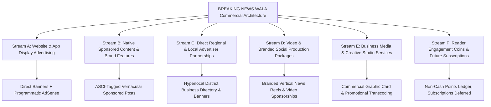

### 4.1 Detailed Evaluation Across the Six Streams

| Revenue Stream | Target Customer | Operational Complexity | Editorial Hazard & Risk | Technical & Data Dependencies | Governance Status | Implementation Priority |
| :--- | :--- | :--- | :--- | :--- | :--- | :--- |
| **A. Website & App Display Ads** | National programmatic ad networks (Google AdSense) & direct local brands | Low to Moderate | Low (when strict visual separation is enforced) | Ad slot components (`DOM-N`), CDN edge caching, viewable impression tracking | **Confirmed (Direct)** / **Proposed (AdSense)** | **Phase 1 (MVP Baseline)** |
| **B. Native Sponsored Content** | Regional corporations, universities, hospitals, infrastructure builders | Moderate | **High** (Risk of disguised PR corrupting news credibility) | Editorial Review Gate (`WF-MON-01`), ASCI badging, distinct styling | **Confirmed** | **Phase 1 (Curated Only)** |
| **C. Direct Advertiser Partnerships** | Local district merchants, regional automobile dealers, educational coaching | Moderate | Moderate (Pressure on local field reporters to soften coverage) | Admin Ad Management UI (`/admin/monetization`), District geotagging | **Confirmed** | **Phase 1–2** |
| **D. Video & Social Commercials** | Regional consumer brands, real estate firms, agrochemical companies | High | Moderate (Risk of dramatic hype in commercial reels) | Video Studio (`WF-VID-01`), Cloud MP4 transcoding, social syndication | **Proposed** | **Phase 2 (Post-MVP)** |
| **E. Business & Media Services** | Local businesses requiring professional digital graphics & vernacular video | High | Low (Separate client agency work; non-news) | Graphics Studio (`WF-RGFX-01`), Cloud Storage export quotas | **Proposed** | **Phase 2–3** |
| **F. Subscriptions & Reader Coins** | Loyal vernacular readers, community advocates, hyper-engaged citizens | Very High | Low to Moderate (Monetary payouts introduce legal compliance friction) | Gamification Ledger (`FEAT-USR-003`), Payment Gateway, Invoicing | **Coins: Confirmed (Non-Cash)** / **Subs: Deferred** | **Coins: Phase 2** / **Subs: Phase 3+** |


---

## 5. Advertising Inventory & Placement Architecture

The advertising inventory system is architecturally decoupled from newsroom content delivery. In accordance with `docs/12-Database.md` (`DOM-N`) and `RULE-AD-001` through `RULE-AD-005`, ad slots operate with fixed dimensions, pre-allocated layout containers, and strict device compatibility rules.

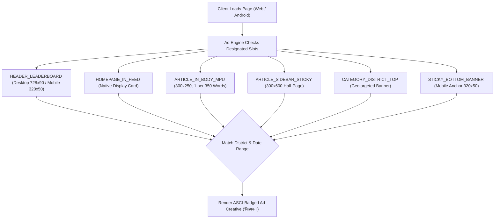

### 5.1 Authoritative Inventory Placement Catalog

| Placement Code | Logical UI Location | Standard Creative Dimensions | Device Compatibility | Dynamic Injection Rules & Constraints | Primary Reporting Metrics |
| :--- | :--- | :--- | :--- | :--- | :--- |
| **`HEADER_LEADERBOARD`** | Top of viewport above primary news navigation. | $728 \times 90\text{px}$ (Desktop), $320 \times 50\text{px}$ (Mobile) | Desktop, Tablet, Mobile Web | Fixed header container; must never obscure breaking news ticker (`RULE-AD-001`). | Impressions, Clicks, Viewable CTR |
| **`HOMEPAGE_IN_FEED`** | Injected between headline news clusters on home/district portals. | $300 \times 250\text{px}$ (MPU) or fluid responsive native card | Desktop, Mobile Web, Android App | Max 1 banner per 6 news cards; clearly bordered with contrasting background. | Impressions, Clicks, Engagement |
| **`ARTICLE_IN_BODY_MPU`** | Embedded directly within long-form article body copy. | $300 \times 250\text{px}$ (Medium Rectangle) | Mobile Web, Desktop, Android App | **Density limit:** Max 1 ad per 350 words; non-adjacent paragraphs only (`RULE-AD-004`). | Viewable Impressions, Read Dwell Time |
| **`ARTICLE_SIDEBAR_STICKY`** | Right sidebar of desktop article reading view. | $300 \times 600\text{px}$ (Half-Page) or $160 \times 600\text{px}$ (Skyscraper) | Desktop Only ($\ge 1024\text{px}$ width) | Sticks on scroll; unmounts dynamically on small screens; zero CLS impact. | Viewable Duration, Clicks |
| **`CATEGORY_DISTRICT_TOP`** | Top header banner on specific district feeds (e.g., `/district/meerut`). | $728 \times 90\text{px}$ or $320 \times 100\text{px}$ (Large Banner) | All Devices | Geotargeted strictly to assigned district slug (`RULE-AD-005`). | Local District Reach, Clicks |
| **`STICKY_BOTTOM_BANNER`** | Fixed bottom mobile footer bar. | $320 \times 50\text{px}$ (Mobile Leaderboard) | Mobile Web, Android App | Includes an accessible close button (`[×]`); does not obstruct article text. | Mobile Impressions, Clicks |
| **`VIDEO_REEL_POST_ROLL`** | 5-second branded closing card after vertical video reel completes. | $1080 \times 1920\text{px}$ (9:16 Vertical Card) | Mobile Web, Android App | Appended strictly post-content; zero interruption during active news video. | Video Completions, Brand Recall |

---

## 6. Ad Campaign Lifecycle & Administrative Governance

The campaign management engine governs direct advertiser bookings, scheduling, creative audits, and automated expiration through the Admin Control Panel (`/admin/monetization/campaigns`).

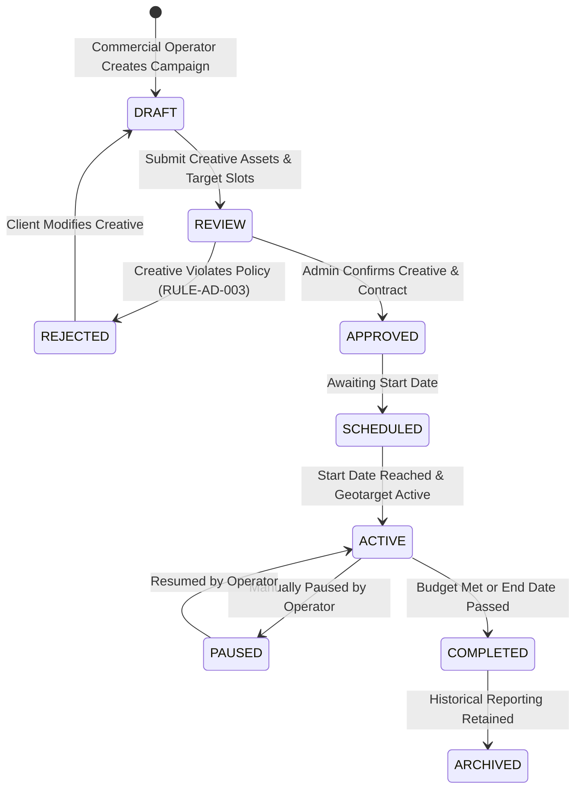

### 6.1 Campaign Data Structure (`ad_campaigns` & `ad_creatives`)
In accordance with the database schema in `docs/12-Database.md`:
- **`ad_campaigns` Entity:**
  - `id` (UUID, Primary Key)
  - `campaign_name` (VARCHAR, e.g., *"Meerut University Admissions 2027"*)
  - `advertiser_id` (UUID, FK $\rightarrow$ `advertisers.id`)
  - `start_date` / `end_date` (TIMESTAMPTZ)
  - `target_districts` (VARCHAR Array, e.g., `["meerut", "ghaziabad"]` or `["ALL"]`)
  - `budget_total` / `budget_spent` (DECIMAL, tracking financial allocation)
  - `pricing_model` (ENUM: `FIXED_DURATION`, `CPM`, `CPC`)
  - `status` (ENUM: `DRAFT`, `REVIEW`, `APPROVED`, `SCHEDULED`, `ACTIVE`, `PAUSED`, `COMPLETED`, `REJECTED`)
- **`ad_creatives` Entity:**
  - `id` (UUID, Primary Key)
  - `campaign_id` (UUID, FK)
  - `ad_slot_code` (VARCHAR, matching Inventory Catalog)
  - `image_url` (VARCHAR, pointing to verified asset in Cloud Storage)
  - `destination_url` (VARCHAR, sanitized external click-through destination)
  - `alt_text` (VARCHAR, accessible Devanagari label)
  - `is_approved` (BOOLEAN, requires explicit administrative sign-off)

---

## 7. Advertiser & Direct Client Relationship Management

Direct local advertiser partnerships form the primary commercial engine for hyper-local vernacular journalism across Tier-2, Tier-3, and rural districts.

### 7.1 Proposed Advertiser Profile Architecture
The platform designs a centralized client management module within the Admin Control Panel:
- **Business Identity & Verification:** Legal enterprise name, trade name, GSTIN (Goods and Services Tax Identification Number), registered corporate address, and authorized signatory details.
- **Billing & Contact Information:** Verified email, primary mobile number (authenticated via OTP), and finance department contact.
- **Contract & Agreement Tracking:** Uploaded digital sponsorship agreements, insertion orders (IO), agreed campaign terms, and payment milestones.
- **Campaign Ledger:** Historical log of all past, active, and scheduled campaigns run across web and mobile feeds.
- **Access Control:** In Phase 1, campaigns are managed by internal Commercial Administrators (`ROLE_AD_MANAGER`). A self-serve client portal where advertisers log in directly to view impressions and upload banners is categorized as **Proposed for Phase 2**.

---

## 8. Commercial Pricing Models & Valuation Analysis

To provide pricing flexibility for diverse advertisers—from neighborhood grocery chains to regional educational universities—the platform architecturally supports multiple pricing paradigms.

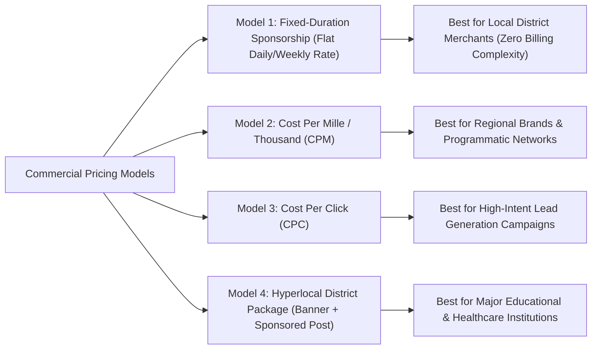

### 8.1 Comparative Analysis of Pricing Structures

| Pricing Model | Operational Mechanics | Authoritative Measurement Metric | Billing & Invoicing Logic | Commercial Advantages | Fraud & Abuse Vulnerabilities | Implementation Status |
| :--- | :--- | :--- | :--- | :--- | :--- | :--- |
| **Fixed-Duration Sponsorship** | Advertiser books a designated slot in a specific district for fixed days (e.g., 7 days in Meerut). | Time duration (Days active from start to end timestamp). | Fixed prepaid invoice; zero impression reconciliation friction. | Ideal for regional small merchants who lack digital analytics expertise. | Low fraud risk (traffic swings do not alter billing amount). | **Confirmed Baseline (Phase 1)** |
| **Cost Per Mille (CPM)** | Advertiser pays per 1,000 IAB-verified viewable impressions delivered. | Deduplicated viewable impressions ($\ge 50\%$ visible for $\ge 1.0\text{s}$). | Billed monthly based on aggregated telemetry rollups in `daily_ad_analytics`. | Standard enterprise model; aligns cost directly with delivered readership reach. | Vulnerable to impression bot scraping and rapid reload attacks (`RULE-ANA-002`). | **Proposed (Phase 2)** |
| **Cost Per Click (CPC)** | Advertiser pays only when a verified human reader clicks the ad creative. | Unique deduplicated click events per session hash. | Billed per verified click tally; requires real-time click fraud filtering. | Attractive to performance advertisers seeking direct telephone/website leads. | **High fraud risk** (click farming, rival merchant click attacks). | **Pending Approval (Strict Verification Required)** |
| **Hyperlocal Media Package** | Bundled offering: 1 District Header Banner + 1 ASCI Sponsored Article + 1 Video Reel mention. | Package delivery milestones (Article published, banner active 14 days). | Staged contract billing (50% advance, 50% on milestone completion). | Maximizes revenue per commercial relationship; packages multiple media assets. | Requires strict editorial review to prevent PR distortion of newsroom standards. | **Confirmed Baseline (Phase 1)** |

> [!IMPORTANT]
> **No Fabricated Rate Cards:** Market rate cards (e.g., specific INR amounts per day or per 1,000 impressions) vary by district economic tier and must be formally established and approved by the Chief Commercial Officer. No pricing schedules are hardcoded into technical architecture.


---

## 9. Sponsored Content & Native Article Governance

Sponsored articles, brand profiles, and paid corporate announcements represent significant commercial opportunities. However, without rigid ethical guardrails, native advertising threatens the foundational credibility of the newsroom.

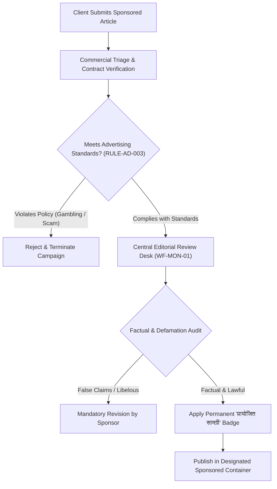

### 9.1 The Six Mandatory Sponsored Content Invariants
1. **No Disguised Advertorials:** Sponsored content must **never** be presented as independent investigative journalism. Every sponsored story must carry a prominent, permanent header badge: **"प्रायोजित सामग्री / Sponsored Content"** pursuant to ASCI regulations (`RULE-AD-002`).
2. **Zero Editorial Immunity:** Commercial payment does **not** grant immunity from editorial scrutiny. If a commercial partner is involved in an active criminal investigation, civic scandal, or public health hazard, BREAKING NEWS WALA reporters will report the facts objectively without commercial interference.
3. **Advertisers Possess Zero CMS Permissions:** External sponsors and corporate communications teams are **never** given publishing logins to the CMS. All sponsored copy must be reviewed, formatted, and published by authorized internal staff.
4. **Separation of Commercial & Editorial Approval:** Commercial approval confirms contract payment; editorial approval verifies factual legality, absence of hate speech, and stylistic compliance. An article requires **both** approvals to go live.
5. **No Block on Editorial Corrections:** If a sponsored article contains factual errors, misleading statistics, or unverified scientific claims, the newsroom reserves the absolute right to append an Errata Notice or unpublish the piece pursuant to `docs/Editorial-Policy.md`.
6. **No "Dofollow" Backlink Schemes:** In accordance with Google Search Essentials and `docs/SEO.md`, external links within sponsored articles must carry `rel="sponsored"` or `rel="nofollow"` attributes to prevent algorithmic search penalties.

---

## 10. Reporter Performance Incentives & Revenue Sharing Analysis

Field correspondents operating in rural districts require fair, sustainable livelihoods. However, tying reporter compensation directly to digital article clicks creates severe perverse incentives that reward sensationalism, rumor-mongering, and rushed reporting.

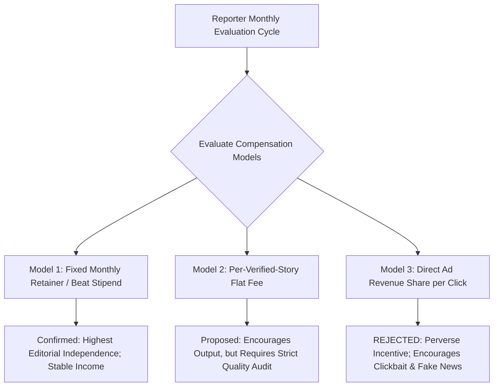

### 10.1 Evaluation of Reporter Compensation Structures

| Compensation Model | Description & Operational Mechanics | Journalistic Independence Impact | Financial & Operational Complexity | Governance Status |
| :--- | :--- | :--- | :--- | :--- |
| **Fixed Monthly Retainer / Beat Stipend** | Regular monthly retainer paid to accredited district correspondents based on beat coverage. | **High Independence:** Reporter focuses on public interest stories without click pressure. | Low complexity; predictable monthly payroll budgeting. | **Confirmed Baseline (Phase 1)** |
| **Per-Verified-Story Flat Honorarium** | Flat fee paid for approved, deeply investigated, or exclusive district reports. | **Moderate Independence:** Incentivizes production; requires strict desk review to avoid spam. | Moderate; requires cross-verification with `editorial_audit_logs`. | **Proposed for Phase 2 (Stringers)** |
| **Special Investigative Assignment Grant** | Project-based funding for long-form rural exposés, environmental series, or civic deep-dives. | **Very High:** Enables thorough field investigation without daily deadline pressure. | Moderate; requires prior approval by Chief Editorial Officer. | **Proposed for Phase 2** |
| **Direct Click-Through Ad Revenue Share** | Paying reporters a direct percentage of advertising revenue generated by pageviews on their articles. | **SEVERE EDITORIAL RISK:** Reporters inevitably pivot to sensationalist, clickbait, and salacious rumors. | High; requires complex click-fraud deduction and ad reconciliation. | **EXPLICITLY REJECTED** |
| **Local Ad Referral Commission** | Field correspondents introduce local district merchants who book display banners; reporter receives a referral finder's fee. | Moderate risk (Reporters must not write PR articles for their advertisers). | Moderate; requires strict separation of sales leads from news beats. | **Pending Approval (Legal & Commercial Sign-off)** |

---

## 11. Reader Gamification, Coin Ledger & Referral Architecture

In accordance with `docs/01-PRD.md` (`MON-003`), `docs/02-Features.md` (`FEAT-USR-003`), and `RULE-REWARD-002`, the platform incorporates an engagement coin and referral ledger designed to foster viral community growth across Hindi heartland districts.

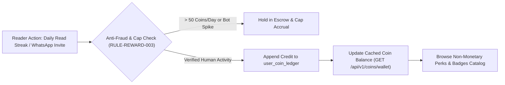

### 11.1 The Crucial Distinction of Gamification Assets
To ensure complete compliance with Indian financial regulations, the Reserve Bank of India (RBI) guidelines, and consumer protection laws, the platform enforces strict boundaries across four asset categories:
1. **Non-Monetary Engagement Coins (Current Architecture):** Virtual platform loyalty points earned through reading news streaks and sharing articles. **These coins possess zero legal monetary cash value and cannot be withdrawn as real money.**
2. **Promotional Digital Rewards:** Non-cash badges, verified citizen contributor icons, exclusive digital certificates, and partner discount vouchers.
3. **Monetary Balances (Not Supported in Phase 1/2):** Real Indian Rupees (INR) stored in digital wallets. *Status: Explicitly out of scope for initial phases.*
4. **Withdrawable Cash Funds:** Any direct bank transfer (UPI, NEFT) derived from gamified points. *Status: Deferred to future phases pending tax and legal certification.*

### 11.2 Daily Point Earning & Anti-Fraud Caps
Pursuant to `FEAT-USR-003` and `RULE-REWARD-003`:
- **Daily Earning Ceiling:** A registered user may earn a maximum of **50 engagement coins per 24-hour cycle**, preventing automated bot scraping or click farming.
- **Viral Referral Attribution:** When an existing user shares a personalized WhatsApp invite link and a new user completes SMS phone verification, both accounts receive a one-time bonus of 25 engagement points.
- **Velocity Escrow Defense:** Accounts executing more than 10 rapid point-accrual actions per minute are automatically frozen in `ESCROW_SUSPECTED_FRAUD` pending administrative audit.

---

## 12. Premium Memberships, Subscriptions & Paid Offerings

While BREAKING NEWS WALA remains fundamentally a free-to-read public interest news portal, future commercial resilience may incorporate optional subscription offerings.

### 12.1 Evaluation of Subscription Models (Deferred for Phase 3+)

| Subscription Offering | User Proposition | Technical Architecture Requirements | Commercial Viability in Tier-2/3 India | Implementation Status |
| :--- | :--- | :--- | :--- | :--- |
| **"Ad-Free Supporter" Pass** | Completely eliminates display banners and sponsored cards across web and mobile. | Client session check for `has_ad_free_entitlement = TRUE`; dynamic ad unit bypass. | Moderate; price sensitivity in regional markets is high. | **Deferred to Phase 3** |
| **Exclusive Investigative Dossiers** | Access to in-depth monthly regional governance dossiers, PDF archives, and special reports. | Paywalled content gating in backend API; encrypted document distribution. | Low to Moderate; best suited for institutional and business subscribers. | **Deferred to Phase 3** |
| **WhatsApp Premium News Digest** | Curated daily morning executive audio summary dispatched via official WhatsApp Business API. | Twilio / Meta WhatsApp Business API integration; subscriber distribution lists. | High; massive vernacular consumer affinity for WhatsApp news summaries. | **Proposed for Phase 2–3** |
| **Voluntary Reader Support / Patronage** | Optional non-paywalled micro-donations (e.g., ₹50/month) to support independent rural journalism. | UPI integration (Razorpay / Cashfree), transparent patron acknowledgment page. | Moderate; growing cultural acceptance of civic media patronage. | **Proposed for Phase 3** |

> [!NOTE]
> **No Paywall on Urgent Public Safety News:** Even if future subscription offerings are activated, breaking news alerts, public health warnings, disaster reports, and civic emergency updates will **never** be placed behind a paywall.


---

## 13. Payment, Order Processing & Billing Architecture

When commercial transactions occur—such as direct advertisers booking campaigns or purchasing media services—the payment architecture must adhere to strict financial security and server-side verification standards.

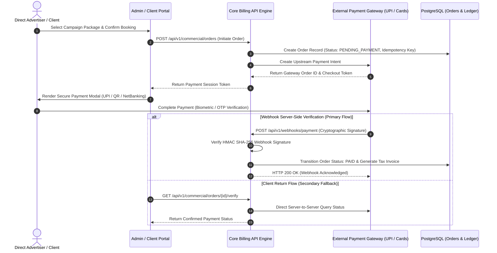

### 13.1 Seven Non-Negotiable Payment Security Invariants
1. **Zero Client Trust:** A frontend client message stating *"payment successful"* is **never** accepted as proof of payment. Payment confirmation requires direct server-to-server cryptographic webhook validation.
2. **HMAC Webhook Signature Verification:** All incoming payment notifications must be validated against the payment gateway's shared secret using cryptographic HMAC-SHA256 signatures before executing status mutations.
3. **Idempotency Key Enforcement:** Every payment transaction incorporates an immutable `idempotency_key` ensuring that network retries or duplicate webhook dispatches never trigger double-billing or duplicate campaign activation.
4. **PCI-DSS Compliance & Zero Card Storage:** The platform **never** receives, processes, or stores raw credit/debit card numbers, CVVs, or banking PINs. All payment flows utilize hosted gateway drop-in interfaces or direct UPI intent flows.
5. **Server-Side Secret Isolation:** Payment gateway API keys, merchant secret salts, and webhook signing tokens are stored strictly in server-side environment variables (`docs/25-Environment.md`) and are never exposed to browser clients.
6. **State Machine Locking:** Order status transitions (`PENDING_PAYMENT` $\rightarrow$ `PAID` $\rightarrow$ `REFUNDED` $\rightarrow$ `FAILED`) are atomic and governed by database transaction locks to prevent race conditions.
7. **Reconciliation Auditing:** Automated daily batch crons cross-reference gateway settlement logs against internal database orders, generating exception alerts for any unlinked transactions.

---

## 14. Financial Records, Revenue Reporting & Reconciliation

Accurate commercial bookkeeping distinguishes gross transaction volume from net enterprise revenue, ensuring transparent financial governance.

### 14.1 The Eight Financial Accounting Dimensions
1. **Gross Contract Value (GCV):** Total face value of agreed advertising bookings before discounts, rebates, or applicable taxes.
2. **Commercial Discounts & Rebates:** Formally documented price reductions granted for long-term or multi-district packages.
3. **Gross Realized Billings:** Actual invoice amounts issued to advertisers.
4. **Goods and Services Tax (GST Collected):** 18% statutory tax collected on behalf of the Government of India, held in liability escrow.
5. **Payment Gateway Processing Fees:** Merchant deduction fees (typically 1.5% to 2.5% for cards/netbanking, capped for UPI) deducted by external aggregators.
6. **Refunds & Adjustments:** Amounts returned to advertisers due to cancelled campaigns, scheduling conflicts, or quality disputes.
7. **Net Commercial Revenue (NCR):** $\text{Gross Billings} - \text{Discounts} - \text{GST} - \text{Gateway Fees} - \text{Refunds}$.
8. **Outstanding Accounts Receivable (A/R):** Invoiced balances awaiting payment past the agreed credit period (e.g., Net-30).

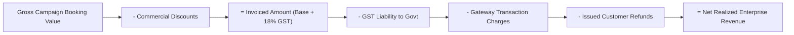

---

## 15. Tax, GST, Legal Compliance & Invoicing Standards

Commercial operations within the Republic of India are governed by statutory tax frameworks, digital media guidelines, and consumer protection acts.

### 15.1 Statutory Compliance Codes

| Statutory Area | Governing Authority / Law | Operational Compliance Mandate | Implementation Requirement |
| :--- | :--- | :--- | :--- |
| **Goods and Services Tax (GST)** | Ministry of Finance / GST Council | Digital internet advertising services are classified under SAC Code **998363** (Internet Advertising Services). Standard GST rate is 18%. | B2B tax invoices must capture advertiser GSTIN, Corporate Name, and Address. Intrastate transactions generate CGST (9%) + SGST (9%); interstate generate IGST (18%). |
| **B2B Tax Invoicing** | Central Goods and Services Tax Rules | Serialized, sequential tax invoices generated upon order completion with HSN/SAC breakdown. | Invoices must state BREAKING NEWS WALA legal entity name, PAN, GSTIN, invoice date, and unique sequential invoice number. |
| **Advertising Disclosures** | Advertising Standards Council of India (ASCI) | All paid commercial features, native articles, and banner sponsorships must carry prominent disclosures (`RULE-AD-002`). | Render standardized "विज्ञापन" / "प्रायोजित" badges across all placements. |
| **Consumer Protection Act, 2019** | Central Consumer Protection Authority (CCPA) | Protection against unfair trade practices and false or misleading advertisements. | Ad creatives undergo administrative review (`RULE-AD-003`) prior to campaign activation. |
| **Income Tax TDS (Section 194C / 194J)** | Income Tax Department | Tax Deducted at Source on reporter stipends, freelancer fees, and vendor payments. | Retain PAN details of paid contributors; issue quarterly Form 16A certificates where applicable. |

> [!IMPORTANT]
> **Tax Advisory Invariant:** All tax rates, SAC classifications, and invoicing rules must be formally validated and certified by a qualified Chartered Accountant (CA) prior to processing live commercial billing.

---

## 16. Ad Fraud Detection, Traffic Verification & Abuse Safeguards

Digital advertising systems are vulnerable to automated bot impressions, click farms, and malicious hit floods designed to artificially drain advertiser budgets or compromise platform stability.

```mermaid
flowchart TD
    HIT["Ad Impression / Click Ingress Event"] --> SIGN_CHECK{"Inspect Behavioral Telemetry"}
    
    SIGN_CHECK -->|Headless Bot User-Agent / cURL| DROP_BOT["Flag as Bot Traffic: Zero View Counted"]
    SIGN_CHECK -->|Click Velocity > 10 / min from single IP| FREEZE_VEL["Trigger RULE-REWARD-003: Freeze in Escrow"]
    SIGN_CHECK -->|Rapid Consecutive Clicks (< 200ms)| DROP_RAPID["Discard as Accidental Double-Click"]
    SIGN_CHECK -->|Valid Human Dwell (>= 1.0s in Viewport)| VERIF_IMP["Log Verified IAB Viewable Impression"]
    
    DROP_BOT & FREEZE_VEL & DROP_RAPID --> FRAUD_LOG["Record Anomaly in Ad Fraud Audit Trail"]
    VERIF_IMP --> AD_LEDGER["Credit Campaign Delivery Ledger"]
```

### 16.1 Automated Safeguards
1. **Invalid Traffic (IVT) Filtering:** The API Gateway cross-checks requests against known botnet IP lists, automated crawler signatures, and headless browser attributes.
2. **Click Velocity Caps:** Single IP addresses or session hashes generating more than 5 clicks within a 60-second window on a single ad placement are suppressed from billing calculations.
3. **Pre-Render Impression Suppression:** Ad units located below the visible fold that are never scrolled into view are recorded as requested inventory but are **never** counted or billed as viewable impressions.
4. **Advertiser Audit Dispute Workflow:** Advertisers may challenge campaign delivery figures within 14 days of campaign completion. The newsroom provides raw, scrubbed impression timestamp logs to resolve discrepancies.

---

## 17. Privacy-Preserving Ad Targeting & Consent Governance

Unlike invasive ad networks that track users across the internet using third-party cookies and covert device fingerprinting, BREAKING NEWS WALA implements a **Privacy-First Advertising Architecture**.

### 17.1 Permitted vs. Prohibited Targeting Methodologies

| Targeting Dimension | Technical Mechanics | Privacy Status | Permitted on BREAKING NEWS WALA? |
| :--- | :--- | :--- | :--- |
| **Contextual Categorical Targeting** | Ads target article category (e.g., tractor ads on Agriculture news; coaching ads on Education news). | **Zero PII:** Evaluates solely the news article topic currently being read. | **YES (Primary Targeting Method)** |
| **Hyperlocal District Targeting** | Ads target specific district feeds (e.g., hospital ads rendered strictly on `/district/meerut`). | **Zero PII:** Derived from URL slug or server-side truncated IP (`RULE-ANA-001`). | **YES (Core Hyperlocal Value)** |
| **Device Form Factor Targeting** | Serving mobile-optimized banners ($320\times50$) to mobile clients and leaderboards ($728\times90$) to desktops. | **Zero PII:** Evaluates standard viewport dimensions and responsive CSS breakpoints. | **YES** |
| **Time-of-Day Dayparting** | Scheduling restaurant ads between 18:00 and 21:00 IST. | **Zero PII:** Evaluates standard server clock time. | **YES** |
| **Cross-Site Behavioral Retargeting** | Following users across third-party websites to serve targeted ads based on external web browsing. | **HIGH PRIVACY RISK:** Requires invasive third-party tracking cookies. | **STRICTLY PROHIBITED (`RULE-ANA-006`)** |
| **Individual Personal Profile Tracking** | Storing citizen reading habits alongside personal mobile numbers or names for ad targeting. | **HIGH PRIVACY RISK:** Violates DPDP Act principles. | **STRICTLY PROHIBITED (`RULE-ANA-001`)** |


---

## 18. Cross-Platform Commercial Consistency: Web & Native Android

The commercial engine must operate seamlessly across desktop web, mobile web, and the future Native Android mobile application (`docs/02-Features.md`, `docs/11-Architecture.md`).

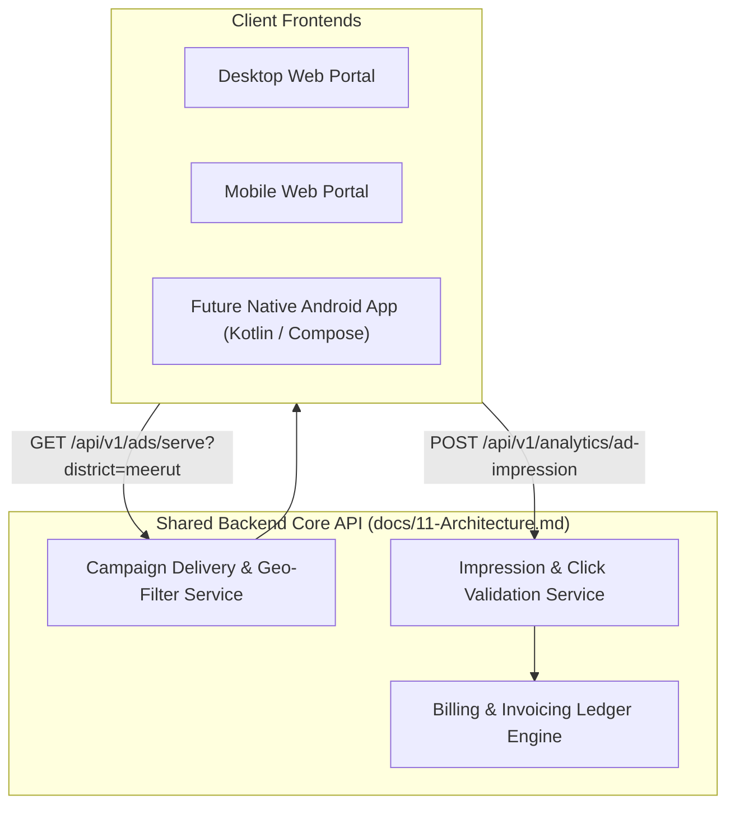

### 18.1 Shared Architecture Invariants
1. **Single Source of Truth:** A single PostgreSQL database (`DOM-N`) and Redis cache layer power all advertising schedules, active campaigns, creative URLs, and impression counts. The Android application will **never** utilize an independent advertising database.
2. **Unified API Contracts:** Both web and Android clients fetch ad inventory through identical endpoints (`/api/v1/ads/serve`) and submit viewable impression heartbeats via standard JSON payloads.
3. **Consistent Geotargeting Logic:** A direct banner booked for Meerut District will display automatically on both the web district feed (`/district/meerut`) and the native Android district tab.
4. **Synchronized Frequency Capping:** Client session identifiers ensure that sticky bottom banners or pop-up interstitials are not served repeatedly to the same reader across device reloads.

---

## 19. Monetization Analytics & Key Performance Indicators

In coordination with `docs/Analytics.md` (Section 12), commercial analytics measure business health, inventory sell-through, and campaign delivery performance.

### 19.1 Core Monetization Key Performance Indicators (KPIs)

| Metric Code | Metric Name | Precise Technical Formula | Measurement Unit | Business Objective |
| :--- | :--- | :--- | :--- | :--- |
| **`KPI-MON-01`** | **Total Viewable Impressions** | Count of ad renders meeting IAB criteria ($\ge 50\%$ pixels for $\ge 1.0\text{s}$). | Integer Count | Auditable proof of delivered commercial value. |
| **`KPI-MON-02`** | **Average Viewable CTR** | $\frac{\text{Verified Ad Clicks}}{\text{Total Viewable Impressions}} \times 100$ | Percentage ($\%$) | Evaluates creative quality and audience relevance. |
| **`KPI-MON-03`** | **Inventory Fill Rate** | $\frac{\text{Filled Ad Slots with Paid Banners}}{\text{Total Available Ad Slot Requests}} \times 100$ | Percentage ($\%$) | Measures commercial monetization efficiency across beats. |
| **`KPI-MON-04`** | **Effective CPM (eCPM)** | $\frac{\text{Total Ad Revenue Realized}}{\text{Total Impressions Delivered}} \times 1,000$ | Currency (INR / USD) | Evaluates yield per thousand page reads across categories. |
| **`KPI-MON-05`** | **Sponsored Read Rate** | $\frac{\text{Reads on Sponsored Articles with Dwell } \ge 45\text{s}}{\text{Total Sponsored Article Pageviews}} \times 100$ | Percentage ($\%$) | Proves genuine vernacular reader engagement to sponsors. |
| **`KPI-MON-06`** | **Days Sales Outstanding (DSO)**| $\frac{\text{Accounts Receivable Balance}}{\text{Total Credit Sales}} \times \text{Days in Period}$ | Number of Days | Tracks cash collection velocity and credit risk. |

---

## 20. Commercial Role-Based Access Control (RBAC) Matrix

To preserve ethical independence and financial security, commercial permissions are strictly cordoned off from editorial and reporting roles (`docs/14-Auth.md`).

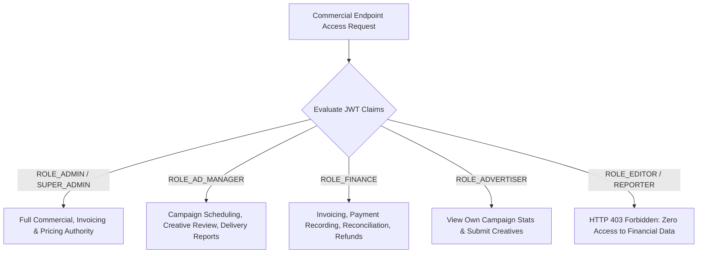

### 20.1 Commercial Permissions Matrix

| Operational Capability | Super Admin / Admin | Commercial Manager (`ROLE_AD_MANAGER`) | Finance Operator (`ROLE_FINANCE`) | Client Advertiser (`ROLE_ADVERTISER`) | Newsroom Editor (`ROLE_EDITOR`) | Field Reporter (`ROLE_REPORTER`) |
| :--- | :--- | :--- | :--- | :--- | :--- | :--- |
| **Create / Book Ad Campaigns** | Full Authority | Full Authority | Read Only | Submit Drafts | No Access | No Access |
| **Approve Ad Creatives (Policy)** | Full Authority | Full Authority | No Access | No Access | No Access | No Access |
| **Manage Inventory & Slots** | Full Authority | Configure Slots | No Access | No Access | No Access | No Access |
| **Set Rate Cards & Pricing** | Full Authority | Propose Rates | No Access | No Access | No Access | No Access |
| **View Revenue & Financials** | Full Authority | View Delivery | Full Authority | Own Invoices | **No Access** | **No Access** |
| **Record Offline Payments** | Full Authority | No Access | Full Authority | No Access | No Access | No Access |
| **Issue Advertiser Refunds** | Full Authority | Request Refund | Execute Refund | No Access | No Access | No Access |
| **Review Sponsored Articles** | Full Authority | Verify Commercials| Verify Payment | Submit Drafts | **Mandatory Editorial Review** | Submit Drafts |

---

## 21. Commercial Dashboard Interface Specifications

Commercial interfaces within the Admin Control Panel (`docs/08-Sitemap.md`) provide role-tailored tooling for sales, ad operations, and finance teams.

### 21.1 Interface Modules Catalog
1. **Admin Monetization Dashboard (`/admin/monetization`):** High-level revenue overview, monthly gross billings, real-time active campaign counts, district inventory fill rates, and pending campaign approvals.
2. **Campaign Operations Console (`/admin/monetization/campaigns`):** Granular scheduling workspace allowing ad operators to upload creatives, set start/end dates, select target districts (`RULE-AD-005`), assign creative dimensions, and view real-time impression delivery progress bars.
3. **Sponsored Content Desk (`/admin/monetization/sponsored-posts`):** Workspace managing native brand features, verifying ASCI compliance badges, confirming commercial payment status, and routing articles to the Central Newsroom review queue (`WF-MON-01`).
4. **Finance & Reconciliation Console (`/admin/monetization/reports`):** Invoicing ledger, payment collection logs, gateway settlement reconciliations, outstanding accounts receivable aging tables, and tax reports for monthly GST filing.
5. **Direct Advertiser Self-Serve Portal (Proposed Phase 2):** Secure external client portal where verified local business advertisers log in to view delivery telemetry for their own campaigns, download GST tax invoices, and upload new creative banners.


---

## 22. Commercial Architecture & Monetization Workflows

The following six Mermaid diagrams illustrate the complete commercial lifecycles, payment pipelines, and financial governance flows of BREAKING NEWS WALA:

### 22.1 Diagram 1: Advertisement Campaign Lifecycle
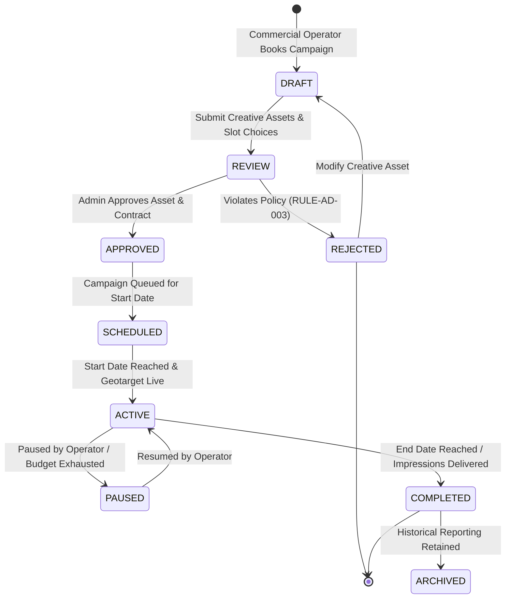

### 22.2 Diagram 2: Sponsored-Content Editorial Approval Workflow
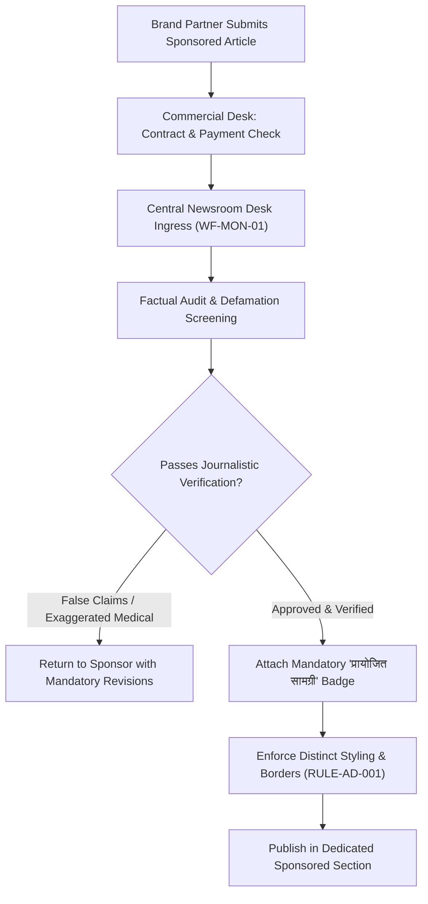

### 22.3 Diagram 3: Payment & Server-Side Verification Workflow
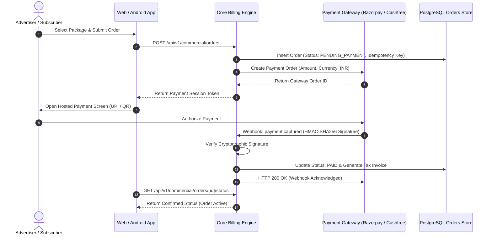

### 22.4 Diagram 4: Refund and Reconciliation Workflow
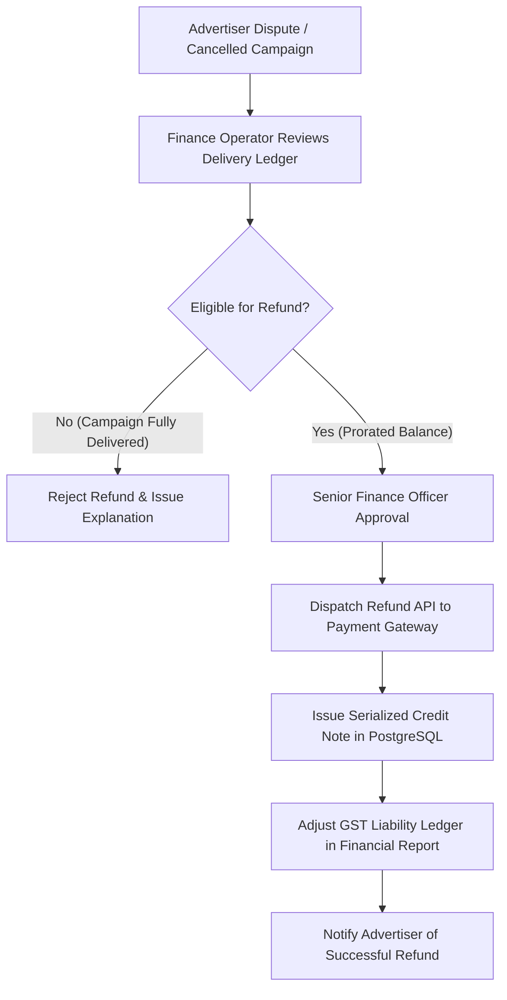

### 22.5 Diagram 5: Reporter Incentive Approval Workflow (Proposed)
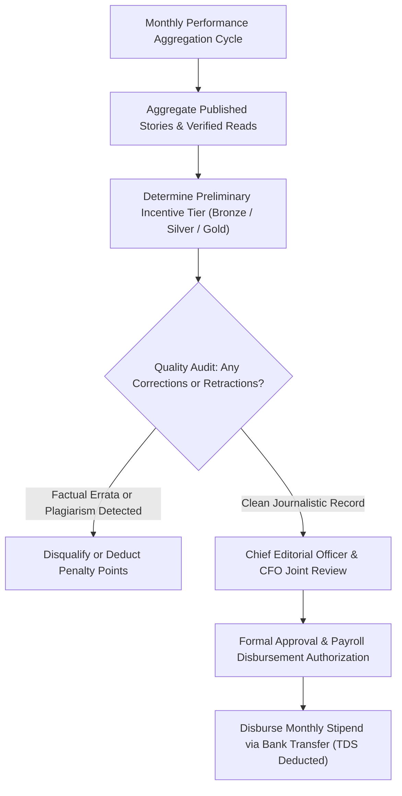

### 22.6 Diagram 6: Advertising Revenue Reporting Flow
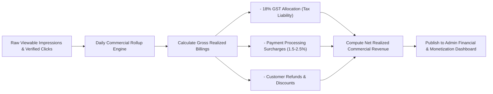

---

## 23. Cross-Document Traceability Matrix

The Master Monetization Specification directly harmonizes with and enforces requirements established across the technical documentation suite:

| Target Doc ID | Target Document Title | Section Reference | Commercial Architecture Traceability Points |
| :--- | :--- | :--- | :--- |
| [`01-PRD.md`](file:///c:/Users/pp/Downloads/BREAKING-NEWS-WALA-main/docs/01-PRD.md) | Product Requirements | Sections 7, 24, 25 | Operationalizes PRD requirements for banner slots, ASCI sponsored post rules, and non-monetary reader coin ledger (`MON-003`). |
| [`02-Features.md`](file:///c:/Users/pp/Downloads/BREAKING-NEWS-WALA-main/docs/02-Features.md) | Feature Specification | `FEAT-PUB-011`, `FEAT-USR-003` | Enforces display ad rendering constraints and the 50-coins/day gamification ceiling. |
| [`04-NFR.md`](file:///c:/Users/pp/Downloads/BREAKING-NEWS-WALA-main/docs/04-NFR.md) | Non-Functional Requirements | Performance & Usability | Restricts ad injection density to protect sub-2.5s LCP and prevent Cumulative Layout Shift (CLS). |
| [`05-Workflows.md`](file:///c:/Users/pp/Downloads/BREAKING-NEWS-WALA-main/docs/05-Workflows.md) | Master Workflows | `WF-MON-01`, `WF-PUB-01` | Establishes procedural rules for sponsored post review and public banner delivery. |
| [`06-Business-Rules.md`](file:///c:/Users/pp/Downloads/BREAKING-NEWS-WALA-main/docs/06-Business-Rules.md) | Business Rules | `RULE-AD-001` to `005`, `RULE-REWARD-001` to `003` | Enforces visual ad separation, ASCI labeling, anti-fraud click velocity checks, and district geotargeting. |
| [`07-Design.md`](file:///c:/Users/pp/Downloads/BREAKING-NEWS-WALA-main/docs/07-Design.md) | Visual Design & Theme | Section 8 (Ad Containers) | Specifies bordered ad containers with contrasting backgrounds and prominent Devanagari labels. |
| [`11-Architecture.md`](file:///c:/Users/pp/Downloads/BREAKING-NEWS-WALA-main/docs/11-Architecture.md) | Technical Architecture | Section 8 (Monetization Service) | Integrates ad delivery APIs with Redis caching and PostgreSQL transactional storage. |
| [`12-Database.md`](file:///c:/Users/pp/Downloads/BREAKING-NEWS-WALA-main/docs/12-Database.md) | Database Specification | `DOM-N` (`ad_campaigns`, `ad_creatives`) | Defines relational entities for campaigns, creative assets, slot codes, and coin transactions. |
| [`13-API.md`](file:///c:/Users/pp/Downloads/BREAKING-NEWS-WALA-main/docs/13-API.md) | API Specification | `ADS-02`, `COIN-01`, `COIN-02`, `COIN-03` | Implements administrative campaign endpoints and authenticated citizen wallet routes. |
| [`14-Auth.md`](file:///c:/Users/pp/Downloads/BREAKING-NEWS-WALA-main/docs/14-Auth.md) | Authentication & RBAC | Section 6 (Commercial Scopes) | Enforces role boundaries ensuring reporters cannot view financial revenue or advertiser contracts. |
| [`15-Security.md`](file:///c:/Users/pp/Downloads/BREAKING-NEWS-WALA-main/docs/15-Security.md) | Security Policy | Section 14 (Payment Security) | Mandates server-side payment verification, webhook HMAC signatures, and zero card data storage. |
| [`Editorial-Policy.md`](file:///c:/Users/pp/Downloads/BREAKING-NEWS-WALA-main/docs/Editorial-Policy.md) | Editorial Standards | Section 17 (Commercial Firewall) | Guarantees uncompromised editorial independence; commercial sponsors cannot purchase favorable coverage. |
| [`Analytics.md`](file:///c:/Users/pp/Downloads/BREAKING-NEWS-WALA-main/docs/Analytics.md) | Analytics & Telemetry | Section 12 (Ad Analytics) | Defines viewable impression criteria, CTR measurement, and anti-bot invalid traffic filtering. |
| [`SEO.md`](file:///c:/Users/pp/Downloads/BREAKING-NEWS-WALA-main/docs/SEO.md) | Search Engine Optimization | Section 9, 20 | Mandates `rel="sponsored"` on external links within sponsored content to prevent search penalties. |
| [`25-Environment.md`](file:///c:/Users/pp/Downloads/BREAKING-NEWS-WALA-main/docs/25-Environment.md) | Environment Configuration | `ADS_ENABLED`, `ADS_PROVIDER` | Governs deployment environment flags controlling ad rendering and provider credentials. |
| [`26-Testing.md`](file:///c:/Users/pp/Downloads/BREAKING-NEWS-WALA-main/docs/26-Testing.md) | Testing Architecture | Section 8 (Commercial QA) | Specifies automated test suites for ad density caps, webhook signatures, and coin ledger idempotency. |

---

## 24. Monetization Architectural Decision Register

This register records all major commercial, financial, and monetization architectural decisions governing BREAKING NEWS WALA:

### ADR-MON-001: Strict Visual & Structural Demarcation of Ads and News
- **Status:** `Confirmed`
- **Context:** Unlabeled or disguised advertising erodes citizen trust and violates Press Council of India standards.
- **Decision:** Mandate `RULE-AD-001`. All advertising banners and sponsored articles must render in clearly designated containers with distinct background styling, separate from editorial feeds.
- **Consequences:** Eliminates reader confusion; preserves foundational journalistic credibility.

### ADR-MON-002: Mandatory ASCI "विज्ञापन" / "प्रायोजित" Disclosure Badges
- **Status:** `Confirmed`
- **Context:** Digital commercial publications in India are legally required to provide transparent sponsorship disclosures.
- **Decision:** Mandate `RULE-AD-002`. Every advertisement unit must display "विज्ञापन" and every sponsored article must display "प्रायोजित सामग्री" in at least 10pt font.
- **Consequences:** Full compliance with ASCI and Consumer Protection Act guidelines.

### ADR-MON-003: Absolute Editorial Firewall & Advertiser Zero-CMS Access
- **Status:** `Confirmed`
- **Context:** Allowing commercial advertisers or sponsors to directly publish or modify content destroys editorial independence.
- **Decision:** Enforce an absolute firewall. Advertisers are **never** granted CMS publishing access. All sponsored content must pass through the Central Newsroom review desk (`WF-MON-01`).
- **Consequences:** Protects editorial sovereignty; commercial payment never guarantees immunity from investigative coverage.

### ADR-MON-004: In-Article Ad Density Capped at 1 per 350 Words
- **Status:** `Confirmed`
- **Context:** Cluttered advertising degrades reading experience and hurts Google Core Web Vitals.
- **Decision:** Enforce `RULE-AD-004`. Dynamically inject maximum 1 ad banner per 350 words of body copy, prohibiting adjacent ad placements.
- **Consequences:** Maximizes reader retention; prevents page layout shifts.

### ADR-MON-005: Non-Monetary Engagement Coins & No Cash Payouts in Phase 1/2
- **Status:** `Confirmed`
- **Context:** Offering real cash withdrawals for reading or referral points introduces complex RBI financial licensing, tax withholding (TDS), and bot fraud liabilities.
- **Decision:** Enforce `RULE-REWARD-002` and PRD Section 7. Coins are non-monetary engagement units capped at 50/day; zero real-money cash redemptions in Phase 1/2.
- **Consequences:** Eliminates financial fraud vectors; provides safe viral community gamification.

### ADR-MON-006: Server-Side Cryptographic Webhook Payment Verification
- **Status:** `Confirmed`
- **Context:** Relying on client-side frontend redirect messages for payment confirmation facilitates client-side tampering and fraud.
- **Decision:** Mandate server-side HMAC-SHA256 signature verification on payment gateway webhooks with strict idempotency key tracking.
- **Consequences:** Eliminates payment spoofing and duplicate processing.

### ADR-MON-007: Contextual & District-Level Targeting Without PII
- **Status:** `Confirmed`
- **Context:** Collecting user browsing histories for behavioral ad tracking violates the DPDP Act and slows down client performance.
- **Decision:** Restrict advertising targeting strictly to contextual article categories and district geographic slugs (`RULE-AD-005`), without tracking personal PII.
- **Consequences:** Complete reader privacy; lightning-fast client delivery without third-party cookie bloat.

### ADR-MON-008: Strict Prohibition of Deceptive, Predatory & Gambling Ads
- **Status:** `Confirmed`
- **Context:** Real-money gaming, betting, and predatory financial scams damage family trust across regional communities.
- **Decision:** Mandate `RULE-AD-003`. Strictly ban all betting apps, adult content, miracle cure promotions, and deceptive system warning banners.
- **Consequences:** High brand safety; aligns with regional family values.

### ADR-MON-009: Self-Serve Direct Advertiser Portal for Regional Brands
- **Status:** `Proposed`
- **Context:** As the platform expands across dozens of districts, manual administrative booking of local banners becomes an operational bottleneck.
- **Decision:** Develop a self-serve portal (`ROLE_ADVERTISER`) allowing verified local businesses to book banners, upload creatives, and pay online in Phase 2.
- **Consequences:** Scalable local ad sales; reduced administrative overhead. *Status: Proposed for Phase 2.*

### ADR-MON-010: Integration of Google AdSense / Programmatic Fallback Ads
- **Status:** `Proposed`
- **Context:** Unsold ad inventory slots generate zero commercial yield.
- **Decision:** Introduce a managed programmatic fallback (e.g., Google AdSense or Media.net) that dynamically serves ads only when no direct district campaign is active.
- **Consequences:** Maximizes inventory fill rates; requires CSP header tuning. *Status: Proposed.*

### ADR-MON-011: Paid Reader Subscriptions & Premium Ad-Free Passes
- **Status:** `Deferred`
- **Context:** Vernacular readers in Tier-2/3 heartlands exhibit low willingness to pay for news paywalls during early growth phases.
- **Decision:** Defer paid subscriptions and ad-free supporter passes to Phase 3+, prioritizing free public reach and direct advertising during Phase 1–2.
- **Consequences:** Avoids premature paywall friction; maximizes readership growth. *Status: Deferred to Phase 3.*

### ADR-MON-012: Reporter Quality-Weighted Cash Incentive Tiers & Payouts
- **Status:** `Pending Approval`
- **Context:** Management seeks to reward high-performing rural stringers with monthly cash stipends based on published output and verification accuracy.
- **Decision:** Establish Bronze, Silver, and Gold incentive tiers requiring Chief Editorial Officer and CFO joint approval (`RULE-REWARD-001`).
- **Consequences:** Standardizes freelancer compensation; requires formal legal freelancer agreements and tax withholding protocols. *Status: Pending Approval.*

---

## 25. Documentation Quality Requirements & Strict Scope Restrictions

### 25.1 Documentation Quality & Standards Compliance
1. **Linguistic Standard:** Written in clear, high-fidelity professional English, maintaining standard financial, legal, and Devanagari advertising terminology.
2. **Operational Commercial Rigor:** Establishes concrete database tables, campaign state machines, billing workflows, and fraud safeguards rather than abstract monetization theories.
3. **Cross-Document Harmonization:** Fully cross-referenced with all 31 existing documentation artifacts, preserving established business rules, architectural constraints, and editorial firewalls.

### 25.2 Strict Scope Restrictions Compliance
- **No Application Code:** Zero JavaScript, TypeScript, Python, or Kotlin advertising code was written or modified.
- **No Payment Gateway Integration:** No live Razorpay, Cashfree, or Stripe API keys or SDKs were installed or configured.
- **No Database Migrations:** No live financial tables, DDL migrations, or ledger mutations were executed on the production database.
- **Single Canonical Target File:** Authored exclusively to [`docs/Monetization.md`](file:///c:/Users/pp/Downloads/BREAKING-NEWS-WALA-main/docs/Monetization.md). No secondary, duplicate, or nested documentation copies were created.
