# Master Monitoring, Observability, Telemetry & Incident Reliability Specification
## Project: BREAKING NEWS WALA (ब्रेकिंग न्यूज़ वाला)
### Document ID: DOC-33-MONIT-2026-V1.0
### Confidentiality: Internal Technical Architecture, SRE & Operational Reliability Specification

---

## 1. Document Information & Governance Status

### 1.1 Governance Metadata

| Attribute | Specification Details |
| :--- | :--- |
| **Document Title** | Master Monitoring, Observability, Telemetry & Incident Reliability Specification |
| **Document ID** | `DOC-33-MONIT-2026-V1.0` |
| **Baseline Version** | `1.0.0` |
| **Document Status** | **Approved Architectural Baseline & SRE Reliability Framework** |
| **Creation Date** | October 31, 2026 |
| **Target System Scope** | Public Web Portal, Reporter Web Application, Central Newsroom Desk, Admin Control Panel, Shared Core Backend API, PostgreSQL Database, Redis Caching Tier, BullMQ Asynchronous Queues, Cloud Storage, RSS Ingestion Engine, AI Agent Fleet, Multi-Provider API Pool, Model Context Protocol (MCP) Nodes, Graphics Studio, Video Studio, Notification Engine, and Future Native Android Mobile Application |
| **Primary Authors** | Principal Site Reliability Engineer (SRE), Lead DevOps Architect, Core Systems Architect, Head of Information Security |
| **Approved By** | Chief Technology Officer, Head of Product, Chief Editorial Officer, Enterprise Security Architect |
| **Predecessor Dependencies** | [`docs/01-PRD.md`](file:///c:/Users/pp/Downloads/BREAKING-NEWS-WALA-main/docs/01-PRD.md), [`docs/02-Features.md`](file:///c:/Users/pp/Downloads/BREAKING-NEWS-WALA-main/docs/02-Features.md), [`docs/03-Plan.md`](file:///c:/Users/pp/Downloads/BREAKING-NEWS-WALA-main/docs/03-Plan.md), [`docs/04-NFR.md`](file:///c:/Users/pp/Downloads/BREAKING-NEWS-WALA-main/docs/04-NFR.md), [`docs/05-Workflows.md`](file:///c:/Users/pp/Downloads/BREAKING-NEWS-WALA-main/docs/05-Workflows.md), [`docs/06-Business-Rules.md`](file:///c:/Users/pp/Downloads/BREAKING-NEWS-WALA-main/docs/06-Business-Rules.md), [`docs/11-Architecture.md`](file:///c:/Users/pp/Downloads/BREAKING-NEWS-WALA-main/docs/11-Architecture.md), [`docs/12-Database.md`](file:///c:/Users/pp/Downloads/BREAKING-NEWS-WALA-main/docs/12-Database.md), [`docs/13-API.md`](file:///c:/Users/pp/Downloads/BREAKING-NEWS-WALA-main/docs/13-API.md), [`docs/14-Auth.md`](file:///c:/Users/pp/Downloads/BREAKING-NEWS-WALA-main/docs/14-Auth.md), [`docs/15-Security.md`](file:///c:/Users/pp/Downloads/BREAKING-NEWS-WALA-main/docs/15-Security.md), [`docs/16-Storage.md`](file:///c:/Users/pp/Downloads/BREAKING-NEWS-WALA-main/docs/16-Storage.md), [`docs/17-Agents.md`](file:///c:/Users/pp/Downloads/BREAKING-NEWS-WALA-main/docs/17-Agents.md), [`docs/18-MCP.md`](file:///c:/Users/pp/Downloads/BREAKING-NEWS-WALA-main/docs/18-MCP.md), [`docs/19-API-Pool.md`](file:///c:/Users/pp/Downloads/BREAKING-NEWS-WALA-main/docs/19-API-Pool.md), [`docs/20-Integrations.md`](file:///c:/Users/pp/Downloads/BREAKING-NEWS-WALA-main/docs/20-Integrations.md), [`docs/24-Deployment.md`](file:///c:/Users/pp/Downloads/BREAKING-NEWS-WALA-main/docs/24-Deployment.md), [`docs/25-Environment.md`](file:///c:/Users/pp/Downloads/BREAKING-NEWS-WALA-main/docs/25-Environment.md), [`docs/26-Testing.md`](file:///c:/Users/pp/Downloads/BREAKING-NEWS-WALA-main/docs/26-Testing.md), [`docs/27-Debugging.md`](file:///c:/Users/pp/Downloads/BREAKING-NEWS-WALA-main/docs/27-Debugging.md), [`docs/SEO.md`](file:///c:/Users/pp/Downloads/BREAKING-NEWS-WALA-main/docs/SEO.md), [`docs/Editorial-Policy.md`](file:///c:/Users/pp/Downloads/BREAKING-NEWS-WALA-main/docs/Editorial-Policy.md), [`docs/Analytics.md`](file:///c:/Users/pp/Downloads/BREAKING-NEWS-WALA-main/docs/Analytics.md), [`docs/Monetization.md`](file:///c:/Users/pp/Downloads/BREAKING-NEWS-WALA-main/docs/Monetization.md) |
| **Downstream Dependencies** | Production Runbooks, SRE Pager Escalation Rotations, Incident Post-Mortems |
| **Canonical Target Path** | `docs/Monitoring.md` |

---

## 2. Document Objective & Observability Strategy

### 2.1 Strategic Objective
The objective of this specification is to define an enterprise-grade, high-fidelity monitoring and observability framework for **BREAKING NEWS WALA (ब्रेकिंग न्यूज़ वाला)**.

A modern vernacular news network operating in high-velocity breaking news environments cannot afford silent infrastructure degradation, unmonitored queue backlogs, or unobserved API failures. When a major regional news event occurs, traffic spikes by orders of magnitude; our observability architecture must detect anomalies in real-time, isolate failures before they cascade, provide actionable root cause telemetry, and maintain the platform's non-functional quality commitments (`docs/04-NFR.md`).

### 2.2 Crucial Demarcation of Observability Domains
To prevent architectural confusion, this specification strictly delineates seven distinct data and operational streams:
1. **Infrastructure Monitoring:** Tracking physical/virtual resource consumption (CPU, memory, disk I/O, network bandwidth, container restarts, Kubernetes/Cloud Run pod limits).
2. **Application Performance Monitoring (APM):** Profiling code execution, request throughput, endpoint latencies ($P50, P95, P99$), thread event loops, and database connection pools.
3. **Structured Distributed Logging:** Immutable, search-indexed JSON log streams tagged with end-to-end distributed correlation IDs (`X-Correlation-ID`) across asynchronous service boundaries.
4. **Distributed Tracing:** Microsecond-level trace spans tracking requests as they travel from web/mobile frontends through API gateways, Redis caches, database queries, and third-party AI LLMs.
5. **Runtime Error Tracking:** Automated aggregation, de-duplication, symbolication, and triage of unhandled frontend exceptions and backend process crashes.
6. **Security & SIEM Monitoring:** Real-time threat detection tracking credential stuffing bursts, privilege escalation attempts, WAF blocks, and malicious file uploads (`docs/15-Security.md`).
7. **Business & Audience Analytics:** Readership trends, pageview conversions, and revenue telemetry (`docs/Analytics.md`, `docs/Monetization.md`), which are **strictly decoupled** from infrastructure health telemetry.

---

## 3. Monitoring & Observability Architecture

The observability architecture is engineered around the **Four Pillars of Modern Telemetry** (Metrics, Logs, Traces, and Health Probes) unified by a distributed context propagation engine.

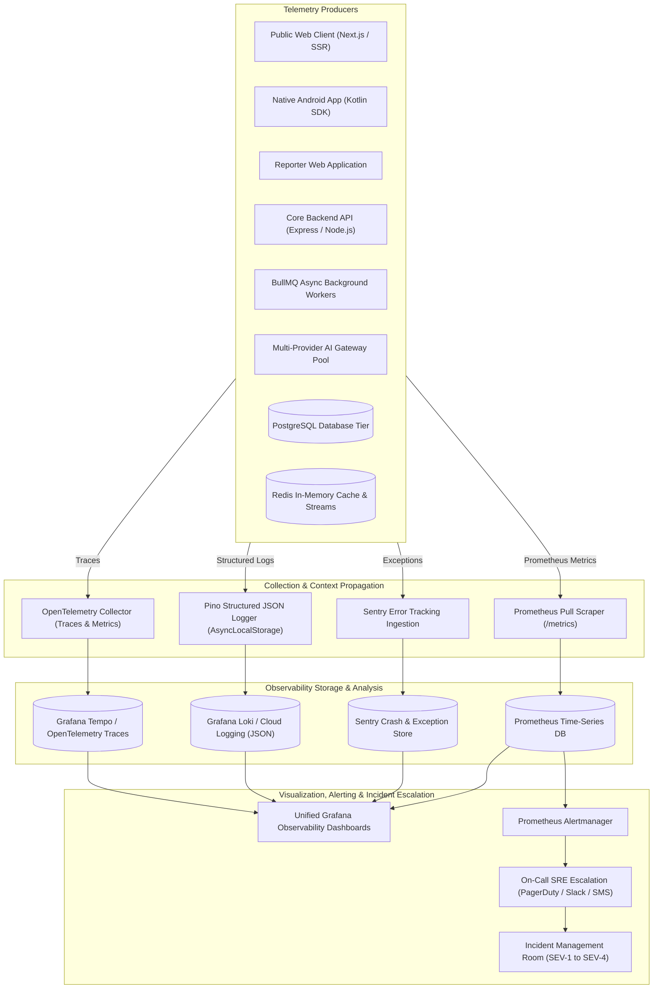

### 3.1 Distributed Context Propagation (The Correlation Spine)
In accordance with `docs/27-Debugging.md` (Section 7):
- Every inbound HTTP request, background worker task, and WebSocket connection carries or generates an immutable `X-Correlation-ID` (UUIDv4).
- The backend leverages Node.js `AsyncLocalStorage` to propagate the correlation ID throughout the execution lifecycle without explicit parameter drilling.
- Database queries executed via Prisma/pg append a SQL comment header containing the correlation ID (`/* correlation_id=... */`), enabling DBAs to link lock contention directly to originating user actions in `pg_stat_activity`.
- BullMQ worker jobs inherit the correlation ID in their execution metadata, ensuring asynchronous tasks (video rendering, RSS parsing, push broadcasts) maintain end-to-end traceability.

---

## 4. Public Website & Reader Experience Monitoring

The Public News Website (`docs/01-PRD.md`, `docs/07-Design.md`) represents the primary public face of BREAKING NEWS WALA. Public monitoring focuses on uptime, real-world vernacular reader latency, and visual stability.

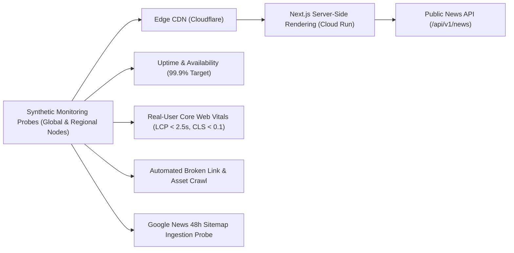

### 4.1 Monitored Public Dimensions
1. **Platform Availability & Uptime:** Continuous blackbox synthetic health probes checking `https://breakingnewswala.com/` every 60 seconds from multiple Indian geographic nodes (Delhi, Mumbai, Bengaluru). Target: **$\ge 99.9\%$ Availability** (`NFR-AVAIL-001`).
2. **Server-Side Rendering (SSR) Latency:** Time taken by the Next.js engine to render dynamic Hindi news pages to raw HTML before edge caching. Target: **$P95 \le 350\text{ms}$**.
3. **Core Web Vitals Real-User Monitoring (RUM):** Real-time client beacon telemetry capturing:
   - **Largest Contentful Paint (LCP):** Must occur within $\le 2.5\text{s}$ on 75% of page loads over 4G connections (`docs/SEO.md`, `docs/04-NFR.md`).
   - **Interaction to Next Paint (INP):** $\le 200\text{ms}$ to guarantee responsive mobile touch feedback.
   - **Cumulative Layout Shift (CLS):** $\le 0.1$ to eliminate unexpected visual jumping during ad banner injections.
4. **Client-Side JavaScript Exception Rate:** Automated capture of unhandled browser runtime errors via Sentry. Alert trigger: $> 1.0\%$ of active sessions experiencing JavaScript exceptions.
5. **Asset & Media Delivery Health:** Monitoring CDN cache hit ratios, WebP/AVIF image load failure rates, and video player HLS/MP4 buffering stalls.
6. **Search & Category Route Health:** Synthetic checks querying top district routes (`/district/meerut`, `/district/bhopal`) ensuring news articles render without empty states.


---

## 5. Reporter Workspace & Field Application Monitoring

Field correspondents operating in regional districts rely on the Reporter Web Application (`WF-CRE-01` through `WF-CRE-03`) to draft stories, upload witness evidence, and submit breaking coverage. Monitoring must detect field friction immediately without violating reporter draft confidentiality.

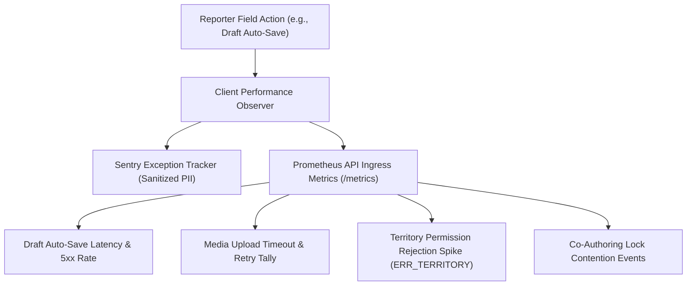

### 5.1 Key Reporter Workspace Telemetry
- **Authentication & Session Failures:** Tracking failed reporter OTP verifications, expired JWT refresh loops, and biometric authentication drops (`RULE-XPLAT-008`). Alert threshold: $> 5$ consecutive failures per reporter account.
- **Draft Auto-Save Reliability:** Measuring the success rate and latency of periodic background draft syncs (`/api/v1/reporter/drafts/save`). Alert threshold: Auto-save latency $> 1,500\text{ms}$ or failure rate $> 0.5\%$.
- **Media Upload Ingress Health:** Monitoring resumable chunk upload failures to Cloud Storage buckets for high-resolution photographs and raw video footage.
- **Territorial Boundary Enforcement Rejections:** Telemetry tracking HTTP 403 `ERR_TERRITORY_UNAUTHORIZED` errors (`RULE-EDIT-003`). Sudden spikes indicate misconfigured reporter assignments in the Admin Panel.
- **Studio Canvas & Timeline Crashes:** Client-side exception tracking in the Graphics and Video Studios, monitoring WebGL context loss or memory crashes during client-side rendering.

> [!NOTE]
> **Draft Confidentiality Invariant:** Reporter workspace telemetry captures performance timings, file byte sizes, and HTTP status codes. Telemetry **never** collects, logs, or inspects the text content of unreleased investigative drafts.

---

## 6. Admin Control Panel & Central Newsroom Operations Monitoring

The Central Newsroom Desk (`WF-EDT-01` through `WF-EDT-04`) is the nerve center of editorial publishing. A failure in the newsroom review queue stops news publishing across the entire enterprise.

### 6.1 Critical Newsroom Operational Indicators
- **Editorial Review Queue Depth:** Real-time count of active drafts awaiting editor triage (`status = PENDING_REVIEW`). Alert trigger: Backlog $> 40$ stories for $> 30$ continuous minutes during business hours.
- **Atomic Concurrency Lock Leaks:** Monitoring the 15-minute Redis claim locks (`RULE-EDIT-010`). If an editor locks a story and disconnects, the system tracks orphaned lock expirations to prevent stories from becoming permanently unreviewable.
- **Publishing Pipeline Failures:** Tracking instances where an editor clicks "Approve & Publish" (`WF-EDT-02`) but the background publisher fails to invalidate edge CDN caches, update XML sitemaps, or notify the live feed. **Severity: High (SEV-2).**
- **Administrative MFA & Authorization Failures:** Alerting on any failed administrative TOTP challenge or unauthorized attempt to access `/admin/*` routes (`RULE-AUTH-006`). Alert trigger: Instant notification to SecOps on 3 consecutive admin MFA failures.
- **Audit Log Ingestion Health:** Continuous verification that the append-only `editorial_audit_logs` table (`RULE-SEC-002`, `RULE-ANA-005`) is actively recording state mutations without database errors.

---

## 7. Backend API, Routing & Microservice Telemetry

The shared Node.js / Express backend provides the core APIs for all web, mobile, and administrative services (`docs/11-Architecture.md`, `docs/13-API.md`).

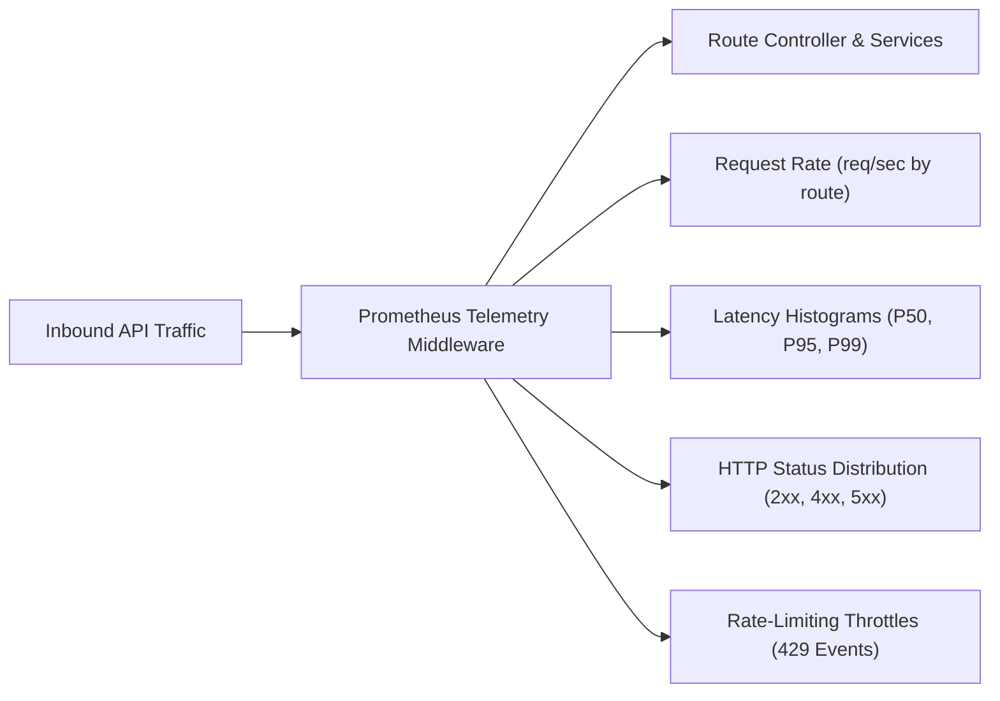

### 7.1 Authoritative API Telemetry Targets (`docs/04-NFR.md`)

| Metric Name | Prometheus Metric Identifier | Target Threshold (`04-NFR.md`) | SRE Alert Threshold |
| :--- | :--- | :--- | :--- |
| **API Latency (P50)** | `http_request_duration_seconds{quantile="0.50"}` | $\le 50\text{ms}$ | $> 100\text{ms}$ over 5m |
| **API Latency (P95)** | `http_request_duration_seconds{quantile="0.95"}` | $\le 200\text{ms}$ | $> 250\text{ms}$ over 5m |
| **API Latency (P99)** | `http_request_duration_seconds{quantile="0.99"}` | $\le 500\text{ms}$ | $> 800\text{ms}$ over 5m |
| **Server Error Rate (5xx)** | `http_requests_total{status=~"5.."}` | $< 0.1\%$ | $> 1.0\%$ over 3m (SEV-2) |
| **Client Error Rate (4xx)** | `http_requests_total{status=~"4.."}` | Normal baseline ($< 2.0\%$) | $> 5.0\%$ over 5m (Scraper / Attack) |
| **Rate Limit Violations** | `http_requests_total{status="429"}` | Expected during bot spikes | Burst $> 500/\text{min}$ triggers WAF review |
| **Node.js Event Loop Lag** | `nodejs_eventloop_lag_seconds` | $\le 20\text{ms}$ | $> 50\text{ms}$ indicates CPU starvation |
| **Process Memory (RSS)** | `process_resident_memory_bytes` | $\le 75\%$ container limit | $> 85\%$ triggers container autoscaling |

---

## 8. Database & Storage Engine Observability (PostgreSQL)

PostgreSQL is the single source of truth for all operational data (`docs/12-Database.md`). Database health monitoring ensures transactional integrity, high query speeds, and zero data corruption.

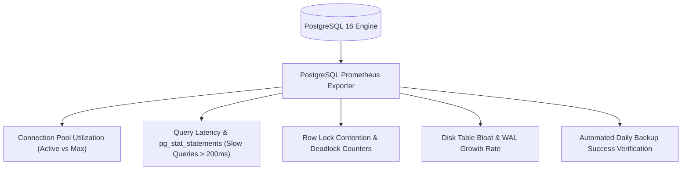

### 8.1 Critical Database Telemetry Indicators
1. **Connection Pool Saturation:** Monitoring active vs. idle connections in the PgBouncer pool. Alert trigger: Pool utilization $> 85\%$ of maximum allocation (`NFR-SCA-002`).
2. **Slow Query Tracking (`pg_stat_statements`):** Automatic capture of any query executing in $> 200\text{ms}$. Slow queries automatically log the originating correlation comment (`/* correlation_id=... */`) for rapid debugging.
3. **Deadlocks and Lock Contention:** Instant alert on any transaction deadlock (`pg_stat_database.deadlocks > 0`). Locks waiting $> 5.0\text{s}$ trigger high-priority alerts to prevent queue stalling.
4. **Replication Lag & Failover Readiness:** For multi-AZ replication setups, replication lag must remain under $1.0\text{s}$. Lag $> 5.0\text{s}$ triggers replication degradation warnings.
5. **Storage & WAL Growth:** Monitoring database disk volume consumption and Write-Ahead Log (WAL) generation rates. Alert trigger: Disk space $< 20\%$ free.
6. **Backup Completion & Integrity Probes:** Verification that daily automated database snapshots and point-in-time WAL archives complete successfully. Alert trigger: Absence of a verified daily backup snapshot by 06:00 IST triggers an immediate **SEV-1** alert.

> [!CAUTION]
> **Database Credential Security:** Database telemetry exporters, slow-query logs, and connection traces must **never** record raw SQL passwords, user credentials, or unencrypted authentication tokens.


---

## 9. Cache, Message Queues & Background Workers (Redis & BullMQ)

Redis powers real-time deduplication caches (`RULE-ANA-002`), sliding window newsroom trending counters (`RULE-ANA-004`), and BullMQ background queues for asynchronous newsroom tasks (`docs/11-Architecture.md`).

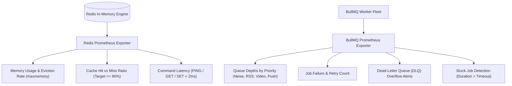

### 9.1 Cache Performance Telemetry
- **Cache Hit / Miss Ratio:** Target: **$\ge 90\%$ hit ratio** for static news reads. Alert trigger: Hit ratio $< 80\%$ over 10 minutes, indicating cache stampedes or premature TTL expirations.
- **Memory Pressure & Evictions:** Monitoring `used_memory` against the allocated `maxmemory` ceiling. Alert trigger: Redis memory $> 85\%$ or `evicted_keys > 0` on non-volatile keys.
- **Client Connection Starvation:** Monitoring connected clients and rejected connections (`rejected_connections > 0`).

### 9.2 BullMQ Queue Backlog & Worker Health
The platform segregates asynchronous operations into dedicated queues with strict service-level targets:

| Queue Identifier | Core Operational Responsibility | Normal In-Flight Target | Critical Backlog Alert | Max Job Timeout |
| :--- | :--- | :--- | :--- | :--- |
| **`queue:news-publish`** | Edge cache purge, XML sitemap update, WebSocket push | $\le 10$ jobs | $> 50$ jobs over 5m | 30 seconds |
| **`queue:push-notifications`** | FCM / Web Push broadcast fan-out (`WF-NOT-02`) | $\le 100$ jobs | $> 1,000$ jobs over 5m | 120 seconds |
| **`queue:rss-ingest`** | Ingesting and parsing verified external RSS feeds | $\le 20$ jobs | $> 100$ jobs over 15m | 60 seconds |
| **`queue:ai-tasks`** | Summaries, translations, headline proposals (`docs/19-API-Pool.md`) | $\le 25$ jobs | $> 100$ jobs over 10m | 90 seconds |
| **`queue:video-transcode`**| Multi-track MP4 video rendering (`WF-VID-01`) | $\le 5$ jobs | $> 25$ jobs over 20m | 600 seconds |
| **`queue:dead-letter`** | Quarantined failed jobs requiring administrative audit | 0 jobs | $> 5$ jobs triggers alert | N/A |

---

## 10. RSS Feed & External Content Intake Monitoring

The RSS polling and URL-to-News ingestion engines (`WF-RSS-01`, `WF-RSS-02`, `WF-URL-01`) continuously poll approved external syndicates and wire partners.

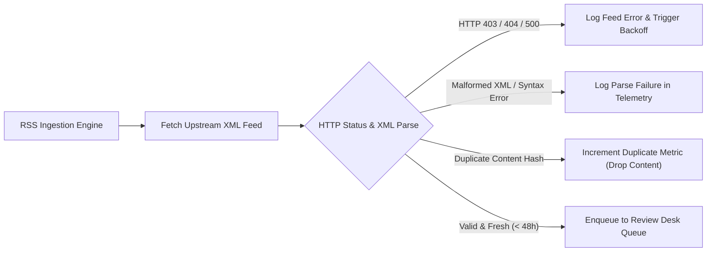

### 10.1 Feed Health Telemetry Rules
1. **Source Status Enforcement:** Ingestion crons strictly verify that `is_active = TRUE` before polling. If a deactivated feed attempts ingestion, it is dropped immediately and an unauthorized ingress anomaly is logged.
2. **Upstream Latency & Timeouts:** Tracking external feed response times. Feeds exceeding a 5.0-second timeout are halted with exponential backoff to prevent worker thread starvation.
3. **Parse Failure Detection:** Monitoring feeds that suddenly alter their XML schemas or RSS/Atom structures, generating instant alerts for feed configuration review.
4. **Duplicate Spike Anomaly:** A sudden spike where $> 95\%$ of imported items are flagged as duplicates indicates a broken pagination or caching loop at the upstream publisher.

---

## 11. AI Agent Mesh & Multi-Provider API Pool Observability

The AI intelligence layer (`docs/17-Agents.md`, `docs/19-API-Pool.md`, `docs/21-Prompts.md`) coordinates 14 specialized AI agents through a centralized multi-provider gateway. Monitoring must maintain real-time observability over model availability, latencies, token consumption, and automated failover circuits.

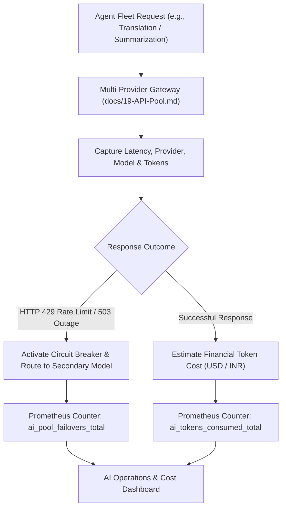

### 11.1 Key AI Telemetry Metrics

| Metric Identifier | Metric Type | Alert Threshold | Operational Meaning |
| :--- | :--- | :--- | :--- |
| `ai_agent_invocations_total` | Counter | N/A | Total calls partitioned by agent type (`headline`, `translator`, `seo`). |
| `ai_request_duration_seconds` | Histogram | $P95 > 4.0\text{s}$ over 5m | Upstream LLM latency degradation alert. |
| `ai_tokens_consumed_total` | Counter | Daily budget threshold | Tracks prompt (input) and completion (output) tokens for cost control. |
| `ai_pool_failovers_total` | Counter | $> 5$ failovers in 10m | Primary provider degraded; automated failover active (`WF-API-01`). |
| `ai_circuit_breaker_state` | Gauge | State $= 1$ (OPEN) | Circuit breaker tripped; requests actively routed to fallback models. |
| `ai_rate_limit_errors_total` | Counter | $> 10$ errors in 5m | Provider quota exhaustion alert (Triggers API key pool rotation). |
| `ai_hallucination_reports_total`| Counter | Daily anomaly threshold | Editor-flagged factual hallucinations logged for prompt evaluation. |

> [!IMPORTANT]
> **Strict AI Telemetry Privacy:** AI telemetry captures model names, token counts, error codes, and latencies. Telemetry **never** logs API keys, secret bearer tokens, or full unedited sensitive user prompts.

---

## 12. Model Context Protocol (MCP) Infrastructure Telemetry

The Model Context Protocol (MCP) layer (`docs/18-MCP.md`) provides autonomous AI agents with structured, governed access to platform tools, database schemas, and external resources.

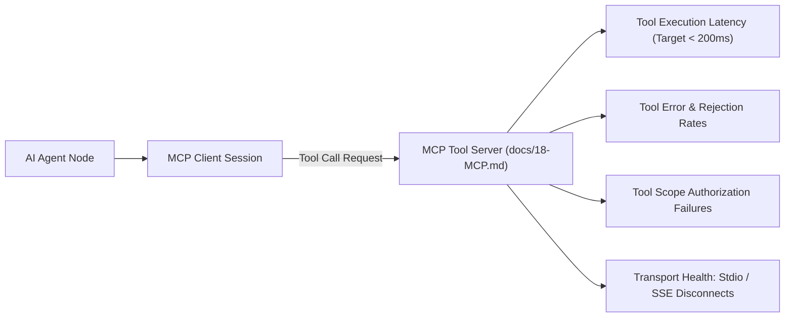

### 12.1 MCP Telemetry Dimensions
- **MCP Server Availability:** Heartbeat ping monitoring the availability of local stdio or SSE transports connecting agents to tool servers.
- **Tool Invocation Latency:** Profiling the execution duration of individual MCP tools (e.g., `db_query_article`, `reverse_image_search`, `fetch_rss_feed`).
- **Tool Schema Validation Failures:** Tracking instances where an agent provides malformed tool arguments that fail JSON-schema validation.
- **Authorization & Scope Violations:** Alerting on any attempt by an agent to invoke a tool outside its assigned role permissions (e.g., an unauthenticated agent attempting to call an administrative mutation tool).
- **Transport Disconnections:** Monitoring unexpected EOF or connection drops between agent workers and MCP daemon processes.


---

## 13. Graphics Studio & Video Studio Telemetry

The Graphics Studio (`WF-RGFX-01`, `WF-AGFX-01`) and Video Studio (`WF-VID-01`) handle computationally intensive media rendering, canvas composition, and cloud MP4 transcoding. Observability must differentiate between client-side aborts, server-side render crashes, and storage upload failures.

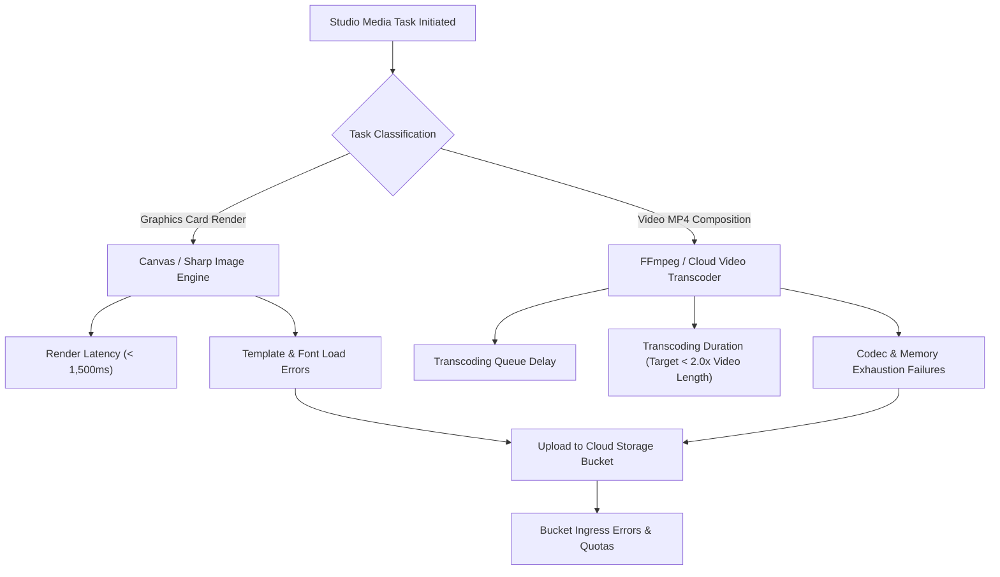

### 13.1 Studio Observability Metrics
- **Render Job Failure Rate:** Percentage of render tasks terminating in error (`ERR_CODEC_FAILURE`, `ERR_OUT_OF_MEMORY`, `ERR_FONT_NOT_FOUND`). Alert trigger: Failure rate $> 2.0\%$ over 10 minutes.
- **Transcode Speed Factor:** Ratio of transcode duration to raw video duration. Target: Transcode factor $\le 1.5\text{x}$. A factor $> 3.0\text{x}$ indicates worker CPU throttling.
- **User Abort vs. System Crash:** Telemetry explicitly separates user cancellations (closing the editor tab before render completes) from genuine backend worker exceptions, avoiding false alarm operational pages.
- **Media Storage Quotas:** Tracking Cloud Storage bucket capacity growth and bandwidth egress spikes (`docs/16-Storage.md`). Alert trigger: Bucket storage utilization $> 80\%$ of budget allocation.

---

## 14. Push Notification & Message Delivery Monitoring

Push notifications (`WF-NOT-01`, `WF-NOT-02`) broadcast urgent public developments to readers across Web Push and native mobile devices.

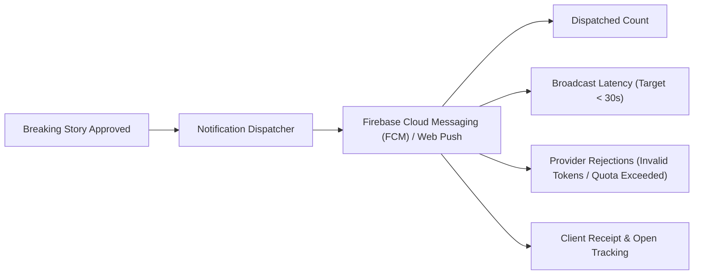

### 14.1 Key Notification Observability Indicators
- **Broadcast Fan-Out Latency:** Duration (in seconds) required to dispatch push notifications to the entire subscriber base across targeted districts. Target: **$\le 30\text{ seconds}$** for urgent breaking news alerts (`docs/04-NFR.md`). Alert trigger: Latency $> 60\text{s}$.
- **Upstream Provider Error Rates:** Monitoring FCM and Web Push API response codes (HTTP 401 Unauthorized, 429 Quota Exceeded, 503 Service Unavailable).
- **Stale Token Pruning Telemetry:** Tracking `UNREGISTERED` and `INVALID_TOKEN` responses, automatically scheduling dead device tokens for deletion to maintain a clean subscriber database.
- **Delivery Acknowledgment vs. Open Rate:** Distinguishing between upstream provider acceptance, client device receipt, and active user clicks (`docs/Analytics.md`).

---

## 15. Future Native Android Mobile Observability Architecture

The future Native Android mobile application will be built using native Kotlin and Jetpack Compose (not a wrapped WebView), communicating with the shared backend API (`docs/02-Features.md`, `docs/11-Architecture.md`).

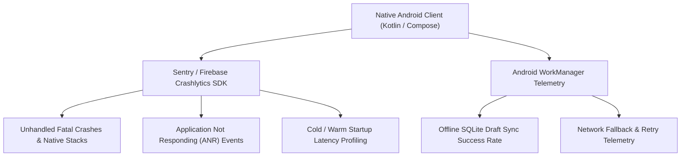

### 15.1 Mobile Telemetry Dimensions
- **Crash-Free Session Rate:** Percentage of user sessions terminating cleanly without fatal unhandled exceptions. Target: **$\ge 99.5\%$ Crash-Free Sessions**. Alert trigger: Crash-free rate $< 99.0\%$.
- **Application Not Responding (ANR) Rate:** Monitoring UI thread freezes exceeding 5.0 seconds. Target: **ANR rate $< 0.1\%$**.
- **Cold App Startup Duration:** Time required from app launch intent to the first interactive frame of the district news feed. Target: **$\le 2.0\text{ seconds}$** on mid-tier Android devices.
- **WorkManager Offline Sync Health:** Tracking background synchronization success of cached reporter drafts and offline article reads when reconnecting to 4G/WiFi networks.
- **Network Request Failure Rate:** Monitoring client-side HTTP timeouts, DNS lookup failures, and SSL handshake errors in low-connectivity rural zones.

> [!CAUTION]
> **Mobile Privacy Invariant:** Mobile observability SDKs must be configured with strict PII scrubbers. Crash reports must **never** capture user phone numbers, device IMEI, MAC addresses, or location coordinates.

---

## 16. Security Monitoring, Threat Detection & SIEM Integration

Security monitoring coordinates with `docs/15-Security.md` to protect the news network against cyberattacks, state-sponsored disruption, and unauthorized data exfiltration.

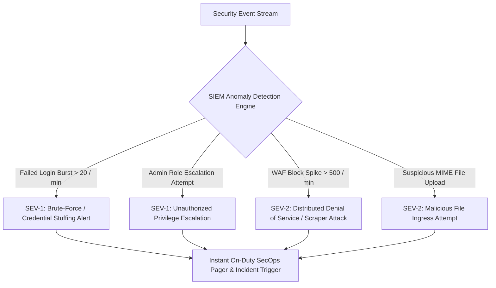

### 16.1 Automated Security Detection Rules

| Security Threat Identifier | Detection Rule & Trigger Condition | Severity | Automated Response & Escalation |
| :--- | :--- | :--- | :--- |
| **`SEC-ATO-001`** (Credential Stuffing) | $> 20$ failed login attempts across multiple IPs targeting single account within 5m. | **SEV-1** | Account temporarily locked; CAPTCHA challenge enforced; SecOps paged. |
| **`SEC-PRIV-002`** (Privilege Escalation) | Non-admin JWT token attempting access to `/api/v1/admin/*` endpoints. | **SEV-1** | Session token immediately revoked; client IP blocked at WAF; audit alert logged. |
| **`SEC-SSRF-003`** (Server-Side Forgery) | RSS feed or URL-to-News scraping private IP ranges (`10.0.0.0/8`, `127.0.0.1`, `169.254.169.254`). | **SEV-1** | Outbound request aborted at DNS resolver; source permanently blacklisted. |
| **`SEC-MAL-004`** (Malicious File Ingress) | Media upload containing executable magic bytes (`.exe`, `.sh`, `.php`) or SVG with script tags. | **SEV-2** | File quarantined immediately; temporary upload token revoked; reporter account flagged. |
| **`SEC-WAF-005`** (DDoS / Scraper Flood) | Edge WAF blocks $> 500$ malicious requests per minute. | **SEV-2** | Cloudflare Under Attack Mode enabled; automated rate limiting escalated. |
| **`SEC-AUD-006`** (Audit Log Tampering) | Any unauthorized database write or delete attempt against `editorial_audit_logs`. | **SEV-1** | Database root alert; immutable S3 object retention audit triggered. |


---

## 17. Structured Logging Standards, Correlation & Redaction

In accordance with `docs/27-Debugging.md` (Section 7), all backend microservices, background workers, and API gateways must format logs as single-line, structured JSON streams.

### 17.1 Standard JSON Log Envelope
```json
{
  "timestamp": "2026-10-31T11:15:00.123Z",
  "level": "ERROR",
  "service": "bnw-backend-core",
  "environment": "production",
  "request_id": "req-98234-abcd",
  "correlation_id": "c8f92b1a-5f34-4b92-91f2-1084b6f12345",
  "trace_id": "4bf92f3577b34da6a3ce929d0e0e4736",
  "actor_id": "usr_rep_88321",
  "actor_role": "ROLE_REPORTER",
  "operation": "SUBMIT_ARTICLE_DRAFT",
  "error_code": "ERR_TERRITORY_UNAUTHORIZED",
  "duration_ms": 42.5,
  "message": "Reporter attempted to submit story outside assigned district beat",
  "metadata": {
    "attempted_district": "bhopal",
    "assigned_district": "meerut"
  }
}
```

### 17.2 Log Levels and Operational Usage
- **`FATAL`:** Unrecoverable process crash, catastrophic database loss, or security compromise requiring immediate container restart and SRE escalation.
- **`ERROR`:** Failed user requests, unhandled runtime exceptions, failed database transactions, or external AI API outages.
- **`WARN`:** Recoverable degradation, approaching rate limits, high latency spikes, or failed background job retries.
- **`INFO`:** Key operational milestones (server startup, successful user login, article published, campaign scheduled).
- **`DEBUG`:** Verbose developer diagnostics (disabled in production environments).

### 17.3 Automated Secret Redaction & PII Masking
The logging middleware utilizes an automated pre-serialize scrubber that recursively masks sensitive keys before writing to stdout:
- **Redacted Keys:** `password`, `token`, `authorization`, `cookie`, `jwt`, `api_key`, `secret`, `cvv`, `pan`, `aadhar`, `credit_card`.
- **Masking Pattern:** Replaced with static string `"[REDACTED_SECRET]"`.
- **IP Masking:** IP addresses in application logs are truncated at the final octet pursuant to `RULE-ANA-001`.

---

## 18. Alerting Framework, Severity Levels & Escalation Rules

Alerts must be actionable, symptom-based, and designed to eliminate alert fatigue. Every fired alert must correspond to an explicit operational runbook in `docs/27-Debugging.md`.

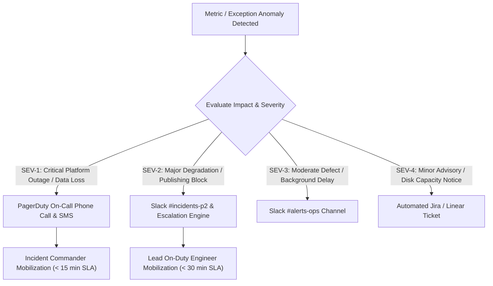

### 18.1 Incident Severity Classification Matrix

| Severity Level | Operational Definition & Impact Assessment | Example Conditions | Response SLA | Primary Notification Channels | Incident Authority |
| :--- | :--- | :--- | :--- | :--- | :--- |
| **`SEV-1` (Critical)** | Catastrophic platform-wide outage, complete database corruption, severe data breach, or total block on public news publishing. | - Complete site outage (5xx error rate $> 5\%$).<br>- PostgreSQL master database failure.<br>- Critical security compromise / credential dump.<br>- Backup failure across all storage nodes. | **$< 15\text{ minutes}$** (24/7/365) | PagerDuty voice call, SMS, automated conference bridge, executive push | Incident Commander, Chief Technology Officer, Lead SRE |
| **`SEV-2` (Major)** | Core newsroom functionality severely degraded; public reads functional but newsroom review queue stalled or AI failovers exhausted. | - Editorial review queue completely locked.<br>- All primary and secondary AI providers offline.<br>- API latency P95 $> 1,000\text{ms}$ for $> 10\text{m}$.<br>- Push notification broadcast completely stuck. | **$< 30\text{ minutes}$** | Slack `#incidents-p2`, automated on-call engineer page, SMS alert | Lead SRE, Backend Architect, Newsroom Tech Lead |
| **`SEV-3` (Moderate)** | Non-critical component degraded; public news and editorial publishing unaffected; single district or feed failing. | - Single RSS syndicate feed parsing failing.<br>- Video Studio render latency $> 3\text{x}$ normal.<br>- Background analytics batch delay $> 1\text{ hour}$.<br>- Minor layout styling glitch on legacy browsers. | **$< 2\text{ hours}$** (Business hours) | Slack `#alerts-ops`, internal operational digest | On-Duty DevOps Engineer, Relevant Feature Team |
| **`SEV-4` (Minor)** | Informational advisory, minor maintenance requirement, or scheduled resource capacity warning. | - Storage bucket utilization $> 75\%$.<br>- Stale device notification tokens $> 10,000$.<br>- Transient network blip recovered automatically.<br>- Minor documentation typo or metric drift. | **Next Business Day** | Automated backlog ticket (Linear / Jira), weekly digest | Assigned Engineering Squad |

---

## 19. Incident Management, Triage & Post-Incident Review Lifecycle

When incidents occur, the engineering organization follows a standardized, blame-free incident resolution lifecycle (`docs/27-Debugging.md`).

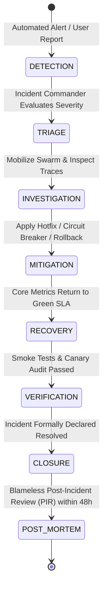

### 19.1 Incident Roles and Responsibilities
- **Incident Commander (IC):** Leads operational response, coordinates communication, assigns investigation tasks, and maintains focus on mitigation over root-cause speculation.
- **Operations Lead:** Executes diagnostics, rolls back broken deployments (`docs/24-Deployment.md`), scales containers, or toggles feature flags.
- **Communications Lead:** Updates the public status page (`status.breakingnewswala.com`) and briefs the Chief Editorial Officer on estimated time to recovery.

### 19.2 The Blameless Post-Incident Review (PIR)
For all **SEV-1** and **SEV-2** incidents, a formal Blameless PIR must be conducted within 48 hours of resolution:
1. **Detailed Chronology:** Exact timeline of events from initial regression trigger to automated alert, mobilization, mitigation, and final recovery.
2. **Root Cause Analysis (5 Whys):** Identifying systemic, process, and architectural root causes without assigning individual blame.
3. **Preventive Action Items:** Explicit engineering tickets (with assigned owners and due dates) ensuring the specific failure mode cannot recur.

---

## 20. Health Probes, Liveness, Readiness & Synthetic Testing

The platform exposes dedicated health probe endpoints to support automated container orchestration (Cloud Run / Kubernetes) and external monitoring synthetics (`docs/24-Deployment.md`).

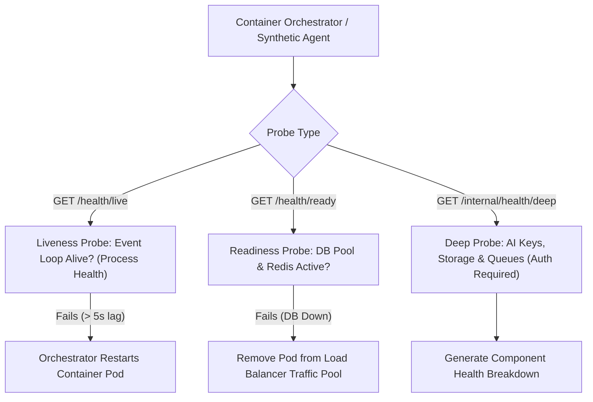

### 20.1 Probe Endpoint Specifications
1. **Liveness Probe (`GET /health/live`):**
   - **Purpose:** Verifies that the Node.js process is responsive and the event loop is not deadlocked.
   - **Behavior:** Returns HTTP 200 `{ "status": "UP", "uptime": 12450 }`. Does not query external databases.
   - **Failure Action:** Container orchestrator restarts the pod after 3 consecutive failures.
2. **Readiness Probe (`GET /health/ready`):**
   - **Purpose:** Verifies that downstream dependencies (PostgreSQL connection pool, Redis ping) are healthy before routing live reader traffic.
   - **Behavior:** Executes `SELECT 1` on PostgreSQL and `PING` on Redis. Returns HTTP 200 if both succeed; HTTP 503 Service Unavailable if either fails.
   - **Failure Action:** Ingress load balancer temporarily removes the container from the serving pool.
3. **Deep Internal Diagnostics (`GET /internal/health/deep`):**
   - **Purpose:** Comprehensive operational audit testing AI gateway endpoints, Cloud Storage read/write permissions, and BullMQ queue workers.
   - **Security Restriction:** Protected strictly by internal administrative Bearer tokens. **Never exposed to public networks.**


---

## 21. Operational Monitoring Dashboard Specifications

Dashboards consolidate operational signals into real-time, actionable visual consoles for engineering, SRE, and newsroom supervisors.

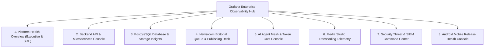

### 21.1 Comprehensive Dashboard Catalog

| Dashboard Title | Target Audience | Primary Operational Purpose | Core Metric Visualizations | Access Control Level |
| :--- | :--- | :--- | :--- | :--- |
| **1. Platform Health Overview** | CTO, Lead SRE, On-Duty Engineers | High-level situational awareness across all platform services. | Service availability lights, global request throughput, global 5xx error rate, P95 latency heatmap, active SEV alerts. | All Technical Staff, Executive Leadership |
| **2. Backend API & Routing** | Backend Engineers, SRE | Deep performance triage of REST routes and microservices. | Requests per second by endpoint, latency distribution (P50/P95/P99), HTTP status breakdown, event loop lag, memory RSS. | Technical Engineering Staff |
| **3. Database & Storage Insights** | Database Administrators (DBA), SRE | Monitoring PostgreSQL query health and storage capacity. | Active connection pool gauge, slow query table (`pg_stat_statements`), table bloat, deadlock counters, WAL write rates. | Restricted to DBAs and Lead SRE |
| **4. Newsroom Operations Desk** | Bureau Chiefs, Desk Editors | Real-time health of editorial workflows and publishing. | Editorial review queue backlog, claim lock expirations, publishing throughput, RSS feed parse failures. | Central Newsroom Editors, Technical Leads |
| **5. AI Agent & Cost Console** | AI Engineers, Prompt Architects | Telemetry monitoring model performance and operational expenditure. | Token usage per agent, provider failover counters, TTFT latency, estimated cost in INR/USD, model error rates. | AI Operations, Finance, Tech Leads |
| **6. Media Studio Telemetry** | Video Producers, DevOps | Operational monitoring of rendering and transcoding pipelines. | BullMQ queue backlog, video transcode factor, canvas export failures, Cloud Storage bucket upload throughput. | Studio Operations, DevOps |
| **7. Security & SIEM Command** | SecOps, Security Architects | Real-time threat detection and perimeter defense monitoring. | Failed login bursts, WAF block tallies, privilege escalation attempts, SSRF blocks, audit log modification alerts. | Restricted strictly to SecOps Team |
| **8. Android Release Health** | Mobile Engineers, Product Leads | Stability and performance tracking for native Android releases. | Crash-free session percentage, ANR rate, cold start latency, screen rendering frame drops, OS version distribution. | Mobile Squad, Product Managers |

---

## 22. Monitoring Technology & Provider Evaluation

To ensure operational excellence without vendor lock-in or unpredictable licensing costs, the platform evaluates proven open-source and managed observability technologies.

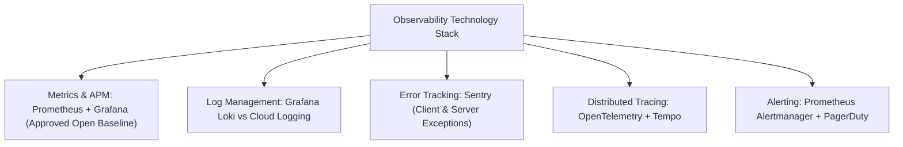

### 22.1 Observability Technology Comparison Matrix

| Observability Category | Technology Option | Architectural Advantages | Cost & Scaling Model | Data Privacy & Governance | Recommendation Status |
| :--- | :--- | :--- | :--- | :--- | :--- |
| **Metrics & APM** | **Prometheus + Grafana** | Industry standard, lightweight pull scraping, powerful PromQL syntax, zero per-seat licensing. | Highly predictable; scales with disk time-series retention. | **Complete:** 100% internal data ownership. | **CONFIRMED BASELINE** |
| **APM Alternative** | **Datadog / New Relic** | Turnkey managed agent, rich automated anomaly detection. | Unpredictable, high cost scaling per host and custom metric. | Low: Telemetry exported to external US cloud. | **REJECTED (Cost & Vendor Lock-in)** |
| **Log Aggregation** | **Grafana Loki** | Native Grafana integration, indexes only metadata labels (low storage footprint), sub-second search. | Very low storage cost; uses standard object storage. | **High:** Self-hosted in private VPC. | **PROPOSED FOR PHASE 2** |
| **Log Alternative** | **ELK Stack (Elasticsearch)** | Full-text log indexing, mature Kibana analytics ecosystem. | High RAM consumption; complex cluster operations. | High (Self-hosted). | **DEFERRED (High Operational Burden)** |
| **Error Tracking** | **Sentry (Self-Hosted / Cloud)** | Superior stack trace symbolication, client SDKs (React, Node, Kotlin), release health tracking. | Generous free tier; predictable scaling. | **Excellent:** Robust PII data scrubber pipeline. | **PROPOSED BASELINE** |
| **Distributed Tracing** | **OpenTelemetry + Tempo** | Vendor-neutral instrumentation standard; low-cost trace storage in cloud object buckets. | Scales efficiently with sampling rate. | **Complete:** Internal trace retention. | **CONFIRMED BASELINE** |
| **Synthetic Probes** | **Uptime Kuma / Better Stack** | Multi-region HTTP checks, SSL certificate monitoring, public status page integration. | Free open-source (Uptime Kuma) or low-cost SaaS. | High: Tests only public URLs. | **PROPOSED FOR PHASE 1** |

---

## 23. Observability Architecture & Workflow Diagrams

The following six Mermaid diagrams illustrate the complete monitoring architecture, data flows, alert routing, and incident response lifecycles:

### 23.1 Diagram 1: Overall Observability Architecture
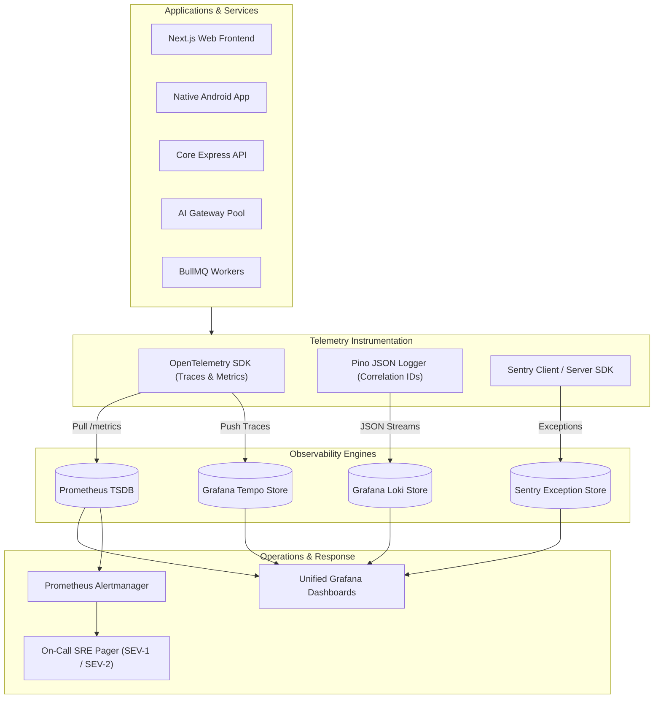

### 23.2 Diagram 2: Metrics, Logs and Traces Collection Pipeline
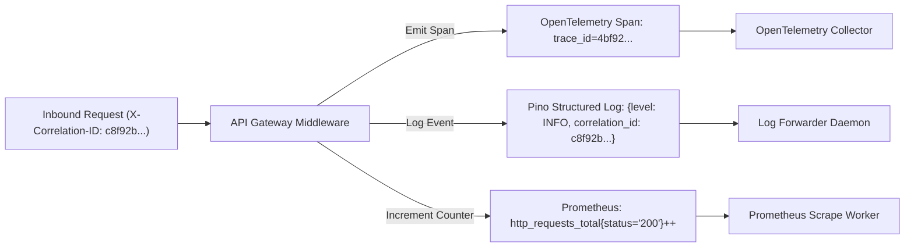

### 23.3 Diagram 3: Alert Routing & Escalation Workflow
```mermaid
flowchart TD
    ALERT_TRIGGER["Prometheus Rule Fires: P95 Latency > 250ms for 5m"] --> AM["Alertmanager Pipeline"]
    
    AM --> DEDUP{"Deduplicate & Group by Service"}
    DEDUP --> SEV_ROUTE{"Evaluate Severity Level"}
    
    SEV_ROUTE -->|SEV-1: Critical Outage| PAGE_SRE["PagerDuty Voice Call + SMS (On-Call SRE Mobilized)"]
    SEV_ROUTE -->|SEV-2: Major Degradation| SLACK_INC["Slack #incidents-p2 + Automated Ticket"]
    SEV_ROUTE -->|SEV-3: Partial Defect| SLACK_OPS["Slack #alerts-ops Channel"]
    SEV_ROUTE -->|SEV-4: Advisory / Capacity| JIRA_LOG["Create Linear / Jira Maintenance Ticket"]
    
    PAGE_SRE --> ESCALATE_CHECK{"Acknowledged within 15 mins?"}
    ESCALATE_CHECK -- "No" --> ESCALATE_LEAD["Escalate to VP Engineering & CTO"]
    ESCALATE_CHECK -- "Yes" --> SRE_COMMAND["Incident Response Commenced"]
```

### 23.4 Diagram 4: Incident Lifecycle State Machine
```mermaid
stateDiagram-v2
    [*] --> DETECTED: Automated Alert Fires / Health Probe Fails
    DETECTED --> TRIAGED: SRE Assigns Severity (SEV-1 to SEV-4)
    TRIAGED --> INVESTIGATING: Swarm Diagnoses Traces & Logs
    INVESTIGATING --> MITIGATING: Rollback Applied / Hotfix Deployed
    MITIGATING --> RECOVERED: Service Metrics Return to Green SLA
    RECOVERED --> VERIFYING: Automated Smoke Tests Pass
    VERIFYING --> CLOSED: Incident Formally Closed
    CLOSED --> PIR_REVIEW: Blameless Post-Incident Review within 48h
    PIR_REVIEW --> [*]
```

### 23.5 Diagram 5: AI & Multi-Provider Monitoring Pipeline
```mermaid
flowchart TD
    AI_TASK["AI Task Triggered (e.g., Vernacular Translation)"] --> GATEWAY["Multi-Provider API Gateway (docs/19-API-Pool.md)"]
    
    GATEWAY --> EXEC_CALL["Execute Call against Primary LLM (Gemini 1.5 Flash)"]
    EXEC_CALL --> OUTCOME{"Call Outcome"}
    
    OUTCOME -- "HTTP 429 / 503 Outage" --> TRIP_CB["Trip Circuit Breaker & Failover to Secondary"]
    OUTCOME -- "Success" --> LOG_TOKENS["Log Prompt & Completion Tokens"]
    
    TRIP_CB --> INC_FAIL["Increment: ai_pool_failovers_total"]
    LOG_TOKENS --> INC_TOKENS["Increment: ai_tokens_consumed_total"]
    
    INC_FAIL & INC_TOKENS --> GRAF_AI["AI Operations & Cost Dashboard in Grafana"]
```

### 23.6 Diagram 6: Future Native Android Monitoring Integration
```mermaid
flowchart TD
    MOBILE_CLIENT["Native Android Client (Kotlin / Compose)"] --> APP_MONITOR["Mobile Observability Framework"]
    
    APP_MONITOR -->|Unhandled Crash / ANR| SENTRY_MOBILE["Sentry Mobile SDK (PII Scrubbed)"]
    APP_MONITOR -->|HTTP Latency & Network Drops| BACKEND_METRICS["Telemetry Gateway (/api/v1/analytics/event)"]
    APP_MONITOR -->|Background Sync Telemetry| WORK_TELEMETRY["WorkManager Telemetry Logger"]
    
    SENTRY_MOBILE --> CRASH_DASH["Mobile Crash & ANR Dashboard in Sentry"]
    BACKEND_METRICS --> PROM_BACKEND["Central Prometheus TSDB"]
    WORK_TELEMETRY --> PROM_BACKEND
    PROM_BACKEND --> ANDROID_GRAF["Android Release Health Console in Grafana"]
```

---

## 24. Cross-Document Traceability Matrix

The Master Monitoring Specification enforces the non-functional requirements and operational workflows established across the project documentation library:

| Target Doc ID | Target Document Title | Key Section Reference | Monitoring Architecture Traceability Points |
| :--- | :--- | :--- | :--- |
| [`01-PRD.md`](file:///c:/Users/pp/Downloads/BREAKING-NEWS-WALA-main/docs/01-PRD.md) | Product Requirements | Sections 24, 25, 27 | Enforces platform reliability benchmarks and real-time newsroom situational awareness. |
| [`02-Features.md`](file:///c:/Users/pp/Downloads/BREAKING-NEWS-WALA-main/docs/02-Features.md) | Feature Specification | `FEAT-ADM-001`, `FEAT-PUB-012` | Telemetry instrumentation for administrative audit logs and public reader performance. |
| [`03-Plan.md`](file:///c:/Users/pp/Downloads/BREAKING-NEWS-WALA-main/docs/03-Plan.md) | Project Plan & Roadmap | Phase 12 (Observability) | Implements Phase 12 operational observability milestones prior to production launch. |
| [`04-NFR.md`](file:///c:/Users/pp/Downloads/BREAKING-NEWS-WALA-main/docs/04-NFR.md) | Non-Functional Requirements | Sections 19, 20 (`NFR-OBS-001`, `002`)| Establishes P95 latency targets ($\le 200\text{ms}$), 99.9% uptime, and 15-second exception capture SLAs. |
| [`05-Workflows.md`](file:///c:/Users/pp/Downloads/BREAKING-NEWS-WALA-main/docs/05-Workflows.md) | Master Workflows | `WF-ERR-01` to `03`, `WF-ANA-01` | Coordinates error recovery workflows and real-time newsroom concurrency feeds. |
| [`06-Business-Rules.md`](file:///c:/Users/pp/Downloads/BREAKING-NEWS-WALA-main/docs/06-Business-Rules.md) | Business Rules | `RULE-SEC-002`, `RULE-ANA-005` | Mandates 180-day immutable audit log retention under CERT-In directives. |
| [`11-Architecture.md`](file:///c:/Users/pp/Downloads/BREAKING-NEWS-WALA-main/docs/11-Architecture.md) | Technical Architecture | Section 20, Principle P-11 | Governs OpenTelemetry distributed tracing, Pino JSON logging, and Prometheus scraping. |
| [`12-Database.md`](file:///c:/Users/pp/Downloads/BREAKING-NEWS-WALA-main/docs/12-Database.md) | Database Specification | `pg_stat_statements`, Pool Config | Specifies database pool saturation limits, slow query logging, and correlation comments. |
| [`13-API.md`](file:///c:/Users/pp/Downloads/BREAKING-NEWS-WALA-main/docs/13-API.md) | API Specification | Standard Error Envelopes | Standardizes HTTP 4xx/5xx error codes and correlation ID propagation in API responses. |
| [`14-Auth.md`](file:///c:/Users/pp/Downloads/BREAKING-NEWS-WALA-main/docs/14-Auth.md) | Authentication & RBAC | Section 12 (Security Telemetry) | Monitors failed login bursts, TOTP MFA rejections, and administrative privilege breaches. |
| [`15-Security.md`](file:///c:/Users/pp/Downloads/BREAKING-NEWS-WALA-main/docs/15-Security.md) | Security Policy | Threat Matrix (RSK-001 to 012) | Implements automated SIEM anomaly detection rules for credential stuffing and SSRF attacks. |
| [`16-Storage.md`](file:///c:/Users/pp/Downloads/BREAKING-NEWS-WALA-main/docs/16-Storage.md) | Storage Architecture | Section 12 (Storage Telemetry) | Monitors Cloud Storage upload/download latencies, quota consumption, and bucket permissions. |
| [`17-Agents.md`](file:///c:/Users/pp/Downloads/BREAKING-NEWS-WALA-main/docs/17-Agents.md) | AI Agents Architecture | Section 10 (Fleet Telemetry) | Profiles token throughput, TTFT latency, and human rejection rates across all 14 agents. |
| [`18-MCP.md`](file:///c:/Users/pp/Downloads/BREAKING-NEWS-WALA-main/docs/18-MCP.md) | Model Context Protocol | Section 16 (MCP Telemetry) | Tracks tool invocation latencies, schema validation errors, and transport disconnects. |
| [`19-API-Pool.md`](file:///c:/Users/pp/Downloads/BREAKING-NEWS-WALA-main/docs/19-API-Pool.md) | Multi-Provider API Pool | Section 8 (Failover Telemetry) | Implements automated circuit breakers and failover counters (`ai_pool_failovers_total`). |
| [`20-Integrations.md`](file:///c:/Users/pp/Downloads/BREAKING-NEWS-WALA-main/docs/20-Integrations.md) | Integrations Architecture | `INT-OPS-019`, `ADR-INT-011` | Formalizes Sentry (error tracking) and Prometheus/Grafana (APM) as the integration baseline. |
| [`24-Deployment.md`](file:///c:/Users/pp/Downloads/BREAKING-NEWS-WALA-main/docs/24-Deployment.md) | Deployment Architecture | Section 15 (Operational Readiness) | Implements `/health/live` and `/health/ready` probe endpoints for container orchestration. |
| [`25-Environment.md`](file:///c:/Users/pp/Downloads/BREAKING-NEWS-WALA-main/docs/25-Environment.md) | Environment Configuration | Section 6.15 (Observability Envs) | Governs deployment environment flags controlling Sentry DSNs, log levels, and Prometheus ports. |
| [`26-Testing.md`](file:///c:/Users/pp/Downloads/BREAKING-NEWS-WALA-main/docs/26-Testing.md) | Testing Architecture | Section 8 (Monitoring QA) | Details automated test suites verifying health probe status codes and metric increment integrity. |
| [`27-Debugging.md`](file:///c:/Users/pp/Downloads/BREAKING-NEWS-WALA-main/docs/27-Debugging.md) | Debugging & Diagnostics | Section 7 (Logging & Runbooks) | Provides concrete operational runbooks for triaging memory leaks, slow queries, and stalled queues. |
| [`Analytics.md`](file:///c:/Users/pp/Downloads/BREAKING-NEWS-WALA-main/docs/Analytics.md) | Analytics & Telemetry | Section 14 (Technical Metrics) | Strictly separates public audience analytics from infrastructure SRE telemetry. |
| [`Monetization.md`](file:///c:/Users/pp/Downloads/BREAKING-NEWS-WALA-main/docs/Monetization.md) | Monetization Strategy | Section 16 (Ad Fraud Detection) | Monitors viewable ad impressions, webhook verification failures, and click fraud anomalies. |
| [`Editorial-Policy.md`](file:///c:/Users/pp/Downloads/BREAKING-NEWS-WALA-main/docs/Editorial-Policy.md) | Editorial Standards | Section 14 (Audit Integrity) | Preserves immutable audit logging for retractions and errata notices without silent scrubbing. |

---

## 25. Monitoring Architectural Decision Register

This register records all major operational, SRE, and observability architectural decisions governing BREAKING NEWS WALA:

### ADR-MONIT-001: OpenTelemetry-Standard Distributed Tracing with AsyncLocalStorage
- **Status:** `Confirmed`
- **Context:** Tracing asynchronous requests across microservices, background queues, and database calls requires a vendor-neutral context propagation mechanism.
- **Decision:** Mandate OpenTelemetry SDK with Node.js `AsyncLocalStorage` to propagate `X-Correlation-ID` automatically across all internal service boundaries and database comments.
- **Consequences:** Eliminates manual parameter drilling; guarantees end-to-end request visibility.

### ADR-MONIT-002: Prometheus Pull-Scraping Architecture via Backend `/metrics`
- **Status:** `Confirmed`
- **Context:** High-throughput backend services require lightweight, non-blocking metrics collection without incurring external network latency on every transaction.
- **Decision:** Expose a standardized, non-public `/metrics` endpoint scraped by Prometheus time-series engines at 15-second intervals.
- **Consequences:** Extremely low CPU/memory overhead; enables powerful PromQL alerting expressions.

### ADR-MONIT-003: Single-Line Structured JSON Logging with Mandatory Redaction
- **Status:** `Confirmed`
- **Context:** Plain-text unstructured logs are difficult to parse at scale and frequently leak sensitive user passwords or authentication secrets.
- **Decision:** Mandate single-line JSON log serialization via Pino with automated pre-serialize redaction filters for passwords, tokens, API keys, and PII.
- **Consequences:** Safe, search-indexed log streams compatible with Grafana Loki and Cloud Logging.

### ADR-MONIT-004: Decoupling Liveness (`/health/live`) and Readiness (`/health/ready`) Probes
- **Status:** `Confirmed`
- **Context:** Conflating process health with database availability causes container orchestrators to aggressively restart healthy pods during transient database hiccups.
- **Decision:** Decouple probes. Liveness checks solely process responsiveness; readiness checks downstream database/cache connectivity to manage traffic routing.
- **Consequences:** Prevents cascading container restart loops during localized database maintenance.

### ADR-MONIT-005: Four-Tier Incident Severity Model (SEV-1 to SEV-4) with Blameless PIRs
- **Status:** `Confirmed`
- **Context:** Operational disruptions require clear escalation protocols, defined response SLAs, and a blameless learning culture to prevent recurring defects.
- **Decision:** Formally adopt SEV-1 through SEV-4 severity levels, mandating blameless Post-Incident Reviews (PIRs) within 48 hours for all SEV-1/SEV-2 outages.
- **Consequences:** Rapid mobilization during emergencies; continuous systemic reliability improvements.

### ADR-MONIT-006: 180-Day Immutable Retention of System and Audit Logs under CERT-In
- **Status:** `Confirmed`
- **Context:** Indian cybersecurity regulations (CERT-In Directive No. 20(3)/2022) mandate digital news and intermediary platforms to retain immutable access logs.
- **Decision:** Enforce `RULE-ANA-005`. Archive all backend access logs and security telemetry in write-once, immutable cloud object storage for a minimum of 180 days.
- **Consequences:** Full statutory compliance with national cyber forensics directives.

### ADR-MONIT-007: Zero Collection of Private Draft Content or PII in Telemetry
- **Status:** `Confirmed`
- **Context:** Telemetry collection that inadvertently logs user draft text or citizen personal data violates reporter confidentiality and the DPDP Act.
- **Decision:** Strictly prohibit capturing draft article bodies, investigative field notes, or unredacted user credentials in telemetry logs or traces.
- **Consequences:** Complete privacy preservation; high field reporter trust.

### ADR-MONIT-008: Automated Circuit Breakers and Telemetry on AI Multi-Provider Pool
- **Status:** `Confirmed`
- **Context:** Upstream AI LLM outages or rate limits (HTTP 429) can block newsroom summarization and translation workflows.
- **Decision:** Implement real-time Prometheus telemetry tracking provider failovers (`WF-API-01`), automatically tripping circuit breakers to route traffic to secondary models.
- **Consequences:** High-availability AI services; zero interruption to newsroom publishing desks.

### ADR-MONIT-009: Self-Hosted Grafana Loki for Log Aggregation
- **Status:** `Proposed`
- **Context:** Storing billions of log lines in commercial SaaS aggregators generates excessive monthly recurring bills.
- **Decision:** Plan deployment of a self-hosted Grafana Loki cluster in Phase 2, utilizing low-cost cloud object storage for log chunk retention.
- **Consequences:** Highly cost-effective log searchability; unified Grafana experience. *Status: Proposed for Phase 2.*

### ADR-MONIT-010: Sentry Integration for Client-Side Web and Native Android Crash Reporting
- **Status:** `Proposed`
- **Context:** Capturing client-side JavaScript errors and native Android stack traces requires specialized symbolication engines.
- **Decision:** Integrate Sentry SDK across web and Android clients, configured with strict client-side PII scrubbers (`ADR-INT-011`).
- **Consequences:** Sub-15 second crash notifications; rapid client-side bug triage. *Status: Proposed baseline.*

### ADR-MONIT-011: Public Status Page at `status.breakingnewswala.com`
- **Status:** `Proposed`
- **Context:** Transparency during service disruptions builds public credibility and reduces redundant customer support inquiries.
- **Decision:** Deploy an independent, statically hosted public status page powered by synthetic probes (Uptime Kuma / Better Stack).
- **Consequences:** Transparent communication during major outages. *Status: Proposed for Phase 2.*

### ADR-MONIT-012: Integration with Commercial PagerDuty On-Call Rotations
- **Status:** `Pending Approval`
- **Context:** Automated voice call and SMS paging for critical SEV-1 incidents requires enterprise PagerDuty subscriptions.
- **Decision:** Formally adopt PagerDuty for on-call SRE rotations, defining primary and secondary escalation chains.
- **Consequences:** Guarantees sub-15 minute emergency response; requires financial budget allocation. *Status: Pending Approval by CTO and CFO.*

---

## 26. Documentation Quality Requirements & Strict Scope Restrictions

### 26.1 Documentation Quality & Standards Compliance
1. **Linguistic Standard:** Written in clear, high-fidelity professional technical English, maintaining exact SRE, DevOps, and cybersecurity terminology.
2. **Operational SRE Focus:** Establishes concrete Prometheus metrics, Grafana dashboards, health probe contracts, and incident runbooks rather than abstract monitoring theories.
3. **Cross-Document Harmonization:** Fully cross-referenced with all 32 existing documentation artifacts, preserving non-functional targets (`docs/04-NFR.md`), business rules, and security frameworks.

### 26.2 Strict Scope Restrictions Compliance
- **No Application Code:** Zero JavaScript, TypeScript, Python, or Kotlin monitoring SDKs were installed or configured in codebase files.
- **No External Account Creation:** No live Prometheus, Sentry, Grafana, or PagerDuty accounts, API keys, or alert webhooks were created.
- **No Infrastructure Mutations:** No Docker, Kubernetes, or Cloud Run configuration files were modified.
- **Single Canonical Target File:** Authored exclusively to [`docs/Monitoring.md`](file:///c:/Users/pp/Downloads/BREAKING-NEWS-WALA-main/docs/Monitoring.md). No secondary, duplicate, or nested documentation copies were generated.
