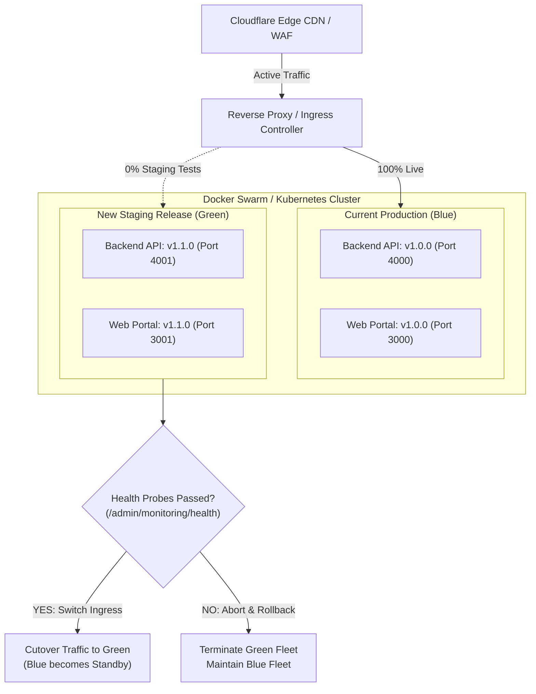

# Production Deployment Operational Runbook
## Project: BREAKING NEWS WALA (ब्रेकिंग न्यूज़ वाला)
### Document ID: DOC-RUN-DEP-2026-V1.0
### Scope: Zero-Downtime Deployment, Blue-Green Strategy, Pre-Flight Gates & Rollback Protocols
### Authority: Master Prompt 09 (`BNW-MASTER-009`) — Section 13 Production Deployment Infrastructure

---

## 1. Objective & Architectural Tenets

This runbook specifies the step-by-step procedures for deploying code changes to the production environment of **BREAKING NEWS WALA**.

### Non-Negotiable Invariants
- **Zero-Downtime Deployment**: Continuous availability of the news portal is required. Deployments must utilize rolling updates or Blue-Green traffic shifting at the edge proxy (Cloudflare / NGINX).
- **Single Shared Backend**: Deployment targets the monolithic backend (`packages/backend`) and purpose-built frontends (`apps/web`, `apps/newsroom`, `apps/reporter`, `apps/admin`). No microservice splits.
- **Strict Pre-Flight Gate**: Zero deployment may proceed if automated tests fail, TypeScript compilation fails, database migrations are pending without backups, or uncommitted git changes exist.

---

## 2. Pre-Deployment Gate Checklist

Before initiating any deployment to staging or production, the deployer must verify and check off all items:

- [ ] **Test Verification**: Monorepo test suite passes 100% (`npm test` $\ge 599$ tests passing across backend, admin, web, newsroom, reporter).
- [ ] **Type Safety Verification**: Zero TypeScript errors across all workspaces:
  - `npx tsc --noEmit -p packages/types/tsconfig.json`
  - `npx tsc --noEmit -p packages/backend/tsconfig.json`
  - `npx tsc --noEmit -p apps/web/tsconfig.json`
  - `npx tsc --noEmit -p apps/newsroom/tsconfig.json`
  - `npx tsc --noEmit -p apps/reporter/tsconfig.json`
  - `npx tsc --noEmit -p apps/admin/tsconfig.json`
- [ ] **Database Migration Review**: Inspect any new Prisma migrations (`packages/backend/prisma/migrations/`) for backward-compatible non-locking DDL.
- [ ] **Pre-Deployment Backup**: Trigger a verified database snapshot (`/api/v1/admin/backup/create`) and confirm SHA-256 generation.
- [ ] **Secret Audit**: Verify no secrets or credentials exist in code or commits; confirm all environment variables are present in the target vault.

---

## 3. Deployment Architecture & Traffic Shifting



---

## 4. Step-by-Step Deployment Protocol

### Step 1: Build & Package Production Images
```bash
# Build production Docker images with deterministic tags
docker build -t bnw-backend:v1.1.0 -f packages/backend/Dockerfile .
docker build -t bnw-web:v1.1.0 -f apps/web/Dockerfile .
docker build -t bnw-admin:v1.1.0 -f apps/admin/Dockerfile .
docker build -t bnw-newsroom:v1.1.0 -f apps/newsroom/Dockerfile .
docker build -t bnw-reporter:v1.1.0 -f apps/reporter/Dockerfile .
```

### Step 2: Apply Database Migrations (Zero-Downtime)
Ensure all schema modifications are strictly additive (new tables, nullable columns, or dual-write fields):
```bash
# Apply migrations to production database
npx prisma migrate deploy --schema=packages/backend/prisma/schema.prisma
```

### Step 3: Launch Green Fleet (Staging Instances)
Start the new containers on secondary internal ports without routing public traffic:
```bash
docker compose -f docker-compose.prod.yml up -d --no-deps bnw-backend-green bnw-web-green
```

### Step 4: Perform Synthetic Health Probes & Smoke Tests
Send synthetic health probe requests directly to Green fleet:
```bash
# Query health endpoint
curl -f http://127.0.0.1:4001/api/v1/admin/monitoring/health

# Verify core dependencies: PostgreSQL, Redis, Storage
curl -f http://127.0.0.1:4001/api/v1/categories
curl -f http://127.0.0.1:4001/api/v1/districts
```

### Step 5: Traffic Cutover (Blue $\rightarrow$ Green)
Update NGINX upstream configuration or Docker Swarm service router:
```bash
# Reload reverse proxy to point to Green fleet
docker exec -it bnw-nginx nginx -s reload
```

### Step 6: Post-Cutover Verification & Monitoring
Monitor the Central Monitoring Desk (`/security`) for 15 minutes:
- Verify P95 latency remains under $250\,\text{ms}$.
- Confirm HTTP 5xx error rate remains $< 0.01\%$.
- Verify background BullMQ workers are actively processing queues.

---

## 5. Automated Rollback Protocol

### Rollback Triggers
Immediate rollback is mandated if any of the following conditions occur within 30 minutes of deployment:
1. P95 API response latency exceeds $1,000\,\text{ms}$ sustained for $> 3\text{ minutes}$.
2. HTTP 5xx error rate exceeds $1.0\%$ across all requests.
3. Database connection pool exhaustion (`PgBouncer` queue timeout).
4. Critical regression in the editorial breaking news publishing workflow.

### Rollback Execution Steps
1. **Instant Ingress Reversion**:
   ```bash
   # Revert NGINX upstream to Blue fleet
   cp /etc/nginx/conf.d/upstream-blue.conf /etc/nginx/conf.d/active-upstream.conf
   docker exec -it bnw-nginx nginx -s reload
   ```
2. **Quarantine Green Containers**:
   ```bash
   docker stop bnw-backend-green bnw-web-green
   ```
3. **Notify Engineering & Incident Team**:
   Log emergency event in Central Incident Log and alert Incident Commander.
4. **Post-Mortem Investigation**:
   Collect container logs, Sentry trace events, and Redis queue statuses for root cause analysis.

