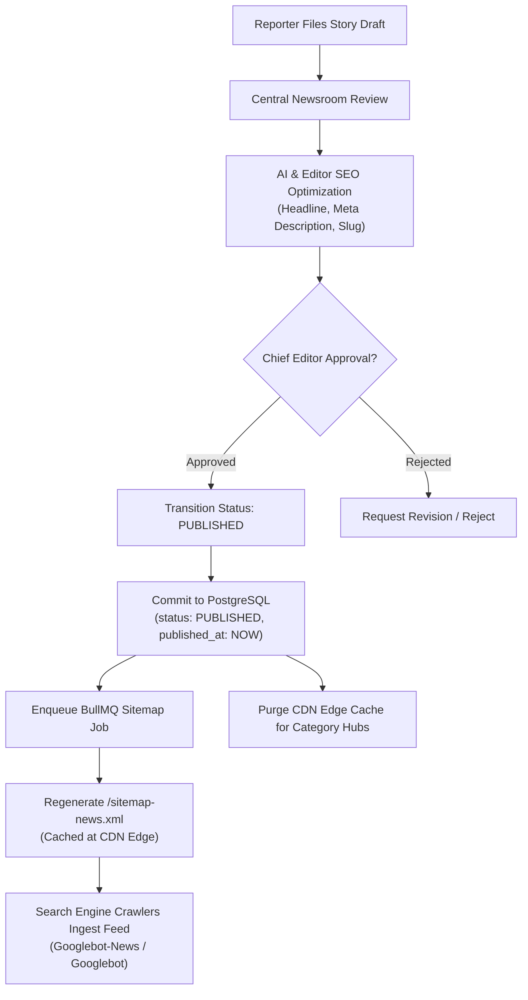
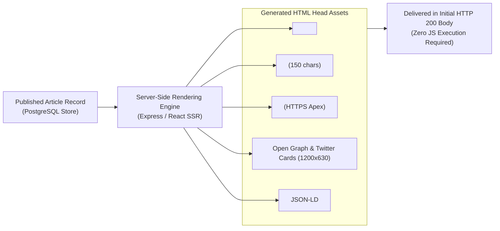
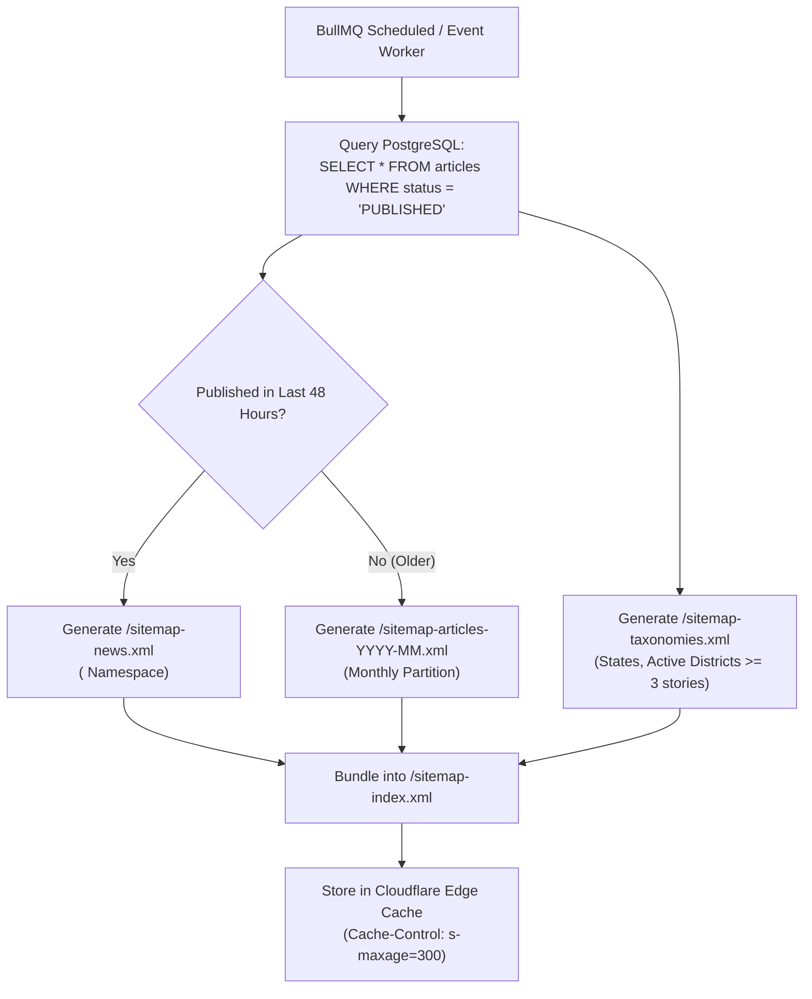
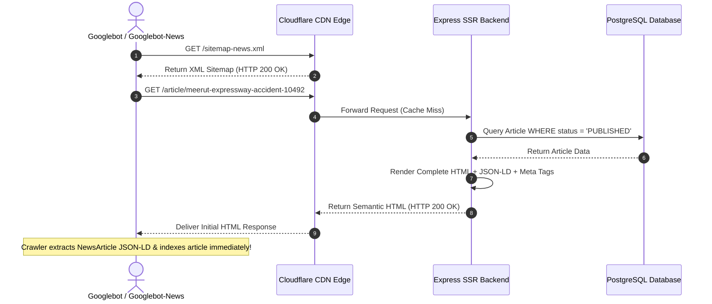
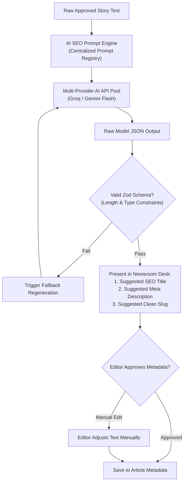
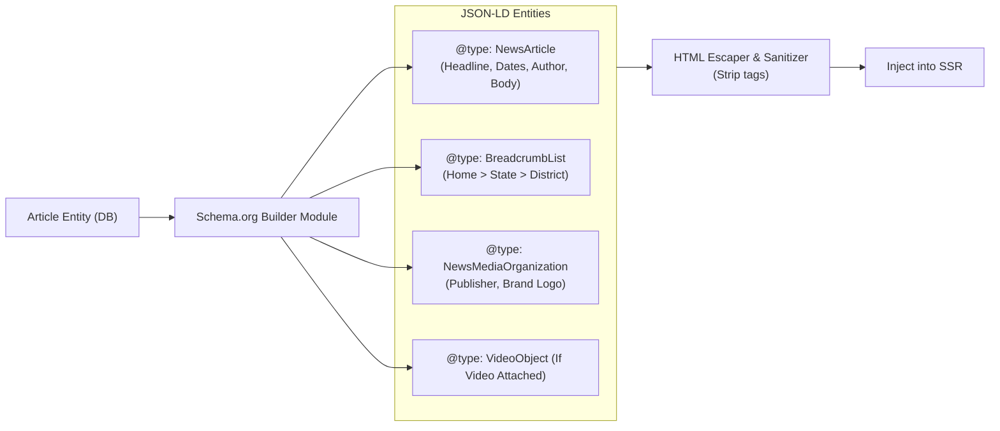
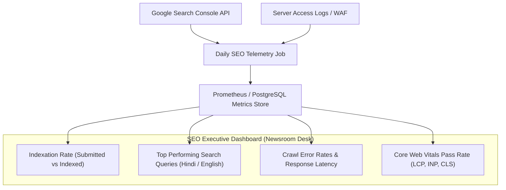

# BREAKING NEWS WALA — Search Engine Optimization (SEO) & News Syndication Specification
**Document ID**: `BNW-DOC-29-SEO`  
**Document Version**: `v1.0.0`  
**Classification**: `Technical / Search Engine Optimization & Discovery`  
**Status**: `Approved Standard`  
**Governing Documents**: `docs/01-PRD.md` through `docs/28-Contributing.md`  
**Canonical Location**: `docs/SEO.md`  

---

## 1. Document Information & Governance Status

This document establishes the canonical Search Engine Optimization (SEO), News Syndication, and Structured Data Specification for the BREAKING NEWS WALA digital news ecosystem. It defines the technical standards, metadata architectures, crawl budget rules, Google News eligibility guidelines, and Devanagari Hindi search strategies governing all public news discovery across search engines and social platforms.

### 1.1 Governance Metadata
- **Project**: BREAKING NEWS WALA (Hyperlocal Indic Digital News Ecosystem)
- **Document Authority**: Technical SEO Lead, System Architect, Content Strategy Lead, Chief Editor
- **Review Cycle**: Quarterly or upon major search engine algorithm update (e.g., Google Core Update, Google News Guidelines revision)
- **Target Systems**: Public Web PWA, Server-Side Rendering (SSR) Edge Gateway, Express API Metadata Routers, PostgreSQL Relational Store, XML Sitemap Generators, and Content Delivery Network (CDN).

---

## 2. Document Objective & Purpose

The objective of this specification is to maximize organic search discovery, indexation speed, and presentation fidelity for breaking news content while safeguarding editorial integrity and preventing crawl abuse.

Specifically, this document governs:
1. **Technical SEO Architecture**: Server-Side Rendering (SSR) for search engine crawlers, HTTP status code hygiene (200, 301, 404, 410), canonical URL enforcement, and Core Web Vitals optimization.
2. **News SEO & Google News Readiness**: Compliance with Google Search Essentials and Google News Publisher Center policies, transparent author attribution, publication timestamp hygiene, and original reporting standards.
3. **Structured Data Standards**: Valid schema.org JSON-LD definitions for `NewsArticle`, `Organization`, `BreadcrumbList`, and `VideoObject`.
4. **Hindi-First Search Strategy**: Devanagari keyword optimization, transliterated and Unicode slug evaluations, location-specific news taxonomy, and regional intent matching.
5. **Crawl Budget & Sitemap Architecture**: Automated generation of standard XML Sitemaps, Google News Sitemaps (`<news:news>`), Image/Video Sitemaps, and strict `robots.txt` directives.
6. **Editorial & AI-Assisted SEO Workflows**: Integrating AI title and meta description generation under strict human editorial verification without keyword stuffing or factual distortion.
7. **Security & Content Isolation**: Strict exclusion of private reporter drafts, admin consoles, and unverified content from search engine indexing.

---

## 3. SEO Goals & Core Objectives

Aligned with `docs/01-PRD.md`, the platform's SEO strategy is engineered around six primary objectives:

```
+-----------------------------------------------------------------------------------------+
|                                      SEO CORE GOALS                                     |
|                                                                                         |
|   1. RAPID DISCOVERY & INDEXING   Enable news crawlers to detect articles in minutes    |
|   2. HINDI REGIONAL DISCOVERY     Optimize for Devanagari & romanized regional searches |
|   3. HYPERLOCAL INTENT MATCHING   Capture district, city, and tehsil news search traffic|
|   4. RICH SEARCH PRESENTATION     Enhance SERP visibility via JSON-LD NewsArticle data  |
|   5. GOOGLE NEWS ELIGIBILITY      Satisfy technical, editorial, and transparency policies|
|   6. ACCURATE SOCIAL PREVIEWS     Render high-fidelity Open Graph / Twitter card previews|
+-----------------------------------------------------------------------------------------+
```

> **Mandatory Disclaimer**: This specification establishes technical compliance and best practices. Under no circumstances does it guarantee specific search rankings, traffic volumes, or immediate Google News inclusion, as search algorithms operate autonomously outside platform control.

---

## 4. Search Engine Strategy

The search engine strategy establishes how BREAKING NEWS WALA interacts with web crawlers across Google Search, Google News, Bing, and localized search engines.

### 4.1 The Four Stages of Search Engine Ingestion
Troubleshooting search visibility requires understanding the distinct stages of search engine processing:
1. **Crawling (Discovery)**: Automated search bots (e.g., `Googlebot`, `Googlebot-News`, `Bingbot`) discover URLs via XML sitemaps, internal links, and external syndication feeds.
2. **Indexing (Comprehension)**: The crawler parses HTML, extracts text and metadata, processes JSON-LD structured data, and stores the document in the search index.
3. **Ranking (Evaluation)**: The algorithm scores the indexed document against user search queries based on relevance, freshness, authority, Core Web Vitals, and regional proximity.
4. **News Inclusion & Presentation**: Eligible articles are surfaced in specialized discovery surfaces such as Google Top Stories, Google News carousel, Google Discover, and rich snippet carousels.

### 4.2 Compliance & Policy Governance
- **Google Search Essentials**: Strict adherence to webmaster quality guidelines, completely prohibiting cloaking, doorway pages, hidden text, automated scraped content without value, and unnatural keyword stuffing.
- **Continuous Compliance Verification**: Because search engine policies and ranking algorithms evolve continuously, technical and editorial guidelines must be verified against current official documentation before implementing major changes.

---

## 5. Technical SEO Architecture

Technical SEO guarantees that web pages are discoverable, crawlable, fast, and unambiguously understood by search engine bots.

### 5.1 Server-Side Rendering (SSR) & Dynamic Hydration
Client-side-only Single Page Applications (SPAs) suffer from indexing delays because search engine bots must queue JavaScript execution.
- **Edge SSR for Public News**: The backend architecture (`docs/11-Architecture.md`) utilizes Server-Side Rendering (SSR) for public news routes (`/`, `/article/:slug`, `/category/:slug`, `/district/:slug`).
- **Initial HTML Delivery**: When a search crawler issues an HTTP GET for an article URL, the server renders the complete semantic HTML document, including headlines, body paragraphs, author attribution, Open Graph meta tags, and JSON-LD structured data in the initial HTTP response before hydration.
- **No Cloaking Policy**: The server serves identical HTML content to search engine crawlers and real human visitors. Altering content or metadata based on User-Agent inspection is strictly forbidden.

### 5.2 Canonical URLs & Duplicate Prevention
- **Canonical Link Element**: Every indexable page must contain a self-referencing canonical URL tag in its `<head>`:
  `<link rel="canonical" href="https://breakingnewswala.in/article/meerut-expressway-accident-update" />`
- **Protocol & Domain Normalization**: All canonical links enforce HTTPS, the apex domain (`https://breakingnewswala.in`), no trailing slashes, and lowercase paths.
- **Query Parameter Handling**: URLs carrying tracking parameters (e.g., `?utm_source=whatsapp`, `?fbclid=...`, `?ref=share`) must point their canonical tag strictly to the clean base URL without query strings.

### 5.3 HTTP Status Codes & Redirect Management
| Scenario | Required HTTP Status Code | Technical Implementation Rule |
| :--- | :---: | :--- |
| **Published Article Available** | `200 OK` | Delivers full semantic HTML and metadata. |
| **Article URL Changed / Slug Updated**| `301 Moved Permanently` | Immediate redirect to new canonical slug; permanent link update. |
| **Article Retracted / Permanently Deleted**| `410 Gone` | Signals search engines to purge URL from index immediately. |
| **Non-Existent Page / Invalid Slug** | `404 Not Found` | Custom 404 error page with internal navigation links; no soft 404s. |
| **Private Draft / Restricted Content**| `403 Forbidden` / `404` | Blocks access; returns zero editorial content to public crawlers. |
| **Temporary Maintenance Outage** | `503 Service Unavailable` | Includes `Retry-After: 3600` header to instruct crawlers to return later. |

### 5.4 Robots Directives & Private Content Protection
- **Default Indexable Pages**: `<meta name="robots" content="index, follow, max-image-preview:large, max-snippet:-1, max-video-preview:-1" />`
- **Strict Private Content Exclusion**:
  > **Security Mandate**: All non-public routes (Reporter Portal `/reporter/*`, Admin Desk `/admin/*`, Editorial Queue `/editor/*`, User Profile `/account/*`, API Endpoints `/api/*`) must emit `<meta name="robots" content="noindex, nofollow" />` and require authenticated session cookies. Private editorial drafts and rejected stories must **never** be accessible or indexable by public search engines.


---

## 6. News Article SEO Architecture

Every published news story must satisfy structured on-page and semantic SEO requirements to ensure search engine comprehension and high-fidelity presentation.

```
+-----------------------------------------------------------------------------------------+
|                               NEWS ARTICLE SEO METADATA                                 |
|                                                                                         |
|   [Editorial Headline]   Clear, punchy, Hindi Devanagari news headline                  |
|   [SEO Title Tag]        Keyword-optimized title (< 65 chars): Headline | Brand         |
|   [Meta Description]     Compelling factual summary (140-160 chars)                     |
|   [Canonical URL]        Stable, unique, HTTPS apex domain URL                          |
|   [Author Attribution]   Named reporter byline linked to verified profile               |
|   [Timestamps]           Explicit ISO 8601 UTC datePublished and dateModified           |
|   [Hero Media Asset]     High-res 16:9 WebP/AVIF image with descriptive Hindi alt text  |
|   [Hyperlocal Tags]      State, District, Tehsil, and Category semantic bindings        |
|   [JSON-LD Schema]       Validated schema.org/NewsArticle structured data block         |
+-----------------------------------------------------------------------------------------+
```

### 6.1 Headline versus SEO Title Distinction
- **Editorial Headline (`headline`)**: The on-page `<h1>` headline displayed to human readers. It prioritizes editorial voice, urgent breaking news impact, and Devanagari clarity (e.g., *"मेरठ-दिल्ली एक्सप्रेसवे पर भीषण सड़क हादसा, 4 की मौत, कई घायल"*).
- **SEO Title (`seo_title`)**: The text rendered inside `<title>` in the document `<head>`. It is optimized for search engine result snippets and character truncation limits (max 60-65 characters):
  `<title>मेरठ एक्सप्रेसवे हादसा: 4 की मौत, कई घायल | BREAKING NEWS WALA</title>`
- **Meta Description (`meta_description`)**: A concise, factual summary (140-160 characters) providing searchers with an informative snippet without clickbait or keyword stuffing:
  `<meta name="description" content="मेरठ-दिल्ली एक्सप्रेसवे पर शनिवार सुबह घने कोहरे के कारण कई गाड़ियां आपस में टकराईं। हादसे में 4 लोगों की मौत हो गई और 10 से ज्यादा घायल हैं।" />`

### 6.2 Timestamp Hygiene & Editorial Attribution
- **Date Published (`datePublished`)**: Exact timestamp when the article was approved and published by the editor (`2026-10-31T04:30:00+05:30`).
- **Date Modified (`dateModified`)**: Timestamp of the most recent substantive editorial correction or update.
  > **Timestamp Manipulation Prohibition**: Artificial bumping of `dateModified` or `datePublished` without substantive new reporting to game search engine freshness algorithms is strictly prohibited by Google News guidelines.
- **Author Transparency**: Every article must include an author byline linking to the reporter's public profile page (`/reporter/:id`), displaying the reporter's bio, verified status, and coverage territory.

---

## 7. Hindi-First SEO and URL Slug Strategy

BREAKING NEWS WALA is an Indic-first platform prioritizing Hindi-speaking regions. The SEO strategy must accommodate Devanagari search queries, transliterated search behavior, and URL encoding constraints.

### 7.1 Evaluation of URL Slug Approaches
Selecting the URL slug strategy requires balancing search engine readability, social sharing reliability, and character encoding stability:

| Evaluation Factor | Option 1: Hindi Unicode Slugs (`/article/मेरठ-हादसा`) | Option 2: Romanized Hindi Slugs (`/article/meerut-hadsa`) | Option 3: Semantic English Slug + ID (`/article/meerut-expressway-accident-10492`) |
| :--- | :--- | :--- | :--- |
| **Browser Address Bar Readability** | **Exceptional** (Renders pure Hindi) | Moderate (Phonetic Latin) | High (Clean English/Latin) |
| **Copy-Paste / Social Sharing** | **Poor** (Expands to `%E0%A4%AE%E0%A5%87...`) | **High** (Clean ASCII characters) | **Exceptional** (Clean, short ASCII URL) |
| **Search Engine Compatibility** | High (Google parses Unicode UTF-8) | High (Matches romanized queries) | **Exceptional** (Universal search engine parsing) |
| **SMS / WhatsApp Previews** | Can break in legacy SMS or apps | Reliable | **100% Reliable** |
| **Uniqueness & Collision Risk** | Moderate (Requires collision checks) | Moderate | **Zero Collision Risk** (Guaranteed by ID suffix) |

### 7.2 Recommended Slug Strategy (Proposed ADR-SEO-001)
- **Recommendation**: **Option 3 (Semantic Romanized/English Slug with Unique Numeric ID Suffix)**.
  - *Example Canonical URL*: `https://breakingnewswala.in/article/meerut-expressway-bus-accident-10492`
  - *Technical Justification*: Prevents URL percent-encoding explosion (`%E0%A4%...`) when shared across WhatsApp, Telegram, or SMS, while preserving primary geographical and topic keywords for search crawlers. The unique numeric suffix guarantees collision-free routing.

### 7.3 URL Slug Immutability and 301 Redirect Rules
1. **Slug Stability**: Once an article transitions to `PUBLISHED`, its URL slug should remain permanent.
2. **Mandatory 301 Redirect on Headline Update**: If an editor updates a headline and explicitly modifies the slug, the backend must create an entry in the `url_redirects` table mapping the old slug to the new slug with an HTTP `301 Moved Permanently` response.
3. **Reserved Route Protection**: Slugs matching system routes (`admin`, `reporter`, `api`, `category`, `district`, `sitemap`, `search`, `login`) must be rejected by slug generation validation.

---

## 8. Structured Data (JSON-LD)

Structured data disambiguates content entities for search engines, qualifying articles for rich snippets, Top Stories carousels, and Google Discover placement. All structured data must be emitted as valid JSON-LD inside a single `<script type="application/ld+json">` tag in the `<head>`.

### 8.1 Schema: `NewsArticle` (Primary Article Schema)
```json
{
  "@context": "https://schema.org",
  "@type": "NewsArticle",
  "mainEntityOfPage": {
    "@type": "WebPage",
    "@id": "https://breakingnewswala.in/article/meerut-expressway-accident-10492"
  },
  "headline": "मेरठ एक्सप्रेसवे पर भीषण हादसा: 4 की मौत, कई घायल",
  "description": "मेरठ-दिल्ली एक्सप्रेसवे पर शनिवार सुबह घने कोहरे के कारण कई गाड़ियां टकराईं। हादसे में 4 लोगों की मौत हो गई।",
  "image": [
    "https://cdn.breakingnewswala.in/media/2026/10/meerut-accident-16x9.webp",
    "https://cdn.breakingnewswala.in/media/2026/10/meerut-accident-4x3.webp",
    "https://cdn.breakingnewswala.in/media/2026/10/meerut-accident-1x1.webp"
  ],
  "datePublished": "2026-10-31T04:30:00+05:30",
  "dateModified": "2026-10-31T05:15:00+05:30",
  "author": [{
    "@type": "Person",
    "name": "राजेश शर्मा",
    "jobTitle": "District Bureau Chief",
    "url": "https://breakingnewswala.in/reporter/rajesh-sharma"
  }],
  "publisher": {
    "@type": "NewsMediaOrganization",
    "name": "BREAKING NEWS WALA",
    "url": "https://breakingnewswala.in",
    "logo": {
      "@type": "ImageObject",
      "url": "https://breakingnewswala.in/logo.png",
      "width": 600,
      "height": 60
    }
  },
  "articleSection": "उत्तर प्रदेश",
  "contentLocation": {
    "@type": "AdministrativeArea",
    "name": "Meerut, Uttar Pradesh, India"
  },
  "inLanguage": "hi"
}
```

### 8.2 Schema: `BreadcrumbList` (Hierarchical Navigation)
```json
{
  "@context": "https://schema.org",
  "@type": "BreadcrumbList",
  "itemListElement": [
    {
      "@type": "ListItem",
      "position": 1,
      "name": "होम",
      "item": "https://breakingnewswala.in"
    },
    {
      "@type": "ListItem",
      "position": 2,
      "name": "उत्तर प्रदेश",
      "item": "https://breakingnewswala.in/category/uttar-pradesh"
    },
    {
      "@type": "ListItem",
      "position": 3,
      "name": "मेरठ",
      "item": "https://breakingnewswala.in/district/meerut"
    }
  ]
}
```

### 8.3 Structured Data Integrity Rules
- **Mirror Visible Content**: JSON-LD entities (headlines, dates, authors, images) must exactly match the content visible to human visitors.
- **Zero Fabrication**: Never fabricate fake review ratings, false authors, or misleading publisher claims.
- **Strict Validation**: All JSON-LD generation must pass Google's Rich Results Test and Schema Markup Validator during automated CI testing (`docs/26-Testing.md`).

---

## 9. Google News Readiness & Eligibility

Google News inclusion requires strict adherence to technical and editorial policies outlined in Google's official publisher documentation.

```
+-----------------------------------------------------------------------------------------+
|                                GOOGLE NEWS READINESS PILLARS                            |
|                                                                                         |
|   1. TRANSPARENT BYLINES       Clear, named reporter attribution on every news piece    |
|   2. EDITORIAL ACCOUNTABILITY  Public About Us, Editorial Policy, and Contact pages     |
|   3. CORRECTION DISCLOSURE     Explicit timestamps & correction notices on updates      |
|   4. SEPARATION OF ADS & NEWS  Clear labeling of sponsored / advertising placements     |
|   5. ORIGINAL REPORTING        Original on-ground district journalism over aggregation  |
|   6. TECHNICAL CRAWLABILITY    Valid Google News XML sitemap & sub-300ms SSR response   |
+-----------------------------------------------------------------------------------------+
```

### 9.1 Mandatory Editorial Transparency Requirements
1. **Public Newsroom Accountability**: The website must maintain clear, permanent links in the footer to:
   - **About Us** (`/about`): Stating publication mission, leadership, and operational headquarters.
   - **Editorial & Ethics Policy** (`/editorial-policy`): Documenting fact-checking and neutrality standards.
   - **Corrections Policy** (`/corrections`): Detailing how errors are reported, corrected, and logged.
   - **Contact Us** (`/contact`): Physical newsroom address, editorial email, and telephone contact.
2. **Separation of Sponsored Content**: Any paid partnership, political advertisement, or sponsored post must carry explicit visual badges (`प्रायोजित / Sponsored`) and include `rel="sponsored"` or `rel="nofollow"` on outbound links.
3. **Policy Invariant**: Google News algorithms do not guarantee inclusion; compliance ensures that the platform satisfies all mandatory eligibility thresholds.


---

## 10. XML Sitemap Architecture

Sitemaps enable search engine web crawlers to rapidly discover newly published breaking news articles, updated stories, and media assets.

### 10.1 Sitemap Hierarchy & Namespace Specifications
The platform architecture implements a **Sitemap Index** linking to four specialized component sitemaps:

```
[Sitemap Index: /sitemap-index.xml]
       |
       +---> [1. Google News Sitemap: /sitemap-news.xml] (Articles published in last 48 hours)
       |
       +---> [2. Core Content Sitemap: /sitemap-articles-YYYY-MM.xml] (Archived monthly partitions)
       |
       +---> [3. Categories & Locations: /sitemap-taxonomies.xml] (State, District & Topic hubs)
       |
       +---> [4. Media & Video Sitemaps: /sitemap-images.xml & /sitemap-videos.xml]
```

### 10.2 The Google News XML Sitemap Specification
Google News requires a specialized XML format complying with the `http://www.google.com/schemas/sitemap-news/0.9` extension namespace:
- **48-Hour Retention Window**: Articles older than 48 hours are automatically purged from `/sitemap-news.xml` and retained exclusively in the monthly core sitemaps.
- **Maximum Capacity**: Must contain no more than 1,000 URLs per file to guarantee rapid crawler processing.

```xml
<?xml version="1.0" encoding="UTF-8"?>
<urlset xmlns="http://www.sitemaps.org/schemas/sitemap/0.9"
        xmlns:news="http://www.google.com/schemas/sitemap-news/0.9">
  <url>
    <loc>https://breakingnewswala.in/article/meerut-expressway-accident-10492</loc>
    <news:news>
      <news:publication>
        <news:name>BREAKING NEWS WALA</news:name>
        <news:language>hi</news:language>
      </news:publication>
      <news:publication_date>2026-10-31T04:30:00+05:30</news:publication_date>
      <news:title>मेरठ एक्सप्रेसवे पर भीषण हादसा: 4 की मौत, कई घायल</news:title>
    </news:news>
  </url>
</urlset>
```

### 10.3 Automated Sitemap Generation & Cache Lifecycle
- **Real-Time Job Enqueuing**: When an editor publishes or updates an article, a lightweight BullMQ job regenerates `/sitemap-news.xml`.
- **Edge Caching**: Sitemaps are cached at the Cloudflare CDN edge with a `Cache-Control: public, s-maxage=300, max-age=60` header, preventing origin database load during aggressive crawler sweeps.
- **Sitemap Partitioning Limits**: Standard sitemap files must never exceed 50,000 URLs or 50 MB uncompressed. Monthly article sitemaps (`/sitemap-articles-2026-10.xml`) ensure horizontal scalability.

---

## 11. Robots and Crawl Management

Crawl management directs search bots to valuable public content while preventing crawler resources from being wasted on administrative, dynamic, or non-indexable routes.

### 11.1 The `robots.txt` Specification
```txt
# BREAKING NEWS WALA - Canonical Crawl Directives
User-agent: *
Allow: /
Allow: /article/
Allow: /category/
Allow: /district/
Allow: /about
Allow: /contact
Allow: /editorial-policy
Allow: /corrections

# Disallow Private & Administrative Endpoints
Disallow: /admin/
Disallow: /reporter/
Disallow: /editor/
Disallow: /api/
Disallow: /account/
Disallow: /auth/
Disallow: /*?*utm_*
Disallow: /*?*ref=*
Disallow: /*?*fbclid=*

# Sitemap Index Declarations
Sitemap: https://breakingnewswala.in/sitemap-index.xml
Sitemap: https://breakingnewswala.in/sitemap-news.xml
```

### 11.2 The Security Boundary Invariant
> **Strict Security Warning**: `robots.txt` is an informational directive for compliant search crawlers; **it is NOT an authentication or access-control mechanism**.
>
> Private editorial desks (`/editor/*`), reporter submission forms (`/reporter/*`), and backend APIs (`/api/*`) must be secured strictly through server-side JWT authentication, HTTP-only session cookies, and HTTP 401/403 status responses (`docs/14-Auth.md`). Administrators must never expose unauthenticated private URLs under the assumption that `robots.txt` disallow rules make them secure.

---

## 12. News Categories & Hyperlocal Location SEO

BREAKING NEWS WALA leverages a hierarchical news taxonomy designed to capture high-intent regional searches across states, districts, and municipalities.

### 12.1 Regional Taxonomy Structure
```
[State Hub: /category/uttar-pradesh]
       |
       +---> [District Landing Page: /district/meerut]
       |            |
       |            +---> [Hyperlocal Story: /article/meerut-metro-trial-run-10495]
       |            +---> [Hyperlocal Story: /article/meerut-university-results-10496]
       |
       +---> [District Landing Page: /district/varanasi]
```

- **Topical Categories**: Politics (`/category/politics`), Crime (`/category/crime`), Sports (`/category/sports`), Entertainment (`/category/entertainment`), Business (`/category/business`), Jobs (`/category/jobs`).
- **Regional Hubs**: Madhya Pradesh (`/category/madhya-pradesh`), Uttar Pradesh (`/category/uttar-pradesh`), National (`/category/national`), International (`/category/international`).

### 12.2 Thin Content & Doorway Page Defenses
- **The 3-Story Minimum Gate**: District or city landing pages (`/district/:slug`) must contain at least **three active published articles** before emitting `<meta name="robots" content="index, follow" />`.
- **Empty / Inactive Territories**: If a rural district has zero published stories, the page emits `noindex, follow` and displays nearby regional news, preventing search engines from penalizing the domain for programmatic "thin" or "doorway" pages.
- **Pagination Canonicalization**: Multi-page category feeds (`/category/politics?page=2`) must contain self-referencing canonical URLs with clean pagination links (`rel="prev"` and `rel="next"` semantic markers).

---

## 13. Internal Linking Architecture

A deliberate internal linking structure distributes PageRank authority, accelerates crawler discovery of deep district articles, and extends user session duration.

```
+-----------------------------------------------------------------------------------------+
|                               INTERNAL LINKING TOPOLOGY                                 |
|                                                                                         |
|   [Homepage Ticker]  ====>  [Breaking District Story]  <====  [District Landing Hub]     |
|                                     |                                                   |
|                                     +---> [Related Topic Stories (3-5 contextual cards)] |
|                                     +---> [Parent Category Hub Link]                    |
|                                     +---> [Verified Reporter Profile Link]              |
|                                     +---> [Breadcrumb Trail Navigation]                 |
+-----------------------------------------------------------------------------------------+
```

### 13.1 Contextual Anchor Text Rules
- **Descriptive Anchor Text**: All internal link anchors must use natural, informative Devanagari text describing the destination article (e.g., *"मेरठ एक्सप्रेसवे हादसे की पूरी रिपोर्ट पढ़ें"*).
- **Prohibited Anchor Patterns**: Generic phrases such as *"यहाँ क्लिक करें"* (Click here), *"आगे पढ़ें"* (Read more), or raw URLs as link text are strictly prohibited.
- **Breadcrumb Trail Consistency**: Visible on-page breadcrumbs must exactly mirror the JSON-LD `BreadcrumbList` schema, allowing search bots to establish structural site depth.

---

## 14. Image SEO Architecture

High-resolution, fast-loading images are mandatory for Google Discover qualification and Google Image Search discovery as governed by `docs/16-Storage.md`.

### 14.1 Image Standards & Metadata Specifications
- **Hero Image Dimensions**: Minimum width of `1200px` (aspect ratios `16:9`, `4:3`, or `1:1`) to satisfy Google Discover large-image card requirements (`max-image-preview:large`).
- **Next-Gen Formatting**: Images must be delivered via the global CDN in **WebP** or **AVIF** formats with fallback JPEG derivatives.
- **Responsive `srcset`**: Image tags must declare responsive breakpoints:
  ```html
  
  ```
- **Semantic Alternative Text (`alt`)**: Every image must provide descriptive, non-stuffed Hindi alt text describing the visual scene for visually impaired readers and search crawlers. Decorative graphics must carry empty `alt=""` and `aria-hidden="true"`.


---

## 15. Video SEO Architecture

Video reporting provides high user engagement and qualifies for specialized Google Video Search and Video Carousel placements as governed by `docs/16-Storage.md`.

### 15.1 Video Metadata & `VideoObject` Schema
Every article featuring native video footage must embed schema.org `VideoObject` structured data:

```json
{
  "@context": "https://schema.org",
  "@type": "VideoObject",
  "name": "मेरठ एक्सप्रेसवे हादसे का ग्राउंड रिपोर्ट: चश्मदीदों की जुबानी",
  "description": "मेरठ-दिल्ली एक्सप्रेसवे पर हुए भीषण हादसे का प्रत्यक्षदर्शी वीडियो और रेस्क्यू ऑपरेशन की लाइव कवरेज।",
  "thumbnailUrl": [
    "https://cdn.breakingnewswala.in/videos/2026/10/meerut-rescue-thumb.webp"
  ],
  "uploadDate": "2026-10-31T05:00:00+05:30",
  "duration": "PT2M45S",
  "contentUrl": "https://cdn.breakingnewswala.in/videos/2026/10/meerut-rescue/master.m3u8",
  "embedUrl": "https://breakingnewswala.in/embed/video/meerut-rescue-10492"
}
```

### 15.2 Video XML Sitemap & Accessibility
- **Video Sitemap Extension**: Dedicated feed at `/sitemap-videos.xml` mapping video URLs, duration, and thumbnail locations using the `http://www.google.com/schemas/sitemap-video/1.1` namespace.
- **Playback Accessibility**: Videos must stream smoothly over adaptive HLS/DASH protocols without unskippable interstitials that block initial playback.
- **Zero Fake Video Metadata**: It is strictly forbidden to attach `VideoObject` markup to static articles that only feature photo carousels or decorative animated GIFs.

---

## 16. Social Sharing and Open Graph Metadata

Social media sharing directly drives reader acquisition and syndication discovery across WhatsApp, X, Facebook, and Telegram.

### 16.1 Open Graph & Twitter Card Specifications
All public article pages must render standardized Open Graph and Twitter Card tags in the initial SSR `<head>`:

```html
<!-- Open Graph Protocol (Facebook, WhatsApp, LinkedIn) -->
<meta property="og:type" content="article" />
<meta property="og:site_name" content="BREAKING NEWS WALA" />
<meta property="og:title" content="मेरठ एक्सप्रेसवे हादसा: 4 की मौत, कई घायल" />
<meta property="og:description" content="मेरठ-दिल्ली एक्सप्रेसवे पर घने कोहरे के चलते भीषण टक्कर। ग्राउंड रिपोर्ट और बचाव कार्य के लाइव अपडेट्स।" />
<meta property="og:url" content="https://breakingnewswala.in/article/meerut-expressway-accident-10492" />
<meta property="og:image" content="https://cdn.breakingnewswala.in/media/meerut-accident-og.webp" />
<meta property="og:image:width" content="1200" />
<meta property="og:image:height" content="630" />
<meta property="og:locale" content="hi_IN" />

<!-- Article Semantic Tags -->
<meta property="article:published_time" content="2026-10-31T04:30:00+05:30" />
<meta property="article:modified_time" content="2026-10-31T05:15:00+05:30" />
<meta property="article:section" content="उत्तर प्रदेश" />
<meta property="article:tag" content="मेरठ" />
<meta property="article:tag" content="सड़क हादसा" />

<!-- X (Twitter) Card Metadata -->
<meta name="twitter:card" content="summary_large_image" />
<meta name="twitter:site" content="@BreakingNewsWala" />
<meta name="twitter:title" content="मेरठ एक्सप्रेसवे हादसा: 4 की मौत, कई घायल" />
<meta name="twitter:description" content="घने कोहरे के चलते मेरठ एक्सप्रेसवे पर भीषण टक्कर। देखें ग्राउंड रिपोर्ट।" />
<meta name="twitter:image" content="https://cdn.breakingnewswala.in/media/meerut-accident-og.webp" />
```

### 16.2 Social Image Dimensions & WhatsApp Optimization
- **Standard Ratio**: `1200 x 630 pixels` (1.91:1 aspect ratio), guaranteeing high-resolution preview cards across desktop and mobile.
- **File Size Ceiling**: OG preview images must be optimized under `300 KB` to ensure immediate thumbnail rendering within WhatsApp and Telegram message bubbles.

---

## 17. Core Web Vitals and Performance SEO

Google's search ranking algorithm incorporates **Core Web Vitals** as key page experience signals. Performance optimization is governed by `docs/04-NFR.md` and `docs/10-Responsive-Design.md`.

### 17.1 Core Web Vitals Thresholds (75th Percentile)
| Core Web Vital Metric | Target Threshold | Technical Optimization Strategy |
| :--- | :--- | :--- |
| **Largest Contentful Paint (LCP)** | **< 2.5 seconds** | Preload hero image with `<link rel="preload" as="image" ... fetchpriority="high">`; serve WebP from edge CDN; SSR initial HTML. |
| **Interaction to Next Paint (INP)**| **< 200 milliseconds** | Defer non-critical analytics scripts; break long JavaScript tasks (> 50ms) using `requestIdleCallback()`. |
| **Cumulative Layout Shift (CLS)** | **< 0.1** | Explicit `width` and `height` attributes on all `` and `<video>` tags; reserve layout container heights for ads. |

### 17.2 Font Loading & Visual Stability
- **Devanagari Font Strategy**: Web fonts (`Noto Sans Devanagari`) must enforce `font-display: swap` in `@font-face` declarations. This eliminates Flash of Invisible Text (FOIT) and ensures immediate headline rendering while web fonts load.
- **Zero Shift Skeletons**: Feed cards and breaking news tickers utilize CSS placeholder skeletons with identical dimensions to prevent layout reflow when news streams hydrate.

---

## 18. AI-Assisted SEO Architecture

Artificial Intelligence tools (`docs/17-Agents.md`, `docs/19-API-Pool.md`, and `docs/21-Prompts.md`) assist editorial desks in generating search metadata efficiently while preserving human editorial oversight.

### 18.1 Autonomous SEO Assistance Capabilities
- **SEO Title Suggestions**: Suggesting 3 keyword-optimized headline variants under 65 characters.
- **Meta Description Extraction**: Condensing long articles into punchy, factual 150-character search snippets.
- **Entity & Topic Tagging**: Extracting standardized geographical (State, District, Tehsil) and topical tags.
- **Romanized Slug Generation**: Generating clean, ASCII-safe URL slugs from Hindi headlines.

### 18.2 Mandatory AI SEO Invariants
1. **Factual Integrity Preservation**: AI SEO generators must never exaggerate facts, fabricate casualty figures, or invent sensationalist keywords to chase search volume.
2. **Mandatory Human Editorial Sign-Off**: AI suggestions are presented as editable recommendations in the Central Newsroom desk. An editor must explicitly review, modify, or approve metadata before publishing.
3. **Multi-Provider AI API Pool Gateway**: All AI SEO prompts must route through the centralized API Pool (`docs/19-API-Pool.md`). Autonomous agents are strictly prohibited from making direct, unmonitored calls to external LLM providers.
4. **Prohibition on Automated Publishing**: SEO optimization agents cannot trigger article publication. The status transition to `PUBLISHED` remains strictly reserved for authorized human editors or audited trusted reporters.

---

## 19. Editorial SEO Workflow

SEO is integrated directly into the newsroom lifecycle, ensuring every published article is search-optimized before hitting public servers.

```
+-----------------------------------------------------------------------------------------+
|                                EDITORIAL SEO LIFECYCLE                                  |
|                                                                                         |
|   [1] Reporter Files Draft  ---> Initial story submitted in Central Newsroom            |
|                |                                                                        |
|                v                                                                        |
|   [2] AI Generates SEO Data ---> AI Agent suggests Title, Description & Slug            |
|                |                                                                        |
|                v                                                                        |
|   [3] Editor Verification   ---> Human Editor audits headline, alt-text & canonical URL |
|                |                                                                        |
|                v                                                                        |
|   [4] Approval & Publish    ---> Article published; status: PUBLISHED                   |
|                |                                                                        |
|                v                                                                        |
|   [5] Real-Time Sync        ---> /sitemap-news.xml updated; CDN edge purged             |
|                |                                                                        |
|                v                                                                        |
|   [6] Telemetry & Audit     ---> Search Console impressions & CTR monitored in desk     |
+-----------------------------------------------------------------------------------------+
```

---

## 20. Duplicate Content and Content Quality Governance

Search engines penalize news domains that publish duplicate, scraped, or thin aggregated content.

### 20.1 Deduplication & Syndication Rules
- **Cross-Domain Syndication Attribution**: When syndicating wire reports (e.g. ANI, PTI), the article must explicitly declare the wire source byline and, where required by syndication agreements, include a cross-domain canonical tag or clear credit statement: *"Source: ANI News Service"*.
- **Substantive Rewrites**: Automated RSS feeds must pass through the Ingestion Agent and Newsroom Desk for multi-source verification and regional context enrichment. Publishing raw, unedited external feed text is prohibited.
- **Correction Notices**: If an article is corrected after publication, an italicized update notice must be appended to the bottom of the article: *"Update (31 Oct, 11:00 AM IST): Police have revised casualty figures to 4."*


---

## 21. SEO Security and Privacy Architecture

SEO features interface directly with public crawlers and must be engineered to prevent data leaks, Cross-Site Scripting (XSS), and administrative route exposure as governed by `docs/15-Security.md`.

```
+-----------------------------------------------------------------------------------------+
|                                SEO SECURITY SAFEGUARDS                                  |
|                                                                                         |
|   1. METADATA XSS INJECTION DEFENSE   Sanitize all inputs before <meta> or JSON-LD tags |
|   2. ZERO PRIVATE ROUTE INDEXATION    Strict noindex on /admin/*, /reporter/*, /editor/*|
|   3. AUTHENTICATION INDEPENDENCE      Never rely on robots.txt for security access      |
|   4. DRAFT CONTENT ISOLATION          Unpublished articles return 404/403 to crawlers   |
|   5. SECURE STRUCTURED DATA           Verify JSON-LD does not serialize private PII     |
+-----------------------------------------------------------------------------------------+
```

### 21.1 Metadata Injection & XSS Defense
- **JSON-LD Script Escaping**: When serializing user-generated text into `<script type="application/ld+json">`, the backend serializer must escape HTML closing tags (e.g., replacing `</script>` with `<\/script>` and `<` with `\u003c`) to prevent JSON-LD Cross-Site Scripting (XSS) injection.
- **Header & Meta Sanitization**: Dynamic metadata attributes (`og:title`, `<title>`) must be stripped of unescaped quotes and carriage returns to prevent HTTP Response Splitting or DOM injection.

### 21.2 Private Editorial Desks & Draft Protection
- **Noindex Enforced on Private Routes**: All authenticated routes (`/admin/*`, `/reporter/*`, `/editor/*`, `/account/*`) must emit `<meta name="robots" content="noindex, nofollow" />` and `X-Robots-Tag: noindex, nofollow`.
- **Public Query Isolation**: The public article lookup query strictly enforces `WHERE status = 'PUBLISHED'`. Accessing an article with status `DRAFT`, `SUBMITTED`, or `REJECTED` returns HTTP 404 to unauthenticated clients and search bots.

---

## 22. SEO Monitoring, Telemetry and Reporting

Observability into search engine visibility, indexation rates, and Core Web Vitals enables data-driven optimization without relying on guesswork.

### 22.1 Search Performance Telemetry Metrics
| Metric | Telemetry Source | Healthy Operational Benchmark | Action on Degradation |
| :--- | :--- | :--- | :--- |
| **Indexed vs Submitted URLs** | Google Search Console (GSC) | > 95% of sitemap URLs indexed | Inspect sitemap for non-200 URLs or duplicate content flags. |
| **Search Crawl Latency** | GSC Crawl Stats / Cloudflare | p95 < 300ms for HTML responses | Inspect backend SSR cache hit ratio; scale Cloud Run instances. |
| **Google News Sitemap Freshness**| Edge CDN Cache Logs | Regenerated within 2 minutes of publish | Verify BullMQ worker processing `/sitemap-news.xml` jobs. |
| **Mobile Core Web Vitals Pass Rate**| Chrome User Experience Report (CrUX) | >= 75% of page views meet "Good" | Audit LCP hero images; optimize JavaScript hydration chunks. |
| **Crawl 5xx Error Rate** | Express Access Logs / WAF | < 0.01% of crawler requests | Check database connection pool and Redis latency. |
| **Broken Internal Links (404s)**| Internal Crawler / Sentry | Zero broken internal links | Review slug redirect table; patch broken navigation links. |

---

## 23. SEO Architecture Diagrams

The following 7 architectural Mermaid diagrams illustrate news metadata flows, sitemap generation, crawler interactions, and AI-assisted SEO pipelines.

### 23.1 Diagram 1: News Publishing and SEO Lifecycle


### 23.2 Diagram 2: Article Metadata Generation Pipeline


### 23.3 Diagram 3: Public Sitemap Generation Topology


### 23.4 Diagram 4: Search Crawler Discovery Sequence


### 23.5 Diagram 5: AI-Assisted SEO Workflow


### 23.6 Diagram 6: Structured-Data Generation Pipeline


### 23.7 Diagram 7: SEO Monitoring and Reporting Pipeline


---

## 24. SEO Quality Checklists

### 24.1 Checklist: Before Article Publication
- [ ] **Editorial Headline Reviewed**: Headline is accurate, informative, and free of sensationalist clickbait.
- [ ] **SEO Title Tag Validated**: Title is under 65 characters and includes primary topic/district keyword.
- [ ] **Meta Description Reviewed**: Compelling 140-160 character factual summary in Devanagari Hindi.
- [ ] **URL Slug Checked**: Clean ASCII-safe slug with unique numeric ID suffix; no reserved path collisions.
- [ ] **Canonical URL Self-Referencing**: Valid HTTPS apex domain canonical link element rendered.
- [ ] **Author Byline Explicit**: Named reporter attributed and linked to public verified profile.
- [ ] **Timestamps Validated**: Accurate ISO 8601 UTC `published_at` and `updated_at` dates.
- [ ] **Hero Media Optimized**: High-resolution 16:9 image (min 1200x675) with descriptive Hindi alt text.
- [ ] **JSON-LD Schema Validated**: Passes Schema Markup Validator with zero errors or warnings.
- [ ] **Human Sign-Off Complete**: Chief Editor or authorized editor has reviewed and approved metadata.

### 24.2 Checklist: Post-Publication Verification
- [ ] **Public URL Accessible**: HTTP GET returns clean 200 OK without redirect loops.
- [ ] **SSR HTML Verification**: View Source confirms headline, meta tags, and JSON-LD render in initial HTML.
- [ ] **Google News Sitemap Updated**: Article appears in `/sitemap-news.xml` within 2 minutes of publish.
- [ ] **Social Sharing Preview Checked**: Verified rich preview card rendering on WhatsApp and X card validators.
- [ ] **Search Engine Crawlability**: URL inspect tool in Google Search Console confirms crawlability.

### 24.3 Checklist: Content Update or Retraction
- [ ] **Timestamp Hygiene**: `dateModified` updated strictly for substantive editorial updates (no artificial bumping).
- [ ] **Visible Correction Notice**: On-page note clearly explains nature of correction or update.
- [ ] **Slug Stability**: Existing canonical URL preserved; if slug must change, HTTP 301 redirect is configured.
- [ ] **Retraction Protocol**: If story retracted, server returns HTTP 410 Gone and purges URL from sitemaps.

---

## 25. SEO Decision Register

The following Architectural Decision Records (ADRs) document confirmed SEO choices, URL conventions, and pending proposals.

| ADR ID | SEO Area | Decision / Question | Status | Available Options | Recommendation | Reasoning | Dependencies | Approver | Next Action |
| :--- | :--- | :--- | :--- | :--- | :--- | :--- | :--- | :--- | :--- |
| **ADR-SEO-001** | URL Slug Strategy | Slug structure for Hindi news articles | **Proposed** | 1. Hindi Unicode<br>2. Romanized Hindi<br>3. Semantic English/Latin + ID | **Option 3: Semantic English/Latin + ID** | Prevents percent-encoding explosion (`%E0%A4%...`) in WhatsApp/SMS; 100% collision-free. | Router | Chief Editor | Author slug generator utility. |
| **ADR-SEO-002** | Structured Data | Format for search engine structured data | **Confirmed** | 1. Microdata<br>2. JSON-LD in `<head>` | **Option 2: JSON-LD in `<head>`** | Recommended by Google; clean decoupling from presentation DOM; easy server serialization. | Express SSR | Tech Lead | Implement JSON-LD schema builder. |
| **ADR-SEO-003** | Google News Feed | Architecture for Google News sitemap | **Confirmed** | 1. Single monolith sitemap<br>2. Dedicated `/sitemap-news.xml` | **Option 2: Dedicated `/sitemap-news.xml`** | Strict compliance with Google News 48-hour retention limit; isolates high-frequency crawl traffic. | BullMQ | DevOps Lead | Configure news sitemap worker. |
| **ADR-SEO-004** | Private Route Crawl | Protection mechanism for administrative desks | **Confirmed** | 1. Rely strictly on `robots.txt`<br>2. Server-side auth + `noindex` meta | **Option 2: Server-side auth + `noindex` meta** | Security Invariant: `robots.txt` is not an access control mechanism. | `14-Auth.md` | SecOps Lead | Enforce `noindex` on admin headers. |
| **ADR-SEO-005** | Thin Content Gate | Indexing policy for low-volume rural district hubs | **Confirmed** | 1. Index all district URLs<br>2. Index only districts with >= 3 articles | **Option 2: Index only districts with >= 3 articles** | Prevents search engine algorithmic penalties for thin/doorway pages. | PostgreSQL | SEO Lead | Add 3-story check to district router. |
| **ADR-SEO-006** | Font Loading FOIT | Font display strategy for Devanagari web fonts | **Confirmed** | 1. `font-display: block`<br>2. `font-display: swap` | **Option 2: `font-display: swap`** | Eliminates Flash of Invisible Text (FOIT); ensures immediate headline visibility on 4G. | Tailwind CSS | Frontend Lead | Set `font-display: swap` in CSS. |
| **ADR-SEO-007** | AI SEO Human Gate | Policy on automated publishing of AI-generated SEO data | **Confirmed** | 1. Fully autonomous publish<br>2. Mandatory human review gate | **Option 2: Mandatory human review gate** | Editorial integrity invariant: AI metadata must be verified for factual accuracy before publish. | `17-Agents.md`| Chief Editor | Implement review desk UI fields. |
| **ADR-SEO-008** | Social Image Ratio | Image dimension standard for Open Graph preview cards | **Confirmed** | 1. 1:1 Square (600x600)<br>2. 1.91:1 Landscape (1200x630) | **Option 2: 1.91:1 Landscape (1200x630)** | Optimal card rendering across WhatsApp, X, Facebook, and Telegram. | `16-Storage` | UI Designer | Configure R2 image derivative size. |
| **ADR-SEO-009** | Devanagari Truncation| Method for truncating long Hindi headlines in cards | **Confirmed** | 1. String slice (`substr(0, 50)`)<br>2. CSS `line-clamp` | **Option 2: CSS `line-clamp`** | Prevents splitting multi-byte Unicode combining matras into corrupt visual artifacts. | CSS Engine | Frontend Lead | Enforce `line-clamp-2` utility. |
| **ADR-SEO-010** | Search Console API | Mechanism for tracking indexation telemetry | **Proposed** | 1. Manual periodic GSC export<br>2. Automated GSC API ingestion | **Option 2: Automated GSC API ingestion** | Real-time observability into crawl errors, impressions, and indexation rates. | GSC Service | Platform Eng | Set up GSC service account. |
| **ADR-SEO-011** | Pagination Canonical | Canonical tag strategy for category pagination pages | **Confirmed** | 1. Canonical to page 1<br>2. Self-referencing canonical on page 2+ | **Option 2: Self-referencing canonical on page 2+** | Google standard: allows search bots to crawl deep pagination without treating as duplicates. | Router | SEO Lead | Add canonical page query handling. |
| **ADR-SEO-012** | Core Web Vitals SLA | Field performance threshold for production releases | **Confirmed** | 1. Desktop only<br>2. Mobile 4G 75th percentile pass | **Option 2: Mobile 4G 75th percentile pass** | Google prioritizes mobile-first indexing; reflects actual regional reader demographics. | `04-NFR.md` | QA Lead | Include CrUX checks in release gate. |

---

## 26. Cross-Document Traceability Matrix

| Reference Document | Section / Requirement | Alignment in `SEO.md` |
| :--- | :--- | :--- |
| `docs/01-PRD.md` | Core vision, Indic news focus, regional discovery | Sections 2, 3, 7 (Hindi-first SEO, Devanagari keyword optimization) |
| `docs/02-Features.md` | News categories, district coverage, live alerts | Sections 6, 12 (Category and location taxonomy, breaking news ticker SEO) |
| `docs/04-NFR.md` | Latency, Core Web Vitals, sub-50ms cache read | Sections 5.1, 17, 25 (LCP < 2.5s, INP < 200ms, CLS < 0.1, edge caching) |
| `docs/05-Workflows.md` | Editorial publishing lifecycle, status transitions | Sections 6.2, 19, 23.1 (Editorial review gates, publishing triggers, sitemap sync) |
| `docs/06-Business-Rules.md`| Role permissions, territory isolation, direct-publish | Sections 5.4, 9.1, 21.2 (Strict exclusion of unapproved drafts from indexation) |
| `docs/07-Design.md` | Design system, typography scale, brand preservation | Sections 7.1, 9.1, 17.2 (Devanagari font stack, light-theme, brand logo rules) |
| `docs/08-Sitemap.md` | URL taxonomy, routing structure, sitemap specifications| Sections 5.2, 10, 11 (URL slug stability, sitemap index, robots.txt directives) |
| `docs/09-Components.md` | News cards, breadcrumbs, media player embeds | Sections 8.2, 13, 14.1 (BreadcrumbList schema, responsive srcsets, card links) |
| `docs/10-Responsive-Design.md`| Mobile-first breakpoints, touch targets, CLS stability | Sections 14.1, 17.1 (Mobile 360px optimization, layout shift prevention) |
| `docs/11-Architecture.md` | Server-Side Rendering (SSR), edge CDN caching | Sections 5.1, 10.3 (SSR for crawlers, Cloudflare CDN edge caching) |
| `docs/12-Database.md` | PostgreSQL schema, slug indexing, composite indexes | Sections 5.3, 7.3, 10.3 (Unique slug indexes, `url_redirects` table for 301s) |
| `docs/13-API.md` | REST API contracts, RFC 7807 error responses | Sections 5.3, 12.1 (HTTP status codes, pagination capping, error headers) |
| `docs/15-Security.md` | Threat modeling, zero-trust secrets, SSRF protection | Sections 5.4, 21 (Metadata injection defense, private route protection) |
| `docs/16-Storage.md` | Cloudflare R2, image resizing, video transcoding | Sections 14, 15 (WebP/AVIF derivatives, HLS video player loc, image sitemaps) |
| `docs/17-Agents.md` | Autonomous AI agents, editorial assistants | Section 18 (AI SEO title and meta description generation, human review gate) |
| `docs/19-API-Pool.md` | Multi-Provider AI API Pool, circuit breakers, quotas | Section 18.2 (Mandatory AI API Pool routing for SEO prompts) |
| `docs/20-Integrations.md` | RSS feeds, webhooks, Indian SMS, FCM push | Sections 10.2, 20.1 (Source attribution for wire services, syndication canonicals) |
| `docs/21-Prompts.md` | Prompt versioning, structured Zod output schemas | Section 18.1 (SEO prompt templates, character limit enforcement) |
| `docs/23-README.md` | Project overview, technology stack | Section 1.1 (Repository context, platform documentation links) |
| `docs/26-Testing.md` | Automated test suites, schema validation quality gates| Sections 8.3, 22.1 (JSON-LD validation in CI, CrUX release gates) |
| `docs/27-Debugging.md` | Diagnostic runbooks, crawler error troubleshooting | Sections 5.3, 22.1 (Crawler 5xx error triage, broken internal link analysis) |
| `docs/28-Contributing.md` | Engineering standards, code review standards | Section 19.1 (Documentation synchronization matrix, single canonical copy) |

---

## 27. Documentation Quality Requirements & Strict Scope Restrictions

### 27.1 Quality Affirmations
- **Complete Technical & Editorial Rigor**: This specification provides a comprehensive, production-grade SEO architecture spanning Technical SEO, News SEO, Structured Data (JSON-LD), Google News eligibility, and Hyperlocal Hindi taxonomy.
- **Strict Invariant Safeguards**: Codifies mandatory protections for all non-negotiable architectural boundaries (Source Activation Invariant, Private Content Exclusion, AI Schema Validity != Factual Truth, Mandatory Human Editorial Review, and Single Canonical URLs).
- **Zero Ambiguity Governance**: Reusable checklists and formal ADR decision records provide clear criteria for developer implementation without guesswork.

### 27.2 Strict Scope Restrictions Compliance
In accordance with task constraints:
1. **Documentation-Only Boundary**: No website source code was modified, no sitemap XML files were generated on disk, no DNS records were altered, and no URLs were submitted to search engines.
2. **Zero Inventions of Third-Party Integrations**: Google Search Console, Google News Publisher Center, and analytics integrations are documented as architectural specifications without asserting that active credentials or accounts already exist.
3. **Single Canonical Location**: Maintained exclusively at `docs/SEO.md` (`c:\Users\pp\Downloads\BREAKING-NEWS-WALA-main\docs\SEO.md`). No duplicate or stray documentation files exist.
